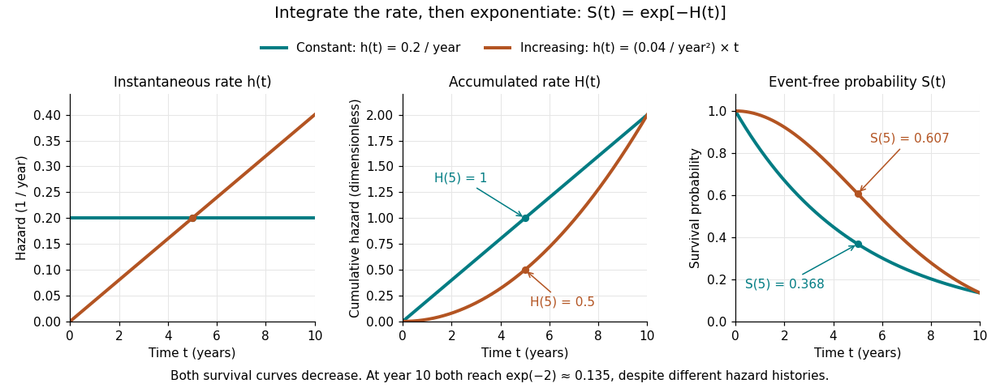

# Cumulative hazard function

↑ **Parent:** [Hazard function](hazard-function.md)

Suppose $T\geq0$ has an [absolutely continuous probability distribution](absolutely-continuous-probability-distribution.md), with [survival function](survival-function.md) $S(0)=1$. On an [interval](interval-mathematics.md) where $S(t)>0$, its [cumulative hazard](cumulative-hazard-function.md) is

$$
H(t)=\int_0^t h(u)\,du=-\log S(t),\qquad
S(t)=e^{-H(t)}.
$$

Here $h$ is the [hazard function](hazard-function.md); its [integral](integral.md) is dimensionless because the units of rate and time cancel. The identity follows by integrating the [derivative](derivative.md) of $\log S$, so mere [continuity](continuous-function.md) of the [survival function](survival-function.md) is not enough: the [absolute continuity](absolutely-continuous-function.md) assumption supplies a [probability density function](probability-density-function.md). If $S$ reaches zero, interpret $-\log S$ as $+\infty$. The normalization $S(0)=1$ also matters; an initial [probability mass](probability-mass.md) at zero would require an initial term $-\log S(0)$.

Accumulating [hazard functions](hazard-function.md) adds on the $H$ scale and multiplies survival factors on the $S$ scale. For $S(a)>0$ and $b>a$,

$$
\mathbb P(a<T\leq b\mid T>a)=1-e^{-[H(b)-H(a)]}.
$$

For instance, a [cumulative hazard](cumulative-hazard-function.md) increment of $2$ gives event [probability](probability.md) $1-e^{-2}\approx0.864665$, rather than a [probability](probability.md) of $2$. With $h(t)=0.2$ per year, $H(5)=1$ and $S(5)=e^{-1}\approx0.367879$. With the increasing [hazard function](hazard-function.md) $h(t)=0.04t$ per year when $t$ is expressed in years, $H(t)=0.02t^2$, so $H(5)=0.5$ gives $S(5)=e^{-0.5}\approx0.606531$. Its coefficient has units of inverse years squared.

**[Figure 1](#image-constant-and-increasing-hazard-functions-their-cumulative-hazards-and-their-survival-functions). Constant and increasing hazard functions, their cumulative hazards, and their survival functions**.

The constant [hazard function](hazard-function.md) produces an [exponential distribution](exponential-distribution.md); the increasing example is a [Weibull distribution](weibull-distribution.md). Their [survival functions](survival-function.md) both decrease, although one [hazard function](hazard-function.md) stays constant and the other increases. At year ten both have $H(10)=2$ and $S(10)=e^{-2}$ despite different earlier histories. The accumulation identity is described in [Lu Tian's Stanford notes, Section 1.1](https://web.stanford.edu/~lutian/coursepdf/unit1.pdf).

For a [discrete hazard](discrete-hazard.md) $q_j$ at each possible event time $t_j$, the exact counterpart is $S(t)=\prod_{t_j\leq t}(1-q_j)$. Taking its negative [logarithm](logarithm.md) sums $-\log(1-q_j)$, rather than $q_j$. Therefore exponentiating a [Nelson–Aalen estimator](nelson-aalen-estimator.md) does not give exactly the [Kaplan–Meier estimator](kaplan-meier-estimator.md); [small-jump comparison of cumulative hazard estimators](small-jump-comparison-of-cumulative-hazard-estimators.md) quantifies the difference.

**Table of contents**

- [Mean accumulated hazard under independent censoring](mean-accumulated-hazard-under-independent-censoring.md)
- [Mean accumulated hazard before fixed censoring](mean-accumulated-hazard-before-fixed-censoring.md)
- [Cumulative hazard probability transformation](cumulative-hazard-probability-transformation.md)

## ↑ Ancestors (7)

1. [Hazard function](hazard-function.md)
2. [Survival function](survival-function.md)
3. [Survival analysis](survival-analysis-split.md)
4. [Probability and statistics](probability-and-statistics-split.md)
5. [Area of mathematics](area-of-mathematics.md)
6. [Mathematics](mathematics-split.md)
7. [Codex Wiki](split.md)

## ← Incoming links (28)

- [Cox–Snell residual](cox-snell-residual.md)
- [Cumulative hazard probability transformation](cumulative-hazard-probability-transformation.md)
- [Solution](past-exam-of-the-mathematics-course-of-the-university-of-cambridge/2001/iii/paper-29/1/a/solution.md)
- [Solution](past-exam-of-the-mathematics-course-of-the-university-of-cambridge/2001/iii/paper-29/1/b/solution.md)
- [Solution](past-exam-of-the-mathematics-course-of-the-university-of-cambridge/2001/iii/paper-29/1/c/ii/solution.md)
- [Solution](past-exam-of-the-mathematics-course-of-the-university-of-cambridge/2001/iii/paper-29/1/c/solution.md)
- [Solution](past-exam-of-the-mathematics-course-of-the-university-of-cambridge/2001/iii/paper-29/1/d/solution.md)
- [Solution](past-exam-of-the-mathematics-course-of-the-university-of-cambridge/2001/iii/paper-29/2/a/i/solution.md)
- [Solution](past-exam-of-the-mathematics-course-of-the-university-of-cambridge/2001/iii/paper-29/2/b/ii/solution.md)
- [Solution](past-exam-of-the-mathematics-course-of-the-university-of-cambridge/2007/iii/paper-46/3/solution.md)
- [Solution](past-exam-of-the-mathematics-course-of-the-university-of-cambridge/2012/iii/paper-41/5/b/solution.md)
- [Solution](past-exam-of-the-mathematics-course-of-the-university-of-cambridge/2014/iii/paper-32/5/solution.md)
- [Solution](past-exam-of-the-mathematics-course-of-the-university-of-cambridge/2014/iii/paper-59/1/solution.md)
- [Solution](past-exam-of-the-mathematics-course-of-the-university-of-cambridge/2015/iii/paper-33/5/a/ii/solution.md)
- [Solution](past-exam-of-the-mathematics-course-of-the-university-of-cambridge/2015/iii/paper-33/5/b/iii/solution.md)
- [5](past-exam-of-the-mathematics-course-of-the-university-of-cambridge/2016/iii/paper-207/5.md)
- [Solution](past-exam-of-the-mathematics-course-of-the-university-of-cambridge/2016/iii/paper-207/6/a/solution.md)
- [Solution](past-exam-of-the-mathematics-course-of-the-university-of-cambridge/2016/iii/paper-207/6/b/i/solution.md)
- [Solution](past-exam-of-the-mathematics-course-of-the-university-of-cambridge/2016/iii/paper-207/7/c/solution.md)
- [Solution](past-exam-of-the-mathematics-course-of-the-university-of-cambridge/2016/iii/paper-207/7/d/solution.md)
- [Solution](past-exam-of-the-mathematics-course-of-the-university-of-cambridge/2021/iii/paper-207/4/b/solution.md)
- [Solution](past-exam-of-the-mathematics-course-of-the-university-of-cambridge/2022/iii/paper-207/5/c/i/solution.md)
- [Solution](past-exam-of-the-mathematics-course-of-the-university-of-cambridge/2022/iii/paper-207/6/c/solution.md)
- [Solution](past-exam-of-the-mathematics-course-of-the-university-of-cambridge/2023/iii/paper-207/4/a/ii/solution.md)
- [Solution](past-exam-of-the-mathematics-course-of-the-university-of-cambridge/2024/iii/paper-207/4/b/solution.md)
- [Solution](past-exam-of-the-mathematics-course-of-the-university-of-cambridge/2024/iii/paper-207/5/a/solution.md)
- [Population hazard of a survival mixture](population-hazard-of-a-survival-mixture.md)
- [Survival distribution](survival-distribution.md)
