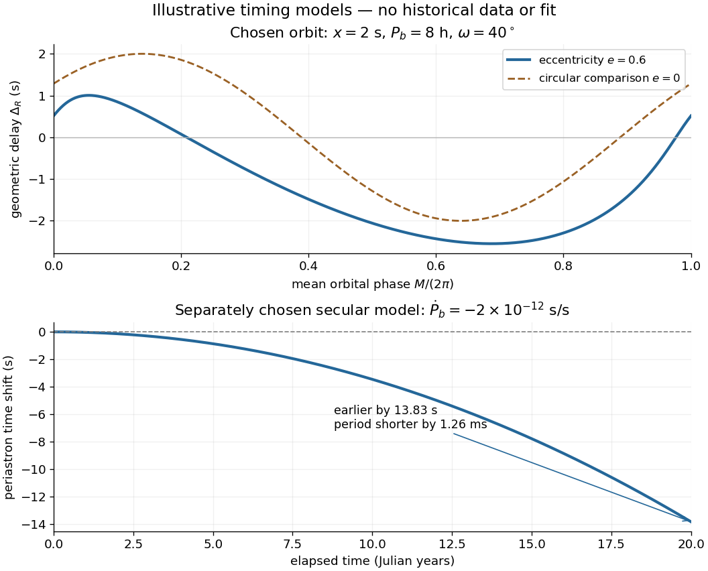

# Cumulative periastron-time shift from orbital decay

↑ **Parent:** [Binary-pulsar orbital decay](binary-pulsar-orbital-decay.md)

A tiny [orbital period](orbital-period.md) change accumulates into a larger timing shift. Choose the original model $P_b(t)=P_{b0}+\dot P_b t$, with $P_{b0}=28{,}800\,\mathrm{s}$ and $\dot P_b=-2\times10^{-12}\,\mathrm{s/s}$. Expanding the accumulated cycle count gives

$$
N(t)=\int_0^t\frac{dt'}{P_b(t')}\simeq\frac{t}{P_{b0}}-\frac{\dot P_b t^2}{2P_{b0}^2},\qquad
\delta T\simeq\frac{\dot P_b t^2}{2P_{b0}}.
$$

Negative $\delta T$ means an event of fixed orbital cycle count arrives earlier than a constant-[period](period-of-a-function.md) prediction. After twenty Julian years, the chosen [period](period-of-a-function.md) has decreased by $1.262\,\mathrm{ms}$, while the accumulated event shift is about $-13.83\,\mathrm{s}$. This is a time shift of [periapsis](periapsis.md) passage; it is different from a rotation of the direction of [periapsis](periapsis.md).

**[Figure 7](#binary-pulsar-kepler-delay-and-period-drift). A chosen eccentric light-travel delay and an accumulated orbital-period change**. Original calculations, not observations or a historical fit. The upper panel solves Kepler's equation for x=2 seconds, an 8 hour orbital period, eccentricity 0.6 and argument of periapsis 40 degrees; the dashed curve sets eccentricity to zero. The lower panel independently chooses a constant period derivative of minus 2 times 10 to the minus 12 seconds per second. It plots the leading event-time shift against a constant-period ephemeris; no masses or radiation mechanism are fitted.

## ↑ Ancestors (10)

1. [Binary-pulsar orbital decay](binary-pulsar-orbital-decay.md)
2. [Binary pulsar](binary-pulsar.md)
3. [Pulsar](pulsar.md)
4. [Neutron star](neutron-star.md)
5. [Stellar evolution](stellar-evolution.md)
6. [Stellar astrophysics](stellar-astrophysics-split.md)
7. [Astrophysics](astrophysics-split.md)
8. [Branches of physics](branches-of-physics.md)
9. [Physics](physics-split.md)
10. [Codex Wiki](split.md)
