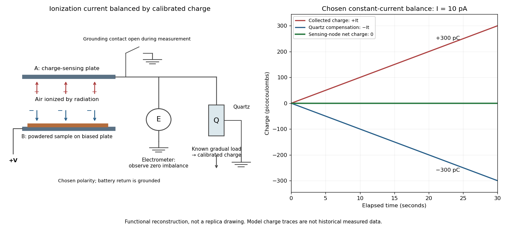

# Curie ionization-current measurement

↑ **Parent:** [Radioactive decay](radioactive-decay.md)

[Marie Curie](marie-curie.md)'s thesis describes powdered material on the lower plate of a [capacitor](capacitor.md), biased by a battery. Radiation made the intervening air conduct. The upper plate connected to an [electrometer](electrometer.md) and a loaded [piezoelectric crystal](piezoelectric-crystal.md) of [quartz](quartz.md). Adjusting the load supplied a known compensating [electric charge](electric-charge-split.md) while keeping the [electrometer](electrometer.md) at zero; charge divided by elapsed [time](time-in-physics.md) determined the [electric current](electric-current.md). Voltage scans identified a collection plateau. Contact potentials affected weak-field readings; excessively strong fields could instead introduce additional [ionization](ionization.md). Fixed geometry and plateau operation made comparisons meaningful.[Chapter I(b), Messung der Strahlungsintensität, figures 1–3: apparatus, null compensation, saturation and field-dependent limitations](untersuchungen-uber-die-radioaktiven-substanzen-by-marie-curie.md)

**[Figure 8](#image-the-functional-measurement-chain-in-curie-s-ionization-experiment). The functional measurement chain in Curie's ionization experiment**. Original schematic of the plate, [electrometer](electrometer.md) and compensation by [piezoelectricity](piezoelectricity.md) in the [Curie ionization-current measurement](curie-ionization-current-measurement.md). The charge traces use a stipulated constant $10\,\mathrm{pA}$ signal and an exactly opposing compensation ramp; they are not historical measured traces.

The null method turns a weak signal into a balance against a known quantity. In the diagram's chosen constant-current model, $I=10\,\mathrm{pA}$ for $\Delta t=30\,\mathrm s$ gives

$$
\boxed{Q=I\Delta t=300\,\mathrm{pC}.}
$$

Supplying $-300\,\mathrm{pC}$ over the same interval leaves zero net [electric charge](electric-charge-split.md) at the sensing node. The [electrometer](electrometer.md) detects imbalance; the compensating-charge calibration supplies the numerical measurement.

This [electric current](electric-current.md) measures collected charge produced by [ionization](ionization.md). Converting it to [becquerels](becquerel.md) additionally requires the energy deposition and charge-collection response per transformation. The apparatus can compare preparations without already possessing that complete source-to-signal calibration.

## ↑ Ancestors (4)

1. [Radioactive decay](radioactive-decay.md)
2. [Nuclear physics](nuclear-physics.md)
3. [Physics](physics-split.md)
4. [Codex Wiki](split.md)

## ← Incoming links (6)

- [Curie ionization-current measurement](curie-ionization-current-measurement.md)
- [Marie Curie](marie-curie.md)
- [Nobel Prize in Physics in 1903](nobel-prize-in-physics-in-1903.md)
- [Pierre Curie](pierre-curie.md)
- [Piezoelectric crystal](piezoelectric-crystal.md)
- [Radioactive decay](radioactive-decay.md)
