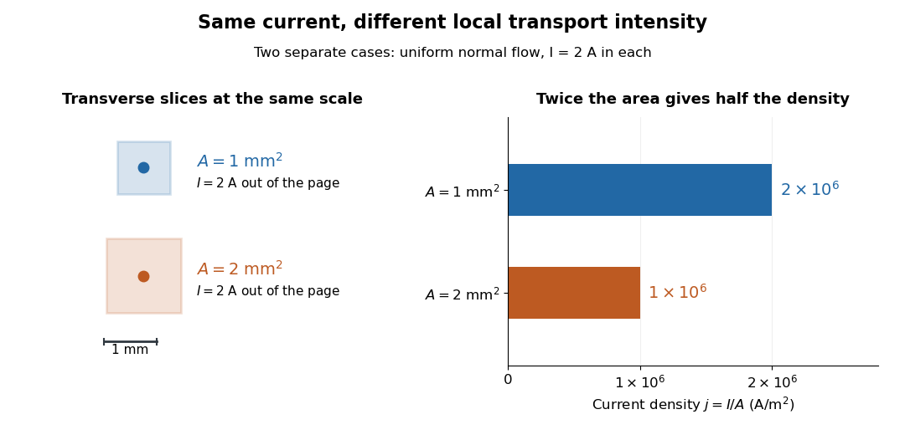

# Current density

↑ **Parent:** [Electric current](electric-current.md)  
ⓦ [Wiki](https://en.wikipedia.org/wiki/Current_density)

The [current density](current-density.md) $\mathbf J(\mathbf r,t)$ describes the amount and direction of local [electric charge](electric-charge.md) transport per [area](surface-area.md) per [time](time-in-physics.md). Its [SI](international-system-of-units.md) unit is $\mathrm{A/m^2}$. Through a small [area element](area-element-of-a-surface.md) with [unit normal](unit-normal.md) $\mathbf n$, the contribution to [electric current](electric-current.md) is $dI=\mathbf J\cdot\mathbf n\,dA$: the [dot product](dot-product.md) selects transport through the surface. A [current density](current-density.md) tangent to the surface contributes zero. If [current density](current-density.md) is uniform and perpendicular to a wire's transverse slice, its magnitude $j=|\mathbf J|$ satisfies

$$
I=jA,\qquad j=\frac IA\quad\text{with the normal chosen along conventional current}.
$$

Here $A$ is the [wire cross-sectional area](wire-cross-sectional-area.md). For nonuniform [current density](current-density.md), $I/A$ is only the average normal component, and the [surface integral](surface-integral.md) is needed. [Ling, Sanny and Moebs, §9.2: local current density](https://openstax.org/books/university-physics-volume-2/pages/9-2-model-of-conduction-in-metals).

Consider two separate uniform-flow cases, each carrying [electric current](electric-current.md) $I=2\,\mathrm A$. A [wire cross-sectional area](wire-cross-sectional-area.md) of $1\,\mathrm{mm^2}=10^{-6}\,\mathrm{m^2}$ gives $j=2\times10^6\,\mathrm{A/m^2}$; doubling the [wire cross-sectional area](wire-cross-sectional-area.md) to $2\,\mathrm{mm^2}$ gives $j=10^6\,\mathrm{A/m^2}$. Equal [electric current](electric-current.md) can therefore mean different local transport intensity. This distinction matters for [Joule heating](joule-heating.md), whose local [power](power.md) per volume depends on [current density](current-density.md) and [electric field](electric-field.md).

**[Figure 20](#image-equal-electric-current-through-different-wire-cross-sectional-areas-gives-different-current-densities). Equal electric current through different wire cross-sectional areas gives different current densities**. [Source](current-density-and-wire-area.py). Both cases carry $2\,\mathrm A$ with uniform normal [current density](current-density.md). The transverse slices use the same spatial scale; the bars compare $j=I/A$.

For a toy [Electron](electron.md) transport model, stipulate mobile [electron number density](electron-number-density.md) $n=8\times10^{28}\,\mathrm{m^{-3}}$ and [drift velocity](drift-velocity.md) $\mathbf v_d=-10^{-4}\,\mathrm{m/s}\,\widehat{\mathbf x}$, with the positive [unit normal](unit-normal.md) $\widehat{\mathbf x}$. Each [Electron](electron.md) has [electric charge](electric-charge.md) $-e$, where the [elementary charge](elementary-charge.md) $e=1.602176634\times10^{-19}\,\mathrm C$ is exact in [SI](international-system-of-units.md). These are defined model inputs, rather than measured parameters of a particular material. [NIST, exact elementary charge](https://physics.nist.gov/cuu/Constants/Value/e.html) The [current density](current-density.md) and its magnitude are

$$
\mathbf J=n(-e)\mathbf v_d=j\widehat{\mathbf x},\qquad j=ne|\mathbf v_d|=1.2817413072\times10^6\,\mathrm{A/m^2}.
$$

For [wire cross-sectional area](wire-cross-sectional-area.md) $A=1\,\mathrm{mm^2}$ and constant transport over [time](time-in-physics.md) $10\,\mathrm s$, this gives

$$
I=jA=1.2817413072\,\mathrm A,\qquad \Delta Q_{\mathrm{cross}}=I\Delta t=12.817413072\,\mathrm C.
$$

The two minus signs make [conventional current](conventional-current.md) point opposite to the [Electron](electron.md) [drift velocity](drift-velocity.md). A small [drift velocity](drift-velocity.md) can carry an appreciable [electric current](electric-current.md) because many [charge carriers](charge-carrier.md) contribute; it does not specify the propagation speed of an electrical disturbance.

**Table of contents**

- [Wire cross-sectional area](wire-cross-sectional-area.md)
- [Charge carrier](charge-carrier.md)
  - [Drift velocity](drift-velocity.md)
  - [Charge carrier mobility](charge-carrier-mobility.md)
- [Current dipole](current-dipole.md)
  - [Radial current dipole](radial-current-dipole.md)
- [Four-current](four-current.md)
- [Surface current density](surface-current-density.md)
  - [Current sheet](current-sheet.md)
    - [Force on a current sheet from the mean magnetic field](force-on-a-current-sheet-from-the-mean-magnetic-field.md)
    - [Magnetic-field jump across a surface current](magnetic-field-jump-across-a-surface-current.md)
  - [Surface conductivity](surface-conductivity.md)

## ↑ Ancestors (6)

1. [Electric current](electric-current.md)
2. [Electric charge](electric-charge.md)
3. [Electromagnetism](electromagnetism-split.md)
4. [Branches of physics](branches-of-physics.md)
5. [Physics](physics-split.md)
6. [Codex Wiki](split.md)

## ← Incoming links (42)

- [Biot-Savart law](biot-savart-law.md)
- [Charge carrier](charge-carrier.md)
- [Charge conservation](charge-conservation.md)
- [Charge continuity equation](charge-continuity-equation.md)
- [Complex conductivity](complex-conductivity.md)
- [Current density](current-density.md)
- [Displacement current](displacement-current.md)
- [Drift velocity](drift-velocity.md)
- [Drude conductivity and Hall experiment](drude-conductivity-and-hall-experiment.md)
- [Drude current relaxation](drude-current-relaxation.md)
- [Drude frequency response](drude-frequency-response.md)
- [Drude model](drude-model.md)
- [Electric current](electric-current.md)
- [Electrical conductance](electrical-conductance.md)
- [Electrical conductivity](electrical-conductivity.md)
- [Electrical resistance](electrical-resistance.md)
- [Electrolyte](electrolyte.md)
- [Finite-thickness Meissner screening](finite-thickness-meissner-screening.md)
- [Four-current](four-current.md)
- [Galvanic cell](galvanic-cell.md)
- [Hall coefficient](hall-coefficient.md)
- [Ion](ion.md)
- [Local Joule heating rate](local-joule-heating-rate.md)
- [Maxwell equations](maxwell-equations.md)
- [Meissner screening current](meissner-screening-current.md)
- [Ohmic conductor](ohmic-conductor.md)
- [Solution](past-exam-of-the-mathematics-course-of-the-university-of-cambridge/2009/ii/paper-4/35c/solution.md)
- [Solution](past-exam-of-the-mathematics-course-of-the-university-of-cambridge/2016/ia/paper-3/11c/c/solution.md)
- [Solution](past-exam-of-the-mathematics-course-of-the-university-of-cambridge/2016/ib/paper-2/6d/a/solution.md)
- [Solution](past-exam-of-the-mathematics-course-of-the-university-of-cambridge/2016/iii/paper-318/1/i/solution.md)
- [Solution](past-exam-of-the-mathematics-course-of-the-university-of-cambridge/2019/ib/paper-2/6a/solution.md)
- [Solution](past-exam-of-the-mathematics-course-of-the-university-of-cambridge/2023/ib/paper-3/15d/a/solution.md)
- [Solution](past-exam-of-the-mathematics-course-of-the-university-of-cambridge/2023/ii/paper-3/36a/c/solution.md)
- [Solution](past-exam-of-the-mathematics-course-of-the-university-of-cambridge/2023/iii/paper-314/1/b/i/solution.md)
- [Solution](past-exam-of-the-mathematics-course-of-the-university-of-cambridge/2024/iii/paper-314/1/a/solution.md)
- [Planar London screening](planar-london-screening.md)
- [Plasma (physics)](plasma-physics.md)
- [Poynting theorem](poynting-theorem.md)
- [Surface current density](surface-current-density.md)
- [Uniform-current rotating magnetohydrodynamic wave dispersion](uniform-current-rotating-magnetohydrodynamic-wave-dispersion.md)
- [Volume conductor](volume-conductor.md)
- [Wire cross-sectional area](wire-cross-sectional-area.md)
