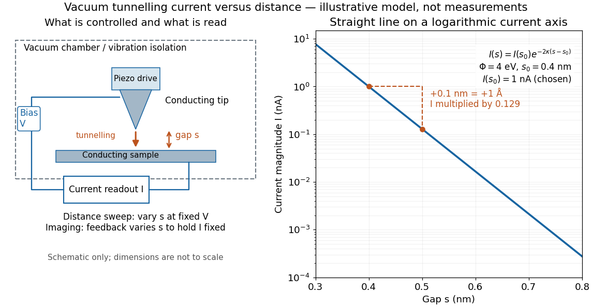

# Current-distance test of vacuum tunnelling

↑ **Parent:** [Quantum tunnelling](quantum-tunnelling.md)

[Tunneling through a controllable vacuum gap by Gerd Binnig and others](tunneling-through-a-controllable-vacuum-gap-by-gerd-binnig-and-others.md) made barrier width experimentally adjustable. Their apparatus used a pointed [electrical conductor](electrical-conductor.md) opposite a conducting plate, with fine positioning by [piezoelectricity](piezoelectricity.md). Rubber-tube support and magnetic levitation above a cooled bowl exhibiting [superconductivity](superconductivity-split.md) suppressed vibrations; the junction itself remained near room temperature.[p. 178, Fig. 1: tungsten tip, platinum plate, piezodrive and helium-cooled superconducting lead bowl](tunneling-through-a-controllable-vacuum-gap-by-gerd-binnig-and-others.md)

The readout was [electrical resistance](electrical-resistance.md) versus displacement at a fixed [electric potential difference](electric-potential-difference.md) of 60 mV of either polarity. They observed an [exponential function](exponential-function.md) dependence spanning four orders of magnitude. Cleaning and better [vacuum](vacuum.md) increased the inferred barrier from approximately 0.6-0.7 eV to 3.2 eV. Reproducible curves and the cleaning response argued against deforming contamination layers; an appropriate slope also helped exclude an ordinary conducting contact. The paper reports residual contamination, electronics-limited range and a jump attributed to release of thermal stress; its curve origins generally do not determine absolute gap widths.[p. 179, equation (1), Fig. 2 and accompanying control/limitation discussion](tunneling-through-a-controllable-vacuum-gap-by-gerd-binnig-and-others.md)

The ideal [tunnel junction](tunnel-junction.md) model explains the slope. At fixed small [electric potential difference](electric-potential-difference.md), fixed tip geometry and approximately unchanged [density of states](density-of-states.md), take an effective barrier [energy](energy-split.md) $\Phi$ above the relevant [electron](electron.md) states and approximate the current magnitude by

$$
I(s)\simeq C\exp(-2\kappa s),\qquad
\kappa=\frac{\sqrt{2m_e\Phi}}{\hbar},\qquad
-\frac{d\ln I}{ds}\simeq2\kappa.
$$

The coefficient $C$ includes the applied [electric potential difference](electric-potential-difference.md), available occupied and empty [quantum states](quantum-state.md), and tip geometry. A single [transmission probability](transmission-probability.md) is not an [electric current](electric-current.md): a junction combines contributions from many [electron](electron.md) states in both directions, with the [electric potential difference](electric-potential-difference.md) producing a net imbalance. Its tilted, material-dependent barrier is only approximated by the equal-exterior [rectangular potential barrier](rectangular-potential-barrier.md); the exact single-particle formula above is not a complete junction model.

For the chosen model value $\Phi=4$ [electronvolts](electronvolt.md), $\kappa\simeq10.25\,\mathrm{nm}^{-1}$. Increasing separation by $0.1\,\mathrm{nm}$ multiplies $I$ by about $0.129$, a reduction by about $7.8$. The following diagram chooses $I(0.4\,\mathrm{nm})=1\,\mathrm{nA}$ solely for illustration; it contains no measured data and is not a fit to the 1982 curves.

**[Figure 16](#image-vacuum-junction-controls-and-the-exponential-tunnelling-current-distance-law). Vacuum-junction controls and the exponential tunnelling-current distance law**. Original [tunnel junction](tunnel-junction.md) schematic and illustrative [electric current](electric-current.md) versus distance model at effective barrier [energy](energy-split.md) four [electronvolts](electronvolt.md). The [electric current](electric-current.md) scale is chosen, the [logarithm](logarithm.md) axis slope is calculated, and the apparatus is not drawn to scale. Distance sweeps and constant-current imaging are distinct operating procedures.

Distance calibration is essential. In [Scanning Tunneling Microscopy: From Birth to Adolescence by Gerd Binnig and others](scanning-tunneling-microscopy-from-birth-to-adolescence-by-gerd-binnig-and-others.md), the authors describe an initial inferred barrier near 1 eV. Recalibration found only half the quoted piezo displacement sensitivity and raised the inferred barrier above 4 eV. Thus an exponential trace alone was insufficient evidence for tunnelling through [vacuum](vacuum.md). The model makes the sensitivity explicit: the inferred $\Phi=\hbar^2(d\ln I/ds)^2/(8m_e)$ depends quadratically on the distance scale.[p. 397, piezo-sensitivity calibration discussion](scanning-tunneling-microscopy-from-birth-to-adolescence-by-gerd-binnig-and-others.md)

For [scanning tunnelling microscopy](scanning-tunneling-microscopy.md), [feedback control](closed-loop-control.md) adjusts the vertical position to hold [electric current](electric-current.md) fixed during a lateral scan; the recorded height follows separation only when the surface is electronically homogeneous. Changes in the local [density of states](density-of-states.md) can also change apparent height. This limitation is already explicit in the authors' account of constant-current imaging.[p. 391, Fig. 2, joint local density of states; p. 396, Fig. 5(a), electronically homogeneous surface condition](scanning-tunneling-microscopy-from-birth-to-adolescence-by-gerd-binnig-and-others.md)

**Table of contents**

- [Piezoelectricity](piezoelectricity.md)
  - [Piezoelectric stress sensor](piezoelectric-stress-sensor.md)
    - [Voltage sensitivity of a piezoelectric sensor](voltage-sensitivity-of-a-piezoelectric-sensor.md)
  - [Direct piezoelectric effect](direct-piezoelectric-effect.md)
    - [Open-circuit piezoelectric response](open-circuit-piezoelectric-response.md)
    - [Piezoelectric coefficient](piezoelectric-coefficient.md)
  - [Piezoelectric hysteresis](piezoelectric-hysteresis.md)
  - [Piezoelectric scanner creep](piezoelectric-scanner-creep.md)
  - [Converse piezoelectric effect](converse-piezoelectric-effect.md)
  - [Piezoelectric crystal](piezoelectric-crystal.md)

## ↑ Ancestors (6)

1. [Quantum tunnelling](quantum-tunnelling.md)
2. [Potential barrier](potential-barrier.md)
3. [Quantum mechanics](quantum-mechanics-split.md)
4. [Branches of physics](branches-of-physics.md)
5. [Physics](physics-split.md)
6. [Codex Wiki](split.md)

## ← Incoming links (1)

- [Scanning tunneling microscopy](scanning-tunneling-microscopy.md)
