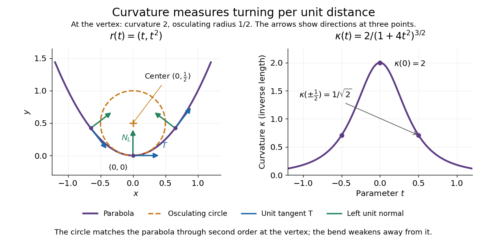

# Curvature of a plane curve

↑ **Parent:** [Curvature of a space curve](curvature-of-a-space-curve.md)

For a twice continuously differentiable [regular curve](regular-curve.md) $r(t)=(x(t),y(t))$ in the plane, unsigned [curvature](curvature.md) is the absolute value of its [signed curvature](signed-curvature.md):

$$
\kappa(t)=\frac{|x'(t)y''(t)-y'(t)x''(t)|}{\bigl(x'(t)^2+y'(t)^2\bigr)^{3/2}}.
$$

The nonvanishing [velocity vector](velocity-vector.md) makes the denominator positive. For a [graph of a function](graph-of-a-function.md) $(t,f(t))$, this reduces to $|f''(t)|/(1+f'(t)^2)^{3/2}$; omitting the absolute value gives the [signed curvature of a plane graph](signed-curvature-of-a-plane-graph.md) for increasing $t$.

For the [parabola](parabola.md) $r(t)=(t,t^2)$, the [derivatives](derivative.md) are $r'=(1,2t)$ and $r''=(0,2)$. Therefore

$$
v=\sqrt{1+4t^2},\qquad k(t)=\kappa(t)=\frac{2}{(1+4t^2)^{3/2}},\qquad \rho(t)=\frac{(1+4t^2)^{3/2}}{2}.
$$

The [curvature](curvature.md) is greatest at the vertex $t=0$, where $\kappa=2$ and the [radius of curvature](radius-of-curvature.md) is $1/2$. At $t=\pm1/2$ the [curvature](curvature.md) is $1/\sqrt2$, so the [parabola](parabola.md) bends less sharply despite its larger [speed](speed.md) $\sqrt2$.

Its [unit tangent vector](unit-tangent-vector.md) and left [unit normal](unit-normal.md) are

$$
T=\frac{(1,2t)}{\sqrt{1+4t^2}},\qquad N_L=\frac{(-2t,1)}{\sqrt{1+4t^2}}.
$$

Since $k>0$, $N_L$ is also its [principal normal vector](principal-normal-vector.md). At $t=0$ the [osculating circle](osculating-circle.md) consequently has center $(0,0)+(1/2)(0,1)=(0,1/2)$ and equation

$$
x^2+(y-1/2)^2=1/4.
$$

The lower branch $y=1/2-\sqrt{1/4-x^2}$ has value $0$, [derivative](derivative.md) $0$, and [second derivative](second-derivative.md) $2$ at $x=0$, matching the [parabola](parabola.md) $y=x^2$ through second order. Away from the vertex the two curves separate: an [osculating circle](osculating-circle.md) describes a local bend, not the whole [curve](curve.md).

**[Figure 9](#image-the-parabola-s-changing-tangent-and-normal-with-its-osculating-circle-at-the-vertex). The parabola's changing tangent and normal, with its osculating circle at the vertex**.

Vanishing [curvature](curvature.md) at one point does not imply a straight segment. The [graph of a function](graph-of-a-function.md) $y=x^3$ has [signed curvature](signed-curvature.md) $6x/(1+9x^4)^{3/2}$, which vanishes at its [inflection point](inflection-point.md) $x=0$ and changes sign across it. By contrast, if [curvature](curvature.md) vanishes throughout a connected regular interval, $dT/ds=0$ throughout that interval: the constant [unit tangent vector](unit-tangent-vector.md) forces the image to lie on a [straight line](straight-line.md).

**Table of contents**

- [Osculating circle](osculating-circle.md)
- [Radius of curvature](radius-of-curvature.md)
- [Travel time at reciprocal-curvature speed](travel-time-at-reciprocal-curvature-speed.md)
- [Level-line curvature](level-line-curvature.md)

## ↑ Ancestors (7)

1. [Curvature of a space curve](curvature-of-a-space-curve.md)
2. [Curvature and torsion](curvature-and-torsion.md)
3. [Differential geometry](differential-geometry-split.md)
4. [Geometry and topology](geometry-and-topology-split.md)
5. [Area of mathematics](area-of-mathematics.md)
6. [Mathematics](mathematics-split.md)
7. [Codex Wiki](split.md)

## ← Incoming links (7)

- [Archimedean spiral](archimedean-spiral.md)
- [Curvature](curvature.md)
- [Osculating circle](osculating-circle.md)
- [Solution](past-exam-of-the-mathematics-course-of-the-university-of-cambridge/2003/ia/paper-3/3a/solution.md)
- [Solution](past-exam-of-the-mathematics-course-of-the-university-of-cambridge/2010/ia/paper-3/4c/solution.md)
- [Solution](past-exam-of-the-mathematics-course-of-the-university-of-cambridge/2015/ia/paper-3/4a/c/solution.md)
- [Solution](past-exam-of-the-mathematics-course-of-the-university-of-cambridge/2018/ia/paper-3/3c/solution.md)
