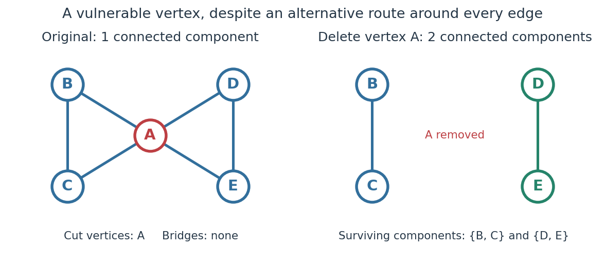
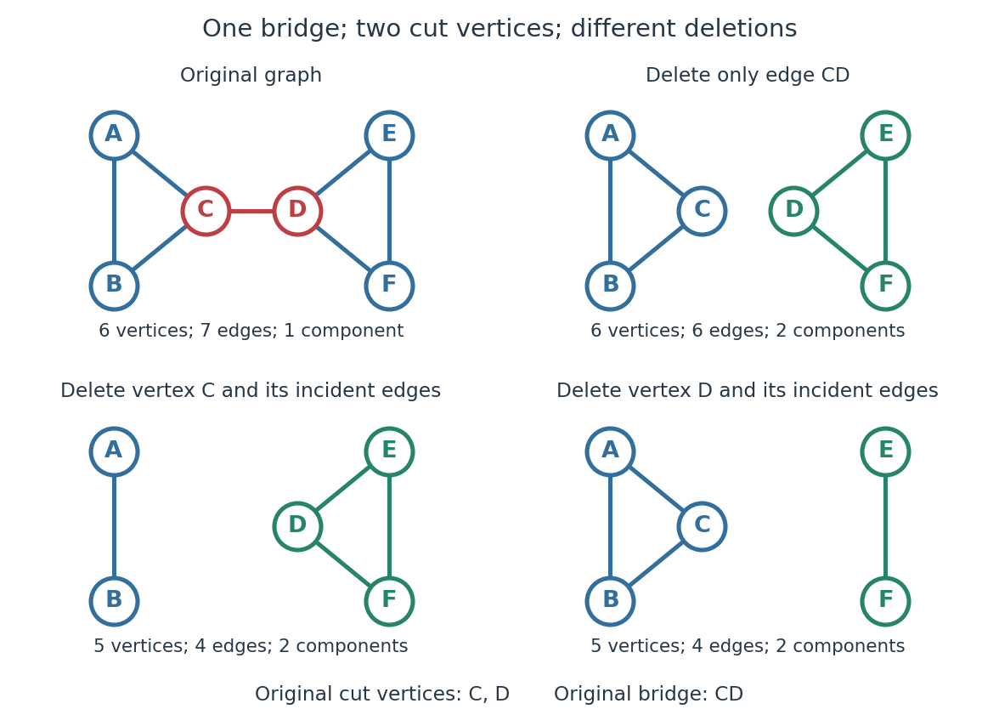

# Cut vertex

↑ **Parent:** [Graph theory](graph-theory-split.md)

A [cut vertex](cut-vertex.md), also called an [articulation point](cut-vertex.md), is a [vertex](vertex-graph-theory.md) $v$ of an [undirected graph](undirected-graph.md) whose deletion increases the number of [connected components of a graph](component-graph-theory.md). Write $k(G)$ for that count, including isolated [vertices](vertex-graph-theory.md), and $G-v$ for the [graph](graph-split.md) obtained by removing $v$ and every incident [edge](edge-of-a-graph.md). Then the test is $k(G-v)>k(G)$, even when the original [graph](graph-split.md) is disconnected. By contrast, deleting a [bridge in a graph](bridge-graph-theory.md) removes just one [edge](edge-of-a-graph.md) and keeps both endpoint [vertices](vertex-graph-theory.md). These are different failure models. [Sedgewick and Wayne, Algorithms, §4.1: bridges and articulation points](https://algs4.cs.princeton.edu/41graph/)

First take two [triangles in a graph](triangle-in-a-graph.md), $ABC$ and $ADE$, sharing only the [vertex](vertex-graph-theory.md) $A$. This [simple graph](simple-graph.md) has

$$
V=\{A,B,C,D,E\},\qquad E=\{AB,AC,BC,AD,AE,DE\}.
$$

Here $XY$ abbreviates the [unordered pair](unordered-pair.md) $\{X,Y\}$. Removing $A$ leaves the two [connected components of a graph](component-graph-theory.md) $\{B,C\}$ and $\{D,E\}$, so $k(G-A)=2>1=k(G)$. Removing any other [vertex](vertex-graph-theory.md) leaves a [connected graph](connected-graph.md). Thus $A$ is the only [cut vertex](cut-vertex.md). Every [edge](edge-of-a-graph.md) lies on a [triangle in a graph](triangle-in-a-graph.md), so deleting any single [edge](edge-of-a-graph.md) still leaves a [graph path](path-in-a-graph.md) between its endpoints along the other two [edges](edge-of-a-graph.md). There are no [bridges in a graph](bridge-graph-theory.md).

**[Figure 7](#image-two-triangles-in-a-graph-share-a-cut-vertex-a-although-no-edge-is-a-bridge-in-a-graph). Two triangles in a graph share a cut vertex $A$, although no edge is a bridge in a graph**.

The generator computes the [adjacency lists](adjacency-list.md) and checks every [vertex](vertex-graph-theory.md) deletion, giving the following complete table:

| Deleted [vertex](vertex-graph-theory.md) $v$ | Original [graph neighbours](neighbour-of-a-vertex.md) of $v$ | $k(G-v)$ |
| --- | --- | --- |
| $A$ | $B,C,D,E$ | $2$ |
| $B$ | $A,C$ | $1$ |
| $C$ | $A,B$ | $1$ |
| $D$ | $A,E$ | $1$ |
| $E$ | $A,D$ | $1$ |

Now take two disjoint [triangles in a graph](triangle-in-a-graph.md), $ABC$ and $DEF$, joined by the [edge](edge-of-a-graph.md) $CD$:

$$
V=\{A,B,C,D,E,F\},\qquad E=\{AB,AC,BC,CD,DE,DF,EF\}.
$$

Deleting only $CD$ preserves all six [vertices](vertex-graph-theory.md) and leaves [connected components of a graph](component-graph-theory.md) $\{A,B,C\}$ and $\{D,E,F\}$: $CD$ is the only [bridge in a graph](bridge-graph-theory.md). Deleting $C$ also removes $AC$ and $BC$, leaving [connected components of a graph](component-graph-theory.md) $\{A,B\}$ and $\{D,E,F\}$. Deleting $D$ instead leaves $\{A,B,C\}$ and $\{E,F\}$. Thus $C,D$ are exactly the [cut vertices](cut-vertex.md).

**[Figure 8](#image-edge-deletion-keeps-its-endpoints-cut-vertex-deletion-removes-all-incident-edges). Edge deletion keeps its endpoints; cut vertex deletion removes all incident edges**.

Again the [adjacency lists](adjacency-list.md) and all [vertex](vertex-graph-theory.md) deletion counts are computed directly:

| Deleted [vertex](vertex-graph-theory.md) $v$ | Original [graph neighbours](neighbour-of-a-vertex.md) of $v$ | $k(G-v)$ |
| --- | --- | --- |
| $A$ | $B,C$ | $1$ |
| $B$ | $A,C$ | $1$ |
| $C$ | $A,B,D$ | $2$ |
| $D$ | $C,E,F$ | $2$ |
| $E$ | $D,F$ | $1$ |
| $F$ | $D,E$ | $1$ |

For a disconnected example, adjoin an isolated [vertex](vertex-graph-theory.md) $Z$ to the first [graph](graph-split.md). Now $k(G)=2$, deleting $A$ gives $k(G-A)=3$, and deleting $Z$ gives $k(G-Z)=1$. The original [graph](graph-split.md) was already disconnected, but $A$ is still a [cut vertex](cut-vertex.md); $Z$ is not. The empty [graph](graph-split.md) has count zero, so deleting the only [vertex](vertex-graph-theory.md) of a one-[vertex](vertex-graph-theory.md) [graph](graph-split.md) does not create a [cut vertex](cut-vertex.md). Nor is either endpoint of a single isolated [edge](edge-of-a-graph.md) a [cut vertex](cut-vertex.md), although that [edge](edge-of-a-graph.md) is a [bridge in a graph](bridge-graph-theory.md).

In a communications network, a [cut vertex](cut-vertex.md) models a router whose failure separates surviving routers. The shared-$A$ example shows why having an alternative [graph path](path-in-a-graph.md) around each individual [edge](edge-of-a-graph.md) does not protect against failure of the common router. An additional [edge](edge-of-a-graph.md) from $B$ to $D$ removes this particular vulnerability: after deleting $A$, $B,D$ still join the two sides. A [bridge in a graph](bridge-graph-theory.md) instead models a vulnerable link. This distinction tells us whether to add another cable between existing devices or a route avoiding an indispensable device; it describes [connectivity](connectivity-graph-theory.md), rather than traffic capacity or failure probabilities.

The beautiful structural consequence is that a [graph](graph-split.md) splits into [biconnected components](biconnected-component.md) joined at [cut vertices](cut-vertex.md). Within each nontrivial robust piece, a single [vertex](vertex-graph-theory.md) failure cannot separate the other [vertices](vertex-graph-theory.md); between pieces, the shared [cut vertices](cut-vertex.md) reveal the bottlenecks. Also, a [Hamiltonian](hamiltonian.md) [graph](graph-split.md) has no [cut vertex](cut-vertex.md): deleting any [vertex](vertex-graph-theory.md) from its [Hamilton cycle](hamilton-cycle.md) leaves a [Hamiltonian path](hamiltonian-path.md) through all remaining [vertices](vertex-graph-theory.md).

Historically, Tarjan's June 1972 paper developed [depth-first search](depth-first-search.md) as a tool for finding [biconnected components](biconnected-component.md) in time linear in the numbers of [vertices](vertex-graph-theory.md) and [edges](edge-of-a-graph.md). [Robert Tarjan, Depth-First Search and Linear Graph Algorithms, SIAM Journal on Computing 1(2), 146–160 (1972)](https://epubs.siam.org/doi/10.1137/0201010) In his 1983 recollection, Tarjan credited Hopcroft with the original linear-time [biconnected component](biconnected-component.md) [algorithm](algorithm.md) during their collaboration beginning in summer 1970, and described the published version as a refinement. The historical lesson is how a carefully organized traversal turns many separate deletion experiments into one computation. [Robert E. Tarjan, Citation Classic recollection (1983)](https://garfield.library.upenn.edu/classics1983/A1983QY47200001.pdf)

**Table of contents**

- [Biconnected component](biconnected-component.md)
- [DFS discovery time](dfs-discovery-time.md)
- [DFS lowpoint](dfs-lowpoint.md)

## ↑ Ancestors (5)

1. [Graph theory](graph-theory-split.md)
2. [Foundations of mathematics](foundations-of-mathematics-split.md)
3. [Area of mathematics](area-of-mathematics.md)
4. [Mathematics](mathematics-split.md)
5. [Codex Wiki](split.md)

## ← Incoming links (6)

- [Biconnected component](biconnected-component.md)
- [Cut vertex](cut-vertex.md)
- [DFS lowpoint](dfs-lowpoint.md)
- [Hamilton cycle](hamilton-cycle.md)
- [Necessary conditions for a Hamilton cycle](necessary-conditions-for-a-hamilton-cycle.md)
- [Solution](past-exam-of-the-mathematics-course-of-the-university-of-cambridge/2015/ii/paper-3/14i/b/solution.md)
