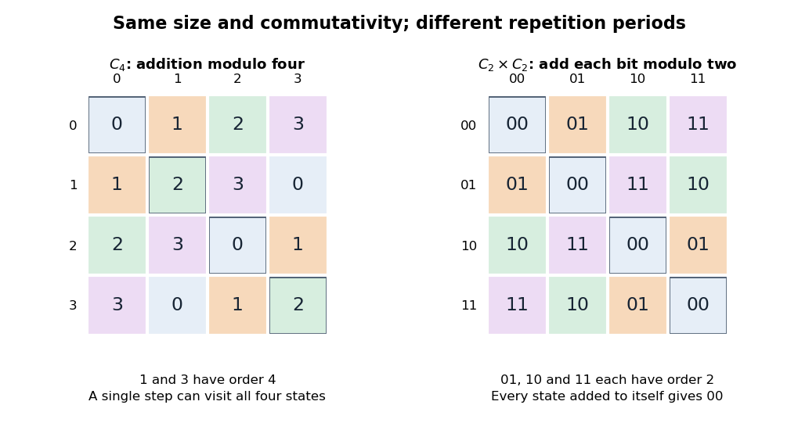

# Cyclic group of order four and Klein four-group

↑ **Parent:** [Finite abelian group](finite-abelian-group.md)

The [finite cyclic group](finite-cyclic-group.md) $C_4=\mathbb Z/4\mathbb Z$ and the [Klein four-group](klein-four-group.md) $V_4=C_2\times C_2$ are both [abelian groups](abelian-group.md) of order four. In $C_4$, composition is [addition](addition.md) modulo four. In $V_4$, label the elements $00,01,10,11$ and add each coordinate modulo two. For example, $01+10=11$ and $11+11=00$.

**[Figure 3](#image-two-abelian-groups-of-order-four-have-different-addition-tables). Two abelian groups of order four have different addition tables**. Each cell is the row element plus the column element. Diagonal cells record adding an element to itself. In $C_4$, only $0$ and $2$ return to zero after two additions. In the [Klein four-group](klein-four-group.md), every diagonal cell is the [identity element](identity-element.md) $00$. The symmetric tables show [commutativity](commutativity.md), while the different doubling behavior distinguishes the [groups](group-split.md).

The [order of a group element](order-of-a-group-element.md) is preserved by a [group isomorphism](group-isomorphism.md): an equation $g^m=e$ holds exactly when its image satisfies the same equation. In $C_4$, both $1$ and $3$ have order four. In $V_4$, each nonidentity element has order two. Hence **these groups are not isomorphic**, despite having the same [order of a finite group](order-of-a-finite-group.md). No relabelling can repair this discrepancy.

For a geometric model of $V_4$, take the [symmetries](symmetry-physics.md) of a non-square [rectangle](rectangle.md): the [identity element](identity-element.md), [reflection](reflection-mathematics.md) in its horizontal axis, [reflection](reflection-mathematics.md) in its vertical axis, and [rotation](rotation-mathematics.md) through $180^\circ$. The two [reflections](reflection-mathematics.md) commute, and their composite is the half-turn. Every nonidentity motion is its own [inverse element](inverse-element.md). This makes the two binary switches concrete: choosing whether to apply each [reflection](reflection-mathematics.md) specifies all four motions. The case of [abelian groups of prime-square order](abelian-group-of-prime-square-order.md) generalizes this distinction from $p=2$ to any [prime](prime-number-split.md) $p$.

## ↑ Ancestors (8)

1. [Finite abelian group](finite-abelian-group.md)
2. [Abelian group](abelian-group.md)
3. [Group](group-split.md)
4. [Group theory](group-theory-split.md)
5. [Algebra](algebra-split.md)
6. [Area of mathematics](area-of-mathematics.md)
7. [Mathematics](mathematics-split.md)
8. [Codex Wiki](split.md)

## ← Incoming links (3)

- [Abelian group](abelian-group.md)
- [Cyclic group of order four](cyclic-group-of-order-four.md)
- [Finite group](finite-group.md)
