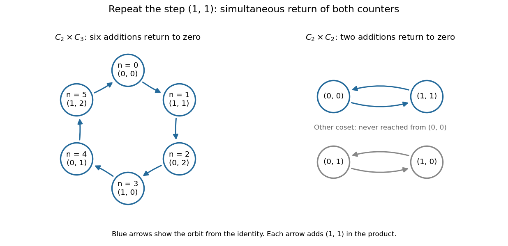

# Cyclicity of a product of two finite cyclic groups

↑ **Parent:** [Direct product of groups](direct-product-of-groups.md)

For positive [integers](integer-split.md) $m,n$, two finite [cyclic groups](cyclic-group.md) combine into one [cyclic group](cyclic-group.md) precisely when their [group orders](order-of-a-finite-group.md) are [coprime](coprime-integers.md):

$$
C_m\times C_n\cong C_{mn}\quad\Longleftrightarrow\quad\gcd(m,n)=1.
$$

The reason is that both cyclic counters must return to their [identity elements](identity-element.md) simultaneously. If $a,b$ are [generators of a group](generator-of-a-group.md) for the two factors, the [order of a direct-product element](order-of-a-direct-product-element.md) gives $\operatorname{ord}(a,b)=\operatorname{lcm}(m,n)$. The pair generates all $mn$ elements exactly when this [least common multiple](least-common-multiple.md) is $mn$.

For $C_2\times C_3$, repeated addition of $(1,1)$ visits

$$
(0,0),(1,1),(0,2),(1,0),(0,1),(1,2),(0,0).
$$

All six pairs appear before the return, so $(1,1)$ is a generator. In contrast, in $C_2\times C_2$ the same step gives only $(0,0),(1,1),(0,0)$. Every nonidentity element has [order of a group element](order-of-a-group-element.md) two, so none can generate all four pairs. This is the [Klein four-group](klein-four-group.md); there is no [group isomorphism](group-isomorphism.md) to $C_4$ even though both have four elements.

**[Figure 1](#image-adding-the-same-pair-generates-all-of-c2-times-c3-but-only-a-two-element-subgroup-of-c2-times-c2). Adding the same pair generates all of C2 times C3 but only a two-element subgroup of C2 times C2**.

For a brief proof of the converse, each component [order of a group element](order-of-a-group-element.md) divides the corresponding factor [group order](order-of-a-finite-group.md). Every pair's order therefore divides $\operatorname{lcm}(m,n)$. If $\gcd(m,n)>1$, this is smaller than $mn$, so no pair can generate the whole product. The [Chinese remainder theorem](chinese-remainder-theorem.md) gives the explicit isomorphism in the [coprime](coprime-integers.md) case: $t\bmod mn\mapsto(t\bmod m,t\bmod n)$.

## ↑ Ancestors (6)

1. [Direct product of groups](direct-product-of-groups.md)
2. [Group theory](group-theory-split.md)
3. [Algebra](algebra-split.md)
4. [Area of mathematics](area-of-mathematics.md)
5. [Mathematics](mathematics-split.md)
6. [Codex Wiki](split.md)

## ← Incoming links (5)

- [Direct product of groups](direct-product-of-groups.md)
- [Solution](past-exam-of-the-mathematics-course-of-the-university-of-cambridge/2007/ia/paper-3/5d/solution.md)
- [Solution](past-exam-of-the-mathematics-course-of-the-year-2-of-the-natural-sciences-course-of-the-university-of-cambridge/2014/paper-2/8/ii/solution.md)
- [Solution](past-exam-of-the-mathematics-course-of-the-year-2-of-the-natural-sciences-course-of-the-university-of-cambridge/2023/paper-2/9/c/solution.md)
- [Solution](past-exam-of-the-mathematics-course-of-the-year-2-of-the-natural-sciences-course-of-the-university-of-cambridge/2024/paper-2/9/b/solution.md)
