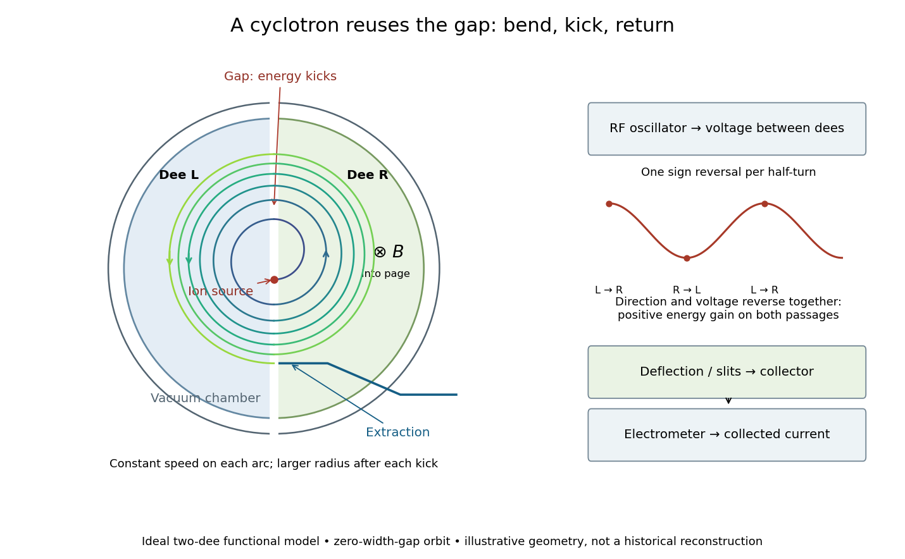

# Cyclotron

↑ **Parent:** [Particle accelerator](particle-accelerator-split.md)  
ⓦ [Wiki](https://en.wikipedia.org/wiki/Cyclotron)

A cyclotron repeatedly passes [ions](ion.md) through an alternating [electric field](electric-field-split.md) between two hollow electrodes called [cyclotron dees](cyclotron-dee.md). A nearly uniform [magnetic field](magnetic-field-split.md) perpendicular to their plane bends the [charged particles](charged-particle.md) back toward the gap. Inside each [cyclotron dee](cyclotron-dee.md), ideal shielding suppresses the accelerating [electric field](electric-field-split.md), so each segment is a constant-[speed](speed.md) [circular motion](circular-motion.md). The next gap crossing increases the [speed](speed.md) and the [radius](radius.md) of curvature. The complete path consists of connected, progressively larger arcs, rather than one circle or a smooth spiral with continuous acceleration everywhere.

The striking feature is a timing cancellation: the longer arc traveled by a faster particle takes the same time. This [cyclotron resonance condition](cyclotron-resonance-condition.md) lets one fixed [radio frequency](radio-frequency.md) accelerate many successive gap crossings. The following construction and [cyclotron energy and orbit radius](cyclotron-energy-and-orbit-radius.md) example describe an ideal model; the [Lawrence-Livingston cyclotron experiment](lawrence-livingston-cyclotron-experiment.md) explains what the builders actually measured.

**[Figure 1](#image-cyclotron-bending-gap-kicks-and-a-separate-beam-readout). Cyclotron bending, gap kicks, and a separate beam readout**. Original functional schematic, with illustrative dimensions only. The orbit is constructed from exact semicircles of successively increased speed in the zero-width-gap model; the white gap band marks where the finite-gap electric field would act. The architecture shows two ideal dees, not a scale reconstruction of the one-driven-dee 1932 apparatus. Extraction and readout are shown as a separate functional chain.

**Table of contents**

- [Cyclotron dee](cyclotron-dee.md)
- [Cyclotron resonance condition](cyclotron-resonance-condition.md)
  - [Cyclotron gap energy gain](cyclotron-gap-energy-gain.md)
- [Cyclotron energy and orbit radius](cyclotron-energy-and-orbit-radius.md)
- [Lawrence-Livingston cyclotron experiment](lawrence-livingston-cyclotron-experiment.md)
- [Relativistic detuning of a cyclotron](relativistic-detuning-of-a-cyclotron.md)

## ↑ Ancestors (4)

1. [Particle accelerator](particle-accelerator-split.md)
2. [Experimental apparatus](experimental-apparatus.md)
3. [Physics](physics-split.md)
4. [Codex Wiki](split.md)

## ← Incoming links (6)

- [Electrostatic acceleration energy gain](electrostatic-acceleration-energy-gain.md)
- [Lawrence-Livingston cyclotron experiment](lawrence-livingston-cyclotron-experiment.md)
- [Nobel Prize in Physics in 1939](nobel-prize-in-physics-in-1939.md)
- [Particle accelerator](particle-accelerator-split.md)
- [Penning trap normal modes](penning-trap-normal-modes.md)
- [Trapped-electron spin-jump readout](trapped-electron-spin-jump-readout.md)
