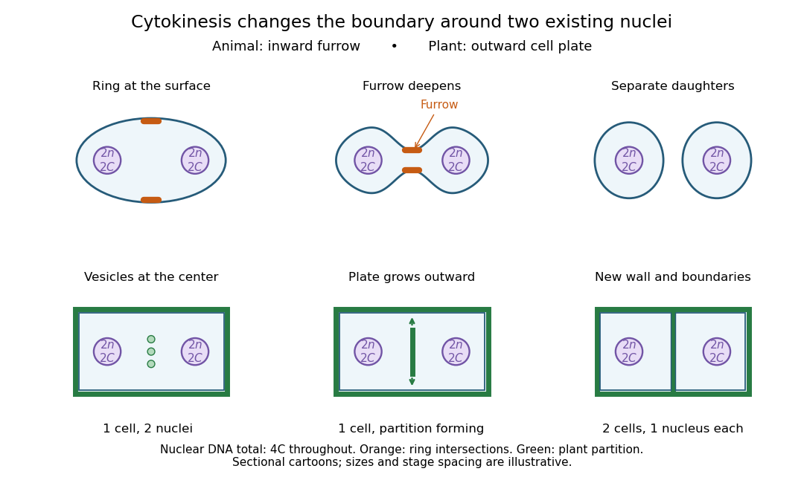

# Cytokinesis

↑ **Parent:** [M phase](m-phase.md)  
ⓦ [Wiki](https://en.wikipedia.org/wiki/Cytokinesis)

[Cytokinesis](cytokinesis.md) partitions the [cytoplasm](cytoplasm.md). Without [cytokinesis](cytokinesis.md), two [cell nuclei](cell-nucleus.md) can share one [biological cell](biological-cell-split.md). [Biology 2e, §10.2, The Mitotic Phase, Figure 10.6 and Cytokinesis](biology-2e-by-mary-ann-clark-and-others/the-cell-cycle.md)

[Cytokinesis](cytokinesis.md) makes physically separate daughter [biological cells](biological-cell-split.md) by partitioning their [cytoplasm](cytoplasm.md) and completing their [cell membrane](cell-membrane-split.md) boundaries. [Mitosis](mitosis.md) divides nuclear material. These processes can overlap during [M phase](m-phase.md), but completion of one does not imply completion of the other.[Biology 2e by Mary Ann Clark and others; §10.2, The Mitotic Phase and Cytokinesis: nuclear division versus physical daughter-cell separation](biology-2e-by-mary-ann-clark-and-others/the-cell-cycle.md)

For an original compartment-counting example, consider a hypothetical [diploid](diploid.md) [biological cell](biological-cell-split.md) after two daughter [cell nuclei](cell-nucleus.md) have formed. Let $n=5$ be the number of [chromosomes](chromosome.md) in one [haploid](haploid.md) set, and let $C$ be that set's unreplicated nuclear [DNA](deoxyribonucleic-acid.md) amount, as in [cell-cycle DNA content](cell-cycle-dna-content.md). Assume faithful [mitosis](mitosis.md), no nuclear [DNA replication](dna-replication.md) during the partition, and no loss of nuclear [DNA](deoxyribonucleic-acid.md); exclude [mitochondrion](mitochondria.md) [DNA](deoxyribonucleic-acid.md).

| Counting boundary | Before [cytokinesis](cytokinesis.md) | After [cytokinesis](cytokinesis.md) |
| --- | --- | --- |
| [Biological cells](biological-cell-split.md) | 1 | 2 |
| [Cell nuclei](cell-nucleus.md) in each [biological cell](biological-cell-split.md) | 2 | 1 |
| Each [cell nucleus](cell-nucleus.md) | $2n=10$ [chromosomes](chromosome.md), $2C$ | $2n=10$ [chromosomes](chromosome.md), $2C$ |
| Nuclear [DNA](deoxyribonucleic-acid.md) per [biological cell](biological-cell-split.md) | $4C$ | $2C$ |
| Nuclear [DNA](deoxyribonucleic-acid.md) across all descendants | $4C$ | $4C$ |

The check is to follow the two existing [cell nuclei](cell-nucleus.md): initially one boundary encloses both; finally each daughter boundary encloses one. The total remains two [cell nuclei](cell-nucleus.md), twenty [chromosomes](chromosome.md) and $2C+2C=4C$ of nuclear [DNA](deoxyribonucleic-acid.md). Thus the amount per [biological cell](biological-cell-split.md) halves because the counting boundary changes, without any new [DNA replication](dna-replication.md) or change of nuclear [ploidy](ploidy.md). Doubling the number of [biological cells](biological-cell-split.md) need not double their combined material.

**[Figure 4](#image-cytokinesis-inward-cleavage-furrow-versus-outward-cell-plate-growth). Cytokinesis: inward cleavage furrow versus outward cell plate growth**. Original sectional cartoons of an [animal](animal.md) [biological cell](biological-cell-split.md) and a [plant](plant.md) [biological cell](biological-cell-split.md), each already containing two $2n,2C$ daughter [cell nuclei](cell-nucleus.md). Orange marks intersections with an [actomyosin ring](actomyosin-ring.md); green marks a growing [cell plate](cell-plate.md) and the new partition. Stages illustrate geometry, not measured times or a universal order relative to [mitosis](mitosis.md).

Coordinating [chromosome segregation](chromosome-segregation.md) with [cytoplasm](cytoplasm.md) partition lets descendants inherit nuclear information inside separate working compartments. Equal nuclear [DNA](deoxyribonucleic-acid.md) allocations do not require equal daughter sizes or equal allocations of every [organelle](organelle.md). The geometry of [cytokinesis](cytokinesis.md) connects an internal allocation to the creation of two independently bounded [biological cells](biological-cell-split.md).

**Table of contents**

- [Abscission](abscission.md)
- [Midbody](midbody.md)
- [Actomyosin ring](actomyosin-ring.md)
- [Cleavage furrow](cleavage-furrow.md)
  - [Toroidal sand dollar egg experiment](toroidal-sand-dollar-egg-experiment.md)
- [Cell plate](cell-plate.md)

## ↑ Ancestors (5)

1. [M phase](m-phase.md)
2. [Cell cycle](cell-cycle-split.md)
3. [Biological cell](biological-cell-split.md)
4. [Biology](biology-split.md)
5. [Codex Wiki](split.md)

## ← Incoming links (23)

- [Actomyosin ring](actomyosin-ring.md)
- [Aurora B](aurora-b.md)
- [Biological cell division](biological-cell-division.md)
- [Cell cortex](cell-cortex.md)
- [Cell cycle](cell-cycle-split.md)
- [Cell plate](cell-plate.md)
- [Cleavage furrow](cleavage-furrow.md)
- [Cytokinesis](cytokinesis.md)
- [ECT2](ect2.md)
- [ESCRT-III](escrt-iii.md)
- [M phase](m-phase.md)
- [Mitosis](mitosis.md)
- [Mitotic daughter chromosome accounting](mitotic-daughter-chromosome-accounting.md)
- [Myosin II](myosin-ii.md)
- [Solution](past-exam-of-the-biochemistry-course-of-the-university-of-cambridge/2024/paper-5/section-2/a/solution.md)
- [Solution](past-exam-of-the-biochemistry-course-of-the-university-of-cambridge/2024/paper-5/section-2/k/solution.md)
- [Solution](past-exam-of-the-biochemistry-course-of-the-university-of-cambridge/2024/paper-5/section-2/o/solution.md)
- [Solution](past-exam-of-the-biochemistry-course-of-the-university-of-cambridge/2025/paper-3/section-i/1/solution.md)
- [Solution](past-exam-of-the-biochemistry-course-of-the-university-of-cambridge/2025/paper-3/section-ii/3/solution.md)
- [Solution](past-exam-of-the-zoology-course-of-the-university-of-cambridge/2025/paper-zl6/1/solution.md)
- [Solution](past-exam-of-the-zoology-course-of-the-university-of-cambridge/2025/paper-zl6/5/solution.md)
- [Toroidal sand dollar egg experiment](toroidal-sand-dollar-egg-experiment.md)
- [Yeast budding](yeast-budding.md)
