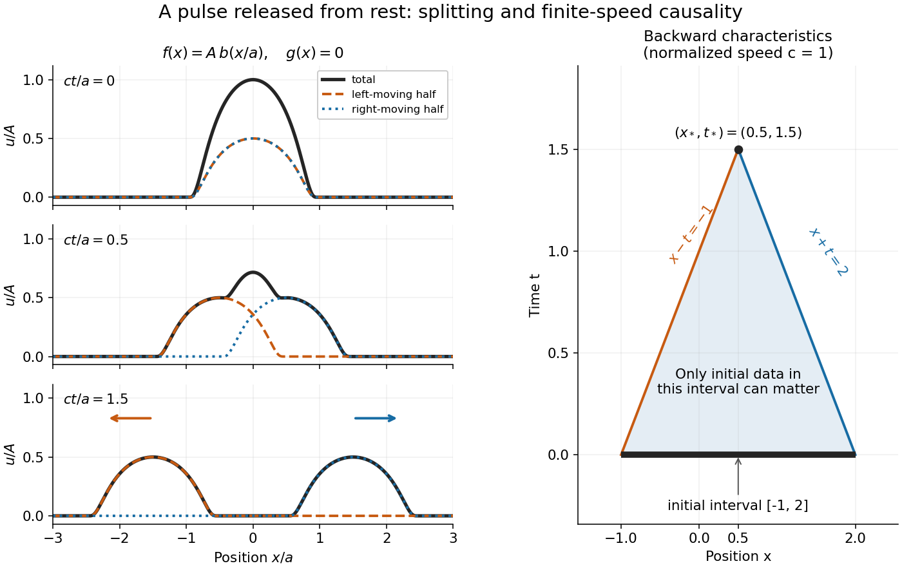

<h1 id="d-alembert-s-formula">D'Alembert's formula</h1>

↑ **Parent:** [Wave equation](wave-equation-split.md)  
ⓦ [Wiki](https://en.wikipedia.org/wiki/D'Alembert's_formula)

For constant [wave speed](wave-speed.md) $c>0$, the whole-line [Cauchy problem](cauchy-problem.md)

$$
u_{tt}=c^2u_{xx},\qquad u(x,0)=f(x),\qquad u_t(x,0)=g(x)
$$

has the unique [classical solution](classical-solution.md), for $f\in C^2(\mathbb R)$ and $g\in C^1(\mathbb R)$,

$$
u(x,t)=\frac{f(x-ct)+f(x+ct)}2+\frac1{2c}\int_{x-ct}^{x+ct}g(s)\,ds.
$$

The first term evolves displacement released from rest; the second evolves initial [velocity](velocity.md). The factor $1/(2c)$ converts an integral of [velocity](velocity.md) over distance into displacement. On a finite string the formula applies before the backward [characteristic curves](characteristic-curve.md) reach an endpoint, or globally after an extension that enforces the [boundary conditions](boundary-condition.md). [5 Wave Equation in R](math-220a-partial-differential-equations-of-applied-mathematics/5-wave-equation-in-r.md)

For a completely smooth example, choose a [bump function](bump-function.md) with [compact support](compact-support.md):

$$
b(z)=\begin{cases}\exp\!\left(1-\frac1{1-z^2}\right),&|z|<1,\\0,&|z|\geq1,\end{cases}
\qquad f(x)=A b(x/a),\qquad g(x)=0,
$$

where $a>0$ sets the half-width and $A$ sets the initial peak. Then

$$
u(x,t)=\frac A2 b\!\left(\frac{x-ct}{a}\right)+\frac A2 b\!\left(\frac{x+ct}{a}\right).
$$

At $t=0$ the two copies coincide, recovering peak $A$. At $t=a/(2c)$, $u(0,t)=A e^{-1/3}\simeq0.716531A$. At $t=3a/(2c)$ the pulses are separated, centred at $x=\pm3a/2$, each of width $2a$ and peak $A/2$. Zero initial [velocity](velocity.md) forces equal left and right contributions; a purely right-moving initial profile instead requires $g=-cf'$. Thus “released from rest” and “launched to the right” describe different [Cauchy data](cauchy-data.md).

**[Figure 8](#image-a-smooth-pulse-released-from-rest-splits-in-two-while-backward-characteristics-select-a-causal-interval). A smooth pulse released from rest splits in two, while backward characteristics select a causal interval**.

The [domain of dependence](domain-of-dependence.md) of $(x_*,t_*)$, for $t_*\geq0$, is contained in $[x_*-ct_*,x_*+ct_*]$ on the initial line. More precisely, displacement contributes only through the two endpoints, while initial [velocity](velocity.md) contributes throughout the interval. With $c=1$, $x_*=0.5$ and $t_*=1.5$, that interval is $[-1,2]$. Changing either initial datum outside it cannot change $u(0.5,1.5)$. If both initial data vanish outside $[-a,a]$, the solution vanishes outside $[-a-ct,a+ct]$: this is [finite propagation speed](finite-propagation-speed.md). The expanding interval bounds possible influence; it need not be filled by nonzero displacement, as the separated bumps demonstrate.

Historically, d'Alembert studied the vibrating-string problem in “Recherches sur la courbe que forme une corde tendue mise en vibration”, in the Berlin Academy's volume for the year 1747, pages 214–219. The memoir introduces the differential equation and integrates it through two arbitrary one-variable functions. The original geometric problem makes the formula's enduring appeal clear: arbitrary initial shapes can be handled without first decomposing them into [normal modes](normal-mode.md). [D'Alembert, vibrating-string memoir, Academy year 1747](https://webusers.imj-prg.fr/~david.aubin/cours/Textes/Dalembert-HAB-1747-cordes-vibrantes.pdf)

For a brief derivation, use [characteristic coordinates](characteristic-coordinate.md) $\xi=x-ct$ and $\eta=x+ct$. The [chain rule](chain-rule.md) gives $u_{tt}-c^2u_{xx}=-4c^2u_{\xi\eta}$, so $u=F(\xi)+G(\eta)$. The initial conditions yield $F+G=f$ and $-cF'+cG'=g$. Integrating these relations gives the displayed formula; the arbitrary integration constants cancel in their sum.

**Table of contents**

- [Rectangular pulse splitting under the wave equation](rectangular-pulse-splitting-under-the-wave-equation.md)
- [D'Alembert formula with initial velocity](d-alembert-formula-with-initial-velocity.md)
  - [Central zero region for odd compactly supported initial velocity](central-zero-region-for-odd-compactly-supported-initial-velocity.md)

## ↑ Ancestors (6)

1. [Wave equation](wave-equation-split.md)
2. [Partial differential equation](partial-differential-equation-split.md)
3. [Analysis](analysis-split.md)
4. [Area of mathematics](area-of-mathematics.md)
5. [Mathematics](mathematics-split.md)
6. [Codex Wiki](split.md)

## ← Incoming links (7)

- [Characteristic line for the one-dimensional wave equation](characteristic-line-for-the-one-dimensional-wave-equation.md)
- [D'Alembert formula with initial velocity](d-alembert-formula-with-initial-velocity.md)
- [Finite propagation speed](finite-propagation-speed.md)
- [One-dimensional wave equation](one-dimensional-wave-equation.md)
- [Solution](past-exam-of-the-mathematics-course-of-the-university-of-cambridge/2002/ib/paper-3/2a/solution.md)
- [Support widening for the wave equation](support-widening-for-the-wave-equation.md)
- [Wave equation](wave-equation-split.md)
