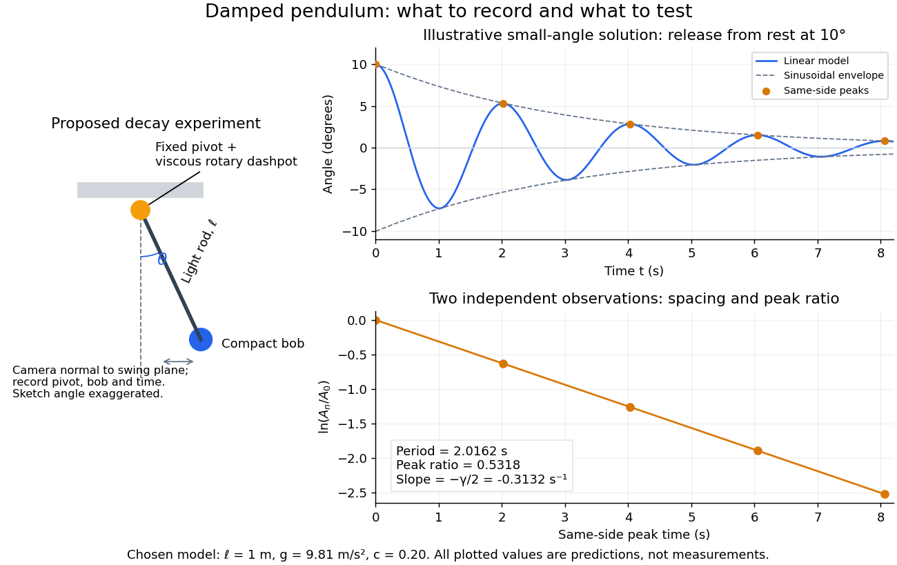

# Damped pendulum

↑ **Parent:** [Simple pendulum](simple-pendulum.md)

A [damped pendulum](damped-pendulum.md) is a [simple pendulum](simple-pendulum.md) whose [mechanical energy](mechanical-energy.md) is removed by a resisting [torque](torque.md). Here the model is undriven, with a fixed pivot, a [point mass](point-mass.md) $m>0$ at distance $\ell>0$, uniform [gravitational acceleration](gravitational-acceleration.md) $g>0$, and resisting [torque](torque.md) $-b\,d\theta/dt$ with constant $b>0$. The [angle](angle.md) $\theta$ is measured from the downward vertical in [radians](radian.md). An ideal viscous rotary [dashpot](dashpot.md) realizes this torque law; tangential [linear drag](linear-drag.md) $-\alpha v$ on the bob gives the same equation with $b=\alpha\ell^2$. The [moment of inertia](moment-of-inertia.md) is $m\ell^2$, so

$$
m\ell^2\frac{d^2\theta}{dt^2}+b\frac{d\theta}{dt}+mg\ell\sin\theta=0,\qquad
\omega_0=\sqrt{\frac g\ell},\quad \gamma=\frac{b}{m\ell^2},\quad \tau=\omega_0t,\quad c=\frac\gamma{\omega_0}>0.
$$

Here $t$ is physical [time](time-in-physics.md), $\omega_0$ is the undamped small-amplitude [angular frequency](angular-frequency.md), and $\gamma$ has units of inverse [time](time-in-physics.md). In the normalized equation $\ddot\theta+c\dot\theta+\sin\theta=0$, dots mean differentiation with respect to $\tau$, not $t$. The parameter $c$ is dimensionless. This separates the chosen damping law from the [small-angle approximation](small-angle-approximation.md): retaining $\sin\theta$ allows finite [angles](angle.md) even when the resisting [torque](torque.md) is linear in [angular velocity](angular-velocity.md).

**[Figure 4](#image-proposed-viscous-damper-experiment-and-illustrative-small-angle-decay-angle-versus-time-and-successive-peak-ratios-not-measured-data). Proposed viscous-damper experiment and illustrative small-angle decay: angle versus time and successive peak ratios, not measured data**.

To motivate the model, release a pendulum without a push and record how its swing shrinks. A published example by Gintautas and Hubler uses a rotary sensor built from a computer mouse to measure the frequency and damping coefficient of a [physical pendulum](physical-pendulum.md). [Gintautas and Hubler, A simple, low-cost, data-logging pendulum built from a computer mouse, 2009](https://arxiv.org/abs/0901.4319) The following is a proposed experiment with a chosen viscous rotary [dashpot](dashpot.md); the plotted observations are predictions, not a reproduction of their measurements.

Mount a compact bob on a light rigid rod with a fixed pivot, couple the pivot to an adjustable viscous rotary [dashpot](dashpot.md), and measure $\ell$ from the pivot to the bob's centre. First record decay with the [dashpot](dashpot.md) disconnected, then repeat with it connected at several settings; this establishes how much decay is already due to other losses. Keep the bob, rod, camera, and release [angle](angle.md) unchanged between these trials. The simple model requires rod and damper-rotor [moments of inertia](moment-of-inertia.md) to be negligible compared with $m\ell^2$. Otherwise measure the total [moment of inertia](moment-of-inertia.md) $I$ and the distance $d$ to the assembly's centre of mass: the [physical pendulum](physical-pendulum.md) equation becomes $I\,d^2\theta/dt^2+b\,d\theta/dt+Mgd\sin\theta=0$, where $M$ is the total moving [mass](mass.md). A damper that also exerts an elastic restoring [torque](torque.md) would require another term.

Place a camera perpendicular to the swing plane, include the pivot and bob centre in every frame, and determine their coordinates relative to the resting vertical. For horizontal and downward separations $x,y$, use $\theta=\operatorname{atan2}(x,y)$; record the frame timestamps rather than assuming a frame rate. Release from rest at about $10^\circ$, record through several complete swings, and repeat the release. For every same-side turning point, tabulate its [time](time-in-physics.md) $t_n$ and angular [amplitude](wave-amplitude.md) $A_n=|\theta(t_n)|$. Measure the [oscillation period](period-of-an-oscillation.md) from differences $t_{n+1}-t_n$; comparing several periods exposes drift. Interpolating around each observed extremum reduces frame discretization error. Check that late peaks still exceed the angular resolution; taking the [natural logarithm](natural-logarithm.md) of tiny, uncertain peaks amplifies their relative errors.

In the [small-angle approximation](small-angle-approximation.md), the [damped pendulum](damped-pendulum.md) becomes a [damped harmonic oscillator](damped-harmonic-oscillator.md). For $0<\gamma<2\omega_0$ and release from rest at $\theta_0$, its exact linear-model solution is

$$
\theta_{\mathrm{lin}}(t)=\theta_0e^{-\gamma t/2}\left(\cos\omega_dt+\frac{\gamma}{2\omega_d}\sin\omega_dt\right),\qquad
\omega_d=\sqrt{\omega_0^2-\frac{\gamma^2}{4}},\qquad T_d=\frac{2\pi}{\omega_d}.
$$

The decaying sinusoidal envelope has coefficient $|\theta_0|\omega_0/\omega_d$; because release is from rest, its successive same-side extrema occur at $t_n=nT_d$ and have $A_n=|\theta_0|e^{-\gamma nT_d/2}$. Thus the envelope and the sequence of actual peak heights are different descriptions of the same trace. The linear damping regimes and this solution are derived in [Richard Fitzpatrick, Damped Oscillatory Motion, equations 82–93](https://farside.ph.utexas.edu/teaching/336k/Newton/node19.html).

The experiment tests two predictions independently: nearly equal same-side peak spacing and a straight line when plotting $\ln(A_n/A_0)$ against $t_n-t_0$. Its predicted slope is $-\gamma/2$, giving

$$
\gamma=\frac{2}{t_{n+1}-t_n}\ln\frac{A_n}{A_{n+1}},\qquad b=m\ell^2\gamma,\qquad
\omega_d^2+\frac{\gamma^2}{4}=\frac g\ell.
$$

Use several peaks and repeated trials rather than a single ratio, and compare the frequency identity with independently measured $\ell$ and $g$. For the illustrative choices $\ell=1.00\,\mathrm m$, $g=9.81\,\mathrm{m/s^2}$, $c=0.20$, and $\theta_0=10^\circ$, the linear model gives $\gamma\approx0.6264\,\mathrm{s^{-1}}$, $T_d\approx2.0162\,\mathrm s$, and $A_{n+1}/A_n\approx0.5318$. The first two positive peaks after release are therefore approximately $5.318^\circ$ and $2.828^\circ$. The undamped small-amplitude [oscillation period](period-of-an-oscillation.md) is about $2.0061\,\mathrm s$: substantial loss per swing need not imply a large change in period.

Repeat at a larger release [angle](angle.md) to distinguish two limitations. The relative error in replacing $\sin\theta$ by $\theta$ is about $\theta^2/6$ for small [angles](angle.md): about $0.51\%$ at $10^\circ$, but about $17.3\%$ at $60^\circ$ when compared with $\theta$. Finite-amplitude swing spacing can therefore change as the swing shrinks even if $b$ is constant. Separately, [friction](friction.md) at the pivot or [quadratic drag](quadratic-drag.md) can invalidate the assumed linear resisting [torque](torque.md); exponential peak decay should be checked, not imposed on all recorded motion. Peters discusses why real pendulum damping can require nonlinear terms. [Randall D. Peters, Nonlinear Damping of the 'Linear' Pendulum, 2003](https://arxiv.org/abs/physics/0306081) Repeatability, residual pivot motion, changes in damper [temperature](temperature.md), and finite camera resolution are useful checks on this proposed measurement.

The normalized [equilibrium points](equilibrium-point-of-a-dynamical-system.md) are $(\theta,\dot\theta)=(k\pi,0)$. Even multiples of $\pi$ are attracting: their [linearization](linearization.md) has [eigenvalues](eigenvalue.md) $(-c\pm\sqrt{c^2-4})/2$, giving a [stable focus](stable-spiral.md) for $0<c<2$, repeated negative [eigenvalues](eigenvalue.md) at $c=2$, and a [stable node](stable-node.md) for $c>2$. These are the underdamped, critically damped, and overdamped small-displacement regimes. Odd multiples of $\pi$ have [eigenvalues](eigenvalue.md) $(-c\pm\sqrt{c^2+4})/2$ of opposite signs and are [saddle equilibria](saddle-equilibrium.md). The [energy dissipation of a damped pendulum](energy-dissipation-of-a-damped-pendulum.md) explains why trajectories in the [phase portrait](phase-portrait.md) spiral inward near a [stable focus](stable-spiral.md) instead of closing into the recurring orbit of an undamped [simple pendulum](simple-pendulum.md).

**Table of contents**

- [Energy dissipation of a damped pendulum](energy-dissipation-of-a-damped-pendulum.md)

## ↑ Ancestors (5)

1. [Simple pendulum](simple-pendulum.md)
2. [Classical mechanics](classical-mechanics-split.md)
3. [Branches of physics](branches-of-physics.md)
4. [Physics](physics-split.md)
5. [Codex Wiki](split.md)

## ← Incoming links (7)

- [Damped pendulum](damped-pendulum.md)
- [Energy dissipation of a damped pendulum](energy-dissipation-of-a-damped-pendulum.md)
- [Mathematical model](mathematical-model.md)
- [Solution](past-exam-of-the-mathematics-course-of-the-university-of-cambridge/2008/ia/paper-4/4b/solution.md)
- [Solution](past-exam-of-the-mathematics-course-of-the-university-of-cambridge/2014/ia/paper-2/8b/i/solution.md)
- [Physics](physics-split.md)
- [Simple pendulum](simple-pendulum.md)
