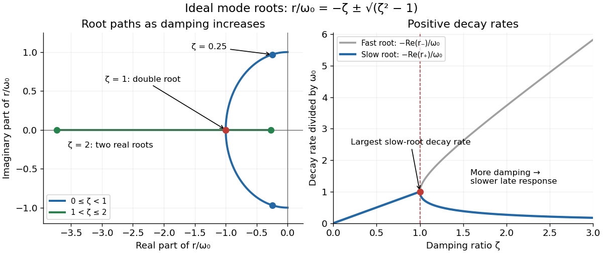

# Damping ratio

↑ **Parent:** [Viscous damping](viscous-damping.md)

The [damping ratio](damping-ratio.md) is the dimensionless ratio $b/b_{\mathrm{crit}}$. Substituting the [exponential function](exponential-function.md) $x=e^{rt}$ into the [viscous damping](viscous-damping.md) model gives the [characteristic equation](characteristic-equation-of-a-constant-coefficient-differential-equation.md) and its [characteristic roots](characteristic-root-of-a-constant-coefficient-differential-equation.md):

$$
mr^2+br+k=0,\qquad r_\pm=-\zeta\omega_0\pm\omega_0\sqrt{\zeta^2-1}.
$$

For $0<\zeta<1$, [underdamping](underdamping.md) gives a pair of [complex conjugate](complex-conjugate.md) roots with negative [real part](real-part.md). For $\zeta=1$, [critical damping](critical-damping.md) gives the repeated negative real root. For $\zeta>1$, [overdamping](overdamping.md) gives two distinct negative real roots. At $\zeta=0$ the roots are purely imaginary and the [harmonic oscillator](simple-harmonic-motion.md) is undamped; this boundary case has no [energy](energy.md) loss. With $m,k>0$, negative $b$ would inject [energy](energy.md) and lies outside the dissipative model.

**[Figure 4](#image-characteristic-roots-of-an-ideal-viscous-oscillator-and-their-dimensionless-decay-rates-as-the-damping-ratio-varies). Characteristic roots of an ideal viscous oscillator and their dimensionless decay rates as the damping ratio varies**.

The left panel locates $r/\omega_0$ in the [complex plane](complex-plane.md); the [imaginary part](imaginary-part.md) gives the damped [angular frequency](angular-frequency.md), while the negative [real part](real-part.md) gives the [exponential decay](exponential-decay.md) rate. The right panel shows the positive rates $-\operatorname{Re}(r_\pm)/\omega_0$. Beyond [critical damping](critical-damping.md), one root moves toward zero, explaining slow late motion for generic [initial conditions](initial-condition.md). The repeated-root solution also has a [polynomial](polynomial-split.md) prefactor, so these rates alone do not describe its complete response.

## ↑ Ancestors (8)

1. [Viscous damping](viscous-damping.md)
2. [Damping](damping.md)
3. [Wave equation](wave-equation-split.md)
4. [Partial differential equation](partial-differential-equation-split.md)
5. [Analysis](analysis-split.md)
6. [Area of mathematics](area-of-mathematics.md)
7. [Mathematics](mathematics-split.md)
8. [Codex Wiki](split.md)

## ← Incoming links (5)

- [Damping](damping.md)
- [Damping measurement from free decay](damping-measurement-from-free-decay.md)
- [Damping ratio](damping-ratio.md)
- [Logarithmic decrement](logarithmic-decrement.md)
- [Overdamping](overdamping.md)
