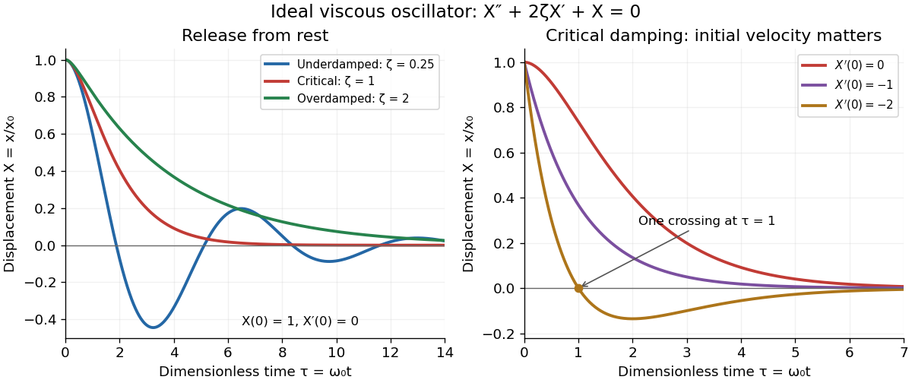

# Damping

↑ **Parent:** [Wave equation](wave-equation-split.md)  
ⓦ [Wiki](https://en.wikipedia.org/wiki/Damping)

Damping dissipates the [energy](energy.md) of an [oscillation](oscillation.md), reducing its [amplitude](wave-amplitude.md). A [linearly damped string](linearly-damped-string.md) applies this mechanism to each [normal mode](normal-mode.md).

Why can stronger [damping](damping.md) make a return to [equilibrium](equilibrium-point-of-a-dynamical-system.md) slower? A weak brake lets a [spring](spring.md) exchange [potential energy](potential-energy.md) with [kinetic energy](kinetic-energy.md) many times; a very strong brake makes the final motion creep. [Critical damping](critical-damping.md) marks the boundary between these behaviours. The distinction depends on the [force](force.md) law: the classification below concerns a single [damped harmonic oscillator](damped-harmonic-oscillator.md) with [viscous damping](viscous-damping.md), rather than every mechanism that removes [energy](energy.md).

Let $x(t)$ be [displacement](displacement.md) from [equilibrium](equilibrium-point-of-a-dynamical-system.md), $m>0$ the moving [mass](mass.md), $k>0$ the [spring constant](spring-constant.md), and $b\geq0$ the constant coefficient of [viscous damping](viscous-damping.md). With no driving [force](force.md), [Newton's second law](newton-s-second-law.md) gives

$$
m\ddot x+b\dot x+kx=0,\qquad x(0)=x_0,\quad \dot x(0)=v_0.
$$

The two [initial conditions](initial-condition.md) specify [displacement](displacement.md) and [velocity](velocity.md). Define the undamped [eigenfrequency](eigenfrequency.md) as an [angular frequency](angular-frequency.md) $\omega_0=\sqrt{k/m}$ and the [damping ratio](damping-ratio.md) as $\zeta=b/(2\sqrt{mk})$. The [ordinary differential equation](ordinary-differential-equation.md) becomes $\ddot x+2\zeta\omega_0\dot x+\omega_0^2x=0$. A constant weight in a vertical [spring](spring.md) merely shifts [equilibrium](equilibrium-point-of-a-dynamical-system.md); it is already absorbed in the definition of $x$.[§15.5, equations 15.23–15.26 and the force discussion preceding 15.23](university-physics-volume-1-by-william-moebs-and-others/15-5-damped-oscillations.md)

For example, the ideal parameters $m=1\,\mathrm{kg}$ and $k=4\,\mathrm{N\,m^{-1}}$ give $\omega_0=2\,\mathrm{s^{-1}}$ and [critical damping](critical-damping.md) at $b=4\,\mathrm{kg\,s^{-1}}$. Values $b=1,4,8\,\mathrm{kg\,s^{-1}}$ give [damping ratios](damping-ratio.md) $0.25,1,2$, respectively. These are model choices, not measured values. For release from rest with $x_0>0$, set $X=x/x_0$ and $\tau=\omega_0t$; then $X''+2\zeta X'+X=0$, where primes now denote [derivatives](derivative.md) with respect to $\tau$.

**[Figure 3](#image-ideal-viscous-oscillator-responses-release-from-rest-in-three-damping-regimes-and-the-effect-of-initial-velocity-at-critical-damping). Ideal viscous oscillator responses: release from rest in three damping regimes, and the effect of initial velocity at critical damping**.

The left panel uses identical [initial conditions](initial-condition.md) $X(0)=1$, $X'(0)=0$. [Underdamping](underdamping.md) produces repeated crossings of [equilibrium](equilibrium-point-of-a-dynamical-system.md); [critical damping](critical-damping.md) and [overdamping](overdamping.md) give positive decreasing responses. The right panel keeps [critical damping](critical-damping.md) but changes initial [velocity](velocity.md): $X'(0)=-2$ gives one crossing, although there is no [oscillation](oscillation.md). Both panels are exact model predictions.

**Table of contents**

- [Critical damping](critical-damping.md)
- [Viscous damping](viscous-damping.md)
  - [Damping ratio](damping-ratio.md)
  - [Oscillator energy dissipation](oscillator-energy-dissipation.md)
- [Underdamping](underdamping.md)
- [Overdamping](overdamping.md)
- [Damping measurement from free decay](damping-measurement-from-free-decay.md)
  - [Air track](air-track.md)
  - [Ultrasonic motion sensor](ultrasonic-motion-sensor.md)
  - [Logarithmic decrement](logarithmic-decrement.md)
- [Eddy-current damping](eddy-current-damping.md)

## ↑ Ancestors (6)

1. [Wave equation](wave-equation-split.md)
2. [Partial differential equation](partial-differential-equation-split.md)
3. [Analysis](analysis-split.md)
4. [Area of mathematics](area-of-mathematics.md)
5. [Mathematics](mathematics-split.md)
6. [Codex Wiki](split.md)

## ← Incoming links (24)

- [Acoustic wavelength measurement](acoustic-wavelength-measurement.md)
- [Air track](air-track.md)
- [Cavendish torsion balance](cavendish-torsion-balance.md)
- [Critical damping](critical-damping.md)
- [Damped torsional oscillation](damped-torsional-oscillation.md)
- [Damping](damping.md)
- [Dispersion relation](dispersion-relation.md)
- [Free two-mass spring](free-two-mass-spring.md)
- [Group velocity](group-velocity.md)
- [Information velocity](information-velocity.md)
- [Laser-diffraction measurement of capillary waves](laser-diffraction-measurement-of-capillary-waves.md)
- [Magnetic dipole torque](magnetic-dipole-torque.md)
- [Mathematical model](mathematical-model.md)
- [Normal mode](normal-mode.md)
- [Overdamped RLC response](overdamped-rlc-response.md)
- [Parallel axis theorem](parallel-axis-theorem.md)
- [Restoring force](restoring-force.md)
- [Rüchardt experiment](ruchardt-experiment.md)
- [Simple harmonic motion](simple-harmonic-motion.md)
- [Slow steady gyroscope precession](slow-steady-gyroscope-precession.md)
- [Torsion constant](torsion-constant.md)
- [Wave equation](wave-equation-split.md)
- [Wave equation on a string](wave-equation-on-a-string.md)
- [Work-energy theorem](work-energy-theorem.md)
