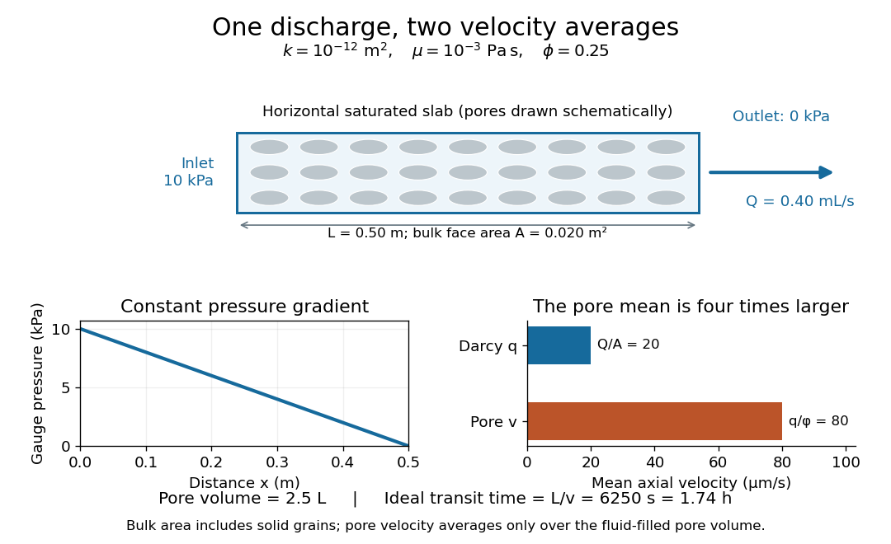

# Darcy flow through a homogeneous slab

↑ **Parent:** [Darcy law](darcy-law.md)

Consider a horizontal slab of fully saturated sand with uniform intrinsic [permeability of a porous medium](permeability-of-a-porous-medium.md) $k=10^{-12}\,\mathrm{m^2}$, length $L=0.50\,\mathrm m$, total cross-sectional area $A=0.020\,\mathrm{m^2}$, and [porosity](porosity.md) $\phi=0.25$. Use one [Newtonian fluid](newtonian-fluid.md) with [mass density](density.md) $\rho=1000\,\mathrm{kg\,m^{-3}}$ and [dynamic viscosity](dynamic-viscosity.md) $\mu=10^{-3}\,\mathrm{Pa\,s}$. Prescribe inlet and outlet gauge [fluid pressures](fluid-pressure.md) $10000\,\mathrm{Pa}$ and $0\,\mathrm{Pa}$, with no sources or leaks and steady [incompressible flow](incompressible-flow.md). The two ends have the same elevation, so [gravity](gravity.md) has no component along the slab. [Mass conservation](mass-conservation.md) makes the axial [Darcy flux](darcy-velocity.md) constant, and [Darcy law](darcy-law.md) then gives a linear [fluid pressure](fluid-pressure.md) profile:

$$
p(x)=10000\left(1-\frac{x}{L}\right)\mathrm{Pa},\qquad \frac{dp}{dx}=-20000\,\mathrm{Pa\,m^{-1}},\qquad q=-\frac{10^{-12}}{10^{-3}}(-20000)=2.0\times10^{-5}\,\mathrm{m\,s^{-1}}.
$$

The measured [volume flux](volumetric-flow-rate.md) and mean [pore velocity](pore-velocity.md) are

$$
Q=Aq=4.0\times10^{-7}\,\mathrm{m^3\,s^{-1}}=0.40\,\mathrm{mL\,s^{-1}},\qquad v=\frac q\phi=8.0\times10^{-5}\,\mathrm{m\,s^{-1}}.
$$

The slab's total volume is $AL=0.010\,\mathrm{m^3}$, of which $\phi AL=0.0025\,\mathrm{m^3}=2.5\,\mathrm L$ is pore volume. In the ideal uniform advective model, a nonreacting tracer has transit time $L/v=6250\,\mathrm s\simeq1.74\,\mathrm h$, consistent with pore volume divided by [volume flux](volumetric-flow-rate.md), $\phi AL/Q$. The incorrect substitution of [Darcy velocity](darcy-velocity.md) for [pore velocity](pore-velocity.md) would give $25000\,\mathrm s$, four times too long. Real passages have different path lengths and local speeds; these numbers describe a bulk mean rather than every particle's journey.

As an independent check, [gravitational acceleration](gravitational-acceleration.md) magnitude $g=9.81\,\mathrm{m\,s^{-2}}$ gives [hydraulic conductivity](hydraulic-conductivity.md) $K=9.81\times10^{-6}\,\mathrm{m\,s^{-1}}$, [hydraulic head](hydraulic-head.md) drop $\Delta h=10000/(1000\times9.81)\,\mathrm m\simeq1.01937\,\mathrm m$, and $q=K\Delta h/L=2.0\times10^{-5}\,\mathrm{m\,s^{-1}}$ again. If a representative pore size is $d=10^{-4}\,\mathrm m$, the [Reynolds number](reynolds-number.md) convention based on [pore velocity](pore-velocity.md) gives $\rho vd/\mu=0.008$, supporting neglect of pore inertia. This size is an illustrative extra measurement, not something determined by [porosity](porosity.md) and intrinsic [permeability of a porous medium](permeability-of-a-porous-medium.md) alone.

**[Figure 1](#image-the-same-discharge-gives-different-darcy-and-pore-velocities). The same discharge gives different Darcy and pore velocities**.

Regenerate the diagram by running `python ../darcy-flux-and-pore-velocity.py` from `_media`; it writes its PNG into the current directory.

## ↑ Ancestors (6)

1. [Darcy law](darcy-law.md)
2. [Porous-media flow](porous-media-flow-split.md)
3. [Fluid mechanics](fluid-mechanics-split.md)
4. [Branches of physics](branches-of-physics.md)
5. [Physics](physics-split.md)
6. [Codex Wiki](split.md)

## ← Incoming links (2)

- [Darcy velocity](darcy-velocity.md)
- [Porous-media flow](porous-media-flow-split.md)
