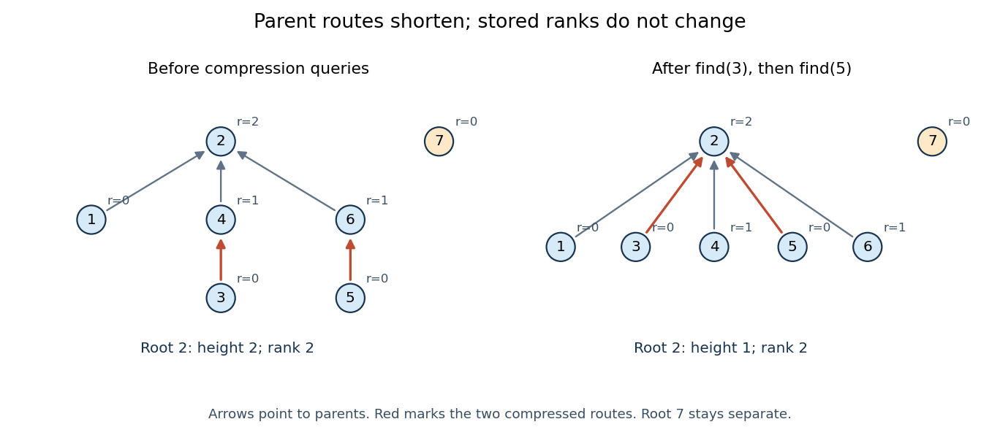

# Data structure

↑ **Parent:** [Computer science](computer-science.md)  
ⓦ [Wiki](https://en.wikipedia.org/wiki/Data_structure)

A [data structure](data-structure.md) organizes stored information together with operations for accessing and changing it. Choosing a [data structure](data-structure.md) means choosing which questions should be cheap to answer: an [array](#array-data-structure) supports access by numbered position, a [hash table](#hash-table) supports lookup by key, and a [priority queue](#priority-queue) supports selecting an item by priority. The operations and their [time complexity](theoretical-computer-science.md#time-complexity) matter as much as the stored values.

Suppose three requests arrive as $(5,\mathrm{Ada}),(2,\mathrm{Bo}),(4,\mathrm{Cy})$, where the number is a priority and smaller numbers are more urgent. A [FIFO queue](#fifo-queue) removes Ada first because she arrived first. A minimum-oriented [priority queue](#priority-queue) removes Bo first because $2$ is the least priority. An [array](#array-data-structure) can store the same three records in arrival order, but finding the least priority by scanning this representation takes three key inspections. A [binary heap](#binary-heap) organizes these records so the least priority is immediately available. The information is the same; the representation changes the work needed to use it.

This is a useful design principle: preserve just enough organization for the operations the application needs. Maintaining a [sorted array](#sorted-array) gives the whole order, but moving entries to insert a new key can be expensive. A [binary heap](#binary-heap) keeps a weaker [heap order](#heap-order) that supports fast repeated selection without maintaining a [sorted array](#sorted-array). A good [data structure](data-structure.md) makes an [algorithm](algorithm.md)'s next step easy.

**Table of contents**

- [Suffix array](#suffix-array)
- [Wavelet tree](#wavelet-tree)
- [Rank query](#rank-query)
- [List (abstract data type)](#list-abstract-data-type)
- [Heap data structure](#heap-data-structure)
  - [Meldable heap](#meldable-heap)
    - [Meldable min-heap](#meldable-min-heap)
    - [Leftist heap](#leftist-heap)
  - [Max-heap](#max-heap)
  - [Min-heap](#min-heap)
- [Associative array](#associative-array)
- [Treap](#treap)
  - [Implicit treap](#implicit-treap)
- [Suffix automaton](#suffix-automaton)
- [Double-ended queue](#double-ended-queue)
  - [Monotonic queue](#monotonic-queue)
- [Trie](#trie)
  - [Binary trie](#binary-trie)
- [Monotone stack](#monotone-stack)
  - [Monotone increasing stack](#monotone-increasing-stack)
- [Fenwick tree](#fenwick-tree)
- [Quadtree](#quadtree)
- [Segment tree](#segment-tree)
  - [Lazy segment tree](#lazy-segment-tree)
  - [Lazy propagation](#lazy-propagation)
- [Bitset](#bitset)
- [Adjacency list](#adjacency-list)
  - [Adjacency list edge conventions](#adjacency-list-edge-conventions)
  - [Neighbour enumeration](#neighbour-enumeration)
  - [Adjacency list storage and query costs](#adjacency-list-storage-and-query-costs)
- [Priority queue](#priority-queue)
  - [Binary heap](#binary-heap)
    - [Heap order](#heap-order)
    - [Sift up](#sift-up)
    - [Sift down](#sift-down)
- [Hash table](#hash-table)
  - [Hash set](#hash-set)
  - [Hash map](#hash-map)
  - [Separate chaining](#separate-chaining)
    - [Simple uniform hashing](#simple-uniform-hashing)
  - [Open addressing](#open-addressing)
    - [Linear probing](#linear-probing)
      - [Linear probing cluster](#linear-probing-cluster)
        - [Primary clustering](#primary-clustering)
    - [Tombstone in open addressing](#tombstone-in-open-addressing)
    - [Hash table probe](#hash-table-probe)
  - [Hash bucket](#hash-bucket)
  - [Key equality](#key-equality)
  - [Load factor of a hash table](#load-factor-of-a-hash-table)
  - [Hash table resizing](#hash-table-resizing)
  - [Hash table key](#hash-table-key)
  - [Hash table record](#hash-table-record)
- [Array (data structure)](#array-data-structure)
  - [Difference array](#difference-array)
  - [Row-major order](#row-major-order)
  - [Column-major order](#column-major-order)
  - [Sorted array](#sorted-array)
  - [Array index](#array-index)
  - [Dynamic array](#dynamic-array)
- [Circular buffer](#circular-buffer)
  - [Circular buffer indices](#circular-buffer-indices)
  - [Circular buffer full and empty states](#circular-buffer-full-and-empty-states)
  - [Circular buffer operation trace](#circular-buffer-operation-trace)
  - [Circular buffer overflow policy](#circular-buffer-overflow-policy)
  - [Circular buffer operation costs](#circular-buffer-operation-costs)
- [FIFO queue](#fifo-queue)
  - [Two-list functional queue](#two-list-functional-queue)
- [Stack (data structure)](#stack-data-structure)
  - [Call stack](#call-stack)
    - [Stack frame](#stack-frame)
- [Binary tree](#binary-tree)
  - [Binary expression tree](#binary-expression-tree)
  - [Binary tree child slot](#binary-tree-child-slot)
    - [Null child slot count](#null-child-slot-count)
  - [Subtree](#subtree)
  - [Height of a binary tree](#height-of-a-binary-tree)
  - [Inorder traversal](#inorder-traversal)
  - [Binary search tree](#binary-search-tree)
    - [Dictionary intersection](#dictionary-intersection)
  - [Complete binary tree](#complete-binary-tree)
  - [Full binary tree](#full-binary-tree)
  - [Perfect binary tree](#perfect-binary-tree)
- [Linked list](#linked-list)
  - [Linked list node](#linked-list-node)
  - [Mutable list](#mutable-list)
  - [Lazy list](#lazy-list)
- [Disjoint-set data structure](#disjoint-set-data-structure)
  - [Union by size](#union-by-size)
  - [Disjoint-set representative](#disjoint-set-representative)
  - [Disjoint-set find operation](#disjoint-set-find-operation)
  - [Disjoint-set union operation](#disjoint-set-union-operation)
  - [Disjoint-set forest](#disjoint-set-forest)
    - [Union by rank](#union-by-rank)
    - [Path compression](#path-compression)
  - [Union-find operation bounds](#union-find-operation-bounds)

## Suffix array

↑ **Parent:** [Data structure](data-structure.md)

A [suffix array](#suffix-array) stores starting positions of a [string](foundations-of-mathematics.md#string)'s [suffixes](foundations-of-mathematics.md#string-suffix) in [lexicographic order](extremal-set-theory.md#lexicographic-order). All [suffixes](foundations-of-mathematics.md#string-suffix) starting with a fixed query occupy a consecutive interval. This permits [string-searching algorithms](algorithm.md#string-searching-algorithm) to search a compact list of positions instead of storing every suffix explicitly.

## Wavelet tree

↑ **Parent:** [Data structure](data-structure.md)

A [wavelet tree](#wavelet-tree) recursively partitions an alphabet and records bit sequences indicating which partition each character belongs to. A character [rank query](#rank-query) follows the relevant partitions while mapping the prefix length through the bit-sequence ranks. A balanced tree takes logarithmically many levels in the alphabet size.

## Rank query

↑ **Parent:** [Data structure](data-structure.md)

A character [rank query](#rank-query) asks how many occurrences of character $c$ appear in the first $r$ positions of a sequence. A [prefix sum](arithmetic.md#prefix-sum) array answers a single-character version in constant time after linear preprocessing; a [wavelet tree](#wavelet-tree) supports many characters more compactly.

## List (abstract data type)

↑ **Parent:** [Data structure](data-structure.md)  
ⓦ [Wiki](https://en.wikipedia.org/wiki/List_(abstract_data_type))

A [list](#list-abstract-data-type) is an ordered collection in which entries may repeat. Removing duplicates would discard information about both multiplicity and, depending on the representation, order. A [linked list](#linked-list) and an [array](#array-data-structure) are different ways to implement list operations.

## Heap data structure

↑ **Parent:** [Data structure](data-structure.md)

A tree-based [data structure](data-structure.md) that orders each parent relative to its children so that an extremal value is available at the root. In a [max-heap](#max-heap), every parent is at least as large as its children. Heap implementations provide one way to realize a [priority queue](#priority-queue); the abstract queue and its implementing structure are distinct concepts.

### Meldable heap

↑ **Parent:** [Heap data structure](#heap-data-structure)

A [heap data structure](#heap-data-structure) supporting a meld operation that combines two heaps into one while preserving the [heap order](#heap-order). The cost of melding distinguishes implementations such as a [leftist heap](#leftist-heap) from ordinary [binary heaps](#binary-heap).

#### Meldable min-heap

↑ **Parent:** [Meldable heap](#meldable-heap)

A [meldable heap](#meldable-heap) satisfying the [min-heap](#min-heap) ordering: each parent key is no greater than its children's keys. It combines efficient merging with access to the current minimum key.

#### Leftist heap

↑ **Parent:** [Meldable heap](#meldable-heap)

A binary [meldable heap](#meldable-heap) satisfying [heap order](#heap-order) and the leftist condition: at each node, the shortest path to a missing child is no longer in the right subtree than in the left. Melding recurses down right spines, swaps children when needed, and takes logarithmic time.

### Max-heap

↑ **Parent:** [Heap data structure](#heap-data-structure)

A [heap data structure](#heap-data-structure) in which every parent key is at least as large as its children's keys. The root therefore stores a largest key, allowing a [priority queue](#priority-queue) to retrieve a current maximum efficiently.

### Min-heap

↑ **Parent:** [Heap data structure](#heap-data-structure)

A min-heap has every parent key no greater than its child keys. The root therefore contains a minimum key.

## Associative array

↑ **Parent:** [Data structure](data-structure.md)

## Treap

↑ **Parent:** [Data structure](data-structure.md)

A treap is a binary search tree ordered by keys and simultaneously a [binary heap](#binary-heap) ordered by priorities. Independent random priorities give logarithmic expected search depth. An implicit treap uses subtree sizes to address sequence positions instead of storing explicit keys.

### Implicit treap

↑ **Parent:** [Treap](#treap)

An implicit treap represents a sequence in traversal order and uses subtree sizes to locate positions. Splits and merges therefore address sequence positions rather than explicit search keys.

## Suffix automaton

↑ **Parent:** [Data structure](data-structure.md)

A suffix automaton is a finite automaton recognizing all suffixes of a fixed [string](foundations-of-mathematics.md#string). With every reachable state accepting, it recognizes all substrings; its number of states and transitions is linear in the original string length for a fixed finite alphabet.

## Double-ended queue

↑ **Parent:** [Data structure](data-structure.md)

### Monotonic queue

↑ **Parent:** [Double-ended queue](#double-ended-queue)

A monotonic queue keeps candidate values in sorted order while a window moves through a sequence. For window maxima, discard smaller or equal values from the back before appending a new value, and remove expired indices from the front. The maximum is always at the front. Each index enters and leaves at most once, so all windows can be processed in linear time.

## Trie

↑ **Parent:** [Data structure](data-structure.md)

### Binary trie

↑ **Parent:** [Trie](#trie)

A binary trie stores bit strings by following one edge for each bit, with child edges labeled zero and one. A chosen direction of traversal fixes whether low or high bits are read first.

## Monotone stack

↑ **Parent:** [Data structure](data-structure.md)

A stack whose stored values remain ordered by removing incompatible values before each insertion. In subarray-minimum counting, an entry can store a value and the number of suffixes for which it is currently minimal. Each item is pushed and popped at most once, giving linear total work for a full scan.

### Monotone increasing stack

↑ **Parent:** [Monotone stack](#monotone-stack)

A [monotone stack](#monotone-stack) whose stored values are kept in increasing order from bottom to top. An implementation specifies whether equality is allowed; popping values greater than or equal to a new value leaves strictly increasing stored values.

## Fenwick tree

↑ **Parent:** [Data structure](data-structure.md)

A Fenwick tree stores a changing array so that a point update and a [prefix sum](arithmetic.md#prefix-sum) query each take $O(\log n)$ time with $O(n)$ storage. With indices starting at $1$, the entry at $i$ stores the sum over the final block of length $i\mathbin{\&}(-i)$ ending at $i$. A query repeatedly removes that final block, while an update visits the blocks containing the changed position.

## Quadtree

↑ **Parent:** [Data structure](data-structure.md)

A tree in which each internal node has four children, commonly representing the four equal quadrants of a square region. For image compression, a uniform square can be stored as one leaf; a mixed square is split recursively. Large uniform regions therefore need few nodes.

## Segment tree

↑ **Parent:** [Data structure](data-structure.md)

A [binary tree](#binary-tree) organizing a fixed sequence into recursively subdivided contiguous intervals. Each node stores an aggregate for its interval. Range queries and point updates visit logarithmically many nodes; range-update variants store additional information such as a coverage count to maintain the length of a union of active intervals.

### Lazy segment tree

↑ **Parent:** [Segment tree](#segment-tree)

A lazy segment tree augments a [segment tree](#segment-tree) with [lazy propagation](#lazy-propagation), allowing compatible interval updates and interval aggregate queries in logarithmic time.

### Lazy propagation

↑ **Parent:** [Segment tree](#segment-tree)

Lazy propagation postpones an interval update at an internal node until its descendants are needed. Each node retains both its current aggregate and a pending update tag, which is composed with later tags.

## Bitset

↑ **Parent:** [Data structure](data-structure.md)

A representation of a [finite set](set.md#finite-set) of bounded [nonnegative integers](arithmetic.md#natural-number) by a binary word: bit $i$ is 1 exactly when $i$ belongs to the set. Bitwise AND, OR, and XOR implement intersection, union, and symmetric difference. A large [integer](integer.md) can store the whole word when the programming language provides arbitrary-precision [integers](integer.md).

## Adjacency list

↑ **Parent:** [Data structure](data-structure.md)  
ⓦ [Wiki](https://en.wikipedia.org/wiki/Adjacency_list)

An [adjacency list](#adjacency-list) represents a [graph](graph.md) by keeping, for each [vertex](graph.md#vertex-graph-theory) $v$, a collection $\mathrm{Adj}[v]$ of the [vertices](graph.md#vertex-graph-theory) reached by its outgoing [edges](graph-theory.md#edge-of-a-graph). An [array](#array-data-structure) indexed by [vertex](graph.md#vertex-graph-theory) identifiers can locate each collection; the collection itself may use a [linked list](#linked-list) or an [array](#array-data-structure). In an [undirected graph](graph-theory.md#undirected-graph), each nonloop [edge](graph-theory.md#edge-of-a-graph) supplies an entry at both endpoints.[Graph.java, class documentation and fields: vertex-indexed adjacency collections; addEdge: entries at both endpoints](mathematics-bibliography.md#algorithms-4th-edition-by-robert-sedgewick-and-others/graph-java)

For a worked example, take the [simple graph](graph.md#simple-graph)

$$
V=\{A,B,C,D,E,F\},\qquad E=\{AB,AC,BC,CD,DE,DF,EF\},
$$

where $AB$ denotes the [unordered pair](set.md#unordered-pair) $\{A,B\}$. Its [adjacency lists](#adjacency-list), displayed in label order, are

$$
\begin{aligned}
\mathrm{Adj}[A]&=(B,C), & \mathrm{Adj}[B]&=(A,C), & \mathrm{Adj}[C]&=(A,B,D),\\
\mathrm{Adj}[D]&=(C,E,F), & \mathrm{Adj}[E]&=(D,F), & \mathrm{Adj}[F]&=(D,E).
\end{aligned}
$$

Thus $C$ has three [neighbours](graph-theory.md#neighbour-of-a-vertex), although the [graph](graph.md) has six [vertices](graph.md#vertex-graph-theory). Its list contains exactly the destinations available for a single step from $C$; no slots are reserved there for $C,E,F$. The fourteen neighbour entries represent seven [edges](graph-theory.md#edge-of-a-graph), with $CD$ appearing as $D$ in $C$'s list and as $C$ in $D$'s list. The label order makes the example easy to read; an [adjacency list](#adjacency-list) need not be sorted.

<a id="image-seven-undirected-edges-and-their-fourteen-adjacency-list-entries"></a>


**[Figure 1](#image-seven-undirected-edges-and-their-fourteen-adjacency-list-entries). Seven undirected edges and their fourteen adjacency list entries**.

The useful idea is to store existing connections explicitly. [Neighbour enumeration](#neighbour-enumeration) can then follow exactly the possible next steps, which is what [breadth-first search](tree-graph-theory.md#breadth-first-search) and [depth-first search](algorithm.md#depth-first-search) need. In a [sparse graph](graph.md#sparse-graph), most pairs of [vertices](graph.md#vertex-graph-theory) have no [edge](graph-theory.md#edge-of-a-graph); [adjacency lists](#adjacency-list) avoid reserving a separate [adjacency matrix](graph-theory.md#adjacency-matrix) entry for every such absence. Whether this saves work depends on the question: [neighbour enumeration](#neighbour-enumeration) and testing one proposed [edge](graph-theory.md#edge-of-a-graph) have different costs.

### Adjacency list edge conventions

↑ **Parent:** [Adjacency list](#adjacency-list)

For a [directed graph](graph-theory.md#directed-graph), store $v$ in $\mathrm{Adj}[u]$ for the [edge](graph-theory.md#edge-of-a-graph) $u\to v$. The reverse [edge](graph-theory.md#edge-of-a-graph) $v\to u$ is separate and is stored only if it exists. Consequently, list length is [outdegree](graph-theory.md#outdegree), not [indegree](combinatorics.md#indegree), and each directed [edge](graph-theory.md#edge-of-a-graph) contributes one entry in total. An incoming-list index is additional storage.[Digraph.java, addEdge, adj and outdegree: one entry in the tail's collection; indegree is maintained separately](mathematics-bibliography.md#algorithms-4th-edition-by-robert-sedgewick-and-others/digraph-java)

Orient the seven [edges](graph-theory.md#edge-of-a-graph) of our example from earlier to later labels. The resulting [directed graph](graph-theory.md#directed-graph) has

$$
\begin{aligned}
\mathrm{Adj}[A]&=(B,C), & \mathrm{Adj}[B]&=(C), & \mathrm{Adj}[C]&=(D),\\
\mathrm{Adj}[D]&=(E,F), & \mathrm{Adj}[E]&=(F), & \mathrm{Adj}[F]&=().
\end{aligned}
$$

There are now seven entries, with [outdegrees](graph-theory.md#outdegree) $(2,1,1,2,1,0)$. In particular, $F$ needs an empty list even though it is reached from $D,E$: incoming [edges](graph-theory.md#edge-of-a-graph) do not make $F$'s outgoing list nonempty. Replacing each directed [edge](graph-theory.md#edge-of-a-graph) by an [undirected graph](graph-theory.md#undirected-graph) connection would lose this distinction.

Our running [simple graph](graph.md#simple-graph) excludes [self-loops](graph.md#loop-graph-theory) and repeated [edges](graph-theory.md#edge-of-a-graph). If those restrictions are relaxed, specify how the [adjacency list](#adjacency-list) encodes them. Here an undirected [self-loop](graph.md#loop-graph-theory) at $u$ contributes two copies of $u$ to $\mathrm{Adj}[u]$, matching its contribution of two to the [degree of a vertex](graph-theory.md#degree-graph-theory). A directed [self-loop](graph.md#loop-graph-theory) contributes one copy, and one each to [outdegree](graph-theory.md#outdegree) and [indegree](combinatorics.md#indegree). Distinct parallel [edges](graph-theory.md#edge-of-a-graph) retain distinct entries; a [multigraph](graph.md#multigraph)'s list length can therefore exceed its number of distinct [neighbours](graph-theory.md#neighbour-of-a-vertex).[Graph.java, class documentation: parallel edges and two-entry undirected self-loop convention; addEdge applies both insertions even when v equals w](mathematics-bibliography.md#algorithms-4th-edition-by-robert-sedgewick-and-others/graph-java)[Digraph.java, class documentation and addEdge: parallel edges permitted; a directed self-loop adds one outgoing entry and increments indegree once](mathematics-bibliography.md#algorithms-4th-edition-by-robert-sedgewick-and-others/digraph-java)

For example, add one undirected [self-loop](graph.md#loop-graph-theory) at $A$ to the seven-[edge](graph-theory.md#edge-of-a-graph) example. Its list becomes $(B,C,A,A)$, the [vertex degree](graph-theory.md#degree-graph-theory) of $A$ becomes four, and the total entry count becomes sixteen for eight [edges](graph-theory.md#edge-of-a-graph). If an application instead stores a [self-loop](graph.md#loop-graph-theory) once, it must account for its doubled undirected [vertex degree](graph-theory.md#degree-graph-theory) separately. In a [weighted graph](random-walk.md#weighted-graph), an entry can be an [ordered pair](set.md#ordered-pair) $(v,w)$ meaning destination $v$ and weight $w$; the weight belongs to the [edge](graph-theory.md#edge-of-a-graph), not to the destination [vertex](graph.md#vertex-graph-theory).

### Neighbour enumeration

↑ **Parent:** [Adjacency list](#adjacency-list)

[Neighbour enumeration](#neighbour-enumeration) reports the [neighbours](graph-theory.md#neighbour-of-a-vertex) of a specified [vertex](graph.md#vertex-graph-theory). For a [simple graph](graph.md#simple-graph), scan its [adjacency list](#adjacency-list) and report each entry. With constant-time list access and work per entry, a list of length $d$ needs $O(1+d)$ time in [Big O notation](real-analysis.md#big-o-notation), conventionally written $O(d)$ for nonempty lists. Use [vertex degree](graph-theory.md#degree-graph-theory) for an [undirected graph](graph-theory.md#undirected-graph) and [outdegree](graph-theory.md#outdegree) for a [directed graph](graph-theory.md#directed-graph). Obtaining the list reference can take constant time; consuming it requires visiting every entry.[Digraph.java, class documentation and adj: obtaining the collection versus iterating in time proportional to outdegree](mathematics-bibliography.md#algorithms-4th-edition-by-robert-sedgewick-and-others/digraph-java)

In our undirected example, enumerating $C$'s [neighbours](graph-theory.md#neighbour-of-a-vertex) reads $A,B,D$: three entries. Scanning row $C$ of the full [adjacency matrix](graph-theory.md#adjacency-matrix) reads six entries, $(1,1,0,1,0,0)$, to produce the same answer. In the directed variant, enumerating $F$'s outgoing [neighbours](graph-theory.md#neighbour-of-a-vertex) reads no neighbour entries, but still needs constant work to locate and recognize its empty list. For a [multigraph](graph.md#multigraph), scanning lists enumerates incident [edges](graph-theory.md#edge-of-a-graph) with multiplicity; reporting only distinct [neighbours](graph-theory.md#neighbour-of-a-vertex) additionally requires removing repetitions.

For a short [time complexity](theoretical-computer-science.md#time-complexity) argument, each reported entry requires at least one output operation, and one scan suffices. Across all [vertices](graph.md#vertex-graph-theory), the undirected entry count is $\sum_{v\in V}\deg(v)=2|E|$ by the [handshaking lemma](combinatorics.md#degree-sum-formula); the directed count is $\sum_{v\in V}d^+(v)=|E|$. A [graph search](graph.md#graph-search) that processes each [vertex](graph.md#vertex-graph-theory) once and scans each of its entries once therefore does $O(|V|+|E|)$ structural work, provided its visited-state access and [FIFO queue](#fifo-queue) or [stack](#stack-data-structure) operations also have the required constant-time costs. With a full [adjacency matrix](graph-theory.md#adjacency-matrix), scanning every row instead inspects $|V|^2$ entries. This is how the representation enters the analysis of [breadth-first search](tree-graph-theory.md#breadth-first-search) and [depth-first search](algorithm.md#depth-first-search).

### Adjacency list storage and query costs

↑ **Parent:** [Adjacency list](#adjacency-list)

Write $n=|V|$ and $m=|E|$. Suppose each [vertex](graph.md#vertex-graph-theory) identifier, list descriptor, link and optional [edge](graph-theory.md#edge-of-a-graph) weight occupies a constant number of [machine words](computer-science.md#machine-word), and indexed [array](#array-data-structure) access and identifier comparison take constant time. There are $n$ list descriptors and $m$ directed, or $2m$ undirected, neighbour entries. Hence [adjacency lists](#adjacency-list) use $O(n+m)$ [machine words](computer-science.md#machine-word) in [Big O notation](real-analysis.md#big-o-notation). A full [adjacency matrix](graph-theory.md#adjacency-matrix) has $n^2$ entries, regardless of $m$. These are counts under a storage model, not fixed byte sizes.[Recitation 19, The Adjacency List and The Adjacency Matrix: directed and undirected entry totals, linear list storage, and quadratic full-matrix storage](computer-science-bibliography.md#recitation-19-graph-representations-and-traversals-cornell-course-page)

Our undirected example has six list descriptors and fourteen neighbour entries, versus thirty-six full [adjacency matrix](graph-theory.md#adjacency-matrix) entries. The numbers $20$ and $36$ count different kinds of logical items: they do not prove a particular byte saving. A [linked list](#linked-list) also needs links; an [array](#array-data-structure) may have unused capacity. Storing only half of a [symmetric matrix](linear-algebra.md#symmetric-matrix) changes its exact count while leaving quadratic growth. If identifiers or weights require growing numbers of [machine words](computer-science.md#machine-word), their size must be included in the [space complexity](theoretical-computer-science.md#space-complexity).

<a id="image-adjacency-matrix-storage-and-queries-compared-with-adjacency-lists-on-the-same-six-vertex-graph"></a>


**[Figure 2](#image-adjacency-matrix-storage-and-queries-compared-with-adjacency-lists-on-the-same-six-vertex-graph). Adjacency matrix storage and queries compared with adjacency lists on the same six-vertex graph**.

An unsorted [adjacency list](#adjacency-list) answers "does the [edge](graph-theory.md#edge-of-a-graph) $u\to v$ exist?" by [linear search](algorithm.md#linear-search) through $\mathrm{Adj}[u]$. In the worst case it inspects all $d$ entries, giving $O(1+d)$ time, or $O(d)$ for $d\geq1$. Even if $v$ is absent, an uninspected entry could still contain it, so arbitrary lists require the whole scan. On our example, looking for $CF$ in $C$'s list compares $F$ with $A,B,D$ and fails after three comparisons. A full [adjacency matrix](graph-theory.md#adjacency-matrix) instead answers from its single $C,F$ entry in $O(1)$ time.[Recitation 19, The Adjacency List: edge-membership question; The Adjacency Matrix: constant-time edge-existence query](computer-science-bibliography.md#recitation-19-graph-representations-and-traversals-cornell-course-page)

Different promises change the query. A [sorted array](#sorted-array) of neighbour identifiers permits [binary search](algorithm.md#binary-search) in $O(\log(d+1))$ time, but maintaining order after insertion may require shifting entries. A per-[vertex](graph.md#vertex-graph-theory) [hash table](#hash-table) permits expected constant-time membership under the hashing and load assumptions of that [data structure](data-structure.md); it does not give that guarantee to an arbitrary [adjacency list](#adjacency-list). A stored list length can likewise make a [vertex degree](graph-theory.md#degree-graph-theory) query constant-time even though [neighbour enumeration](#neighbour-enumeration) still has to visit its entries.

The advantage grows with scale. For a [graph path](graph-theory.md#path-in-a-graph) on $n\geq2$ [vertices](graph.md#vertex-graph-theory), $m=n-1$, so there are $2n-2$ undirected neighbour entries and $n$ descriptors, versus $n^2$ full [adjacency matrix](graph-theory.md#adjacency-matrix) entries. Such a family is a [sparse graph](graph.md#sparse-graph) with $m=O(n)$. For a [complete graph](graph-theory.md#complete-graph), $m=n(n-1)/2$, so the undirected neighbour entries already number $n(n-1)$: the [adjacency list](#adjacency-list) advantage in growth rate disappears. Choose by the workload: following existing [edges](graph-theory.md#edge-of-a-graph) favours [adjacency lists](#adjacency-list); many arbitrary pair-membership queries can favour a full [adjacency matrix](graph-theory.md#adjacency-matrix). The representation organizes the same [graph](graph.md) for different questions.

## Priority queue

↑ **Parent:** [Data structure](data-structure.md)  
ⓦ [Wiki](https://en.wikipedia.org/wiki/Priority_queue)

A [priority queue](#priority-queue) stores items with comparable priority keys and supports insertion, inspection of a best-priority item, and removal of a best-priority item. Here we use the minimum convention: keys have a [total order](set.md#total-order), and smaller means earlier. The operation `peek` returns a stored item of [minimum](set.md#minimum-of-a-subset-of-a-total-order) priority without removing it; `extract-min` removes and returns such an item. Both require a nonempty [priority queue](#priority-queue), or an explicitly specified empty-case result. A maximum-oriented [priority queue](#priority-queue) reverses the choice.

For the requests $(5,\mathrm{Ada}),(2,\mathrm{Bo}),(4,\mathrm{Cy})$, `peek` returns Bo and leaves all three requests stored. `extract-min` returns Bo and leaves Ada and Cy; another `peek` returns Cy. Inserting $(1,\mathrm{Dee})$ now makes Dee the next request selected. This changing collection need not be a [sorted array](#sorted-array): only the next choice must be available.

Distinct items may share a priority. Inserting $(2,\mathrm{Eli})$ alongside $(2,\mathrm{Bo})$ permits either item to be removed first. A [priority queue](#priority-queue) does not inherently promise arrival order on ties. If that policy matters, compare priority first and a unique increasing arrival number second; the resulting [total order](set.md#total-order) makes earlier arrivals win equal-priority ties. This is analogous to the motivation for [stable sorting](algorithm.md#stable-sorting), but it is an extra policy for the [priority queue](#priority-queue).

The interface specifies behavior; the [data structure](data-structure.md) determines costs. A [binary heap](#binary-heap) implements a [priority queue](#priority-queue) with constant-time `peek` and logarithmic-time insertion and `extract-min`, under the cost assumptions below. Scheduling by urgency or by the time of the next event needs exactly this repeated next-item selection. MIT's notes use these applications to motivate the [priority queue](#priority-queue) interface.[MIT 6.006, lecture 8: priority queues and binary heaps, pp. 1–2](https://ocw.mit.edu/courses/6-006-introduction-to-algorithms-spring-2020/40d4851e550507ca14dc778b9b2266cc_MIT6_006S20_lec8.pdf)

### Binary heap

↑ **Parent:** [Priority queue](#priority-queue)  
ⓦ [Wiki](https://en.wikipedia.org/wiki/Binary_heap)

A [binary heap](#binary-heap) represents a [priority queue](#priority-queue) as a [complete binary tree](#complete-binary-tree) obeying a [heap order](#heap-order). We use the minimum convention: the priority of every [parent in a rooted tree](tree-graph-theory.md#parent-in-a-rooted-tree) is no greater than the priorities of its [children in a rooted tree](tree-graph-theory.md#child-in-a-rooted-tree). Equal priorities are allowed. Each stored entry may be a record carrying a priority key; the numerical example below displays only keys. Reversing the inequalities gives the maximum convention.

The [complete binary tree](#complete-binary-tree) can be stored directly in a zero-indexed [array](#array-data-structure) $A=(A_0,\ldots,A_{n-1})$: read its levels from top to bottom, left to right. The [root of a tree](tree-graph-theory.md#root-of-a-tree) is at index $0$. The possible [children in a rooted tree](tree-graph-theory.md#child-in-a-rooted-tree) of index $i$ are at $2i+1$ and $2i+2$, and an index denotes a present entry only when it is less than $n$. For $i>0$, its [parent in a rooted tree](tree-graph-theory.md#parent-in-a-rooted-tree) is at $\lfloor(i-1)/2\rfloor$, using the [floor function](calculus.md#floor-function). Thus the links of the [complete binary tree](#complete-binary-tree) are determined by arithmetic rather than separately stored pointers.

Consider

$$
A=(2,5,3,9,7,8,4).
$$

The [children in a rooted tree](tree-graph-theory.md#child-in-a-rooted-tree) of index $0$ have keys $5,3$; those of index $1$ have keys $9,7$; those of index $2$ have keys $8,4$. The six comparisons $2\le5$, $2\le3$, $5\le9$, $5\le7$, $3\le8$, $3\le4$ establish the [heap order](#heap-order). At index $4$, the [parent in a rooted tree](tree-graph-theory.md#parent-in-a-rooted-tree) is index $\lfloor(4-1)/2\rfloor=1$, carrying key $5$.

<a id="image-one-binary-heap-viewed-as-an-array-and-a-complete-binary-tree"></a>


**[Figure 3](#image-one-binary-heap-viewed-as-an-array-and-a-complete-binary-tree). One binary heap viewed as an array and a complete binary tree**. Matching indices identify the same entries in both representations. The [heap order](#heap-order) compares each [parent in a rooted tree](tree-graph-theory.md#parent-in-a-rooted-tree) with its [children in a rooted tree](tree-graph-theory.md#child-in-a-rooted-tree); it does not make a [sorted array](#sorted-array).

The [array](#array-data-structure) is visibly not a [sorted array](#sorted-array): $5$ precedes $3$, and $8$ precedes $4$. Nor is the last entry a [maximum](set.md#maximum-of-a-subset-of-a-total-order): it is $4$, whereas the [maximum](set.md#maximum-of-a-subset-of-a-total-order) is $9$ at index $3$. The [heap order](#heap-order) compares ancestors and descendants, without imposing an order between separate branches. Nevertheless, following the [graph path](graph-theory.md#path-in-a-graph) from the [root of a tree](tree-graph-theory.md#root-of-a-tree) to any entry gives a chain of nondecreasing priorities. This short argument proves that `peek` can return $A_0$, a [minimum](set.md#minimum-of-a-subset-of-a-total-order), without inspecting the other entries.

Insertion appends an entry to the [array](#array-data-structure), preserving the shape of the [complete binary tree](#complete-binary-tree), then uses [sift up](#sift-up) to repair the [heap order](#heap-order). Insert key $1$ into the displayed [binary heap](#binary-heap). It is appended at index $7$, and exchanges with indices $3$, $1$, then $0$:

$$
\begin{aligned}
(2,5,3,9,7,8,4,1)&\longrightarrow(2,5,3,1,7,8,4,9)\\
&\longrightarrow(2,1,3,5,7,8,4,9)\\
&\longrightarrow(1,2,3,5,7,8,4,9).
\end{aligned}
$$

The moving key follows $7\to3\to1\to0$; the keys $9,5,2$ each move down one level. Only this chain needs repair.

Now apply `extract-min`. Save key $1$, move the last key $9$ to the [root of a tree](tree-graph-theory.md#root-of-a-tree), and shorten the [array](#array-data-structure) to length $7$. Use [sift down](#sift-down), always choosing the smaller of the present [children in a rooted tree](tree-graph-theory.md#child-in-a-rooted-tree):

$$
\begin{aligned}
(9,2,3,5,7,8,4)&\longrightarrow(2,9,3,5,7,8,4)\\
&\longrightarrow(2,5,3,9,7,8,4).
\end{aligned}
$$

First $9$ exchanges with key $2$ at index $1$, since $2<3$; then with key $5$ at index $3$, since $5<7$. At index $3$, the possible [children in a rooted tree](tree-graph-theory.md#child-in-a-rooted-tree) would be indices $7,8$, both outside the shortened [array](#array-data-structure), so the process stops. The returned key is $1$, and the remaining [binary heap](#binary-heap) is exactly the original one.

<a id="image-sift-up-inserts-1-then-sift-down-restores-the-original-binary-heap-after-removing-1"></a>


**[Figure 4](#image-sift-up-inserts-1-then-sift-down-restores-the-original-binary-heap-after-removing-1). Sift up inserts 1, then sift down restores the original binary heap after removing 1**. The four panels show the start and end of each repair. Colored arrows mark the moving key's [graph path](graph-theory.md#path-in-a-graph). The extraction panels contain seven entries: index 3 has no [children in a rooted tree](tree-graph-theory.md#child-in-a-rooted-tree).

For a nonempty [binary heap](#binary-heap) with $n$ entries, the deepest level is $\lfloor\log_2 n\rfloor$, using the [floor function](calculus.md#floor-function) and [logarithm](calculus.md#logarithm). Each exchange moves one level and uses only a bounded number of comparisons. The resulting [time complexity](theoretical-computer-science.md#time-complexity) bounds, expressed in [Big O notation](real-analysis.md#big-o-notation), are:

| Operation | [Time complexity](theoretical-computer-science.md#time-complexity) | Reason |
| --- | --- | --- |
| `peek` | $O(1)$ | Read the [root of a tree](tree-graph-theory.md#root-of-a-tree). |
| Insert | $O(\log n)$ for $n\ge2$ | Append, then [sift up](#sift-up) through at most the levels of the [complete binary tree](#complete-binary-tree). |
| `extract-min` | $O(\log n)$ for $n\ge2$ | Move the last entry, then [sift down](#sift-down) through at most those levels. |
| Build from an arbitrary [array](#array-data-structure) | $O(n)$ | Apply [sift down](#sift-down) from the last index with [children in a rooted tree](tree-graph-theory.md#child-in-a-rooted-tree) back to index $0$. |

These bounds assume constant-cost indexed access, key comparisons and exchanges, and available [array](#array-data-structure) capacity for insertion. Allocating and copying a larger [array](#array-data-structure) is a separate cost. Empty and one-entry cases take constant work.

To build a [binary heap](#binary-heap), begin at index $\lfloor n/2\rfloor-1$ and work backwards. Entries without [children in a rooted tree](tree-graph-theory.md#child-in-a-rooted-tree) already obey the [heap order](#heap-order). Each [sift down](#sift-down), also called [heapify down](#sift-down), starts with every present smaller [rooted tree](tree-graph-theory.md#rooted-tree) below it already repaired. Most entries are close to the bottom and can move very little; successively longer repair distances occur for geometrically fewer entries. Summing these distances gives $O(n)$ work, rather than charging $O(\log n)$ to every entry. MIT's notes give this bottom-up construction and contrast it with repeated insertion.[MIT 6.006, lecture 8: implicit indices, heap repair and linear build, pp. 3–6](https://ocw.mit.edu/courses/6-006-introduction-to-algorithms-spring-2020/40d4851e550507ca14dc778b9b2266cc_MIT6_006S20_lec8.pdf)

The [Dijkstra algorithm](shortest-path-problem.md#dijkstra-algorithm) additionally needs to decrease the priority of an existing [vertex](graph.md#vertex-graph-theory) when its [tentative distance](shortest-path-problem.md#tentative-distance) improves. Given its current index, lowering the key followed by [sift up](#sift-up) takes $O(\log n)$ time for $n\ge2$. An indexed [binary heap](#binary-heap) maintains a separate map from item identity to its current index and updates that map after every exchange. For [vertices](graph.md#vertex-graph-theory) numbered in a fixed range, the map can be another [array](#array-data-structure), giving constant-time index lookup. An ordinary unindexed [binary heap](#binary-heap) supplies no such guarantee: locating an arbitrary item can require scanning $n$ entries. Item identity and priority must remain distinct, especially when several [vertices](graph.md#vertex-graph-theory) have equal [tentative distances](shortest-path-problem.md#tentative-distance).

The attractive compromise is local organization with global usefulness. A [binary heap](#binary-heap) maintains only the [heap order](#heap-order), yet every `extract-min` gives the next smallest key. Repeated extraction of the original example gives $2,3,4,5,7,8,9$, so a [priority queue](#priority-queue) also supplies a [sorting algorithm](algorithm.md#sorting-algorithm) without storing a [sorted array](#sorted-array) between extractions.

#### Heap order

↑ **Parent:** [Binary heap](#binary-heap)

The minimum convention for [heap order](#heap-order) requires every [parent in a rooted tree](tree-graph-theory.md#parent-in-a-rooted-tree) to have priority no greater than each of its [children in a rooted tree](tree-graph-theory.md#child-in-a-rooted-tree). The displayed formula uses the [array](#array-data-structure) representation of a [binary heap](#binary-heap). It permits equal priorities and does not require a [sorted array](#sorted-array); the maximum convention reverses the inequality.

#### Sift up

↑ **Parent:** [Binary heap](#binary-heap)

After inserting or lowering a key in a minimum-oriented [binary heap](#binary-heap), compare it with its [parent in a rooted tree](tree-graph-theory.md#parent-in-a-rooted-tree). Exchange them while the moving key is smaller, then continue at its new index. Stop at the [root of a tree](tree-graph-theory.md#root-of-a-tree) or when the [heap order](#heap-order) is satisfied. This repair assumes the rest of the [binary heap](#binary-heap) was valid before the insertion or key decrease.

#### Sift down

↑ **Parent:** [Binary heap](#binary-heap)

To repair a key in a minimum-oriented [binary heap](#binary-heap), choose the smaller-priority present entry among its [children in a rooted tree](tree-graph-theory.md#child-in-a-rooted-tree). Exchange if that entry is smaller than the moving key, and continue at the new index. Stop when there are no [children in a rooted tree](tree-graph-theory.md#child-in-a-rooted-tree) or the [heap order](#heap-order) holds. The smaller [rooted trees](tree-graph-theory.md#rooted-tree) below the starting entry must already obey the [heap order](#heap-order); choosing the larger child could leave a violation with the smaller one.

## Hash table

↑ **Parent:** [Data structure](data-structure.md)  
ⓦ [Wiki](https://en.wikipedia.org/wiki/Hash_table)

A [hash table](#hash-table) stores records by key: for example, a product number can select its current stock count without scanning every product. A [hash function](computer-science.md#hash-function) selects a [hash bucket](#hash-bucket) in an [array](#array-data-structure), and a collision-handling method such as [separate chaining](#separate-chaining) retains distinct keys assigned to the same [hash bucket](#hash-bucket). The useful idea is to narrow the search to one small collection, while [key equality](#key-equality) decides which record actually matches.

Use a map interface with one value per key: `get(k)` returns the associated value or an explicit absent result; `put(k,v)` replaces the value if an equal key is present, otherwise inserts a new record; `delete(k)` removes the matching record if present. The absent result must be distinguishable from every permitted stored value. Replacing a value does not increase the record count $n$. A [hash collision](computer-science.md#hash-collision) between unequal keys must never cause one record to replace the other.[6.006 Introduction to Algorithms, Fall 2011 by Massachusetts Institute of Technology, 6.006 course staff; p. 1, dictionary operations and replacement of an existing key](computer-science-bibliography.md#6-006-introduction-to-algorithms-fall-2011-by-massachusetts-institute-of-technology-6-006-course-staff/lecture-8-hashing-i)

Let $x\sim y$ denote the chosen [key equality](#key-equality), an [equivalence relation](set-theory.md#equivalence-relation), and let $h_m$ be the bucket-index [hash function](computer-science.md#hash-function) for $m>0$ [hash buckets](#hash-bucket). Correctness requires

$$
x\sim y\ \Longrightarrow\ h_m(x)=h_m(y),\qquad h_m(x)\in\{0,\ldots,m-1\}.
$$

The converse is false: equal bucket indices merely identify candidates for a [key equality](#key-equality) comparison. If an implementation first computes a full hash value $H(k)$ and then reduces it to a bucket index, equal keys must have equal $H$ values too. Keep both [key equality](#key-equality) and the [hash function](computer-science.md#hash-function) stable while a key is stored; changing the key so it selects another [hash bucket](#hash-bucket) can make its record unreachable. This distinction is explicit in the published `hashCode`/`equals` contract.[Object (Java SE 25 & JDK 25)](computer-science-bibliography.md#java-platform-standard-edition-25-api-specification-by-oracle/object-java-se-25-and-jdk-25)

For a constructed [integer](integer.md) example, use [modular arithmetic](modular-arithmetic.md) to define $h_m(k)=k\bmod m$ and store keys $1,5,9,2$ with values $A,B,C,D$. At $m=4$, three records share [hash bucket](#hash-bucket) $1$ and one occupies [hash bucket](#hash-bucket) $2$. The [hash table load factor](#load-factor-of-a-hash-table) is

$$
\alpha=\frac{n}{m}=\frac44=1.
$$

It is the mean number of records per [hash bucket](#hash-bucket), including empty [hash buckets](#hash-bucket), not a bound on the longest chain. With [separate chaining](#separate-chaining), $\alpha$ may exceed $1$ because records live in the chains rather than one record being confined to each [array](#array-data-structure) slot.

Growing this example to $m=8$ changes the bucket-index [hash function](computer-science.md#hash-function): key $5$ now belongs to [hash bucket](#hash-bucket) $5$, while keys $1,9$ still share [hash bucket](#hash-bucket) $1$. Every record must be assigned using the new bucket-index [hash function](computer-science.md#hash-function); copying the old [array](#array-data-structure) of chain heads unchanged is insufficient. The [hash table load factor](#load-factor-of-a-hash-table) becomes $4/8=1/2$.

<a id="hash-table-resizing-buckets"></a>


**[Figure 5](#hash-table-resizing-buckets). Hash table resizing recomputes indices but does not guarantee fewer hash collisions**. Original deterministic model using $h_m(k)=k\bmod m$, not a measured implementation. The upper panels retain keys $1,5,9,2$ in four and eight [hash buckets](#hash-bucket); chain order is illustrative. The lower counterexample retains all four keys $1,9,17,25$ in [hash bucket](#hash-bucket) $1$ even after doubling.

For an insertion-only [sequence](sequence-and-series.md#sequence) starting empty with constant initial capacity, one policy doubles $m$ before inserting a new key that would make $n>m$. A rebuild for [separate chaining](#separate-chaining) allocates the new [array](#array-data-structure) and transfers each existing record directly into its new chain. Since keys are already distinct, transfer needs no duplicate search. With constant-cost hashing and linking, this takes $O(n+m)$ [time complexity](theoretical-computer-science.md#time-complexity), hence $O(n)$ at a growth threshold. [Amortized analysis](theoretical-computer-science.md#amortized-analysis) charges the occasional rebuild across many insertions: the old capacities $1,2,4,\ldots,2^r$ form a [geometric series](sequence-and-series.md#geometric-series) with sum $2^{r+1}-1$, so total rebuilding work over $N$ insertions is $O(N)$. This gives $O(1)$ amortized resizing overhead; an insertion that triggers a rebuild can still take $O(n)$.[6.006 Introduction to Algorithms, Fall 2011 by Massachusetts Institute of Technology, 6.006 course staff; p. 2, rebuilding cost and geometric table doubling](computer-science-bibliography.md#6-006-introduction-to-algorithms-fall-2011-by-massachusetts-institute-of-technology-6-006-course-staff/lecture-9-hashing-ii)

The search to check for an existing key is additional work. Bounded [hash table load factor](#load-factor-of-a-hash-table) together with the probabilistic assumptions in [separate chaining](#separate-chaining) gives expected amortized $O(1)$ insertion, not worst-case $O(1)$. Rehashing alone gives no distribution guarantee: the diagram's keys $1,9,17,25$ all collide modulo both $4$ and $8$. Even a low [hash table load factor](#load-factor-of-a-hash-table) permits a long chain. If supporting shrinkage too, leave a gap between growth and shrink thresholds to avoid repeated rebuilding when insertions and deletions alternate near one threshold.[6.006 Introduction to Algorithms, Fall 2011 by Massachusetts Institute of Technology, 6.006 course staff; p. 3, expected bounds and shrinking at one-quarter occupancy](computer-science-bibliography.md#6-006-introduction-to-algorithms-fall-2011-by-massachusetts-institute-of-technology-6-006-course-staff/lecture-9-hashing-ii)

### Hash set

↑ **Parent:** [Hash table](#hash-table)

A set data structure backed by a [hash table](#hash-table). It stores each key at most once and supports membership tests, insertion, and removal with expected constant time under suitable hashing and load assumptions.

### Hash map

↑ **Parent:** [Hash table](#hash-table)

An [associative array](#associative-array) implemented with a [hash table](#hash-table). It associates each stored key with a value and resolves collisions between keys with equal hash locations.

### Separate chaining

↑ **Parent:** [Hash table](#hash-table)

With [separate chaining](#separate-chaining), each [hash bucket](#hash-bucket) in a [hash table](#hash-table) contains a collection of records, often a [linked list](#linked-list). Lookup computes the bucket index, then follows that chain until a [key equality](#key-equality) comparison succeeds or the chain ends. A [hash collision](computer-science.md#hash-collision) therefore affects the search work without merging unequal keys. Deletion searches the same chain and unlinks the matching record; in a singly [linked list](#linked-list), remembering the preceding record during the search permits the unlink.[5.1 ChainedHashTable: Hashing with Chaining](computer-science-bibliography.md#open-data-structures-an-introduction-by-pat-morin/5-1-chainedhashtable-hashing-with-chaining)

For the four-key [integer](integer.md) example in [hash table](#hash-table), insert a new record at the head of its chain after checking that its key is absent. Inserting $(1,A),(5,B),(9,C),(2,D)$ in that order makes [hash bucket](#hash-bucket) $1$ hold $(9,C)\to(5,B)\to(1,A)$, [hash bucket](#hash-bucket) $2$ hold $(2,D)$, and the other two [hash buckets](#hash-bucket) empty. All five subsequent operations below select [hash bucket](#hash-bucket) $1$ because $5\bmod4=13\bmod4=9\bmod4=1$:

<a id="hash-table-chain-operations"></a>


**[Figure 6](#hash-table-chain-operations). Separate chaining traces lookup, replacement, deletion and insertion through key equality**. Original deterministic model with $h_4(k)=k\bmod4$. The table counts actual keys inspected, not elapsed machine time. Operations occur from top to bottom; only an absent key adds a new record, and the untouched record $(2,D)$ remains in [hash bucket](#hash-bucket) $2$.

`get(5)` rejects key $9$, accepts key $5$, and returns $B$ after two [key equality](#key-equality) comparisons. `get(13)` rejects $9,5,1$ and reports absence after three comparisons. `put(5,B*)` examines $9,5$ and replaces the value without changing $n=4$. `delete(9)` examines just the head record, removes it, and gives $n=3$. Finally, `put(13,E)` rejects $5,1$ before inserting the new head record; $n$ returns to $4$ and the chain is $(13,E)\to(5,B*)\to(1,A)$. The successive [hash table load factors](#load-factor-of-a-hash-table) are $1,1,1,3/4,1$. These counts follow from the stipulated chain order; a different insertion policy changes the successful-search counts.

For a chain of length $\ell$, lookup and deletion by key take $O(1+\ell)$ [time complexity](theoretical-computer-science.md#time-complexity) in [Big O notation](real-analysis.md#big-o-notation). The same applies to `put` before any resizing, since replacement semantics require checking for an existing equal key. Head insertion alone is $O(1)$ if absence is already known; that is a different precondition. These bounds assume $O(1)$ bucket-index hashing, [array](#array-data-structure) access, [key equality](#key-equality) comparisons, allocation and link updates. A long [string](foundations-of-mathematics.md#string) or large [integer](integer.md) can make hashing or comparison depend on its encoded length, so counting record visits alone does not establish constant running time.

Under [simple uniform hashing](#simple-uniform-hashing), each distinct key's bucket index is an independent [random variable](random-variable.md) with a [uniform distribution on a finite set](discrete-probability-distribution.md#discrete-uniform-distribution) of $m$ indices. The keys and query are fixed independently of this random assignment. Then lookup has expected $O(1+\alpha)$ [time complexity](theoretical-computer-science.md#time-complexity), where $\alpha=n/m$ is the [hash table load factor](#load-factor-of-a-hash-table); it is expected $O(1)$ when $\alpha$ stays bounded. These are model assumptions, not an automatic consequence of using a deterministic [hash function](computer-science.md#hash-function).[6.006 Introduction to Algorithms, Fall 2011 by Massachusetts Institute of Technology, 6.006 course staff; pp. 4–5, chaining worst case and simple uniform hashing assumption](computer-science-bibliography.md#6-006-introduction-to-algorithms-fall-2011-by-massachusetts-institute-of-technology-6-006-course-staff/lecture-8-hashing-i)

Here is the short calculation. For an absent query $q$ and stored keys $k_1,\ldots,k_n$, let $I_i$ be the [indicator random variable](expected-value.md#indicator-random-variable) of $h_m(k_i)=h_m(q)$. The number $C$ of records inspected has [expected value](expected-value.md)

$$
C=\sum_{i=1}^{n}I_i,\qquad \mathbb E[C]=\sum_{i=1}^{n}\mathbb E[I_i]=\frac{n}{m}=\alpha,
$$

by [linearity of expectation](expected-value.md#linearity-of-expectation). For a present fixed query, scanning its entire chain inspects at most itself plus all other colliding records, with [expected value](expected-value.md) $1+(n-1)/m$; stopping at the match only decreases this upper bound. Adding constant hashing and bucket access yields expected $O(1+\alpha)$ for either query. The argument needs pairwise collision bounds; it does not require all the [indicator random variables](expected-value.md#indicator-random-variable) to be independent. A [universal hash family](computer-science.md#universal-hash-family) can provide a related bound by random choice of a [hash function](computer-science.md#hash-function) for a fixed key set, as explained in that article.

The worst case remains $O(n)$, and an absent query takes $n$ comparisons if all $n$ records occupy its [hash bucket](#hash-bucket). For instance, $1,1+m,1+2m,\ldots,1+(n-1)m$ all collide under $h_m(k)=k\bmod m$. [Separate chaining](#separate-chaining) remains correct, but a [sequence](sequence-and-series.md#sequence) of insertions that each checks the existing chain can take quadratic total work. [Amortized analysis](theoretical-computer-science.md#amortized-analysis) of resizing does not remove this search cost, and an adaptive choice of keys based on a known [hash function](computer-science.md#hash-function) is outside the stated [simple uniform hashing](#simple-uniform-hashing) model.

#### Simple uniform hashing

↑ **Parent:** [Separate chaining](#separate-chaining)

A probabilistic model assigning distinct keys independent bucket indices with a [uniform distribution on a finite set](discrete-probability-distribution.md#discrete-uniform-distribution). It supplies an [expected value](expected-value.md) bound for [separate chaining](#separate-chaining), not a guarantee for every deterministic [hash function](computer-science.md#hash-function) or workload.

### Open addressing

↑ **Parent:** [Hash table](#hash-table)  
ⓦ [Wiki](https://en.wikipedia.org/wiki/Open_addressing)

A [hash table](#hash-table) collision-handling method storing at most one live record per [array](#array-data-structure) slot. A [hash function](computer-science.md#hash-function) chooses a starting slot, and a probe rule chooses further slots. Unlike [separate chaining](#separate-chaining), records occupy the slots themselves.

#### Linear probing

↑ **Parent:** [Open addressing](#open-addressing)  
ⓦ [Wiki](https://en.wikipedia.org/wiki/Linear_probing)

An [open addressing](#open-addressing) probe rule that visits $h_m(k),h_m(k)+1,h_m(k)+2,\ldots$ modulo $m$, using [modular arithmetic](modular-arithmetic.md), until a matching record or an appropriate stopping slot is found.[6.006 Introduction to Algorithms, Fall 2011 by Massachusetts Institute of Technology, 6.006 course staff; Lecture 10: Hashing III: Open Addressing, p. 3, Linear Probing formula](computer-science-bibliography.md#6-006-introduction-to-algorithms-fall-2011-by-massachusetts-institute-of-technology-6-006-course-staff/lecture-10-hashing-iii-open-addressing)

For capacity $m>0$, the [hash table probe](#hash-table-probe) numbered $i$, starting at zero, inspects the [array index](#array-index)

$$
p_i(k)=(h_m(k)+i)\bmod m,\qquad 0\leq i<m.
$$

The [hash function](computer-science.md#hash-function) $h_m$ gives the first [array index](#array-index). Each subsequent [hash table probe](#hash-table-probe) moves one slot forward, wrapping from $m-1$ to $0$ by [modular arithmetic](modular-arithmetic.md). Keep the [hash function](computer-science.md#hash-function) and [key equality](#key-equality) fixed while [hash table records](#hash-table-record) are stored.

Use three distinguishable slot states: occupied by a live [hash table record](#hash-table-record); never used since initialization or rebuilding, written `E`; or deleted, written `D`, a [tombstone in open addressing](#tombstone-in-open-addressing). Lookup compares occupied [hash table keys](#hash-table-key) using [key equality](#key-equality), stops at `E`, and continues past `D`.[Open Data Structures: An Introduction by Pat Morin; Section 5.2, three entry types and find: nil stops lookup, del does not](computer-science-bibliography.md#open-data-structures-an-introduction-by-pat-morin/5-2-linearhashtable-linear-probing)

For an original example, take an eight-slot [array](#array-data-structure), [integer](integer.md) [hash table keys](#hash-table-key), and the [hash function](computer-science.md#hash-function) $h_8(k)=k\bmod8$. Start with all slots `E` and insert the [hash table records](#hash-table-record) $(0,A),(8,B),(16,C),(9,V)$ in that order. The insertion [hash table probe](#hash-table-probe) traces, expressed as [array indices](#array-index), are

$$
\begin{aligned}
0 &: 0, &8 &: 0\to1,\\
16 &: 0\to1\to2, &9 &: 1\to2\to3.
\end{aligned}
$$

The resulting [array](#array-data-structure) holds [hash table keys](#hash-table-key) $0,8,16,9$ at [array indices](#array-index) $0,1,2,3$, with `E` in the other four slots. The first three [hash table keys](#hash-table-key) have the same initial [array index](#array-index), a [hash collision](computer-science.md#hash-collision); the fourth begins at $1$ but joins the same [linear probing cluster](#linear-probing-cluster). Lookup of $16$ examines [array indices](#array-index) $0,1,2$, rejecting $0,8$ before returning $C$. Lookup of absent $24$ examines $0,1,2,3,4$, including the stopping `E`: five [hash table probes](#hash-table-probe) for a [hash table load factor](#load-factor-of-a-hash-table) $\alpha=4/8=1/2$.

<a id="linear-probing-insertion-probe-traces"></a>


**[Figure 7](#linear-probing-insertion-probe-traces). Four insertions build a linear probing cluster, followed by lookup of hash table key $16$**. Original deterministic eight-slot example, with [hash table keys](#hash-table-key) shown and associated values omitted. Orange numbers count [hash table probes](#hash-table-probe) in order; green marks placement or a match. Each row follows the preceding row.

Bound lookup to at most $m$ [hash table probes](#hash-table-probe), even if no `E` remains. For [algorithm termination](algorithm.md#algorithm-termination), the first $m$ [array indices](#array-index) are distinct: equality of $p_i(k)$ and $p_j(k)$ implies that $m$ divides $i-j$ by [modular arithmetic](modular-arithmetic.md), and $0\leq i,j<m$ forces $i=j$. They therefore cover the entire [finite set](set.md#finite-set) of slots exactly once. If no occupied [hash table key](#hash-table-key) matches and no `E` is encountered, exhausting these $m$ [hash table probes](#hash-table-probe) establishes absence; wrapping around again supplies no new information.[6.006 Introduction to Algorithms, Fall 2011 by Massachusetts Institute of Technology, 6.006 course staff; Lecture 10: Hashing III: Open Addressing, pp. 1–2, probe permutation requirement and Search loop with m trials](computer-science-bibliography.md#6-006-introduction-to-algorithms-fall-2011-by-massachusetts-institute-of-technology-6-006-course-staff/lecture-10-hashing-iii-open-addressing)

The attraction is a compact [array](#array-data-structure) and a simple [hash table probe](#hash-table-probe) rule. Consecutive slots can benefit from [spatial locality](computer-science.md#spatial-locality), although actual [memory cache](computer-science.md#cache-computing) behavior depends on representation and hardware. Correctness rests on preserving the search route; speed depends on how long that route becomes. The [linear probing cluster](#linear-probing-cluster) below explains why even a moderate [hash table load factor](#load-factor-of-a-hash-table) gives no universal constant lookup bound.

##### Linear probing cluster

↑ **Parent:** [Linear probing](#linear-probing)

A maximal consecutive run of occupied or deleted slots in [linear probing](#linear-probing), bounded by never-used slots when any exist; adjacency wraps around by [modular arithmetic](modular-arithmetic.md). Deleted slots still belong to the search run.[Open Data Structures: An Introduction by Pat Morin; Section 5.2.1, definition of a run using non-nil entries and modular indices](computer-science-bibliography.md#open-data-structures-an-introduction-by-pat-morin/5-2-linearhashtable-linear-probing)

In the eight-slot example, [array indices](#array-index) $0,1,2,3$ form one [linear probing cluster](#linear-probing-cluster). Inserting absent [hash table key](#hash-table-key) $10$ starts at $2$, passes the occupied slots $2,3$, and fills $4$. This extends the same [linear probing cluster](#linear-probing-cluster) despite $10$ having a different initial [array index](#array-index) from $0,8,16$. A [hash collision](computer-science.md#hash-collision) at the initial slot is enough to make later slots compete too.

For a worst-case family, insert [integer](integer.md) [hash table keys](#hash-table-key) $0,m,2m,\ldots,(n-1)m$ into an empty capacity-$m$ [array](#array-data-structure), using the [hash function](computer-science.md#hash-function) $h_m(k)=k\bmod m$, where $1\leq n<m$. They occupy [array indices](#array-index) $0,\ldots,n-1$. Lookup of absent $nm$ needs $n+1$ [hash table probes](#hash-table-probe). Taking $n=\lfloor m/2\rfloor$ gives [hash table load factor](#load-factor-of-a-hash-table) at most $1/2$ while the number of [hash table probes](#hash-table-probe) grows with $m$. Thus occupancy alone cannot promise constant lookup work.

Before any rebuilding, bounded lookup, deletion by [hash table key](#hash-table-key), and insertion with a duplicate check each have worst-case $O(m)$ [time complexity](theoretical-computer-science.md#time-complexity) in [Big O notation](real-analysis.md#big-o-notation), assuming constant-cost [hash function](computer-science.md#hash-function) evaluation, [array](#array-data-structure) access and [key equality](#key-equality). The counterexample gives a matching linear worst-case growth in the number of [hash table probes](#hash-table-probe). [Hash table resizing](#hash-table-resizing) is additional work; expensive [string](foundations-of-mathematics.md#string) comparisons or hashing also fall outside these constant-cost assumptions.

###### Primary clustering

↑ **Parent:** [Linear probing cluster](#linear-probing-cluster)

In an insertion-only table, an absent [hash table key](#hash-table-key) starting anywhere inside a [linear probing cluster](#linear-probing-cluster) reaches its far end. Filling a one-slot gap can merge two runs, joining [hash table keys](#hash-table-key) with different initial [array indices](#array-index) into one long search route. The insertion of $10$ above exhibits this effect without a [hash collision](computer-science.md#hash-collision) with $0$ at their initial slots.[6.006 Introduction to Algorithms, Fall 2011 by Massachusetts Institute of Technology, 6.006 course staff; Lecture 10: Hashing III: Open Addressing, pp. 3–4, Linear Probing and Figure 4: Primary Clustering](computer-science-bibliography.md#6-006-introduction-to-algorithms-fall-2011-by-massachusetts-institute-of-technology-6-006-course-staff/lecture-10-hashing-iii-open-addressing)

#### Tombstone in open addressing

↑ **Parent:** [Open addressing](#open-addressing)

A deleted-slot marker in [open addressing](#open-addressing). Lookup continues past it because a [hash collision](computer-science.md#hash-collision) may have displaced a match further along. [Linear probing](#linear-probing) can reuse the slot for insertion after checking for an existing equal key. A genuinely empty slot can terminate lookup; this marker cannot.[Open Data Structures: An Introduction by Pat Morin; section 5.2, find, add, remove, and correctness paragraph distinguishing del from nil](computer-science-bibliography.md#open-data-structures-an-introduction-by-pat-morin/5-2-linearhashtable-linear-probing)

Delete [hash table key](#hash-table-key) $8$ from the original eight-slot example. Writing `E` into [array index](#array-index) $1$ makes lookup of $16$ inspect $0,1$ and incorrectly report absence, although its [hash table record](#hash-table-record) remains at $2$. Writing `D` instead makes lookup pass $1$ and reach $2$, returning $C$ after three [hash table probes](#hash-table-probe). The deleted slot must remember that the search route once continued through it.

<a id="linear-probing-deletion-search-paths"></a>


**[Figure 8](#linear-probing-deletion-search-paths). Deleting to an empty slot breaks lookup; a tombstone in open addressing preserves the search route**. Original deterministic comparison: the middle and lower rows are alternative deletions from the top row. `E` means never used and stops lookup; `D` means deleted and lets lookup continue. Orange numbers give the [hash table probe](#hash-table-probe) order for [hash table key](#hash-table-key) $16$.

A short [algorithm correctness](algorithm.md#algorithm-correctness) proof uses this invariant: no never-used slot precedes a stored [hash table key](#hash-table-key) along its [linear probing](#linear-probing) route. Initially the claim is vacuous. Insertion places a new [hash table record](#hash-table-record) no later than the first `E`, possibly at an earlier `D`, and cannot create an `E` before another stored [hash table record](#hash-table-record). Replacing a value leaves all slots occupied as before. Deletion to `D` also creates no `E`. By [mathematical induction](foundations-of-mathematics.md#mathematical-induction) over operations, the invariant persists, so stopping lookup at `E` is sound. Deletion directly to `E` invalidates that argument, as the diagram shows.

To implement the [hash table](#hash-table) map operation `put(k,v)` in one bounded scan, remember the first `D` encountered, but keep checking occupied [hash table keys](#hash-table-key). A later [key equality](#key-equality) match means replace that [hash table record](#hash-table-record)'s value and stop. Only after reaching `E`, or completing $m$ [hash table probes](#hash-table-probe), is absence established. Then insert at the remembered `D`, if any; otherwise use the stopping `E`. If all $m$ slots are occupied and no match exists, report full or rebuild before trying again. Merely finding `D` is not permission to create a second equal [hash table key](#hash-table-key).[Open Data Structures: An Introduction by Pat Morin; Section 5.2, add: test for an existing element before reusing del; the book uses a find pass followed by a placement pass](computer-science-bibliography.md#open-data-structures-an-introduction-by-pat-morin/5-2-linearhashtable-linear-probing)

Continue from the correctly deleted example, with [hash table keys](#hash-table-key) $0,16,9$ at [array indices](#array-index) $0,2,3$ and `D` at $1$. `put(16,Z)` examines $0,1,2$ and updates the value at $2$, leaving $1$ deleted and retaining three live [hash table records](#hash-table-record). Inserting immediately at $1$ would instead create two copies of $16$. Now `put(24,W)` examines $0,1,2,3,4$, proves absence at `E`, and places the new [hash table record](#hash-table-record) at the remembered [array index](#array-index) $1$. The [hash table load factor](#load-factor-of-a-hash-table) rises from $3/8$ to $4/8$; reusing `D` avoids extending the [linear probing cluster](#linear-probing-cluster) to $4$.

For a boundary case, fill all eight slots with [hash table keys](#hash-table-key) $0,1,\ldots,7$ and then delete all eight to `D`. The live [hash table load factor](#load-factor-of-a-hash-table) is zero, but absent lookup of $16$ still needs eight [hash table probes](#hash-table-probe). `put(16,C)` also checks eight slots before reusing the first `D`, at [array index](#array-index) $0$. A loop that waits indefinitely for `E` would never finish in this state. Rebuilding from the live [hash table records](#hash-table-record) into a fresh [array](#array-data-structure) removes each [tombstone in open addressing](#tombstone-in-open-addressing) and restores never-used stopping slots.[Open Data Structures: An Introduction by Pat Morin; Section 5.2, resize: reinsert live elements and reset the non-nil count to the live count](computer-science-bibliography.md#open-data-structures-an-introduction-by-pat-morin/5-2-linearhashtable-linear-probing)

#### Hash table probe

↑ **Parent:** [Open addressing](#open-addressing)

One inspection of an [array](#array-data-structure) slot during an [open addressing](#open-addressing) operation. Its [array index](#array-index) follows the chosen probing rule; its contents determine whether to continue, return a matching [hash table record](#hash-table-record), or establish absence.

### Hash bucket

↑ **Parent:** [Hash table](#hash-table)

The collection of records assigned to one bucket index by a [hash function](computer-science.md#hash-function). In [separate chaining](#separate-chaining), an [array](#array-data-structure) slot refers to this collection, which may be empty.

For $m>0$ [hash buckets](#hash-bucket), number them $0,\ldots,m-1$ and write $\ell_j$ for the number of records in [hash bucket](#hash-bucket) $j$. Each record belongs to exactly one [hash bucket](#hash-bucket), so

$$
\sum_{j=0}^{m-1}\ell_j=n,\qquad \frac1m\sum_{j=0}^{m-1}\ell_j=\frac nm=\alpha.
$$

An empty [hash bucket](#hash-bucket) contributes zero to this sum but still contributes one to the denominator $m$. The [hash table load factor](#load-factor-of-a-hash-table) therefore measures records per allocated [hash bucket](#hash-bucket), not records per nonempty [hash bucket](#hash-bucket). A [hash bucket](#hash-bucket) is a destination selected by the bucket-index [hash function](computer-science.md#hash-function); with [separate chaining](#separate-chaining), its records need not occupy consecutive positions in [computer memory](computer-science.md#computer-memory).

For the twelve-record concentrated placement in [load factor of a hash table](#load-factor-of-a-hash-table), one [hash bucket](#hash-bucket) contains twelve records and seven [hash buckets](#hash-bucket) are empty. Averaging only over nonempty [hash buckets](#hash-bucket) gives $12$, whereas the [hash table load factor](#load-factor-of-a-hash-table) is $12/8=1.5$. This difference matters when deciding how much [array](#array-data-structure) capacity to allocate. For $n>0$, the largest [hash bucket](#hash-bucket) satisfies $\lceil n/m\rceil\leq\max_j\ell_j\leq n$; the lower bound follows because at least one entry cannot be below the [arithmetic mean](arithmetic.md#arithmetic-mean). Neither inequality says that an actual [hash function](computer-science.md#hash-function) achieves a balanced placement.

### Key equality

↑ **Parent:** [Hash table](#hash-table)

The [equivalence relation](set-theory.md#equivalence-relation) used to decide whether two keys name the same record. A [hash function](computer-science.md#hash-function) must respect [key equality](#key-equality); a [hash collision](computer-science.md#hash-collision) does not establish [key equality](#key-equality).

The choice of [key equality](#key-equality) is part of the map's meaning. In the one-value-per-key policy of [hash table](#hash-table), one record represents each stored [equivalence class](set-theory.md#equivalence-class) of keys: `put(k,v)` updates an existing equal key and adds a record only if no equal key is present. A collection that deliberately retains repeated equal keys has a different policy; its load count must count those extra records too. Repeated calls and distinct stored records are different quantities.[6.006 Introduction to Algorithms, Fall 2011 by Massachusetts Institute of Technology, 6.006 course staff; p. 1, Dictionary Problem: distinct keys or replacement on repeated insertion](computer-science-bibliography.md#6-006-introduction-to-algorithms-fall-2011-by-massachusetts-institute-of-technology-6-006-course-staff/lecture-8-hashing-i)

For an original example, restrict keys to two-letter [strings](foundations-of-mathematics.md#string) using letters `A` through `Z` or `a` through `z`. Declare two keys equal when replacing every uppercase letter by its lowercase counterpart gives the same [string](foundations-of-mathematics.md#string). Assign each letter its position $1,\ldots,26$ in the alphabet, ignoring case, and define the bucket-index [hash function](computer-science.md#hash-function) as the sum of the two positions modulo $8$, using [modular arithmetic](modular-arithmetic.md). Then `AB` and `ab` are equal keys and both select [hash bucket](#hash-bucket) $3$. Key `ba` also selects [hash bucket](#hash-bucket) $3$ because $2+1=3$, but is unequal to `ab`: order still matters. Starting empty, `put(AB,7)`, `put(ab,9)`, `put(ba,4)` leave two records, with values $9$ for the `ab` [equivalence class](set-theory.md#equivalence-class) and $4$ for `ba`; the [hash table load factor](#load-factor-of-a-hash-table) is $2/8=1/4$, not $3/8$.

The compatibility rule is one-way: $x\sim y\Rightarrow h_m(x)=h_m(y)$. Otherwise a lookup using an equal spelling could search a different [hash bucket](#hash-bucket) and incorrectly report absence. Equal indices merely allow a [key equality](#key-equality) check. Both the [equivalence relation](set-theory.md#equivalence-relation) and the [hash function](computer-science.md#hash-function) must stay consistent while records are stored; changing equality-relevant key contents can invalidate the lookup rule. The Java contract imposes these consistency and equality requirements on `equals` and `hashCode`.[Java Platform, Standard Edition 25 API Specification by Oracle; Method Details, equals equivalence-relation contract and hashCode general contract](computer-science-bibliography.md#java-platform-standard-edition-25-api-specification-by-oracle/object-java-se-25-and-jdk-25)

### Load factor of a hash table

↑ **Parent:** [Hash table](#hash-table)

The number $n$ of stored records divided by the number $m>0$ of [hash buckets](#hash-bucket). For [separate chaining](#separate-chaining), this is the mean chain length over all [hash buckets](#hash-bucket), including empty ones.

Consider two original [separate chaining](#separate-chaining) placements using the deterministic [hash function](computer-science.md#hash-function) $h_m(k)=k\bmod m$ on nonnegative [integer](integer.md) keys. With $m=8$, keys $0,1,\ldots,11$ give the balanced chain lengths $(2,2,2,2,1,1,1,1)$. Instead, keys $0,16,32,\ldots,176$ all select [hash bucket](#hash-bucket) $0$, giving $(12,0,0,0,0,0,0,0)$. Both store $n=12$ records, so both have $\alpha=12/8=1.5$. The maximum chain lengths are $2$ and $12$. These are constructed placements, not measured workloads.

<a id="image-the-same-hash-table-load-factor-permits-balanced-and-concentrated-hash-bucket-occupancies"></a>


**[Figure 9](#image-the-same-hash-table-load-factor-permits-balanced-and-concentrated-hash-bucket-occupancies). The same hash table load factor permits balanced and concentrated hash bucket occupancies**. Both original examples use eight [hash buckets](#hash-bucket) and twelve distinct [integer](integer.md) keys. Every outlined column counts towards $m$, including empty ones; each colored square represents one record. The dashed line marks the [arithmetic mean](arithmetic.md#arithmetic-mean) $\alpha=1.5$, not the maximum chain length.

For an absent query, [separate chaining](#separate-chaining) inspects every record in the selected [hash bucket](#hash-bucket). Key $24$ selects [hash bucket](#hash-bucket) $0$ in both examples but is stored in neither, so it takes two [key equality](#key-equality) comparisons in the balanced placement and twelve in the concentrated placement. Key $15$ selects [hash bucket](#hash-bucket) $7$ and instead takes one comparison in the balanced placement and zero in the concentrated placement. If an absent query's bucket index has the [uniform distribution on a finite set](discrete-probability-distribution.md#discrete-uniform-distribution) of eight indices, its mean comparison count is $1.5$ in either fixed placement. That average does not limit the cost of a particular query.

For successful lookups, suppose each of the twelve stored keys is queried with equal [probability](probability-theory.md#probability), with fixed chain order and no rearrangement on access. A chain of length $\ell$ contributes comparison counts $1,\ldots,\ell$, irrespective of its order. Thus

$$
\overline C_{\mathrm{hit}}=\frac1n\sum_{j=0}^{m-1}\frac{\ell_j(\ell_j+1)}2=\frac{\sum_{j=0}^{m-1}\ell_j^2+n}{2n}.
$$

The balanced placement gives $(4\cdot3+4\cdot1)/12=4/3$ comparisons; the concentrated placement gives $(1+\cdots+12)/12=13/2$. Even this average depends on more than $\alpha$: concentration appears through the squared chain lengths. These exact counts exclude computing the [hash function](computer-science.md#hash-function), locating the [hash bucket](#hash-bucket), and allocating records. Elapsed lookup time also depends on the cost of [key equality](#key-equality), key length, and [memory access latency](computer-science.md#memory-access-latency); $\alpha$ alone specifies none of them.

The expected $O(1+\alpha)$ [time complexity](theoretical-computer-science.md#time-complexity) bound for [separate chaining](#separate-chaining) needs a probabilistic assumption. Fix distinct stored keys and a query independently of the random choice of [hash function](computer-science.md#hash-function), and require $\Pr_h[h_m(x)=h_m(y)]\leq c/m$ for every unequal pair, where $c$ is a constant independent of $n,m$. With constant-cost hashing, [array](#array-data-structure) access and [key equality](#key-equality), this suffices. The authored chaining analysis cited here uses this pairwise-collision argument; its multiplicative construction has $c=2$, rather than the $c=1$ of [simple uniform hashing](#simple-uniform-hashing).[Open Data Structures: An Introduction by Pat Morin; section 5.1.1, Lemma 5.1 and the indicator-variable proof of Lemma 5.2](computer-science-bibliography.md#open-data-structures-an-introduction-by-pat-morin/5-1-chainedhashtable-hashing-with-chaining)

For the proof outline, let $I_i$ be the [indicator random variable](expected-value.md#indicator-random-variable) that stored key $k_i$ shares an absent query $q$'s [hash bucket](#hash-bucket). By [linearity of expectation](expected-value.md#linearity-of-expectation),

$$
\mathbb E[C_{\mathrm{miss}}]=\sum_{i=1}^n\Pr_h[h_m(k_i)=h_m(q)]\leq c\alpha.
$$

A present query's full chain contains itself plus at most $n-1$ other records, giving $\mathbb E[C_{\mathrm{hit}}]\leq1+c(n-1)/m$. Stopping at the match can only improve this bound. Full independence is unnecessary for this calculation, but fixed known [hash functions](computer-science.md#hash-function) and keys chosen adaptively to collide are outside the stated assumption. Keeping $\alpha$ bounded then controls expected lookup work, while the concentrated example still explains why it gives no worst-case guarantee.

For the balanced twelve-record map, `put(3,new_value)` replaces a value, so $n=12$ and $\alpha=1.5$ remain unchanged. An absent key such as $19$ instead adds a thirteenth record, giving $\alpha=13/8$ if capacity stays fixed. Under a policy that stores every repeated-key record separately, another record with key $3$ would also increase $n$; all equal-key records necessarily share a [hash bucket](#hash-bucket) when the [hash function](computer-science.md#hash-function) respects [key equality](#key-equality). State the map policy before interpreting the count.

The appeal of the [hash table load factor](#load-factor-of-a-hash-table) is that one number helps tune a space-versus-search tradeoff: more [hash buckets](#hash-bucket) require more [array](#array-data-structure) storage and can reduce expected search work under the stated assumptions. The actual chain lengths and query choices still matter.

In [open addressing](#open-addressing), $m$ counts record slots and $n$ counts live records, so $\alpha=n/m\leq1$. A policy retaining at least one genuinely empty slot requires $\alpha<1$; being below one is not itself a speed guarantee. For deletion using a [tombstone in open addressing](#tombstone-in-open-addressing), also track $t$, the number of marked slots: $(n+t)/m$ counts slots that cannot terminate an unsuccessful probe. For example, $m=8,n=3,t=4$ gives live occupancy $3/8$ but nonempty-or-marked occupancy $7/8$. These ratios answer different questions.[Open Data Structures: An Introduction by Pat Morin; section 5.2, three entry types, counters n and q, and find stopping at nil](computer-science-bibliography.md#open-data-structures-an-introduction-by-pat-morin/5-2-linearhashtable-linear-probing)

### Hash table resizing

↑ **Parent:** [Hash table](#hash-table)

Changing the number of [hash buckets](#hash-bucket) and reassigning stored records using the new bucket-index [hash function](computer-science.md#hash-function). [Amortized analysis](theoretical-computer-science.md#amortized-analysis) of rebuilding and [expected value](expected-value.md) bounds for subsequent lookup address different costs.

Rebuild the balanced example from [load factor of a hash table](#load-factor-of-a-hash-table) with $m'=16$ while keeping exactly the same twelve records. Under $h_m(k)=k\bmod m$, keys $0,\ldots,7$ retain their indices, whereas keys $8,9,10,11$ move from [hash buckets](#hash-bucket) $0,1,2,3$ to [hash buckets](#hash-bucket) $8,9,10,11$. The new chain lengths are twelve ones followed by four zeros; $\alpha'=12/16=3/4$. Copying the old eight chain heads and adding eight empty heads would leave those four moved keys unreachable by the new lookup rule.

<a id="image-hash-table-resizing-from-eight-to-sixteen-hash-buckets-redistributes-existing-records"></a>


**[Figure 10](#image-hash-table-resizing-from-eight-to-sixteen-hash-buckets-redistributes-existing-records). Hash table resizing from eight to sixteen hash buckets redistributes existing records**. Original [modular arithmetic](modular-arithmetic.md) example for keys $0,\ldots,11$. Blue keys keep their indices; orange keys move because $h_{16}(k)$ differs from $h_8(k)$. The record count stays twelve, and empty [hash buckets](#hash-bucket) still count towards capacity.

For a short [algorithm correctness](algorithm.md#algorithm-correctness) outline, allocate the new [array](#array-data-structure), visit every old record once, compute its new bucket index, and link it into that [hash bucket](#hash-bucket). At every step, each transferred record is stored exactly once at the index prescribed by the new [hash function](computer-science.md#hash-function). Finishing the visit therefore preserves every key-value association and makes the new lookup rule valid. Direct transfer can skip duplicate searches because the old one-value-per-key map already established distinct [equivalence classes](set-theory.md#equivalence-class); rebuilding is not twelve new user insertions.

Under constant-cost hashing, linking and slot initialization, [separate chaining](#separate-chaining) rebuilding takes $O(n+m+m')$ [time complexity](theoretical-computer-science.md#time-complexity): initialize $m'$ new heads, examine $m$ old heads, and transfer $n$ records. For doubling, $m'=2m$, this is $O(n+m)$ in [Big O notation](real-analysis.md#big-o-notation). It is $O(n)$ when the resize policy makes $m$ proportional to $n$, but an enormous mostly empty old [array](#array-data-structure) can make scanning its heads dominate. Growing capacity can lower $\alpha$ without shortening a particular chain: the concentrated keys $0,16,\ldots,176$ all remain in [hash bucket](#hash-bucket) $0$ after growth from eight to sixteen.

For an insertion-only [sequence](sequence-and-series.md#sequence) starting empty, choose initial capacity $m_0=8$ and double before a genuinely new key would make $n>m$. The first three growths occur before inserting records $9,17,33$ and transfer $8,16,32$ existing records. If $N=33$ distinct records are inserted, the transfer count is $8+16+32=56$. More generally, the transferred old capacities form a [geometric series](sequence-and-series.md#geometric-series); if the last is $M<N$, their sum is $2M-m_0<2N$. Initializing and scanning these geometrically growing [arrays](#array-data-structure) also costs $O(N)$ in total, giving $O(1)$ amortized rebuilding overhead per insertion. A triggering insertion still pays for its whole rebuild.[6.006 Introduction to Algorithms, Fall 2011 by Massachusetts Institute of Technology, 6.006 course staff; p. 2, Rehashing, How fast to grow?, and Amortized Analysis](computer-science-bibliography.md#6-006-introduction-to-algorithms-fall-2011-by-massachusetts-institute-of-technology-6-006-course-staff/lecture-9-hashing-ii)

The illustrative twelve-record resize above is an explicitly requested rebuild, not a growth triggered by this threshold policy. Checking for an equal key before growing also prevents a value replacement from triggering unnecessary growth. To combine resizing overhead with expected constant insertion [time complexity](theoretical-computer-science.md#time-complexity), separately impose the collision and constant-cost assumptions in [load factor of a hash table](#load-factor-of-a-hash-table). [Amortized analysis](theoretical-computer-science.md#amortized-analysis) distributes rebuilding costs over operations; it does not randomize a poor [hash function](computer-science.md#hash-function) or bound a single operation's latency. With deletions, separate the grow and shrink thresholds; for example, growing when full and halving at one-quarter live occupancy leaves room for many operations between opposite rebuilds.[6.006 Introduction to Algorithms, Fall 2011 by Massachusetts Institute of Technology, 6.006 course staff; p. 3, Back to Hashing and Delete: halving when n reaches m/4](computer-science-bibliography.md#6-006-introduction-to-algorithms-fall-2011-by-massachusetts-institute-of-technology-6-006-course-staff/lecture-9-hashing-ii)

// Target: computer-science.bigb

### Hash table key

↑ **Parent:** [Hash table](#hash-table)

The identifier used to select a [hash table record](#hash-table-record). [Key equality](#key-equality) determines whether two identifiers name the same entry, while a [hash function](computer-science.md#hash-function) chooses where its lookup begins.

### Hash table record

↑ **Parent:** [Hash table](#hash-table)

An entry pairing a [hash table key](#hash-table-key) $k$ with its associated value $v$. In the map interface of [hash table](#hash-table), each [key equality](#key-equality) class has at most one live [hash table record](#hash-table-record).

## Array (data structure)

↑ **Parent:** [Data structure](data-structure.md)

A [data structure](data-structure.md) storing entries at numbered positions, usually starting at index zero. The fixed-capacity representation considered here puts equal-sized slots consecutively in [computer memory](computer-science.md#computer-memory). The number $n$ of occupied slots can be smaller than the capacity; unused slots provide room for later entries. An [array](#array-data-structure) of references stores consecutive references, while the objects they identify can be elsewhere. [Pat Morin, Open Data Structures, chapter 2: array-based lists](https://opendatastructures.org/ods-java/2_Array_Based_Lists.html)

Let the first slot have abstract address $b$ and each slot occupy $s$ address units. Then indexed access computes

$$
\operatorname{address}(i)=b+i\,s,\qquad 0\leq i<n.
$$

For toy values $b=100$, $s=4$, the slots for $A,B,C$ start at $100,104,108$; index $2$ goes directly to $C$ through $100+2\cdot4=108$. These are illustrative slot addresses, not observed allocation addresses. Under the word-RAM (random-access machine) model for [time complexity](theoretical-computer-science.md#time-complexity), word-sized [arithmetic operations](numerical-analysis.md#arithmetic-operation) and any addressed [computer memory](computer-science.md#computer-memory) access have constant cost, and the addresses and entries fit in words. Thus one [array](#array-data-structure) access takes $O(1)$ time in [Big O notation](real-analysis.md#big-o-notation), independently of the index. This is the access assumption needed by [binary search](algorithm.md#binary-search). [Pat Morin, Open Data Structures, section 1.4: the word-RAM model](https://opendatastructures.org/ods-java/1_4_Model_Computation.html)

<a id="image-an-array-computes-a-slot-address-a-linked-list-follows-links"></a>


**[Figure 11](#image-an-array-computes-a-slot-address-a-linked-list-follows-links). An array computes a slot address; a linked list follows links**.

Inserting $X$ after $B$ in an [array](#array-data-structure) holding $A,B,C$ with one unused slot produces $A,B,X,C$: first copy $C$ from slot $2$ to slot $3$, then write $X$ into slot $2$. Writing $X$ first would lose $C$ unless it had been saved separately. More generally, insert at index $i$ by copying occupied slots from right to left, then fill the gap; with spare capacity this moves $n-i$ entries and takes $O(1+n-i)$ time in [Big O notation](real-analysis.md#big-o-notation), so insertion near the middle has $O(n)$ [time complexity](theoretical-computer-science.md#time-complexity). Removing an entry closes the gap by shifting later entries left. [Pat Morin, Open Data Structures, section 2.1.1: indexed access and shifts](https://opendatastructures.org/ods-java/2_1_ArrayStack_Fast_Stack_O.html)

A fixed-capacity [array](#array-data-structure) cannot accept another entry when full. A resizable representation can allocate a larger [array](#array-data-structure) and copy the entries. Doubling capacity when full gives $O(1)$ append cost by [amortized analysis](theoretical-computer-science.md#amortized-analysis) over a [sequence](sequence-and-series.md#sequence) starting empty, but a single append that copies $n$ entries still has $O(n)$ worst-case [time complexity](theoretical-computer-science.md#time-complexity). The outline is a [geometric series](sequence-and-series.md#geometric-series): copied capacities $1,2,4,\ldots,2^k$ sum to $2^{k+1}-1$, less than twice the number of appends that triggered the last copy. Middle insertion still pays for its shifts. [Pat Morin, Open Data Structures, sections 2.1.2–2.1.3: resizing and amortized costs](https://opendatastructures.org/ods-java/2_1_ArrayStack_Fast_Stack_O.html)

### Difference array

↑ **Parent:** [Array (data structure)](#array-data-structure)

For an array $a$, its difference array stores $d_0=a_0$ and $d_i=a_i-a_{i-1}$ for $i>0$. The original entries are [prefix sums](arithmetic.md#prefix-sum) of $d$. Adding $v$ on indices $[l,r]$ requires only $d_l\mathrel{+}=v$ and, when present, $d_{r+1}\mathrel{-}=v$.

### Row-major order

↑ **Parent:** [Array (data structure)](#array-data-structure)

Storage of a multidimensional [array](#array-data-structure) with the last index varying fastest in consecutive positions. In a two-dimensional [array](#array-data-structure), each row is contiguous. [Row-major order](#row-major-order) is a layout convention; a program can traverse that [array](#array-data-structure) by rows or by columns. See the explicit address calculation in [spatial locality](computer-science.md#spatial-locality).

### Column-major order

↑ **Parent:** [Array (data structure)](#array-data-structure)

Storage of a multidimensional [array](#array-data-structure) with the first index varying fastest in consecutive positions. In a two-dimensional [array](#array-data-structure), each column is contiguous. Traversing a [row-major](#row-major-order) [array](#array-data-structure) by columns does not change its storage into [column-major order](#column-major-order).

### Sorted array

↑ **Parent:** [Array (data structure)](#array-data-structure)

An [array](#array-data-structure) whose entries appear in nondecreasing order under a specified [total order](set.md#total-order). The displayed inequalities allow repeated values.

For example, $(2,5,5,9)$ is a [sorted array](#sorted-array) of [integers](integer.md). Inserting $7$ at index $3$ gives $(2,5,5,7,9)$: with spare capacity, first shift $9$ one slot right. Appending $7$ would violate the [sorted array](#sorted-array) property. Updating an entry also requires preserving the [total order](set.md#total-order), or removing and reinserting it in a suitable position.

The useful combination is order plus direct indexed access: [binary search](algorithm.md#binary-search) eliminates a whole interval of candidates at each comparison, giving $O(\log n)$ search [time complexity](theoretical-computer-science.md#time-complexity) under constant-cost comparisons and the [array](#array-data-structure) cost model. A [sorted array](#sorted-array) is therefore attractive for many lookups between changes, while keeping it sorted can still require $O(n)$ shifting work per insertion. A sorted [linked list](#linked-list) has the ordering information but does not supply the same constant-cost access to a middle index.

### Array index

↑ **Parent:** [Array (data structure)](#array-data-structure)

An [integer](integer.md) identifying a position in an [array](#array-data-structure). With zero-based indexing and capacity $m$, valid [array indices](#array-index) are $0,\ldots,m-1$. An [array index](#array-index) identifies the slot rather than its stored value.

### Dynamic array

↑ **Parent:** [Array (data structure)](#array-data-structure)  
ⓦ [Wiki](https://en.wikipedia.org/wiki/Dynamic_array)

A [dynamic array](#dynamic-array) is an [array](#array-data-structure) whose backing storage can grow as entries are appended. [Dynamic array doubling](theoretical-computer-science.md#dynamic-array-doubling) is one growth policy with a deterministic [amortized analysis](theoretical-computer-science.md#amortized-analysis).

## Circular buffer

↑ **Parent:** [Data structure](data-structure.md)

A [circular buffer](#circular-buffer) stores a changing [sequence](sequence-and-series.md#sequence) in a fixed-capacity [array](#array-data-structure), reusing slots by wrapping [array indices](#array-index) through [modular arithmetic](modular-arithmetic.md). A front [array index](#array-index) and an occupied count can represent a [FIFO queue](#fifo-queue) without shifting entries after removal. The physical [array](#array-data-structure) stays in place; the position at which its logical [sequence](sequence-and-series.md#sequence) begins moves. This makes a [circular buffer](#circular-buffer) useful when storage must remain bounded while successive items arrive and leave.

Capacity and overflow behavior are separate choices. A rejecting [FIFO queue](#fifo-queue) preserves all accepted items until removal and reports failure on a full insertion. An overwriting [circular buffer](#circular-buffer) deliberately discards its oldest item to retain the newest arrivals. These are different [application programming interfaces](computer-science.md#application-programming-interface). The existing [representation independence](computer-science.md#representation-independence) example specifies the rejecting policy and gives its [abstraction function](computer-science.md#abstraction-function) and correctness argument against a shifting [array](#array-data-structure) implementation.

### Circular buffer indices

↑ **Parent:** [Circular buffer](#circular-buffer)

Let the capacity be a positive [integer](integer.md) $C$, and allocate exactly $C$ [array](#array-data-structure) slots $B_0,\ldots,B_{C-1}$. Store the front [array index](#array-index) $h$ and count $n$. The [representation invariant](computer-science.md#representation-invariant) is

$$
|B|=C,\qquad h,n\in\mathbb Z,\qquad 0\leq h<C,\qquad 0\leq n\leq C.
$$

The logical [sequence](sequence-and-series.md#sequence) and next-write [array index](#array-index) are

$$
q_i=B_{(h+i)\bmod C}\quad(0\leq i<n),\qquad w=(h+n)\bmod C.
$$

Here $\bmod$ denotes the nonnegative remainder from [modular arithmetic](modular-arithmetic.md). The count determines which slots are live: leftover bits in other slots are not members of the [FIFO queue](#fifo-queue). If $n=0$, $h$ has no current front item; it identifies the position where the next successful insertion begins. If $n=C$, $w=h$ points at a live item, so writing there requires an explicit overwrite policy.

For $n<C$, `enqueue(x)` writes $B_w\leftarrow x$, then increments $n$, leaving $h$ fixed. For $n>0$, `dequeue()` saves and returns $B_h$, then sets $h\leftarrow(h+1)\bmod C$ and $n\leftarrow n-1$. These are sequential updates, completed before the next call. A rejecting interface tests $n=C$ or $n=0$ first and returns `full` or `empty`, respectively, without changing state. `peek` returns $B_h$ only when $n>0$; `size` returns $n$.

One can instead store $w$ and $n$, recovering $h=(w-n)\bmod C$. On insertion, advance $w$ and increment $n$; on removal, keep $w$ fixed and decrement $n$. Thus the next-write [array index](#array-index) is not necessarily the front [array index](#array-index).

Names such as `head` and `tail` require checking the actual [API](computer-science.md#application-programming-interface): the kernel documentation calls the insertion position `head` and the removal position `tail`.[David Howells and Paul E. McKenney, Circular Buffers, What is a circular buffer?: head is insertion, tail is removal](computer-science-bibliography.md#circular-buffers-by-david-howells-and-paul-e-mckenney)

<a id="image-a-wrapped-circular-buffer-has-one-logical-sequence-across-the-end-of-its-physical-array"></a>


**[Figure 12](#image-a-wrapped-circular-buffer-has-one-logical-sequence-across-the-end-of-its-physical-array). A wrapped circular buffer has one logical sequence across the end of its physical array**. Capacity five, front $h=2$, count $n=4$, and next-write index $w=1$. Follow physical slots $2,3,4,0$ to read $C,D,E,F$. Slot 1 still shows the removed label $B$, but it is outside the live [sequence](sequence-and-series.md#sequence).

The diagram is the state after step 8 of [circular buffer operation trace](#circular-buffer-operation-trace). Reading the physical [array](#array-data-structure) from slot zero would give $F,B,C,D,E$, which includes a removed label and puts $F$ first. Reading from $h$ for exactly $n$ items gives $(C,D,E,F)$. The next insertion uses slot $1$, not slot $0$. This distinction also explains why the live [sequence](sequence-and-series.md#sequence) may need two contiguous pieces of the [array](#array-data-structure): here slots $2$ through $4$, followed by slot $0$. No items need to move to make this wrap work.

### Circular buffer full and empty states

↑ **Parent:** [Circular buffer](#circular-buffer)

With front-plus-count storage, empty means $n=0$ and full means $n=C$; every allocated slot is usable. With only the two wrapped [array indices](#array-index) $h,w$, the equality $h=w$ describes both possibilities. Indeed $w-h\equiv n\pmod C$, and the two allowed counts $0,C$ have the same remainder. Recovering the count as $(w-h)\bmod C$ therefore loses the full state. A count, a separate full flag, or a different index representation must resolve that ambiguity.

Another convention reserves one slot: for a physical [array](#array-data-structure) of length $C\geq2$, empty means $w=h$ and full means $(w+1)\bmod C=h$. Its usable capacity is $C-1$, and $(w-h)\bmod C$ now recovers its count because $0\leq n<C$. A five-slot [array](#array-data-structure) then stores at most four items.

This is the convention of the kernel's documented `CIRC_*` helpers, which additionally require power-of-two [array](#array-data-structure) lengths. It is not a universal property of [circular buffers](#circular-buffer); our capacity-five count-based example uses all five slots and does not use those helpers.[David Howells and Paul E. McKenney, Circular Buffers, What is a circular buffer?; Measuring power-of-2 buffers: full/empty convention and helper result range](computer-science-bibliography.md#circular-buffers-by-david-howells-and-paul-e-mckenney)

The smallest count-based case, $C=1$, makes the issue vivid: both $h$ and $w$ are always zero, but $n$ still distinguishes one live item from none. Capacity zero is excluded from our formulas because remainder modulo zero is undefined.

### Circular buffer operation trace

↑ **Parent:** [Circular buffer](#circular-buffer)

Start with $C=5$, $h=0$, $n=0$ and immutable labels. Perform `enqueue(A)`, `enqueue(B)`, `dequeue()`, `enqueue(C)`, `enqueue(D)`, `dequeue()`, `enqueue(E)`, `enqueue(F)`, `enqueue(G)`. The removals return $A$ and $B$. The interleaved insertions and removals make the front advance before the [array](#array-data-structure) fills; slot reuse does not require waiting for the [FIFO queue](#fifo-queue) to become empty.

<a id="image-an-interleaved-capacity-five-fifo-queue-trace-branches-at-a-full-insertion"></a>


**[Figure 13](#image-an-interleaved-capacity-five-fifo-queue-trace-branches-at-a-full-insertion). An interleaved capacity-five FIFO queue trace branches at a full insertion**. The table follows completed sequential calls. At step 10, rejecting $H$ retains $C$; overwriting accepts $H$ and discards $C$. Step 11 therefore returns different labels. The lower bars show membership lifetimes for $C$ and $H$ at operation boundaries, not elapsed times or programming-language object lifetimes.

At step 7, $E$ occupies physical slot $4$ and the next-write [array index](#array-index) wraps to $0$. At step 8, $F$ reuses slot $0$, giving the physical layout in the preceding diagram. At step 9, $G$ replaces the stale contents of slot $1$: the physical [array](#array-data-structure) is $(F,G,C,D,E)$ but the logical [sequence](sequence-and-series.md#sequence) is $(C,D,E,F,G)$. Now $h=w=2$, yet $n=5$ makes the state full rather than empty.

The displayed $h,n,w$ values are related by $w=(h+n)\bmod5$ after every call. They are shown together to explain the invariant; an implementation need store only two. For the rejecting [FIFO queue](#fifo-queue), every successful removal returns the earliest accepted label not already removed. The [representation independence](computer-science.md#representation-independence) example supplies the general proof through its [abstraction function](computer-science.md#abstraction-function); this trace makes the wrapped physical storage visible.

### Circular buffer overflow policy

↑ **Parent:** [Circular buffer](#circular-buffer)

Continue from step 9 with a proposed insertion of $H$. A rejecting operation `try_enqueue(H)` returns `full`, writes nothing and leaves $(C,D,E,F,G)$ with $h=2,n=5,w=2$. The next `dequeue()` returns $C$, leaving $(D,E,F,G)$ with $h=3,n=4,w=2$. Rejection requires the caller to decide whether to retry or abandon $H$.

An overwriting operation `append_latest(H)` instead writes $B_h\leftarrow H$, advances $h\leftarrow(h+1)\bmod C$, and keeps $n=C$. It can report the discarded label $C$ as part of its specified result. At step 10 this gives $(D,E,F,G,H)$ with $h=3,n=5,w=3$. The next `dequeue()` returns $D$, leaving $(E,F,G,H)$ with $h=4,n=4,w=3$. Below full capacity, `append_latest` follows the ordinary insertion rule without discarding anything.

The lower bars in the trace diagram expose the consequence: $C$ entered at step 4 and remains a member until step 11 under rejection, but only until step 10 under overwrite. $H$ never becomes a member in the rejecting branch; it does in the overwriting branch. The same physical slot can therefore hold different logical items over time. These interfaces are observably different, so [representation independence](computer-science.md#representation-independence) cannot justify exchanging them while retaining the same promised results.

Boost's documented `push_back` behavior chooses overwrite when full, implemented by assignment to the old element. Its discussion of iterator invalidation illustrates why a reused address need not still identify the original item. Assignment, object destruction, and release of an owned resource are separate language-level concerns; the membership bars make no claim about those lifetimes.[Jan Gaspar, Boost.Circular Buffer, Implementation: Overwrite Operation; Writing to a Full Buffer; Iterator Invalidation; Caveats](computer-science-bibliography.md#boost-circular-buffer-by-jan-gaspar/implementation)

A rejecting [FIFO queue](#fifo-queue) suits work that must remain pending until explicitly removed. An overwriting [circular buffer](#circular-buffer) suits a bounded recent history where losing the oldest retained item is the stated policy. Neither storage wrap nor bounded capacity chooses between those requirements.

### Circular buffer operation costs

↑ **Parent:** [Circular buffer](#circular-buffer)

With storage allocated in advance, each successful insertion, removal, `peek`, `size`, and full/empty check uses $O(1)$ worst-case [time complexity](theoretical-computer-science.md#time-complexity) in [Big O notation](real-analysis.md#big-o-notation). This assumes constant-cost indexed [array](#array-data-structure) access, bounded [machine word](computer-science.md#machine-word) index arithmetic and fixed-cost scalar item reads and writes. Each operation touches a bounded number of slots and fields regardless of $n$ and $C$; no shifting, scanning or resizing occurs. Rejected operations also take constant work. Producing a copy of all $n$ live items takes $O(n)$ work under the same scalar-cost assumptions.

The preallocated [array](#array-data-structure) occupies $O(C)$ scalar slots plus constant bookkeeping. Allocation and any initial slot construction are separate setup costs. Copying a large item, running an expensive destructor or callback, allocating an item, or growing a [dynamic array](#dynamic-array) changes the operation cost and must be charged separately. The bound is worst-case structural work, with no need for [amortized analysis](theoretical-computer-science.md#amortized-analysis), and says nothing about a measured wall-clock deadline.

These formulas describe sequential calls. Wrapping [array indices](#array-index) implies neither [atomic operations](operating-system.md#atomic-operation) nor safe access from multiple [software threads](operating-system.md#thread-computing). Publication of an item's contents and reuse of its slot require a protocol justified under the relevant [memory model](operating-system.md#memory-model), including any necessary [acquire-release synchronization](operating-system.md#acquire-release-synchronization). The kernel documentation discusses barriers under explicit producer/consumer restrictions; Boost's documentation separately requires [mutual exclusion](operating-system.md#mutual-exclusion) for shared access involving writes. Neither property follows merely from choosing a [circular buffer](#circular-buffer).[David Howells and Paul E. McKenney, Circular Buffers, Using memory barriers with circular buffers; The producer; The Consumer: explicit synchronization and ordering requirements](computer-science-bibliography.md#circular-buffers-by-david-howells-and-paul-e-mckenney)[Jan Gaspar, Boost.Circular Buffer, Implementation, Thread-Safety: shared access involving a writer requires mutual exclusion](computer-science-bibliography.md#boost-circular-buffer-by-jan-gaspar/implementation)

## FIFO queue

↑ **Parent:** [Data structure](data-structure.md)

A [FIFO queue](#fifo-queue) is a [data structure](data-structure.md) with first-in, first-out behavior: `enqueue` inserts at the rear, `dequeue` removes and returns the front, and `peek` inspects the front without removing it. Removal and inspection require a nonempty [FIFO queue](#fifo-queue), or an explicitly defined empty-case result. Enqueue $A,B,C$ in that order, dequeue $A$, then enqueue $D$: the remaining [sequence](sequence-and-series.md#sequence) is $B,C,D$, with $B$ next. A [LIFO stack](#stack-data-structure) would remove the most recently inserted item instead. A [FIFO queue](#fifo-queue) models arrival-order service and supplies the next [vertex](graph.md#vertex-graph-theory) for [breadth-first search](tree-graph-theory.md#breadth-first-search); a stochastic service model belongs to [queueing theory](queueing-theory.md). [Sedgewick and Wayne, Algorithms: Queue interface and implementation](https://raw.githubusercontent.com/kevin-wayne/algs4/master/src/main/java/edu/princeton/cs/algs4/Queue.java)

The [FIFO queue](#fifo-queue) interface specifies removal order, not [time complexity](theoretical-computer-science.md#time-complexity). A [linked list](#linked-list) with both front and rear pointers supports `enqueue`, `dequeue` and `peek` in $O(1)$ worst-case time under constant-cost pointer operations and allocation, as in Sedgewick and Wayne's implementation. A plain [array](#array-data-structure) that deletes its first entry by shifting the remaining $n-1$ entries takes $O(n)$ time per such removal. An [array](#array-data-structure) with advancing front and rear indices can avoid these shifts; storage and resizing policies still need analysis. The [two-list functional queue](#two-list-functional-queue) gives a different implementation with constant [amortized analysis](theoretical-computer-science.md#amortized-analysis) cost along a single sequence of uses. These representation choices matter when deriving the linear [time complexity](theoretical-computer-science.md#time-complexity) of [breadth-first search](tree-graph-theory.md#breadth-first-search) in [Big O notation](real-analysis.md#big-o-notation).

// Destination: computer-science.bigb

### Two-list functional queue

↑ **Parent:** [FIFO queue](#fifo-queue)

Represent the abstract sequence by `front @ rev rear`. Keep the front nonempty unless both lists are empty. Prepending to the rear enqueues; when the front is exhausted, reverse the rear once. Along a single sequence of uses, each element crosses between lists at most once, giving constant [amortized analysis](theoretical-computer-science.md#amortized-analysis) cost per operation. Reusing an old persistent version can repeat a reversal and needs a separate analysis.

// Destination: computer-science.bigb

## Stack (data structure)

↑ **Parent:** [Data structure](data-structure.md)  
ⓦ [Wiki](https://en.wikipedia.org/wiki/Stack_(abstract_data_type))

A [stack](#stack-data-structure) is a [data structure](data-structure.md) with last-in, first-out behavior: `push` adds an item at the top, `pop` removes and returns the top item, and `peek` inspects it without removal. Push $A,B,C$: successive removals return $C,B,A$. Inspection and removal require a nonempty [stack](#stack-data-structure), or a specified empty-case result. A [linked list](#linked-list) whose head is the top supports all three operations in $O(1)$ worst-case time under constant-cost pointer operations and allocation. The [stack](#stack-data-structure) interface itself does not fix these costs. [Sedgewick and Wayne, Algorithms: Stack interface and implementation](https://raw.githubusercontent.com/kevin-wayne/algs4/master/src/main/java/edu/princeton/cs/algs4/Stack.java)

A [stack](#stack-data-structure) records work that must be resumed in reverse order: the most recent unfinished task is handled first. [Depth-first search](algorithm.md#depth-first-search) uses this discipline to finish a newly entered branch before resuming the older branch that led to it. [Breadth-first search](tree-graph-theory.md#breadth-first-search) uses a [FIFO queue](#fifo-queue) to resume the oldest pending [vertex](graph.md#vertex-graph-theory) instead. Both are small interfaces whose removal rule changes the shape of a [graph search](graph.md#graph-search).

### Call stack

↑ **Parent:** [Stack (data structure)](#stack-data-structure)  
ⓦ [Wiki](https://en.wikipedia.org/wiki/Call_stack)

A [call stack](#call-stack) stores active procedure calls and the information needed to resume each caller, such as its return location and local variables. A call adds a frame; returning removes that frame and resumes the previous call. When [depth-first search](algorithm.md#depth-first-search) uses [recursion](algorithm.md#recursion-computer-science), a frame also records where its [adjacency list](#adjacency-list) scan paused. The active frames describe a [graph path](graph-theory.md#path-in-a-graph) from the starting [vertex](graph.md#vertex-graph-theory) to the current [vertex](graph.md#vertex-graph-theory); finished calls have left the [call stack](#call-stack), although their [vertices](graph.md#vertex-graph-theory) remain marked as discovered.

#### Stack frame

↑ **Parent:** [Call stack](#call-stack)

The record for one active invocation in a [call stack](#call-stack), containing information such as local [variables](mathematics.md#variable-mathematics) and the place to resume its caller. Returning removes that invocation's [stack frame](#stack-frame), allowing the caller's computation to continue.

## Binary tree

↑ **Parent:** [Data structure](data-structure.md)  
ⓦ [Wiki](https://en.wikipedia.org/wiki/Binary_tree)

A [binary tree](#binary-tree), in the [data structure](data-structure.md) convention used here, is a [rooted tree](tree-graph-theory.md#rooted-tree) in which each [vertex](graph.md#vertex-graph-theory) has zero, one or two [children in a rooted tree](tree-graph-theory.md#child-in-a-rooted-tree), occupying distinct left and right positions. A single left child and a single right child give different [binary trees](#binary-tree). A [vertex](graph.md#vertex-graph-theory) with no [children in a rooted tree](tree-graph-theory.md#child-in-a-rooted-tree) is called a leaf. An empty [binary tree](#binary-tree) has no [root of a tree](tree-graph-theory.md#root-of-a-tree) and is also allowed as a storage case. [Pat Morin, Open Data Structures, chapter 6: roots, left and right children](computer-science-bibliography.md#open-data-structures-an-introduction-by-pat-morin/6-binary-trees)

For example, give the [root of a tree](tree-graph-theory.md#root-of-a-tree) label $4$, its left child label $2$ and its right child label $6$. Attach $1,3$ as the left and right [children in a rooted tree](tree-graph-theory.md#child-in-a-rooted-tree) of $2$, and $5,7$ as those of $6$. This [binary tree](#binary-tree) has seven [vertices](graph.md#vertex-graph-theory), six [edges](graph-theory.md#edge-of-a-graph), and [height of a binary tree](#height-of-a-binary-tree) $2$: a longest downward [graph path](graph-theory.md#path-in-a-graph) contains two [edges](graph-theory.md#edge-of-a-graph). The [binary search tree](#binary-search-tree) lookup illustration below shows this shape alongside the [binary tree](#binary-tree) consisting only of successive right children $1,2,\ldots,7$, whose [height of a binary tree](#height-of-a-binary-tree) is $6$.

Left and right positions specify an ordered shape, not a numerical [total order](set.md#total-order) on stored labels. Swapping labels $1$ and $7$ in the first example still gives a [binary tree](#binary-tree), but destroys the [binary search tree](#binary-search-tree) property. Nor must a [binary tree](#binary-tree) be balanced: the right-child chain is just as valid. The same shape convention supports a [binary heap](#binary-heap), a [Huffman code](information-theory.md#huffman-code), or a [binary search tree](#binary-search-tree), each with its own additional rules. The useful idea is to describe two smaller [subtrees](#subtree) at each [vertex](graph.md#vertex-graph-theory), making [structural recursion](programming-language.md#structural-recursion) natural.

For a precise recursive description, a finite [binary tree](#binary-tree) is either empty or a [root of a tree](tree-graph-theory.md#root-of-a-tree) carrying a value together with an [ordered pair](set.md#ordered-pair) $(L,R)$ of disjoint smaller [binary trees](#binary-tree). The entries of this [ordered pair](set.md#ordered-pair) are its left and right [subtrees](#subtree), each of which may be empty. Thus two [binary tree child slots](#binary-tree-child-slot) exist even when fewer than two [children in a rooted tree](tree-graph-theory.md#child-in-a-rooted-tree) exist; an empty slot does not denote an extra [vertex](graph.md#vertex-graph-theory). This decomposition is the basis of [structural recursion](programming-language.md#structural-recursion).[Introduction to Programming in Java, section 4.4, Binary search trees: recursive definition and node representation](computer-science-bibliography.md#introduction-to-programming-in-java-an-interdisciplinary-approach-by-robert-sedgewick-and-others/4-4-symbol-tables)

<a id="image-left-and-right-binary-tree-child-slots-distinguish-shapes-even-with-just-one-child"></a>


**[Figure 14](#image-left-and-right-binary-tree-child-slots-distinguish-shapes-even-with-just-one-child). Left and right binary tree child slots distinguish shapes even with just one child**. Solid circles are [vertices](graph.md#vertex-graph-theory); outlined squares mark empty [binary tree child slots](#binary-tree-child-slot). The first two [binary trees](#binary-tree) differ only in the occupied slot at $A$. The last two have the same four labels but different [height of a binary tree](#height-of-a-binary-tree).

In the four-[vertex](graph.md#vertex-graph-theory) mixed example, $A$ has left child $B$ and right child $D$, while $B$ has only a right child $C$. Count its [vertices](graph.md#vertex-graph-theory) by [structural recursion](programming-language.md#structural-recursion): the empty [binary tree](#binary-tree) contributes zero and each nonempty [binary tree](#binary-tree) contributes one plus the counts of its left and right [subtrees](#subtree). Thus $B$ contributes $1+0+1=2$, and $A$ contributes $1+2+1=4$. The same decomposition computes [height of a binary tree](#height-of-a-binary-tree), supports [inorder traversal](#inorder-traversal), and supplies short proofs by [structural induction](foundations-of-mathematics.md#structural-induction). It separates shape from the values stored in a [data structure](data-structure.md).

Ignoring values, let $b_n$ count finite [binary tree](#binary-tree) shapes with $n$ [vertices](graph.md#vertex-graph-theory), retaining left and right slots and counting the empty shape once. Splitting at the [root of a tree](tree-graph-theory.md#root-of-a-tree) gives the [recurrence relation](sequence-and-series.md#recurrence-relation)

$$
b_0=1,\qquad b_n=\sum_{i=0}^{n-1}b_i b_{n-1-i}\quad(n\geq1).
$$

For each left [subtree](#subtree) size $i$, choose its shape and the right [subtree](#subtree) shape independently. This yields the [Catalan numbers](combinatorics.md#catalan-number): $b_1=1$, $b_2=2$, and $b_3=2+1+2=5$. The two shapes at $n=2$ are exactly the left-only and right-only examples. Forgetting the slot distinction would change the counting problem.

### Binary expression tree

↑ **Parent:** [Binary tree](#binary-tree)

A [binary tree](#binary-tree) representing a [mathematical expression](algebra.md#expression-mathematics), with values at its leaves and binary operations at internal nodes. The tree records which pair of intermediate values is combined at each step.

### Binary tree child slot

↑ **Parent:** [Binary tree](#binary-tree)

One of the two distinguished positions, left or right, at a [vertex](graph.md#vertex-graph-theory) of a [binary tree](#binary-tree). Each [binary tree child slot](#binary-tree-child-slot) is occupied by a child and its [subtree](#subtree), or is empty. A reference representation can use `null` for an empty [binary tree child slot](#binary-tree-child-slot). Two slots are capacity for at most two [children in a rooted tree](tree-graph-theory.md#child-in-a-rooted-tree), rather than a requirement for two actual [vertices](graph.md#vertex-graph-theory).

#### Null child slot count

↑ **Parent:** [Binary tree child slot](#binary-tree-child-slot)

Every nonempty finite [binary tree](#binary-tree) with $n$ [vertices](graph.md#vertex-graph-theory) has exactly $n+1$ empty [binary tree child slots](#binary-tree-child-slot). There are $2n$ slots altogether, and precisely $n-1$ occupied slots, one for each [edge](graph-theory.md#edge-of-a-graph) of its underlying [tree](tree-graph-theory.md). Therefore

$$
2n-(n-1)=n+1.
$$

This counts missing child references, not [vertices](graph.md#vertex-graph-theory) or leaves. In the mixed four-[vertex](graph.md#vertex-graph-theory) example, $A$ has no empty [binary tree child slots](#binary-tree-child-slot), $B$ has one, and $C,D$ each have two: $0+1+2+2=5$. The four-[vertex](graph.md#vertex-graph-theory) chain also has five: one at each of its first three [vertices](graph.md#vertex-graph-theory) and two at the last. For $n=0$, there are no [vertices](graph.md#vertex-graph-theory) and hence no child fields; the empty [binary tree](#binary-tree) instead has a single empty root position if it is represented by a root reference.

A second proof uses the recursive decomposition. Count every empty [subtree](#subtree) occurrence, including the root position for the empty [binary tree](#binary-tree): let $e(\varnothing)=1$. For a nonempty [binary tree](#binary-tree), $e(T)=e(L)+e(R)$. If the two [subtrees](#subtree) have $n_L,n_R$ [vertices](graph.md#vertex-graph-theory), [structural induction](foundations-of-mathematics.md#structural-induction) gives $e(T)=(n_L+1)+(n_R+1)=n+1$. Distinct empty positions may share the same `null` value; these are occurrences, not separately allocated objects. This count is useful when analysing the base cases reached by a [structural recursion](programming-language.md#structural-recursion) that calls both [subtrees](#subtree) of every [vertex](graph.md#vertex-graph-theory).

### Subtree

↑ **Parent:** [Binary tree](#binary-tree)

For a [vertex](graph.md#vertex-graph-theory) $u$ in a [rooted tree](tree-graph-theory.md#rooted-tree), its [subtree](#subtree) contains $u$ and every [vertex](graph.md#vertex-graph-theory) reachable by repeatedly following [children in a rooted tree](tree-graph-theory.md#child-in-a-rooted-tree), together with the connecting [edges](graph-theory.md#edge-of-a-graph); its [root of a tree](tree-graph-theory.md#root-of-a-tree) is $u$. In a [binary tree](#binary-tree), the left [subtree](#subtree) is rooted at the left child, and is empty when that child is absent; the right [subtree](#subtree) is defined similarly. A [binary search tree](#binary-search-tree) constrains every key in these [subtrees](#subtree).

### Height of a binary tree

↑ **Parent:** [Binary tree](#binary-tree)

For a nonempty [binary tree](#binary-tree), the largest number of [edges](graph-theory.md#edge-of-a-graph) on a downward [graph path](graph-theory.md#path-in-a-graph) from its [root of a tree](tree-graph-theory.md#root-of-a-tree) to a leaf. A single [vertex](graph.md#vertex-graph-theory) has [height of a binary tree](#height-of-a-binary-tree) $0$; a chain of $n\geq1$ [vertices](graph.md#vertex-graph-theory) has [height of a binary tree](#height-of-a-binary-tree) $n-1$. A convenient [recursion](algorithm.md#recursion-computer-science) convention assigns an empty [binary tree](#binary-tree) height $-1$, giving $h=1+\max(h_L,h_R)$ for the left and right [subtrees](#subtree). A [binary search tree](#binary-search-tree) lookup visits at most $h+1$ [vertices](graph.md#vertex-graph-theory).

The convention counts [edges](graph-theory.md#edge-of-a-graph), rather than [vertices](graph.md#vertex-graph-theory) on the longest [graph path](graph-theory.md#path-in-a-graph). Its recursive form is

$$
h(\varnothing)=-1,\qquad h(T)=1+\max\{h(L),h(R)\}\quad(T\ne\varnothing).
$$

[Data Structures and Algorithms, section 9.1.2, height pseudocode: null returns -1](computer-science-bibliography.md#data-structures-and-algorithms-edited-by-peter-ljunglof-and-others/9-1-binary-trees)

For a leaf, both [subtrees](#subtree) are empty, giving $1+\max(-1,-1)=0$. For the mixed four-[vertex](graph.md#vertex-graph-theory) example, $h(C)=h(D)=0$, $h(B)=1+\max(-1,0)=1$, and $h(A)=1+\max(1,0)=2$. The four-[vertex](graph.md#vertex-graph-theory) chain has [height of a binary tree](#height-of-a-binary-tree) $3$. A convention that counts [vertices](graph.md#vertex-graph-theory) would add one to every nonempty [binary tree](#binary-tree) height, so a height formula must specify its convention.

At distance $d$ from the [root of a tree](tree-graph-theory.md#root-of-a-tree), there are at most $2^d$ [vertices](graph.md#vertex-graph-theory): each [vertex](graph.md#vertex-graph-theory) in the preceding level has at most two [children in a rooted tree](tree-graph-theory.md#child-in-a-rooted-tree). Summing this [geometric series](sequence-and-series.md#geometric-series) and using the longest [graph path](graph-theory.md#path-in-a-graph) gives, for $n\geq1$,

$$
n\leq2^{h+1}-1,\qquad \lceil\log_2(n+1)\rceil-1\leq h\leq n-1.
$$

The upper bound is attained by a chain; a [perfect binary tree](#perfect-binary-tree) attains the capacity bound. For $n=4$, the minimum possible [height of a binary tree](#height-of-a-binary-tree) is $\lceil\log_2 5\rceil-1=2$, as in the mixed example, while the maximum is $3$. The [binary tree](#binary-tree) definition permits both extremes. Small [height of a binary tree](#height-of-a-binary-tree) bounds the length of a directed lookup in a [binary search tree](#binary-search-tree); evaluating the [height of a binary tree](#height-of-a-binary-tree) by the displayed [structural recursion](programming-language.md#structural-recursion) still examines all $n$ [vertices](graph.md#vertex-graph-theory), requiring $O(n)$ [time complexity](theoretical-computer-science.md#time-complexity) under constant-cost child access and arithmetic.

### Inorder traversal

↑ **Parent:** [Binary tree](#binary-tree)

An [inorder traversal](#inorder-traversal) of a [binary tree](#binary-tree) uses [recursion](algorithm.md#recursion-computer-science) to visit the left [subtree](#subtree), output the current [vertex](graph.md#vertex-graph-theory), and visit the right [subtree](#subtree); an empty [subtree](#subtree) outputs nothing. This is a [depth-first traversal of a tree](tree-graph-theory.md#depth-first-traversal-of-a-tree) with output between the two recursive calls. It produces sorted keys for a [binary search tree](#binary-search-tree), but arbitrary labels in a [binary tree](#binary-tree) need not appear in [total order](set.md#total-order).

// Target: computer-science.bigb

### Binary search tree

↑ **Parent:** [Binary tree](#binary-tree)

A [binary search tree](#binary-search-tree) stores key-value entries in a [binary tree](#binary-tree), with distinct keys drawn from a [total order](set.md#total-order). At every [vertex](graph.md#vertex-graph-theory), all keys in its left [subtree](#subtree) must be smaller than its own key, and all keys in its right [subtree](#subtree) must be larger. Thus the entries represent a [partial function](function.md#partial-function) from keys to values: a key has at most one associated value and may be absent. [Pat Morin, Open Data Structures, section 6.2: the binary search tree property](computer-science-bibliography.md#open-data-structures-an-introduction-by-pat-morin/6-binary-trees)

Lookup starts at the [root of a tree](tree-graph-theory.md#root-of-a-tree). Compare the target with the current key: equality returns its value, a smaller target continues into the left [subtree](#subtree), and a larger target continues into the right [subtree](#subtree). Reaching an empty [subtree](#subtree) reports absence. The ordering rule justifies discarding the other [subtree](#subtree) at every step; this is the [algorithm correctness](algorithm.md#algorithm-correctness) argument for lookup. It applies to the entire [subtree](#subtree), even if that [subtree](#subtree) contains many [vertices](graph.md#vertex-graph-theory). [Pat Morin, Open Data Structures, section 6.2.1: exact-match searching](computer-science-bibliography.md#open-data-structures-an-introduction-by-pat-morin/6-binary-trees)

In the seven-key example, search for $5$. At $4$, the comparison $5>4$ selects the right [subtree](#subtree); at $6$, $5<6$ selects the left [subtree](#subtree); at $5$, equality ends the search. The visited keys are $4\to6\to5$, three key comparisons. The right-child chain stores exactly the same keys and satisfies the same [binary search tree](#binary-search-tree) rule, but lookup of $5$ visits $1\to2\to3\to4\to5$, five comparisons. Searching for absent key $8$ visits $4,6,7$ in the first [binary search tree](#binary-search-tree) and all seven keys in the chain before reaching an empty right [subtree](#subtree).

<a id="image-lookup-of-key-5-in-two-binary-search-trees-containing-the-same-seven-keys"></a>


**[Figure 15](#image-lookup-of-key-5-in-two-binary-search-trees-containing-the-same-seven-keys). Lookup of key $5$ in two binary search trees containing the same seven keys**. Orange highlights visited keys and [edges](graph-theory.md#edge-of-a-graph); green marks the match. The balanced shape has [height of a binary tree](#height-of-a-binary-tree) $2$ and requires three visits, while the chain has [height of a binary tree](#height-of-a-binary-tree) $6$ and requires five visits for this target.

For a nonempty [binary search tree](#binary-search-tree) of [height of a binary tree](#height-of-a-binary-tree) $h$, lookup inspects at most $h+1$ [vertices](graph.md#vertex-graph-theory). Under constant-cost key comparisons and child-reference access, its [time complexity](theoretical-computer-science.md#time-complexity) is $O(h+1)$ in [Big O notation](real-analysis.md#big-o-notation), usually written $O(h)$ for $h\geq1$. With $n$ entries, $h\leq n-1$, giving $O(n)$ worst-case lookup. If the shape is kept balanced so that $h=O(\log n)$, lookup takes $O(\log n)$ for $n\geq2$. The empty and one-entry cases take constant work. The worst-case linear bound also appears in Sedgewick and Wayne's ordinary, unbalanced implementation. [Sedgewick and Wayne, Algorithms: BST implementation, complexity contract and get method](https://raw.githubusercontent.com/kevin-wayne/algs4/master/src/main/java/edu/princeton/cs/algs4/BST.java)

In a shape with every level full, there are $1+2+\cdots+2^h=2^{h+1}-1$ [vertices](graph.md#vertex-graph-theory), a [geometric series](sequence-and-series.md#geometric-series). This explains how a small [height of a binary tree](#height-of-a-binary-tree) can accommodate many entries. The [binary search tree](#binary-search-tree) ordering rule alone does not guarantee this shape or logarithmic [time complexity](theoretical-computer-science.md#time-complexity). [Breadth-first search](tree-graph-theory.md#breadth-first-search) also gains no logarithmic key-lookup guarantee merely from having a [binary tree](#binary-tree): in the displayed balanced example, its left-to-right level order is $4,2,6,1,3,5,7$, so it inspects six keys before finding $5$, and an absent target requires all seven. Directed lookup uses the [total order](set.md#total-order) to choose one branch.

The ordering requirement includes every ancestor on the [graph path](graph-theory.md#path-in-a-graph) from the [root of a tree](tree-graph-theory.md#root-of-a-tree). Consider the smaller [binary tree](#binary-tree) with root key $4$, left child $2$, right child $6$, and right child $3$ under $2$. Key $3$ must satisfy both $2<3$, from its immediate [parent in a rooted tree](tree-graph-theory.md#parent-in-a-rooted-tree), and $3<4$, from its position in the root's left [subtree](#subtree). Replacing $3$ by $5$ preserves all immediate parent-child comparisons, including $2<5$, but violates $5<4$. Lookup for $5$ would incorrectly go from $4$ to $6$ and then to an empty left [subtree](#subtree), overlooking the stored key.

<a id="image-the-binary-search-tree-ordering-rule-constrains-an-entire-subtree"></a>


**[Figure 16](#image-the-binary-search-tree-ordering-rule-constrains-an-entire-subtree). The binary search tree ordering rule constrains an entire subtree**. The valid example has $2<3<4$. The invalid example passes immediate parent-child comparisons, but key $5$ lies in the left [subtree](#subtree) of key $4$ and violates its inherited upper bound.

An [inorder traversal](#inorder-traversal) visits a left [subtree](#subtree), then its own [vertex](graph.md#vertex-graph-theory), then a right [subtree](#subtree). On the valid small example its output is $2,3,4,6$; on the invalid example it is $2,5,4,6$, exposing the descent from $5$ to $4$. Both seven-key [binary search trees](#binary-search-tree) yield $1,2,3,4,5,6,7$. The theorem is that an [inorder traversal](#inorder-traversal) of a finite [binary search tree](#binary-search-tree) with distinct keys lists every key once in strictly increasing [total order](set.md#total-order). For a short proof outline, use [mathematical induction](foundations-of-mathematics.md#mathematical-induction) on the number of [vertices](graph.md#vertex-graph-theory): each smaller [subtree](#subtree) produces its own sorted list, and the full ordering rule places every left key before the current key and every right key after it. Concatenating these three parts preserves strict order. Sedgewick and Wayne's `keys` method uses this left-current-right order. [Sedgewick and Wayne, Algorithms: BST keys method and inherited-bound isBST check](https://raw.githubusercontent.com/kevin-wayne/algs4/master/src/main/java/edu/princeton/cs/algs4/BST.java)

This combination is useful and attractive: one [data structure](data-structure.md) supports directed lookup and ordered enumeration. An [inorder traversal](#inorder-traversal) costs $O(n)$ [time complexity](theoretical-computer-science.md#time-complexity) for $n$ entries, since it visits every [vertex](graph.md#vertex-graph-theory); balance accelerates lookup but cannot eliminate the work of outputting all keys.

// Destination: computer-science.bigb

#### Dictionary intersection

↑ **Parent:** [Binary search tree](#binary-search-tree)

For partial maps $D_1,D_2$, retain exactly entries $(k,v)$ for which both maps define the same value $v$ at $k$. Merely sharing a key is insufficient. Traverse one [binary search tree](#binary-search-tree), look up each key in the other, and insert only equal-value matches into the result.

// Destination: computer-science.bigb

### Complete binary tree

↑ **Parent:** [Binary tree](#binary-tree)

A [complete binary tree](#complete-binary-tree) is a [binary tree](#binary-tree) whose levels are full except possibly the deepest, which is filled from left to right with no gaps.[Data Structures and Algorithms, section 9.1.1: complete shape and binary heap example](computer-science-bibliography.md#data-structures-and-algorithms-edited-by-peter-ljunglof-and-others/9-1-binary-trees)

Here a level groups [vertices](graph.md#vertex-graph-theory) by their [graph distance](graph-theory.md#distance-graph-theory) from the [root of a tree](tree-graph-theory.md#root-of-a-tree). A [binary heap](#binary-heap) uses this shape to maintain logarithmic [height of a binary tree](#height-of-a-binary-tree). Completeness differs from the two-children condition of a [full binary tree](#full-binary-tree).

<a id="image-full-binary-trees-complete-binary-trees-and-perfect-binary-trees-impose-different-shape-conditions"></a>


**[Figure 17](#image-full-binary-trees-complete-binary-trees-and-perfect-binary-trees-impose-different-shape-conditions). Full binary trees, complete binary trees, and perfect binary trees impose different shape conditions**. Each panel states all three properties. Outlined positions expose gaps in the last level. In particular, the five-[vertex](graph.md#vertex-graph-theory) example in the lower left is both full and complete but is not perfect.

For a six-[vertex](graph.md#vertex-graph-theory) example, give $A$ two [children in a rooted tree](tree-graph-theory.md#child-in-a-rooted-tree) $B,C$, give $B$ two [children in a rooted tree](tree-graph-theory.md#child-in-a-rooted-tree) $D,E$, and give $C$ only a left child $F$. The levels have $1,2,3$ [vertices](graph.md#vertex-graph-theory), and the last occupies its first three positions, so this is a [complete binary tree](#complete-binary-tree). It is not a [full binary tree](#full-binary-tree), since $C$ has exactly one child. Moving $F$ to the right slot of $C$ preserves $n=6$ and [height of a binary tree](#height-of-a-binary-tree) $2$, but leaves a gap before $F$ and destroys completeness. Merely keeping the deepest [vertices](graph.md#vertex-graph-theory) near the left side is insufficient; every earlier position must be occupied.

Number positions by the left-to-right level order of [breadth-first search](tree-graph-theory.md#breadth-first-search), beginning with root position $1$. The children of position $i$ have positions $2i$ and $2i+1$. A nonempty [complete binary tree](#complete-binary-tree) occupies exactly positions $1,\ldots,n$, so its [height of a binary tree](#height-of-a-binary-tree) is $\lfloor\log_2 n\rfloor$: positions $2^h,\ldots,2^{h+1}-1$ form level $h$. This consecutive occupancy explains the compact [array](#array-data-structure) representation of a [binary heap](#binary-heap), while [heap order](#heap-order) is a separate condition on values. Neither completeness nor the [binary tree](#binary-tree) definition supplies the [binary search tree](#binary-search-tree) ordering rule.

### Full binary tree

↑ **Parent:** [Binary tree](#binary-tree)

A [full binary tree](#full-binary-tree) is a [binary tree](#binary-tree) in which every nonleaf has exactly two [children in a rooted tree](tree-graph-theory.md#child-in-a-rooted-tree); equivalently, no [vertex](graph.md#vertex-graph-theory) has just one child.[Data Structures and Algorithms, section 9.1.1: full shape and Huffman coding tree example](computer-science-bibliography.md#data-structures-and-algorithms-edited-by-peter-ljunglof-and-others/9-1-binary-trees)

A binary [Huffman code](information-theory.md#huffman-code) with at least two positive-probability symbols has a full code [tree](tree-graph-theory.md): a [vertex](graph.md#vertex-graph-theory) with only one child could be suppressed to shorten all codewords below it.

Let $A$ have [children in a rooted tree](tree-graph-theory.md#child-in-a-rooted-tree) $B,C$, and let $C$ have [children in a rooted tree](tree-graph-theory.md#child-in-a-rooted-tree) $D,E$, with $B,D,E$ leaves. Every [vertex](graph.md#vertex-graph-theory) has zero or two [children in a rooted tree](tree-graph-theory.md#child-in-a-rooted-tree), so this five-[vertex](graph.md#vertex-graph-theory) [binary tree](#binary-tree) is full. It is not a [complete binary tree](#complete-binary-tree): level $2$ has empty positions under $B$ before the occupied positions under $C$. Instead put $D,E$ under $B$ and leave $C$ a leaf. The resulting five-[vertex](graph.md#vertex-graph-theory) [binary tree](#binary-tree) is both full and complete, yet is not a [perfect binary tree](#perfect-binary-tree) because its leaves occur at two different distances from the [root of a tree](tree-graph-theory.md#root-of-a-tree).

If a nonempty finite [full binary tree](#full-binary-tree) has $i$ nonleaf [vertices](graph.md#vertex-graph-theory) and $\ell$ leaves, then its [edges](graph-theory.md#edge-of-a-graph) can be counted as $2i$, two leaving each nonleaf, or as $i+\ell-1$, using the [tree](tree-graph-theory.md) count. Hence

$$
\ell=i+1,\qquad n=i+\ell=2i+1.
$$

Thus $n$ is odd, but odd size alone does not imply fullness: a three-[vertex](graph.md#vertex-graph-theory) chain is a counterexample. Nor does fullness guarantee small [height of a binary tree](#height-of-a-binary-tree). Repeatedly give one continuing [vertex](graph.md#vertex-graph-theory) a leaf in one slot and another continuing [vertex](graph.md#vertex-graph-theory) in the other, ending with two leaves. With $i\geq1$ nonleaf [vertices](graph.md#vertex-graph-theory), this constructs a [full binary tree](#full-binary-tree) of $n=2i+1$ [vertices](graph.md#vertex-graph-theory) and [height of a binary tree](#height-of-a-binary-tree) $i$. The two-children rule permits height growing linearly with size.

### Perfect binary tree

↑ **Parent:** [Binary tree](#binary-tree)

A nonempty [binary tree](#binary-tree) in which every level, including the deepest, contains all its possible [vertices](graph.md#vertex-graph-theory). Equivalently, it is a [full binary tree](#full-binary-tree) whose leaves are all at the same [graph distance](graph-theory.md#distance-graph-theory) from the [root of a tree](tree-graph-theory.md#root-of-a-tree).[Data Structures and Algorithms, section 9.1.1: perfect shape, equal leaf levels, and Figure 9.4](computer-science-bibliography.md#data-structures-and-algorithms-edited-by-peter-ljunglof-and-others/9-1-binary-trees)

Every [perfect binary tree](#perfect-binary-tree) is both a [full binary tree](#full-binary-tree) and a [complete binary tree](#complete-binary-tree); the five-[vertex](graph.md#vertex-graph-theory) example above shows that the converse fails even when both properties hold. These definitions fix the terminology used here.

For [height of a binary tree](#height-of-a-binary-tree) $h\geq0$, the level sizes are $1,2,4,\ldots,2^h$, giving $n=2^{h+1}-1$ by a [geometric series](sequence-and-series.md#geometric-series). There are $2^h$ leaves. The seven-[vertex](graph.md#vertex-graph-theory) example has level sizes $1,2,4$ and [height of a binary tree](#height-of-a-binary-tree) $2$; the single-[vertex](graph.md#vertex-graph-theory) [binary tree](#binary-tree) is already perfect, with $h=0$. More generally, joining two [perfect binary trees](#perfect-binary-tree) of equal [height of a binary tree](#height-of-a-binary-tree) under a fresh [root of a tree](tree-graph-theory.md#root-of-a-tree) gives the next such shape. Equal heights are essential: fullness alone allows unequal leaf distances. A [perfect binary tree](#perfect-binary-tree) realizes the maximum number of [vertices](graph.md#vertex-graph-theory) for its [height of a binary tree](#height-of-a-binary-tree), making the exponential capacity behind short lookup [graph paths](graph-theory.md#path-in-a-graph) visible.

// Target: probability-and-statistics.bigb

## Linked list

↑ **Parent:** [Data structure](data-structure.md)  
ⓦ [Wiki](https://en.wikipedia.org/wiki/Linked_list)

A [data structure](data-structure.md) representing a [sequence](sequence-and-series.md#sequence) through [linked list nodes](#linked-list-node) and links between them. In the singly linked representation used here, each [linked list node](#linked-list-node) holds an item and a `next` reference to its successor. `head` identifies the first [linked list node](#linked-list-node); the final `next` is `null`, meaning no successor. An empty [linked list](#linked-list) has `head = null`. Sedgewick and Wayne use this representation to implement both a [stack](#stack-data-structure) and a [FIFO queue](#fifo-queue). [Sedgewick and Wayne, Algorithms, section 1.3: linked lists](https://algs4.cs.princeton.edu/13stacks/index.php)

For $A\to B\to C$, place the [linked list nodes](#linked-list-node) at conceptual [computer memory](computer-science.md#computer-memory) positions $40,12,76$, respectively. These deliberately separated labels describe a toy layout, not actual pointer values. The [sequence](sequence-and-series.md#sequence) order comes from the links, not increasing positions. To read index $2$, begin at `head` and follow two `next` references. For index $i$, this takes $i$ link-following steps and $O(1+i)$ [time complexity](theoretical-computer-science.md#time-complexity), hence $O(n)$ in the worst case for $n$ [linked list nodes](#linked-list-node), under the constant-cost operations assumed for the [array](#array-data-structure) example. [Pat Morin, Open Data Structures, chapter 3: links versus indexed access](https://opendatastructures.org/ods-java/3_Linked_Lists.html)

Suppose a reference to the existing [linked list node](#linked-list-node) $B$ is already known. To insert a fresh [linked list node](#linked-list-node) $X$ after it, first set `X.next = B.next`, preserving the old successor $C$, and then set `B.next = X`. The result is $A\to B\to X\to C$; none of the old items moves. Reversing these assignments would read the newly changed `B.next` and set `X.next = X`, losing the route to $C$ from `head`. This is a two-update [algorithm correctness](algorithm.md#algorithm-correctness) argument, rather than a claim that finding the insertion location is free.

<a id="image-insert-a-linked-list-node-by-preserving-the-successor-before-redirecting-the-incoming-link"></a>


**[Figure 18](#image-insert-a-linked-list-node-by-preserving-the-successor-before-redirecting-the-incoming-link). Insert a linked list node by preserving the successor before redirecting the incoming link**.

The two pointer updates take $O(1)$ time in [Big O notation](real-analysis.md#big-o-notation). The complete insertion has $O(1)$ [time complexity](theoretical-computer-science.md#time-complexity) if the predecessor is already known, allocating and initializing the fixed-size [linked list node](#linked-list-node) costs $O(1)$, and copying its item has constant cost. Finding $B$ from `head` can instead cost $O(n)$; a position described only by an index does not confer the constant-cost advantage. This makes a [linked list](#linked-list) useful when an [algorithm](algorithm.md) already holds the needed [linked list node](#linked-list-node), or repeatedly works at the front as a [stack](#stack-data-structure) does.

Deletion similarly needs the incoming link: to remove $X$ after known $B$, set `B.next = X.next`. A reference to $X$ alone does not identify its predecessor in this singly linked representation. The head is a special case: after checking for a nonempty [linked list](#linked-list), remove it with `head = head.next`. If a tail reference is also maintained, deleting the only [linked list node](#linked-list-node) must clear that reference too; a stored length must also be updated. Removing a [linked list node](#linked-list-node) from the [sequence](sequence-and-series.md#sequence) and reclaiming its storage are separate responsibilities. [Pat Morin, Open Data Structures, section 3.1: head removal and empty-list bookkeeping](https://opendatastructures.org/ods-java/3_1_SLList_Singly_Linked_Li.html)

There are practical costs beyond [Big O notation](real-analysis.md#big-o-notation). Each singly linked [linked list node](#linked-list-node) needs a successor reference in addition to its item; separate allocation may add further overhead, while an [array](#array-data-structure) can reserve unused capacity. Consecutive [array](#array-data-structure) slots can make a scan reuse nearby contents already brought into a [memory cache](computer-science.md#cache-computing); separated [linked list nodes](#linked-list-node) can make link following wait for successive [computer memory](computer-science.md#computer-memory) fetches. These are layout-dependent effects, not a guarantee that every [array](#array-data-structure) operation beats every [linked list](#linked-list) operation on every machine. An [array](#array-data-structure) of references can still lead to scattered objects, and [linked list nodes](#linked-list-node) can be allocated close together. [Ulrich Drepper, What Every Programmer Should Know About Memory, sections 3.3 and 6.2: access patterns and cache use](https://people.freebsd.org/~lstewart/articles/cpumemory.pdf)

### Linked list node

↑ **Parent:** [Linked list](#linked-list)

One record holding an item and the references that connect it into a [linked list](#linked-list). In the singly linked examples, its `next` identifies the successor or is `null`. A [linked list node](#linked-list-node)'s position in the [sequence](sequence-and-series.md#sequence) can change when links change, without moving the [linked list node](#linked-list-node) in [computer memory](computer-science.md#computer-memory).

// Target: computer-science.bigb

### Mutable list

↑ **Parent:** [Linked list](#linked-list)

A [linked list](#linked-list) whose links are held in [ML reference type](programming-language.md#ml-reference-type) cells and may be changed. Deleting a node updates the link that reaches it, including the root link when the head is removed. Aliases of links observe these mutations; no fresh list spine is needed for destructive filtering.

// Destination: computer-science.bigb

### Lazy list

↑ **Parent:** [Linked list](#linked-list)

A [linked list](#linked-list) whose future structure is obtained by calling a delayed computation. In [Standard ML](programming-language.md#standard-ml), `unit -> node` delays a computation until demand. Filtering may need to force arbitrarily many rejected elements to produce its next retained element; filtering an infinite list need not produce a result. Delay alone does not imply [memoization](algorithm.md#memoization).

// Destination: computer-science.bigb

## Disjoint-set data structure

↑ **Parent:** [Data structure](data-structure.md)  
ⓦ [Wiki](https://en.wikipedia.org/wiki/Disjoint-set_data_structure)

A [disjoint-set data structure](#disjoint-set-data-structure) maintains a [partition of a set](set.md#partition-of-a-set). Its find operation returns a representative, equal for two elements exactly when they belong to the same block; its union operation merges two blocks. [Kruskal's algorithm](tree-graph-theory.md#kruskal-s-algorithm) uses it to track [connected components of a graph](graph.md#component-graph-theory).

Start with a [singleton set](set.md#singleton-mathematics) for every stored [set element](set.md#element-of-a-set). Each [disjoint-set find operation](#disjoint-set-find-operation) returns a [disjoint-set representative](#disjoint-set-representative); a [disjoint-set union operation](#disjoint-set-union-operation) merges the containing [blocks of a set partition](combinatorics.md#block-of-a-set-partition). The interface does not split a [block of a set partition](combinatorics.md#block-of-a-set-partition) or delete a member.[Algorithms, 4th edition by Robert Sedgewick and others; UF.java, class documentation: initial singletons, representative equality and union interface](mathematics-bibliography.md#algorithms-4th-edition-by-robert-sedgewick-and-others/uf-java)

The [partition of a set](set.md#partition-of-a-set) consists of nonempty disjoint [blocks of a set partition](combinatorics.md#block-of-a-set-partition) covering the stored [set](set.md); being in the same [block of a set partition](combinatorics.md#block-of-a-set-partition) defines an [equivalence relation](set-theory.md#equivalence-relation). A [disjoint-set representative](#disjoint-set-representative) names a whole [block of a set partition](combinatorics.md#block-of-a-set-partition), without requiring a list of its members.

### Union by size

↑ **Parent:** [Disjoint-set data structure](#disjoint-set-data-structure)

When merging two components in a [disjoint-set data structure](#disjoint-set-data-structure), attach the representative of the smaller component to that of the larger one. Each time an element's depth increases its component size at least doubles, so its depth is logarithmically bounded even before [path compression](#path-compression) is applied.

### Disjoint-set representative

↑ **Parent:** [Disjoint-set data structure](#disjoint-set-data-structure)

A [disjoint-set representative](#disjoint-set-representative) is a chosen member of a [block of a set partition](combinatorics.md#block-of-a-set-partition). It may be any member; it need not be the [minimum](set.md#minimum-of-a-subset-of-a-total-order), the first inserted member or a permanent identifier. A merge may change the [disjoint-set representative](#disjoint-set-representative) of an existing member. At any one state, the required rule is

$$
\operatorname{find}(x)=\operatorname{find}(y)\quad\Longleftrightarrow\quad x,y\text{ belong to the same block}.
$$

If an application needs the [minimum](set.md#minimum-of-a-subset-of-a-total-order) member, store it separately with the [disjoint-set representative](#disjoint-set-representative) and update that extra information on merging.

### Disjoint-set find operation

↑ **Parent:** [Disjoint-set data structure](#disjoint-set-data-structure)

The [disjoint-set find operation](#disjoint-set-find-operation) returns the [disjoint-set representative](#disjoint-set-representative) of a stored [set element](set.md#element-of-a-set) $x$. It preserves the [partition of a set](set.md#partition-of-a-set). With [path compression](#path-compression), it can change internal pointers while answering the same membership question. Inputs outside the stored [set](set.md) require a specified error policy; they are not silently inserted here.

### Disjoint-set union operation

↑ **Parent:** [Disjoint-set data structure](#disjoint-set-data-structure)

The [disjoint-set union operation](#disjoint-set-union-operation) first uses the [disjoint-set find operation](#disjoint-set-find-operation) to locate the [blocks of a set partition](combinatorics.md#block-of-a-set-partition) containing $x,y$. If they are different [blocks of a set partition](combinatorics.md#block-of-a-set-partition) $A,B$, replace them by their [union](set.md#set-union) $A\cup B$; every other [block of a set partition](combinatorics.md#block-of-a-set-partition) stays as it was. If the two [disjoint-set representatives](#disjoint-set-representative) agree, no merge is needed. Here `unite` returns `True` exactly when it merges two different [blocks of a set partition](combinatorics.md#block-of-a-set-partition). A successful call decreases their count by one; a redundant call preserves it. The name `union` is also customary. Some interfaces instead accept already found [disjoint-set representatives](#disjoint-set-representative), making that linking step a separate operation.

For an original example, initialize $X=\{1,2,3,4,5,6,7\}$ as seven [singleton sets](set.md#singleton-mathematics). Apply the calls in this order:

$$
\operatorname{unite}(2,1),\ \operatorname{unite}(4,3),\ \operatorname{unite}(2,4),\ \operatorname{unite}(6,5),\ \operatorname{unite}(2,6),\ \operatorname{unite}(1,2).
$$

The first five calls succeed. After the third, the [partition of a set](set.md#partition-of-a-set) is $\{\{1,2,3,4\},\{5\},\{6\},\{7\}\}$; after the fifth it is $\{\{1,2,3,4,5,6\},\{7\}\}$. The sixth returns `False`: $1,2$ are already together. The [blocks of a set partition](combinatorics.md#block-of-a-set-partition) number $7,6,5,4,3,2,2$, counting the initial state. A [disjoint-set find operation](#disjoint-set-find-operation) on $7$ cannot merge it with any other member.

<a id="image-five-successful-disjoint-set-union-operations-and-one-redundant-call-on-seven-elements"></a>


**[Figure 19](#image-five-successful-disjoint-set-union-operations-and-one-redundant-call-on-seven-elements). Five successful disjoint-set union operations and one redundant call on seven elements**. Each coloured enclosure is one [block of a set partition](combinatorics.md#block-of-a-set-partition). Columns identify the same seven members in every row; enclosures show membership rather than parent pointers.

This is exactly the kind of changing membership needed by [Kruskal component merging](tree-graph-theory.md#kruskal-component-merging): an accepted [edge](graph-theory.md#edge-of-a-graph) joins two current [connected components of a graph](graph.md#component-graph-theory), while an [edge](graph-theory.md#edge-of-a-graph) whose endpoints already have equal [disjoint-set representatives](#disjoint-set-representative) is rejected. The existing [Kruskal's algorithm worked example](tree-graph-theory.md#kruskal-s-algorithm-worked-example) follows that application. A [disjoint-set forest](#disjoint-set-forest) stores membership efficiently without repeatedly enumerating every [block of a set partition](combinatorics.md#block-of-a-set-partition).

### Disjoint-set forest

↑ **Parent:** [Disjoint-set data structure](#disjoint-set-data-structure)

A [disjoint-set forest](#disjoint-set-forest) represents each [block of a set partition](combinatorics.md#block-of-a-set-partition) by a [rooted tree](tree-graph-theory.md#rooted-tree). Each [set element](set.md#element-of-a-set) stores a pointer to its [parent in a rooted tree](tree-graph-theory.md#parent-in-a-rooted-tree); the [root of a tree](tree-graph-theory.md#root-of-a-tree) stores a pointer to itself as a stopping convention. These self-pointers are sentinels, omitted from the [forest](tree-graph-theory.md#forest)'s [edges](graph-theory.md#edge-of-a-graph). Following parent pointers reaches the [disjoint-set representative](#disjoint-set-representative), the [root of a tree](tree-graph-theory.md#root-of-a-tree). An indexed [array](#array-data-structure) `parent` suffices when members are numbered consecutively. The [rooted trees](tree-graph-theory.md#rooted-tree) encode membership; their [edges](graph-theory.md#edge-of-a-graph) need not be [edges](graph-theory.md#edge-of-a-graph) of any input [graph](graph.md).

To link different [blocks of a set partition](combinatorics.md#block-of-a-set-partition), point one [root of a tree](tree-graph-theory.md#root-of-a-tree) at the other [root of a tree](tree-graph-theory.md#root-of-a-tree). Linking roots preserves every old membership and joins exactly the two [rooted trees](tree-graph-theory.md#rooted-tree). Arbitrarily reparenting a nonroot could detach only part of a [block of a set partition](combinatorics.md#block-of-a-set-partition), so it would not implement the required [disjoint-set union operation](#disjoint-set-union-operation). The [disjoint-set find operation](#disjoint-set-find-operation) terminates because each nonroot pointer moves towards the unique [root of a tree](tree-graph-theory.md#root-of-a-tree); linking distinct roots cannot introduce a [graph cycle](graph-theory.md#cycle-in-a-graph).

#### Union by rank

↑ **Parent:** [Disjoint-set forest](#disjoint-set-forest)

[Union by rank](#union-by-rank) keeps a nonnegative [integer](integer.md) rank, initially zero, for each member. For each input, obtain its [root of a tree](tree-graph-theory.md#root-of-a-tree) using the [disjoint-set find operation](#disjoint-set-find-operation), then compare the resulting ranks. Attach the lower-rank [root of a tree](tree-graph-theory.md#root-of-a-tree) below the higher-rank [root of a tree](tree-graph-theory.md#root-of-a-tree), leaving both ranks unchanged. When the two [disjoint-set representatives](#disjoint-set-representative) differ but their ranks are equal, choose either survivor and increase its rank by exactly one. A redundant [disjoint-set union operation](#disjoint-set-union-operation) changes no ranks. [Path compression](#path-compression) also changes no ranks. The surviving root's rank bounds the height of its [rooted tree](tree-graph-theory.md#rooted-tree), measured in [edges](graph-theory.md#edge-of-a-graph); after [path compression](#path-compression) it need not equal that height.[Robert Tarjan, COS 226 Bob’s Notes 1: Union-Find and Percolation, Version 2, Fall 2010, p. 4: rank linking, equal-rank increment and upper-bound interpretation after compression](computer-science-bibliography.md#cos-226-bob’s-notes-1-union-find-and-percolation-version-2-by-robert-tarjan)

In our example, let the first argument's [root of a tree](tree-graph-theory.md#root-of-a-tree) survive equal-rank ties. The first two merges create roots $2,4$, each of rank $1$. The third gives $\mathrm{parent}[4]=2$ and increases the rank of $2$ to $2$. The fourth creates root $6$ of rank $1$. The fifth attaches $6$ below $2$ without increasing any rank. Before any subsequent compression queries, the indexed [arrays](#array-data-structure) are

$$
\begin{array}{c|rrrrrrr}
x&1&2&3&4&5&6&7\\\hline
\mathrm{parent}[x]&2&2&4&2&6&2&7\\
\mathrm{rank}[x]&0&2&0&1&0&1&0
\end{array}
$$

The redundant call on $1,2$ leaves these [arrays](#array-data-structure) unchanged. In particular, the [disjoint-set representative](#disjoint-set-representative) of $1$ is $2$, although $1$ is the [minimum](set.md#minimum-of-a-subset-of-a-total-order) member of its [block of a set partition](combinatorics.md#block-of-a-set-partition).

Two short arguments explain the rank invariant. First, a root of rank $r$ has at least $2^r$ members in its [block of a set partition](combinatorics.md#block-of-a-set-partition): rank zero starts with one, and increasing rank combines two disjoint [blocks of a set partition](combinatorics.md#block-of-a-set-partition) with at least $2^r$ members each. Unequal-rank linking only adds members. Thus every rank is at most $\lfloor\log_2 n\rfloor$ for $n$ stored members, using the [floor function](calculus.md#floor-function) and [logarithm](calculus.md#logarithm). Second, height is initially zero; unequal-rank linking adds at most one to the lower height, while equal-rank linking raises the available bound by one. [Path compression](#path-compression) only shortens routes. These arguments prove a height bound, not the stronger [amortized analysis](theoretical-computer-science.md#amortized-analysis) below.

#### Path compression

↑ **Parent:** [Disjoint-set forest](#disjoint-set-forest)

[Path compression](#path-compression) changes parent pointers during a [disjoint-set find operation](#disjoint-set-find-operation) so that future queries traverse fewer [edges](graph-theory.md#edge-of-a-graph). Full [path compression](#path-compression) first follows the entire parent route to its [root of a tree](tree-graph-theory.md#root-of-a-tree), then makes every member on that route point directly to that same [root of a tree](tree-graph-theory.md#root-of-a-tree). No member changes its [block of a set partition](combinatorics.md#block-of-a-set-partition) or its [disjoint-set representative](#disjoint-set-representative). Pointers outside the traversed route stay as they were. The following iterative Python implements full [path compression](#path-compression) and [union by rank](#union-by-rank); `parent` and `rank` are initially indexed [arrays](#array-data-structure) with `parent[x] = x` and `rank[x] = 0` for every valid member.

```
def find(x):
    root = x
    while parent[root] != root:
        root = parent[root]
    while parent[x] != x:
        following = parent[x]
        parent[x] = root
        x = following
    return root

def unite(x, y):
    a, b = find(x), find(y)
    if a == b:
        return False
    if rank[a] < rank[b]:
        a, b = b, a
    parent[b] = a
    if rank[a] == rank[b]:
        rank[a] += 1
    return True
```

Starting from the displayed [disjoint-set forest](#disjoint-set-forest), `find(3)` traverses $3\to4\to2$, returns $2$ and changes only $\mathrm{parent}[3]$ from $4$ to $2$. The route $5\to6\to2$ still has two [edges](graph-theory.md#edge-of-a-graph). Then `find(5)` changes only $\mathrm{parent}[5]$ from $6$ to $2$. The final parent [array](#array-data-structure) is $(2,2,2,2,2,2,7)$; every stored rank retains its displayed value. The [rooted tree](tree-graph-theory.md#rooted-tree) at $2$ now has height one although its root's rank is two. Root $7$ still represents a separate [singleton set](set.md#singleton-mathematics).

<a id="image-full-path-compression-shortens-two-parent-routes-while-union-by-rank-metadata-stays-unchanged"></a>


**[Figure 20](#image-full-path-compression-shortens-two-parent-routes-while-union-by-rank-metadata-stays-unchanged). Full path compression shortens two parent routes while union by rank metadata stays unchanged**. Arrows point towards the [parent in a rooted tree](tree-graph-theory.md#parent-in-a-rooted-tree); self-pointers at roots are omitted. The same [partition of a set](set.md#partition-of-a-set) appears before and after `find(3)` followed by `find(5)`. Labels $r$ record stored ranks, including historical ranks at nonroots.

The two-pass [algorithm](algorithm.md) first discovers the answer and then reuses it. During the second pass, saving `following` before overwriting the pointer preserves the remaining route. Every replacement pointer targets the original [root of a tree](tree-graph-theory.md#root-of-a-tree), proving that the [partition of a set](set.md#partition-of-a-set) is unchanged.

Full [path compression](#path-compression) is one specific rule. The authored `UF.java` implementation instead uses path halving, redirecting a visited member to its parent's parent while advancing along the route. Its [union by rank](#union-by-rank) rule agrees with the one above.[Algorithms, 4th edition by Robert Sedgewick and others; UF.java, find and union methods: halving assignment versus the full-compression algorithm here; lower-rank linking and equal-rank increment](mathematics-bibliography.md#algorithms-4th-edition-by-robert-sedgewick-and-others/uf-java)

### Union-find operation bounds

↑ **Parent:** [Disjoint-set data structure](#disjoint-set-data-structure)

Assume identifiers, pointers and ranks fit into constant-size [machine words](computer-science.md#machine-word), with constant-cost indexed [array](#array-data-structure) access, comparison and assignment. Initializing $n\geq1$ members costs $O(n)$ time and [machine words](computer-science.md#machine-word). With [union by rank](#union-by-rank) and full [path compression](#path-compression), any [sequence](sequence-and-series.md#sequence) of $m$ [disjoint-set find operations](#disjoint-set-find-operation) and [disjoint-set union operations](#disjoint-set-union-operation) then has total [time complexity](theoretical-computer-science.md#time-complexity), in [Big O notation](real-analysis.md#big-o-notation),

$$
O\bigl(n+m\alpha(n)\bigr).
$$

Here $\alpha(n)\geq1$ is a conventionally normalized [inverse Ackermann function](computability-theory.md#inverse-ackermann-function). The documented path-halving implementation has the same [amortized analysis](theoretical-computer-science.md#amortized-analysis) bound.[Algorithms, 4th edition by Robert Sedgewick and others; UF.java, class documentation: linear constructor, logarithmic worst-case operations and inverse-Ackermann sequence bound for rank with halving](mathematics-bibliography.md#algorithms-4th-edition-by-robert-sedgewick-and-others/uf-java)

A [disjoint-set union operation](#disjoint-set-union-operation) includes two [disjoint-set find operations](#disjoint-set-find-operation) and a constant amount of additional linking work. Including $n$ in the bound accounts for initialization even if no queries follow.

This is a bound on an entire [sequence](sequence-and-series.md#sequence). It is not a worst-case constant bound for each call: a [disjoint-set find operation](#disjoint-set-find-operation) can still encounter a previously uncompressed route of logarithmic length. The [inverse Ackermann function](computability-theory.md#inverse-ackermann-function) grows extraordinarily slowly but is unbounded, so it cannot be replaced by a mathematical constant in this asymptotic statement. The general distinction between a per-operation maximum and a whole-[sequence](sequence-and-series.md#sequence) guarantee is explained in [amortized analysis](theoretical-computer-science.md#amortized-analysis).

[Robert Tarjan](computer-science.md#robert-tarjan)'s 1975 paper established an [inverse Ackermann function](computability-theory.md#inverse-ackermann-function) bound for set union. Its abstract states the sharper two-parameter form for $m\geq n$ representative queries and $n-1$ intermixed merges: the worst total cost is bounded above and below by positive constant multiples of $m\alpha(m,n)$. Those variables count different operations from the convenient $n+m\alpha(n)$ formulation above; the abstract's matching lower bound is about its analyzed method, rather than a claim that every conceivable representation obeys the same lower bound.[Efficiency of a Good But Not Linear Set Union Algorithm, Journal of the ACM 22(2), April 1975, pp. 215–225, DOI 10.1145/321879.321884; abstract reproduced in Princeton's publication record](computer-science-bibliography.md#efficiency-of-a-good-but-not-linear-set-union-algorithm-by-robert-endre-tarjan)

The intuition is that [union by rank](#union-by-rank) limits how parent routes grow, while [path compression](#path-compression) makes an expensive traversal improve later queries. The rank argument alone proves only a logarithmic bound. Establishing the [inverse Ackermann function](computability-theory.md#inverse-ackermann-function) bound requires a finer accounting of traversals across rank ranges; it does not follow merely from drawing a flatter [rooted tree](tree-graph-theory.md#rooted-tree). The useful result is that repeated merging and membership queries can share the work of maintaining a changing [partition of a set](set.md#partition-of-a-set).

## ↑ Ancestors (2)

1. [Computer science](computer-science.md)
2. [Codex Wiki](README.md)

## ← Incoming links (20)

- [Adjacency list storage and query costs](#adjacency-list-storage-and-query-costs)
- [Array (data structure)](#array-data-structure)
- [Binary search tree](#binary-search-tree)
- [Binary tree](#binary-tree)
- [Bounding volume hierarchy](computer-aided-geometric-design.md#bounding-volume-hierarchy)
- [Buffered device block](file-system.md#buffered-device-block)
- [Computer science](computer-science.md)
- [Data structure](data-structure.md)
- [Encapsulation (computer programming)](computer-science.md#encapsulation-computer-programming)
- [FIFO queue](#fifo-queue)
- [File-system allocation bitmap](file-system.md#file-system-allocation-bitmap)
- [Hash function](computer-science.md#hash-function)
- [Heap data structure](#heap-data-structure)
- [Inode](file-system.md#inode)
- [Linked list](#linked-list)
- [Page table](virtual-memory.md#page-table)
- [Potential method](theoretical-computer-science.md#potential-method)
- [Priority queue](#priority-queue)
- [Recursion (computer science)](algorithm.md#recursion-computer-science)
- [Stack (data structure)](#stack-data-structure)
