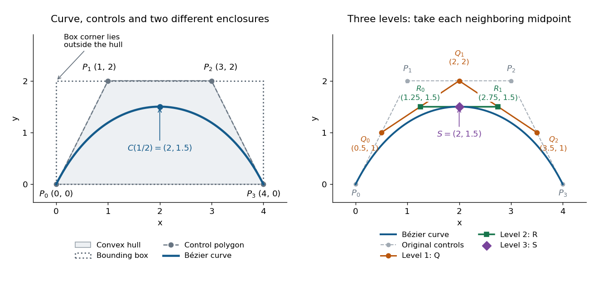
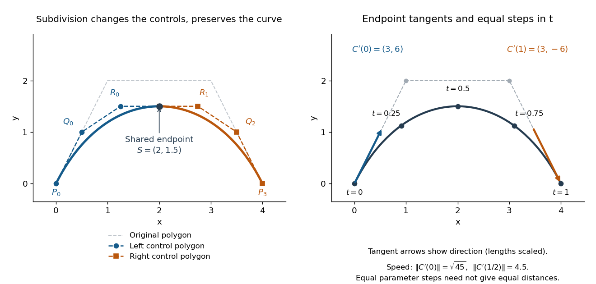

<h1 id="de-casteljau-s-algorithm">De Casteljau's algorithm</h1>

↑ **Parent:** [Bézier curve](bezier-curve.md)  
ⓦ [Wiki](https://en.wikipedia.org/wiki/De_Casteljau's_algorithm)

[De Casteljau's algorithm](de-casteljau-s-algorithm.md) evaluates a [Bézier curve](bezier-curve.md) by repeated [linear interpolation](linear-interpolation.md) between neighboring [control points](control-point.md). Fix $t\in[0,1]$, start with $P_i^{(0)}(t)=P_i$, and compute

$$
P_i^{(r)}(t)=(1-t)P_i^{(r-1)}(t)+tP_{i+1}^{(r-1)}(t),\qquad r=1,\ldots,n,\quad i=0,\ldots,n-r.
$$

Each new row has one fewer point. The final point is $P_0^{(n)}(t)=C(t)$. Use the same $t$ at every stage: it describes the fraction of each [line segment](line-segment.md) traversed from its first endpoint toward its second. A cubic [Bézier curve](bezier-curve.md) needs three levels containing $3$, $2$, and $1$ [linear interpolations](linear-interpolation.md), respectively.[Stanford CS348a, Handout 19, §2.3, pp. 10–11](https://graphics.stanford.edu/courses/cs164-10-spring/Handouts/handout19.pdf)

For the [Bézier curve](bezier-curve.md) with [control points](control-point.md) $P_0=(0,0)$, $P_1=(1,2)$, $P_2=(3,2)$, $P_3=(4,0)$, evaluation at $t=1/2$ takes the [midpoint](midpoint.md) of every neighboring pair. The first level gives

$$
Q_0=\tfrac12(P_0+P_1)=(0.5,1),\qquad Q_1=\tfrac12(P_1+P_2)=(2,2),\qquad Q_2=\tfrac12(P_2+P_3)=(3.5,1).
$$

The second level gives

$$
R_0=\tfrac12(Q_0+Q_1)=(1.25,1.5),\qquad R_1=\tfrac12(Q_1+Q_2)=(2.75,1.5),
$$

and the third level gives

$$
S=\tfrac12(R_0+R_1)=(2,1.5)=C(1/2).
$$

The intermediate [control polygons](control-polygon.md) shrink toward the evaluated point. Each step is a [convex combination](convex-combination.md), giving a geometric explanation of the [convex hull](convex-hull.md) property; every step also commutes with an [affine map](affine-map.md).

**[Figure 10](#image-cubic-bezier-curve-its-convex-hull-and-bounding-box-and-the-three-levels-of-de-casteljau-s-algorithm-at-t-1-2). Cubic Bézier curve, its convex hull and bounding box, and the three levels of De Casteljau's algorithm at t = 1/2**.

The same construction splits the [Bézier curve](bezier-curve.md) exactly, with no approximation. The outer edges of the triangular array give the new [control points](control-point.md): for a cubic, $(P_0,Q_0,R_0,S)$ specify the left piece and $(S,R_1,Q_2,P_3)$ specify the right piece.[Stanford CS348a, Handout 19, §2.3, p. 11, subsegment control points](https://graphics.stanford.edu/courses/cs164-10-spring/Handouts/handout19.pdf) At $t=1/2$ these two lists are

$$
L=\bigl((0,0),(0.5,1),(1.25,1.5),(2,1.5)\bigr),\qquad H=\bigl((2,1.5),(2.75,1.5),(3.5,1),(4,0)\bigr).
$$

Write $C_L$ and $C_H$ for the [Bézier curves](bezier-curve.md) defined by these lists, each with its own parameter $u\in[0,1]$. Then

$$
C_L(u)=C(u/2),\qquad C_H(u)=C((1+u)/2).
$$

Their images reproduce the original curve, while their [derivatives](derivative.md) account for the shorter parameter intervals. At the join,

$$
C_L(1)=C_H(0)=S,\qquad C_L'(1)=3(S-R_0)=(2.25,0)=3(R_1-S)=C_H'(0).
$$

The [chain rule](chain-rule.md) gives $C_L'(1)=C_H'(0)=C'(1/2)/2$; in the original parameter, both pieces have [derivative](derivative.md) $(4.5,0)$. This is the interval scaling in the [parametric first-derivative join of Bézier curves](parametric-first-derivative-join-of-bezier-curves.md).

**[Figure 11](#image-exact-midpoint-subdivision-with-two-smaller-control-polygons-endpoint-tangent-directions-and-equally-spaced-parameter-samples). Exact midpoint subdivision with two smaller control polygons, endpoint tangent directions, and equally spaced parameter samples**.

Repeated [midpoint](midpoint.md) splitting is useful for drawing [vector graphics](vector-graphics.md) paths: each piece has a smaller [control polygon](control-polygon.md) and its own [convex hull](convex-hull.md) enclosure. A renderer can refine pieces until they are sufficiently close to [line segments](line-segment.md) at the chosen display scale. Evaluating $C(t)$ and splitting it are thus two results of the same short [algorithm](algorithm.md).

For a proof outline, expanding the recursion gives

$$
P_i^{(r)}(t)=\sum_{j=0}^r\binom rj(1-t)^{r-j}t^jP_{i+j}.
$$

[Pascal's identity](pascal-s-rule.md) proves this by [induction](mathematical-induction.md); at $r=n$, $i=0$ it is precisely the [Bernstein basis](bernstein-basis.md) formula for the [Bézier curve](bezier-curve.md). The geometric construction remains useful even when expanding the [polynomial](polynomial-split.md) by hand would be cumbersome.

// Target: analysis.bigb

## ↑ Ancestors (7)

1. [Bézier curve](bezier-curve.md)
2. [Computer aided geometric design](computer-aided-geometric-design.md)
3. [Numerical analysis](numerical-analysis-split.md)
4. [Analysis](analysis-split.md)
5. [Area of mathematics](area-of-mathematics.md)
6. [Mathematics](mathematics-split.md)
7. [Codex Wiki](split.md)

## ← Incoming links (6)

- [Bézier curve](bezier-curve.md)
- [De Casteljau's algorithm](de-casteljau-s-algorithm.md)
- [Solution](past-exam-of-the-mathematics-course-of-the-university-of-cambridge/2003/iii/paper-68/4/solution.md)
- [Solution](past-exam-of-the-mathematics-course-of-the-university-of-cambridge/2005/iii/paper-66/1/iv/solution.md)
- [Solution](past-exam-of-the-mathematics-course-of-the-university-of-cambridge/2008/iii/paper-77/3/i/solution.md)
- [Solution](past-exam-of-the-mathematics-course-of-the-university-of-cambridge/2008/iii/paper-77/3/ii/solution.md)
