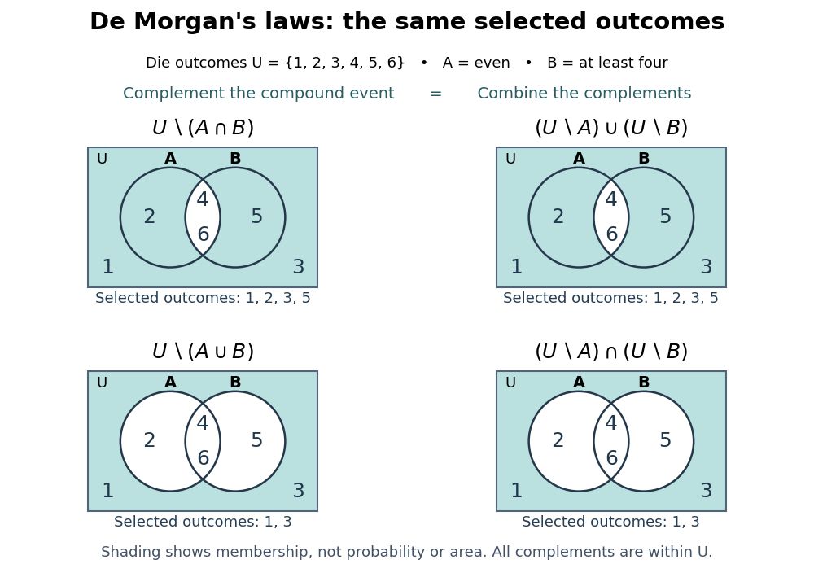

<h1 id="de-morgan-s-laws">De Morgan's laws</h1>

↑ **Parent:** [Boolean operation](boolean-operation.md)  
ⓦ [Wiki](https://en.wikipedia.org/wiki/De_Morgan's_laws)

[De Morgan's laws](de-morgan-s-laws.md) exchange [logical conjunction](logical-conjunction.md) and [logical disjunction](logical-disjunction.md) when a [logical negation](negation.md) moves across them:

$$
\neg(P\wedge Q)\equiv(\neg P)\vee(\neg Q),
\qquad
\neg(P\vee Q)\equiv(\neg P)\wedge(\neg Q).
$$

Here $\equiv$ denotes [logical equivalence](logical-equivalence.md): the two [propositional formulas](propositional-formula.md) agree under every [Boolean valuation](boolean-valuation.md).[Discrete Mathematics: An Open Introduction (3rd edition) by Oscar Levin; Discrete Mathematics: An Open Introduction, 3rd edition by Oscar Levin, §3.1, Logical Equivalence: definition, Example 3.1.3 and De Morgan's Laws box](discrete-mathematics-an-open-introduction-3rd-edition-by-oscar-levin/3-1-propositional-logic.md)

A complete verification uses the four rows of a [truth table](truth-table.md). In input order $(0,0),(0,1),(1,0),(1,1)$, both sides of the first [logical equivalence](logical-equivalence.md) have output sequence $(1,1,1,0)$; both sides of the second have $(1,0,0,0)$. A proof in words is equally short: failure of “both” means at least one failure, whereas failure of “at least one” means both fail. The differing middle rows explain why simply pushing [logical negation](negation.md) inward without changing AND to OR is wrong.

For the [events](event.md) in [Boolean operations on events](boolean-operations-on-events.md), the corresponding [set](set-split.md) identities are

$$
U\setminus(A\cap B)=(U\setminus A)\cup(U\setminus B)=\{1,2,3,5\},
$$

$$
U\setminus(A\cup B)=(U\setminus A)\cap(U\setminus B)=\{1,3\}.
$$

One can prove these identities by checking an arbitrary [set element](element-of-a-set.md) $u\in U$: its two membership [truth values](truth-value.md) obey [De Morgan's laws](de-morgan-s-laws.md). The same reasoning works for any two [subsets](subset.md) of a common [universal set](universal-set.md).

**[Figure 2](#image-de-morgan-s-laws-shade-the-same-set-whether-a-compound-event-is-complemented-first-or-its-component-events-are-complemented-first). De Morgan's laws shade the same set whether a compound event is complemented first or its component events are complemented first**.

For a nested program test, let $R$ mean “backup recent”, $V$ mean “backup verified”, and $O$ mean “manual override authorized”. Rejecting when neither an acceptable backup nor an override is present gives

$$
\neg\bigl((R\wedge V)\vee O\bigr)
\equiv\bigl((\neg R)\vee(\neg V)\bigr)\wedge\neg O.
$$

The transformed condition reads “backup stale or unverified, and no override”. Apply the second of [De Morgan's laws](de-morgan-s-laws.md) at the outside, then the first at the inner [logical conjunction](logical-conjunction.md). For $(R,V,O)=(1,0,0)$ it rejects; changing only $O$ to one makes it accept. With Boolean operands in [Python](python-programming-language.md), `not ((recent and verified) or override)` and `((not recent) or (not verified)) and (not override)` have the same result and inspect the operands in the same order, with the same skipped operands.

**Table of contents**

- [De Morgan dual of a Boolean function](de-morgan-dual-of-a-boolean-function.md)

## ↑ Ancestors (4)

1. [Boolean operation](boolean-operation.md)
2. [Theoretical computer science](theoretical-computer-science-split.md)
3. [Computer science](computer-science-split.md)
4. [Codex Wiki](split.md)

## ← Incoming links (12)

- [Boolean satisfiability problem](boolean-satisfiability-problem.md)
- [Complement of a set](complement-of-a-set.md)
- [Countable intersection](countable-intersection.md)
- [De Morgan dual of a Boolean function](de-morgan-dual-of-a-boolean-function.md)
- [De Morgan's laws](de-morgan-s-laws.md)
- [Dual Boolean function](dual-boolean-function.md)
- [Failure-probability budget](failure-probability-budget.md)
- [Logical equivalence](logical-equivalence.md)
- [Negation](negation.md)
- [Solution](past-exam-of-the-mathematics-course-of-the-university-of-cambridge/2013/iii/paper-59/3/c/solution.md)
- [Solution](past-exam-of-the-mathematics-course-of-the-university-of-cambridge/2017/ii/paper-3/4h/c/solution.md)
- [Solution](past-exam-of-the-mathematics-course-of-the-university-of-cambridge/2023/iii/paper-124/2/vi/solution.md)
