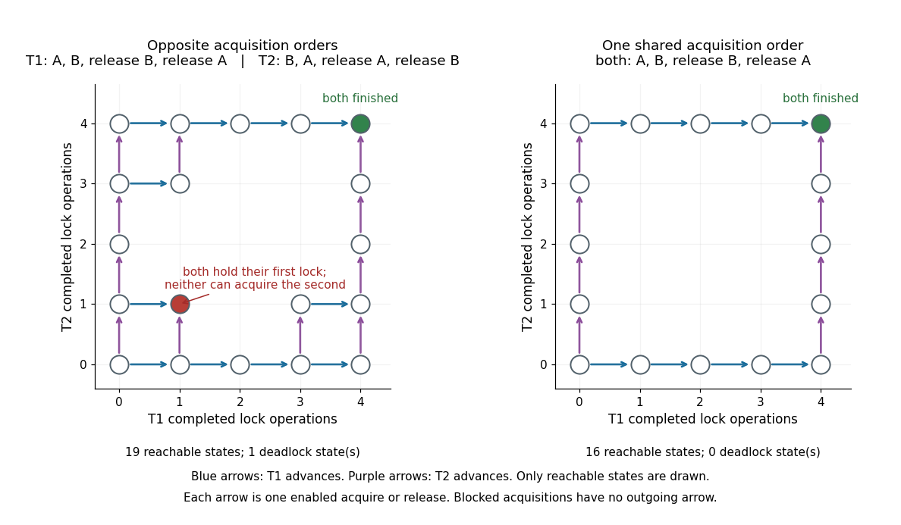

# Deadlock

↑ **Parent:** [Synchronization (computing)](synchronization-computing.md)  
ⓦ [Wiki](https://en.wikipedia.org/wiki/Deadlock)

A group of participants cannot proceed because each waits for a resource whose release depends on another participant in the group. Consider two initially free [mutex](mutex.md) objects A and B. T1 acquires A then tries B; T2 acquires B then tries A. If each obtains its first [mutex](mutex.md), both wait permanently for the other, with release reachable only after the second acquisition. Each [mutex](mutex.md) still enforces [mutual exclusion](mutual-exclusion.md).[pp. 5–7, figures 32.6–32.7: opposing acquisition orders and circular wait](operating-systems-three-easy-pieces-by-remzi-h-arpaci-dusseau-and-others/common-concurrency-problems.md)

**[Figure 9](#image-reachable-states-for-opposite-mutex-acquisition-orders-and-for-one-shared-lock-ordering). Reachable states for opposite mutex acquisition orders and for one shared lock ordering**.

Each [software thread](thread-computing.md) performs four indivisible operations: acquire its first [mutex](mutex.md), acquire its second, release the second, release the first. An unavailable acquisition blocks; neither participant releases early. A state records each participant's completed-operation count and both owners. Exhaustive exploration finds 19 reachable states with opposite orders, including exactly one nonterminal state with no enabled operation: both counts are $1$, T1 owns A, and T2 owns B. Giving both participants the order A then B leaves 16 reachable states and no such blocked state. Unshown grid positions are unreachable. These are tiny [sequential consistency](sequential-consistency.md) models, without timeouts, cancellation, recursive acquisition or other resources.

**Table of contents**

- [Deadlock freedom](deadlock-freedom.md)
- [Lock ordering](lock-ordering.md)

## ↑ Ancestors (6)

1. [Synchronization (computing)](synchronization-computing.md)
2. [Thread (computing)](thread-computing.md)
3. [Process (computing)](process-computing.md)
4. [Operating system](operating-system-split.md)
5. [Computer science](computer-science-split.md)
6. [Codex Wiki](split.md)

## ← Incoming links (2)

- [Deadlock freedom](deadlock-freedom.md)
- [Lock ordering](lock-ordering.md)
