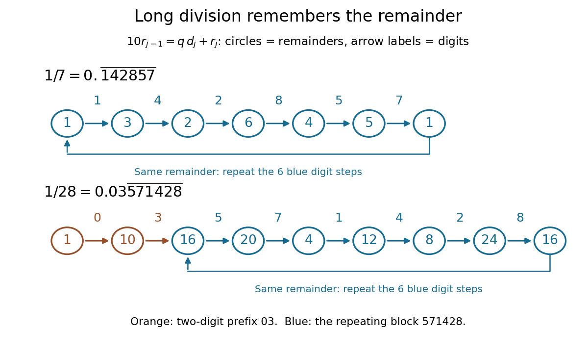

# Decimal period from multiplicative order

↑ **Parent:** [Multiplicative order](multiplicative-order.md)

For a [reduced fraction](reduced-fraction.md) $p/q$ with $0<p<q$, $q>1$, and $q,10$ [coprime integers](coprime-integers.md), its [decimal representation](decimal-representation.md) repeats immediately after the decimal point. The shortest repeating block has length

$$
L=\operatorname{ord}_q(10),\qquad L\mid\varphi(q).
$$

Here $\operatorname{ord}$ denotes [multiplicative order](multiplicative-order.md), and $\varphi$ denotes [Euler's totient function](euler-totient-function.md). Changing the [numerator](numerator.md) preserves the [decimal period](decimal-period-from-multiplicative-order.md) as long as the [fraction](fraction.md) remains reduced.[pp. 7–8, Theorem 4.5 and Remark 4.9](orders-of-units-in-modular-arithmetic-by-keith-conrad.md)

For example, [long division](long-division.md) of $1/7$ gives the [remainders](remainder.md) $1,3,2,6,4,5,1$, with emitted digits $1,4,2,8,5,7$. Consequently

$$
\frac17=0.\overline{142857},\qquad \operatorname{ord}_7(10)=6.
$$

Each [remainder](remainder.md) determines both the next digit and the next [remainder](remainder.md); returning to one restarts the same six steps.

**[Figure 26](#image-long-division-remainders-explain-the-six-digit-repeat-of-one-seventh-and-the-two-digit-prefix-of-one-twenty-eighth). Long-division remainders explain the six-digit repeat of one seventh and the two-digit prefix of one twenty-eighth**.

More generally, initialize [long division](long-division.md) with $r_0=p$. At each step, [division with remainder](euclidean-division.md) gives

$$
10r_{j-1}=qd_j+r_j,\qquad 0\leq d_j\leq9,\qquad 0\leq r_j<q,
$$

so $r_j\equiv p10^j\pmod q$. Since $p,q$ are [coprime integers](coprime-integers.md), the [modular inverse](modular-multiplicative-inverse.md) of $p$ shows that $r_L=r_0$ exactly when $10^L\equiv1\pmod q$. To see why the digit block cannot repeat sooner than the [remainders](remainder.md), a purely [repeating decimal](repeating-decimal.md) with a block of $L$ digits represents $D/(10^L-1)$ for an [integer](integer-split.md) $D$. A [reduced fraction](reduced-fraction.md) $p/q$ with that value forces $q\mid10^L-1$. Hence the shortest digit repeat and the [multiplicative order](multiplicative-order.md) coincide.

Knowing the [decimal period](decimal-period-from-multiplicative-order.md) predicts how many digits must be computed and stored: one block determines the whole [repeating decimal](repeating-decimal.md). It also constructs the block directly. With $L=\operatorname{ord}_q(10)$, the [integer](integer-split.md)

$$
D=\frac{p(10^L-1)}q
$$

is the block, padded on the left with zeros to $L$ digits. For $1/11$, $L=2$ and $D=9$, so the block is $09$ and $1/11=0.\overline{09}$. Reduction matters: $7/21=1/3=0.\overline3$ has [decimal period](decimal-period-from-multiplicative-order.md) one, whereas $\operatorname{ord}_{21}(10)=6$.

If the reduced [denominator](denominator.md) contains [prime factors](prime-factor.md) two or five, ten has no [multiplicative order](multiplicative-order.md) modulo that whole [denominator](denominator.md). Write

$$
q=2^u5^v m,\qquad \gcd(m,10)=1,\qquad k_0=\max(u,v).
$$

The [decimal preperiod](decimal-preperiod.md) has exactly $k_0$ digits. If $m>1$, the remaining [repeating decimal](repeating-decimal.md) has [decimal period](decimal-period-from-multiplicative-order.md) $\operatorname{ord}_m(10)$. For instance, $28=2^2\cdot7$ gives $1/28=0.03\overline{571428}$: two prefix digits, then six repeating digits. If $m=1$, the [decimal representation](decimal-representation.md) is a [terminating decimal](terminating-decimal.md) with exactly $k_0$ fractional places. We use the representation ending in zeros, rather than its alternative ending in nines; for example $1/40=0.025$ terminates after three places.

A short derivation explains both cases. After $k$ digits, multiplying the [reduced fraction](reduced-fraction.md) by $10^k$ and discarding its [integer](integer-split.md) part leaves a [reduced fraction](reduced-fraction.md) whose [denominator](denominator.md) is $q/\gcd(q,10^k)$. This [denominator](denominator.md) first becomes [coprime](coprime-integers.md) to ten at $k=k_0$. It then equals $m$, giving an immediate repeat when $m>1$, or an [integer](integer-split.md) when $m=1$. The same [long division](long-division.md) argument works for [positional notation](positional-notation.md) in any base $b\geq2$: for a reduced [denominator](denominator.md) $q>1$ [coprime](coprime-integers.md) to $b$, the shortest repeating block has length $\operatorname{ord}_q(b)$.

## ↑ Ancestors (5)

1. [Multiplicative order](multiplicative-order.md)
2. [Number theory](number-theory-split.md)
3. [Area of mathematics](area-of-mathematics.md)
4. [Mathematics](mathematics-split.md)
5. [Codex Wiki](split.md)

## ← Incoming links (4)

- [Decimal preperiod](decimal-preperiod.md)
- [Solution](past-exam-of-the-mathematics-course-of-the-university-of-cambridge/2007/ia/paper-4/8e/ii/solution.md)
- [Solution](past-exam-of-the-mathematics-course-of-the-university-of-cambridge/2007/ia/paper-5/12/ii/solution.md)
- [Terminating decimal](terminating-decimal.md)
