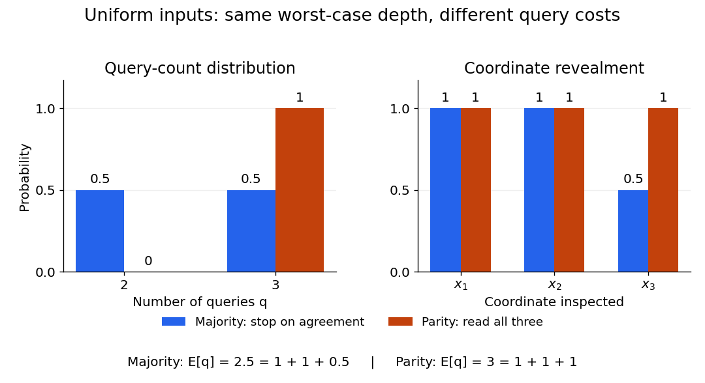

# Decision-tree query cost

↑ **Parent:** [Decision tree](decision-tree.md)

For a particular [decision tree](decision-tree.md) $T$, its [decision-tree query cost](decision-tree-query-cost.md) $q_T(x)$ is the number of queries along the [graph path](path-in-a-graph.md) followed by [input](input-computer-science.md) $x$. Its actual tree depth is

$$
h(T)=\max_{x\in\{0,1\}^n}q_T(x).
$$

The query [vertices](vertex-graph-theory.md) count as operations; each is followed by one answer [edge](edge-of-a-graph.md). Thus a leaf reached after $k$ queries has [graph path](path-in-a-graph.md) length $k$, and a tree consisting only of an [output](output-computing.md) leaf has depth zero. With no repeated coordinates, $0\leq q_T(x)\leq n$. The [decision-tree depth](decision-tree-depth.md) $D(f)$ minimizes $h(T)$ over all correct [decision trees](decision-tree.md) for $f$; $h(T)$ measures the chosen algorithm, while $D(f)$ measures the [Boolean function](boolean-function.md).

Choose an [input](input-computer-science.md) [probability distribution](probability-distribution-split.md) $\mu$ and let $X$ have that distribution. Then $q_T(X)$ is a [random variable](random-variable-split.md) even when the [decision tree](decision-tree.md) is deterministic. Its [probability mass function](probability-mass-function.md) describes how often each path length occurs, and its [expected value](expected-value-split.md) is the [expected query cost](expected-query-cost.md). None of these quantities changes the actual maximum depth of $T$.

**[Figure 4](#image-uniform-three-bit-inputs-query-count-distributions-and-coordinate-revealment-for-majority-and-parity). Uniform three-bit inputs: query-count distributions and coordinate revealment for majority and parity**.

The left panel aggregates the eight [inputs](input-computer-science.md) from the [three-bit majority decision tree](three-bit-majority-decision-tree.md): four cost two queries and four cost three. [Parity](parity.md) always costs three. The right panel asks a different question, which coordinates are inspected: the [majority function](majority-function.md) algorithm always queries coordinates 1 and 2, but queries coordinate 3 only on disagreements. These are [probabilities](probability.md) of inspection, not [probabilities](probability.md) that a [bit](bit.md) equals one.

**Table of contents**

- [Expected query cost](expected-query-cost.md)
- [Coordinate revealment](coordinate-revealment.md)

## ↑ Ancestors (6)

1. [Decision tree](decision-tree.md)
2. [Decision tree model](decision-tree-model.md)
3. [Computational complexity theory](computational-complexity-theory.md)
4. [Theoretical computer science](theoretical-computer-science-split.md)
5. [Computer science](computer-science-split.md)
6. [Codex Wiki](split.md)

## ← Incoming links (3)

- [Decision tree](decision-tree.md)
- [Decision-tree query cost](decision-tree-query-cost.md)
- [Three-bit majority decision tree](three-bit-majority-decision-tree.md)
