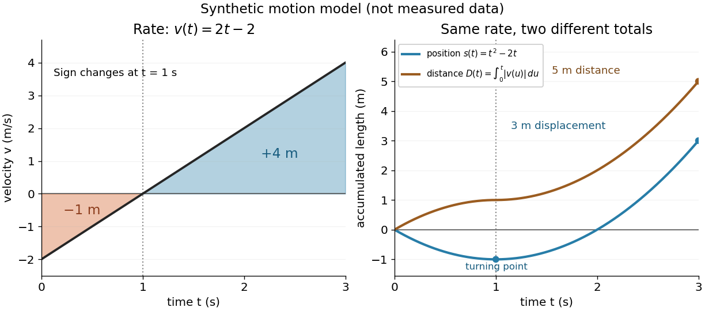

# Definite integral

↑ **Parent:** [Integral](integral-split.md)

A [definite integral](definite-integral.md) accumulates an [integrand](integrand.md) between specified endpoints, retaining the sign of each contribution. For a [real-valued function](real-valued-function.md) on a finite [real interval](interval-mathematics.md), a finite [definite integral](definite-integral.md) is a [scalar](scalar.md); an [indefinite integral](antiderivative.md) describes a family of [antiderivatives](antiderivative.md). The lower and upper limits of integration $a,b$ specify where accumulation starts and ends. The integration variable is a placeholder: $\int_a^b f(x)\,dx=\int_a^b f(u)\,du$.

This is useful whenever a varying rate must be converted into a total change. For motion along a [straight line](straight-line.md) with [continuous](continuous-function.md) [velocity](velocity.md) $v(t)$ and [position](position.md) $s(t)$ satisfying $s'(t)=v(t)$, the [fundamental theorem of calculus](fundamental-theorem-of-calculus.md) gives [displacement](displacement.md), while accumulating [speed](speed.md) gives the [distance traveled from velocity](distance-traveled-from-velocity.md):

$$
s(b)-s(a)=\int_a^b v(t)\,dt,\qquad
D=\int_a^b |v(t)|\,dt,\qquad a<b.
$$

Negative [velocity](velocity.md) reduces [displacement](displacement.md) while adding to the [distance traveled from velocity](distance-traveled-from-velocity.md). The [physical dimension](physical-dimension.md) of a [definite integral](definite-integral.md) is the product of the [integrand](integrand.md)'s [physical dimension](physical-dimension.md) and the integration variable's [physical dimension](physical-dimension.md): here $(\mathrm{m}/\mathrm{s})\mathrm{s}=\mathrm{m}$. An [area](surface-area.md) on a rate graph need not be a spatial [area](surface-area.md).[Theorem 5.6 and the displacement and total-distance discussion](calculus-volume-1-by-gilbert-strang-and-others/5-4-integration-formulas-and-the-net-change-theorem.md)

As an explicitly synthetic motion model, let $v(t)=(2\,\mathrm{m}\,\mathrm{s}^{-2})t-2\,\mathrm{m}\,\mathrm{s}^{-1}$ for $0\le t\le3\,\mathrm{s}$, with $s(0)=0$. Using numerical values in seconds and metres, an [antiderivative](antiderivative.md) gives $s(t)=t^2-2t$. The [velocity](velocity.md) changes sign at $t=1$: the model first moves $1$ m in the negative direction, then $4$ m in the positive direction. Its [displacement](displacement.md) is $-1+4=3$ m, and its [distance traveled from velocity](distance-traveled-from-velocity.md) is $1+4=5$ m. The initial [position](position.md) fixes the [constant of integration](constant-of-integration.md), but does not change either accumulated quantity.

**[Figure 3](#variable-velocity-displacement-and-distance). Synthetic variable velocity model with displacement 3 metres and distance traveled 5 metres over three seconds**.

Orientation matters independently of whether the [integrand](integrand.md) is positive or negative. For a [function](function-split.md) [integrable](integrability.md) on the [interval](interval-mathematics.md) containing the endpoints, use the conventions

$$
\int_a^a f(x)\,dx=0,\qquad
\int_b^a f(x)\,dx=-\int_a^b f(x)\,dx,\qquad
\int_a^c f(x)\,dx=\int_a^b f(x)\,dx+\int_b^c f(x)\,dx.
$$

For the preceding [velocity](velocity.md) model, accumulation from $3$ seconds back to $0$ seconds gives $-3$ m. Reversing the bounds of the [speed](speed.md) [integral](integral-split.md) gives $-5$ m, which is an oriented [integral](integral-split.md), not a negative [distance traveled from velocity](distance-traveled-from-velocity.md); physical elapsed-time totals use the earlier endpoint first. The splitting rule holds even when $b$ is outside the [interval](interval-mathematics.md) between $a$ and $c$, provided [integrability](integrability.md) holds on the [interval](interval-mathematics.md) containing all three endpoints.[5.2 The Definite Integral](calculus-volume-1-by-gilbert-strang-and-others/5-2-the-definite-integral.md)

Existence needs hypotheses. For a [bounded function](bounded-function.md) $f$ on $[a,b]$ with $a<b$, a finite [Riemann integral](riemann-integral.md) exists when every tagged [Riemann sum](riemann-sum.md) approaches the same value as the largest cell width tends to zero:

$$
\int_a^b f(x)\,dx=\lim_{\max_i(x_i-x_{i-1})\to0}
\sum_{i=1}^n f(\xi_i)(x_i-x_{i-1}),\qquad
a=x_0<\cdots<x_n=b,\quad \xi_i\in[x_{i-1},x_i].
$$

The [limit](limit-of-a-function.md) must be independent of both the [partition of an interval](partition-of-an-interval.md) and the tags. Merely making the number of cells large can leave a wide cell unresolved. On a finite [closed interval](closed-real-interval.md), every [continuous function](continuous-function.md), and every [bounded function](bounded-function.md) that is [continuous](continuous-function.md) except at finitely many points, is [Riemann integrable](riemann-integrable-function.md).[Lemma 5.2.7 and Theorem 5.2.9](basic-analysis-introduction-to-real-analysis-volume-i-by-jiri-lebl/5-2-properties-of-the-integral.md) Boundedness alone is insufficient: the [Dirichlet function](dirichlet-function.md) on $[0,1]$ is $1$ on the [rational numbers](rational-number.md) and $0$ on the [irrational numbers](irrational-number.md). Tags can all be chosen rational or all irrational, giving [Riemann sums](riemann-sum.md) of $1$ or $0$ at arbitrarily small cell widths.[Example 5.1.4](basic-analysis-introduction-to-real-analysis-volume-i-by-jiri-lebl/5-1-the-riemann-integral.md)

For a finite signed [Lebesgue integral](lebesgue-integral.md), the condition is instead that $f$ be a [measurable function](measurable-function.md) for [Lebesgue measure](lebesgue-measure.md) and $\int_{[a,b]}|f|\,dx<\infty$. A [measurable function](measurable-function.md) for [Lebesgue measure](lebesgue-measure.md) that is also a [bounded function](bounded-function.md) on a finite [interval](interval-mathematics.md) satisfies this condition since $|f|\le M$ gives $\int|f|\le M(b-a)$. The [Dirichlet function](dirichlet-function.md) therefore has [Lebesgue integral](lebesgue-integral.md) zero: the [rational numbers](rational-number.md) form a [null set](null-set.md), so it equals zero [Lebesgue almost everywhere](almost-everywhere.md). The [Riemann integral](riemann-integral.md) and [Lebesgue integral](lebesgue-integral.md) agree for the [continuous functions](continuous-function.md) used in the diagrams.[Definition 120, Proposition 123(2), Remark 124 and Theorem 126](18-102-introduction-to-functional-analysis-spring-2021-lecture-notes-by-andrew-lin/lecture-12-lebesgue-integrable-functions-the-lebesgue-integral-and-the-dominated-convergence-theorem.md) An unbounded [integrand](integrand.md) or infinite endpoint requires further analysis, for example the [limits](limit-of-a-function.md) defining an [improper integral](improper-integral.md); the notation alone does not establish convergence.

**Table of contents**

- [Integration limit](integration-limit.md)
- [Distance traveled from velocity](distance-traveled-from-velocity.md)

## ↑ Ancestors (7)

1. [Integral](integral-split.md)
2. [Calculus](calculus-split.md)
3. [Real analysis](real-analysis-split.md)
4. [Analysis](analysis-split.md)
5. [Area of mathematics](area-of-mathematics.md)
6. [Mathematics](mathematics-split.md)
7. [Codex Wiki](split.md)

## ← Incoming links (38)

- [Change of variables formula](change-of-variables-formula.md)
- [Cold-junction compensation](cold-junction-compensation.md)
- [Cubic exactness of Simpson's rule](cubic-exactness-of-simpson-s-rule.md)
- [Definite integral](definite-integral.md)
- [Disc integration](disc-integration.md)
- [Finite samples do not certify quadrature accuracy](finite-samples-do-not-certify-quadrature-accuracy.md)
- [Integral](integral-split.md)
- [Integrating factor](integrating-factor.md)
- [Integration by parts](integration-by-parts.md)
- [Integration by substitution](integration-by-substitution.md)
- [Integration limit](integration-limit.md)
- [Linear functional](linear-functional.md)
- [Numerical integration](numerical-integration-split.md)
- [Solution](past-exam-of-the-mathematics-course-of-the-year-1-of-the-natural-sciences-course-of-the-university-of-cambridge/2007/paper-2/section-a/2/b/solution.md)
- [Solution](past-exam-of-the-mathematics-course-of-the-year-1-of-the-natural-sciences-course-of-the-university-of-cambridge/2012/paper-1/5/solution.md)
- [Solution](past-exam-of-the-mathematics-course-of-the-year-1-of-the-natural-sciences-course-of-the-university-of-cambridge/2013/paper-1/10/b/solution.md)
- [Solution](past-exam-of-the-mathematics-course-of-the-year-1-of-the-natural-sciences-course-of-the-university-of-cambridge/2014/paper-1/9/a/solution.md)
- [Solution](past-exam-of-the-mathematics-course-of-the-year-1-of-the-natural-sciences-course-of-the-university-of-cambridge/2015/paper-1/14/d/solution.md)
- [Solution](past-exam-of-the-mathematics-course-of-the-year-1-of-the-natural-sciences-course-of-the-university-of-cambridge/2015/paper-1/5/solution.md)
- [Solution](past-exam-of-the-mathematics-course-of-the-year-1-of-the-natural-sciences-course-of-the-university-of-cambridge/2016/paper-1/13/b/solution.md)
- [Solution](past-exam-of-the-mathematics-course-of-the-year-1-of-the-natural-sciences-course-of-the-university-of-cambridge/2016/paper-1/18/a/i/solution.md)
- [Solution](past-exam-of-the-mathematics-course-of-the-year-1-of-the-natural-sciences-course-of-the-university-of-cambridge/2016/paper-1/7/b/solution.md)
- [Solution](past-exam-of-the-mathematics-course-of-the-year-1-of-the-natural-sciences-course-of-the-university-of-cambridge/2019/paper-1/17/b/solution.md)
- [Solution](past-exam-of-the-mathematics-course-of-the-year-1-of-the-natural-sciences-course-of-the-university-of-cambridge/2019/paper-1/20/a/solution.md)
- [Solution](past-exam-of-the-mathematics-course-of-the-year-1-of-the-natural-sciences-course-of-the-university-of-cambridge/2019/paper-1/20/b/solution.md)
- [Solution](past-exam-of-the-mathematics-course-of-the-year-1-of-the-natural-sciences-course-of-the-university-of-cambridge/2019/paper-1/20/c/solution.md)
- [Solution](past-exam-of-the-mathematics-course-of-the-year-1-of-the-natural-sciences-course-of-the-university-of-cambridge/2019/paper-2/2/b/solution.md)
- [Solution](past-exam-of-the-mathematics-course-of-the-year-1-of-the-natural-sciences-course-of-the-university-of-cambridge/2020/paper-1/17/b/solution.md)
- [Solution](past-exam-of-the-mathematics-course-of-the-year-1-of-the-natural-sciences-course-of-the-university-of-cambridge/2024/paper-1/10/b/solution.md)
- [Solution](past-exam-of-the-mathematics-course-of-the-year-1-of-the-natural-sciences-course-of-the-university-of-cambridge/2024/paper-1/17/a/solution.md)
- [Solution](past-exam-of-the-mathematics-course-of-the-year-1-of-the-natural-sciences-course-of-the-university-of-cambridge/2025/paper-1/13/a/solution.md)
- [Solution](past-exam-of-the-mathematics-course-of-the-year-1-of-the-natural-sciences-course-of-the-university-of-cambridge/2025/paper-1/13/b/solution.md)
- [Solution](past-exam-of-the-mathematics-course-of-the-year-1-of-the-natural-sciences-course-of-the-university-of-cambridge/2025/paper-1/5/b/solution.md)
- [Richardson extrapolation](richardson-extrapolation.md)
- [Signed area under a graph](signed-area-under-a-graph.md)
- [Simpson's rule](simpson-s-rule.md)
- [Sine-weighted power integral recurrence](sine-weighted-power-integral-recurrence.md)
- [Trigonometric substitution](trigonometric-substitution.md)
