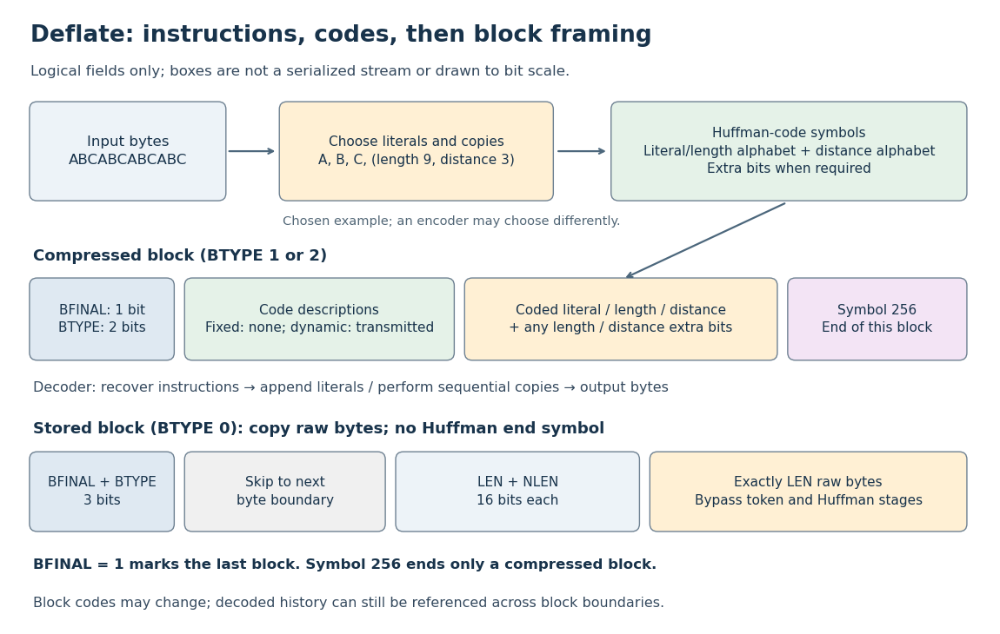

# Deflate block framing

↑ **Parent:** [Deflate](deflate.md)

Each block starts with a one-[bit](bit.md) `BFINAL` flag and a two-[bit](bit.md) `BTYPE` field. The `BTYPE` values are 0 for stored data, 1 for fixed [Huffman codes](huffman-code.md), 2 for dynamic [Huffman codes](huffman-code.md), and 3 for an invalid reserved value. For compressed blocks, symbol 256 ends the current block; `BFINAL = 1` says this is the last block. An end-of-block symbol does not mean a literal zero [byte](byte.md), and in a nonfinal block it does not end the whole stream.[RFC 1951, section 3.2.3: header, block types and decoding loop](deflate-compressed-data-format-specification-version-1-3-by-l-peter-deutsch.md)

**[Figure 8](#image-deflate-separates-literal-and-copy-instructions-from-huffman-coding-and-final-block-framing-stored-blocks-bypass-both-stages). Deflate separates literal and copy instructions from Huffman coding and final-block framing; stored blocks bypass both stages**.

A stored block instead skips to the next [byte](byte.md) boundary, reads the sixteen-[bit](bit.md) `LEN` and its sixteen-[bit](bit.md) one's complement `NLEN`, then copies exactly `LEN` raw [bytes](byte.md). Its length field replaces the compressed block's end-of-block symbol. A compressed block need not end at a [byte](byte.md) boundary, so the next block header can start inside the current [byte](byte.md).[RFC 1951, sections 3.2.3 and 3.2.4: alignment, LEN, NLEN and stored data](deflate-compressed-data-format-specification-version-1-3-by-l-peter-deutsch.md)

The diagram shows logical fields, not a serialization into [bits](bit.md). RFC 1951 specifies [bit](bit.md) packing separately, including different conventions for [codewords](codeword.md) and other fields (section 3.1.1). For [PNG](png.md), the filtered image data is compressed inside a zlib wrapper with its own header and checksum; raw [Deflate](deflate.md) and a complete [PNG](png.md) file therefore have different framing.[PNG Specification, Third Edition, sections 10.1 and 10.2: zlib wrapper and filtered image data](portable-network-graphics-png-specification-third-edition-by-mark-adler-and-others.md)

## ↑ Ancestors (4)

1. [Deflate](deflate.md)
2. [Data compression](data-compression.md)
3. [Computer science](computer-science-split.md)
4. [Codex Wiki](split.md)

## ← Incoming links (3)

- [Deflate](deflate.md)
- [Deflate compression overhead](deflate-compression-overhead.md)
- [Deflate overlapping copy](deflate-overlapping-copy.md)
