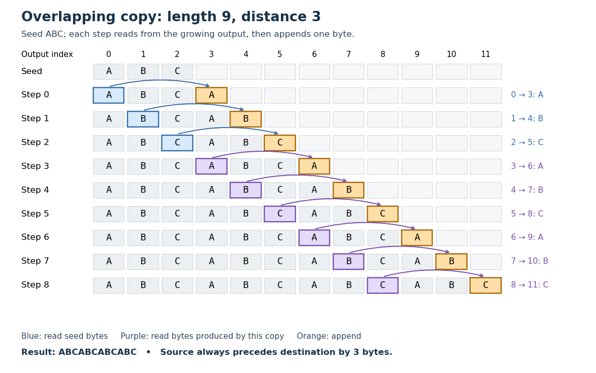

# Deflate overlapping copy

↑ **Parent:** [Deflate backreference](deflate-backreference.md)

In a [Deflate overlapping copy](deflate-overlapping-copy.md), $\ell>d$: some source [bytes](byte.md) are created by the very copy being decoded. For each step $i=0,\ldots,\ell-1$, read the current [output](output-computing.md) at index $n+i-d$ and append that [byte](byte.md) at index $n+i$. Because $d\geq1$, the source index is always smaller than the destination index, so the needed [byte](byte.md) exists when it is read.[RFC 1951, section 3.2.3, printed p. 11: overlapping string references](deflate-compressed-data-format-specification-version-1-3-by-l-peter-deutsch.md)

For `ABC` followed by $(9,3)$, the source indices are $0,1,2,3,4,5,6,7,8$ and the destination indices are $3,4,5,6,7,8,9,10,11$. Steps 0 through 2 copy the original `ABC`; steps 3 through 5 copy the `ABC` just appended; steps 6 through 8 copy the next newly appended `ABC`. Thus the final [output](output-computing.md) is exactly `ABCABCABCABC`. Taking a snapshot of the original three-[byte](byte.md) source slice would produce only three [bytes](byte.md); that operation does not implement the specified nine-[byte](byte.md) copy.

**[Figure 7](#image-nine-successive-copies-at-distance-three-extend-abc-to-abcabcabcabc-using-newly-produced-bytes). Nine successive copies at distance three extend ABC to ABCABCABCABC using newly produced bytes**.

The reusable idea is a short description of periodic continuation: the decoder repeatedly looks a fixed distance behind its growing [output](output-computing.md). A [Deflate backreference](deflate-backreference.md) can also reach across a [Deflate block framing](deflate-block-framing.md) boundary. Changing the block's [Huffman codes](huffman-code.md) does not by itself erase the decoded history.[RFC 1951, sections 2 and 3.2.3: independent block codes, references across blocks](deflate-compressed-data-format-specification-version-1-3-by-l-peter-deutsch.md)

## ↑ Ancestors (5)

1. [Deflate backreference](deflate-backreference.md)
2. [Deflate](deflate.md)
3. [Data compression](data-compression.md)
4. [Computer science](computer-science-split.md)
5. [Codex Wiki](split.md)

## ← Incoming links (1)

- [Deflate overlapping copy](deflate-overlapping-copy.md)
