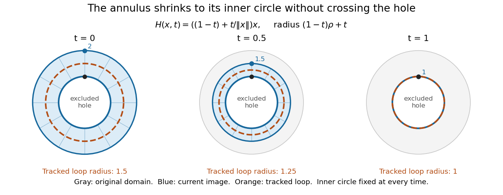

# Deformation retraction

↑ **Parent:** [Retract](retract.md)

A [deformation retraction](deformation-retraction.md) of $X$ onto a subspace $A$ is a [homotopy](homotopy-split.md) $H:X\times[0,1]\to X$ such that $H(x,0)=x$, $H(x,1)=r(x)\in A$, and $H(a,t)=a$ for every $a\in A$ and every $t$. Thus the [retract](retract.md) is fixed pointwise throughout. With inclusion $i:A\hookrightarrow X$, the equations $r\circ i=\operatorname{id}_A$ and $i\circ r\simeq\operatorname{id}_X$ exhibit a [homotopy equivalence](homotopy-equivalence.md). See [Hatcher, Algebraic Topology, Chapter 0, pp. 2–3](https://pi.math.cornell.edu/~hatcher/AT/ATch0.pdf#page=2).

Take the closed [annulus](annulus-mathematics.md)

$$
A=\{x\in\mathbb R^2:1\leq\lVert x\rVert\leq2\}.
$$

An exact [deformation retraction](deformation-retraction.md) onto its inner [circle](circle.md) is

$$
H(x,t)=\left((1-t)+\frac{t}{\lVert x\rVert}\right)x,
\qquad r(x)=\frac{x}{\lVert x\rVert}.
$$

The denominator is nonzero everywhere on the [annulus](annulus-mathematics.md). If the starting radius is $\rho=\lVert x\rVert$, its radius at time $t$ is $(1-t)\rho+t$. This lies between $1$ and $\rho\leq2$, verifying that the entire [homotopy](homotopy-split.md) stays in the original [annulus](annulus-mathematics.md). When $\rho=1$, the point is stationary, as required.

For $x=(0,2)$, times $0,1/2,1$ give $(0,2),(0,3/2),(0,1)$. A radius-$3/2$ [loop](loop-topology.md) similarly becomes a radius-$5/4$ [loop](loop-topology.md) halfway through, then the unit [circle](circle.md). Its angle and [winding number](winding-number.md) are preserved. This is useful because computing the [fundamental group](fundamental-group.md) of the [annulus](annulus-mathematics.md) reduces to computing that of the [circle](circle.md); the explicit [homotopy equivalence](homotopy-equivalence.md) establishes why the answer transfers.

**[Figure 2](#image-radial-deformation-of-the-closed-annulus-onto-its-fixed-inner-circle-with-intermediate-radii-staying-in-the-annulus). Radial deformation of the closed annulus onto its fixed inner circle, with intermediate radii staying in the annulus**.

## ↑ Ancestors (7)

1. [Retract](retract.md)
2. [Homotopy](homotopy-split.md)
3. [Algebraic topology](algebraic-topology-split.md)
4. [Geometry and topology](geometry-and-topology-split.md)
5. [Area of mathematics](area-of-mathematics.md)
6. [Mathematics](mathematics-split.md)
7. [Codex Wiki](split.md)

## ← Incoming links (23)

- [Algebraic topology](algebraic-topology-split.md)
- [Boundary of a Möbius band winds twice around its core](boundary-of-a-mobius-band-winds-twice-around-its-core.md)
- [Core circle of a Möbius band](core-circle-of-a-mobius-band.md)
- [Deformation retraction](deformation-retraction.md)
- [Euler characteristic of an annulus](euler-characteristic-of-an-annulus.md)
- [Fundamental group](fundamental-group.md)
- [Kernel cover of a real projective plane wedged with a circle](kernel-cover-of-a-real-projective-plane-wedged-with-a-circle.md)
- [Möbius band](mobius-band.md)
- [Orientable total space of the orientation line bundle](orientable-total-space-of-the-orientation-line-bundle.md)
- [Solution](past-exam-of-the-mathematics-course-of-the-university-of-cambridge/2002/iii/paper-14/4/solution.md)
- [Solution](past-exam-of-the-mathematics-course-of-the-university-of-cambridge/2004/iii/paper-19/3/c/solution.md)
- [Solution](past-exam-of-the-mathematics-course-of-the-university-of-cambridge/2008/ii/paper-1/21f/ii/solution.md)
- [Solution](past-exam-of-the-mathematics-course-of-the-university-of-cambridge/2008/iii/paper-18/1/solution.md)
- [Solution](past-exam-of-the-mathematics-course-of-the-university-of-cambridge/2010/iii/paper-17/1/b/solution.md)
- [Solution](past-exam-of-the-mathematics-course-of-the-university-of-cambridge/2012/iii/paper-19/1/solution.md)
- [Solution](past-exam-of-the-mathematics-course-of-the-university-of-cambridge/2012/iii/paper-19/2/solution.md)
- [Solution](past-exam-of-the-mathematics-course-of-the-university-of-cambridge/2014/iii/paper-14/5/2/solution.md)
- [Solution](past-exam-of-the-mathematics-course-of-the-university-of-cambridge/2017/ii/paper-2/19i/c/iii/solution.md)
- [Solution](past-exam-of-the-mathematics-course-of-the-university-of-cambridge/2017/iii/paper-114/1/solution.md)
- [Solution](past-exam-of-the-mathematics-course-of-the-university-of-cambridge/2017/iii/paper-114/2/solution.md)
- [Solution](past-exam-of-the-mathematics-course-of-the-university-of-cambridge/2018/iii/paper-114/2/solution.md)
- [Solution](past-exam-of-the-mathematics-course-of-the-university-of-cambridge/2020/ii/paper-2/21f/a/solution.md)
- [Solution](past-exam-of-the-mathematics-course-of-the-university-of-cambridge/2021/iii/paper-115/2/b/solution.md)
