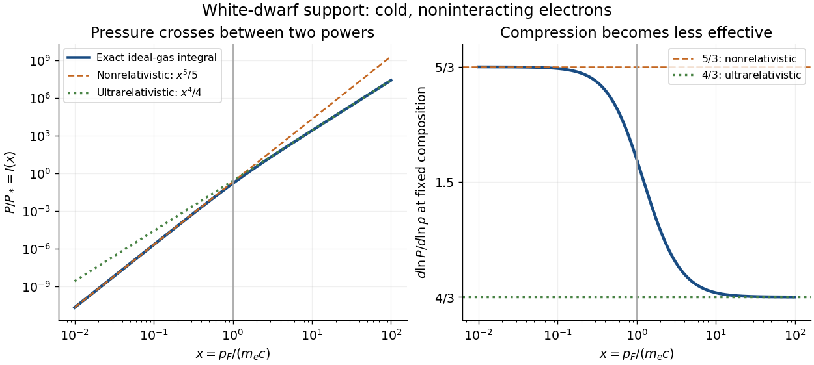

# Degenerate-electron pressure crossover

↑ **Parent:** [Chandrasekhar limit](chandrasekhar-limit.md)

Consider an ideal [degenerate electron gas](degenerate-electron-gas.md) at zero [temperature](temperature-split.md). Counting two spin states per [phase space](phase-space.md) cell gives [number density](number-density.md) $n_e=p_F^3/(3\pi^2\hbar^3)$. The isotropic [momentum](momentum-split.md) flux gives [pressure](pressure-split.md)

$$
P=\frac{1}{3\pi^2\hbar^3}\int_0^{p_F}p^3v(p)\,dp
=P_*I(x),\qquad
P_*=\frac{m_e^4c^5}{3\pi^2\hbar^3},\qquad
I(x)=\int_0^x\frac{t^4}{\sqrt{1+t^2}}\,dt.
$$

Here $m_e$ is [electron](electron.md) [mass](mass.md), $c$ is the [speed of light](speed-of-light.md), $\hbar=h/(2\pi)$ with [Planck constant](planck-constant.md) $h$, and [special relativity](special-relativity-split.md) gives $v(p)=pc/\sqrt{p^2+m_e^2c^2}$. The factor $1/3$ averages the directional [momentum](momentum-split.md) flux, and the spin factor is already included. This normalization makes $P_*$ a [pressure](pressure-split.md), not an [energy](energy-split.md) per [electron](electron.md).

For $x\ll1$, expand the denominator: $I(x)\sim x^5/5$ and $P\simeq n_ep_F^2/(5m_e)$. For $x\gg1$, the integrand approaches $t^3$: $I(x)\sim x^4/4$ and $P\simeq n_ep_Fc/4$. At fixed composition, [mass density](density.md) is $\rho=\mu_em_un_e$, with $\mu_e$ the [mean molecular weight per electron](mean-molecular-weight-per-electron.md) and $m_u$ the [unified atomic mass unit](dalton-unit.md). Since $n_e\propto x^3$, the logarithmic stiffness is

$$
\gamma_{\rm eff}=\frac{d\log P}{d\log\rho}
=\frac{x^5}{3\sqrt{1+x^2}I(x)},\qquad
\gamma_{\rm eff}\longrightarrow\begin{cases}5/3&x\ll1,\\4/3&x\gg1.\end{cases}
$$

[Pressure](pressure-split.md) keeps rising; its fractional gain per fractional compression becomes smaller. Relativistic [electrons](electron.md) approach a speed ceiling while their [momenta](momentum-split.md) keep increasing. Thus the high-density [equation of state](equation-of-state.md) loses the extra compression leverage of a [nonrelativistic white dwarf](nonrelativistic-white-dwarf.md). The [Chandrasekhar mass from central polytropic constants](chandrasekhar-mass-from-central-polytropic-constants.md) supplies the corresponding global [mass](mass.md) calculation.

For a calculated local example with $\mu_e=2$, $x=1$ gives $\rho\simeq1.95\times10^9\,\mathrm{kg\,m^{-3}}$, $I(1)=0.1537384$ and $P\simeq7.38\times10^{21}\,\mathrm{Pa}$. Its stiffness is $1.53314$, intermediate between the two limits. These are ideal [equation of state](equation-of-state.md) values at one point, not a measured central [mass density](density.md) or a whole [white dwarf](white-dwarf.md) model. Finite [temperature](temperature-split.md) and interactions are excluded.

**[Figure 10](#image-how-relativistic-electron-degeneracy-softens-white-dwarf-support). How relativistic electron degeneracy softens white-dwarf support**. Original calculation of the cold ideal pressure integral and its logarithmic density slope. The two asymptotes have their actual coefficients, with a common pressure normalization. The vertical line marks Fermi momentum equal to electron rest mass times light speed; it is a smooth crossover, not a discontinuous transition.

## ↑ Ancestors (8)

1. [Chandrasekhar limit](chandrasekhar-limit.md)
2. [White dwarf](white-dwarf.md)
3. [Stellar evolution](stellar-evolution.md)
4. [Stellar astrophysics](stellar-astrophysics-split.md)
5. [Astrophysics](astrophysics-split.md)
6. [Branches of physics](branches-of-physics.md)
7. [Physics](physics-split.md)
8. [Codex Wiki](split.md)

## ← Incoming links (1)

- [White dwarf](white-dwarf.md)
