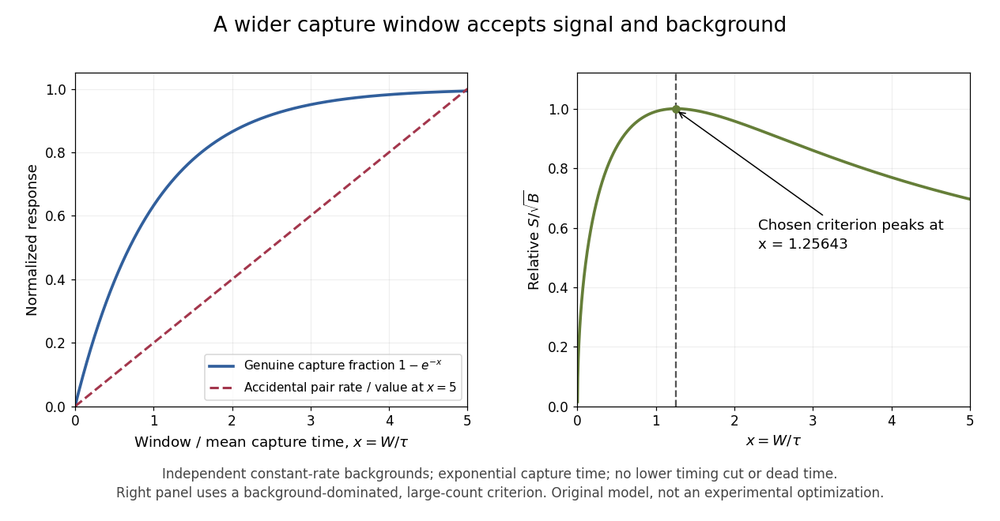

# Delayed neutron-capture coincidence window

↑ **Parent:** [Cowan-Reines reactor antineutrino experiment](cowan-reines-reactor-antineutrino-experiment.md)

Why not accept every delayed pulse? A longer window captures more genuine [neutron capture](neutron-capture.md) signals, but also admits more [accidental coincidences](accidental-coincidence.md). Consider an original model with a capture waiting [time](time-in-physics.md) following an [exponential distribution](exponential-distribution.md) of [mean](expected-value-split.md) $\tau>0$. Assume detection after a prompt signal accepts $0<t<W$, with perfect time measurement and no lower cut. Integrating the normalized density gives

$$
\epsilon(W)=\int_0^W\frac{e^{-t/\tau}}{\tau}\,dt=1-e^{-W/\tau}.
$$

This assumes that moderation, competing capture channels, boundaries and electronic recovery can be represented or neglected in a single effective waiting-time model. It is not a fitted historical capture law.

Let independent prompt-like and delayed-like background streams have [Poisson process](poisson-process-split.md) rates $R_p$ and $R_d$. The [accidental coincidence](accidental-coincidence.md) pair rate in a directed window of full width $W$ is $R_pR_dW$. Electronics producing at most one accepted delayed match per prompt instead give $R_p(1-e^{-R_dW})$. These definitions coincide to first order when $R_dW\ll1$. Correlated backgrounds, such as one external [neutron](neutron-split.md) producing both a prompt recoil and a later capture, require separate controls; an independent-stream estimate cannot remove them.

**[Figure 6](#image-longer-capture-windows-trade-signal-acceptance-for-accidental-background). Longer capture windows trade signal acceptance for accidental background**.

For chosen $\tau=20\,\mu\mathrm s$ and $W=50\,\mu\mathrm s$, the accepted fraction is $1-e^{-2.5}\simeq0.918$. With chosen $R_p=40\,\mathrm{s^{-1}}$ and $R_d=30\,\mathrm{s^{-1}}$, the pair rate is $0.0600\,\mathrm{s^{-1}}$, while the at-most-one rate is approximately $0.05996\,\mathrm{s^{-1}}$. These are teaching parameters, not reported Savannah River rates. A measured uncorrelated background can be tested using displaced time windows; a reactor-off measurement addresses a different question and cannot by itself characterize every reactor-correlated background.

**Table of contents**

- [Optimum capture window in a background-dominated model](optimum-capture-window-in-a-background-dominated-model.md)

## ↑ Ancestors (7)

1. [Cowan-Reines reactor antineutrino experiment](cowan-reines-reactor-antineutrino-experiment.md)
2. [Inverse beta decay](inverse-beta-decay.md)
3. [Beta decay](beta-decay.md)
4. [Radioactive decay](radioactive-decay.md)
5. [Nuclear physics](nuclear-physics.md)
6. [Physics](physics-split.md)
7. [Codex Wiki](split.md)
