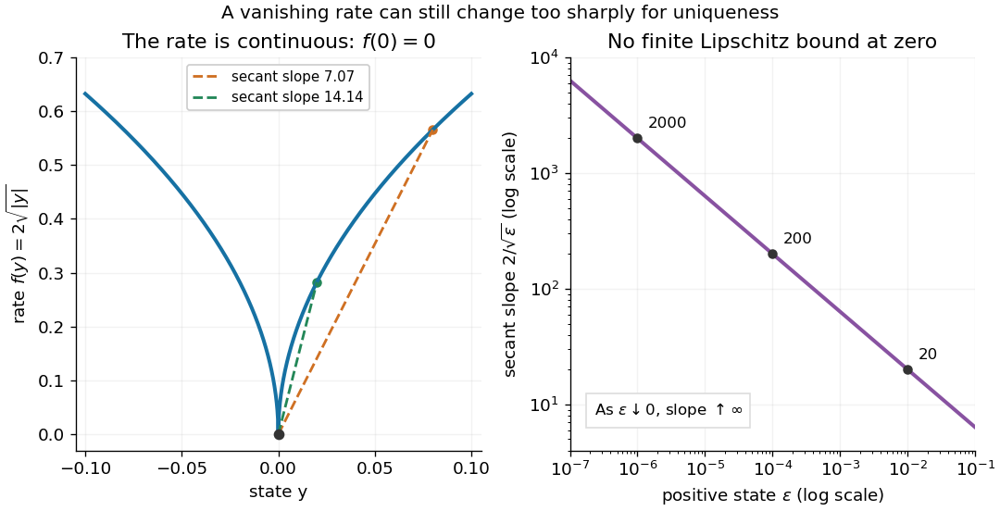

# Delayed solutions of a square-root differential equation

↑ **Parent:** [Peano existence theorem](peano-existence-theorem.md)

This [initial value problem](initial-value-problem.md) uses a [square root](square-root.md) and [absolute value](absolute-value.md) to define a [continuous function](continuous-function.md) on all of $\mathbb R^2$. For every finite waiting time $c\geq0$, a forward [solution of a differential equation](solution-of-a-differential-equation.md) on $t\geq0$ is

$$
y_c(t)=\begin{cases}0,&0\leq t\leq c,\\(t-c)^2,&t>c.\end{cases}
$$

The constant [solution of a differential equation](solution-of-a-differential-equation.md) $y_\infty(t)=0$ is another choice. For example, at $t=3$, waits $c=0,1,2,3$ give values $9,4,1,0$. These are [dimensionless](dimensionless-quantity.md) mathematical trajectories; no measured physical waiting time is being supplied.

Verification uses the original [ordinary differential equation](ordinary-differential-equation.md), including the join. Before departure, both $y_c'$ and $2\sqrt{|y_c|}$ vanish. For $t>c$, their common value is $2(t-c)$. For $c>0$, the difference quotient at the join is

$$
\frac{y_c(c+s)-y_c(c)}s=\begin{cases}0,&s<0,\\s,&s>0,\end{cases}\qquad\longrightarrow0.
$$

Thus the [derivative](derivative.md) exists at $c$, equals the rate law there, and is continuous across the join. For $c=0$ the same computation gives the right [derivative](derivative.md) at the starting endpoint. For $c>0$, the left and right [second derivatives](second-derivative.md) at departure are $0$ and $2$: these forward [solutions of a differential equation](solution-of-a-differential-equation.md) are [continuously differentiable functions](continuously-differentiable-function.md), without being twice differentiable at departure. The local two-sided statement of the [Peano existence theorem](peano-existence-theorem.md) is separate from this explicitly forward family.

The rate law tends to zero as $y\to0$, but its secant slopes from zero are unbounded:

$$
\frac{|f(\varepsilon)-f(0)|}{|\varepsilon-0|}=\frac{2}{\sqrt\varepsilon}\longrightarrow\infty\qquad(\varepsilon\downarrow0).
$$

No finite local [Lipschitz constant](lipschitz-constant.md) exists at zero. At $\varepsilon=10^{-2},10^{-4},10^{-6}$ the quotient is $20,200,2000$, even though the rates are shrinking to zero. [Continuity](continuous-function.md) controls the rate itself; [Lipschitz continuity](lipschitz-continuity.md) would control its change relative to the state displacement.

**[Figure 9](#image-a-continuous-square-root-rate-has-unbounded-secant-slopes-at-zero). A continuous square-root rate has unbounded secant slopes at zero**. Left: the continuous rate $f(y)=2\sqrt{|y|}$ on both sides of zero, with two positive-state secants. Right: their slope $2/\sqrt\varepsilon$ on logarithmic axes, including the values $20,200,2000$.

There is also a numerical lesson. The [forward Euler method](euler-method.md) starting exactly at zero gives $Y_{k+1}=Y_k+2\Delta t\sqrt{|Y_k|}=0$ at every step. It reproduces the constant [solution of a differential equation](solution-of-a-differential-equation.md) for every positive [step size](step-size.md), while the moving trajectories remain equally valid. A computation producing one trajectory cannot establish uniqueness. Likewise, the [separable differential equation](separable-differential-equation.md) calculation that divides by $\sqrt{|y|}$ only describes the moving pieces: checking the original equation recovers the zero pieces and their joins.

**Table of contents**

- [Sticking solutions of a bounded square-root differential equation](sticking-solutions-of-a-bounded-square-root-differential-equation.md)

## ↑ Ancestors (7)

1. [Peano existence theorem](peano-existence-theorem.md)
2. [Ordinary differential equation](ordinary-differential-equation.md)
3. [Differential equation](differential-equation-split.md)
4. [Analysis](analysis-split.md)
5. [Area of mathematics](area-of-mathematics.md)
6. [Mathematics](mathematics-split.md)
7. [Codex Wiki](split.md)

## ← Incoming links (1)

- [Peano existence theorem](peano-existence-theorem.md)
