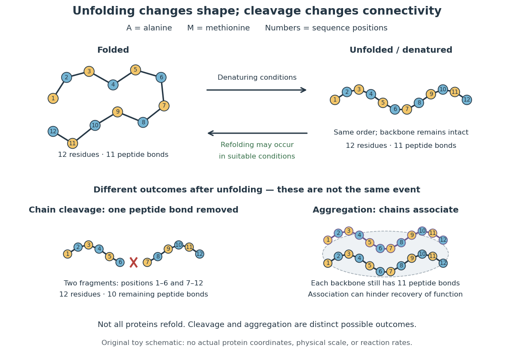

# Denaturation (biochemistry)

↑ **Parent:** [Protein](protein-split.md)  
ⓦ [Wiki](https://en.wikipedia.org/wiki/Denaturation_(biochemistry))

[Protein denaturation](denaturation-biochemistry.md) is the loss of a [protein](protein-split.md)'s native spatial organization, often with loss of biological function. Changes in [temperature](temperature-split.md), [pH](ph.md) or surroundings can disrupt [protein secondary structure](protein-secondary-structure.md), [protein tertiary structure](protein-tertiary-structure.md) or [protein quaternary structure](protein-quaternary-structure.md). [Protein denaturation](denaturation-biochemistry.md) ordinarily preserves the [peptide bonds](peptide-bond.md) and [protein primary structure](protein-primary-structure.md); it is different from cutting the chain. Recovery by [protein folding](protein-folding.md) is possible in some cases, but removing the denaturing conditions does not guarantee that every [protein](protein-split.md) recovers. See [Clark, Douglas and Choi: denaturation, environmental conditions and loss of function](https://openstax.org/books/biology-2e/pages/3-4-proteins).

**[Figure 15](#image-protein-folding-protein-denaturation-chain-cleavage-and-protein-aggregation-are-distinct-events). Protein folding, protein denaturation, chain cleavage and protein aggregation are distinct events**. Original toy schematic. Folded and unfolded drawings both preserve all twelve [amino acid residues](amino-acid-residue.md) in the same order and all eleven [peptide bonds](peptide-bond.md). Cleavage removes one internal [peptide bond](peptide-bond.md), leaving two fragments with ten remaining [peptide bonds](peptide-bond.md) in total. The separate [protein aggregation](protein-aggregation.md) drawing contains two associated chains with eleven [peptide bonds](peptide-bond.md) each. Refolding is a qualified possibility, not a universal outcome. The drawings are not actual [protein](protein-split.md) coordinates.

In the diagram, unfolding preserves all eleven [peptide bonds](peptide-bond.md). Cleaving the connection between positions 6 and 7 leaves two six-residue fragments: each contains five [peptide bonds](peptide-bond.md), so there are $5+5=10$ in total. Simply cooling or otherwise restoring suitable conditions cannot recover the original chain by [protein folding](protein-folding.md) alone; the missing [covalent bond](covalent-bond-split.md) would have to be remade. Conversely, [protein aggregation](protein-aggregation.md) can impede recovery without breaking any [peptide bond](peptide-bond.md). These distinctions explain why loss of function does not by itself reveal whether a [protein](protein-split.md) unfolded, associated with other chains, or suffered chemical damage.

**Table of contents**

- [Protein aggregation](protein-aggregation.md)

## ↑ Ancestors (3)

1. [Protein](protein-split.md)
2. [Biology](biology-split.md)
3. [Codex Wiki](split.md)
