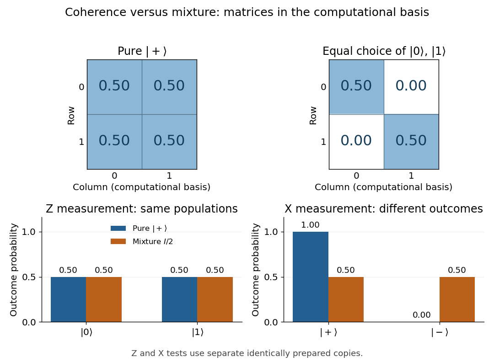

# Density matrix

↑ **Parent:** [Quantum theory](quantum-theory.md)  
ⓦ [Wiki](https://en.wikipedia.org/wiki/Density_matrix)

A finite-dimensional [density operator](density-matrix.md) $\rho$ represents a [quantum state](quantum-system.md#quantum-state) on a [Hilbert space](hilbert-space.md). It is [Hermitian](hilbert-space.md#hermitian-operator), [positive semidefinite](quadratic-form.md#positive-semidefinite-matrix), and has [trace](linear-algebra.md#matrix-trace) one:

$$
\rho=\rho^\dagger,\qquad \langle v|\rho|v\rangle\geq0\text{ for every }|v\rangle,\qquad \operatorname{Tr}\rho=1.
$$

The [density matrix](density-matrix.md) is its [matrix](vector-space.md#matrix) in a chosen [orthonormal basis](inner-product.md#orthonormal-basis). In [dimension](vector-space.md#dimension-vector-space) $N$ it has $N^2-1$ real parameters: a [Hermitian matrix](hilbert-space.md#hermitian-operator) has $N^2$, and fixing its [trace](linear-algebra.md#matrix-trace) removes one; positivity restricts the allowed values.

A [quantum state ensemble](#quantum-state-ensemble) of normalized [pure states](quantum-theory.md#pure-state) $|\psi_i\rangle$ with positive [probabilities](probability-theory.md#probability) $p_i$ gives

$$
\rho=\sum_i p_i|\psi_i\rangle\langle\psi_i|,\qquad p_i>0,\qquad \sum_i p_i=1.
$$

Zero-weight terms can be omitted. Conversely, the [spectral theorem](hilbert-space.md#spectral-theorem) gives such an ensemble for every [density operator](density-matrix.md), using its [orthonormal](inner-product.md#orthonormal-set) [eigenvectors](linear-operator-theory.md#eigenvector) and nonnegative [eigenvalues](linear-operator-theory.md#eigenvalue), with zero [eigenvalues](linear-operator-theory.md#eigenvalue) omitted. A [pure state](quantum-theory.md#pure-state) has $\rho=|\psi\rangle\langle\psi|$; a [mixed state](#mixed-state) needs at least two nonzero [eigenvalues](linear-operator-theory.md#eigenvalue). [Watrous, The Theory of Quantum Information, chapter 2, section 2.1.2, pp. 62–64](https://cs.uwaterloo.ca/~watrous/TQI/TQI.2.pdf)

For a [projective measurement](quantum-measurement.md#projective-measurement) with [orthogonal projections](hilbert-space.md#orthogonal-projection) $\Pi_a$, the [Born rule](wave-function.md#born-rule) is

$$
P(a)=\operatorname{Tr}(\rho\Pi_a)=\sum_i p_i\langle\psi_i|\Pi_a|\psi_i\rangle.
$$

This is the average of the component [pure state](quantum-theory.md#pure-state) [probabilities](probability-theory.md#probability). Positivity makes each outcome [probability](probability-theory.md#probability) nonnegative, and $\sum_a\Pi_a=I$ makes them sum to one. The same [density operator](density-matrix.md) therefore predicts every measurement on the system without requiring a unique preparation history. [Preskill, Physics 229 notes, chapter 2, section 2.3.1, equations (2.51)–(2.59)](https://www.preskill.caltech.edu/ph229/notes/chap2.pdf)

For a closed system, [Schrödinger picture](quantum-system.md#schrodinger-picture) evolution under a [unitary operator](vector-space.md#unitary-operator) is

$$
\rho_S(t)=U(t)\rho_HU(t)^\dagger
$$

when $\rho_H=\rho_S(0)$ denotes the time-independent [Heisenberg picture](quantum-system.md#heisenberg-picture) state and $U(0)=I$. In the [Schrödinger picture](quantum-system.md#schrodinger-picture) the [density operator](density-matrix.md) evolves; in the [Heisenberg picture](quantum-system.md#heisenberg-picture) the [observables](quantum-system.md#observable) evolve instead, with identical measurement predictions. This [unitary operator](vector-space.md#unitary-operator) preserves the [eigenvalues](linear-operator-theory.md#eigenvalue) and hence the [purity of a density operator](#purity-of-a-density-operator). [Preskill, Physics 229 notes, chapter 2, section 2.3.4, equation (2.79)](https://www.preskill.caltech.edu/ph229/notes/chap2.pdf)

A historical source for the probabilistic formulation of [quantum mechanics](quantum-mechanics.md) is von Neumann's 1927 paper Wahrscheinlichkeitstheoretischer Aufbau der Quantenmechanik. [von Neumann, Nachrichten von der Gesellschaft der Wissenschaften zu Göttingen, Mathematisch-Physikalische Klasse, 1927, pp. 245–272](https://geodesic.mathdoc.fr/item/NGWGMP_1927__1927_59230/)

**Table of contents**

- [Improper mixture](#improper-mixture)
- [Leading high-temperature density kernel](#leading-high-temperature-density-kernel)
- [One-body density matrix](#one-body-density-matrix)
- [Thermal representation of a reduced coupled-oscillator ground state](#thermal-representation-of-a-reduced-coupled-oscillator-ground-state)
- [Quantum state population](#quantum-state-population)
- [Quantum coherence in a specified basis](#quantum-coherence-in-a-specified-basis)
  - [Electron phase coherence](#electron-phase-coherence)
- [Two-qubit Werner state](#two-qubit-werner-state)
  - [Single-copy Werner filtering normalization bound](#single-copy-werner-filtering-normalization-bound)
    - [Single-copy Werner filtering cannot increase concurrence](#single-copy-werner-filtering-cannot-increase-concurrence)
  - [Concurrence of a two-qubit Werner state](#concurrence-of-a-two-qubit-werner-state)
  - [Bell twirling followed by triplet symmetrization](#bell-twirling-followed-by-triplet-symmetrization)
- [Extreme points of the density-operator state space](#extreme-points-of-the-density-operator-state-space)
- [Unitary orbit of a density operator](#unitary-orbit-of-a-density-operator)
- [Quantum state ensemble](#quantum-state-ensemble)
  - [Convex roof extension](#convex-roof-extension)
    - [Monotonicity of a convex roof under a quantum instrument](#monotonicity-of-a-convex-roof-under-a-quantum-instrument)
- [Pauli correlation tensor](#pauli-correlation-tensor)
- [Maximally mixed state](#maximally-mixed-state)
  - [Obstruction to uniform probability lowering by a unitary](#obstruction-to-uniform-probability-lowering-by-a-unitary)
- [Mixed state](#mixed-state)
- [Von Neumann equation](#von-neumann-equation)
- [Purification of a density operator](#purification-of-a-density-operator)
  - [Purity decouples a subsystem from its purification](#purity-decouples-a-subsystem-from-its-purification)
  - [Flagged purification of a quantum ensemble](#flagged-purification-of-a-quantum-ensemble)
  - [Unitary freedom of purification](#unitary-freedom-of-purification)
  - [Hughston–Jozsa–Wootters theorem](#hughston-jozsa-wootters-theorem)
    - [Isometry parametrization of a density-matrix ensemble](#isometry-parametrization-of-a-density-matrix-ensemble)
  - [Uhlmann's theorem](#uhlmann-s-theorem)
- [Trace distance](#trace-distance)
  - [Trace distance between qubit states](#trace-distance-between-qubit-states)
  - [Trace-distance contraction under quantum channels](#trace-distance-contraction-under-quantum-channels)
  - [Trace distance for qubit dephasing](#trace-distance-for-qubit-dephasing)
  - [Pure-target upper bound on trace distance](#pure-target-upper-bound-on-trace-distance)
  - [Spectral-parts formula for trace distance](#spectral-parts-formula-for-trace-distance)
  - [Pure-target lower bound on trace distance](#pure-target-lower-bound-on-trace-distance)
  - [Variational characterization of trace distance](#variational-characterization-of-trace-distance)
    - [Trace-distance-preserving binary measurement](#trace-distance-preserving-binary-measurement)
- [Von Neumann entropy](von-neumann-entropy.md)
  - [Entropy continuity from Jordan decomposition](von-neumann-entropy.md#entropy-continuity-from-jordan-decomposition)
  - [Entropy of an orthogonal quantum mixture](von-neumann-entropy.md#entropy-of-an-orthogonal-quantum-mixture)
  - [Entropy of a binary diagonal qubit mixture](von-neumann-entropy.md#entropy-of-a-binary-diagonal-qubit-mixture)
  - [Entropy bound from overlap with a pure state](von-neumann-entropy.md#entropy-bound-from-overlap-with-a-pure-state)
  - [Maximum entropy of a quantum state](von-neumann-entropy.md#maximum-entropy-of-a-quantum-state)
  - [Entropy increase under nonselective projective measurement](von-neumann-entropy.md#entropy-increase-under-nonselective-projective-measurement)
    - [Relative entropy of a pinched state](von-neumann-entropy.md#relative-entropy-of-a-pinched-state)
  - [Entanglement entropy](von-neumann-entropy.md#entanglement-entropy)
    - [Two-qubit entropy from the reduced determinant](von-neumann-entropy.md#two-qubit-entropy-from-the-reduced-determinant)
    - [Average monotonicity of pure-state entanglement entropy](von-neumann-entropy.md#average-monotonicity-of-pure-state-entanglement-entropy)
    - [Schmidt decomposition](von-neumann-entropy.md#schmidt-decomposition)
      - [Schmidt basis](von-neumann-entropy.md#schmidt-basis)
      - [Operator Schmidt rank](von-neumann-entropy.md#operator-schmidt-rank)
        - [Local Kraus rank bound from an entangled resource](von-neumann-entropy.md#local-kraus-rank-bound-from-an-entangled-resource)
      - [Schmidt-basis Pauli correlation tensor](von-neumann-entropy.md#schmidt-basis-pauli-correlation-tensor)
      - [Schmidt coefficient](von-neumann-entropy.md#schmidt-coefficient)
      - [Schmidt rank](von-neumann-entropy.md#schmidt-rank)
        - [Schmidt-rank contraction under product operators](von-neumann-entropy.md#schmidt-rank-contraction-under-product-operators)
        - [Monotonicity of Schmidt rank under LOCC](von-neumann-entropy.md#monotonicity-of-schmidt-rank-under-locc)
        - [Maximally entangled overlap bound from Schmidt rank](von-neumann-entropy.md#maximally-entangled-overlap-bound-from-schmidt-rank)
    - [Schmidt number](von-neumann-entropy.md#schmidt-number)
  - [Subadditivity of Von Neumann entropy](von-neumann-entropy.md#subadditivity-of-von-neumann-entropy)
    - [Araki–Lieb inequality](von-neumann-entropy.md#araki-lieb-inequality)
    - [Strong subadditivity of quantum entropy](von-neumann-entropy.md#strong-subadditivity-of-quantum-entropy)
      - [Strong subadditivity from relative-entropy monotonicity](von-neumann-entropy.md#strong-subadditivity-from-relative-entropy-monotonicity)
      - [Weak monotonicity of quantum entropy](von-neumann-entropy.md#weak-monotonicity-of-quantum-entropy)
  - [Concavity of Von Neumann entropy](von-neumann-entropy.md#concavity-of-von-neumann-entropy)
    - [Strict concavity of Von Neumann entropy](von-neumann-entropy.md#strict-concavity-of-von-neumann-entropy)
    - [Entropy bounds for a quantum mixture](von-neumann-entropy.md#entropy-bounds-for-a-quantum-mixture)
    - [Entropy bound for a binary mixture](von-neumann-entropy.md#entropy-bound-for-a-binary-mixture)
  - [Quantum conditional entropy](von-neumann-entropy.md#quantum-conditional-entropy)
    - [Pure-state negative conditional entropy criterion](von-neumann-entropy.md#pure-state-negative-conditional-entropy-criterion)
    - [Concavity of quantum conditional entropy](von-neumann-entropy.md#concavity-of-quantum-conditional-entropy)
    - [Continuity bound for quantum conditional entropy](von-neumann-entropy.md#continuity-bound-for-quantum-conditional-entropy)
    - [Dimension bound for quantum conditional entropy](von-neumann-entropy.md#dimension-bound-for-quantum-conditional-entropy)
  - [Quantum relative entropy](von-neumann-entropy.md#quantum-relative-entropy)
    - [Relative entropy of classically flagged states](von-neumann-entropy.md#relative-entropy-of-classically-flagged-states)
    - [Nonnegativity of quantum relative entropy](von-neumann-entropy.md#nonnegativity-of-quantum-relative-entropy)
      - [Eigenbasis proof of quantum relative entropy nonnegativity](von-neumann-entropy.md#eigenbasis-proof-of-quantum-relative-entropy-nonnegativity)
    - [Quantum Pinsker inequality](von-neumann-entropy.md#quantum-pinsker-inequality)
    - [Donald's identity](von-neumann-entropy.md#donald-s-identity)
      - [Relative-entropy barycenter of a quantum ensemble](von-neumann-entropy.md#relative-entropy-barycenter-of-a-quantum-ensemble)
    - [Data-processing inequality for quantum relative entropy](von-neumann-entropy.md#data-processing-inequality-for-quantum-relative-entropy)
    - [Additivity of quantum relative entropy](von-neumann-entropy.md#additivity-of-quantum-relative-entropy)
    - [Superadditivity of quantum relative entropy](von-neumann-entropy.md#superadditivity-of-quantum-relative-entropy)
      - [Multipartite superadditivity of quantum relative entropy](von-neumann-entropy.md#multipartite-superadditivity-of-quantum-relative-entropy)
        - [Lower asymptotic semicontinuity of quantum relative entropy](von-neumann-entropy.md#lower-asymptotic-semicontinuity-of-quantum-relative-entropy)
    - [Quantum mutual information](von-neumann-entropy.md#quantum-mutual-information)
      - [Quantum conditional mutual information](von-neumann-entropy.md#quantum-conditional-mutual-information)
      - [Data processing for quantum mutual information](von-neumann-entropy.md#data-processing-for-quantum-mutual-information)
        - [Postselection can increase conditional quantum mutual information](von-neumann-entropy.md#postselection-can-increase-conditional-quantum-mutual-information)
        - [Mutual-information loss as conditional mutual information](von-neumann-entropy.md#mutual-information-loss-as-conditional-mutual-information)
      - [Quantum mutual information balance identity](von-neumann-entropy.md#quantum-mutual-information-balance-identity)
    - [Variational characterization of quantum conditional entropy](von-neumann-entropy.md#variational-characterization-of-quantum-conditional-entropy)
- [Purity of a density operator](#purity-of-a-density-operator)
- [Reduced density operator of a weakly coupled oscillator pair](#reduced-density-operator-of-a-weakly-coupled-oscillator-pair)
- [Bloch vector](#bloch-vector)
  - [Qubit polarization](#qubit-polarization)
  - [Bloch ball](#bloch-ball)
    - [Antipodal eigenprojectors of a qubit density matrix](#antipodal-eigenprojectors-of-a-qubit-density-matrix)
  - [Generalized Bloch representation](#generalized-bloch-representation)
    - [Hamiltonian rotations of Bloch vectors](#hamiltonian-rotations-of-bloch-vectors)
    - [Purity bound for generalized Bloch vectors](#purity-bound-for-generalized-bloch-vectors)
    - [Affine Bloch equation](#affine-bloch-equation)
      - [Transverse relaxation](#transverse-relaxation)
      - [Population relaxation](#population-relaxation)
      - [Steady states of an affine Bloch equation](#steady-states-of-an-affine-bloch-equation)
  - [Bloch sphere](#bloch-sphere)
    - [Pure-qubit overlap identity](#pure-qubit-overlap-identity)
    - [Uniform pure-qubit average](#uniform-pure-qubit-average)
  - [Informationally complete three-observable qubit tomography](#informationally-complete-three-observable-qubit-tomography)

## Improper mixture

↑ **Parent:** [Density matrix](density-matrix.md)

The reduced [density matrix](density-matrix.md) obtained by taking the [partial trace](quantum-theory.md#partial-trace) of a larger [entangled state](bell-state.md#entangled-state). It predicts the local measurement statistics, but its mixed form does not imply that the total state has collapsed into one of the displayed components. Different ensembles can represent the same [reduced density matrix](bell-state.md#reduced-density-matrix).

## Leading high-temperature density kernel

↑ **Parent:** [Density matrix](density-matrix.md)

Neglecting [commutators](lie-algebra.md#commutator) between kinetic and [potential energy](energy.md#potential-energy) permits a leading product approximation to the imaginary-time evolution operator. The kinetic factor is a Gaussian Fourier [integral](integral.md); the potential factor multiplies it in position space. The unsymmetrized product places the potential at one endpoint and need not be exactly [Hermitian](hilbert-space.md#hermitian-operator) at the discarded order. Splitting the potential equally between both endpoints gives a [Hermitian](hilbert-space.md#hermitian-operator) approximation with exponent $-\beta[V(x)+V(x')]/2$ and the same leading diagonal normalization.

## One-body density matrix

↑ **Parent:** [Density matrix](density-matrix.md)

The [one-body density matrix](#one-body-density-matrix) contains first-order spatial coherence and mode occupations of a many-particle state. Its [trace](linear-algebra.md#matrix-trace) is the particle number in the convention displayed. A macroscopic [eigenvalue](linear-operator-theory.md#eigenvalue) identifies [Bose-Einstein condensation](quantum-ideal-gas-statistics.md#bose-einstein-condensation); in a homogeneous condensate the long-distance [matrix](vector-space.md#matrix) approaches a nonzero constant. A finite density or local coherence alone does not imply this long-distance limit.

## Thermal representation of a reduced coupled-oscillator ground state

↑ **Parent:** [Density matrix](density-matrix.md)

Tracing one oscillator out of a symmetric coordinate-coupled Gaussian [ground state](quantum-mechanics.md#ground-state) gives a thermal density operator for an effective oscillator of [frequency](wave.md#frequency) $\nu$. Its geometric ratio is $q=[(\sqrt{\omega_+}-\sqrt{\omega_-})/(\sqrt{\omega_+}+\sqrt{\omega_-})]^2$. It is generally squeezed relative to the original bare-frequency number basis. The covariance ratio fixes the effective [frequency](wave.md#frequency) rather than permitting an arbitrary thermal-basis identification.

## Quantum state population

↑ **Parent:** [Density matrix](density-matrix.md)

For a chosen normalized level state $|k\rangle$, its population is the [probability](probability-theory.md#probability) $\langle k|\rho|k\rangle=\operatorname{Tr}(|k\rangle\langle k|\rho)$ of finding the system in that state. In an orthonormal level basis these diagonal entries are nonnegative and sum to one. Off-diagonal [quantum coherence](#quantum-coherence-in-a-specified-basis) contains information absent from the population vector, so matching all level populations need not prepare a specified coherent superposition.

## Quantum coherence in a specified basis

↑ **Parent:** [Density matrix](density-matrix.md)

For a chosen [orthonormal basis](inner-product.md#orthonormal-basis), the off-diagonal entries of a [density operator](density-matrix.md) encode quantum coherence between distinct basis states. A diagonal density operator is an incoherent mixture in that basis. This property is basis-dependent: diagonalizing the operator does not imply that it lacked coherence in the measurement or energy basis of interest. Relative phases affect these entries, while a global wavefunction phase cancels from the density operator. Dephasing damps the entries and can spoil [stimulated Raman adiabatic passage](control-theory.md#stimulated-raman-adiabatic-passage) by removing the ground-state interference that maintains the dark state.

### Electron phase coherence

↑ **Parent:** [Quantum coherence in a specified basis](#quantum-coherence-in-a-specified-basis)

Preservation of relative electronic phase along alternative paths so they can interfere. Loss of coherence suppresses interference structure, but semiclassical magnetic focusing can persist if momentum trajectories remain sufficiently ballistic.

## Two-qubit Werner state

↑ **Parent:** [Density matrix](density-matrix.md)

This collective-unitary-invariant two-qubit state has singlet weight $p$ and equal weights on the three triplet [Bell states](bell-state.md). With $P_s$ the [spin singlet state](bell-state.md#spin-singlet-state) projector, its [partial transpose](quantum-information-theory.md#partial-transpose) has eigenvalues $(1-2p)/2$ once and $(1+2p)/6$ three times. It is entangled exactly when $p>1/2$. At $p=1/2$, it is the equally weighted mixture of six antiparallel product states along the three Pauli axes. In the interval $1/4\leq p\leq1/2$, convex mixing of this boundary state with $I/4$ explicitly proves separability. The weight $p$ here is the singlet probability, not the alternative coefficient multiplying a pure singlet in a white-noise mixture.

### Single-copy Werner filtering normalization bound

↑ **Parent:** [Two-qubit Werner state](#two-qubit-werner-state)

Write $W_F=(I\otimes I-w\sum_j\sigma_j\otimes\sigma_j)/4$, with $w=(4F-1)/3\in(1/3,1]$. For positive matrices $X=A^\dagger A=a_0I+a\cdot\sigma$ and $Y=B^\dagger B=b_0I+b\cdot\sigma$, the success probability is $p=a_0b_0-w a\cdot b$. It is at least $a_0b_0-|a||b|\geq\sqrt{(a_0^2-|a|^2)(b_0^2-|b|^2)}=|\det A\det B|$. Squaring the middle comparison leaves $(a_0|b|-b_0|a|)^2\geq0$.

#### Single-copy Werner filtering cannot increase concurrence

↑ **Parent:** [Single-copy Werner filtering normalization bound](#single-copy-werner-filtering-normalization-bound)

Combine the [single-copy Werner filtering normalization bound](#single-copy-werner-filtering-normalization-bound) with [concurrence scaling under invertible local filters](bell-state.md#concurrence-scaling-under-invertible-local-filters). Every complete classical record of [local operations and classical communication](bell-state.md#local-operations-and-classical-communication) has a product filter $A\otimes B$; singular branches are separable. Thus every retained branch has [concurrence](bell-state.md#concurrence) at most that of the input. Coarse-graining successful records preserves the bound by convexity. Since [concurrence of a two-qubit Werner state](#concurrence-of-a-two-qubit-werner-state) increases strictly with $F$, no successful single-copy protocol can output a Werner state with larger $F$. Several input copies permit collective distillation and are outside this statement.

### Concurrence of a two-qubit Werner state

↑ **Parent:** [Two-qubit Werner state](#two-qubit-werner-state)

For any normalized pure two-[qubit](quantum-system.md#qubit) vector, its squared overlap with a [maximally entangled state](quantum-theory.md#maximally-entangled-state) is at most $(1+C)/2$: in a [Schmidt decomposition](von-neumann-entropy.md#schmidt-decomposition) the overlap is bounded by $(\sqrt\lambda+\sqrt{1-\lambda})/\sqrt2$. Averaging gives $C(W_F)\geq2F-1$. Equality follows from the six-state ensemble $\sqrt F\,|\Psi_-\rangle\pm\sqrt{1-F}\,|t_j\rangle$, with equal weights, where $t_1=\Psi_+$, $t_2=\Phi_-$ and $t_3=i\Phi_+$. The coherences cancel and each coefficient determinant gives pure concurrence $2F-1$.

### Bell twirling followed by triplet symmetrization

↑ **Parent:** [Two-qubit Werner state](#two-qubit-werner-state)

Average the four correlated local Pauli operations to remove coherences in the [Bell states](bell-state.md) basis. A one-party Pauli operation can permute the largest of the four resulting weights into the singlet sector; that weight is at least $1/4$. Correlated common local unitaries then permute the three triplet projectors, while [collective-unitary covariance of the two-qubit singlet](bell-state.md#collective-unitary-covariance-of-the-two-qubit-singlet) keeps the singlet projector unchanged. Averaging all six permutations makes the triplet weights equal, producing a [two-qubit Werner state](#two-qubit-werner-state). Shared randomness or [local operations and classical communication](bell-state.md#local-operations-and-classical-communication) coordinates these local operations. Common unitaries alone cannot increase an initially small singlet weight, because that weight is invariant under them.

## Extreme points of the density-operator state space

↑ **Parent:** [Density matrix](density-matrix.md)

The [density operators](density-matrix.md) on a finite-dimensional [Hilbert space](hilbert-space.md) form a convex set. Its [extreme points](convex-set.md#extreme-point) are exactly the rank-one projectors, hence exactly the [pure states](quantum-theory.md#pure-state). To prove this, suppose $|\psi\rangle\langle\psi|=\sum_i a_i\rho_i$ with $a_i>0$ and $\rho_i$ [positive semidefinite](quadratic-form.md#positive-semidefinite-matrix). For $w\perp\psi$, $0=\sum_i a_i\langle w|\rho_i|w\rangle$ is a sum of nonnegative numbers, so every term vanishes. Diagonalizing $\rho_i$ shows that $\langle w|\rho_i|w\rangle=0$ implies $\rho_iw=0$. Thus each $\rho_i$ is supported on the line spanned by $\psi$, and its unit [trace](linear-algebra.md#matrix-trace) forces $\rho_i=|\psi\rangle\langle\psi|$.

Conversely, a [density operator](density-matrix.md) of [rank](quadratic-form.md#rank-one-quadratic-form) at least two has a [spectral decomposition](linear-operator-theory.md#spectral-decomposition) with at least two positive [eigenvalues](linear-operator-theory.md#eigenvalue). If $\lambda$ is one of them, $0<\lambda<1$ and $\rho=\lambda|e\rangle\langle e|+(1-\lambda)\sigma$, where $\sigma$ is the normalized remainder. These are distinct [density operators](density-matrix.md), proving that $\rho$ is not an [extreme point](convex-set.md#extreme-point).

## Unitary orbit of a density operator

↑ **Parent:** [Density matrix](density-matrix.md)

The unitary orbit consists exactly of [density operators](density-matrix.md) with the same spectrum. If distinct eigenvalues have multiplicities $n_j$, its stabilizer is $\prod_jU(n_j)$ and its real dimension is $N^2-\sum_jn_j^2$. A reachable compact group with [Lie algebra](lie-algebra.md) $\mathfrak g$ is transitive on this orbit exactly when $\dim\mathfrak g-\dim(\mathfrak g\cap\{X:[X,\rho]=0\})$ equals the orbit dimension. Global phases act trivially by conjugation.

## Quantum state ensemble

↑ **Parent:** [Density matrix](density-matrix.md)

A quantum state ensemble specifies a random preparation: normalized [pure states](quantum-theory.md#pure-state) $|\psi_i\rangle$ are selected with [probabilities](probability-theory.md#probability) $p_i\geq0$, $\sum_i p_i=1$. Without an accessible preparation label, its measurement statistics are those of the [density operator](density-matrix.md) $\rho=\sum_i p_i|\psi_i\rangle\langle\psi_i|$. Indeed every [POVM](quantum-measurement.md#positive-operator-valued-measure) effect $E$ has probability $\sum_i p_i\langle\psi_i|E|\psi_i\rangle=\operatorname{Tr}(E\rho)$. Different ensembles can therefore have identical operational statistics: equal mixtures of computational-basis qubits or Hadamard-basis qubits both have density operator $I/2$. The ensemble decomposition contains information about the preparation, not additional information accessible from the system alone.

### Convex roof extension

↑ **Parent:** [Quantum state ensemble](#quantum-state-ensemble)

A convex roof extension extends a function $\mu$ on [pure states](quantum-theory.md#pure-state) to arbitrary [density operators](density-matrix.md) by minimizing its ensemble average over all [pure state](quantum-theory.md#pure-state) decompositions. It agrees with $\mu$ on [pure states](quantum-theory.md#pure-state): every positive-weight state in a decomposition of a rank-one [density operator](density-matrix.md) has the same one-dimensional support. Concatenating nearly minimizing ensembles proves that $F$ is a [convex function](real-analysis.md#convex-function). Moreover, every [convex function](real-analysis.md#convex-function) that is no larger than $\mu$ on [pure states](quantum-theory.md#pure-state) is no larger than $F$, by applying convexity to each decomposition. Infima need not be attained; an arbitrarily small additive error suffices when $F$ is finite.

#### Monotonicity of a convex roof under a quantum instrument

↑ **Parent:** [Convex roof extension](#convex-roof-extension)

If a [convex roof extension](#convex-roof-extension) is non-increasing on average for every pure input to a [quantum instrument](quantum-measurement.md#quantum-instrument), then it is non-increasing on average for mixed inputs too. For an input ensemble $\{p_j,\pi_j\}$, let $q_{k|j}$ and $\sigma_{jk}$ be its conditional outcome probabilities and states. Linearity of each unnormalized outcome map gives $P_k\rho_k=\sum_jp_jq_{k|j}\sigma_{jk}$. Convexity gives $\sum_kP_kF(\rho_k)\leq\sum_{j,k}p_jq_{k|j}F(\sigma_{jk})\leq\sum_jp_j\mu(\pi_j)$. Taking the [infimum](real-analysis.md#infimum) over input ensembles proves the result, even when conditional outputs of pure inputs are mixed, provided the averages are well defined.

## Pauli correlation tensor

↑ **Parent:** [Density matrix](density-matrix.md)

For a two-qubit [density operator](density-matrix.md), the real three-by-three [matrix](vector-space.md#matrix) $T$ encodes the spin-product [expectation values](quantum-system.md#expectation-value): unit measurement axes $\mathbf a,\mathbf b$ have $E(\mathbf a,\mathbf b)=\mathbf a^TT\mathbf b$. The tensor does not include local Bloch-vector data and alone need not specify the complete [density operator](density-matrix.md). The [CHSH optimum from the correlation tensor](foundations-of-quantum-mechanics.md#chsh-optimum-from-the-correlation-tensor) depends on the two largest [eigenvalues](linear-operator-theory.md#eigenvalue) of $T^TT$.

## Maximally mixed state

↑ **Parent:** [Density matrix](density-matrix.md)

The maximally mixed [density operator](density-matrix.md) on an $N$-dimensional [Hilbert space](hilbert-space.md) assigns equal weights to every vector of any [orthonormal basis](inner-product.md#orthonormal-basis). It is invariant under every [unitary operator](vector-space.md#unitary-operator). Its purity is $\operatorname{Tr}(\rho_*^2)=1/N$, the minimum possible because the nonnegative [eigenvalues](linear-operator-theory.md#eigenvalue) sum to one and obey the [Cauchy-Schwarz inequality](probability-and-statistics.md#cauchy-schwarz-inequality). For $N>1$ it is a [mixed state](#mixed-state); for $N=1$ it is the sole pure state. A rank-$k$ projector has probability $k/N$ in this state.

### Obstruction to uniform probability lowering by a unitary

↑ **Parent:** [Maximally mixed state](#maximally-mixed-state)

Let $P$ be a rank-$k$ projector with $0<k<N$. No [unitary operator](vector-space.md#unitary-operator) can map every pure state whose $P$ probability equals $k/N$ to a state with the same fixed smaller probability. Average $\sqrt{k/N}|g\rangle\pm\sqrt{1-k/N}|b\rangle$ over good and bad basis vectors and both signs. The average [density operator](density-matrix.md) is the [maximally mixed state](#maximally-mixed-state), so every unitary preserves its average $P$ probability. This contradicts a strictly smaller probability for all states in the ensemble. A preparation tailored to one known starting state is a different resource and is used in [exact amplitude amplification](quantum-theory.md#exact-amplitude-amplification).

## Mixed state

↑ **Parent:** [Density matrix](density-matrix.md)

A mixed state is a [density operator](density-matrix.md) that is not a rank-one [orthogonal projection](hilbert-space.md#orthogonal-projection). In finite [dimension](vector-space.md#dimension-vector-space) it is characterized by $\operatorname{Tr}(\rho^2)<1$, so its [purity of a density operator](#purity-of-a-density-operator) distinguishes it from a [pure state](quantum-theory.md#pure-state).

Compare a [pure state](quantum-theory.md#pure-state) [quantum superposition](quantum-system.md#quantum-superposition) with an equal classical choice between two [computational-basis states](quantum-theory.md#computational-basis-state) of a [qubit](quantum-system.md#qubit):

$$
|+\rangle=\frac{|0\rangle+|1\rangle}{\sqrt2},\qquad
\rho_+=|+\rangle\langle+|=\frac12\begin{pmatrix}1&1\\1&1\end{pmatrix},\qquad
\rho_{\mathrm{mix}}=\frac12|0\rangle\langle0|+\frac12|1\rangle\langle1|=\frac I2.
$$

A $Z$ [projective measurement](quantum-measurement.md#projective-measurement) in the [computational basis](quantum-theory.md#computational-basis) gives $P(0)=P(1)=1/2$ for both [density operators](density-matrix.md). An $X$ [projective measurement](quantum-measurement.md#projective-measurement) in the [Hadamard basis](quantum-theory.md#hadamard-basis) $|\pm\rangle=(|0\rangle\pm|1\rangle)/\sqrt2$ distinguishes them: the [Born rule](wave-function.md#born-rule) gives $P(+)=1$ for $\rho_+$ and $P(+)=1/2$ for $\rho_{\mathrm{mix}}$. These comparisons use separate copies of each preparation; measuring $Z$ first changes the state tested by a subsequent $X$ measurement.

**[Figure 1](#image-equal-computational-basis-populations-can-hide-different-coherence-and-x-measurement-statistics). Equal computational-basis populations can hide different coherence and X-measurement statistics**.

The off-diagonal entries of $\rho_+$ encode [quantum coherence](#quantum-coherence-in-a-specified-basis) in the [computational basis](quantum-theory.md#computational-basis). Such [quantum coherence](#quantum-coherence-in-a-specified-basis) depends on the [basis](vector-space.md#basis): $\rho_+$ is diagonal in the [Hadamard basis](quantum-theory.md#hadamard-basis) but remains a [pure state](quantum-theory.md#pure-state). Mixedness is independent of the [basis](vector-space.md#basis), because a [unitary](vector-bundle.md#unitary-connection) change of [basis](vector-space.md#basis) preserves the [eigenvalues](linear-operator-theory.md#eigenvalue) and the [purity of a density operator](#purity-of-a-density-operator).

Even the [quantum state ensemble](#quantum-state-ensemble) is not unique:

$$
\frac I2=\frac12|0\rangle\langle0|+\frac12|1\rangle\langle1|
=\frac12|+\rangle\langle+|+\frac12|-\rangle\langle-|.
$$

The off-diagonal entries of the two [Hadamard basis](quantum-theory.md#hadamard-basis) projectors cancel. Thus the [density operator](density-matrix.md) retains precisely what measurements on the system can reveal, while an accessible preparation label carries additional information. A [mixed state](#mixed-state) can also be the [reduced density matrix](bell-state.md#reduced-density-matrix) of an [entangled state](bell-state.md#entangled-state), even when the whole system is in a [pure state](quantum-theory.md#pure-state); classical ignorance about a selected component is not its only physical origin. [Preskill, Physics 229 notes, chapter 2, section 2.3.1, equations (2.54)–(2.60)](https://www.preskill.caltech.edu/ph229/notes/chap2.pdf)

## Von Neumann equation

↑ **Parent:** [Density matrix](density-matrix.md)  
ⓦ [Wiki](https://en.wikipedia.org/wiki/Von_Neumann_equation)

The density operator of a closed quantum system obeys

$$
i\hbar\dot\rho=[H,\rho].
$$

## Purification of a density operator

↑ **Parent:** [Density matrix](density-matrix.md)

A purification of a density operator $\rho_A$ is a pure state $|\Psi\rangle_{AE}$ on a larger system such that $\operatorname{Tr}_E|\Psi\rangle\langle\Psi|=\rho_A$. A [spectral decomposition](linear-operator-theory.md#spectral-decomposition) $\rho_A=\sum_jp_j|j\rangle\langle j|$ gives the canonical construction $|\Psi\rangle=\sum_j\sqrt{p_j}|j\rangle_A|j\rangle_E$.

### Purity decouples a subsystem from its purification

↑ **Parent:** [Purification of a density operator](#purification-of-a-density-operator)

If subsystem $S$ has [pure state](quantum-theory.md#pure-state) $|u\rangle\langle u|$ in a normalized joint pure vector $|\Omega\rangle_{SE}$, then $|\Omega\rangle_{SE}=|u\rangle_S\otimes|e\rangle_E$. Indeed, for an [orthonormal basis](inner-product.md#orthonormal-basis) $\{v_j\}$ of $u^\perp$, each squared norm $\|(\langle v_j|\otimes I)|\Omega\rangle\|^2=\langle v_j|\rho_S|v_j\rangle$ is zero. Therefore the joint vector has no component outside $\mathbb Cu\otimes\mathcal H_E$. In particular, if Alice and Bob share a known pure [entangled state](bell-state.md#entangled-state), an adversary holding a purifying system has no correlations with it. This does not make every pure bipartite state useful for key distribution: a pure [product state](bell-state.md#product-state) has no shared random correlations.

### Flagged purification of a quantum ensemble

↑ **Parent:** [Purification of a density operator](#purification-of-a-density-operator)

For $\rho=\sum_xp_x\rho_x$, choose component purifications $|u_x\rangle_{AR}$ and an orthonormal flag register. The vector $|U\rangle=\sum_x\sqrt{p_x}|u_x\rangle|x\rangle$ is normalized and reduces to $\rho$ after tracing out $R$ and the flag. Orthogonal labels remove the cross terms. This construction turns mixture identities into pure-state overlap arguments and proves [joint concavity of quantum fidelity](quantum-information-theory.md#joint-concavity-of-quantum-fidelity).

### Unitary freedom of purification

↑ **Parent:** [Purification of a density operator](#purification-of-a-density-operator)

Any two purifications of the same density operator on sufficiently large reference spaces differ by an isometry on the reference system, and by a unitary when the reference spaces have the same dimension.

<h3 id="hughston-jozsa-wootters-theorem">Hughston–Jozsa–Wootters theorem</h3>

↑ **Parent:** [Purification of a density operator](#purification-of-a-density-operator)  
ⓦ [Wiki](https://en.wikipedia.org/wiki/Hughston–Jozsa–Wootters_theorem)

The Hughston--Jozsa--Wootters theorem says that two pure-state ensembles represent the same density operator exactly when their subnormalized state vectors are related by an isometry, or by a unitary after padding the shorter ensemble with zero vectors.

#### Isometry parametrization of a density-matrix ensemble

↑ **Parent:** [Hughston–Jozsa–Wootters theorem](#hughston-jozsa-wootters-theorem)

For the nonzero spectral decomposition $\rho=\sum_{a=1}^r\lambda_a|e_a\rangle\langle e_a|$, every pure-state [quantum state ensemble](#quantum-state-ensemble) of $\rho$ is specified by the displayed column [linear isometry](hilbert-space.md#linear-isometry-of-hilbert-spaces). To prove this, write $w_j=\sqrt{p_j}\phi_j$. Positivity forces each $w_j$ into the support of $\rho$, and the coefficients $U_{ja}=\langle e_a|w_j\rangle/\sqrt{\lambda_a}$ have orthonormal columns because $\sum_j|w_j\rangle\langle w_j|=\rho$. Conversely this column identity reconstructs $\rho$; the squared vector norms are the [probabilities](probability-theory.md#probability) and sum to one. Complete the columns to unitary bases after adding zero ensemble vectors to obtain the usual unitary-mixing formulation.

<h3 id="uhlmann-s-theorem">Uhlmann's theorem</h3>

↑ **Parent:** [Purification of a density operator](#purification-of-a-density-operator)  
ⓦ [Wiki](https://en.wikipedia.org/wiki/Uhlmann's_theorem)

Uhlmann's theorem states that the fidelity of two density operators is the maximum absolute overlap between their purifications on a common reference space.

## Trace distance

↑ **Parent:** [Density matrix](density-matrix.md)  
ⓦ [Wiki](https://en.wikipedia.org/wiki/Trace_distance)

How different can two preparations look to someone who can perform any [measurement in quantum mechanics](quantum-measurement.md)? The [trace distance](#trace-distance) answers this question for [density operators](density-matrix.md) $\rho,\sigma$ on the same [finite-dimensional vector space](vector-space.md#finite-dimensional-vector-space):

$$
D(\rho,\sigma)=\frac12\lVert\rho-\sigma\rVert_1
=\frac12\operatorname{Tr}|\rho-\sigma|,\qquad
|A|=\sqrt{A^\dagger A}.
$$

Here $|A|$ is the [absolute value of an operator](banach-algebra.md#absolute-value-of-an-operator), and $\lVert A\rVert_1$ is its [trace norm](normed-vector-space.md#trace-norm). Because $\Delta=\rho-\sigma$ is [Hermitian](hilbert-space.md#hermitian-operator), its [trace norm](normed-vector-space.md#trace-norm) is the sum of the absolute values of its [eigenvalues](linear-operator-theory.md#eigenvalue); it is not the sum of the absolute values of its [matrix](vector-space.md#matrix) entries. The factor $1/2$ gives

$$
0\leq D(\rho,\sigma)\leq1.
$$

The [trace distance](#trace-distance) is a [metric](topological-analysis.md#metric): it is symmetric, vanishes exactly when $\rho=\sigma$, and obeys the [triangle inequality](topological-analysis.md#triangle-inequality). Identical preparations have [trace distance](#trace-distance) zero; preparations with orthogonal occupied [eigenspaces](linear-operator-theory.md#eigenspace) have [trace distance](#trace-distance) one and can be identified perfectly in a single [measurement in quantum mechanics](quantum-measurement.md).

Operationally, the [trace distance](#trace-distance) is the largest [total variation distance](probability-and-statistics.md#total-variation-distance) between the outcome [probability distributions](probability-distribution.md) obtainable by a [POVM](quantum-measurement.md#positive-operator-valued-measure). Equivalently, the [variational characterization of trace distance](#variational-characterization-of-trace-distance) says it is the largest possible [probability](probability-theory.md#probability) gap for one event in a binary [measurement in quantum mechanics](quantum-measurement.md). For one copy of either known preparation, each chosen with prior [probability](probability-theory.md#probability) $1/2$, the [Holevo–Helstrom theorem](quantum-information-theory.md#holevo-helstrom-theorem) gives

$$
P_{\mathrm{success}}^{\mathrm{opt}}=\frac{1+D(\rho,\sigma)}2.
$$

Thus [trace distance](#trace-distance) zero leaves only guessing, while [trace distance](#trace-distance) one permits perfect [quantum state discrimination](quantum-information-theory.md#quantum-state-discrimination). The optimum ranges over measurements; different measurement [bases](vector-space.md#basis) can expose different amounts of distinguishability. [Watrous, The Theory of Quantum Information, §3.1, Theorem 3.4 and Proposition 3.5](https://cs.uwaterloo.ca/~watrous/TQI/TQI.3.pdf)

For a worked example with commuting [density operators](density-matrix.md), take a [qubit](quantum-system.md#qubit) with

$$
\rho=\begin{pmatrix}0.8&0\\0&0.2\end{pmatrix},\qquad
\sigma=\begin{pmatrix}0.3&0\\0&0.7\end{pmatrix}.
$$

Their difference has [eigenvalues](linear-operator-theory.md#eigenvalue) $0.5,-0.5$, so $D=(|0.5|+|-0.5|)/2=0.5$. Measuring in the [computational basis](quantum-theory.md#computational-basis) produces outcome [probability distributions](probability-distribution.md) $(0.8,0.2)$ and $(0.3,0.7)$, whose [total variation distance](probability-and-statistics.md#total-variation-distance) is also $0.5$. Guessing $\rho$ on outcome zero and $\sigma$ on outcome one succeeds with [probability](probability-theory.md#probability) $(0.8+0.7)/2=0.75$. A [projective measurement](quantum-measurement.md#projective-measurement) in the [Hadamard basis](quantum-theory.md#hadamard-basis) instead produces $(0.5,0.5)$ for both preparations and gives no discrimination advantage.

The [trace-distance contraction under quantum channels](#trace-distance-contraction-under-quantum-channels) ensures that a common [quantum channel](quantum-information-theory.md#quantum-channel), including the [partial trace](quantum-theory.md#partial-trace), cannot increase the [trace distance](#trace-distance). This makes [trace distance](#trace-distance) a useful error measure: if $D\leq\epsilon$, every event in every [measurement in quantum mechanics](quantum-measurement.md) has a [probability](probability-theory.md#probability) gap at most $\epsilon$. Losing access to a subsystem can hide distinguishability, but cannot create more of it.

### Trace distance between qubit states

↑ **Parent:** [Trace distance](#trace-distance)

For [qubit](quantum-system.md#qubit) [density operators](density-matrix.md), the [trace distance](#trace-distance) has a particularly simple geometry. Write their [Bloch vectors](#bloch-vector) as $\mathbf r,\mathbf s$ in the [Bloch ball](#bloch-ball):

$$
\rho=\frac{I+\mathbf r\cdot\boldsymbol\sigma}{2},\qquad
\sigma=\frac{I+\mathbf s\cdot\boldsymbol\sigma}{2},\qquad
\Delta=\rho-\sigma=\frac{(\mathbf r-\mathbf s)\cdot\boldsymbol\sigma}{2},
$$

where $I$ is the [identity operator](vector-space.md#identity-operator) and $\boldsymbol\sigma=(\sigma_x,\sigma_y,\sigma_z)$ denotes the [Pauli matrices](algebra.md#pauli-matrices). This [Bloch vector](#bloch-vector) representation includes both [pure states](quantum-theory.md#pure-state) on the [Bloch sphere](#bloch-sphere) and [mixed states](#mixed-state) in the interior of the [Bloch ball](#bloch-ball). [Preskill, Physics 229 notes, §2.3.2, equations (2.62)–(2.69)](https://www.preskill.caltech.edu/ph229/notes/chap2.pdf)

The [Pauli matrix multiplication law](algebra.md#pauli-matrix-multiplication-law) gives $[(\mathbf r-\mathbf s)\cdot\boldsymbol\sigma]^2=|\mathbf r-\mathbf s|^2I$. Hence the two [eigenvalues](linear-operator-theory.md#eigenvalue) of $\Delta$ are $\pm|\mathbf r-\mathbf s|/2$, and their absolute sum gives

$$
D(\rho,\sigma)=\frac{|\mathbf r-\mathbf s|}{2}.
$$

The [trace distance](#trace-distance) is half the straight-line [Euclidean distance](topological-analysis.md#euclidean-distance) between the [Bloch vectors](#bloch-vector), not the angular or surface distance along the [Bloch sphere](#bloch-sphere). Opposite [Bloch vectors](#bloch-vector) have [trace distance](#trace-distance) one; the centre $I/2$ is at [trace distance](#trace-distance) $1/2$ from every [pure state](quantum-theory.md#pure-state).

For the [pure states](quantum-theory.md#pure-state) $|0\rangle$ and $|+\rangle=(|0\rangle+|1\rangle)/\sqrt2$, the [Bloch vectors](#bloch-vector) are $\mathbf r=(0,0,1)$ and $\mathbf s=(1,0,0)$. Their straight-line separation is $\sqrt2$, so

$$
D(|0\rangle\langle0|,|+\rangle\langle+|)=\frac1{\sqrt2}.
$$

These [Bloch vectors](#bloch-vector) are perpendicular, but the [pure states](quantum-theory.md#pure-state) are not orthogonal: $|\langle0|+\rangle|=1/\sqrt2$. The [Helstrom measurement for the zero and plus states](quantum-theory.md#helstrom-measurement-for-the-zero-and-plus-states) measures along the difference direction $\mathbf n=(\mathbf r-\mathbf s)/\sqrt2=(-1,0,1)/\sqrt2$, rather than along either input [Bloch vector](#bloch-vector).

**[Figure 2](#image-trace-distance-is-half-a-bloch-vector-chord-and-the-optimal-zero-versus-plus-measurement-follows-the-difference-direction). Trace distance is half a Bloch-vector chord, and the optimal zero-versus-plus measurement follows the difference direction**.

### Trace-distance contraction under quantum channels

↑ **Parent:** [Trace distance](#trace-distance)

By the [variational characterization of trace distance](#variational-characterization-of-trace-distance), maximize $\operatorname{Tr}[P\mathcal E(\rho-\sigma)]$ over $0\leq P\leq I$. The adjoint of a [quantum channel](quantum-information-theory.md#quantum-channel) is positive and unital, so $0\leq\mathcal E^*(P)\leq I$. Moving the channel onto $P$ therefore restricts, rather than enlarges, the effects available in the input variational problem. This proves the displayed bound for every pair of [density operators](density-matrix.md).

### Trace distance for qubit dephasing

↑ **Parent:** [Trace distance](#trace-distance)

For the pure [qubit](quantum-system.md#qubit) $\alpha|0\rangle+\beta|1\rangle$, subtracting the output of [dephasing channel](quantum-information-theory.md#dephasing-channel) leaves a Hermitian matrix with zero diagonal and off-diagonal modulus $|\alpha\beta|\,|1-c|$. Its two [eigenvalues](linear-operator-theory.md#eigenvalue) are that number and its negative, giving the displayed [trace distance](#trace-distance). For real $c=1-2p$, this is $2p|\alpha\beta|$.

### Pure-target upper bound on trace distance

↑ **Parent:** [Trace distance](#trace-distance)

For two normalized [pure states](quantum-theory.md#pure-state), the difference of their projectors has two [eigenvalues](linear-operator-theory.md#eigenvalue) $\pm\sqrt{1-|\langle u|v\rangle|^2}$, giving that [trace distance](#trace-distance). Write a mixed [density operator](density-matrix.md) as $\rho=\sum_jq_j|u_j\rangle\langle u_j|$. Convexity of the [trace norm](normed-vector-space.md#trace-norm) and weighted [Cauchy-Schwarz inequality](probability-and-statistics.md#cauchy-schwarz-inequality) give $D(\rho,|v\rangle\langle v|)\leq\sum_jq_j\sqrt{1-|\langle u_j|v\rangle|^2}\leq\sqrt{1-\langle v|\rho|v\rangle}$. Thus a small [probability](probability-theory.md#probability) of failing the pure-state projector test forces trace-distance proximity, including for correlated multipartite outputs.

### Spectral-parts formula for trace distance

↑ **Parent:** [Trace distance](#trace-distance)

For the Hermitian difference $X=\rho-\sigma$, define its [positive part of a Hermitian operator](hilbert-space.md#positive-part-of-a-hermitian-operator) $Q=X_+$ and [negative part of a Hermitian operator](hilbert-space.md#negative-part-of-a-hermitian-operator) $R=X_-$. Their supports are orthogonal and $|X|=Q+R$. Equal traces give $\operatorname{Tr}Q=\operatorname{Tr}R$, so the [trace distance](#trace-distance) is both $\tfrac12(\operatorname{Tr}Q+\operatorname{Tr}R)$ and $\operatorname{Tr}Q$. This explains why the positive spectral projector attains the [variational characterization of trace distance](#variational-characterization-of-trace-distance).

### Pure-target lower bound on trace distance

↑ **Parent:** [Trace distance](#trace-distance)

For a [density operator](density-matrix.md) $\rho$ and [pure state](quantum-theory.md#pure-state) $P=|\psi\rangle\langle\psi|$, the [diagonal absolute-sum bound for the trace norm](normed-vector-space.md#diagonal-absolute-sum-bound-for-the-trace-norm) in a basis containing $|\psi\rangle$ gives $D(\rho,P)\geq1-\langle\psi|\rho|\psi\rangle=1-F(\rho,P)^2$. The [quantum fidelity](quantum-information-theory.md#fidelity-of-quantum-states) is unsquared. Block-diagonal states with respect to the target and its complement attain equality.

### Variational characterization of trace distance

↑ **Parent:** [Trace distance](#trace-distance)

The [variational characterization of trace distance](#variational-characterization-of-trace-distance) turns a [matrix](vector-space.md#matrix) distance into the best possible binary experiment. For [density operators](density-matrix.md) $\rho,\sigma$ on the same [finite-dimensional vector space](vector-space.md#finite-dimensional-vector-space),

$$
D(\rho,\sigma)=\max_{0\leq P\leq I}\operatorname{Tr}[P(\rho-\sigma)]
=\max_{0\leq P\leq I}|\operatorname{Tr}[P(\rho-\sigma)]|.
$$

An operator $P$ with $0\leq P\leq I$ is an effect of a [POVM](quantum-measurement.md#positive-operator-valued-measure): both $P$ and $I-P$ are [positive operators](hilbert-space.md#positive-operator). The [Born rule](wave-function.md#born-rule) assigns the first outcome [probabilities](probability-theory.md#probability) $\operatorname{Tr}(P\rho)$ and $\operatorname{Tr}(P\sigma)$. Their signed gap is $\operatorname{Tr}(P\Delta)$, where $\Delta=\rho-\sigma$. Since $\operatorname{Tr}\Delta=0$, replacing $P$ by $I-P$ reverses this gap, explaining the equality with the absolute-value maximum.

One optimal $P$ is the [spectral projector](hilbert-space.md#spectral-projector) $P_+$ onto the positive [eigenspaces](linear-operator-theory.md#eigenspace) of $\Delta$. In the [spectral decomposition](linear-operator-theory.md#spectral-decomposition) of $\Delta$, this choice includes all positive [eigenvalues](linear-operator-theory.md#eigenvalue) and excludes all negative [eigenvalues](linear-operator-theory.md#eigenvalue). Their positive sum equals the [trace distance](#trace-distance) by the [spectral-parts formula for trace distance](#spectral-parts-formula-for-trace-distance). Any zero [eigenspace](linear-operator-theory.md#eigenspace) can be assigned to either outcome without changing the gap. This is the effect selected by the equal-prior [Holevo–Helstrom theorem](quantum-information-theory.md#holevo-helstrom-theorem). [Watrous, The Theory of Quantum Information, Theorem 3.4, equations (3.16)–(3.19)](https://cs.uwaterloo.ca/~watrous/TQI/TQI.3.pdf)

The same optimum has a classical description. For any finite-outcome [POVM](quantum-measurement.md#positive-operator-valued-measure) $\{E_i\}$, let $p_i=\operatorname{Tr}(E_i\rho)$ and $q_i=\operatorname{Tr}(E_i\sigma)$. Then

$$
D(\rho,\sigma)=\max_{\{E_i\}}\frac12\sum_i|p_i-q_i|
=\max_{\{E_i\}}\max_A\left|\sum_{i\in A}(p_i-q_i)\right|.
$$

The expression $\frac12\sum_i|p_i-q_i|$ is the [total variation distance](probability-and-statistics.md#total-variation-distance) of the entire outcome [probability distributions](probability-distribution.md); the expression for $A$ is the gap for one event. Grouping outcomes in $A$ gives the single effect $P_A=\sum_{i\in A}E_i$. Conversely, an effect $P$ gives the binary [POVM](quantum-measurement.md#positive-operator-valued-measure) $\{P,I-P\}$, whose two [probability](probability-theory.md#probability) gaps are opposites, so their [total variation distance](probability-and-statistics.md#total-variation-distance) is $|\operatorname{Tr}(P\Delta)|$. Thus the optimum over all [POVMs](quantum-measurement.md#positive-operator-valued-measure) is already attained by one binary [projective measurement](quantum-measurement.md#projective-measurement). [Watrous, The Theory of Quantum Information, §3.1.1, Proposition 3.5 and the discussion following Theorem 3.4](https://cs.uwaterloo.ca/~watrous/TQI/TQI.3.pdf)

For [quantum state discrimination](quantum-information-theory.md#quantum-state-discrimination) with equal prior [probabilities](probability-theory.md#probability), declare $\rho$ on outcome $P$ and $\sigma$ on outcome $I-P$. Directly averaging the two conditional success [probabilities](probability-theory.md#probability) gives

$$
P_{\mathrm{success}}(P)=\frac12\operatorname{Tr}(P\rho)
+\frac12\operatorname{Tr}((I-P)\sigma)
=\frac12\left(1+\operatorname{Tr}(P\Delta)\right).
$$

Optimizing this expression gives $(1+D)/2$. For the diagonal example in [trace distance](#trace-distance), $P=|0\rangle\langle0|$ gives a gap $0.8-0.3=0.5$. For zero versus plus, that same effect gives only $1-1/2=1/2$, while the effect in [Helstrom measurement for the zero and plus states](quantum-theory.md#helstrom-measurement-for-the-zero-and-plus-states) gives the larger gap $1/\sqrt2$. The [trace-distance-preserving binary measurement](#trace-distance-preserving-binary-measurement) depends on the pair of preparations; a fixed measurement [basis](vector-space.md#basis) does not generally attain the [trace distance](#trace-distance) for every pair.

#### Trace-distance-preserving binary measurement

↑ **Parent:** [Variational characterization of trace distance](#variational-characterization-of-trace-distance)

For two [density operators](density-matrix.md) $\rho,\sigma$, let $P_+$ project onto the positive spectral subspace of $\rho-\sigma$. The binary [POVM](quantum-measurement.md#positive-operator-valued-measure) $\{P_+,I-P_+\}$ has output probability difference $(D,-D)$, where $D=D(\rho,\sigma)$. Its [measurement channel](quantum-information-theory.md#measurement-channel) therefore preserves this pair's [trace distance](#trace-distance) exactly. The optimizing [measurement in quantum mechanics](quantum-measurement.md) depends on the pair; a single fixed measurement need not preserve every pair's distance.

## Von Neumann entropy

↑ **Parent:** [Density matrix](density-matrix.md)

[This section is present in another page, follow this link to view it.](von-neumann-entropy.md)

## Purity of a density operator

↑ **Parent:** [Density matrix](density-matrix.md)

The purity of a [density operator](density-matrix.md) is $\gamma=\operatorname{Tr}(\rho^2)$. It equals one exactly for a [pure state](quantum-theory.md#pure-state); in finite [dimension](vector-space.md#dimension-vector-space) $d$ it lies between $1/d$ and $1$. The minimum occurs exactly at the [maximally mixed state](#maximally-mixed-state) $I/d$.

A worked [qubit](quantum-system.md#qubit) family interpolates between the [mixed state](#mixed-state) $I/2$ and the [pure state](quantum-theory.md#pure-state) $\rho_+=|+\rangle\langle+|$, where $|+\rangle=(|0\rangle+|1\rangle)/\sqrt2$:

$$
\rho_p=p\rho_++(1-p)\frac I2
=\frac12\begin{pmatrix}1&p\\p&1\end{pmatrix},\qquad 0\leq p\leq1.
$$

The [eigenvectors](linear-operator-theory.md#eigenvector) are $|\pm\rangle=(|0\rangle\pm|1\rangle)/\sqrt2$, with [eigenvalues](linear-operator-theory.md#eigenvalue) $\lambda_\pm=(1\pm p)/2$. Squaring and summing these [eigenvalues](linear-operator-theory.md#eigenvalue) gives

$$
\gamma(p)=\frac{(1+p)^2+(1-p)^2}{4}=\frac{1+p^2}{2},\qquad
P_X(+)=\operatorname{Tr}(\rho_p|+\rangle\langle+|)=\frac{1+p}{2}.
$$

Here $P_X(+)$ is the [Born rule](wave-function.md#born-rule) [probability](probability-theory.md#probability) of the positive outcome in an $X$ [projective measurement](quantum-measurement.md#projective-measurement). The [Bloch vector](#bloch-vector) is $(p,0,0)$, since $\rho_p=(I+p\sigma_x)/2$ with $\sigma_x$ one of the [Pauli matrices](algebra.md#pauli-matrices). At $p=0$ the purity is $1/2$; at $p=1/2$ it is $5/8$, with $P_X(+)=3/4$; at $p=1$ it is one. Within this family, $p=1$ is a [pure state](quantum-theory.md#pure-state) and every $p<1$ is a [mixed state](#mixed-state). Extending the formula to $p>1$ produces a negative [eigenvalue](linear-operator-theory.md#eigenvalue) $(1-p)/2$, so it ceases to be a [density operator](density-matrix.md) despite remaining [Hermitian](hilbert-space.md#hermitian-operator) with [trace](linear-algebra.md#matrix-trace) one.

**[Figure 3](#image-purity-and-x-measurement-probability-as-a-qubit-moves-from-the-bloch-ball-centre-to-a-pure-state). Purity and X-measurement probability as a qubit moves from the Bloch-ball centre to a pure state**.

The [Bloch vector](#bloch-vector) length measures polarization: for any [qubit](quantum-system.md#qubit) [density operator](density-matrix.md), $\gamma=(1+|\mathbf r|^2)/2$. This connects the interior of the [Bloch ball](#bloch-ball) with [mixed states](#mixed-state) and its boundary, the [Bloch sphere](#bloch-sphere), with [pure states](quantum-theory.md#pure-state). [Preskill, Physics 229 notes, chapter 2, section 2.3.2, equation (2.62)](https://www.preskill.caltech.edu/ph229/notes/chap2.pdf)

For a short proof of the general bound, use the [spectral theorem](hilbert-space.md#spectral-theorem): the nonnegative [eigenvalues](linear-operator-theory.md#eigenvalue) $\lambda_j$ sum to one, so $\gamma=\sum_j\lambda_j^2$. Then

$$
\gamma-\frac1d=\sum_{j=1}^d\left(\lambda_j-\frac1d\right)^2\geq0,\qquad
1-\gamma=2\sum_{j<k}\lambda_j\lambda_k\geq0.
$$

The lower bound is attained only when all [eigenvalues](linear-operator-theory.md#eigenvalue) equal $1/d$; the upper bound is attained only when exactly one [eigenvalue](linear-operator-theory.md#eigenvalue) is nonzero, and hence equals one. Purity is therefore a simple quantitative test of mixedness, invariant under a [unitary operator](vector-space.md#unitary-operator). It does not specify the entire [density operator](density-matrix.md): even distinct [pure states](quantum-theory.md#pure-state) all have purity one. [Preskill, Physics 229 notes, chapter 2, section 2.3.1, equation (2.60) and the following purity criterion](https://www.preskill.caltech.edu/ph229/notes/chap2.pdf)

## Reduced density operator of a weakly coupled oscillator pair

↑ **Parent:** [Density matrix](density-matrix.md)

If a weak interaction changes $|0,0\rangle$ to a normalized state proportional to $|0,0\rangle-g|1,1\rangle$, tracing out either oscillator gives eigenvalues $1/(1+g^2)$ and $g^2/(1+g^2)$.

## Bloch vector

↑ **Parent:** [Density matrix](density-matrix.md)

Every qubit state has the unique form

$$
\rho=\frac12(I+r_x\sigma_x+r_y\sigma_y+r_z\sigma_z),
\qquad |r|\leq1.
$$

It is pure exactly when $|r|=1$, and  
$r_i=2\langle S_i\rangle/\hbar$.

Unit-length Bloch vectors form the [Bloch sphere](#bloch-sphere); mixed-state vectors occupy the ball’s interior.

### Qubit polarization

↑ **Parent:** [Bloch vector](#bloch-vector)

The ensemble [Bloch vector](#bloch-vector) of a two-level [quantum state](quantum-system.md#quantum-state). With $\rho=(I+\mathbf P\cdot\boldsymbol\sigma)/2$, full polarization has $|\mathbf P|=1$ and is pure, while zero polarization has $\rho=I/2$ and is maximally mixed. This internal-state ensemble polarization differs from the [polarization](wave.md#polarization-waves) of a light wave used to drive it.

### Bloch ball

↑ **Parent:** [Bloch vector](#bloch-vector)

The qubit [density operators](density-matrix.md) $\rho=(I+\mathbf s\cdot\boldsymbol\sigma)/2$ correspond exactly to the closed unit ball: their [eigenvalues](linear-operator-theory.md#eigenvalue) are $(1\pm|\mathbf s|)/2$, so positivity is equivalent to $|\mathbf s|\leq1$. The boundary is the [Bloch sphere](#bloch-sphere) of pure states, and the centre is $I/2$. A [depolarizing channel](quantum-information-theory.md#quantum-depolarizing-channel) scales this ball isotropically, possibly with a sign reversal in the larger completely positive parameter interval.

#### Antipodal eigenprojectors of a qubit density matrix

↑ **Parent:** [Bloch ball](#bloch-ball)

For a qubit [density matrix](density-matrix.md) $\rho=(I+n\cdot\sigma)/2$ with nonzero [Bloch vector](#bloch-vector), $\widehat n=n/\|n\|$ and the multiplication rule for the [Pauli matrices](algebra.md#pauli-matrices) give these orthogonal rank-one [spectral projectors](hilbert-space.md#spectral-projector), with eigenvalues $(1\pm\|n\|)/2$. Their [Bloch vectors](#bloch-vector) are opposite unit vectors $\pm\widehat n$. At $n=0$ the state is maximally mixed and the direction is undefined; any orthonormal eigenbasis gives an antipodal pair, but no pair is distinguished by the state.

### Generalized Bloch representation

↑ **Parent:** [Bloch vector](#bloch-vector)

Choose a [Hilbert-Schmidt inner product](compact-operator.md#hilbert-schmidt-inner-product) orthonormal Hermitian operator basis with final element $I/\sqrt N$. A [density operator](density-matrix.md) has real coefficients $r_k=\operatorname{Tr}(\sigma_k\rho)$ and fixed final coefficient $1/\sqrt N$. The remaining coefficients form its generalized [Bloch vector](#bloch-vector). Positivity restricts these real vectors to a compact convex body; for $N>2$ this body is not the entire Euclidean ball allowed by a purity bound.

#### Hamiltonian rotations of Bloch vectors

↑ **Parent:** [Generalized Bloch representation](#generalized-bloch-representation)

In a Hilbert-Schmidt orthonormal operator basis, the generator $-i[H,\cdot]$ is represented on the traceless Hermitian subspace by a real [skew-symmetric matrix](linear-algebra.md#skew-symmetric-matrix). Its propagator is therefore in the [special orthogonal group](linear-algebra.md#special-orthogonal-group) and preserves the [purity of a density operator](#purity-of-a-density-operator). For $N>2$, these rotations form the adjoint image of the accessible unitary group, generally a proper subgroup of the full Euclidean rotation group; preservation of the full [spectrum](linear-operator-theory.md#spectrum-functional-analysis) of the [density operator](density-matrix.md) imposes further constraints.

#### Purity bound for generalized Bloch vectors

↑ **Parent:** [Generalized Bloch representation](#generalized-bloch-representation)

For a Hilbert-Schmidt orthonormal traceless Hermitian basis, the [Generalized Bloch representation](#generalized-bloch-representation) gives the displayed identity by orthogonality. Nonnegative [eigenvalues](linear-operator-theory.md#eigenvalue) of a [density operator](density-matrix.md) sum to one, so their squared sum is at most one, with equality precisely for a rank-one projector. For $N>2$, the radius bound alone does not guarantee positivity: $(2/N)I-P$ for a rank-one projector $P$ has [trace](linear-algebra.md#matrix-trace) one and squared norm one, but one negative [eigenvalue](linear-operator-theory.md#eigenvalue).

#### Affine Bloch equation

↑ **Parent:** [Generalized Bloch representation](#generalized-bloch-representation)

A time-independent [Lindblad equation](quantum-information-theory.md#lindblad-equation) becomes an affine linear equation for the [Generalized Bloch representation](#generalized-bloch-representation). If $\mathcal L(I)=\sum_d[V_d,V_d^\dagger]$, then $A_{mn}=\operatorname{Tr}(\sigma_m\mathcal L(\sigma_n))$ and $c_m=\operatorname{Tr}(\sigma_m\mathcal L(I))/N$ for traceless basis indices. The offset vanishes exactly when the dynamics are unital. Equilibria solve $As_*=-c$, and deviations evolve as $s(t)-s_*=e^{At}(s(0)-s_*)$.

##### Transverse relaxation

↑ **Parent:** [Affine Bloch equation](#affine-bloch-equation)

Decay of the off-diagonal coherence of a two-level [density operator](density-matrix.md). Population relaxation contributes half its total rate; additional [dephasing](quantum-information-theory.md#dephasing-channel) contributes $\gamma_\phi\geq0$ in the usual completely positive two-level model. Thus transverse relaxation should not automatically be identified with pure dephasing alone.

##### Population relaxation

↑ **Parent:** [Affine Bloch equation](#affine-bloch-equation)

For a two-level [density operator](density-matrix.md), rates $\gamma_{12}$ from level one to two and $\gamma_{21}$ in the reverse direction give $\dot p_1=-\gamma_{12}p_1+\gamma_{21}p_2$. Their sum sets the longitudinal population relaxation rate, and their ratio fixes the stationary population imbalance. If both rates vanish, populations are conserved.

##### Steady states of an affine Bloch equation

↑ **Parent:** [Affine Bloch equation](#affine-bloch-equation)

An arbitrary real affine equation has [steady states](dynamical-systems.md#steady-state) exactly when $\operatorname{rank}A=\operatorname{rank}[A\mid-c]$. Its solution set is $s_*+\ker A$. For a finite-dimensional time-independent [Lindblad equation](quantum-information-theory.md#lindblad-equation), physical stationary states always exist by time averaging trajectories. If $A$ is invertible the [steady state](dynamical-systems.md#steady-state) is unique. Conversely, a nonzero traceless Hermitian stationary direction can be decomposed into the difference of two equally weighted [density operators](density-matrix.md); time averaging their trajectories yields two distinct stationary [density operators](density-matrix.md). Thus singularity of the physical Bloch matrix also obstructs physical uniqueness.

### Bloch sphere

↑ **Parent:** [Bloch vector](#bloch-vector)  
ⓦ [Wiki](https://en.wikipedia.org/wiki/Bloch_sphere)

The [Bloch sphere](#bloch-sphere) is the unit sphere of [Bloch vectors](#bloch-vector), corresponding to pure [qubit](quantum-system.md#qubit) states through $\rho=(I+\mathbf r\cdot\boldsymbol\sigma)/2$. A local unitary change of qubit basis induces a rotation of this sphere, with its common phase physically irrelevant. Mixed states occupy the interior of the unit ball.

#### Pure-qubit overlap identity

↑ **Parent:** [Bloch sphere](#bloch-sphere)

Write each pure [density matrix](density-matrix.md) as $(I+r\cdot\sigma)/2$. The [trace](linear-algebra.md#matrix-trace) identities of the [Pauli matrices](algebra.md#pauli-matrices), $\operatorname{Tr}\sigma_i=0$ and $\operatorname{Tr}(\sigma_i\sigma_j)=2\delta_{ij}$, make the [trace](linear-algebra.md#matrix-trace) of their product equal to the displayed overlap. Antipodal unit vectors represent [orthogonal](inner-product.md#orthogonal-vectors) states; vectors at right angles correspond to squared overlap one half. For mixed states the same [trace](linear-algebra.md#matrix-trace) formula gives Hilbert–Schmidt overlap, not in general quantum fidelity.

#### Uniform pure-qubit average

↑ **Parent:** [Bloch sphere](#bloch-sphere)

The rotation-invariant average of pure [qubit](quantum-system.md#qubit) states is uniform area measure on the [Bloch sphere](#bloch-sphere), induced by [Haar measure](measure.md#haar-measure) on unitary transformations. For a uniformly distributed unit [Bloch vector](#bloch-vector) $r$, rotational symmetry gives $\mathbb Er_i=0$ and $\mathbb Er_ir_j=\delta_{ij}/3$. Uniform polar angle without the factor $\sin\theta$ is a different distribution.

### Informationally complete three-observable qubit tomography

↑ **Parent:** [Bloch vector](#bloch-vector)

Three Hermitian expectation values determine an arbitrary qubit state exactly when the traceless parts of the three observables span the three-dimensional space generated by the Pauli matrices. Mere linear independence as Hermitian matrices is insufficient: $I,\sigma_x,\sigma_z$ are independent but cannot detect the sign or magnitude of the Bloch $y$ component.

## ↑ Ancestors (4)

1. [Quantum theory](quantum-theory.md)
2. [Branches of physics](physics.md#branches-of-physics)
3. [Physics](physics.md)
4. [Codex Wiki](README.md)

## ← Incoming links (74)

- [Antipodal eigenprojectors of a qubit density matrix](#antipodal-eigenprojectors-of-a-qubit-density-matrix)
- [Born rule](wave-function.md#born-rule)
- [Canonical ensemble](canonical-ensemble.md)
- [Coherent preparation and incoherent mixing](quantum-system.md#coherent-preparation-and-incoherent-mixing)
- [Condensate fraction](quantum-ideal-gas-statistics.md#condensate-fraction)
- [Density matrix](density-matrix.md)
- [Dephasing channel](quantum-information-theory.md#dephasing-channel)
- [Expectation value](quantum-system.md#expectation-value)
- [Glauber-Sudarshan representation](quantum-theory.md#glauber-sudarshan-representation)
- [Hadamard gate](quantum-theory.md#hadamard-gate)
- [Hartree product state](quantum-mechanics.md#hartree-product-state)
- [Improper mixture](#improper-mixture)
- [Interferometric polarization tomography](quantum-measurement.md#interferometric-polarization-tomography)
- [Off-diagonal long-range order](critical-phenomenon.md#off-diagonal-long-range-order)
- [Partial trace positivity from product vectors](quantum-theory.md#partial-trace-positivity-from-product-vectors)
- [Solution](past-exam-of-the-advanced-quantum-physics-course-of-the-university-of-cambridge/2014/paper-1.md#2/a/solution)
- [Solution](past-exam-of-the-advanced-quantum-physics-course-of-the-university-of-cambridge/2022.md#section-a/2/solution)
- [Solution](past-exam-of-the-atomic-and-optical-physics-course-of-the-university-of-cambridge/2012/paper-1.md#2/solution)
- [Solution](past-exam-of-the-atomic-and-optical-physics-course-of-the-university-of-cambridge/2015/paper-1.md#1/solution)
- [Solution](past-exam-of-the-mathematics-course-of-the-university-of-cambridge/2001/iii/paper-25.md#2/solution)
- [Solution](past-exam-of-the-mathematics-course-of-the-university-of-cambridge/2001/iii/paper-25.md#3/solution)
- [Solution](past-exam-of-the-mathematics-course-of-the-university-of-cambridge/2003/iii/paper-35.md#4/solution)
- [Solution](past-exam-of-the-mathematics-course-of-the-university-of-cambridge/2003/iii/paper-35.md#5/solution)
- [Solution](past-exam-of-the-mathematics-course-of-the-university-of-cambridge/2004/iii/paper-32.md#2/solution)
- [Solution](past-exam-of-the-mathematics-course-of-the-university-of-cambridge/2004/iii/paper-32.md#3/a/solution)
- [Solution](past-exam-of-the-mathematics-course-of-the-university-of-cambridge/2004/iii/paper-32.md#4/solution)
- [Solution](past-exam-of-the-mathematics-course-of-the-university-of-cambridge/2004/iii/paper-32.md#5/solution)
- [Solution](past-exam-of-the-mathematics-course-of-the-university-of-cambridge/2004/iii/paper-32.md#6/solution)
- [Solution](past-exam-of-the-mathematics-course-of-the-university-of-cambridge/2004/iii/paper-58.md#2/solution)
- [Solution](past-exam-of-the-mathematics-course-of-the-university-of-cambridge/2005/iii/paper-58.md#1/iii/solution)
- [Solution](past-exam-of-the-mathematics-course-of-the-university-of-cambridge/2005/iii/paper-58.md#4/ii/solution)
- [Solution](past-exam-of-the-mathematics-course-of-the-university-of-cambridge/2005/iii/paper-58.md#4/iii/solution)
- [Solution](past-exam-of-the-mathematics-course-of-the-university-of-cambridge/2005/iii/paper-59.md#2/solution)
- [Solution](past-exam-of-the-mathematics-course-of-the-university-of-cambridge/2006/iii/paper-33.md#1/solution)
- [Solution](past-exam-of-the-mathematics-course-of-the-university-of-cambridge/2006/iii/paper-58.md#2/a/solution)
- [Solution](past-exam-of-the-mathematics-course-of-the-university-of-cambridge/2006/iii/paper-58.md#3/b/solution)
- [Solution](past-exam-of-the-mathematics-course-of-the-university-of-cambridge/2006/iii/paper-58.md#3/c/solution)
- [Solution](past-exam-of-the-mathematics-course-of-the-university-of-cambridge/2006/iii/paper-59.md#3/solution)
- [Solution](past-exam-of-the-mathematics-course-of-the-university-of-cambridge/2006/iii/paper-60.md#4/a/solution)
- [Solution](past-exam-of-the-mathematics-course-of-the-university-of-cambridge/2007/iii/paper-59.md#1/solution)
- [Solution](past-exam-of-the-mathematics-course-of-the-university-of-cambridge/2008/iii/paper-58.md#1/i/solution)
- [Solution](past-exam-of-the-mathematics-course-of-the-university-of-cambridge/2008/iii/paper-60.md#1/solution)
- [Solution](past-exam-of-the-mathematics-course-of-the-university-of-cambridge/2008/iii/paper-60.md#3/solution)
- [Solution](past-exam-of-the-mathematics-course-of-the-university-of-cambridge/2009/iii/paper-53.md#1/a/solution)
- [Solution](past-exam-of-the-mathematics-course-of-the-university-of-cambridge/2009/iii/paper-53.md#1/b/solution)
- [Solution](past-exam-of-the-mathematics-course-of-the-university-of-cambridge/2009/iii/paper-53.md#1/c/solution)
- [Solution](past-exam-of-the-mathematics-course-of-the-university-of-cambridge/2009/iii/paper-53.md#4/a/5/solution)
- [Solution](past-exam-of-the-mathematics-course-of-the-university-of-cambridge/2009/iii/paper-53.md#4/b/protocol-2/solution)
- [Solution](past-exam-of-the-physics-a-course-of-the-university-of-cambridge/2018/paper-1.md#section-c/c10/solution)
- [Solution](past-exam-of-the-physics-a-course-of-the-university-of-cambridge/2019/paper-1.md#section-c/c11/c/solution)
- [Solution](past-exam-of-the-quantum-condensed-matter-field-theory-course-of-the-university-of-cambridge/2015/paper-1.md#3/b/solution)
- [Solution](past-exam-of-the-quantum-information-course-of-the-university-of-cambridge/2014/paper-1.md#3/c/solution)
- [Solution](past-exam-of-the-quantum-information-course-of-the-university-of-cambridge/2015/paper-1.md#1/a/solution)
- [Solution](past-exam-of-the-superconductivity-and-quantum-coherence-course-of-the-university-of-cambridge/2015/paper-1.md#3/solution)
- [Solution](past-exam-of-the-theoretical-physics-ii-course-of-the-university-of-cambridge/2018.md#3/a/solution)
- [Solution](past-exam-of-the-theoretical-physics-ii-course-of-the-university-of-cambridge/2018.md#3/c/solution)
- [Photon-number measurement backaction](quantum-measurement.md#photon-number-measurement-backaction)
- [Photon polarization](quantum-mechanics.md#photon-polarization)
- [Photon statistics](quantum-optics.md#photon-statistics)
- [Photonic entanglement-swapping experiment](foundations-of-quantum-mechanics.md#photonic-entanglement-swapping-experiment)
- [Polarization CHSH count model](foundations-of-quantum-mechanics.md#polarization-chsh-count-model)
- [Polarization preparation and dephasing experiment](quantum-system.md#polarization-preparation-and-dephasing-experiment)
- [Pure-qubit overlap identity](#pure-qubit-overlap-identity)
- [Quantum state](quantum-system.md#quantum-state)
- [Quantum statistical mechanics](statistical-physics.md#quantum-statistical-mechanics)
- [Quantum superposition](quantum-system.md#quantum-superposition)
- [Quantum theory](quantum-theory.md)
- [Quantum theory of optical coherence](quantum-optics.md#quantum-theory-of-optical-coherence)
- [Qubit](quantum-system.md#qubit)
- [Qubit precession under a constant Hamiltonian](quantum-system.md#qubit-precession-under-a-constant-hamiltonian)
- [Qubit state](quantum-system.md#qubit-state)
- [Ramsey interferometry](quantum-system.md#ramsey-interferometry)
- [Relative quantum phase](quantum-system.md#relative-quantum-phase)
- [Spin measurement](angular-momentum-operator.md#spin-measurement)
