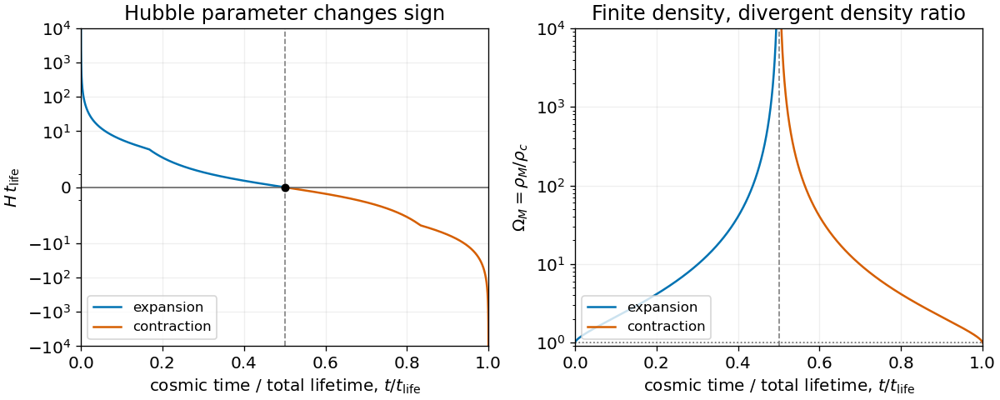

# Density-parameter divergence at a cosmological turnaround

↑ **Parent:** [Cosmological density parameter](cosmological-density-parameter.md)

At maximum expansion of a [closed matter-dominated Friedmann solution](closed-matter-dominated-friedmann-solution.md), the [Hubble parameter](hubble-parameter.md) vanishes while the physical [mass density](density.md) stays positive and finite. Its [critical density](critical-density.md) therefore vanishes and the [cosmological density parameter](cosmological-density-parameter.md) diverges. This is a singularity of that ratio rather than a [curvature singularity](curvature-singularity.md). In the cycloid variable $\theta$, $\Omega_M=\sec^2(\theta/2)$, diverging at $\theta=\pi$ and approaching one at the [Big Bang](big-bang.md) and [Big Crunch](big-crunch.md) ends.

**[Figure 3](#image-a-closed-dust-universe-the-hubble-parameter-changes-sign-while-its-density-parameter-diverges-at-maximum-expansion). A closed dust universe: the Hubble parameter changes sign while its density parameter diverges at maximum expansion**.

## ↑ Ancestors (6)

1. [Cosmological density parameter](cosmological-density-parameter.md)
2. [Critical density](critical-density.md)
3. [Cosmology](cosmology-split.md)
4. [Branches of physics](branches-of-physics.md)
5. [Physics](physics-split.md)
6. [Codex Wiki](split.md)

## ← Incoming links (1)

- [Solution](past-exam-of-the-general-relativity-and-cosmology-course-of-the-university-of-oxford/2013/3/c/solution.md)
