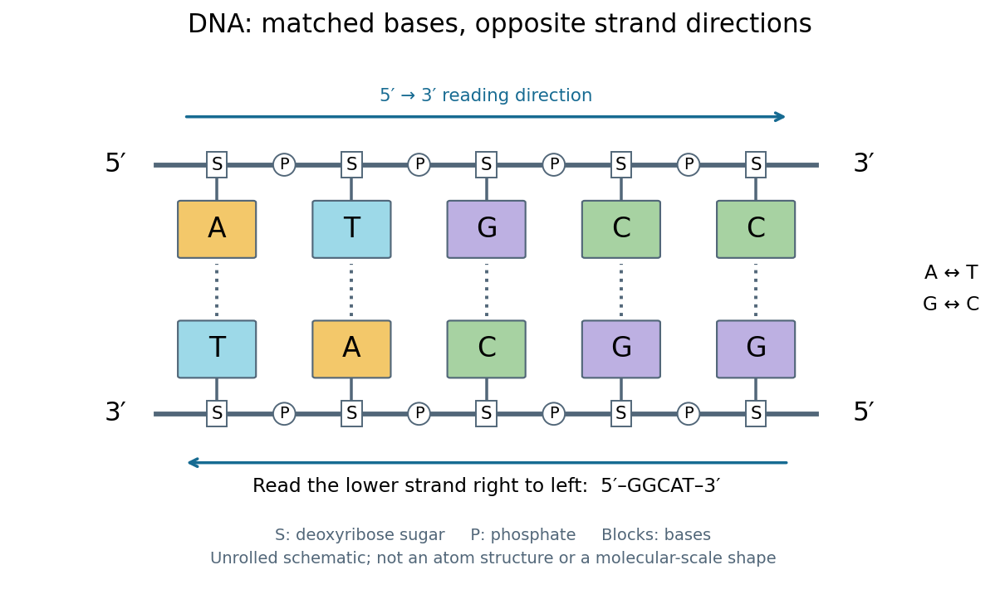

# Deoxyribonucleic acid

↑ **Parent:** [Nucleic acid](nucleic-acid.md)

[Deoxyribonucleic acid](deoxyribonucleic-acid.md), or [DNA](deoxyribonucleic-acid.md), is a [nucleotide](nucleotide.md) [polymer](polymer-split.md) that stores biological information in its [nucleotide sequence](nucleic-acid-sequence.md). The crucial variable is order: two [DNA](deoxyribonucleic-acid.md) [molecules](molecule-split.md) can contain the same numbers of each [nucleobase](nucleotide-base.md) yet carry different [nucleotide sequences](nucleic-acid-sequence.md). This makes a physical [molecule](molecule-split.md) an inheritable record, rather than merely a mixture of ingredients. [Genes](gene.md) are functional regions of that record; the whole [DNA](deoxyribonucleic-acid.md) [nucleotide sequence](nucleic-acid-sequence.md) is not one long [gene](gene.md). See [NHGRI: DNA fact sheet](https://www.genome.gov/about-genomics/fact-sheets/Deoxyribonucleic-Acid-Fact-Sheet).

Each [DNA](deoxyribonucleic-acid.md) strand has a backbone of alternating [deoxyribose](deoxyribose.md) [sugars](sugar.md) and [phosphate](phosphate.md) groups joined through [covalent bonds](covalent-bond-split.md). Attached [nucleobases](nucleotide-base.md) supply the familiar four-letter alphabet: [adenine](adenine.md) A, [thymine](thymine.md) T, [guanine](guanine.md) G, and [cytosine](cytosine.md) C. In ordinary double-stranded [DNA](deoxyribonucleic-acid.md), [base pairing](base-pairing.md) matches A with T and G with C. The backbone connects successive [nucleotides](nucleotide.md) along a strand; [base pairing](base-pairing.md) connects partners across strands. Keeping these two connections distinct explains how strands can separate while each retains its own [nucleotide sequence](nucleic-acid-sequence.md).

The two backbones have directions, conventionally labelled $5'$ and $3'$ after numbered [carbon](carbon.md) [chemical atoms](atom-physics.md) in [deoxyribose](deoxyribose.md). They form [antiparallel nucleic acid strands](antiparallel-nucleic-acid-strands.md): following one from $5'$ to $3'$ takes you opposite to the other's $5'$-to-$3'$ direction. For the chosen [DNA](deoxyribonucleic-acid.md) [nucleotide sequence](nucleic-acid-sequence.md) $5'\text{-}\mathrm{ATGCC}\text{-}3'$, write its partner directly underneath as $3'\text{-}\mathrm{TACGG}\text{-}5'$. Now read that partner from its own $5'$ end: its [reverse complement](reverse-complement.md) is $5'\text{-}\mathrm{GGCAT}\text{-}3'$. Complementing letters and reversing their order are separate operations. See [Alberts et al., Molecular Biology of the Cell: the structure and function of DNA](https://www.ncbi.nlm.nih.gov/books/NBK26821/).

**[Figure 11](#image-dna-base-pairing-and-antiparallel-nucleic-acid-strands-an-unrolled-ladder-for-atgcc-and-its-reverse-complement). DNA base pairing and antiparallel nucleic acid strands: an unrolled ladder for ATGCC and its reverse complement**.

The diagram's rails represent [sugar](sugar.md)–[phosphate](phosphate.md) backbones and its coloured blocks represent [nucleobases](nucleotide-base.md), not individual [chemical atoms](atom-physics.md). Reading left to right gives five matched positions: A–T, T–A, G–C, C–G, C–G. There are two A–T-type [base pairs](base-pair.md) and three G–C-type [base pairs](base-pair.md); the complete two-strand example contains ten [nucleotides](nucleotide.md). Reversing the bottom row changes the reading convention, not the physical partners. Real double-stranded [DNA](deoxyribonucleic-acid.md) winds into a [nucleic acid double helix](nucleic-acid-double-helix.md); the flattened ladder emphasizes [base pairing](base-pairing.md) and direction without pretending to show its three-dimensional geometry.

The motivating consequence is copying by a template. After strands separate, each existing [DNA](deoxyribonucleic-acid.md) strand specifies which incoming [nucleotides](nucleotide.md) should accompany it through [base pairing](base-pairing.md). [DNA replication](dna-replication.md) uses [enzymes](enzyme-split.md) to build complementary strands, allowing the record to persist through successive [biological cells](biological-cell-split.md). [Base pairing](base-pairing.md) supplies a selection rule, while [enzymes](enzyme-split.md) perform the chemistry: a matching diagram alone is not a complete copying mechanism. The connection between structure and copying was already central to the model published by Watson and Crick on 25 April 1953. See [Watson and Crick, Molecular Structure of Nucleic Acids, Nature 171, 737–738 (1953)](https://www.nature.com/articles/171737a0).

Stored information needs interpretation. Some [DNA](deoxyribonucleic-acid.md) regions specify [proteins](protein-split.md) through [RNA](ribonucleic-acid.md); others contribute to functional [RNA](ribonucleic-acid.md) or regulate [gene expression](gene-expression.md), and some have no known function. [Non-coding DNA](non-coding-dna.md) means sequence that does not specify a [protein](protein-split.md)'s sequence of [amino acids](amino-acid.md), not automatically useless sequence. Nor does a [DNA](deoxyribonucleic-acid.md) [nucleotide sequence](nucleic-acid-sequence.md) alone determine an [organism](organism-split.md)'s fate: [phenotypes](phenotype.md) also depend on biological context and environment. See [NHGRI: non-coding DNA](https://www.genome.gov/genetics-glossary/Non-Coding-DNA). Its double-stranded form is often modeled mechanically as a [worm-like chain](worm-like-chain.md), with [elasticity](elasticity-physics-split.md) and effective [excluded volume](excluded-volume.md) depending on solvent conditions.

**Table of contents**

- [Nuclease protection assay](nuclease-protection-assay.md)
- [DNA hybridization](dna-hybridization.md)
- [DNA damage](dna-damage.md)
  - [Chromosome breakage](chromosome-breakage.md)
- [Ancient DNA](ancient-dna.md)
- [DNA looping](dna-looping.md)
- [Negative supercoiling](negative-supercoiling.md)
- [Minor groove](minor-groove.md)
- [Major groove](major-groove.md)
- [DNA double helix](dna-double-helix.md)
- [Z-DNA](z-dna.md)
- [B-DNA](b-dna.md)
- [A-DNA](a-dna.md)
- [DNA supercoiling](dna-supercoiling.md)
- [Heteroduplex DNA](heteroduplex-dna.md)
- [Double-stranded DNA](double-stranded-dna.md)
- [Single-stranded DNA](single-stranded-dna.md)
- [DNA lesion](dna-lesion.md)

## ↑ Ancestors (4)

1. [Nucleic acid](nucleic-acid.md)
2. [Polymer](polymer-split.md)
3. [Chemistry](chemistry-split.md)
4. [Codex Wiki](split.md)

## ← Incoming links (1)

- [Deoxyribonucleic acid](deoxyribonucleic-acid.md)
