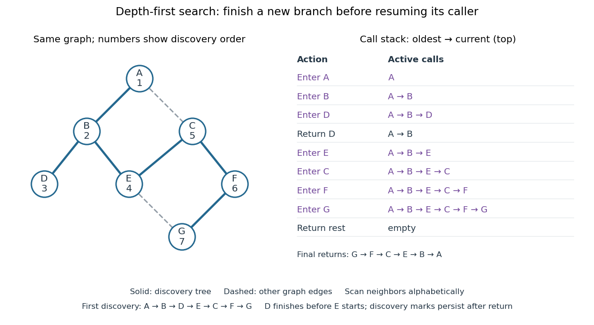

# Depth-first search

↑ **Parent:** [Algorithm](algorithm.md)  
ⓦ [Wiki](https://en.wikipedia.org/wiki/Depth-first_search)

[Depth-first search](depth-first-search.md) is a [graph search](graph-search.md) that follows a branch as far as it can before returning to try the next unexplored branch. Starting at a [vertex](vertex-graph-theory.md) $s$ of an [undirected graph](undirected-graph.md) on a [finite set](finite-set.md) of [vertices](vertex-graph-theory.md), mark $s$ as discovered. Scan its [graph neighbours](neighbour-of-a-vertex.md) in a fixed order: for each undiscovered [vertex](vertex-graph-theory.md), record the current [vertex](vertex-graph-theory.md) as its [parent in a rooted tree](parent-in-a-rooted-tree.md) in the discovery [tree](tree-graph-theory.md), mark the new [vertex](vertex-graph-theory.md), and explore it immediately using [recursion](recursion-computer-science.md). Return when its [adjacency list](adjacency-list.md) is exhausted. Discovery marks persist after return, preventing a [graph cycle](cycle-in-a-graph.md) from causing repeated exploration. This branch-and-return rule is the maze exploration described in MIT's notes. [MIT 6.006, lecture 14: depth-first search, pp. 2–3](6-006-introduction-to-algorithms-fall-2011-by-massachusetts-institute-of-technology-6-006-course-staff/lecture-14-graphs-ii-depth-first-search.md)

Use the same unweighted [undirected graph](undirected-graph.md) as [breadth-first search](breadth-first-search.md), with [vertex set](vertex-set.md) $V=\{A,B,C,D,E,F,G\}$ and [edges](edge-of-a-graph.md)

$$
E=\{AB,AC,BD,BE,CE,CF,EG,FG\},
$$

where $XY$ denotes the unordered pair $\{X,Y\}$. Visit [graph neighbours](neighbour-of-a-vertex.md) in [lexicographic order](lexicographic-order.md) of their one-letter labels, starting at $A$. The discovery order, computed by the diagram's generator, is

$$
A,B,D,E,C,F,G.
$$

The discovery [edges](edge-of-a-graph.md) in order are $AB,BD,BE,EC,CF,FG$. They form a [rooted tree](rooted-tree.md) spanning the reached [vertices](vertex-graph-theory.md), with [root of a tree](root-of-a-tree.md) $A$. The other [edges](edge-of-a-graph.md), $AC$ and $EG$, remain in the original [graph](graph-split.md) but never discover a new [vertex](vertex-graph-theory.md). In particular, the [graph cycle](cycle-in-a-graph.md) $A,B,E,C,A$ causes no repeated discovery.

**[Figure 63](#image-depth-first-search-discovery-edges-and-the-active-call-stack-on-seven-vertices). Depth-first search: discovery edges and the active call stack on seven vertices**. Numbers show first-discovery order. Solid [edges](edge-of-a-graph.md) form the discovery [tree](tree-graph-theory.md); dashed [edges](edge-of-a-graph.md) belong only to the original [graph](graph-split.md). The right panel shows the [call stack](call-stack.md) from oldest call to current call, including the return from $D$ before entering $E$.

At $D$ there is no undiscovered [graph neighbour](neighbour-of-a-vertex.md), so its call returns to $B$. The next call enters $E$, then $C$, then $F$, then $G$. Immediately after discovering $G$, the [call stack](call-stack.md) is $A,B,E,C,F,G$, with $G$ on top; $D$ is still discovered but its call has finished. The maximum [call stack](call-stack.md) depth is six, although seven [vertices](vertex-graph-theory.md) are discovered. Following the recorded [parent in a rooted tree](parent-in-a-rooted-tree.md) backwards at each step reconstructs a [graph path](path-in-a-graph.md); here the route from $A$ to $G$ is $A,B,E,C,F,G$, using five [edges](edge-of-a-graph.md). [Breadth-first search](breadth-first-search.md) instead finds $A,B,E,G$, using three [edges](edge-of-a-graph.md). [Depth-first search](depth-first-search.md) establishes [reachability](reachability-in-a-graph.md) but does not guarantee the fewest [edges](edge-of-a-graph.md).

An explicit [LIFO stack](stack-data-structure.md) can replace [recursion](recursion-computer-science.md), but its entries and discovery rule must be specified. To reproduce this exact traversal, store one frame per active [vertex](vertex-graph-theory.md), retaining the next position in its [adjacency list](adjacency-list.md). Advance the top frame by one [graph neighbour](neighbour-of-a-vertex.md); if that [vertex](vertex-graph-theory.md) is undiscovered, mark it and push its frame immediately; pop an exhausted frame. Pushing all undiscovered [graph neighbours](neighbour-of-a-vertex.md) at once and marking them on push is a different iterative variant. Even pushing them in reverse [lexicographic order](lexicographic-order.md) does not generally reproduce the [parent in a rooted tree](parent-in-a-rooted-tree.md) relationships above: $C$ would already be marked while processing $A$, so $E$ could not discover $C$.

With an [adjacency list](adjacency-list.md) representation, constant-cost discovery checks and frame operations, and the [graph neighbours](neighbour-of-a-vertex.md) already ordered, [depth-first search](depth-first-search.md) has [time complexity](time-complexity.md) $O(|V|+|E|)$ in [Big O notation](big-o-notation.md). Each reached [vertex](vertex-graph-theory.md) is entered once and each incident [edge](edge-of-a-graph.md) is examined at most twice in an [undirected graph](undirected-graph.md); initializing all discovery marks costs $O(|V|)$. The [call stack](call-stack.md) has depth at most $|V|$, since no active [vertex](vertex-graph-theory.md) repeats. Discovery marks and the recorded [parent in a rooted tree](parent-in-a-rooted-tree.md) for each nonroot [vertex](vertex-graph-theory.md) also need $O(|V|)$ auxiliary [space complexity](space-complexity.md), excluding storage for the [graph](graph-split.md). Sorting [adjacency lists](adjacency-list.md) to obtain a chosen order is additional work. [Sedgewick and Wayne, Algorithms: DepthFirstPaths discovery marks and resource bounds](https://raw.githubusercontent.com/kevin-wayne/algs4/master/src/main/java/edu/princeton/cs/algs4/DepthFirstPaths.java)

One start explores only its [connected component of a graph](component-graph-theory.md). To cover a disconnected [graph](graph-split.md), start again at every still-undiscovered [vertex](vertex-graph-theory.md) while keeping all discovery marks; the discovery [trees](tree-graph-theory.md) form a [forest](forest.md). [Depth-first search](depth-first-search.md) is useful for [reachability](reachability-in-a-graph.md), constructing a [spanning tree](spanning-tree.md) of a [connected graph](connected-graph.md), and organizing the return steps needed by a [depth-first traversal of a tree](depth-first-traversal-of-a-tree.md). For detecting a [graph cycle](cycle-in-a-graph.md) in a [simple graph](simple-graph.md) that is an [undirected graph](undirected-graph.md), an [edge](edge-of-a-graph.md) to an already discovered [vertex](vertex-graph-theory.md) other than the current [parent in a rooted tree](parent-in-a-rooted-tree.md) closes a [graph cycle](cycle-in-a-graph.md); the immediate return [edge](edge-of-a-graph.md) to that [parent in a rooted tree](parent-in-a-rooted-tree.md) is not itself a [graph cycle](cycle-in-a-graph.md).

// Target: computer-science.bigb

## ↑ Ancestors (3)

1. [Algorithm](algorithm.md)
2. [Computer science](computer-science-split.md)
3. [Codex Wiki](split.md)

## ← Incoming links (13)

- [Bounding volume hierarchy](bounding-volume-hierarchy.md)
- [Bounding volume hierarchy traversal](bounding-volume-hierarchy-traversal.md)
- [Breadth-first search](breadth-first-search.md)
- [Cached cell value](cached-cell-value.md)
- [Call stack](call-stack.md)
- [Cut vertex](cut-vertex.md)
- [Depth-first search](depth-first-search.md)
- [DFS discovery time](dfs-discovery-time.md)
- [DFS lowpoint](dfs-lowpoint.md)
- [Solution](past-exam-of-the-mathematics-course-of-the-university-of-cambridge/2007/ia/paper-5/9/b/ii/solution.md)
- [Spreadsheet dependency evaluation](spreadsheet-dependency-evaluation.md)
- [Spreadsheet dependency graph](spreadsheet-dependency-graph.md)
- [Stack (data structure)](stack-data-structure.md)
