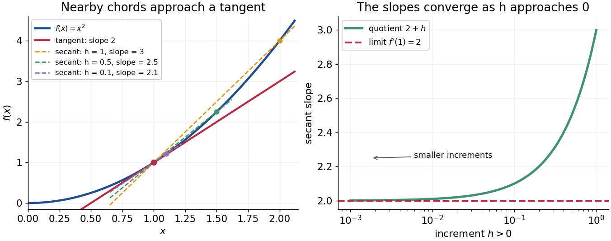

# Derivative

↑ **Parent:** [Calculus](calculus-split.md)  
ⓦ [Wiki](https://en.wikipedia.org/wiki/Derivative)

The derivative measures the instantaneous rate at which a [function](function-split.md) changes. For a real [function](function-split.md) $f$ defined near $a$, it exists when the [difference quotient](difference-quotient.md) has a finite two-sided [limit](limit-of-a-function.md):

$$
f'(a)=\lim_{h\to0}\frac{f(a+h)-f(a)}h.
$$

The quotient is the [slope](slope.md) of the [straight line](straight-line.md) joining two nearby points of the graph. Its [limit](limit-of-a-function.md) is the [slope](slope.md) of the [tangent line](tangent-line.md). Thus a [derivative](derivative.md) describes a local rate without choosing a particular finite measurement interval.

For $f(x)=x^2$, expanding the numerator gives

$$
\frac{(a+h)^2-a^2}h=2a+h,\qquad f'(a)=2a.
$$

At $a=1$, the increments $h=1$, $1/2$ and $1/10$ give [secant line](secant-line.md) [slopes](slope.md) $3$, $2.5$ and $2.1$. The [limit](limit-of-a-function.md) is $2$, and the [tangent line](tangent-line.md) is $y=1+2(x-1)$. The picture makes the limiting process visible.

**[Figure 24](#image-secant-lines-to-x-squared-approach-its-tangent-line-at-x-1). Secant lines to x squared approach its tangent line at x = 1**.

The same calculation shows why the [derivative](derivative.md) is useful for approximation:

$$
f(a+h)=f(a)+f'(a)h+r(h),\qquad \frac{r(h)}h\longrightarrow0.
$$

This is a [local linear approximation](local-linear-approximation.md). Near $a=1$, replacing $(1+h)^2$ by $1+2h$ makes the exact error $h^2$, smaller than the leading change when $h$ is small. A curved graph can therefore be studied locally using a [straight line](straight-line.md).

If the [function](function-split.md) records [position](position.md) against time, its [derivative](derivative.md) is [velocity](velocity.md). If it records an [objective function](objective-function.md), its [derivative](derivative.md) tests local changes that matter in [optimization](mathematical-optimization-split.md); in several variables, the [gradient](gradient.md) collects these directional rates and guides [gradient descent](gradient-descent-split.md). The interpretation comes from the [function](function-split.md) and its units, rather than from a new rule for each application.

Existence matters. For the [absolute value function](absolute-value.md) $f(x)=|x|$, the [one-sided derivatives](one-sided-derivative.md) at zero are $-1$ and $1$, so there is no single [tangent line](tangent-line.md) described by a finite [derivative](derivative.md) there. Nor does a zero [derivative](derivative.md) alone identify a maximum or minimum: $f(x)=x^3$ has $f'(0)=0$ but keeps increasing through zero.

**Table of contents**

- [Right derivative](right-derivative.md)
- [Fermat's theorem on stationary points](fermat-s-theorem-on-stationary-points.md)
- [Symmetric derivative](symmetric-derivative.md)
- [Related rates](related-rates.md)
- [Power rule](power-rule.md)
- [Logarithmic differentiation](logarithmic-differentiation.md)
- [Regularity of a power times a function with a simple zero](regularity-of-a-power-times-a-function-with-a-simple-zero.md)
- [Local linear approximation](local-linear-approximation.md)
- [Symmetric second derivative](symmetric-second-derivative.md)
- [Symmetric second differences detect an affine corner](symmetric-second-differences-detect-an-affine-corner.md)
- [Symmetric first-order differences remove an affine corner](symmetric-first-order-differences-remove-an-affine-corner.md)
- [Vanishing symmetric second derivative forces an affine function](vanishing-symmetric-second-derivative-forces-an-affine-function.md)
- [One-sided derivative](one-sided-derivative.md)
- [Tangent line](tangent-line.md)
  - [Vertical tangent](vertical-tangent.md)
  - [Common tangent](common-tangent.md)
  - [Tangent through the origin to an exponential curve](tangent-through-the-origin-to-an-exponential-curve.md)
  - [Normal line to a plane curve](normal-line-to-a-plane-curve.md)
- [Automatic differentiation](automatic-differentiation.md)
- [Differentiation](differentiation.md)
- [Second derivative](second-derivative.md)
  - [Third derivative](third-derivative.md)
    - [Fourth derivative](fourth-derivative.md)
- [Difference quotient](difference-quotient.md)
  - [Discrete integration by parts](discrete-integration-by-parts.md)
- [Total derivative](total-derivative.md)
- [L'Hôpital's rule](l-hopital-s-rule.md)
  - [Derivative quotient limits on partial domains](derivative-quotient-limits-on-partial-domains.md)
- [Darboux's theorem (analysis)](darboux-s-theorem-analysis.md)
  - [A derivative has no removable discontinuity](a-derivative-has-no-removable-discontinuity.md)
  - [Intermediate secant slope from endpoint derivatives](intermediate-secant-slope-from-endpoint-derivatives.md)
- [Product rule](product-rule.md)
  - [Differentiability restored by a quadratic zero](differentiability-restored-by-a-quadratic-zero.md)
  - [Leibniz rule](leibniz-rule.md)
    - [Generalized Leibniz rule](generalized-leibniz-rule.md)
  - [Nondifferentiable factor with a differentiable nondegenerate product](nondifferentiable-factor-with-a-differentiable-nondegenerate-product.md)
- [Quotient rule](quotient-rule.md)
- [Chain rule](chain-rule.md)
  - [Linear approximation](linear-approximation.md)
  - [Multivariable chain rule](multivariable-chain-rule.md)
    - [Second derivatives under a two-variable coordinate change](second-derivatives-under-a-two-variable-coordinate-change.md)
    - [Derivative along a curve](derivative-along-a-curve.md)
      - [Derivative of a vector field dotted with curve velocity](derivative-of-a-vector-field-dotted-with-curve-velocity.md)
  - [Nondifferentiable inner function with a differentiable nondegenerate composite](nondifferentiable-inner-function-with-a-differentiable-nondegenerate-composite.md)
  - [Second derivative chain rule](second-derivative-chain-rule.md)

## ↑ Ancestors (6)

1. [Calculus](calculus-split.md)
2. [Real analysis](real-analysis-split.md)
3. [Analysis](analysis-split.md)
4. [Area of mathematics](area-of-mathematics.md)
5. [Mathematics](mathematics-split.md)
6. [Codex Wiki](split.md)

## ← Incoming links (2463)

- [A cubic root from existence to a quantitative bracket](a-cubic-root-from-existence-to-a-quantitative-bracket.md)
- [A derivative has no removable discontinuity](a-derivative-has-no-removable-discontinuity.md)
- [Absolute value at a simple zero](absolute-value-at-a-simple-zero.md)
- [Absolutely continuous probability distribution](absolutely-continuous-probability-distribution.md)
- [Acceleration](acceleration.md)
- [Acceleration in cylindrical coordinates](acceleration-in-cylindrical-coordinates.md)
- [Acoustic displacement](acoustic-displacement.md)
- [Activation energy](activation-energy.md)
- [Additive composite expansion](additive-composite-expansion.md)
- [Additive constant](additive-constant.md)
- [Adler trace](adler-trace.md)
- [Analyticity](analyticity.md)
- [Andrews's carbon dioxide experiment](andrews-s-carbon-dioxide-experiment.md)
- [Angular displacement](angular-displacement.md)
- [Anticonformal map](anticonformal-map.md)
- [Antiderivative](antiderivative.md)
- [Antiderivatives on disconnected domains](antiderivatives-on-disconnected-domains.md)
- [Arrhenius equation](arrhenius-equation.md)
- [Arrival-time compression for a moving source](arrival-time-compression-for-a-moving-source.md)
- [Asymptotic normality of a normal sample standard deviation](asymptotic-normality-of-a-normal-sample-standard-deviation.md)
- [Asymptotic power series](asymptotic-power-series.md)
- [Attractive potential ordering does not order quantum reflection](attractive-potential-ordering-does-not-order-quantum-reflection.md)
- [Autonomous third-order reduction using the dependent variable](autonomous-third-order-reduction-using-the-dependent-variable.md)
- [Axial-current divergence for a pseudoscalar Yukawa interaction](axial-current-divergence-for-a-pseudoscalar-yukawa-interaction.md)
- [Backward difference operator](backward-difference-operator.md)
- [Bayes quantile under asymmetric absolute-error loss](bayes-quantile-under-asymmetric-absolute-error-loss.md)
- [Benney equation](benney-equation.md)
- [Bernstein approximation of a corner](bernstein-approximation-of-a-corner.md)
- [Bernstein inequality for algebraic polynomials](bernstein-inequality-for-algebraic-polynomials.md)
- [Bessel focal length uncertainty](bessel-focal-length-uncertainty.md)
- [Beta highest posterior density endpoint characterization](beta-highest-posterior-density-endpoint-characterization.md)
- [Bézier curve](bezier-curve.md)
- [Bézier derivative control polygon](bezier-derivative-control-polygon.md)
- [Binary activity-coefficient consistency](binary-activity-coefficient-consistency.md)
- [Binomial branching process conditioned on extinction](binomial-branching-process-conditioned-on-extinction.md)
- [Bisection method](bisection-method.md)
- [Bound-state matching in a symmetric stepped well](bound-state-matching-in-a-symmetric-stepped-well.md)
- [Boundary condition](boundary-condition.md)
- [Boundary-decaying Green kernel for an inverse-square differential operator](boundary-decaying-green-kernel-for-an-inverse-square-differential-operator.md)
- [Boundary jet](boundary-jet.md)
- [Boundary layer](boundary-layer.md)
- [Boundary trace of a function](boundary-trace-of-a-function.md)
- [Bounded BV extension operator](bounded-bv-extension-operator.md)
- [Bounded-variation step outside W11](bounded-variation-step-outside-w11.md)
- [Bracketing method](bracketing-method.md)
- [Branch of a multivalued function](branch-of-a-multivalued-function.md)
- [Brownian motion](brownian-motion-split.md)
- [Buffer capacity](buffer-capacity.md)
- [Buffer capacity measurement](buffer-capacity-measurement.md)
- [Burgers characteristic breaking](burgers-characteristic-breaking.md)
- [BV mollification error estimate](bv-mollification-error-estimate.md)
- [BV translation estimate](bv-translation-estimate.md)
- [Calculus](calculus-split.md)
- [Canonical partition function](canonical-partition-function.md)
- [Cantor part of a bounded-variation derivative](cantor-part-of-a-bounded-variation-derivative.md)
- [Carothers equation](carothers-equation.md)
- [Catastrophic cancellation](catastrophic-cancellation.md)
- [Catenoid existence threshold for equal rings](catenoid-existence-threshold-for-equal-rings.md)
- [Cauchy derivative formula](cauchy-derivative-formula.md)
- [Cauchy mean value theorem](cauchy-mean-value-theorem.md)
- [Cauchy principal value](cauchy-principal-value.md)
- [Causal Green function for a repeated-root Euler operator](causal-green-function-for-a-repeated-root-euler-operator.md)
- [Causal Green function of a damped oscillator](causal-green-function-of-a-damped-oscillator.md)
- [Causal Green function of an overdamped oscillator](causal-green-function-of-an-overdamped-oscillator.md)
- [Certified curve-plane intersection](certified-curve-plane-intersection.md)
- [Chaikin basis function](chaikin-basis-function.md)
- [Chaikin subdivision](chaikin-subdivision.md)
- [Chain rule](chain-rule.md)
- [Change of dependent variable](change-of-dependent-variable.md)
- [Change of variables for probability densities](change-of-variables-for-probability-densities.md)
- [Change of variables formula](change-of-variables-formula.md)
- [Characteristic fold for sinusoidal data in a forced Burgers equation](characteristic-fold-for-sinusoidal-data-in-a-forced-burgers-equation.md)
- [Characteristic-function derivatives from finite absolute moments](characteristic-function-derivatives-from-finite-absolute-moments.md)
- [Charge conservation](charge-conservation.md)
- [Chebyshev polynomial](chebyshev-polynomial.md)
- [Chemical equilibrium](chemical-equilibrium.md)
- [Chemical potential and Helmholtz free energy](chemical-potential-and-helmholtz-free-energy.md)
- [Chemostat steady state](chemostat-steady-state.md)
- [Chromaticity](chromaticity.md)
- [Circular torus coordinates](circular-torus-coordinates.md)
- [Circulation (physics)](circulation-physics.md)
- [Clamped-beam Green function](clamped-beam-green-function.md)
- [Clamped cubic spline](clamped-cubic-spline.md)
- [Classical solution](classical-solution.md)
- [Clausius-Clapeyron relation](clausius-clapeyron-relation.md)
- [Clock jitter](clock-jitter.md)
- [Closed-return induction under a voltage pulse](closed-return-induction-under-a-voltage-pulse.md)
- [Coarea formula for BV functions](coarea-formula-for-bv-functions.md)
- [Coefficient recovery and factorial moments of a probability generating function](coefficient-recovery-and-factorial-moments-of-a-probability-generating-function.md)
- [Coercive energy estimate for kinetic transport](coercive-energy-estimate-for-kinetic-transport.md)
- [Coercive positivity of a second variation](coercive-positivity-of-a-second-variation.md)
- [Coercivity transfers strong minimality to L1 minimality](coercivity-transfers-strong-minimality-to-l1-minimality.md)
- [Common-ion effect](common-ion-effect.md)
- [Common-strength Hill repression criterion](common-strength-hill-repression-criterion.md)
- [Compact-support spline zero count](compact-support-spline-zero-count.md)
- [Complete boundary-jet condition for formal adjoints](complete-boundary-jet-condition-for-formal-adjoints.md)
- [Complex analysis](complex-analysis-split.md)
- [Complex differentiability](complex-differentiability.md)
- [Complex-frequency SH flux monotonicity](complex-frequency-sh-flux-monotonicity.md)
- [Composite midpoint quadrature rule](composite-midpoint-quadrature-rule.md)
- [Compressibility factor](compressibility-factor.md)
- [Concavity of the logarithm](concavity-of-the-logarithm.md)
- [Concentration of a beta prior near zero](concentration-of-a-beta-prior-near-zero.md)
- [Conformality](conformality.md)
- [Conormal flux of a divergence-form operator](conormal-flux-of-a-divergence-form-operator.md)
- [Conservative forcing in averaged oscillator equations](conservative-forcing-in-averaged-oscillator-equations.md)
- [Consistency of a numerical method](consistency-of-a-numerical-method.md)
- [Constancy theorem](constancy-theorem.md)
- [Constant-coefficient differential equation](constant-coefficient-differential-equation.md)
- [Constant function](constant-function.md)
- [Constant-modulus holomorphic function](constant-modulus-holomorphic-function.md)
- [Constant rank theorem](constant-rank-theorem.md)
- [Continuity and differentiability thresholds for a damped oscillation](continuity-and-differentiability-thresholds-for-a-damped-oscillation.md)
- [Continuity of distributional differentiation](continuity-of-distributional-differentiation.md)
- [Continuous function](continuous-function.md)
- [Control-point influence on a curve](control-point-influence-on-a-curve.md)
- [Convex conjugate](convex-conjugate.md)
- [Convex optimization](convex-optimization-split.md)
- [Convolution of a Cauchy distribution and a uniform distribution](convolution-of-a-cauchy-distribution-and-a-uniform-distribution.md)
- [Cosine fixed-point iteration](cosine-fixed-point-iteration.md)
- [Cosmological Lagrangian displacement](cosmological-lagrangian-displacement.md)
- [Coupled resonant circuit model](coupled-resonant-circuit-model.md)
- [Covalent bond](covalent-bond-split.md)
- [Critical-layer regularity of a neutral Hazel mode](critical-layer-regularity-of-a-neutral-hazel-mode.md)
- [Critical point](critical-point.md)
- [Critical value](critical-value.md)
- [Cubic Laplace transition integral](cubic-laplace-transition-integral.md)
- [Cubic stationary endpoint](cubic-stationary-endpoint.md)
- [Cubic-time resistive damping in a differentially rotating cell](cubic-time-resistive-damping-in-a-differentially-rotating-cell.md)
- [Cumulative hazard function](cumulative-hazard-function.md)
- [Curvature of a plane curve](curvature-of-a-plane-curve.md)
- [Curvature sign convention](curvature-sign-convention.md)
- [Damping](damping.md)
- [DC Josephson effect](dc-josephson-effect.md)
- [De Boor–Fix spline coefficient functional](de-boor-fix-spline-coefficient-functional.md)
- [De Casteljau's algorithm](de-casteljau-s-algorithm.md)
- [Delay differential equation](delay-differential-equation.md)
- [Delay stability of proportional integrator control](delay-stability-of-proportional-integrator-control.md)
- [Delayed solutions of a square-root differential equation](delayed-solutions-of-a-square-root-differential-equation.md)
- [Delta method for Bernoulli odds](delta-method-for-bernoulli-odds.md)
- [Density fourth-power functional](density-fourth-power-functional.md)
- [Density-phase action of a Bose gas](density-phase-action-of-a-bose-gas.md)
- [Derivative](derivative.md)
- [Derivative criterion for monotonicity](derivative-criterion-for-monotonicity.md)
- [Derivative growth outside a finite-measure set](derivative-growth-outside-a-finite-measure-set.md)
- [Derivative of a map into a level set](derivative-of-a-map-into-a-level-set.md)
- [Derivative of an Abel integral](derivative-of-an-abel-integral.md)
- [Derivative of the determinant](derivative-of-the-determinant.md)
- [Derivative of the gamma function](derivative-of-the-gamma-function.md)
- [Derivative quotient limits on partial domains](derivative-quotient-limits-on-partial-domains.md)
- [Derivative-ratio Sobolev gain for a polynomial operator](derivative-ratio-sobolev-gain-for-a-polynomial-operator.md)
- [Derivative seminorms on a compact interval](derivative-seminorms-on-a-compact-interval.md)
- [Deriving the Laguerre equation from Rodrigues' formula](deriving-the-laguerre-equation-from-rodrigues-formula.md)
- [Diagonalization of a cyclic shift over a field](diagonalization-of-a-cyclic-shift-over-a-field.md)
- [Difference quotient](difference-quotient.md)
- [Differentiability](differentiability.md)
- [Differentiability does not imply continuity of the derivative](differentiability-does-not-imply-continuity-of-the-derivative.md)
- [Differentiability does not imply continuous derivatives](differentiability-does-not-imply-continuous-derivatives.md)
- [Differentiability implies continuity](differentiability-implies-continuity.md)
- [Differentiability in quadratic mean](differentiability-in-quadratic-mean.md)
- [Differentiability under equivalent norms](differentiability-under-equivalent-norms.md)
- [Differential calculus](differential-calculus.md)
- [Differential equation](differential-equation-split.md)
- [Differential geometry](differential-geometry-split.md)
- [Differential length comparator](differential-length-comparator.md)
- [Differential magnetic susceptibility](differential-magnetic-susceptibility.md)
- [Differential operator](differential-operator.md)
- [Differentiation](differentiation.md)
- [Differentiation of parameter integrals on compact rectangles](differentiation-of-parameter-integrals-on-compact-rectangles.md)
- [Differentiation operator](differentiation-operator.md)
- [Direct spherical-shell H2 estimate](direct-spherical-shell-h2-estimate.md)
- [Dirichlet gauge transform for constant drift](dirichlet-gauge-transform-for-constant-drift.md)
- [Dirichlet Green function between concentric spheres](dirichlet-green-function-between-concentric-spheres.md)
- [Dirichlet Green function for a conjugated harmonic oscillator](dirichlet-green-function-for-a-conjugated-harmonic-oscillator.md)
- [Dirichlet Green function for a radial power operator on an interval](dirichlet-green-function-for-a-radial-power-operator-on-an-interval.md)
- [Dirichlet half-line Green function for minus d2 plus 1](dirichlet-half-line-green-function-for-minus-d2-plus-1.md)
- [Dirichlet modified Helmholtz Green function on an interval](dirichlet-modified-helmholtz-green-function-on-an-interval.md)
- [Discharge measurement in a draining tank](discharge-measurement-in-a-draining-tank.md)
- [Discontinuity of a function](discontinuity-of-a-function.md)
- [Discontinuous derivative of a differentiable plane curve](discontinuous-derivative-of-a-differentiable-plane-curve.md)
- [Discrete Neumann mode selection](discrete-neumann-mode-selection.md)
- [Disk-median curvature expansion](disk-median-curvature-expansion.md)
- [Displacement cancellation without slope cancellation in crossing pulses](displacement-cancellation-without-slope-cancellation-in-crossing-pulses.md)
- [Doppler frequency along a trajectory](doppler-frequency-along-a-trajectory.md)
- [Doubling of variables for scalar conservation laws](doubling-of-variables-for-scalar-conservation-laws.md)
- [Drying front in a rainfall-driven Manning kinematic wave](drying-front-in-a-rainfall-driven-manning-kinematic-wave.md)
- [Dual differentiability with nonvanishing utility curvature](dual-differentiability-with-nonvanishing-utility-curvature.md)
- [Duffin-Schaeffer polynomial derivative inequality](duffin-schaeffer-polynomial-derivative-inequality.md)
- [Dulong-Petit law](dulong-petit-law.md)
- [Earthquake depth–origin-time trade-off](earthquake-depth-origin-time-trade-off.md)
- [Earthquake location by arrival times](earthquake-location-by-arrival-times.md)
- [Einstein solid](einstein-solid.md)
- [Elastic wave polarization](elastic-wave-polarization.md)
- [Electric potential](electric-potential.md)
- [Electrostatic softening above a conducting wedge](electrostatic-softening-above-a-conducting-wedge.md)
- [EM maximization step](em-maximization-step.md)
- [Endpoint derivative signs of Lagrange cardinal polynomials](endpoint-derivative-signs-of-lagrange-cardinal-polynomials.md)
- [Endpoint force derivative of clamped-free beam energy](endpoint-force-derivative-of-clamped-free-beam-energy.md)
- [Endpoint obstruction in a homogeneous differential equation](endpoint-obstruction-in-a-homogeneous-differential-equation.md)
- [Energy dissipation of a damped pendulum](energy-dissipation-of-a-damped-pendulum.md)
- [Energy form of a half-well sine state](energy-form-of-a-half-well-sine-state.md)
- [Entire function](entire-function.md)
- [Entropy summand](entropy-summand.md)
- [Equality slice of a feasible triangle](equality-slice-of-a-feasible-triangle.md)
- [Equilibrium peeling force of an adsorbed Gaussian chain](equilibrium-peeling-force-of-an-adsorbed-gaussian-chain.md)
- [Equivalence principle](equivalence-principle.md)
- [Erasure-pattern counting bound for maximal decoding error](erasure-pattern-counting-bound-for-maximal-decoding-error.md)
- [Error bound for composite Simpson's rule](error-bound-for-composite-simpson-s-rule.md)
- [Estimation of a beta shape parameter](estimation-of-a-beta-shape-parameter.md)
- [Euler-Maclaurin formula](euler-maclaurin-formula.md)
- [Euler method](euler-method.md)
- [Evanescent probability current](evanescent-probability-current.md)
- [Even reflection across a homogeneous Neumann boundary](even-reflection-across-a-homogeneous-neumann-boundary.md)
- [Exact polynomial steps for a delay equation](exact-polynomial-steps-for-a-delay-equation.md)
- [Existence for nonnegative shifted Poisson regularization](existence-for-nonnegative-shifted-poisson-regularization.md)
- [Exponential function](exponential-function.md)
- [Exponential integral with a square-root endpoint singularity](exponential-integral-with-a-square-root-endpoint-singularity.md)
- [Exponential Markov bound](exponential-markov-bound.md)
- [Extremal derivative of a disc map into a symmetric annulus](extremal-derivative-of-a-disc-map-into-a-symmetric-annulus.md)
- [Extreme value theorem](extreme-value-theorem.md)
- [Fabry–Pérot resonance spacing](fabry-perot-resonance-spacing.md)
- [Faraday's law of induction](faraday-s-law-of-induction.md)
- [Feasible point](feasible-point.md)
- [Feedback based on state overlap need not be stabilizing](feedback-based-on-state-overlap-need-not-be-stabilizing.md)
- [Fermat's theorem on stationary points](fermat-s-theorem-on-stationary-points.md)
- [Fields of a time-dependent electric dipole](fields-of-a-time-dependent-electric-dipole.md)
- [Finite contamination bias of normal location](finite-contamination-bias-of-normal-location.md)
- [Finite difference](finite-difference-split.md)
- [Finite difference method](finite-difference-method.md)
- [Finite difference operator](finite-difference-operator.md)
- [Finite fields as roots of a Frobenius polynomial](finite-fields-as-roots-of-a-frobenius-polynomial.md)
- [Finite-part normal trace for mixed quarter-power boundary data](finite-part-normal-trace-for-mixed-quarter-power-boundary-data.md)
- [Finite rectangular barrier matching](finite-rectangular-barrier-matching.md)
- [Finite samples do not certify quadrature accuracy](finite-samples-do-not-certify-quadrature-accuracy.md)
- [Finite square barrier transmission at half barrier height](finite-square-barrier-transmission-at-half-barrier-height.md)
- [Finite-time blowup](finite-time-blowup.md)
- [Finite titrant response of a buffer](finite-titrant-response-of-a-buffer.md)
- [Finite volume method](finite-volume-method-split.md)
- [Finite-well bound-state node sequence](finite-well-bound-state-node-sequence.md)
- [Finite-well confinement in a semiconductor heterostructure](finite-well-confinement-in-a-semiconductor-heterostructure.md)
- [First integral for a variational integrand independent of the function value](first-integral-for-a-variational-integrand-independent-of-the-function-value.md)
- [First-order low-pass filter](first-order-low-pass-filter.md)
- [First-order ordinary differential equation](first-order-ordinary-differential-equation.md)
- [First three derivatives of an inverse function](first-three-derivatives-of-an-inverse-function.md)
- [Fisher information in an exponential survival snapshot](fisher-information-in-an-exponential-survival-snapshot.md)
- [Fixed-temperature and fixed-flux heat equation on an interval](fixed-temperature-and-fixed-flux-heat-equation-on-an-interval.md)
- [Flat function](flat-function.md)
- [Flat linearized metric perturbations are locally pure gauge](flat-linearized-metric-perturbations-are-locally-pure-gauge.md)
- [Fold boundary of a characteristic graph](fold-boundary-of-a-characteristic-graph.md)
- [Formal pseudodifferential composition rule](formal-pseudodifferential-composition-rule.md)
- [Formal pseudodifferential residue](formal-pseudodifferential-residue.md)
- [Förster distance](forster-distance.md)
- [Four-point midpoint third derivative](four-point-midpoint-third-derivative.md)
- [Fourier analysis](fourier-analysis-split.md)
- [Fourier bounds for Schwartz functions](fourier-bounds-for-schwartz-functions.md)
- [Fourier decay from a Green-function derivative jump](fourier-decay-from-a-green-function-derivative-jump.md)
- [Fourier-mode Green function of the telegraph equation](fourier-mode-green-function-of-the-telegraph-equation.md)
- [Fourier series](fourier-series-split.md)
- [Fourier solution of a first-order equation with periodic forcing](fourier-solution-of-a-first-order-equation-with-periodic-forcing.md)
- [Fourier transform of a derivative](fourier-transform-of-a-derivative.md)
- [Fourier transform of a truncated cosine](fourier-transform-of-a-truncated-cosine.md)
- [Fourth derivative](fourth-derivative.md)
- [Fréchet space](frechet-space.md)
- [Frequency and wavelength peaks of Planck's law](frequency-and-wavelength-peaks-of-planck-s-law.md)
- [Frequency modulation](frequency-modulation.md)
- [Frozen Newton correction for a fixed-point equation](frozen-newton-correction-for-a-fixed-point-equation.md)
- [Function-value resolution near a nondegenerate minimum](function-value-resolution-near-a-nondegenerate-minimum.md)
- [Fundamental theorem of calculus](fundamental-theorem-of-calculus.md)
- [Galvanometer current sensitivity](galvanometer-current-sensitivity.md)
- [Gauge-coupling sign in Ginzburg-Landau superconductivity](gauge-coupling-sign-in-ginzburg-landau-superconductivity.md)
- [Gauss-Lucas theorem](gauss-lucas-theorem.md)
- [Gaussian curvature](gaussian-curvature.md)
- [Gaussian Dirichlet energy](gaussian-dirichlet-energy.md)
- [Gaussian envelope in a Klein-Gordon medium](gaussian-envelope-in-a-klein-gordon-medium.md)
- [Gaussian Poisson summation identity](gaussian-poisson-summation-identity.md)
- [Gaussian-prior Poisson log-effect conditional](gaussian-prior-poisson-log-effect-conditional.md)
- [Gaussian Sobolev space](gaussian-sobolev-space.md)
- [General-order Cauchy-Kovalevskaya theorem](general-order-cauchy-kovalevskaya-theorem.md)
- [Generalized Leibniz rule](generalized-leibniz-rule.md)
- [Generator of a multiplication semigroup](generator-of-a-multiplication-semigroup.md)
- [Generator square inequality](generator-square-inequality.md)
- [Geometric continuity](geometric-continuity.md)
- [Gibbs free-energy change for a pressure-linear gas correction](gibbs-free-energy-change-for-a-pressure-linear-gas-correction.md)
- [Gibbs free energy of mixing](gibbs-free-energy-of-mixing.md)
- [Gibbs phenomenon](gibbs-phenomenon.md)
- [Global harmonic conjugate criterion by vanishing periods](global-harmonic-conjugate-criterion-by-vanishing-periods.md)
- [Global minimum](global-minimum.md)
- [Gradient catastrophe](gradient-catastrophe.md)
- [Gradient of a radial function](gradient-of-a-radial-function.md)
- [Gravitational energy generation in a homologously contracting ideal-gas star](gravitational-energy-generation-in-a-homologously-contracting-ideal-gas-star.md)
- [Green function jump conditions](green-function-jump-conditions.md)
- [Green theorem with holes](green-theorem-with-holes.md)
- [Group delay dispersion](group-delay-dispersion.md)
- [Group velocity](group-velocity.md)
- [Gumbel distribution](gumbel-distribution.md)
- [H-theorem](h-theorem.md)
- [Half-anisotropic distribution function](half-anisotropic-distribution-function.md)
- [Half-line Green function for the first cylindrical harmonic](half-line-green-function-for-the-first-cylindrical-harmonic.md)
- [Half-line square-root potential well](half-line-square-root-potential-well.md)
- [Hamiltonian evolution equation](hamiltonian-evolution-equation.md)
- [Hardy inequality in Euclidean space](hardy-inequality-in-euclidean-space.md)
- [Hardy's inequality](hardy-s-inequality.md)
- [Harmonic expansion on a disk](harmonic-expansion-on-a-disk.md)
- [Harmonic matching across a circle with a derivative jump](harmonic-matching-across-a-circle-with-a-derivative-jump.md)
- [Harmonic superconvergence of the nine-point stencil](harmonic-superconvergence-of-the-nine-point-stencil.md)
- [Hazard function](hazard-function.md)
- [Heat bath relaxation with finite capacity](heat-bath-relaxation-with-finite-capacity.md)
- [Heat-kernel convergence for Gaussian-integrable initial data](heat-kernel-convergence-for-gaussian-integrable-initial-data.md)
- [Heat-kernel convergence from a conditionally convergent Gaussian integral](heat-kernel-convergence-from-a-conditionally-convergent-gaussian-integral.md)
- [Heating and cooling balance in the interstellar medium](heating-and-cooling-balance-in-the-interstellar-medium.md)
- [Hellmann–Feynman theorem](hellmann-feynman-theorem.md)
- [Helmholtz coil](helmholtz-coil.md)
- [Helmholtz free energy](helmholtz-free-energy.md)
- [Herglotz wave function](herglotz-wave-function.md)
- [Hermite interpolating polynomial](hermite-interpolating-polynomial.md)
- [Hermite interpolation error formula](hermite-interpolation-error-formula.md)
- [Hessian criterion for convexity](hessian-criterion-for-convexity.md)
- [High-frequency reciprocal parametrix kernel](high-frequency-reciprocal-parametrix-kernel.md)
- [Higher-order differentiability at a point](higher-order-differentiability-at-a-point.md)
- [History function of a delay differential equation](history-function-of-a-delay-differential-equation.md)
- [History of Hölder's inequality](history-of-holder-s-inequality.md)
- [Hoeffding lemma](hoeffding-lemma.md)
- [Holomorphic derivative of a quadrant Dirichlet solution](holomorphic-derivative-of-a-quadrant-dirichlet-solution.md)
- [Holomorphic function](holomorphic-function-split.md)
- [Holomorphic logarithm](holomorphic-logarithm.md)
- [Homogeneous linear differential equation](homogeneous-linear-differential-equation.md)
- [Hopf thresholds in a two-pool calcium model](hopf-thresholds-in-a-two-pool-calcium-model.md)
- [Hubble parameter](hubble-parameter.md)
- [Huber location estimator](huber-location-estimator.md)
- [Huber loss](huber-loss.md)
- [Huber score](huber-score.md)
- [Hydrostatic pressure](hydrostatic-pressure.md)
- [Hyperbolic cosine](hyperbolic-cosine.md)
- [Hyperbolic function](hyperbolic-function.md)
- [Hyperbolic invariant set](hyperbolic-invariant-set.md)
- [Hyperbolic sine](hyperbolic-sine.md)
- [Ice-ocean albedo feedback](ice-ocean-albedo-feedback.md)
- [Ice-sheet flotation](ice-sheet-flotation.md)
- [Ideal binary Gibbs-Duhem cancellation](ideal-binary-gibbs-duhem-cancellation.md)
- [Ideal weak electrolyte dilution law](ideal-weak-electrolyte-dilution-law.md)
- [Ill-posedness of numerical differentiation](ill-posedness-of-numerical-differentiation.md)
- [Image parity in gravitational lensing](image-parity-in-gravitational-lensing.md)
- [Implicit differential equation](implicit-differential-equation.md)
- [Implicit differentiation](implicit-differentiation.md)
- [Implicit equation](implicit-equation.md)
- [Implicit factorization can reveal nonunique initial solutions](implicit-factorization-can-reveal-nonunique-initial-solutions.md)
- [Implicit function](implicit-function.md)
- [Implicit function theorem](implicit-function-theorem.md)
- [Inada utility with vanishing curvature](inada-utility-with-vanishing-curvature.md)
- [Infimal convolution](infimal-convolution.md)
- [Influence function](influence-function.md)
- [Influence function of the mean](influence-function-of-the-mean.md)
- [Influence-function representer](influence-function-representer.md)
- [Initial curvature incompatibility at a moment-free beam end](initial-curvature-incompatibility-at-a-moment-free-beam-end.md)
- [Initial history of delayed feedback](initial-history-of-delayed-feedback.md)
- [Initial incompatibility with a Neumann boundary condition](initial-incompatibility-with-a-neumann-boundary-condition.md)
- [Initial-value derivative of a linear Gaussian diffusion](initial-value-derivative-of-a-linear-gaussian-diffusion.md)
- [Initial value problem](initial-value-problem.md)
- [Inner variable](inner-variable.md)
- [Instantaneous frequency](instantaneous-frequency.md)
- [Instantaneous stationary lava-crust thickness](instantaneous-stationary-lava-crust-thickness.md)
- [Integer-frequency zeros of a scaling function](integer-frequency-zeros-of-a-scaling-function.md)
- [Integrating factor](integrating-factor.md)
- [Integration by parts](integration-by-parts.md)
- [Intermediate secant slope from endpoint derivatives](intermediate-secant-slope-from-endpoint-derivatives.md)
- [Intermediate value theorem](intermediate-value-theorem.md)
- [Interval bisection](interval-bisection.md)
- [Inverse function](inverse-function.md)
- [Inverse-function linearization of a first-order equation](inverse-function-linearization-of-a-first-order-equation.md)
- [Inverse function rule](inverse-function-rule.md)
- [Inverse function theorem](inverse-function-theorem.md)
- [Inverse hyperbolic sine](inverse-hyperbolic-sine.md)
- [Inverse tangent](inverse-tangent.md)
- [Ionospheric interference fringe spacing](ionospheric-interference-fringe-spacing.md)
- [Ionospheric virtual height](ionospheric-virtual-height.md)
- [Ising ring bond correlation](ising-ring-bond-correlation.md)
- [Isolated mitochondria respiration experiment](isolated-mitochondria-respiration-experiment.md)
- [Isothermal compressibility from chemical-potential response](isothermal-compressibility-from-chemical-potential-response.md)
- [Jacobi's formula](jacobi-s-formula.md)
- [Jones unknot detection problem](jones-unknot-detection-problem.md)
- [Joukowski map from the upper half-disc to the upper half-plane](joukowski-map-from-the-upper-half-disc-to-the-upper-half-plane.md)
- [Joukowski map of the upper exterior of a unit disk](joukowski-map-of-the-upper-exterior-of-a-unit-disk.md)
- [Jump contribution to a piecewise weak derivative](jump-contribution-to-a-piecewise-weak-derivative.md)
- [Jump part of a BV derivative](jump-part-of-a-bv-derivative.md)
- [Jump set of a bounded-variation function](jump-set-of-a-bounded-variation-function.md)
- [Killing vector field](killing-vector-field-split.md)
- [Kirchhoff's law of thermochemistry](kirchhoff-s-law-of-thermochemistry.md)
- [Koebe quarter theorem](koebe-quarter-theorem.md)
- [Kohn singularity of static Lindhard screening](kohn-singularity-of-static-lindhard-screening.md)
- [Kruzhkov entropy flux](kruzhkov-entropy-flux.md)
- [Kuramoto self-consistency equation](kuramoto-self-consistency-equation.md)
- [Lacunary scaling-phase regularity counterexample](lacunary-scaling-phase-regularity-counterexample.md)
- [Lagrange identity for a fourth-order differential operator](lagrange-identity-for-a-fourth-order-differential-operator.md)
- [Lagrange remainder](lagrange-remainder.md)
- [Lanford contraction proof of the Feigenbaum fixed point](lanford-contraction-proof-of-the-feigenbaum-fixed-point.md)
- [Laplace distribution](laplace-distribution.md)
- [Laplace integral solution](laplace-integral-solution.md)
- [Laplace location and scale maximum likelihood](laplace-location-and-scale-maximum-likelihood.md)
- [Laplace solution of a first-order equation with exponential memory](laplace-solution-of-a-first-order-equation-with-exponential-memory.md)
- [Laplace transform](laplace-transform.md)
- [Laplace transform of a derivative](laplace-transform-of-a-derivative.md)
- [Latitude law of Foucault precession](latitude-law-of-foucault-precession.md)
- [Lava-crust overshoot under warming](lava-crust-overshoot-under-warming.md)
- [Lebesgue substitution on an interval](lebesgue-substitution-on-an-interval.md)
- [Lebesgue theorem on differentiability of monotone functions](lebesgue-theorem-on-differentiability-of-monotone-functions.md)
- [Legendre necessary condition](legendre-necessary-condition.md)
- [Leibniz integral rule](leibniz-integral-rule.md)
- [Lemniscatic integral](lemniscatic-integral.md)
- [Lens-to-half-plane map through the intersection points](lens-to-half-plane-map-through-the-intersection-points.md)
- [Liénard boundedness function](lienard-boundedness-function.md)
- [Likelihood-ratio test for equality of beta shape parameters](likelihood-ratio-test-for-equality-of-beta-shape-parameters.md)
- [Limits of adiabatic demagnetization](limits-of-adiabatic-demagnetization.md)
- [Linear approximation](linear-approximation.md)
- [Linear differential equation](linear-differential-equation.md)
- [Linear differential operator](linear-differential-operator.md)
- [Linear spline](linear-spline.md)
- [Lipschitz continuity](lipschitz-continuity.md)
- [Lipschitz error bound for Bernstein approximation](lipschitz-error-bound-for-bernstein-approximation.md)
- [Liquefaction enthalpy budget](liquefaction-enthalpy-budget.md)
- [Little Picard theorem](little-picard-theorem.md)
- [Local diffeomorphism](local-diffeomorphism.md)
- [Local linear approximation](local-linear-approximation.md)
- [Local minimum](local-minimum.md)
- [Local quadratic convergence of Newton iteration](local-quadratic-convergence-of-newton-iteration.md)
- [Locally convex space](locally-convex-space.md)
- [Locally Lipschitz function](locally-lipschitz-function.md)
- [Locally periodic one-dimensional harmonic-mean coefficient](locally-periodic-one-dimensional-harmonic-mean-coefficient.md)
- [Locally uniform convergence of holomorphic functions](locally-uniform-convergence-of-holomorphic-functions.md)
- [Log-cosh energy on a Sobolev space](log-cosh-energy-on-a-sobolev-space.md)
- [Log-likelihood](log-likelihood.md)
- [Logarithm tangent bound](logarithm-tangent-bound.md)
- [Logarithmic cancellation on an exterior annulus](logarithmic-cancellation-on-an-exterior-annulus.md)
- [Logarithmic gradient of an exponential squared-distance sum](logarithmic-gradient-of-an-exponential-squared-distance-sum.md)
- [Logarithmic inversion of a Gaussian divided by its argument](logarithmic-inversion-of-a-gaussian-divided-by-its-argument.md)
- [Logarithmic parameter integral with Cauchy weight](logarithmic-parameter-integral-with-cauchy-weight.md)
- [Logarithmic utility](logarithmic-utility.md)
- [Logarithmically divergent derivative at a regular singular endpoint](logarithmically-divergent-derivative-at-a-regular-singular-endpoint.md)
- [Logarithmically enhanced nonlinear boundary layer](logarithmically-enhanced-nonlinear-boundary-layer.md)
- [Logistic crossover in a weakly nonlinear Euler equation](logistic-crossover-in-a-weakly-nonlinear-euler-equation.md)
- [Logistic differential equation](logistic-differential-equation.md)
- [Logistic map](logistic-map.md)
- [Loss of differentiability from square-root hyperbolic source data](loss-of-differentiability-from-square-root-hyperbolic-source-data.md)
- [Lozi map](lozi-map.md)
- [Mach angle](mach-angle.md)
- [Maclaurin series](maclaurin-series.md)
- [Magnetic coenergy](magnetic-coenergy.md)
- [Magnetic susceptibility](magnetic-susceptibility.md)
- [Marginal utility](marginal-utility.md)
- [Markov interlacing lemma](markov-interlacing-lemma.md)
- [Martingale proof of the integral representation of a Lipschitz function](martingale-proof-of-the-integral-representation-of-a-lipschitz-function.md)
- [Mathematics](mathematics-split.md)
- [Maximum likelihood estimation](maximum-likelihood-estimation-split.md)
- [Mean absolute error bound for local polynomial regression](mean-absolute-error-bound-for-local-polynomial-regression.md)
- [Mean value theorem](mean-value-theorem.md)
- [Mehrstellen method](mehrstellen-method.md)
- [Metric path length](metric-path-length.md)
- [Metric variation of a scalar-curvature coupling](metric-variation-of-a-scalar-curvature-coupling.md)
- [Midpoint quadrature rule](midpoint-quadrature-rule.md)
- [Minimum roof length at fixed wall height and cross-sectional area](minimum-roof-length-at-fixed-wall-height-and-cross-sectional-area.md)
- [Minimum roughness property of a clamped cubic spline](minimum-roughness-property-of-a-clamped-cubic-spline.md)
- [Mixed Dirichlet-Neumann Green function in a quadrant](mixed-dirichlet-neumann-green-function-in-a-quadrant.md)
- [Moment differentiation of the Fourier transform](moment-differentiation-of-the-fourier-transform.md)
- [Monod equation](monod-equation.md)
- [Monotonicity of polynomial critical points in their roots](monotonicity-of-polynomial-critical-points-in-their-roots.md)
- [Monotonicity of the Erlang blocking probability](monotonicity-of-the-erlang-blocking-probability.md)
- [Most probable speed in the Maxwell distribution](most-probable-speed-in-the-maxwell-distribution.md)
- [Moving-surface retarded Jacobian](moving-surface-retarded-jacobian.md)
- [Narrowband frequency modulation](narrowband-frequency-modulation.md)
- [Navier slip boundary condition](navier-slip-boundary-condition.md)
- [Neumann boundary-forcing formula](neumann-boundary-forcing-formula.md)
- [Neumann compatibility condition for Laplace's equation](neumann-compatibility-condition-for-laplace-s-equation.md)
- [Neumann eigenfunction](neumann-eigenfunction.md)
- [Neumann Green function for the modified Helmholtz equation on an interval](neumann-green-function-for-the-modified-helmholtz-equation-on-an-interval.md)
- [Newton iteration in a Banach space](newton-iteration-in-a-banach-space.md)
- [Newton root-finding iteration](newton-root-finding-iteration.md)
- [Newton's second law](newton-s-second-law.md)
- [No-log boundary condition at a linearly vanishing Sturm-Liouville endpoint](no-log-boundary-condition-at-a-linearly-vanishing-sturm-liouville-endpoint.md)
- [Nodal derivative norm from Lagrange cardinal polynomials](nodal-derivative-norm-from-lagrange-cardinal-polynomials.md)
- [Noise amplification by differentiation of a linear interpolant](noise-amplification-by-differentiation-of-a-linear-interpolant.md)
- [Nonintegrability of a radial triangular Fourier cutoff in three dimensions](nonintegrability-of-a-radial-triangular-fourier-cutoff-in-three-dimensions.md)
- [Nonlinear ordinary differential equation](nonlinear-ordinary-differential-equation.md)
- [Nonunique Green kernel at a singular endpoint with two vanishing modes](nonunique-green-kernel-at-a-singular-endpoint-with-two-vanishing-modes.md)
- [Norm and spectral bounds for subdivision regularity](norm-and-spectral-bounds-for-subdivision-regularity.md)
- [Normal likelihood with variance equal to squared mean](normal-likelihood-with-variance-equal-to-squared-mean.md)
- [Normal Q-Q plot](normal-q-q-plot.md)
- [Normalization of generalized Laguerre polynomials](normalization-of-generalized-laguerre-polynomials.md)
- [Nuclear pore transport balance](nuclear-pore-transport-balance.md)
- [Null effective potential in Schwarzschild spacetime](null-effective-potential-in-schwarzschild-spacetime.md)
- [Numerical differentiation](numerical-differentiation.md)
- [Numerical integration](numerical-integration-split.md)
- [Oblique derivative boundary condition](oblique-derivative-boundary-condition.md)
- [Odd Legendre extension for an equatorial Dirichlet plane](odd-legendre-extension-for-an-equatorial-dirichlet-plane.md)
- [Odd variational trial gives an excited oscillator bound](odd-variational-trial-gives-an-excited-oscillator-bound.md)
- [Oil lens capillary balance](oil-lens-capillary-balance.md)
- [On-axis magnetic field of a circular current loop](on-axis-magnetic-field-of-a-circular-current-loop.md)
- [One-sided representatives of a one-dimensional BV function](one-sided-representatives-of-a-one-dimensional-bv-function.md)
- [Optical path length](optical-path-length.md)
- [Optimal geometric envelope for a Poisson distribution](optimal-geometric-envelope-for-a-poisson-distribution.md)
- [Orbital derivative](orbital-derivative.md)
- [Order of a zero of a differential](order-of-a-zero-of-a-differential.md)
- [Ordered-rate exponential M-step](ordered-rate-exponential-m-step.md)
- [Ordinary differential equation](ordinary-differential-equation.md)
- [Ornstein-Uhlenbeck gradient commutation identity](ornstein-uhlenbeck-gradient-commutation-identity.md)
- [Oscillating minimizing sequence with no minimizer](oscillating-minimizing-sequence-with-no-minimizer.md)
- [P-wavefront discontinuity transport](p-wavefront-discontinuity-transport.md)
- [Parameter continuation](parameter-continuation.md)
- [Parameter-shift remainder bound for a logarithmic Laplace integral](parameter-shift-remainder-bound-for-a-logarithmic-laplace-integral.md)
- [Parametric continuity](parametric-continuity.md)
- [Parametric curve](parametric-curve.md)
- [Parametric curve interrogation](parametric-curve-interrogation.md)
- [Parametric first-derivative join of Bézier curves](parametric-first-derivative-join-of-bezier-curves.md)
- [Parametric surface interrogation](parametric-surface-interrogation.md)
- [Partial derivative](partial-derivative.md)
- [Solution](past-exam-of-the-advanced-fluid-dynamics-course-of-the-university-of-oxford/2017/1/d/solution.md)
- [Solution](past-exam-of-the-advanced-quantum-theory-path-integrals-and-many-particle-physics-course-of-the-university-of-oxford/2024/2/e/solution.md)
- [Solution](past-exam-of-the-algebra-2-course-of-the-university-of-oxford/2014/3/d/solution.md)
- [Solution](past-exam-of-the-algebra-analysis-and-differential-equations-1-course-of-the-university-of-oxford/2006/3/ii/solution.md)
- [Solution](past-exam-of-the-algebra-analysis-and-differential-equations-1-course-of-the-university-of-oxford/2009/5/solution.md)
- [Solution](past-exam-of-the-algebra-analysis-and-differential-equations-1-course-of-the-university-of-oxford/2009/7/solution.md)
- [Solution](past-exam-of-the-algebra-analysis-and-differential-equations-1-course-of-the-university-of-oxford/2012/6/solution.md)
- [Solution](past-exam-of-the-algebra-analysis-and-differential-equations-1-course-of-the-university-of-oxford/2013/analysis/4/a/solution.md)
- [Solution](past-exam-of-the-algebra-analysis-and-differential-equations-1-course-of-the-university-of-oxford/2013/analysis/4/b/solution.md)
- [Solution](past-exam-of-the-algebra-analysis-and-differential-equations-1-course-of-the-university-of-oxford/2013/analysis/5/b/solution.md)
- [Solution](past-exam-of-the-algebra-analysis-and-differential-equations-2-course-of-the-university-of-oxford/2004/6/solution.md)
- [Solution](past-exam-of-the-algebra-analysis-and-differential-equations-2-course-of-the-university-of-oxford/2004/8/solution.md)
- [Solution](past-exam-of-the-algebra-analysis-and-differential-equations-2-course-of-the-university-of-oxford/2004/9/solution.md)
- [Solution](past-exam-of-the-algebra-analysis-and-differential-equations-2-course-of-the-university-of-oxford/2006/analysis/4/ii/solution.md)
- [Solution](past-exam-of-the-algebra-analysis-and-differential-equations-2-course-of-the-university-of-oxford/2006/analysis/6/solution.md)
- [Solution](past-exam-of-the-algebra-analysis-and-differential-equations-2-course-of-the-university-of-oxford/2006/differential-equations/9/iv/solution.md)
- [Solution](past-exam-of-the-algebra-analysis-and-differential-equations-2-course-of-the-university-of-oxford/2007/5/solution.md)
- [Solution](past-exam-of-the-algebra-analysis-and-differential-equations-2-course-of-the-university-of-oxford/2007/7/i/solution.md)
- [Solution](past-exam-of-the-algebra-analysis-and-differential-equations-2-course-of-the-university-of-oxford/2007/7/ii/solution.md)
- [Solution](past-exam-of-the-algebra-analysis-and-differential-equations-2-course-of-the-university-of-oxford/2007/8/solution.md)
- [Solution](past-exam-of-the-algebra-analysis-and-differential-equations-2-course-of-the-university-of-oxford/2008-printed-variant/4/a/solution.md)
- [Solution](past-exam-of-the-algebra-analysis-and-differential-equations-2-course-of-the-university-of-oxford/2008-printed-variant/7/solution.md)
- [Solution](past-exam-of-the-algebra-analysis-and-differential-equations-2-course-of-the-university-of-oxford/2008-printed-variant/8/solution.md)
- [Solution](past-exam-of-the-algebra-analysis-and-differential-equations-2-course-of-the-university-of-oxford/2008/4/a/solution.md)
- [Solution](past-exam-of-the-algebra-analysis-and-differential-equations-2-course-of-the-university-of-oxford/2008/7/solution.md)
- [Solution](past-exam-of-the-algebra-analysis-and-differential-equations-2-course-of-the-university-of-oxford/2008/8/solution.md)
- [Solution](past-exam-of-the-algebra-analysis-and-differential-equations-2-course-of-the-university-of-oxford/2009/analysis/6/a/solution.md)
- [Solution](past-exam-of-the-algebra-analysis-and-differential-equations-2-course-of-the-university-of-oxford/2009/analysis/6/b/solution.md)
- [Solution](past-exam-of-the-algebra-analysis-and-differential-equations-2-course-of-the-university-of-oxford/2010/analysis/4/ii/solution.md)
- [Solution](past-exam-of-the-algebra-analysis-and-differential-equations-2-course-of-the-university-of-oxford/2010/analysis/4/iii/solution.md)
- [Solution](past-exam-of-the-algebra-analysis-and-differential-equations-2-course-of-the-university-of-oxford/2010/differential-equations/7/solution.md)
- [Solution](past-exam-of-the-algebra-analysis-and-differential-equations-2-course-of-the-university-of-oxford/2011/analysis/4/iii/solution.md)
- [Solution](past-exam-of-the-algebra-analysis-and-differential-equations-2-course-of-the-university-of-oxford/2011/analysis/6/solution.md)
- [Solution](past-exam-of-the-algebra-analysis-and-differential-equations-2-course-of-the-university-of-oxford/2011/differential-equations/8/solution.md)
- [Solution](past-exam-of-the-algebra-analysis-and-differential-equations-2-course-of-the-university-of-oxford/2011/differential-equations/9/iv/solution.md)
- [Solution](past-exam-of-the-algebra-analysis-and-differential-equations-2-course-of-the-university-of-oxford/2012/4/c/i/solution.md)
- [Solution](past-exam-of-the-algebra-analysis-and-differential-equations-2-course-of-the-university-of-oxford/2012/4/c/ii/solution.md)
- [Solution](past-exam-of-the-algebra-analysis-and-differential-equations-2-course-of-the-university-of-oxford/2012/6/b/solution.md)
- [Solution](past-exam-of-the-algebra-analysis-and-differential-equations-2-course-of-the-university-of-oxford/2012/7/c/solution.md)
- [Solution](past-exam-of-the-algebra-analysis-and-differential-equations-2-course-of-the-university-of-oxford/2012/8/a/solution.md)
- [Solution](past-exam-of-the-algebra-analysis-and-differential-equations-2-course-of-the-university-of-oxford/2012/9/a/solution.md)
- [Solution](past-exam-of-the-algebra-analysis-and-differential-equations-2-course-of-the-university-of-oxford/2012/9/b/v/solution.md)
- [Solution](past-exam-of-the-algebra-analysis-and-differential-equations-2-course-of-the-university-of-oxford/2012/9/b/vi/solution.md)
- [Solution](past-exam-of-the-algebra-and-analysis-i-for-mathematics-and-philosophy-course-of-the-university-of-oxford/2013/analysis/4/a/solution.md)
- [Solution](past-exam-of-the-algebra-and-analysis-i-for-mathematics-and-philosophy-course-of-the-university-of-oxford/2013/analysis/4/b/solution.md)
- [Solution](past-exam-of-the-algebra-and-analysis-i-for-mathematics-and-philosophy-course-of-the-university-of-oxford/2013/analysis/5/b/solution.md)
- [Solution](past-exam-of-the-algebra-and-analysis-ii-for-mathematics-and-philosophy-course-of-the-university-of-oxford/2013/4/a/solution.md)
- [Solution](past-exam-of-the-algebra-and-analysis-ii-for-mathematics-and-philosophy-course-of-the-university-of-oxford/2013/4/c/solution.md)
- [Solution](past-exam-of-the-algebra-and-analysis-ii-for-mathematics-and-philosophy-course-of-the-university-of-oxford/2013/6/a/solution.md)
- [Solution](past-exam-of-the-algebra-and-analysis-ii-for-mathematics-and-philosophy-course-of-the-university-of-oxford/2013/6/c/solution.md)
- [Solution](past-exam-of-the-algebra-and-analysis-ii-for-mathematics-and-philosophy-course-of-the-university-of-oxford/2013/6/d/solution.md)
- [Solution](past-exam-of-the-analysis-course-of-the-university-of-oxford/2008/b/7/solution.md)
- [Solution](past-exam-of-the-analytic-number-theory-and-elliptic-curves-course-of-the-university-of-oxford/2008/b/5/i/solution.md)
- [Solution](past-exam-of-the-analytic-number-theory-and-elliptic-curves-course-of-the-university-of-oxford/2008/b/5/iv/solution.md)
- [Solution](past-exam-of-the-analytic-number-theory-and-elliptic-curves-course-of-the-university-of-oxford/2010/b/4/ii/solution.md)
- [Solution](past-exam-of-the-analytic-number-theory-and-elliptic-curves-course-of-the-university-of-oxford/2010/b/4/iii/solution.md)
- [Solution](past-exam-of-the-applied-complex-variables-course-of-the-university-of-oxford/2011/1/a/i/solution.md)
- [Solution](past-exam-of-the-applied-complex-variables-course-of-the-university-of-oxford/2011/1/a/ii/solution.md)
- [Solution](past-exam-of-the-applied-complex-variables-course-of-the-university-of-oxford/2011/2/a/solution.md)
- [Solution](past-exam-of-the-applied-complex-variables-course-of-the-university-of-oxford/2011/3/a/solution.md)
- [Solution](past-exam-of-the-applied-complex-variables-course-of-the-university-of-oxford/2011/3/b/i/solution.md)
- [Solution](past-exam-of-the-applied-complex-variables-course-of-the-university-of-oxford/2011/3/b/iii/solution.md)
- [Solution](past-exam-of-the-approximation-of-functions-course-of-the-university-of-oxford/2011/1/b/solution.md)
- [Solution](past-exam-of-the-approximation-of-functions-course-of-the-university-of-oxford/2011/2/b/solution.md)
- [Solution](past-exam-of-the-approximation-theory-and-finite-element-methods-course-of-the-university-of-oxford/2007/a/4/c/solution.md)
- [Solution](past-exam-of-the-approximation-theory-and-finite-element-methods-course-of-the-university-of-oxford/2007/b/5/iii/solution.md)
- [Solution](past-exam-of-the-approximation-theory-and-finite-element-methods-course-of-the-university-of-oxford/2007/b/6/ii/solution.md)
- [Solution](past-exam-of-the-approximation-theory-and-finite-element-methods-course-of-the-university-of-oxford/2007/b/7/iii/solution.md)
- [Solution](past-exam-of-the-approximation-theory-and-finite-element-methods-course-of-the-university-of-oxford/2008/a/3/b/solution.md)
- [Solution](past-exam-of-the-approximation-theory-and-finite-element-methods-course-of-the-university-of-oxford/2008/a/3/c/solution.md)
- [Solution](past-exam-of-the-approximation-theory-and-finite-element-methods-course-of-the-university-of-oxford/2008/a/4/b/solution.md)
- [Solution](past-exam-of-the-approximation-theory-and-finite-element-methods-course-of-the-university-of-oxford/2008/b/5/a/solution.md)
- [Solution](past-exam-of-the-approximation-theory-and-finite-element-methods-course-of-the-university-of-oxford/2008/b/5/c/solution.md)
- [Solution](past-exam-of-the-approximation-theory-and-finite-element-methods-course-of-the-university-of-oxford/2008/b/6/b/solution.md)
- [Solution](past-exam-of-the-approximation-theory-and-finite-element-methods-course-of-the-university-of-oxford/2008/b/7/a/solution.md)
- [Solution](past-exam-of-the-approximation-theory-and-finite-element-methods-course-of-the-university-of-oxford/2008/b/7/b/solution.md)
- [Solution](past-exam-of-the-approximation-theory-and-finite-element-methods-course-of-the-university-of-oxford/2010/a/2/a/solution.md)
- [Solution](past-exam-of-the-biological-physics-course-of-the-university-of-oxford/2018/1/b/solution.md)
- [Solution](past-exam-of-the-biological-physics-course-of-the-university-of-oxford/2018/2/b/solution.md)
- [Solution](past-exam-of-the-biological-physics-course-of-the-university-of-oxford/2018/4/d/solution.md)
- [Solution](past-exam-of-the-biological-physics-course-of-the-university-of-oxford/2018/5/c/solution.md)
- [Solution](past-exam-of-the-biological-physics-course-of-the-university-of-oxford/2019/3/c/solution.md)
- [Solution](past-exam-of-the-biological-physics-course-of-the-university-of-oxford/2019/5/c/solution.md)
- [Solution](past-exam-of-the-biological-physics-course-of-the-university-of-oxford/2021/5/c/solution.md)
- [Solution](past-exam-of-the-biological-physics-course-of-the-university-of-oxford/2022/1/c/solution.md)
- [Solution](past-exam-of-the-biological-physics-course-of-the-university-of-oxford/2022/2/a/solution.md)
- [Solution](past-exam-of-the-calculus-of-variations-course-of-the-university-of-oxford/2009/1/b/iii/solution.md)
- [Solution](past-exam-of-the-calculus-of-variations-course-of-the-university-of-oxford/2009/2/a/solution.md)
- [Solution](past-exam-of-the-calculus-of-variations-course-of-the-university-of-oxford/2009/2/b/i/solution.md)
- [Solution](past-exam-of-the-calculus-of-variations-course-of-the-university-of-oxford/2009/3/a/i/solution.md)
- [Solution](past-exam-of-the-calculus-of-variations-course-of-the-university-of-oxford/2009/3/a/ii/solution.md)
- [Solution](past-exam-of-the-calculus-of-variations-course-of-the-university-of-oxford/2009/3/b/iii/solution.md)
- [Solution](past-exam-of-the-calculus-of-variations-course-of-the-university-of-oxford/2010/1/a/ii/solution.md)
- [Solution](past-exam-of-the-calculus-of-variations-course-of-the-university-of-oxford/2010/2/a/solution.md)
- [Solution](past-exam-of-the-calculus-of-variations-course-of-the-university-of-oxford/2010/2/b/ii/solution.md)
- [Solution](past-exam-of-the-calculus-of-variations-course-of-the-university-of-oxford/2010/3/a/i/solution.md)
- [Solution](past-exam-of-the-calculus-of-variations-course-of-the-university-of-oxford/2010/3/a/ii/solution.md)
- [Solution](past-exam-of-the-calculus-of-variations-course-of-the-university-of-oxford/2010/3/a/iii/solution.md)
- [Solution](past-exam-of-the-calculus-of-variations-course-of-the-university-of-oxford/2010/3/b/solution.md)
- [Solution](past-exam-of-the-chemistry-a-course-of-the-university-of-cambridge/2021/paper-1/a3/b/ii/solution.md)
- [Solution](past-exam-of-the-chemistry-course-of-the-year-1-of-the-natural-sciences-course-of-the-university-of-cambridge/2023/paper-1/4/a/solution.md)
- [Solution](past-exam-of-the-chemistry-course-of-the-year-3-of-the-natural-sciences-course-of-the-university-of-cambridge/2022/paper-3/47/b/solution.md)
- [Solution](past-exam-of-the-classical-mechanics-course-of-the-university-of-oxford/2023/3/a/ii/solution.md)
- [Solution](past-exam-of-the-computer-science-course-of-the-university-of-oxford/2015/geometric-modelling/2/a/solution.md)
- [Solution](past-exam-of-the-computer-science-course-of-the-university-of-oxford/2015/geometric-modelling/2/b/solution.md)
- [Solution](past-exam-of-the-computer-science-course-of-the-university-of-oxford/2015/geometric-modelling/2/g/solution.md)
- [Solution](past-exam-of-the-condensed-matter-physics-course-of-the-university-of-oxford/2016/1/c/ii/solution.md)
- [Solution](past-exam-of-the-condensed-matter-physics-course-of-the-university-of-oxford/2016/1/c/solution.md)
- [Solution](past-exam-of-the-condensed-matter-physics-course-of-the-university-of-oxford/2016/2/b/solution.md)
- [Solution](past-exam-of-the-condensed-matter-physics-course-of-the-university-of-oxford/2016/3/a/solution.md)
- [Solution](past-exam-of-the-condensed-matter-physics-course-of-the-university-of-oxford/2016/4/c/ii/solution.md)
- [Solution](past-exam-of-the-condensed-matter-physics-course-of-the-university-of-oxford/2021/3/c/solution.md)
- [Solution](past-exam-of-the-cosmology-course-of-the-university-of-oxford/2025/1/c/solution.md)
- [Solution](past-exam-of-the-cosmology-course-of-the-university-of-oxford/2025/2/b/solution.md)
- [Solution](past-exam-of-the-cosmology-course-of-the-university-of-oxford/2025/2/c/solution.md)
- [Solution](past-exam-of-the-cosmology-course-of-the-university-of-oxford/2025/3/b/solution.md)
- [Solution](past-exam-of-the-differential-equations-1-course-of-the-university-of-oxford/2021/1/b/ii/solution.md)
- [Solution](past-exam-of-the-differential-equations-2-course-of-the-university-of-oxford/2014/3/b/i/solution.md)
- [Solution](past-exam-of-the-differential-equations-2-course-of-the-university-of-oxford/2015/1/b/solution.md)
- [Solution](past-exam-of-the-differential-equations-2-course-of-the-university-of-oxford/2015/1/c/solution.md)
- [Solution](past-exam-of-the-differential-equations-2-course-of-the-university-of-oxford/2015/2/a/solution.md)
- [Solution](past-exam-of-the-differential-equations-2-course-of-the-university-of-oxford/2015/3/b/solution.md)
- [Solution](past-exam-of-the-differential-equations-2-course-of-the-university-of-oxford/2017/2/a/ii/solution.md)
- [Solution](past-exam-of-the-differential-equations-2-course-of-the-university-of-oxford/2017/2/b/ii/solution.md)
- [Solution](past-exam-of-the-differential-equations-2-course-of-the-university-of-oxford/2017/3/b/i/solution.md)
- [Solution](past-exam-of-the-differential-equations-2-course-of-the-university-of-oxford/2021/1/b/i/solution.md)
- [Solution](past-exam-of-the-differential-equations-2-course-of-the-university-of-oxford/2021/1/b/ii/solution.md)
- [Solution](past-exam-of-the-differential-equations-2-course-of-the-university-of-oxford/2021/1/c/ii/solution.md)
- [Solution](past-exam-of-the-differential-equations-2-course-of-the-university-of-oxford/2021/3/a/solution.md)
- [Solution](past-exam-of-the-differential-equations-2-course-of-the-university-of-oxford/2021/3/b/solution.md)
- [Solution](past-exam-of-the-differential-equations-2-course-of-the-university-of-oxford/2021/3/c/iii/solution.md)
- [Solution](past-exam-of-the-differential-equations-2-course-of-the-university-of-oxford/2023/1/b/i/solution.md)
- [Solution](past-exam-of-the-differential-equations-2-course-of-the-university-of-oxford/2023/3/a/i/solution.md)
- [Solution](past-exam-of-the-differential-equations-2-course-of-the-university-of-oxford/2023/3/a/ii/solution.md)
- [Solution](past-exam-of-the-differential-equations-and-applications-course-of-the-university-of-oxford/2007/a/1/solution.md)
- [Solution](past-exam-of-the-differential-equations-and-applications-course-of-the-university-of-oxford/2007/a/4/solution.md)
- [Solution](past-exam-of-the-differential-equations-and-applications-course-of-the-university-of-oxford/2007/b/6/solution.md)
- [Solution](past-exam-of-the-differential-equations-and-applications-course-of-the-university-of-oxford/2008/a/1/c/solution.md)
- [Solution](past-exam-of-the-differential-equations-and-applications-course-of-the-university-of-oxford/2008/a/4/a/ii/solution.md)
- [Solution](past-exam-of-the-differential-equations-and-applications-course-of-the-university-of-oxford/2008/a/4/b/solution.md)
- [Solution](past-exam-of-the-differential-equations-and-applications-course-of-the-university-of-oxford/2008/b/5/solution.md)
- [Solution](past-exam-of-the-differential-equations-and-applications-course-of-the-university-of-oxford/2008/b/6/solution.md)
- [Solution](past-exam-of-the-differential-equations-and-applications-course-of-the-university-of-oxford/2008/b/7/solution.md)
- [Solution](past-exam-of-the-differential-equations-and-applications-course-of-the-university-of-oxford/2008/b/8/solution.md)
- [Solution](past-exam-of-the-differential-equations-and-applications-course-of-the-university-of-oxford/2010/a/1/i/b/solution.md)
- [Solution](past-exam-of-the-differential-equations-and-applications-course-of-the-university-of-oxford/2010/a/1/i/c/solution.md)
- [Solution](past-exam-of-the-differential-equations-and-applications-course-of-the-university-of-oxford/2010/a/1/ii/a/solution.md)
- [Solution](past-exam-of-the-differential-equations-and-applications-course-of-the-university-of-oxford/2010/a/1/ii/b/solution.md)
- [Solution](past-exam-of-the-differential-equations-and-applications-course-of-the-university-of-oxford/2010/a/1/ii/c/solution.md)
- [Solution](past-exam-of-the-differential-equations-and-applications-course-of-the-university-of-oxford/2010/a/3/ii/solution.md)
- [Solution](past-exam-of-the-differential-equations-and-applications-course-of-the-university-of-oxford/2010/a/3/iii/solution.md)
- [Solution](past-exam-of-the-differential-equations-and-applications-course-of-the-university-of-oxford/2010/b/4/a/solution.md)
- [Solution](past-exam-of-the-differential-equations-and-applications-course-of-the-university-of-oxford/2010/b/4/b/solution.md)
- [Solution](past-exam-of-the-differential-equations-and-applications-course-of-the-university-of-oxford/2010/b/6/a/solution.md)
- [Solution](past-exam-of-the-differential-equations-and-applications-course-of-the-university-of-oxford/2011/a/1/a/i/solution.md)
- [Solution](past-exam-of-the-distribution-theory-course-of-the-university-of-oxford/2023/1/a/ii/solution.md)
- [Solution](past-exam-of-the-distribution-theory-course-of-the-university-of-oxford/2023/1/a/iii/solution.md)
- [Solution](past-exam-of-the-distribution-theory-course-of-the-university-of-oxford/2023/1/a/iv/solution.md)
- [Solution](past-exam-of-the-distribution-theory-course-of-the-university-of-oxford/2023/2/b/i/solution.md)
- [Solution](past-exam-of-the-distribution-theory-course-of-the-university-of-oxford/2023/3/b/i/solution.md)
- [Solution](past-exam-of-the-elasticity-and-plasticity-course-of-the-university-of-oxford/2007/1/solution.md)
- [Solution](past-exam-of-the-elasticity-and-plasticity-course-of-the-university-of-oxford/2007/3/ii/solution.md)
- [Solution](past-exam-of-the-elasticity-and-plasticity-course-of-the-university-of-oxford/2011/1/a/solution.md)
- [Solution](past-exam-of-the-elasticity-and-plasticity-course-of-the-university-of-oxford/2011/2/e/solution.md)
- [Solution](past-exam-of-the-elasticity-and-plasticity-course-of-the-university-of-oxford/2011/2/h/solution.md)
- [Solution](past-exam-of-the-elasticity-and-plasticity-course-of-the-university-of-oxford/2023/2/b/solution.md)
- [Solution](past-exam-of-the-elasticity-and-plasticity-course-of-the-university-of-oxford/2023/2/c/iv/solution.md)
- [Solution](past-exam-of-the-electromagnetism-course-of-the-university-of-oxford/2023/1/c/i/solution.md)
- [Solution](past-exam-of-the-electromagnetism-course-of-the-university-of-oxford/2023/2/a/ii/solution.md)
- [Solution](past-exam-of-the-electromagnetism-course-of-the-university-of-oxford/2023/3/c/i/solution.md)
- [Solution](past-exam-of-the-electromagnetism-course-of-the-university-of-oxford/2023/3/d/i/solution.md)
- [Solution](past-exam-of-the-electromagnetism-course-of-the-university-of-oxford/2023/3/d/ii/solution.md)
- [Solution](past-exam-of-the-finite-element-methods-for-partial-differential-equations-course-of-the-university-of-oxford/2011/1/solution.md)
- [Solution](past-exam-of-the-finite-element-methods-for-partial-differential-equations-course-of-the-university-of-oxford/2023/1/a/solution.md)
- [Solution](past-exam-of-the-finite-element-methods-for-partial-differential-equations-course-of-the-university-of-oxford/2023/2/e/solution.md)
- [Solution](past-exam-of-the-finite-element-methods-for-partial-differential-equations-course-of-the-university-of-oxford/2023/3/b/solution.md)
- [Solution](past-exam-of-the-fixed-point-methods-for-nonlinear-partial-differential-equations-course-of-the-university-of-oxford/2008/1/b/solution.md)
- [Solution](past-exam-of-the-fixed-point-methods-for-nonlinear-partial-differential-equations-course-of-the-university-of-oxford/2023/2/c/solution.md)
- [Solution](past-exam-of-the-fixed-point-methods-for-nonlinear-partial-differential-equations-course-of-the-university-of-oxford/2023/3/c/solution.md)
- [Solution](past-exam-of-the-fixed-point-methods-for-nonlinear-partial-differential-equations-course-of-the-university-of-oxford/2023/3/d/solution.md)
- [Solution](past-exam-of-the-fluids-and-waves-course-of-the-university-of-oxford/2021/2/a/i/solution.md)
- [Solution](past-exam-of-the-fluids-and-waves-course-of-the-university-of-oxford/2021/3/b/ii/solution.md)
- [Solution](past-exam-of-the-fluids-course-of-the-university-of-oxford/2021/1/c/solution.md)
- [Solution](past-exam-of-the-fluids-course-of-the-university-of-oxford/2021/3/a/solution.md)
- [Solution](past-exam-of-the-fluids-course-of-the-university-of-oxford/2022/4/a/solution.md)
- [Solution](past-exam-of-the-formation-of-structure-in-the-universe-course-of-the-university-of-cambridge/2013/paper-1/1/a/solution.md)
- [Solution](past-exam-of-the-formation-of-structure-in-the-universe-course-of-the-university-of-cambridge/2013/paper-1/3/solution.md)
- [Solution](past-exam-of-the-fourier-analysis-course-of-the-university-of-oxford/2023/2/a/ii/solution.md)
- [Solution](past-exam-of-the-fourier-analysis-course-of-the-university-of-oxford/2023/3/a/ii/solution.md)
- [Solution](past-exam-of-the-fourier-analysis-course-of-the-university-of-oxford/2023/3/a/iii/solution.md)
- [Solution](past-exam-of-the-fourier-analysis-course-of-the-university-of-oxford/2023/3/a/iv/solution.md)
- [Solution](past-exam-of-the-fourier-analysis-course-of-the-university-of-oxford/2023/3/b/ii/solution.md)
- [Solution](past-exam-of-the-functional-analysis-i-course-of-the-university-of-oxford/2023/1/d/i/solution.md)
- [Solution](past-exam-of-the-functional-analytic-methods-for-partial-differential-equations-course-of-the-university-of-oxford/2023/2/a/ii/solution.md)
- [Solution](past-exam-of-the-functional-analytic-methods-for-partial-differential-equations-course-of-the-university-of-oxford/2023/3/a/i/solution.md)
- [Solution](past-exam-of-the-further-mathematical-biology-course-of-the-university-of-oxford/2023/1/a/solution.md)
- [Solution](past-exam-of-the-further-mathematical-biology-course-of-the-university-of-oxford/2023/2/a/i/solution.md)
- [Solution](past-exam-of-the-further-mathematical-biology-course-of-the-university-of-oxford/2023/3/a/solution.md)
- [Solution](past-exam-of-the-gauge-field-theory-course-of-the-university-of-cambridge/2012/paper-1/1/a/solution.md)
- [Solution](past-exam-of-the-gauge-field-theory-course-of-the-university-of-cambridge/2012/paper-1/1/solution.md)
- [Solution](past-exam-of-the-gauge-field-theory-course-of-the-university-of-cambridge/2012/paper-1/3/b/solution.md)
- [Solution](past-exam-of-the-general-relativity-course-of-the-university-of-oxford/2021/1/c/solution.md)
- [Solution](past-exam-of-the-general-relativity-course-of-the-university-of-oxford/2021/4/b/solution.md)
- [Solution](past-exam-of-the-geometry-course-of-the-university-of-oxford/2007/a/2/solution.md)
- [Solution](past-exam-of-the-geometry-course-of-the-university-of-oxford/2007/b/6/ii/solution.md)
- [Solution](past-exam-of-the-geometry-course-of-the-university-of-oxford/2007/b/6/iii/solution.md)
- [Solution](past-exam-of-the-geometry-course-of-the-university-of-oxford/2007/b/7/ii/solution.md)
- [Solution](past-exam-of-the-geometry-of-surfaces-course-of-the-university-of-oxford/2023/2/a/solution.md)
- [Solution](past-exam-of-the-geometry-of-surfaces-course-of-the-university-of-oxford/2023/3/e/solution.md)
- [Solution](past-exam-of-the-geophysical-fluid-dynamics-course-of-the-university-of-oxford/2025/1/b/solution.md)
- [Solution](past-exam-of-the-graph-theory-and-probabilistic-combinatorics-course-of-the-university-of-oxford/2010/b/5/solution.md)
- [Solution](past-exam-of-the-graph-theory-and-probabilistic-combinatorics-course-of-the-university-of-oxford/2010/b/6/b/solution.md)
- [Solution](past-exam-of-the-graph-theory-and-probabilistic-combinatorics-course-of-the-university-of-oxford/2011/b/6/c/solution.md)
- [Solution](past-exam-of-the-history-of-mathematics-course-of-the-university-of-oxford/2023/7/solution.md)
- [Solution](past-exam-of-the-history-of-mathematics-course-of-the-university-of-oxford/2023/9/solution.md)
- [Solution](past-exam-of-the-information-theory-course-of-the-university-of-oxford/2021/3/c/iii/solution.md)
- [Solution](past-exam-of-the-integration-course-of-the-university-of-oxford/2015/2/b/solution.md)
- [Solution](past-exam-of-the-integration-course-of-the-university-of-oxford/2017/2/a/i/solution.md)
- [Solution](past-exam-of-the-mathematical-and-computational-biology-course-of-the-university-of-cambridge/2024/paper-2/a3/c/solution.md)
- [Solution](past-exam-of-the-mathematical-and-computational-biology-course-of-the-university-of-cambridge/2024/paper-2/a3/d/solution.md)
- [Solution](past-exam-of-the-mathematical-and-computational-biology-course-of-the-university-of-cambridge/2025/paper-1/5/a/solution.md)
- [Solution](past-exam-of-the-mathematical-and-computational-biology-course-of-the-university-of-cambridge/2025/paper-1/5/b/solution.md)
- [Solution](past-exam-of-the-mathematical-mechanical-biology-course-of-the-university-of-oxford/2023/3/b/iv/solution.md)
- [Solution](past-exam-of-the-mathematical-methods-i-course-of-the-university-of-oxford/2014-resit/13/i/solution.md)
- [Solution](past-exam-of-the-mathematical-methods-i-course-of-the-university-of-oxford/2014-resit/4/solution.md)
- [Solution](past-exam-of-the-mathematical-methods-i-course-of-the-university-of-oxford/2018/8/b/solution.md)
- [Solution](past-exam-of-the-mathematical-methods-i-course-of-the-university-of-oxford/2019-resit/12/d/solution.md)
- [Solution](past-exam-of-the-mathematical-methods-i-course-of-the-university-of-oxford/2019-resit/5/solution.md)
- [Solution](past-exam-of-the-mathematical-methods-ii-course-of-the-university-of-oxford/2014/2/b/solution.md)
- [Solution](past-exam-of-the-mathematical-methods-ii-course-of-the-university-of-oxford/2015/9/a/solution.md)
- [Solution](past-exam-of-the-mathematical-methods-ii-course-of-the-university-of-oxford/2015/9/b/solution.md)
- [Solution](past-exam-of-the-mathematical-methods-ii-course-of-the-university-of-oxford/2015/9/e/solution.md)
- [Solution](past-exam-of-the-mathematical-methods-ii-course-of-the-university-of-oxford/2016-resit/12/b/solution.md)
- [Solution](past-exam-of-the-mathematical-methods-ii-course-of-the-university-of-oxford/2016-resit/4/solution.md)
- [Solution](past-exam-of-the-mathematical-methods-ii-course-of-the-university-of-oxford/2016/2/a/solution.md)
- [Solution](past-exam-of-the-mathematical-methods-ii-course-of-the-university-of-oxford/2017-resit/1/a/solution.md)
- [Solution](past-exam-of-the-mathematical-methods-ii-course-of-the-university-of-oxford/2018/6/solution.md)
- [Solution](past-exam-of-the-mathematical-methods-ii-course-of-the-university-of-oxford/2019-resit/1/solution.md)
- [Solution](past-exam-of-the-mathematical-methods-ii-course-of-the-university-of-oxford/2019-resit/9/a/i/solution.md)
- [Solution](past-exam-of-the-mathematical-methods-ii-course-of-the-university-of-oxford/2019/1/solution.md)
- [Solution](past-exam-of-the-mathematical-methods-ii-course-of-the-university-of-oxford/2021/1/i/solution.md)
- [Solution](past-exam-of-the-mathematical-methods-ii-course-of-the-university-of-oxford/2021/1/ii/solution.md)
- [Solution](past-exam-of-the-mathematical-methods-ii-course-of-the-university-of-oxford/2021/7/ii/solution.md)
- [Solution](past-exam-of-the-mathematical-models-of-financial-derivatives-course-of-the-university-of-oxford/2017/3/c/solution.md)
- [Solution](past-exam-of-the-mathematical-models-of-financial-derivatives-course-of-the-university-of-oxford/2023/2/b/iii/solution.md)
- [Solution](past-exam-of-the-mathematical-physics-course-of-the-university-of-oxford/2007/a/2/solution.md)
- [Solution](past-exam-of-the-mathematical-physics-course-of-the-university-of-oxford/2007/b/7/solution.md)
- [Solution](past-exam-of-the-mathematical-physics-course-of-the-university-of-oxford/2007/b/8/ii/solution.md)
- [Solution](past-exam-of-the-mathematical-physiology-course-of-the-university-of-oxford/2023/3/b/solution.md)
- [Solution](past-exam-of-the-mathematical-physiology-course-of-the-university-of-oxford/2023/3/d/solution.md)
- [Solution](past-exam-of-the-mathematics-and-the-environment-and-mathematical-physiology-course-of-the-university-of-oxford/2008/a/3/iv/solution.md)
- [Solution](past-exam-of-the-mathematics-and-the-environment-and-mathematical-physiology-course-of-the-university-of-oxford/2008/b/5/vi/solution.md)
- [Solution](past-exam-of-the-mathematics-and-the-environment-and-mathematical-physiology-course-of-the-university-of-oxford/2008/b/7/solution.md)
- [Solution](past-exam-of-the-mathematics-and-the-environment-and-mathematical-physiology-course-of-the-university-of-oxford/2009/b/5/c/solution.md)
- [Solution](past-exam-of-the-mathematics-and-the-environment-and-mathematical-physiology-course-of-the-university-of-oxford/2010/a/1/i/solution.md)
- [Solution](past-exam-of-the-mathematics-and-the-environment-and-mathematical-physiology-course-of-the-university-of-oxford/2010/a/2/i/solution.md)
- [Solution](past-exam-of-the-mathematics-and-the-environment-and-mathematical-physiology-course-of-the-university-of-oxford/2010/b/5/c/ii/solution.md)
- [Solution](past-exam-of-the-mathematics-course-of-the-university-of-cambridge/2001/ia/paper-1/4d/solution.md)
- [Solution](past-exam-of-the-mathematics-course-of-the-university-of-cambridge/2001/ia/paper-4/10a/solution.md)
- [Solution](past-exam-of-the-mathematics-course-of-the-university-of-cambridge/2001/ia/paper-4/3a/solution.md)
- [Solution](past-exam-of-the-mathematics-course-of-the-university-of-cambridge/2001/ib/paper-1/11h/solution.md)
- [Solution](past-exam-of-the-mathematics-course-of-the-university-of-cambridge/2001/ib/paper-1/15g/solution.md)
- [Solution](past-exam-of-the-mathematics-course-of-the-university-of-cambridge/2001/ib/paper-1/18f/b/solution.md)
- [Solution](past-exam-of-the-mathematics-course-of-the-university-of-cambridge/2001/ib/paper-1/1a/iii/solution.md)
- [Solution](past-exam-of-the-mathematics-course-of-the-university-of-cambridge/2001/ib/paper-1/1a/solution.md)
- [Solution](past-exam-of-the-mathematics-course-of-the-university-of-cambridge/2001/ib/paper-1/9f/solution.md)
- [Solution](past-exam-of-the-mathematics-course-of-the-university-of-cambridge/2001/ib/paper-3/11a/solution.md)
- [Solution](past-exam-of-the-mathematics-course-of-the-university-of-cambridge/2001/iii/paper-23/1/d/solution.md)
- [Solution](past-exam-of-the-mathematics-course-of-the-university-of-cambridge/2001/iii/paper-23/3/c/solution.md)
- [Solution](past-exam-of-the-mathematics-course-of-the-university-of-cambridge/2001/iii/paper-23/5/c/solution.md)
- [Solution](past-exam-of-the-mathematics-course-of-the-university-of-cambridge/2001/iii/paper-26/1/a/solution.md)
- [Solution](past-exam-of-the-mathematics-course-of-the-university-of-cambridge/2001/iii/paper-38/1/solution.md)
- [Solution](past-exam-of-the-mathematics-course-of-the-university-of-cambridge/2001/iii/paper-45/1/i/solution.md)
- [Solution](past-exam-of-the-mathematics-course-of-the-university-of-cambridge/2001/iii/paper-45/1/ii/solution.md)
- [Solution](past-exam-of-the-mathematics-course-of-the-university-of-cambridge/2001/iii/paper-45/2/solution.md)
- [Solution](past-exam-of-the-mathematics-course-of-the-university-of-cambridge/2001/iii/paper-45/3/solution.md)
- [Solution](past-exam-of-the-mathematics-course-of-the-university-of-cambridge/2001/iii/paper-52/2/solution.md)
- [Solution](past-exam-of-the-mathematics-course-of-the-university-of-cambridge/2001/iii/paper-53/2/a/solution.md)
- [Solution](past-exam-of-the-mathematics-course-of-the-university-of-cambridge/2001/iii/paper-53/3/a/solution.md)
- [Solution](past-exam-of-the-mathematics-course-of-the-university-of-cambridge/2001/iii/paper-53/3/c/solution.md)
- [Solution](past-exam-of-the-mathematics-course-of-the-university-of-cambridge/2001/iii/paper-56/3/solution.md)
- [Solution](past-exam-of-the-mathematics-course-of-the-university-of-cambridge/2001/iii/paper-56/4/solution.md)
- [Solution](past-exam-of-the-mathematics-course-of-the-university-of-cambridge/2001/iii/paper-58/1/solution.md)
- [Solution](past-exam-of-the-mathematics-course-of-the-university-of-cambridge/2001/iii/paper-58/7/solution.md)
- [Solution](past-exam-of-the-mathematics-course-of-the-university-of-cambridge/2001/iii/paper-62/2/solution.md)
- [Solution](past-exam-of-the-mathematics-course-of-the-university-of-cambridge/2001/iii/paper-62/4/solution.md)
- [Solution](past-exam-of-the-mathematics-course-of-the-university-of-cambridge/2001/iii/paper-68/1/solution.md)
- [Solution](past-exam-of-the-mathematics-course-of-the-university-of-cambridge/2001/iii/paper-68/2/solution.md)
- [Solution](past-exam-of-the-mathematics-course-of-the-university-of-cambridge/2001/iii/paper-68/3/a/solution.md)
- [Solution](past-exam-of-the-mathematics-course-of-the-university-of-cambridge/2001/iii/paper-68/3/c/solution.md)
- [Solution](past-exam-of-the-mathematics-course-of-the-university-of-cambridge/2001/iii/paper-8/1/ii/solution.md)
- [Solution](past-exam-of-the-mathematics-course-of-the-university-of-cambridge/2001/iii/paper-8/1/iii/solution.md)
- [Solution](past-exam-of-the-mathematics-course-of-the-university-of-cambridge/2001/iii/paper-8/2/solution.md)
- [Solution](past-exam-of-the-mathematics-course-of-the-university-of-cambridge/2001/iii/paper-8/3/solution.md)
- [Solution](past-exam-of-the-mathematics-course-of-the-university-of-cambridge/2002/ia/paper-1/12c/solution.md)
- [Solution](past-exam-of-the-mathematics-course-of-the-university-of-cambridge/2002/ia/paper-4/10e/solution.md)
- [Solution](past-exam-of-the-mathematics-course-of-the-university-of-cambridge/2002/ia/paper-4/2c/solution.md)
- [Solution](past-exam-of-the-mathematics-course-of-the-university-of-cambridge/2002/ib/paper-3/1e/solution.md)
- [Solution](past-exam-of-the-mathematics-course-of-the-university-of-cambridge/2002/ib/paper-4/10e/a/solution.md)
- [Solution](past-exam-of-the-mathematics-course-of-the-university-of-cambridge/2002/ib/paper-4/10e/b/solution.md)
- [Solution](past-exam-of-the-mathematics-course-of-the-university-of-cambridge/2002/ib/paper-4/13g/d/solution.md)
- [Solution](past-exam-of-the-mathematics-course-of-the-university-of-cambridge/2002/ib/paper-4/14h/solution.md)
- [Solution](past-exam-of-the-mathematics-course-of-the-university-of-cambridge/2002/iii/paper-26/2/i/solution.md)
- [Solution](past-exam-of-the-mathematics-course-of-the-university-of-cambridge/2002/iii/paper-31/6/b/solution.md)
- [Solution](past-exam-of-the-mathematics-course-of-the-university-of-cambridge/2002/iii/paper-31/6/solution.md)
- [Solution](past-exam-of-the-mathematics-course-of-the-university-of-cambridge/2002/iii/paper-38/2/solution.md)
- [Solution](past-exam-of-the-mathematics-course-of-the-university-of-cambridge/2002/iii/paper-38/4/solution.md)
- [Solution](past-exam-of-the-mathematics-course-of-the-university-of-cambridge/2002/iii/paper-38/6/ii/solution.md)
- [Solution](past-exam-of-the-mathematics-course-of-the-university-of-cambridge/2002/iii/paper-38/6/iii/solution.md)
- [Solution](past-exam-of-the-mathematics-course-of-the-university-of-cambridge/2002/iii/paper-48/1/a/solution.md)
- [Solution](past-exam-of-the-mathematics-course-of-the-university-of-cambridge/2002/iii/paper-48/2/a/solution.md)
- [Solution](past-exam-of-the-mathematics-course-of-the-university-of-cambridge/2002/iii/paper-48/3/a/solution.md)
- [Solution](past-exam-of-the-mathematics-course-of-the-university-of-cambridge/2002/iii/paper-48/3/b/solution.md)
- [Solution](past-exam-of-the-mathematics-course-of-the-university-of-cambridge/2002/iii/paper-48/4/solution.md)
- [Solution](past-exam-of-the-mathematics-course-of-the-university-of-cambridge/2002/iii/paper-49/1/solution.md)
- [Solution](past-exam-of-the-mathematics-course-of-the-university-of-cambridge/2002/iii/paper-49/2/solution.md)
- [Solution](past-exam-of-the-mathematics-course-of-the-university-of-cambridge/2002/iii/paper-49/4/solution.md)
- [Solution](past-exam-of-the-mathematics-course-of-the-university-of-cambridge/2002/iii/paper-5/3/solution.md)
- [Solution](past-exam-of-the-mathematics-course-of-the-university-of-cambridge/2002/iii/paper-52/1/a/solution.md)
- [Solution](past-exam-of-the-mathematics-course-of-the-university-of-cambridge/2002/iii/paper-52/1/b/solution.md)
- [Solution](past-exam-of-the-mathematics-course-of-the-university-of-cambridge/2002/iii/paper-52/6/c/solution.md)
- [Solution](past-exam-of-the-mathematics-course-of-the-university-of-cambridge/2002/iii/paper-56/1/a/solution.md)
- [Solution](past-exam-of-the-mathematics-course-of-the-university-of-cambridge/2002/iii/paper-56/1/d/solution.md)
- [Solution](past-exam-of-the-mathematics-course-of-the-university-of-cambridge/2002/iii/paper-56/2/g/solution.md)
- [Solution](past-exam-of-the-mathematics-course-of-the-university-of-cambridge/2002/iii/paper-56/3/a/solution.md)
- [Solution](past-exam-of-the-mathematics-course-of-the-university-of-cambridge/2002/iii/paper-56/3/b/solution.md)
- [Solution](past-exam-of-the-mathematics-course-of-the-university-of-cambridge/2002/iii/paper-56/4/b/solution.md)
- [Solution](past-exam-of-the-mathematics-course-of-the-university-of-cambridge/2002/iii/paper-56/4/c/solution.md)
- [Solution](past-exam-of-the-mathematics-course-of-the-university-of-cambridge/2002/iii/paper-59/1/solution.md)
- [Solution](past-exam-of-the-mathematics-course-of-the-university-of-cambridge/2002/iii/paper-59/2/solution.md)
- [Solution](past-exam-of-the-mathematics-course-of-the-university-of-cambridge/2002/iii/paper-59/6/solution.md)
- [Solution](past-exam-of-the-mathematics-course-of-the-university-of-cambridge/2002/iii/paper-61/2/solution.md)
- [Solution](past-exam-of-the-mathematics-course-of-the-university-of-cambridge/2002/iii/paper-61/5/solution.md)
- [Solution](past-exam-of-the-mathematics-course-of-the-university-of-cambridge/2003/ib/paper-2/10f/solution.md)
- [Solution](past-exam-of-the-mathematics-course-of-the-university-of-cambridge/2003/ib/paper-2/14b/b/solution.md)
- [Solution](past-exam-of-the-mathematics-course-of-the-university-of-cambridge/2003/ib/paper-2/16b/a/solution.md)
- [Solution](past-exam-of-the-mathematics-course-of-the-university-of-cambridge/2003/ib/paper-2/18a/solution.md)
- [Solution](past-exam-of-the-mathematics-course-of-the-university-of-cambridge/2003/iii/paper-23/1/i/solution.md)
- [Solution](past-exam-of-the-mathematics-course-of-the-university-of-cambridge/2003/iii/paper-23/2/ii/solution.md)
- [Solution](past-exam-of-the-mathematics-course-of-the-university-of-cambridge/2003/iii/paper-34/2/ii/solution.md)
- [Solution](past-exam-of-the-mathematics-course-of-the-university-of-cambridge/2003/iii/paper-34/3/solution.md)
- [Solution](past-exam-of-the-mathematics-course-of-the-university-of-cambridge/2003/iii/paper-34/4/solution.md)
- [Solution](past-exam-of-the-mathematics-course-of-the-university-of-cambridge/2003/iii/paper-60/1/ii/solution.md)
- [Solution](past-exam-of-the-mathematics-course-of-the-university-of-cambridge/2003/iii/paper-60/2/i/solution.md)
- [Solution](past-exam-of-the-mathematics-course-of-the-university-of-cambridge/2003/iii/paper-60/3/i/solution.md)
- [Solution](past-exam-of-the-mathematics-course-of-the-university-of-cambridge/2003/iii/paper-60/3/ii/solution.md)
- [Solution](past-exam-of-the-mathematics-course-of-the-university-of-cambridge/2003/iii/paper-60/4/solution.md)
- [Solution](past-exam-of-the-mathematics-course-of-the-university-of-cambridge/2003/iii/paper-68/2/solution.md)
- [Solution](past-exam-of-the-mathematics-course-of-the-university-of-cambridge/2003/iii/paper-68/3/solution.md)
- [Solution](past-exam-of-the-mathematics-course-of-the-university-of-cambridge/2003/iii/paper-68/4/solution.md)
- [Solution](past-exam-of-the-mathematics-course-of-the-university-of-cambridge/2003/iii/paper-68/5/solution.md)
- [Solution](past-exam-of-the-mathematics-course-of-the-university-of-cambridge/2003/iii/paper-68/6/solution.md)
- [Solution](past-exam-of-the-mathematics-course-of-the-university-of-cambridge/2003/iii/paper-69/5/1/solution.md)
- [Solution](past-exam-of-the-mathematics-course-of-the-university-of-cambridge/2003/iii/paper-8/2/solution.md)
- [Solution](past-exam-of-the-mathematics-course-of-the-university-of-cambridge/2003/iii/paper-8/3/solution.md)
- [Solution](past-exam-of-the-mathematics-course-of-the-university-of-cambridge/2004/ia/paper-1/4e/solution.md)
- [Solution](past-exam-of-the-mathematics-course-of-the-university-of-cambridge/2004/ia/paper-1/9d/iii/solution.md)
- [Solution](past-exam-of-the-mathematics-course-of-the-university-of-cambridge/2004/ia/paper-1/9d/iv/solution.md)
- [Solution](past-exam-of-the-mathematics-course-of-the-university-of-cambridge/2004/ib/paper-2/16a/solution.md)
- [Solution](past-exam-of-the-mathematics-course-of-the-university-of-cambridge/2004/ib/paper-2/20a/solution.md)
- [Solution](past-exam-of-the-mathematics-course-of-the-university-of-cambridge/2004/ib/paper-2/3g/solution.md)
- [Solution](past-exam-of-the-mathematics-course-of-the-university-of-cambridge/2004/ib/paper-2/6b/solution.md)
- [Solution](past-exam-of-the-mathematics-course-of-the-university-of-cambridge/2004/iii/paper-28/2/a/solution.md)
- [Solution](past-exam-of-the-mathematics-course-of-the-university-of-cambridge/2004/iii/paper-34/1/solution.md)
- [Solution](past-exam-of-the-mathematics-course-of-the-university-of-cambridge/2004/iii/paper-40/6/i/solution.md)
- [Solution](past-exam-of-the-mathematics-course-of-the-university-of-cambridge/2004/iii/paper-47/1/solution.md)
- [Solution](past-exam-of-the-mathematics-course-of-the-university-of-cambridge/2004/iii/paper-47/2/b/solution.md)
- [Solution](past-exam-of-the-mathematics-course-of-the-university-of-cambridge/2004/iii/paper-47/2/c/solution.md)
- [Solution](past-exam-of-the-mathematics-course-of-the-university-of-cambridge/2004/iii/paper-47/4/solution.md)
- [Solution](past-exam-of-the-mathematics-course-of-the-university-of-cambridge/2004/iii/paper-59/1/b/solution.md)
- [Solution](past-exam-of-the-mathematics-course-of-the-university-of-cambridge/2004/iii/paper-59/1/c/solution.md)
- [Solution](past-exam-of-the-mathematics-course-of-the-university-of-cambridge/2004/iii/paper-59/2/c/solution.md)
- [Solution](past-exam-of-the-mathematics-course-of-the-university-of-cambridge/2004/iii/paper-59/2/d/solution.md)
- [Solution](past-exam-of-the-mathematics-course-of-the-university-of-cambridge/2004/iii/paper-59/3/b/solution.md)
- [Solution](past-exam-of-the-mathematics-course-of-the-university-of-cambridge/2004/iii/paper-59/4/a/solution.md)
- [Solution](past-exam-of-the-mathematics-course-of-the-university-of-cambridge/2004/iii/paper-59/6/b/solution.md)
- [Solution](past-exam-of-the-mathematics-course-of-the-university-of-cambridge/2004/iii/paper-64/1/solution.md)
- [Solution](past-exam-of-the-mathematics-course-of-the-university-of-cambridge/2004/iii/paper-64/3/solution.md)
- [Solution](past-exam-of-the-mathematics-course-of-the-university-of-cambridge/2004/iii/paper-64/4/solution.md)
- [Solution](past-exam-of-the-mathematics-course-of-the-university-of-cambridge/2004/iii/paper-67/1/c/solution.md)
- [Solution](past-exam-of-the-mathematics-course-of-the-university-of-cambridge/2004/iii/paper-67/2/d/solution.md)
- [Solution](past-exam-of-the-mathematics-course-of-the-university-of-cambridge/2004/iii/paper-70/2/iii/solution.md)
- [Solution](past-exam-of-the-mathematics-course-of-the-university-of-cambridge/2004/iii/paper-70/3/iv/solution.md)
- [Solution](past-exam-of-the-mathematics-course-of-the-university-of-cambridge/2004/iii/paper-70/4/ii/solution.md)
- [Solution](past-exam-of-the-mathematics-course-of-the-university-of-cambridge/2004/iii/paper-70/5/i/solution.md)
- [Solution](past-exam-of-the-mathematics-course-of-the-university-of-cambridge/2004/iii/paper-71/7/solution.md)
- [Solution](past-exam-of-the-mathematics-course-of-the-university-of-cambridge/2004/iii/paper-76/4/a/i/solution.md)
- [Solution](past-exam-of-the-mathematics-course-of-the-university-of-cambridge/2004/iii/paper-76/4/a/ii/solution.md)
- [Solution](past-exam-of-the-mathematics-course-of-the-university-of-cambridge/2004/iii/paper-76/4/b/solution.md)
- [Solution](past-exam-of-the-mathematics-course-of-the-university-of-cambridge/2004/iii/paper-76/5/b/solution.md)
- [Solution](past-exam-of-the-mathematics-course-of-the-university-of-cambridge/2004/iii/paper-79/2/iii/solution.md)
- [Solution](past-exam-of-the-mathematics-course-of-the-university-of-cambridge/2004/iii/paper-79/2/iv/solution.md)
- [Solution](past-exam-of-the-mathematics-course-of-the-university-of-cambridge/2004/iii/paper-79/3/iii/solution.md)
- [Solution](past-exam-of-the-mathematics-course-of-the-university-of-cambridge/2004/iii/paper-8/2/i/solution.md)
- [Solution](past-exam-of-the-mathematics-course-of-the-university-of-cambridge/2004/iii/paper-8/3/i/solution.md)
- [Solution](past-exam-of-the-mathematics-course-of-the-university-of-cambridge/2004/iii/paper-8/3/ii/solution.md)
- [Solution](past-exam-of-the-mathematics-course-of-the-university-of-cambridge/2004/iii/paper-9/2/solution.md)
- [Solution](past-exam-of-the-mathematics-course-of-the-university-of-cambridge/2004/iii/paper-9/3/solution.md)
- [Solution](past-exam-of-the-mathematics-course-of-the-university-of-cambridge/2004/iii/paper-9/4/ii/solution.md)
- [Solution](past-exam-of-the-mathematics-course-of-the-university-of-cambridge/2004/iii/paper-9/5/solution.md)
- [Solution](past-exam-of-the-mathematics-course-of-the-university-of-cambridge/2004/iii/paper-9/6/solution.md)
- [Solution](past-exam-of-the-mathematics-course-of-the-university-of-cambridge/2005/ia/paper-3/11a/solution.md)
- [Solution](past-exam-of-the-mathematics-course-of-the-university-of-cambridge/2005/ib/paper-2/12a/solution.md)
- [Solution](past-exam-of-the-mathematics-course-of-the-university-of-cambridge/2005/ib/paper-2/15e/solution.md)
- [Solution](past-exam-of-the-mathematics-course-of-the-university-of-cambridge/2005/ib/paper-2/5e/solution.md)
- [Solution](past-exam-of-the-mathematics-course-of-the-university-of-cambridge/2005/ib/paper-2/8e/solution.md)
- [Solution](past-exam-of-the-mathematics-course-of-the-university-of-cambridge/2005/ii/paper-1/24h/i/solution.md)
- [Solution](past-exam-of-the-mathematics-course-of-the-university-of-cambridge/2005/ii/paper-1/24h/ii/solution.md)
- [Solution](past-exam-of-the-mathematics-course-of-the-university-of-cambridge/2005/ii/paper-1/24h/iii/solution.md)
- [Solution](past-exam-of-the-mathematics-course-of-the-university-of-cambridge/2005/ii/paper-1/35c/solution.md)
- [Solution](past-exam-of-the-mathematics-course-of-the-university-of-cambridge/2005/ii/paper-1/38a/a/solution.md)
- [Solution](past-exam-of-the-mathematics-course-of-the-university-of-cambridge/2005/ii/paper-1/5i/solution.md)
- [Solution](past-exam-of-the-mathematics-course-of-the-university-of-cambridge/2005/ii/paper-4/13i/ii/solution.md)
- [Solution](past-exam-of-the-mathematics-course-of-the-university-of-cambridge/2005/ii/paper-4/20g/solution.md)
- [Solution](past-exam-of-the-mathematics-course-of-the-university-of-cambridge/2005/ii/paper-4/24h/ii/solution.md)
- [Solution](past-exam-of-the-mathematics-course-of-the-university-of-cambridge/2005/ii/paper-4/29i/solution.md)
- [Solution](past-exam-of-the-mathematics-course-of-the-university-of-cambridge/2005/ii/paper-4/2f/i/solution.md)
- [Solution](past-exam-of-the-mathematics-course-of-the-university-of-cambridge/2005/ii/paper-4/31a/solution.md)
- [Solution](past-exam-of-the-mathematics-course-of-the-university-of-cambridge/2005/ii/paper-4/37e/solution.md)
- [Solution](past-exam-of-the-mathematics-course-of-the-university-of-cambridge/2005/ii/paper-4/38e/solution.md)
- [Solution](past-exam-of-the-mathematics-course-of-the-university-of-cambridge/2005/iii/paper-43/2/solution.md)
- [Solution](past-exam-of-the-mathematics-course-of-the-university-of-cambridge/2005/iii/paper-54/1/solution.md)
- [Solution](past-exam-of-the-mathematics-course-of-the-university-of-cambridge/2005/iii/paper-54/4/b/solution.md)
- [Solution](past-exam-of-the-mathematics-course-of-the-university-of-cambridge/2005/iii/paper-6/3/solution.md)
- [Solution](past-exam-of-the-mathematics-course-of-the-university-of-cambridge/2005/iii/paper-61/1/solution.md)
- [Solution](past-exam-of-the-mathematics-course-of-the-university-of-cambridge/2005/iii/paper-66/1/i/solution.md)
- [Solution](past-exam-of-the-mathematics-course-of-the-university-of-cambridge/2005/iii/paper-66/1/ii/solution.md)
- [Solution](past-exam-of-the-mathematics-course-of-the-university-of-cambridge/2005/iii/paper-66/1/iii/solution.md)
- [Solution](past-exam-of-the-mathematics-course-of-the-university-of-cambridge/2005/iii/paper-66/1/iv/solution.md)
- [Solution](past-exam-of-the-mathematics-course-of-the-university-of-cambridge/2005/iii/paper-66/3/ii/solution.md)
- [Solution](past-exam-of-the-mathematics-course-of-the-university-of-cambridge/2005/iii/paper-66/3/iii/solution.md)
- [Solution](past-exam-of-the-mathematics-course-of-the-university-of-cambridge/2005/iii/paper-66/4/iii/solution.md)
- [Solution](past-exam-of-the-mathematics-course-of-the-university-of-cambridge/2005/iii/paper-66/5/i/solution.md)
- [Solution](past-exam-of-the-mathematics-course-of-the-university-of-cambridge/2005/iii/paper-66/6/i/solution.md)
- [Solution](past-exam-of-the-mathematics-course-of-the-university-of-cambridge/2005/iii/paper-66/6/ii/solution.md)
- [Solution](past-exam-of-the-mathematics-course-of-the-university-of-cambridge/2005/iii/paper-66/6/iii/solution.md)
- [Solution](past-exam-of-the-mathematics-course-of-the-university-of-cambridge/2005/iii/paper-69/1/a/solution.md)
- [Solution](past-exam-of-the-mathematics-course-of-the-university-of-cambridge/2005/iii/paper-69/1/b/solution.md)
- [Solution](past-exam-of-the-mathematics-course-of-the-university-of-cambridge/2005/iii/paper-69/3/b/solution.md)
- [Solution](past-exam-of-the-mathematics-course-of-the-university-of-cambridge/2005/iii/paper-69/5/a/solution.md)
- [Solution](past-exam-of-the-mathematics-course-of-the-university-of-cambridge/2005/iii/paper-76/2/i/solution.md)
- [Solution](past-exam-of-the-mathematics-course-of-the-university-of-cambridge/2005/iii/paper-76/3/solution.md)
- [Solution](past-exam-of-the-mathematics-course-of-the-university-of-cambridge/2005/iii/paper-79/3/a/solution.md)
- [Solution](past-exam-of-the-mathematics-course-of-the-university-of-cambridge/2005/iii/paper-79/4/b/solution.md)
- [Solution](past-exam-of-the-mathematics-course-of-the-university-of-cambridge/2005/iii/paper-82/2/a/solution.md)
- [Solution](past-exam-of-the-mathematics-course-of-the-university-of-cambridge/2005/iii/paper-82/2/ii/solution.md)
- [Solution](past-exam-of-the-mathematics-course-of-the-university-of-cambridge/2005/iii/paper-82/3/a/solution.md)
- [Solution](past-exam-of-the-mathematics-course-of-the-university-of-cambridge/2005/iii/paper-82/3/d/solution.md)
- [Solution](past-exam-of-the-mathematics-course-of-the-university-of-cambridge/2005/iii/paper-86/1/solution.md)
- [Solution](past-exam-of-the-mathematics-course-of-the-university-of-cambridge/2005/iii/paper-86/2/solution.md)
- [Solution](past-exam-of-the-mathematics-course-of-the-university-of-cambridge/2005/iii/paper-86/5/solution.md)
- [Solution](past-exam-of-the-mathematics-course-of-the-university-of-cambridge/2005/iii/paper-86/6/solution.md)
- [Solution](past-exam-of-the-mathematics-course-of-the-university-of-cambridge/2006/ib/paper-1/11f/solution.md)
- [Solution](past-exam-of-the-mathematics-course-of-the-university-of-cambridge/2006/ib/paper-1/15b/solution.md)
- [Solution](past-exam-of-the-mathematics-course-of-the-university-of-cambridge/2006/ib/paper-1/17a/solution.md)
- [Solution](past-exam-of-the-mathematics-course-of-the-university-of-cambridge/2006/ib/paper-1/7c/solution.md)
- [Solution](past-exam-of-the-mathematics-course-of-the-university-of-cambridge/2006/ii/paper-1/14e/b/solution.md)
- [Solution](past-exam-of-the-mathematics-course-of-the-university-of-cambridge/2006/ii/paper-1/15c/b/solution.md)
- [Solution](past-exam-of-the-mathematics-course-of-the-university-of-cambridge/2006/ii/paper-1/23f/solution.md)
- [Solution](past-exam-of-the-mathematics-course-of-the-university-of-cambridge/2006/ii/paper-1/24h/a/solution.md)
- [Solution](past-exam-of-the-mathematics-course-of-the-university-of-cambridge/2006/ii/paper-1/26j/a/solution.md)
- [Solution](past-exam-of-the-mathematics-course-of-the-university-of-cambridge/2006/ii/paper-1/26j/b/solution.md)
- [Solution](past-exam-of-the-mathematics-course-of-the-university-of-cambridge/2006/ii/paper-1/31e/a/solution.md)
- [Solution](past-exam-of-the-mathematics-course-of-the-university-of-cambridge/2006/ii/paper-1/31e/c/solution.md)
- [Solution](past-exam-of-the-mathematics-course-of-the-university-of-cambridge/2006/ii/paper-1/6b/solution.md)
- [Solution](past-exam-of-the-mathematics-course-of-the-university-of-cambridge/2006/ii/paper-3/18h/solution.md)
- [Solution](past-exam-of-the-mathematics-course-of-the-university-of-cambridge/2006/iii/paper-30/2/solution.md)
- [Solution](past-exam-of-the-mathematics-course-of-the-university-of-cambridge/2006/iii/paper-34/3/solution.md)
- [Solution](past-exam-of-the-mathematics-course-of-the-university-of-cambridge/2006/iii/paper-41/1/solution.md)
- [Solution](past-exam-of-the-mathematics-course-of-the-university-of-cambridge/2006/iii/paper-51/1/c/solution.md)
- [Solution](past-exam-of-the-mathematics-course-of-the-university-of-cambridge/2006/iii/paper-51/1/e/solution.md)
- [Solution](past-exam-of-the-mathematics-course-of-the-university-of-cambridge/2006/iii/paper-51/1/solution.md)
- [Solution](past-exam-of-the-mathematics-course-of-the-university-of-cambridge/2006/iii/paper-51/2/solution.md)
- [Solution](past-exam-of-the-mathematics-course-of-the-university-of-cambridge/2006/iii/paper-51/3/solution.md)
- [Solution](past-exam-of-the-mathematics-course-of-the-university-of-cambridge/2006/iii/paper-56/1/solution.md)
- [Solution](past-exam-of-the-mathematics-course-of-the-university-of-cambridge/2006/iii/paper-56/2/solution.md)
- [Solution](past-exam-of-the-mathematics-course-of-the-university-of-cambridge/2006/iii/paper-56/4/solution.md)
- [Solution](past-exam-of-the-mathematics-course-of-the-university-of-cambridge/2006/iii/paper-68/2/a/solution.md)
- [Solution](past-exam-of-the-mathematics-course-of-the-university-of-cambridge/2006/iii/paper-68/4/a/solution.md)
- [Solution](past-exam-of-the-mathematics-course-of-the-university-of-cambridge/2006/iii/paper-68/5/a/solution.md)
- [Solution](past-exam-of-the-mathematics-course-of-the-university-of-cambridge/2006/iii/paper-68/6/solution.md)
- [Solution](past-exam-of-the-mathematics-course-of-the-university-of-cambridge/2006/iii/paper-68/7/solution.md)
- [Solution](past-exam-of-the-mathematics-course-of-the-university-of-cambridge/2006/iii/paper-69/2/b/solution.md)
- [Solution](past-exam-of-the-mathematics-course-of-the-university-of-cambridge/2006/iii/paper-72/3/iv/b/solution.md)
- [Solution](past-exam-of-the-mathematics-course-of-the-university-of-cambridge/2006/iii/paper-75/1/solution.md)
- [Solution](past-exam-of-the-mathematics-course-of-the-university-of-cambridge/2006/iii/paper-8/1/solution.md)
- [Solution](past-exam-of-the-mathematics-course-of-the-university-of-cambridge/2006/iii/paper-8/3/solution.md)
- [Solution](past-exam-of-the-mathematics-course-of-the-university-of-cambridge/2006/iii/paper-8/5/solution.md)
- [Solution](past-exam-of-the-mathematics-course-of-the-university-of-cambridge/2006/iii/paper-83/4/solution.md)
- [Solution](past-exam-of-the-mathematics-course-of-the-university-of-cambridge/2006/iii/paper-85/2/b/solution.md)
- [Solution](past-exam-of-the-mathematics-course-of-the-university-of-cambridge/2006/iii/paper-85/3/b/solution.md)
- [Solution](past-exam-of-the-mathematics-course-of-the-university-of-cambridge/2006/iii/paper-85/4/a/solution.md)
- [Solution](past-exam-of-the-mathematics-course-of-the-university-of-cambridge/2006/iii/paper-86/1/b/solution.md)
- [Solution](past-exam-of-the-mathematics-course-of-the-university-of-cambridge/2006/iii/paper-86/2/a/solution.md)
- [Solution](past-exam-of-the-mathematics-course-of-the-university-of-cambridge/2006/iii/paper-86/2/b/solution.md)
- [Solution](past-exam-of-the-mathematics-course-of-the-university-of-cambridge/2006/iii/paper-86/3/a/solution.md)
- [Solution](past-exam-of-the-mathematics-course-of-the-university-of-cambridge/2006/iii/paper-86/3/b/solution.md)
- [Solution](past-exam-of-the-mathematics-course-of-the-university-of-cambridge/2006/iii/paper-86/3/c/solution.md)
- [Solution](past-exam-of-the-mathematics-course-of-the-university-of-cambridge/2006/iii/paper-9/1/solution.md)
- [Solution](past-exam-of-the-mathematics-course-of-the-university-of-cambridge/2006/iii/paper-9/2/solution.md)
- [Solution](past-exam-of-the-mathematics-course-of-the-university-of-cambridge/2006/iii/paper-9/5/solution.md)
- [Solution](past-exam-of-the-mathematics-course-of-the-university-of-cambridge/2007/ia/paper-4/10c/ii/solution.md)
- [Solution](past-exam-of-the-mathematics-course-of-the-university-of-cambridge/2007/ia/paper-4/11c/solution.md)
- [Solution](past-exam-of-the-mathematics-course-of-the-university-of-cambridge/2007/ia/paper-4/12c/iii/solution.md)
- [Solution](past-exam-of-the-mathematics-course-of-the-university-of-cambridge/2007/ia/paper-4/4c/solution.md)
- [Solution](past-exam-of-the-mathematics-course-of-the-university-of-cambridge/2007/ib/paper-1/15b/solution.md)
- [Solution](past-exam-of-the-mathematics-course-of-the-university-of-cambridge/2007/ib/paper-3/14h/solution.md)
- [Solution](past-exam-of-the-mathematics-course-of-the-university-of-cambridge/2007/ib/paper-3/3h/ii/solution.md)
- [Solution](past-exam-of-the-mathematics-course-of-the-university-of-cambridge/2007/ib/paper-3/6e/solution.md)
- [Solution](past-exam-of-the-mathematics-course-of-the-university-of-cambridge/2007/ib/paper-4/4h/solution.md)
- [Solution](past-exam-of-the-mathematics-course-of-the-university-of-cambridge/2007/ib/paper-4/8f/solution.md)
- [Solution](past-exam-of-the-mathematics-course-of-the-university-of-cambridge/2007/iii/paper-10/2/b/solution.md)
- [Solution](past-exam-of-the-mathematics-course-of-the-university-of-cambridge/2007/iii/paper-10/2/c/solution.md)
- [Solution](past-exam-of-the-mathematics-course-of-the-university-of-cambridge/2007/iii/paper-10/6/solution.md)
- [Solution](past-exam-of-the-mathematics-course-of-the-university-of-cambridge/2007/iii/paper-10/7/solution.md)
- [Solution](past-exam-of-the-mathematics-course-of-the-university-of-cambridge/2007/iii/paper-10/8/solution.md)
- [Solution](past-exam-of-the-mathematics-course-of-the-university-of-cambridge/2007/iii/paper-29/3/a/solution.md)
- [Solution](past-exam-of-the-mathematics-course-of-the-university-of-cambridge/2007/iii/paper-29/3/b/solution.md)
- [Solution](past-exam-of-the-mathematics-course-of-the-university-of-cambridge/2007/iii/paper-39/2/solution.md)
- [Solution](past-exam-of-the-mathematics-course-of-the-university-of-cambridge/2007/iii/paper-39/3/solution.md)
- [Solution](past-exam-of-the-mathematics-course-of-the-university-of-cambridge/2007/iii/paper-39/4/solution.md)
- [Solution](past-exam-of-the-mathematics-course-of-the-university-of-cambridge/2007/iii/paper-42/1/solution.md)
- [Solution](past-exam-of-the-mathematics-course-of-the-university-of-cambridge/2007/iii/paper-42/2/solution.md)
- [Solution](past-exam-of-the-mathematics-course-of-the-university-of-cambridge/2007/iii/paper-43/3/solution.md)
- [Solution](past-exam-of-the-mathematics-course-of-the-university-of-cambridge/2007/iii/paper-43/5/b/solution.md)
- [Solution](past-exam-of-the-mathematics-course-of-the-university-of-cambridge/2007/iii/paper-43/5/c/solution.md)
- [Solution](past-exam-of-the-mathematics-course-of-the-university-of-cambridge/2007/iii/paper-49/1/solution.md)
- [Solution](past-exam-of-the-mathematics-course-of-the-university-of-cambridge/2007/iii/paper-49/2/solution.md)
- [Solution](past-exam-of-the-mathematics-course-of-the-university-of-cambridge/2007/iii/paper-54/3/solution.md)
- [Solution](past-exam-of-the-mathematics-course-of-the-university-of-cambridge/2007/iii/paper-80/1/a/solution.md)
- [Solution](past-exam-of-the-mathematics-course-of-the-university-of-cambridge/2007/iii/paper-80/2/c/solution.md)
- [Solution](past-exam-of-the-mathematics-course-of-the-university-of-cambridge/2008/ia/paper-2/2a/solution.md)
- [Solution](past-exam-of-the-mathematics-course-of-the-university-of-cambridge/2008/ia/paper-2/5a/solution.md)
- [Solution](past-exam-of-the-mathematics-course-of-the-university-of-cambridge/2008/ia/paper-2/5a/v/solution.md)
- [Solution](past-exam-of-the-mathematics-course-of-the-university-of-cambridge/2008/ia/paper-2/8a/solution.md)
- [Solution](past-exam-of-the-mathematics-course-of-the-university-of-cambridge/2008/iii/paper-12/1/solution.md)
- [Solution](past-exam-of-the-mathematics-course-of-the-university-of-cambridge/2008/iii/paper-12/6/solution.md)
- [Solution](past-exam-of-the-mathematics-course-of-the-university-of-cambridge/2008/iii/paper-36/3/a/solution.md)
- [Solution](past-exam-of-the-mathematics-course-of-the-university-of-cambridge/2008/iii/paper-39/4/iii/solution.md)
- [Solution](past-exam-of-the-mathematics-course-of-the-university-of-cambridge/2008/iii/paper-39/6/i/solution.md)
- [Solution](past-exam-of-the-mathematics-course-of-the-university-of-cambridge/2008/iii/paper-39/6/ii/solution.md)
- [Solution](past-exam-of-the-mathematics-course-of-the-university-of-cambridge/2008/iii/paper-42/2/ii/solution.md)
- [Solution](past-exam-of-the-mathematics-course-of-the-university-of-cambridge/2008/iii/paper-42/4/solution.md)
- [Solution](past-exam-of-the-mathematics-course-of-the-university-of-cambridge/2008/iii/paper-42/5/solution.md)
- [Solution](past-exam-of-the-mathematics-course-of-the-university-of-cambridge/2008/iii/paper-42/6/solution.md)
- [Solution](past-exam-of-the-mathematics-course-of-the-university-of-cambridge/2008/iii/paper-61/3/b/solution.md)
- [Solution](past-exam-of-the-mathematics-course-of-the-university-of-cambridge/2008/iii/paper-61/4/a/solution.md)
- [Solution](past-exam-of-the-mathematics-course-of-the-university-of-cambridge/2008/iii/paper-61/4/e/solution.md)
- [Solution](past-exam-of-the-mathematics-course-of-the-university-of-cambridge/2008/iii/paper-75/1/b/solution.md)
- [Solution](past-exam-of-the-mathematics-course-of-the-university-of-cambridge/2008/iii/paper-77/3/iii/solution.md)
- [Solution](past-exam-of-the-mathematics-course-of-the-university-of-cambridge/2008/iii/paper-77/4/iv/solution.md)
- [Solution](past-exam-of-the-mathematics-course-of-the-university-of-cambridge/2009/ia/paper-1/11d/solution.md)
- [Solution](past-exam-of-the-mathematics-course-of-the-university-of-cambridge/2009/ib/paper-1/15b/solution.md)
- [Solution](past-exam-of-the-mathematics-course-of-the-university-of-cambridge/2009/ib/paper-1/16a/b/solution.md)
- [Solution](past-exam-of-the-mathematics-course-of-the-university-of-cambridge/2009/ib/paper-1/17d/solution.md)
- [Solution](past-exam-of-the-mathematics-course-of-the-university-of-cambridge/2009/ib/paper-1/3d/solution.md)
- [Solution](past-exam-of-the-mathematics-course-of-the-university-of-cambridge/2009/ib/paper-2/13e/solution.md)
- [Solution](past-exam-of-the-mathematics-course-of-the-university-of-cambridge/2009/ib/paper-2/14d/i/solution.md)
- [Solution](past-exam-of-the-mathematics-course-of-the-university-of-cambridge/2009/ib/paper-2/14d/ii/solution.md)
- [Solution](past-exam-of-the-mathematics-course-of-the-university-of-cambridge/2009/ib/paper-2/16b/solution.md)
- [Solution](past-exam-of-the-mathematics-course-of-the-university-of-cambridge/2009/ib/paper-2/3e/solution.md)
- [Solution](past-exam-of-the-mathematics-course-of-the-university-of-cambridge/2009/ib/paper-3/13e/solution.md)
- [Solution](past-exam-of-the-mathematics-course-of-the-university-of-cambridge/2009/ib/paper-3/15a/solution.md)
- [Solution](past-exam-of-the-mathematics-course-of-the-university-of-cambridge/2009/ib/paper-3/18d/solution.md)
- [Solution](past-exam-of-the-mathematics-course-of-the-university-of-cambridge/2009/ib/paper-3/19c/solution.md)
- [Solution](past-exam-of-the-mathematics-course-of-the-university-of-cambridge/2009/ib/paper-3/6a/solution.md)
- [Solution](past-exam-of-the-mathematics-course-of-the-university-of-cambridge/2009/ii/paper-2/14c/i/solution.md)
- [Solution](past-exam-of-the-mathematics-course-of-the-university-of-cambridge/2009/ii/paper-2/15e/ii/solution.md)
- [Solution](past-exam-of-the-mathematics-course-of-the-university-of-cambridge/2009/ii/paper-2/23g/a/solution.md)
- [Solution](past-exam-of-the-mathematics-course-of-the-university-of-cambridge/2009/ii/paper-2/31b/a/solution.md)
- [Solution](past-exam-of-the-mathematics-course-of-the-university-of-cambridge/2009/ii/paper-2/31b/c/solution.md)
- [Solution](past-exam-of-the-mathematics-course-of-the-university-of-cambridge/2009/ii/paper-2/39b/i/solution.md)
- [Solution](past-exam-of-the-mathematics-course-of-the-university-of-cambridge/2009/ii/paper-2/5i/solution.md)
- [Solution](past-exam-of-the-mathematics-course-of-the-university-of-cambridge/2009/iii/paper-11/4/solution.md)
- [Solution](past-exam-of-the-mathematics-course-of-the-university-of-cambridge/2009/iii/paper-21/2/c/solution.md)
- [Solution](past-exam-of-the-mathematics-course-of-the-university-of-cambridge/2009/iii/paper-21/3/a/solution.md)
- [Solution](past-exam-of-the-mathematics-course-of-the-university-of-cambridge/2009/iii/paper-21/3/c/solution.md)
- [Solution](past-exam-of-the-mathematics-course-of-the-university-of-cambridge/2009/iii/paper-39/3/i/solution.md)
- [Solution](past-exam-of-the-mathematics-course-of-the-university-of-cambridge/2009/iii/paper-64/2/c/solution.md)
- [Solution](past-exam-of-the-mathematics-course-of-the-university-of-cambridge/2010/ia/paper-1/10f/a/solution.md)
- [Solution](past-exam-of-the-mathematics-course-of-the-university-of-cambridge/2010/ia/paper-1/10f/b/solution.md)
- [Solution](past-exam-of-the-mathematics-course-of-the-university-of-cambridge/2010/ia/paper-1/12f/a/solution.md)
- [Solution](past-exam-of-the-mathematics-course-of-the-university-of-cambridge/2010/ia/paper-1/12f/c/solution.md)
- [Solution](past-exam-of-the-mathematics-course-of-the-university-of-cambridge/2010/ia/paper-1/12f/d/solution.md)
- [Solution](past-exam-of-the-mathematics-course-of-the-university-of-cambridge/2010/ii/paper-2/6a/solution.md)
- [Solution](past-exam-of-the-mathematics-course-of-the-university-of-cambridge/2010/ii/paper-3/23g/ii/solution.md)
- [Solution](past-exam-of-the-mathematics-course-of-the-university-of-cambridge/2010/ii/paper-3/24h/i/solution.md)
- [Solution](past-exam-of-the-mathematics-course-of-the-university-of-cambridge/2010/ii/paper-3/35c/i/solution.md)
- [Solution](past-exam-of-the-mathematics-course-of-the-university-of-cambridge/2010/ii/paper-3/35c/ii/solution.md)
- [Solution](past-exam-of-the-mathematics-course-of-the-university-of-cambridge/2010/ii/paper-3/37a/solution.md)
- [Solution](past-exam-of-the-mathematics-course-of-the-university-of-cambridge/2010/ii/paper-3/38a/solution.md)
- [Solution](past-exam-of-the-mathematics-course-of-the-university-of-cambridge/2010/ii/paper-3/39a/solution.md)
- [Solution](past-exam-of-the-mathematics-course-of-the-university-of-cambridge/2010/ii/paper-3/9d/solution.md)
- [Solution](past-exam-of-the-mathematics-course-of-the-university-of-cambridge/2010/iii/paper-25/2/solution.md)
- [Solution](past-exam-of-the-mathematics-course-of-the-university-of-cambridge/2010/iii/paper-27/4/a/solution.md)
- [Solution](past-exam-of-the-mathematics-course-of-the-university-of-cambridge/2010/iii/paper-27/4/solution.md)
- [Solution](past-exam-of-the-mathematics-course-of-the-university-of-cambridge/2010/iii/paper-38/4/solution.md)
- [Solution](past-exam-of-the-mathematics-course-of-the-university-of-cambridge/2010/iii/paper-62/3/b/solution.md)
- [Solution](past-exam-of-the-mathematics-course-of-the-university-of-cambridge/2010/iii/paper-62/4/a/solution.md)
- [Solution](past-exam-of-the-mathematics-course-of-the-university-of-cambridge/2010/iii/paper-68/1/a/solution.md)
- [Solution](past-exam-of-the-mathematics-course-of-the-university-of-cambridge/2010/iii/paper-68/1/b/i/solution.md)
- [Solution](past-exam-of-the-mathematics-course-of-the-university-of-cambridge/2010/iii/paper-68/1/b/solution.md)
- [Solution](past-exam-of-the-mathematics-course-of-the-university-of-cambridge/2010/iii/paper-70/1/b/solution.md)
- [Solution](past-exam-of-the-mathematics-course-of-the-university-of-cambridge/2010/iii/paper-70/3/b/solution.md)
- [Solution](past-exam-of-the-mathematics-course-of-the-university-of-cambridge/2010/iii/paper-70/4/b/solution.md)
- [Solution](past-exam-of-the-mathematics-course-of-the-university-of-cambridge/2011/ia/paper-1/11e/i/solution.md)
- [Solution](past-exam-of-the-mathematics-course-of-the-university-of-cambridge/2011/ia/paper-1/11e/ii/solution.md)
- [Solution](past-exam-of-the-mathematics-course-of-the-university-of-cambridge/2011/ia/paper-1/11e/solution.md)
- [Solution](past-exam-of-the-mathematics-course-of-the-university-of-cambridge/2011/ia/paper-1/12d/solution.md)
- [Solution](past-exam-of-the-mathematics-course-of-the-university-of-cambridge/2011/ia/paper-1/9f/c/solution.md)
- [Solution](past-exam-of-the-mathematics-course-of-the-university-of-cambridge/2011/ii/paper-1/2f/ii/solution.md)
- [Solution](past-exam-of-the-mathematics-course-of-the-university-of-cambridge/2012/ia/paper-4/10b/b/solution.md)
- [Solution](past-exam-of-the-mathematics-course-of-the-university-of-cambridge/2012/ia/paper-4/7d/iii/solution.md)
- [Solution](past-exam-of-the-mathematics-course-of-the-university-of-cambridge/2012/iii/paper-20/1/ii/b/solution.md)
- [Solution](past-exam-of-the-mathematics-course-of-the-university-of-cambridge/2012/iii/paper-36/1/a/solution.md)
- [Solution](past-exam-of-the-mathematics-course-of-the-university-of-cambridge/2012/iii/paper-36/2/c/solution.md)
- [Solution](past-exam-of-the-mathematics-course-of-the-university-of-cambridge/2012/iii/paper-36/2/e/solution.md)
- [Solution](past-exam-of-the-mathematics-course-of-the-university-of-cambridge/2012/iii/paper-36/4/a/solution.md)
- [Solution](past-exam-of-the-mathematics-course-of-the-university-of-cambridge/2012/iii/paper-39/2/solution.md)
- [Solution](past-exam-of-the-mathematics-course-of-the-university-of-cambridge/2012/iii/paper-39/3/solution.md)
- [Solution](past-exam-of-the-mathematics-course-of-the-university-of-cambridge/2012/iii/paper-39/5/solution.md)
- [Solution](past-exam-of-the-mathematics-course-of-the-university-of-cambridge/2012/iii/paper-39/6/solution.md)
- [Solution](past-exam-of-the-mathematics-course-of-the-university-of-cambridge/2012/iii/paper-44/2/a/solution.md)
- [Solution](past-exam-of-the-mathematics-course-of-the-university-of-cambridge/2012/iii/paper-5/4/solution.md)
- [Solution](past-exam-of-the-mathematics-course-of-the-university-of-cambridge/2012/iii/paper-51/2/solution.md)
- [Solution](past-exam-of-the-mathematics-course-of-the-university-of-cambridge/2012/iii/paper-51/3/solution.md)
- [Solution](past-exam-of-the-mathematics-course-of-the-university-of-cambridge/2012/iii/paper-51/4/solution.md)
- [Solution](past-exam-of-the-mathematics-course-of-the-university-of-cambridge/2012/iii/paper-68/1/solution.md)
- [Solution](past-exam-of-the-mathematics-course-of-the-university-of-cambridge/2012/iii/paper-68/2/solution.md)
- [Solution](past-exam-of-the-mathematics-course-of-the-university-of-cambridge/2012/iii/paper-68/3/solution.md)
- [Solution](past-exam-of-the-mathematics-course-of-the-university-of-cambridge/2012/iii/paper-70/4/a/solution.md)
- [Solution](past-exam-of-the-mathematics-course-of-the-university-of-cambridge/2012/iii/paper-70/5/a/solution.md)
- [Solution](past-exam-of-the-mathematics-course-of-the-university-of-cambridge/2013/ia/paper-2/10f/solution.md)
- [Solution](past-exam-of-the-mathematics-course-of-the-university-of-cambridge/2013/ia/paper-2/3f/solution.md)
- [Solution](past-exam-of-the-mathematics-course-of-the-university-of-cambridge/2013/ia/paper-2/5a/solution.md)
- [Solution](past-exam-of-the-mathematics-course-of-the-university-of-cambridge/2013/ia/paper-2/7a/solution.md)
- [Solution](past-exam-of-the-mathematics-course-of-the-university-of-cambridge/2013/ia/paper-2/8a/solution.md)
- [Solution](past-exam-of-the-mathematics-course-of-the-university-of-cambridge/2013/ib/paper-1/11f/solution.md)
- [Solution](past-exam-of-the-mathematics-course-of-the-university-of-cambridge/2013/ib/paper-1/2d/ii/solution.md)
- [Solution](past-exam-of-the-mathematics-course-of-the-university-of-cambridge/2013/ib/paper-1/2d/iv/solution.md)
- [Solution](past-exam-of-the-mathematics-course-of-the-university-of-cambridge/2013/ib/paper-1/4a/a/solution.md)
- [Solution](past-exam-of-the-mathematics-course-of-the-university-of-cambridge/2013/ib/paper-1/4a/b/solution.md)
- [Solution](past-exam-of-the-mathematics-course-of-the-university-of-cambridge/2013/ib/paper-2/12f/solution.md)
- [Solution](past-exam-of-the-mathematics-course-of-the-university-of-cambridge/2013/ib/paper-2/13d/i/solution.md)
- [Solution](past-exam-of-the-mathematics-course-of-the-university-of-cambridge/2013/ib/paper-2/16b/solution.md)
- [Solution](past-exam-of-the-mathematics-course-of-the-university-of-cambridge/2013/ib/paper-2/17b/i/solution.md)
- [Solution](past-exam-of-the-mathematics-course-of-the-university-of-cambridge/2013/ib/paper-2/17b/ii/solution.md)
- [Solution](past-exam-of-the-mathematics-course-of-the-university-of-cambridge/2013/ib/paper-2/3f/solution.md)
- [Solution](past-exam-of-the-mathematics-course-of-the-university-of-cambridge/2013/iii/paper-15/1/solution.md)
- [Solution](past-exam-of-the-mathematics-course-of-the-university-of-cambridge/2013/iii/paper-15/3/solution.md)
- [Solution](past-exam-of-the-mathematics-course-of-the-university-of-cambridge/2013/iii/paper-15/5/solution.md)
- [Solution](past-exam-of-the-mathematics-course-of-the-university-of-cambridge/2013/iii/paper-37/1/ii/solution.md)
- [Solution](past-exam-of-the-mathematics-course-of-the-university-of-cambridge/2013/iii/paper-37/2/b/solution.md)
- [Solution](past-exam-of-the-mathematics-course-of-the-university-of-cambridge/2013/iii/paper-37/3/solution.md)
- [Solution](past-exam-of-the-mathematics-course-of-the-university-of-cambridge/2013/iii/paper-38/6/a/solution.md)
- [Solution](past-exam-of-the-mathematics-course-of-the-university-of-cambridge/2013/iii/paper-38/6/b/solution.md)
- [Solution](past-exam-of-the-mathematics-course-of-the-university-of-cambridge/2013/iii/paper-38/6/c/solution.md)
- [Solution](past-exam-of-the-mathematics-course-of-the-university-of-cambridge/2013/iii/paper-48/3/a/solution.md)
- [Solution](past-exam-of-the-mathematics-course-of-the-university-of-cambridge/2013/iii/paper-48/4/a/solution.md)
- [Solution](past-exam-of-the-mathematics-course-of-the-university-of-cambridge/2013/iii/paper-6/4/a/solution.md)
- [Solution](past-exam-of-the-mathematics-course-of-the-university-of-cambridge/2013/iii/paper-6/5/b/solution.md)
- [Solution](past-exam-of-the-mathematics-course-of-the-university-of-cambridge/2013/iii/paper-6/5/e/solution.md)
- [Solution](past-exam-of-the-mathematics-course-of-the-university-of-cambridge/2013/iii/paper-60/1/solution.md)
- [Solution](past-exam-of-the-mathematics-course-of-the-university-of-cambridge/2013/iii/paper-64/3/solution.md)
- [Solution](past-exam-of-the-mathematics-course-of-the-university-of-cambridge/2013/iii/paper-67/3/ii/solution.md)
- [Solution](past-exam-of-the-mathematics-course-of-the-university-of-cambridge/2013/iii/paper-70/1/a/solution.md)
- [Solution](past-exam-of-the-mathematics-course-of-the-university-of-cambridge/2013/iii/paper-70/3/b/solution.md)
- [Solution](past-exam-of-the-mathematics-course-of-the-university-of-cambridge/2013/iii/paper-72/1/a/solution.md)
- [Solution](past-exam-of-the-mathematics-course-of-the-university-of-cambridge/2013/iii/paper-72/2/b/solution.md)
- [Solution](past-exam-of-the-mathematics-course-of-the-university-of-cambridge/2013/iii/paper-75/4/c/solution.md)
- [Solution](past-exam-of-the-mathematics-course-of-the-university-of-cambridge/2014/ia/paper-1/10e/i/solution.md)
- [Solution](past-exam-of-the-mathematics-course-of-the-university-of-cambridge/2014/ia/paper-1/10e/ii/solution.md)
- [Solution](past-exam-of-the-mathematics-course-of-the-university-of-cambridge/2014/ia/paper-1/10e/iii/solution.md)
- [Solution](past-exam-of-the-mathematics-course-of-the-university-of-cambridge/2014/ia/paper-1/11e/i/solution.md)
- [Solution](past-exam-of-the-mathematics-course-of-the-university-of-cambridge/2014/ia/paper-1/11e/ii/solution.md)
- [Solution](past-exam-of-the-mathematics-course-of-the-university-of-cambridge/2014/ia/paper-1/9d/a/solution.md)
- [Solution](past-exam-of-the-mathematics-course-of-the-university-of-cambridge/2014/iii/paper-15/1/solution.md)
- [Solution](past-exam-of-the-mathematics-course-of-the-university-of-cambridge/2014/iii/paper-22/1/ii/solution.md)
- [Solution](past-exam-of-the-mathematics-course-of-the-university-of-cambridge/2014/iii/paper-25/1/b/solution.md)
- [Solution](past-exam-of-the-mathematics-course-of-the-university-of-cambridge/2014/iii/paper-25/2/a/solution.md)
- [Solution](past-exam-of-the-mathematics-course-of-the-university-of-cambridge/2014/iii/paper-26/4/2/solution.md)
- [Solution](past-exam-of-the-mathematics-course-of-the-university-of-cambridge/2014/iii/paper-5/1/b/solution.md)
- [Solution](past-exam-of-the-mathematics-course-of-the-university-of-cambridge/2014/iii/paper-5/2/c/solution.md)
- [Solution](past-exam-of-the-mathematics-course-of-the-university-of-cambridge/2014/iii/paper-64/1/ii/solution.md)
- [Solution](past-exam-of-the-mathematics-course-of-the-university-of-cambridge/2014/iii/paper-64/3/ii/solution.md)
- [Solution](past-exam-of-the-mathematics-course-of-the-university-of-cambridge/2014/iii/paper-64/3/iii/solution.md)
- [Solution](past-exam-of-the-mathematics-course-of-the-university-of-cambridge/2014/iii/paper-68/1/solution.md)
- [Solution](past-exam-of-the-mathematics-course-of-the-university-of-cambridge/2014/iii/paper-68/2/solution.md)
- [Solution](past-exam-of-the-mathematics-course-of-the-university-of-cambridge/2014/iii/paper-68/3/solution.md)
- [Solution](past-exam-of-the-mathematics-course-of-the-university-of-cambridge/2014/iii/paper-68/4/solution.md)
- [Solution](past-exam-of-the-mathematics-course-of-the-university-of-cambridge/2014/iii/paper-74/1/a/solution.md)
- [Solution](past-exam-of-the-mathematics-course-of-the-university-of-cambridge/2014/iii/paper-74/1/b/i/solution.md)
- [Solution](past-exam-of-the-mathematics-course-of-the-university-of-cambridge/2014/iii/paper-74/2/a/ii/solution.md)
- [Solution](past-exam-of-the-mathematics-course-of-the-university-of-cambridge/2014/iii/paper-74/3/a/solution.md)
- [Solution](past-exam-of-the-mathematics-course-of-the-university-of-cambridge/2014/iii/paper-74/3/b/solution.md)
- [Solution](past-exam-of-the-mathematics-course-of-the-university-of-cambridge/2014/iii/paper-74/4/solution.md)
- [Solution](past-exam-of-the-mathematics-course-of-the-university-of-cambridge/2015/ii/paper-1/17f/ii/solution.md)
- [Solution](past-exam-of-the-mathematics-course-of-the-university-of-cambridge/2015/ii/paper-1/22g/solution.md)
- [Solution](past-exam-of-the-mathematics-course-of-the-university-of-cambridge/2015/ii/paper-1/28b/a/solution.md)
- [Solution](past-exam-of-the-mathematics-course-of-the-university-of-cambridge/2015/ii/paper-1/2i/ii/solution.md)
- [Solution](past-exam-of-the-mathematics-course-of-the-university-of-cambridge/2015/ii/paper-1/30e/a/solution.md)
- [Solution](past-exam-of-the-mathematics-course-of-the-university-of-cambridge/2015/ii/paper-1/32a/solution.md)
- [Solution](past-exam-of-the-mathematics-course-of-the-university-of-cambridge/2015/ii/paper-1/35d/a/solution.md)
- [Solution](past-exam-of-the-mathematics-course-of-the-university-of-cambridge/2015/ii/paper-1/38e/a/solution.md)
- [Solution](past-exam-of-the-mathematics-course-of-the-university-of-cambridge/2015/iii/paper-39/2/solution.md)
- [Solution](past-exam-of-the-mathematics-course-of-the-university-of-cambridge/2015/iii/paper-39/3/solution.md)
- [Solution](past-exam-of-the-mathematics-course-of-the-university-of-cambridge/2015/iii/paper-39/4/solution.md)
- [Solution](past-exam-of-the-mathematics-course-of-the-university-of-cambridge/2015/iii/paper-7/2/solution.md)
- [Solution](past-exam-of-the-mathematics-course-of-the-university-of-cambridge/2015/iii/paper-7/5/solution.md)
- [Solution](past-exam-of-the-mathematics-course-of-the-university-of-cambridge/2015/iii/paper-71/1/solution.md)
- [Solution](past-exam-of-the-mathematics-course-of-the-university-of-cambridge/2015/iii/paper-71/2/a/solution.md)
- [Solution](past-exam-of-the-mathematics-course-of-the-university-of-cambridge/2015/iii/paper-71/2/b/solution.md)
- [Solution](past-exam-of-the-mathematics-course-of-the-university-of-cambridge/2015/iii/paper-71/2/c/solution.md)
- [Solution](past-exam-of-the-mathematics-course-of-the-university-of-cambridge/2015/iii/paper-71/3/i/solution.md)
- [Solution](past-exam-of-the-mathematics-course-of-the-university-of-cambridge/2015/iii/paper-71/3/ii/solution.md)
- [Solution](past-exam-of-the-mathematics-course-of-the-university-of-cambridge/2015/iii/paper-72/1/a/solution.md)
- [Solution](past-exam-of-the-mathematics-course-of-the-university-of-cambridge/2015/iii/paper-72/3/solution.md)
- [Solution](past-exam-of-the-mathematics-course-of-the-university-of-cambridge/2015/iii/paper-72/4/solution.md)
- [Solution](past-exam-of-the-mathematics-course-of-the-university-of-cambridge/2016/ia/paper-2/2a/a/solution.md)
- [Solution](past-exam-of-the-mathematics-course-of-the-university-of-cambridge/2016/ia/paper-2/6a/a/i/solution.md)
- [Solution](past-exam-of-the-mathematics-course-of-the-university-of-cambridge/2016/ia/paper-2/6a/a/ii/solution.md)
- [Solution](past-exam-of-the-mathematics-course-of-the-university-of-cambridge/2016/ia/paper-2/6a/b/solution.md)
- [Solution](past-exam-of-the-mathematics-course-of-the-university-of-cambridge/2016/ia/paper-2/8a/b/solution.md)
- [Solution](past-exam-of-the-mathematics-course-of-the-university-of-cambridge/2016/ib/paper-2/3g/c/solution.md)
- [Solution](past-exam-of-the-mathematics-course-of-the-university-of-cambridge/2016/iii/paper-105/1/iii/solution.md)
- [Solution](past-exam-of-the-mathematics-course-of-the-university-of-cambridge/2016/iii/paper-112/1/i/solution.md)
- [Solution](past-exam-of-the-mathematics-course-of-the-university-of-cambridge/2016/iii/paper-328/1/i/solution.md)
- [Solution](past-exam-of-the-mathematics-course-of-the-university-of-cambridge/2016/iii/paper-336/3/solution.md)
- [Solution](past-exam-of-the-mathematics-course-of-the-university-of-cambridge/2017/ia/paper-4/11a/b/i/solution.md)
- [Solution](past-exam-of-the-mathematics-course-of-the-university-of-cambridge/2017/ib/paper-4/14a/solution.md)
- [Solution](past-exam-of-the-mathematics-course-of-the-university-of-cambridge/2017/ib/paper-4/3g/solution.md)
- [Solution](past-exam-of-the-mathematics-course-of-the-university-of-cambridge/2017/ib/paper-4/5a/ii/solution.md)
- [Solution](past-exam-of-the-mathematics-course-of-the-university-of-cambridge/2017/ib/paper-4/5a/iii/solution.md)
- [Solution](past-exam-of-the-mathematics-course-of-the-university-of-cambridge/2017/ib/paper-4/6b/b/solution.md)
- [Solution](past-exam-of-the-mathematics-course-of-the-university-of-cambridge/2017/ii/paper-1/23f/solution.md)
- [Solution](past-exam-of-the-mathematics-course-of-the-university-of-cambridge/2017/ii/paper-1/25i/solution.md)
- [Solution](past-exam-of-the-mathematics-course-of-the-university-of-cambridge/2017/ii/paper-1/28k/a/solution.md)
- [Solution](past-exam-of-the-mathematics-course-of-the-university-of-cambridge/2017/ii/paper-1/30a/b/solution.md)
- [Solution](past-exam-of-the-mathematics-course-of-the-university-of-cambridge/2017/ii/paper-1/36d/solution.md)
- [Solution](past-exam-of-the-mathematics-course-of-the-university-of-cambridge/2017/ii/paper-2/21f/solution.md)
- [Solution](past-exam-of-the-mathematics-course-of-the-university-of-cambridge/2017/ii/paper-2/22i/a/solution.md)
- [Solution](past-exam-of-the-mathematics-course-of-the-university-of-cambridge/2017/ii/paper-2/22i/b/solution.md)
- [Solution](past-exam-of-the-mathematics-course-of-the-university-of-cambridge/2017/ii/paper-2/22i/c/solution.md)
- [Solution](past-exam-of-the-mathematics-course-of-the-university-of-cambridge/2017/ii/paper-2/23i/solution.md)
- [Solution](past-exam-of-the-mathematics-course-of-the-university-of-cambridge/2017/ii/paper-2/28k/b/solution.md)
- [Solution](past-exam-of-the-mathematics-course-of-the-university-of-cambridge/2017/ii/paper-2/28k/c/solution.md)
- [Solution](past-exam-of-the-mathematics-course-of-the-university-of-cambridge/2017/ii/paper-2/29e/ii/solution.md)
- [Solution](past-exam-of-the-mathematics-course-of-the-university-of-cambridge/2017/ii/paper-2/31a/solution.md)
- [Solution](past-exam-of-the-mathematics-course-of-the-university-of-cambridge/2017/ii/paper-2/37b/solution.md)
- [Solution](past-exam-of-the-mathematics-course-of-the-university-of-cambridge/2017/ii/paper-3/13c/a/solution.md)
- [Solution](past-exam-of-the-mathematics-course-of-the-university-of-cambridge/2017/ii/paper-3/16i/a/solution.md)
- [Solution](past-exam-of-the-mathematics-course-of-the-university-of-cambridge/2017/ii/paper-3/22i/c/solution.md)
- [Solution](past-exam-of-the-mathematics-course-of-the-university-of-cambridge/2017/ii/paper-3/24j/b/solution.md)
- [Solution](past-exam-of-the-mathematics-course-of-the-university-of-cambridge/2017/ii/paper-3/26k/b/solution.md)
- [Solution](past-exam-of-the-mathematics-course-of-the-university-of-cambridge/2017/ii/paper-3/29e/solution.md)
- [Solution](past-exam-of-the-mathematics-course-of-the-university-of-cambridge/2017/ii/paper-3/30a/solution.md)
- [Solution](past-exam-of-the-mathematics-course-of-the-university-of-cambridge/2017/ii/paper-3/31a/solution.md)
- [Solution](past-exam-of-the-mathematics-course-of-the-university-of-cambridge/2017/ii/paper-3/35d/solution.md)
- [Solution](past-exam-of-the-mathematics-course-of-the-university-of-cambridge/2017/ii/paper-3/38b/solution.md)
- [Solution](past-exam-of-the-mathematics-course-of-the-university-of-cambridge/2017/ii/paper-4/23i/b/solution.md)
- [Solution](past-exam-of-the-mathematics-course-of-the-university-of-cambridge/2017/ii/paper-4/24i/solution.md)
- [Solution](past-exam-of-the-mathematics-course-of-the-university-of-cambridge/2017/ii/paper-4/29k/solution.md)
- [Solution](past-exam-of-the-mathematics-course-of-the-university-of-cambridge/2017/ii/paper-4/33c/b/i/solution.md)
- [Solution](past-exam-of-the-mathematics-course-of-the-university-of-cambridge/2017/ii/paper-4/36d/b/solution.md)
- [Solution](past-exam-of-the-mathematics-course-of-the-university-of-cambridge/2017/ii/paper-4/37b/solution.md)
- [Solution](past-exam-of-the-mathematics-course-of-the-university-of-cambridge/2017/ii/paper-4/38b/i/solution.md)
- [Solution](past-exam-of-the-mathematics-course-of-the-university-of-cambridge/2017/ii/paper-4/7e/solution.md)
- [Solution](past-exam-of-the-mathematics-course-of-the-university-of-cambridge/2017/iii/paper-105/1/1/a/solution.md)
- [Solution](past-exam-of-the-mathematics-course-of-the-university-of-cambridge/2017/iii/paper-105/1/1/c/solution.md)
- [Solution](past-exam-of-the-mathematics-course-of-the-university-of-cambridge/2017/iii/paper-105/1/2/b/solution.md)
- [Solution](past-exam-of-the-mathematics-course-of-the-university-of-cambridge/2017/iii/paper-105/1/2/c/solution.md)
- [Solution](past-exam-of-the-mathematics-course-of-the-university-of-cambridge/2017/iii/paper-105/1/2/g/solution.md)
- [Solution](past-exam-of-the-mathematics-course-of-the-university-of-cambridge/2017/iii/paper-105/2/f/solution.md)
- [Solution](past-exam-of-the-mathematics-course-of-the-university-of-cambridge/2017/iii/paper-105/2/g/solution.md)
- [Solution](past-exam-of-the-mathematics-course-of-the-university-of-cambridge/2017/iii/paper-105/3/1/b/solution.md)
- [Solution](past-exam-of-the-mathematics-course-of-the-university-of-cambridge/2017/iii/paper-105/3/2/c/solution.md)
- [Solution](past-exam-of-the-mathematics-course-of-the-university-of-cambridge/2017/iii/paper-105/3/2/e/solution.md)
- [Solution](past-exam-of-the-mathematics-course-of-the-university-of-cambridge/2017/iii/paper-105/3/2/f/solution.md)
- [Solution](past-exam-of-the-mathematics-course-of-the-university-of-cambridge/2017/iii/paper-105/3/2/g/solution.md)
- [Solution](past-exam-of-the-mathematics-course-of-the-university-of-cambridge/2017/iii/paper-132/1/a/solution.md)
- [Solution](past-exam-of-the-mathematics-course-of-the-university-of-cambridge/2017/iii/paper-203/3/b/solution.md)
- [Solution](past-exam-of-the-mathematics-course-of-the-university-of-cambridge/2017/iii/paper-203/3/c/solution.md)
- [Solution](past-exam-of-the-mathematics-course-of-the-university-of-cambridge/2017/iii/paper-203/4/a/solution.md)
- [Solution](past-exam-of-the-mathematics-course-of-the-university-of-cambridge/2017/iii/paper-203/4/b/solution.md)
- [Solution](past-exam-of-the-mathematics-course-of-the-university-of-cambridge/2017/iii/paper-206/3/a/solution.md)
- [Solution](past-exam-of-the-mathematics-course-of-the-university-of-cambridge/2017/iii/paper-210/1/solution.md)
- [Solution](past-exam-of-the-mathematics-course-of-the-university-of-cambridge/2017/iii/paper-210/4/solution.md)
- [Solution](past-exam-of-the-mathematics-course-of-the-university-of-cambridge/2017/iii/paper-216/4/b/solution.md)
- [Solution](past-exam-of-the-mathematics-course-of-the-university-of-cambridge/2017/iii/paper-216/4/c/solution.md)
- [Solution](past-exam-of-the-mathematics-course-of-the-university-of-cambridge/2017/iii/paper-311/1/b/ii/solution.md)
- [Solution](past-exam-of-the-mathematics-course-of-the-university-of-cambridge/2017/iii/paper-311/2/a/solution.md)
- [Solution](past-exam-of-the-mathematics-course-of-the-university-of-cambridge/2017/iii/paper-311/2/b/solution.md)
- [Solution](past-exam-of-the-mathematics-course-of-the-university-of-cambridge/2017/iii/paper-311/3/b/solution.md)
- [Solution](past-exam-of-the-mathematics-course-of-the-university-of-cambridge/2017/iii/paper-311/3/c/solution.md)
- [Solution](past-exam-of-the-mathematics-course-of-the-university-of-cambridge/2017/iii/paper-312/1/a/ii/solution.md)
- [Solution](past-exam-of-the-mathematics-course-of-the-university-of-cambridge/2017/iii/paper-312/1/b/i/solution.md)
- [Solution](past-exam-of-the-mathematics-course-of-the-university-of-cambridge/2017/iii/paper-320/2/solution.md)
- [Solution](past-exam-of-the-mathematics-course-of-the-university-of-cambridge/2017/iii/paper-320/3/a/solution.md)
- [Solution](past-exam-of-the-mathematics-course-of-the-university-of-cambridge/2017/iii/paper-328/1/solution.md)
- [Solution](past-exam-of-the-mathematics-course-of-the-university-of-cambridge/2017/iii/paper-328/2/solution.md)
- [Solution](past-exam-of-the-mathematics-course-of-the-university-of-cambridge/2017/iii/paper-331/1/a/ii/solution.md)
- [Solution](past-exam-of-the-mathematics-course-of-the-university-of-cambridge/2017/iii/paper-331/1/b/i/solution.md)
- [Solution](past-exam-of-the-mathematics-course-of-the-university-of-cambridge/2017/iii/paper-331/1/b/iii/solution.md)
- [Solution](past-exam-of-the-mathematics-course-of-the-university-of-cambridge/2017/iii/paper-331/2/b/ii/solution.md)
- [Solution](past-exam-of-the-mathematics-course-of-the-university-of-cambridge/2017/iii/paper-331/3/b/i/solution.md)
- [Solution](past-exam-of-the-mathematics-course-of-the-university-of-cambridge/2017/iii/paper-331/4/b/solution.md)
- [Solution](past-exam-of-the-mathematics-course-of-the-university-of-cambridge/2017/iii/paper-332/3/solution.md)
- [Solution](past-exam-of-the-mathematics-course-of-the-university-of-cambridge/2017/iii/paper-332/4/solution.md)
- [Solution](past-exam-of-the-mathematics-course-of-the-university-of-cambridge/2017/iii/paper-336/3/solution.md)
- [Solution](past-exam-of-the-mathematics-course-of-the-university-of-cambridge/2017/iii/paper-340/1/c/solution.md)
- [Solution](past-exam-of-the-mathematics-course-of-the-university-of-cambridge/2017/iii/paper-340/1/d/solution.md)
- [Solution](past-exam-of-the-mathematics-course-of-the-university-of-cambridge/2017/iii/paper-340/4/b/solution.md)
- [Solution](past-exam-of-the-mathematics-course-of-the-university-of-cambridge/2017/iii/paper-341/2/i/solution.md)
- [Solution](past-exam-of-the-mathematics-course-of-the-university-of-cambridge/2017/iii/paper-341/2/iii/solution.md)
- [Solution](past-exam-of-the-mathematics-course-of-the-university-of-cambridge/2017/iii/paper-341/5/iii/solution.md)
- [Solution](past-exam-of-the-mathematics-course-of-the-university-of-cambridge/2017/iii/paper-341/6/solution.md)
- [Solution](past-exam-of-the-mathematics-course-of-the-university-of-cambridge/2017/iii/paper-344/2/e/solution.md)
- [Solution](past-exam-of-the-mathematics-course-of-the-university-of-cambridge/2018/ii/paper-3/2f/solution.md)
- [Solution](past-exam-of-the-mathematics-course-of-the-university-of-cambridge/2018/iii/paper-213/2/solution.md)
- [Solution](past-exam-of-the-mathematics-course-of-the-university-of-cambridge/2018/iii/paper-308/1/solution.md)
- [Solution](past-exam-of-the-mathematics-course-of-the-university-of-cambridge/2018/iii/paper-336/2/i/solution.md)
- [Solution](past-exam-of-the-mathematics-course-of-the-university-of-cambridge/2019/ia/paper-1/10d/solution.md)
- [Solution](past-exam-of-the-mathematics-course-of-the-university-of-cambridge/2019/ib/paper-2/3e/b/solution.md)
- [Solution](past-exam-of-the-mathematics-course-of-the-university-of-cambridge/2019/ib/paper-3/2e/b/iii/solution.md)
- [Solution](past-exam-of-the-mathematics-course-of-the-university-of-cambridge/2019/ii/paper-3/23f/solution.md)
- [Solution](past-exam-of-the-mathematics-course-of-the-university-of-cambridge/2019/ii/paper-4/38a/c/solution.md)
- [Solution](past-exam-of-the-mathematics-course-of-the-university-of-cambridge/2019/iii/paper-328/3/solution.md)
- [Solution](past-exam-of-the-mathematics-course-of-the-university-of-cambridge/2019/iii/paper-336/1/a/solution.md)
- [Solution](past-exam-of-the-mathematics-course-of-the-university-of-cambridge/2019/iii/paper-336/1/b/solution.md)
- [Solution](past-exam-of-the-mathematics-course-of-the-university-of-cambridge/2019/iii/paper-336/2/solution.md)
- [Solution](past-exam-of-the-mathematics-course-of-the-university-of-cambridge/2019/iii/paper-338/3/c/i/solution.md)
- [Solution](past-exam-of-the-mathematics-course-of-the-university-of-cambridge/2019/iii/paper-346/1/b/solution.md)
- [Solution](past-exam-of-the-mathematics-course-of-the-university-of-cambridge/2020/ib/paper-1/10e/solution.md)
- [Solution](past-exam-of-the-mathematics-course-of-the-university-of-cambridge/2021/ib/paper-4/4c/solution.md)
- [Solution](past-exam-of-the-mathematics-course-of-the-university-of-cambridge/2021/ii/paper-1/6e/a/ii/solution.md)
- [Solution](past-exam-of-the-mathematics-course-of-the-university-of-cambridge/2022/ii/paper-2/18h/a/solution.md)
- [Solution](past-exam-of-the-mathematics-course-of-the-university-of-cambridge/2022/iii/paper-115/1/b/solution.md)
- [Solution](past-exam-of-the-mathematics-course-of-the-university-of-cambridge/2023/ia/paper-1/11e/c/solution.md)
- [Solution](past-exam-of-the-mathematics-course-of-the-university-of-cambridge/2023/ia/paper-2/12f/a/solution.md)
- [Solution](past-exam-of-the-mathematics-course-of-the-university-of-cambridge/2023/ia/paper-2/7a/a/ii/solution.md)
- [Solution](past-exam-of-the-mathematics-course-of-the-university-of-cambridge/2023/ia/paper-3/12b/b/solution.md)
- [Solution](past-exam-of-the-mathematics-course-of-the-university-of-cambridge/2023/ia/paper-3/9b/solution.md)
- [Solution](past-exam-of-the-mathematics-course-of-the-university-of-cambridge/2023/ia/paper-4/11c/solution.md)
- [Solution](past-exam-of-the-mathematics-course-of-the-university-of-cambridge/2023/ib/paper-1/11f/solution.md)
- [Solution](past-exam-of-the-mathematics-course-of-the-university-of-cambridge/2023/ib/paper-1/17b/b/solution.md)
- [Solution](past-exam-of-the-mathematics-course-of-the-university-of-cambridge/2023/ib/paper-1/5b/a/solution.md)
- [Solution](past-exam-of-the-mathematics-course-of-the-university-of-cambridge/2023/ib/paper-2/13c/a/solution.md)
- [Solution](past-exam-of-the-mathematics-course-of-the-university-of-cambridge/2023/ib/paper-2/13c/b/v/solution.md)
- [Solution](past-exam-of-the-mathematics-course-of-the-university-of-cambridge/2023/ib/paper-2/15d/b/i/solution.md)
- [Solution](past-exam-of-the-mathematics-course-of-the-university-of-cambridge/2023/ib/paper-3/11g/solution.md)
- [Solution](past-exam-of-the-mathematics-course-of-the-university-of-cambridge/2023/ib/paper-3/3b/a/solution.md)
- [Solution](past-exam-of-the-mathematics-course-of-the-university-of-cambridge/2023/ib/paper-3/3b/b/solution.md)
- [Solution](past-exam-of-the-mathematics-course-of-the-university-of-cambridge/2023/ib/paper-3/5a/solution.md)
- [Solution](past-exam-of-the-mathematics-course-of-the-university-of-cambridge/2023/ib/paper-3/6d/c/solution.md)
- [Solution](past-exam-of-the-mathematics-course-of-the-university-of-cambridge/2023/ii/paper-2/24f/solution.md)
- [Solution](past-exam-of-the-mathematics-course-of-the-university-of-cambridge/2024/ia/paper-1/10e/b/ii/solution.md)
- [Solution](past-exam-of-the-mathematics-course-of-the-university-of-cambridge/2024/ia/paper-1/10e/c/ii/solution.md)
- [Solution](past-exam-of-the-mathematics-course-of-the-university-of-cambridge/2024/ia/paper-1/10e/c/iii/solution.md)
- [Solution](past-exam-of-the-mathematics-course-of-the-university-of-cambridge/2024/ia/paper-3/11b/ii/solution.md)
- [Solution](past-exam-of-the-mathematics-course-of-the-university-of-cambridge/2024/ib/paper-1/13b/solution.md)
- [Solution](past-exam-of-the-mathematics-course-of-the-university-of-cambridge/2024/ib/paper-1/4c/solution.md)
- [Solution](past-exam-of-the-mathematics-course-of-the-university-of-cambridge/2024/ib/paper-2/3b/solution.md)
- [Solution](past-exam-of-the-mathematics-course-of-the-university-of-cambridge/2024/ib/paper-3/14b/solution.md)
- [Solution](past-exam-of-the-mathematics-course-of-the-university-of-cambridge/2024/ib/paper-3/17a/solution.md)
- [Solution](past-exam-of-the-mathematics-course-of-the-university-of-cambridge/2024/ib/paper-4/10f/solution.md)
- [Solution](past-exam-of-the-mathematics-course-of-the-university-of-cambridge/2024/ib/paper-4/12b/ii/solution.md)
- [Solution](past-exam-of-the-mathematics-course-of-the-university-of-cambridge/2024/ib/paper-4/16d/solution.md)
- [Solution](past-exam-of-the-mathematics-course-of-the-university-of-cambridge/2024/ib/paper-4/4a/solution.md)
- [Solution](past-exam-of-the-mathematics-course-of-the-university-of-cambridge/2024/ii/paper-1/24h/solution.md)
- [Solution](past-exam-of-the-mathematics-course-of-the-university-of-cambridge/2024/ii/paper-1/2g/d/solution.md)
- [Solution](past-exam-of-the-mathematics-course-of-the-university-of-cambridge/2024/ii/paper-1/36b/c/iv/solution.md)
- [Solution](past-exam-of-the-mathematics-course-of-the-university-of-cambridge/2024/ii/paper-1/37d/c/solution.md)
- [Solution](past-exam-of-the-mathematics-course-of-the-university-of-cambridge/2024/ii/paper-1/38b/b/i/solution.md)
- [Solution](past-exam-of-the-mathematics-course-of-the-university-of-cambridge/2024/ii/paper-2/13d/d/solution.md)
- [Solution](past-exam-of-the-mathematics-course-of-the-university-of-cambridge/2024/ii/paper-2/16i/solution.md)
- [Solution](past-exam-of-the-mathematics-course-of-the-university-of-cambridge/2024/ii/paper-2/33a/a/solution.md)
- [Solution](past-exam-of-the-mathematics-course-of-the-university-of-cambridge/2024/ii/paper-3/25j/a/solution.md)
- [Solution](past-exam-of-the-mathematics-course-of-the-university-of-cambridge/2024/ii/paper-3/32c/solution.md)
- [Solution](past-exam-of-the-mathematics-course-of-the-university-of-cambridge/2024/ii/paper-4/18h/b/solution.md)
- [Solution](past-exam-of-the-mathematics-course-of-the-university-of-cambridge/2024/ii/paper-4/23g/a/solution.md)
- [Solution](past-exam-of-the-mathematics-course-of-the-university-of-cambridge/2024/ii/paper-4/23g/b/solution.md)
- [Solution](past-exam-of-the-mathematics-course-of-the-university-of-cambridge/2024/ii/paper-4/25j/b/solution.md)
- [Solution](past-exam-of-the-mathematics-course-of-the-university-of-cambridge/2024/ii/paper-4/35b/a/solution.md)
- [Solution](past-exam-of-the-mathematics-course-of-the-university-of-cambridge/2024/ii/paper-4/35b/d/iii/solution.md)
- [Solution](past-exam-of-the-mathematics-course-of-the-university-of-cambridge/2024/iii/paper-303/2/b/solution.md)
- [Solution](past-exam-of-the-mathematics-course-of-the-university-of-cambridge/2024/iii/paper-327/2/solution.md)
- [Solution](past-exam-of-the-mathematics-course-of-the-university-of-cambridge/2024/iii/paper-332/2/iii/solution.md)
- [Solution](past-exam-of-the-mathematics-course-of-the-university-of-cambridge/2024/iii/paper-349/4/solution.md)
- [Solution](past-exam-of-the-mathematics-course-of-the-university-of-cambridge/2024/iii/paper-355/2/a/solution.md)
- [Solution](past-exam-of-the-mathematics-course-of-the-university-of-cambridge/2025/ib/paper-1/11f/solution.md)
- [Solution](past-exam-of-the-mathematics-course-of-the-university-of-cambridge/2025/ib/paper-1/14c/solution.md)
- [Solution](past-exam-of-the-mathematics-course-of-the-university-of-cambridge/2025/ib/paper-2/12/12-1g/solution.md)
- [Solution](past-exam-of-the-mathematics-course-of-the-university-of-cambridge/2025/ib/paper-4/15c/i/solution.md)
- [Solution](past-exam-of-the-mathematics-course-of-the-university-of-cambridge/2025/ii/paper-1/26i/a/solution.md)
- [Solution](past-exam-of-the-mathematics-course-of-the-university-of-cambridge/2025/ii/paper-1/26i/b/solution.md)
- [Solution](past-exam-of-the-mathematics-course-of-the-university-of-cambridge/2025/ii/paper-1/33d/a/solution.md)
- [Solution](past-exam-of-the-mathematics-course-of-the-university-of-cambridge/2025/ii/paper-1/35b/a/solution.md)
- [Solution](past-exam-of-the-mathematics-course-of-the-university-of-cambridge/2025/ii/paper-1/5k/solution.md)
- [Solution](past-exam-of-the-mathematics-course-of-the-university-of-cambridge/2025/ii/paper-2/6a/c/solution.md)
- [Solution](past-exam-of-the-mathematics-course-of-the-university-of-cambridge/2025/ii/paper-2/7e/c/solution.md)
- [Solution](past-exam-of-the-mathematics-course-of-the-university-of-cambridge/2025/iii/paper-352/1/b/solution.md)
- [Solution](past-exam-of-the-mathematics-course-of-the-university-of-cambridge/2026/ia/paper-1/10e/a/solution.md)
- [Solution](past-exam-of-the-mathematics-course-of-the-university-of-cambridge/2026/ia/paper-1/12e/e/solution.md)
- [Solution](past-exam-of-the-mathematics-course-of-the-university-of-cambridge/2026/ia/paper-1/9e/b/solution.md)
- [Solution](past-exam-of-the-mathematics-course-of-the-university-of-cambridge/2026/ia/paper-1/9e/d/solution.md)
- [Solution](past-exam-of-the-mathematics-course-of-the-university-of-cambridge/2026/ia/paper-2/1c/solution.md)
- [Solution](past-exam-of-the-mathematics-course-of-the-university-of-cambridge/2026/ia/paper-2/7c/a/i/solution.md)
- [Solution](past-exam-of-the-mathematics-course-of-the-university-of-cambridge/2026/ia/paper-2/7c/a/iii/solution.md)
- [Solution](past-exam-of-the-mathematics-course-of-the-university-of-cambridge/2026/ia/paper-3/9a/a/solution.md)
- [Solution](past-exam-of-the-mathematics-course-of-the-university-of-cambridge/2026/ib/paper-1/14d/a/solution.md)
- [Solution](past-exam-of-the-mathematics-course-of-the-university-of-cambridge/2026/ib/paper-1/16c/i/solution.md)
- [Solution](past-exam-of-the-mathematics-course-of-the-university-of-cambridge/2026/ib/paper-2/10f/solution.md)
- [Solution](past-exam-of-the-mathematics-course-of-the-university-of-cambridge/2026/ib/paper-2/17c/solution.md)
- [Solution](past-exam-of-the-mathematics-course-of-the-university-of-cambridge/2026/ib/paper-3/13g/solution.md)
- [Solution](past-exam-of-the-mathematics-course-of-the-university-of-cambridge/2026/ib/paper-3/14a/solution.md)
- [Solution](past-exam-of-the-mathematics-course-of-the-university-of-cambridge/2026/ii/paper-1/24g/c/i/solution.md)
- [Solution](past-exam-of-the-mathematics-course-of-the-university-of-cambridge/2026/ii/paper-1/24g/c/ii/solution.md)
- [Solution](past-exam-of-the-mathematics-course-of-the-university-of-cambridge/2026/ii/paper-1/37d/b/solution.md)
- [Solution](past-exam-of-the-mathematics-course-of-the-university-of-cambridge/2026/ii/paper-1/9d/c/solution.md)
- [Solution](past-exam-of-the-mathematics-course-of-the-university-of-cambridge/2026/ii/paper-2/8a/a/solution.md)
- [Solution](past-exam-of-the-mathematics-course-of-the-university-of-cambridge/2026/ii/paper-3/13e/e/iii/solution.md)
- [Solution](past-exam-of-the-mathematics-course-of-the-university-of-cambridge/2026/ii/paper-3/14d/b/solution.md)
- [Solution](past-exam-of-the-mathematics-course-of-the-university-of-cambridge/2026/ii/paper-3/18f/b/solution.md)
- [Solution](past-exam-of-the-mathematics-course-of-the-university-of-cambridge/2026/ii/paper-3/23g/solution.md)
- [Solution](past-exam-of-the-mathematics-course-of-the-university-of-cambridge/2026/ii/paper-3/37a/b/solution.md)
- [Solution](past-exam-of-the-mathematics-course-of-the-university-of-cambridge/2026/ii/paper-3/37a/e/solution.md)
- [Solution](past-exam-of-the-mathematics-course-of-the-university-of-cambridge/2026/ii/paper-3/8a/solution.md)
- [Solution](past-exam-of-the-mathematics-course-of-the-university-of-cambridge/2026/ii/paper-4/25i/a/solution.md)
- [Solution](past-exam-of-the-mathematics-course-of-the-university-of-cambridge/2026/ii/paper-4/25i/c/solution.md)
- [Solution](past-exam-of-the-mathematics-course-of-the-university-of-cambridge/2026/ii/paper-4/29l/c/solution.md)
- [Solution](past-exam-of-the-mathematics-course-of-the-university-of-cambridge/2026/ii/paper-4/32b/b/ii/solution.md)
- [Solution](past-exam-of-the-mathematics-course-of-the-university-of-cambridge/2026/iii/paper-102/1/iv/solution.md)
- [Solution](past-exam-of-the-mathematics-course-of-the-university-of-cambridge/2026/iii/paper-168/1/i/solution.md)
- [Solution](past-exam-of-the-mathematics-course-of-the-university-of-cambridge/2026/iii/paper-201/2/d/solution.md)
- [Solution](past-exam-of-the-mathematics-course-of-the-university-of-oxford/2015/prelims/mathematics-ii/6/a/ii/solution.md)
- [Solution](past-exam-of-the-mathematics-course-of-the-university-of-oxford/2015/prelims/mathematics-ii/6/b/i/solution.md)
- [Solution](past-exam-of-the-mathematics-course-of-the-university-of-oxford/2015/prelims/mathematics-ii/6/b/ii/solution.md)
- [Solution](past-exam-of-the-mathematics-course-of-the-university-of-oxford/2015/prelims/mathematics-iii/1/a/solution.md)
- [Solution](past-exam-of-the-mathematics-course-of-the-university-of-oxford/2015/prelims/mathematics-iii/1/b/solution.md)
- [Solution](past-exam-of-the-mathematics-course-of-the-university-of-oxford/2015/prelims/mathematics-iii/3/c/solution.md)
- [Solution](past-exam-of-the-mathematics-course-of-the-university-of-oxford/2015/prelims/mathematics-iii/5/a/iv/solution.md)
- [Solution](past-exam-of-the-mathematics-course-of-the-university-of-oxford/2015/prelims/mathematics-iii/7/b/i/solution.md)
- [Solution](past-exam-of-the-mathematics-course-of-the-university-of-oxford/2015/prelims/mathematics-iv/2/a/solution.md)
- [Solution](past-exam-of-the-mathematics-course-of-the-university-of-oxford/2015/prelims/mathematics-iv/2/b/solution.md)
- [Solution](past-exam-of-the-mathematics-course-of-the-university-of-oxford/2015/prelims/mathematics-iv/3/a/solution.md)
- [Solution](past-exam-of-the-mathematics-course-of-the-university-of-oxford/2015/prelims/mathematics-iv/3/b/i/solution.md)
- [Solution](past-exam-of-the-mathematics-course-of-the-university-of-oxford/2015/prelims/mathematics-iv/4/a/solution.md)
- [Solution](past-exam-of-the-mathematics-course-of-the-university-of-oxford/2015/prelims/mathematics-iv/4/c/solution.md)
- [Solution](past-exam-of-the-mathematics-course-of-the-university-of-oxford/2015/prelims/mathematics-iv/7/a/i/solution.md)
- [Solution](past-exam-of-the-mathematics-course-of-the-university-of-oxford/2015/prelims/mathematics-v-resit/question-6/a/solution.md)
- [Solution](past-exam-of-the-mathematics-course-of-the-university-of-oxford/2015/prelims/mathematics-v-resit/question-6/c/solution.md)
- [Solution](past-exam-of-the-mathematics-course-of-the-university-of-oxford/2017/prelims/mathematics-ii/6/a/solution.md)
- [Solution](past-exam-of-the-mathematics-course-of-the-university-of-oxford/2017/prelims/mathematics-iii/1/b/solution.md)
- [Solution](past-exam-of-the-mathematics-course-of-the-university-of-oxford/2017/prelims/mathematics-iii/4/a/iii/solution.md)
- [Solution](past-exam-of-the-mathematics-course-of-the-university-of-oxford/2017/prelims/mathematics-iii/7/b/solution.md)
- [Solution](past-exam-of-the-mathematics-course-of-the-university-of-oxford/2017/prelims/mathematics-iv-resit/5/a/solution.md)
- [Solution](past-exam-of-the-mathematics-course-of-the-university-of-oxford/2017/prelims/mathematics-iv/4/a/solution.md)
- [Solution](past-exam-of-the-mathematics-course-of-the-university-of-oxford/2017/prelims/mathematics-iv/5/a/solution.md)
- [Solution](past-exam-of-the-mathematics-course-of-the-university-of-oxford/2017/prelims/mathematics-v-resit/question-5/b/solution.md)
- [Solution](past-exam-of-the-mathematics-course-of-the-university-of-oxford/2017/prelims/mathematics-v-resit/question-6/a/solution.md)
- [Solution](past-exam-of-the-mathematics-course-of-the-university-of-oxford/2017/prelims/mathematics-v-resit/question-6/b/solution.md)
- [Solution](past-exam-of-the-mathematics-course-of-the-university-of-oxford/2017/prelims/mathematics-v-resit/question-6/c/iii/solution.md)
- [Solution](past-exam-of-the-mathematics-course-of-the-university-of-oxford/2017/prelims/mathematics-v/1/a/solution.md)
- [Solution](past-exam-of-the-mathematics-course-of-the-university-of-oxford/2017/prelims/mathematics-v/3/b/ii/solution.md)
- [Solution](past-exam-of-the-mathematics-course-of-the-university-of-oxford/2017/prelims/mathematics-v/5/b/solution.md)
- [Solution](past-exam-of-the-mathematics-course-of-the-university-of-oxford/2017/prelims/mathematics-v/6/b/solution.md)
- [Solution](past-exam-of-the-mathematics-course-of-the-university-of-oxford/2021/prelims/mathematics-ii/4/a/i/solution.md)
- [Solution](past-exam-of-the-mathematics-course-of-the-university-of-oxford/2021/prelims/mathematics-ii/4/b/i/solution.md)
- [Solution](past-exam-of-the-mathematics-course-of-the-university-of-oxford/2021/prelims/mathematics-ii/4/b/ii/solution.md)
- [Solution](past-exam-of-the-mathematics-course-of-the-university-of-oxford/2021/prelims/mathematics-ii/6/b/solution.md)
- [Solution](past-exam-of-the-mathematics-course-of-the-university-of-oxford/2021/prelims/mathematics-ii/6/c/solution.md)
- [Solution](past-exam-of-the-mathematics-course-of-the-university-of-oxford/2021/prelims/mathematics-ii/6/d/ii/solution.md)
- [Solution](past-exam-of-the-mathematics-course-of-the-university-of-oxford/2021/prelims/mathematics-ii/7/b/ii/solution.md)
- [Solution](past-exam-of-the-mathematics-course-of-the-university-of-oxford/2021/prelims/mathematics-iv-resit/4/a/solution.md)
- [Solution](past-exam-of-the-mathematics-course-of-the-university-of-oxford/2021/prelims/mathematics-iv/4/a/solution.md)
- [Solution](past-exam-of-the-mathematics-course-of-the-university-of-oxford/2021/prelims/mathematics-iv/5/c/solution.md)
- [Solution](past-exam-of-the-mathematics-course-of-the-university-of-oxford/2021/prelims/mathematics-iv/6/a/solution.md)
- [Solution](past-exam-of-the-mathematics-course-of-the-university-of-oxford/2021/prelims/mathematics-iv/6/c/solution.md)
- [Solution](past-exam-of-the-mathematics-course-of-the-university-of-oxford/2021/prelims/mathematics-v-resit/question-4/c/solution.md)
- [Solution](past-exam-of-the-mathematics-course-of-the-university-of-oxford/2023/prelims/mathematics-ii/2/c/iii/solution.md)
- [Solution](past-exam-of-the-mathematics-course-of-the-university-of-oxford/2023/prelims/mathematics-ii/6/a/i/solution.md)
- [Solution](past-exam-of-the-mathematics-course-of-the-university-of-oxford/2023/prelims/mathematics-ii/6/a/ii/solution.md)
- [Solution](past-exam-of-the-mathematics-course-of-the-university-of-oxford/2023/prelims/mathematics-ii/6/a/iii/solution.md)
- [Solution](past-exam-of-the-mathematics-course-of-the-university-of-oxford/2023/prelims/mathematics-ii/6/b/ii/solution.md)
- [Solution](past-exam-of-the-mathematics-course-of-the-university-of-oxford/2023/prelims/mathematics-iii/1/c/solution.md)
- [Solution](past-exam-of-the-mathematics-course-of-the-university-of-oxford/2023/prelims/mathematics-iii/8/a/i/solution.md)
- [Solution](past-exam-of-the-mathematics-course-of-the-university-of-oxford/2023/prelims/mathematics-iv/3/a/i/solution.md)
- [Solution](past-exam-of-the-mathematics-course-of-the-university-of-oxford/2023/prelims/mathematics-iv/4/a/solution.md)
- [Solution](past-exam-of-the-mathematics-course-of-the-university-of-oxford/2023/prelims/mathematics-iv/4/b/iii/solution.md)
- [Solution](past-exam-of-the-mathematics-course-of-the-university-of-oxford/undated/prelims/mathematics-iii-resit/1/a/solution.md)
- [Solution](past-exam-of-the-mathematics-course-of-the-university-of-oxford/undated/prelims/mathematics-iii-resit/1/c/solution.md)
- [Solution](past-exam-of-the-mathematics-course-of-the-university-of-oxford/undated/prelims/mathematics-iii-resit/9/b/iv/solution.md)
- [Solution](past-exam-of-the-mathematics-course-of-the-year-1-of-the-natural-sciences-course-of-the-university-of-cambridge/2001/paper-1/4/b/solution.md)
- [Solution](past-exam-of-the-mathematics-course-of-the-year-1-of-the-natural-sciences-course-of-the-university-of-cambridge/2001/paper-1/5/a/solution.md)
- [Solution](past-exam-of-the-mathematics-course-of-the-year-1-of-the-natural-sciences-course-of-the-university-of-cambridge/2001/paper-2/1/a/solution.md)
- [Solution](past-exam-of-the-mathematics-course-of-the-year-1-of-the-natural-sciences-course-of-the-university-of-cambridge/2001/paper-2/1/b/solution.md)
- [Solution](past-exam-of-the-mathematics-course-of-the-year-1-of-the-natural-sciences-course-of-the-university-of-cambridge/2001/paper-2/1/c/solution.md)
- [Solution](past-exam-of-the-mathematics-course-of-the-year-1-of-the-natural-sciences-course-of-the-university-of-cambridge/2001/paper-2/12/a/iii/solution.md)
- [Solution](past-exam-of-the-mathematics-course-of-the-year-1-of-the-natural-sciences-course-of-the-university-of-cambridge/2001/paper-2/2/solution.md)
- [Solution](past-exam-of-the-mathematics-course-of-the-year-1-of-the-natural-sciences-course-of-the-university-of-cambridge/2001/paper-2/6/a/solution.md)
- [Solution](past-exam-of-the-mathematics-course-of-the-year-1-of-the-natural-sciences-course-of-the-university-of-cambridge/2002/paper-2/2/a/solution.md)
- [Solution](past-exam-of-the-mathematics-course-of-the-year-1-of-the-natural-sciences-course-of-the-university-of-cambridge/2002/paper-2/7/a/solution.md)
- [Solution](past-exam-of-the-mathematics-course-of-the-year-1-of-the-natural-sciences-course-of-the-university-of-cambridge/2002/paper-2/9/ii/solution.md)
- [Solution](past-exam-of-the-mathematics-course-of-the-year-1-of-the-natural-sciences-course-of-the-university-of-cambridge/2002/paper-2/9/solution.md)
- [Solution](past-exam-of-the-mathematics-course-of-the-year-1-of-the-natural-sciences-course-of-the-university-of-cambridge/2003/paper-1/2/b/i/solution.md)
- [Solution](past-exam-of-the-mathematics-course-of-the-year-1-of-the-natural-sciences-course-of-the-university-of-cambridge/2003/paper-1/3/a/solution.md)
- [Solution](past-exam-of-the-mathematics-course-of-the-year-1-of-the-natural-sciences-course-of-the-university-of-cambridge/2003/paper-2/10/a/solution.md)
- [Solution](past-exam-of-the-mathematics-course-of-the-year-1-of-the-natural-sciences-course-of-the-university-of-cambridge/2003/paper-2/10/b/solution.md)
- [Solution](past-exam-of-the-mathematics-course-of-the-year-1-of-the-natural-sciences-course-of-the-university-of-cambridge/2003/paper-2/9/b/solution.md)
- [Solution](past-exam-of-the-mathematics-course-of-the-year-1-of-the-natural-sciences-course-of-the-university-of-cambridge/2006/paper-1/8/a/solution.md)
- [Solution](past-exam-of-the-mathematics-course-of-the-year-1-of-the-natural-sciences-course-of-the-university-of-cambridge/2006/paper-1/9/b/ii/solution.md)
- [Solution](past-exam-of-the-mathematics-course-of-the-year-1-of-the-natural-sciences-course-of-the-university-of-cambridge/2006/paper-2/1/a/solution.md)
- [Solution](past-exam-of-the-mathematics-course-of-the-year-1-of-the-natural-sciences-course-of-the-university-of-cambridge/2007/paper-1/section-a/10/a/solution.md)
- [Solution](past-exam-of-the-mathematics-course-of-the-year-1-of-the-natural-sciences-course-of-the-university-of-cambridge/2007/paper-1/section-a/10/b/solution.md)
- [Solution](past-exam-of-the-mathematics-course-of-the-year-1-of-the-natural-sciences-course-of-the-university-of-cambridge/2007/paper-1/section-a/2/b/solution.md)
- [Solution](past-exam-of-the-mathematics-course-of-the-year-1-of-the-natural-sciences-course-of-the-university-of-cambridge/2007/paper-1/section-b/10/b/iii/solution.md)
- [Solution](past-exam-of-the-mathematics-course-of-the-year-1-of-the-natural-sciences-course-of-the-university-of-cambridge/2007/paper-1/section-b/3/a/i/solution.md)
- [Solution](past-exam-of-the-mathematics-course-of-the-year-1-of-the-natural-sciences-course-of-the-university-of-cambridge/2007/paper-1/section-b/3/b/solution.md)
- [Solution](past-exam-of-the-mathematics-course-of-the-year-1-of-the-natural-sciences-course-of-the-university-of-cambridge/2007/paper-2/section-b/4/b/solution.md)
- [Solution](past-exam-of-the-mathematics-course-of-the-year-1-of-the-natural-sciences-course-of-the-university-of-cambridge/2007/paper-2/section-b/9/solution.md)
- [Solution](past-exam-of-the-mathematics-course-of-the-year-1-of-the-natural-sciences-course-of-the-university-of-cambridge/2008/paper-1/16/a/iii/solution.md)
- [Solution](past-exam-of-the-mathematics-course-of-the-year-1-of-the-natural-sciences-course-of-the-university-of-cambridge/2008/paper-1/2/ii/solution.md)
- [Solution](past-exam-of-the-mathematics-course-of-the-year-1-of-the-natural-sciences-course-of-the-university-of-cambridge/2008/paper-1/20/a/solution.md)
- [Solution](past-exam-of-the-mathematics-course-of-the-year-1-of-the-natural-sciences-course-of-the-university-of-cambridge/2008/paper-1/7/i/solution.md)
- [Solution](past-exam-of-the-mathematics-course-of-the-year-1-of-the-natural-sciences-course-of-the-university-of-cambridge/2008/paper-1/7/ii/solution.md)
- [Solution](past-exam-of-the-mathematics-course-of-the-year-1-of-the-natural-sciences-course-of-the-university-of-cambridge/2008/paper-2/19/b/solution.md)
- [Solution](past-exam-of-the-mathematics-course-of-the-year-1-of-the-natural-sciences-course-of-the-university-of-cambridge/2008/paper-2/2/i/solution.md)
- [Solution](past-exam-of-the-mathematics-course-of-the-year-1-of-the-natural-sciences-course-of-the-university-of-cambridge/2009/paper-1/11/a/ii/solution.md)
- [Solution](past-exam-of-the-mathematics-course-of-the-year-1-of-the-natural-sciences-course-of-the-university-of-cambridge/2009/paper-1/11/c/ii/solution.md)
- [Solution](past-exam-of-the-mathematics-course-of-the-year-1-of-the-natural-sciences-course-of-the-university-of-cambridge/2009/paper-1/17/a/i/solution.md)
- [Solution](past-exam-of-the-mathematics-course-of-the-year-1-of-the-natural-sciences-course-of-the-university-of-cambridge/2009/paper-1/4/a/solution.md)
- [Solution](past-exam-of-the-mathematics-course-of-the-year-1-of-the-natural-sciences-course-of-the-university-of-cambridge/2009/paper-1/8/a/solution.md)
- [Solution](past-exam-of-the-mathematics-course-of-the-year-1-of-the-natural-sciences-course-of-the-university-of-cambridge/2009/paper-2/13/a/ii/solution.md)
- [Solution](past-exam-of-the-mathematics-course-of-the-year-1-of-the-natural-sciences-course-of-the-university-of-cambridge/2009/paper-2/5/solution.md)
- [Solution](past-exam-of-the-mathematics-course-of-the-year-1-of-the-natural-sciences-course-of-the-university-of-cambridge/2009/paper-2/7/solution.md)
- [Solution](past-exam-of-the-mathematics-course-of-the-year-1-of-the-natural-sciences-course-of-the-university-of-cambridge/2010/paper-1/11/a/solution.md)
- [Solution](past-exam-of-the-mathematics-course-of-the-year-1-of-the-natural-sciences-course-of-the-university-of-cambridge/2010/paper-1/11/solution.md)
- [Solution](past-exam-of-the-mathematics-course-of-the-year-1-of-the-natural-sciences-course-of-the-university-of-cambridge/2010/paper-1/17/b/solution.md)
- [Solution](past-exam-of-the-mathematics-course-of-the-year-1-of-the-natural-sciences-course-of-the-university-of-cambridge/2010/paper-1/17/c/solution.md)
- [Solution](past-exam-of-the-mathematics-course-of-the-year-1-of-the-natural-sciences-course-of-the-university-of-cambridge/2010/paper-1/18/a/ii/solution.md)
- [Solution](past-exam-of-the-mathematics-course-of-the-year-1-of-the-natural-sciences-course-of-the-university-of-cambridge/2010/paper-1/18/b/solution.md)
- [Solution](past-exam-of-the-mathematics-course-of-the-year-1-of-the-natural-sciences-course-of-the-university-of-cambridge/2010/paper-1/2/b/solution.md)
- [Solution](past-exam-of-the-mathematics-course-of-the-year-1-of-the-natural-sciences-course-of-the-university-of-cambridge/2010/paper-1/6/solution.md)
- [Solution](past-exam-of-the-mathematics-course-of-the-year-1-of-the-natural-sciences-course-of-the-university-of-cambridge/2010/paper-1/8/a/solution.md)
- [Solution](past-exam-of-the-mathematics-course-of-the-year-1-of-the-natural-sciences-course-of-the-university-of-cambridge/2010/paper-1/8/b/solution.md)
- [Solution](past-exam-of-the-mathematics-course-of-the-year-1-of-the-natural-sciences-course-of-the-university-of-cambridge/2010/paper-2/10/solution.md)
- [Solution](past-exam-of-the-mathematics-course-of-the-year-1-of-the-natural-sciences-course-of-the-university-of-cambridge/2010/paper-2/13/a/solution.md)
- [Solution](past-exam-of-the-mathematics-course-of-the-year-1-of-the-natural-sciences-course-of-the-university-of-cambridge/2010/paper-2/13/b/solution.md)
- [Solution](past-exam-of-the-mathematics-course-of-the-year-1-of-the-natural-sciences-course-of-the-university-of-cambridge/2010/paper-2/19/a/solution.md)
- [Solution](past-exam-of-the-mathematics-course-of-the-year-1-of-the-natural-sciences-course-of-the-university-of-cambridge/2010/paper-2/19/b/solution.md)
- [Solution](past-exam-of-the-mathematics-course-of-the-year-1-of-the-natural-sciences-course-of-the-university-of-cambridge/2010/paper-2/20/b/solution.md)
- [Solution](past-exam-of-the-mathematics-course-of-the-year-1-of-the-natural-sciences-course-of-the-university-of-cambridge/2011/paper-1/11/a/solution.md)
- [Solution](past-exam-of-the-mathematics-course-of-the-year-1-of-the-natural-sciences-course-of-the-university-of-cambridge/2011/paper-1/16/a/solution.md)
- [Solution](past-exam-of-the-mathematics-course-of-the-year-1-of-the-natural-sciences-course-of-the-university-of-cambridge/2011/paper-1/18/b/i/solution.md)
- [Solution](past-exam-of-the-mathematics-course-of-the-year-1-of-the-natural-sciences-course-of-the-university-of-cambridge/2011/paper-1/18/c/solution.md)
- [Solution](past-exam-of-the-mathematics-course-of-the-year-1-of-the-natural-sciences-course-of-the-university-of-cambridge/2011/paper-1/20/a/ii/solution.md)
- [Solution](past-exam-of-the-mathematics-course-of-the-year-1-of-the-natural-sciences-course-of-the-university-of-cambridge/2011/paper-1/20/a/iii/solution.md)
- [Solution](past-exam-of-the-mathematics-course-of-the-year-1-of-the-natural-sciences-course-of-the-university-of-cambridge/2011/paper-1/3/a/solution.md)
- [Solution](past-exam-of-the-mathematics-course-of-the-year-1-of-the-natural-sciences-course-of-the-university-of-cambridge/2011/paper-1/3/b/solution.md)
- [Solution](past-exam-of-the-mathematics-course-of-the-year-1-of-the-natural-sciences-course-of-the-university-of-cambridge/2011/paper-2/2/solution.md)
- [Solution](past-exam-of-the-mathematics-course-of-the-year-1-of-the-natural-sciences-course-of-the-university-of-cambridge/2011/paper-2/20/a/solution.md)
- [Solution](past-exam-of-the-mathematics-course-of-the-year-1-of-the-natural-sciences-course-of-the-university-of-cambridge/2011/paper-2/20/b/solution.md)
- [Solution](past-exam-of-the-mathematics-course-of-the-year-1-of-the-natural-sciences-course-of-the-university-of-cambridge/2011/paper-2/3/solution.md)
- [Solution](past-exam-of-the-mathematics-course-of-the-year-1-of-the-natural-sciences-course-of-the-university-of-cambridge/2011/paper-2/6/solution.md)
- [Solution](past-exam-of-the-mathematics-course-of-the-year-1-of-the-natural-sciences-course-of-the-university-of-cambridge/2011/paper-2/9/solution.md)
- [Solution](past-exam-of-the-mathematics-course-of-the-year-1-of-the-natural-sciences-course-of-the-university-of-cambridge/2012/paper-1/14/d/solution.md)
- [Solution](past-exam-of-the-mathematics-course-of-the-year-1-of-the-natural-sciences-course-of-the-university-of-cambridge/2012/paper-1/19/a/i/solution.md)
- [Solution](past-exam-of-the-mathematics-course-of-the-year-1-of-the-natural-sciences-course-of-the-university-of-cambridge/2012/paper-1/19/a/ii/solution.md)
- [Solution](past-exam-of-the-mathematics-course-of-the-year-1-of-the-natural-sciences-course-of-the-university-of-cambridge/2012/paper-1/19/a/iii/solution.md)
- [Solution](past-exam-of-the-mathematics-course-of-the-year-1-of-the-natural-sciences-course-of-the-university-of-cambridge/2012/paper-1/19/a/v/solution.md)
- [Solution](past-exam-of-the-mathematics-course-of-the-year-1-of-the-natural-sciences-course-of-the-university-of-cambridge/2012/paper-1/2/solution.md)
- [Solution](past-exam-of-the-mathematics-course-of-the-year-1-of-the-natural-sciences-course-of-the-university-of-cambridge/2012/paper-2/10/solution.md)
- [Solution](past-exam-of-the-mathematics-course-of-the-year-1-of-the-natural-sciences-course-of-the-university-of-cambridge/2012/paper-2/15/b/solution.md)
- [Solution](past-exam-of-the-mathematics-course-of-the-year-1-of-the-natural-sciences-course-of-the-university-of-cambridge/2012/paper-2/16/a/solution.md)
- [Solution](past-exam-of-the-mathematics-course-of-the-year-1-of-the-natural-sciences-course-of-the-university-of-cambridge/2012/paper-2/17/a/solution.md)
- [Solution](past-exam-of-the-mathematics-course-of-the-year-1-of-the-natural-sciences-course-of-the-university-of-cambridge/2012/paper-2/17/b/solution.md)
- [Solution](past-exam-of-the-mathematics-course-of-the-year-1-of-the-natural-sciences-course-of-the-university-of-cambridge/2012/paper-2/19/a/solution.md)
- [Solution](past-exam-of-the-mathematics-course-of-the-year-1-of-the-natural-sciences-course-of-the-university-of-cambridge/2012/paper-2/20/a/solution.md)
- [Solution](past-exam-of-the-mathematics-course-of-the-year-1-of-the-natural-sciences-course-of-the-university-of-cambridge/2013/paper-1/13/a/solution.md)
- [Solution](past-exam-of-the-mathematics-course-of-the-year-1-of-the-natural-sciences-course-of-the-university-of-cambridge/2013/paper-1/13/b/solution.md)
- [Solution](past-exam-of-the-mathematics-course-of-the-year-1-of-the-natural-sciences-course-of-the-university-of-cambridge/2013/paper-1/16/b/i/solution.md)
- [Solution](past-exam-of-the-mathematics-course-of-the-year-1-of-the-natural-sciences-course-of-the-university-of-cambridge/2013/paper-1/16/b/ii/solution.md)
- [Solution](past-exam-of-the-mathematics-course-of-the-year-1-of-the-natural-sciences-course-of-the-university-of-cambridge/2013/paper-1/2/b/solution.md)
- [Solution](past-exam-of-the-mathematics-course-of-the-year-1-of-the-natural-sciences-course-of-the-university-of-cambridge/2013/paper-1/20/b/solution.md)
- [Solution](past-exam-of-the-mathematics-course-of-the-year-1-of-the-natural-sciences-course-of-the-university-of-cambridge/2013/paper-1/5/a/solution.md)
- [Solution](past-exam-of-the-mathematics-course-of-the-year-1-of-the-natural-sciences-course-of-the-university-of-cambridge/2013/paper-2/16/b/solution.md)
- [Solution](past-exam-of-the-mathematics-course-of-the-year-1-of-the-natural-sciences-course-of-the-university-of-cambridge/2013/paper-2/17/a/solution.md)
- [Solution](past-exam-of-the-mathematics-course-of-the-year-1-of-the-natural-sciences-course-of-the-university-of-cambridge/2013/paper-2/17/b/solution.md)
- [Solution](past-exam-of-the-mathematics-course-of-the-year-1-of-the-natural-sciences-course-of-the-university-of-cambridge/2013/paper-2/18/d/solution.md)
- [Solution](past-exam-of-the-mathematics-course-of-the-year-1-of-the-natural-sciences-course-of-the-university-of-cambridge/2014/paper-1/1/a/solution.md)
- [Solution](past-exam-of-the-mathematics-course-of-the-year-1-of-the-natural-sciences-course-of-the-university-of-cambridge/2014/paper-1/1/b/solution.md)
- [Solution](past-exam-of-the-mathematics-course-of-the-year-1-of-the-natural-sciences-course-of-the-university-of-cambridge/2014/paper-1/3/a/solution.md)
- [Solution](past-exam-of-the-mathematics-course-of-the-year-1-of-the-natural-sciences-course-of-the-university-of-cambridge/2014/paper-1/7/b/solution.md)
- [Solution](past-exam-of-the-mathematics-course-of-the-year-1-of-the-natural-sciences-course-of-the-university-of-cambridge/2014/paper-1/8/b/solution.md)
- [Solution](past-exam-of-the-mathematics-course-of-the-year-1-of-the-natural-sciences-course-of-the-university-of-cambridge/2014/paper-2/13/a/ii/solution.md)
- [Solution](past-exam-of-the-mathematics-course-of-the-year-1-of-the-natural-sciences-course-of-the-university-of-cambridge/2014/paper-2/13/d/solution.md)
- [Solution](past-exam-of-the-mathematics-course-of-the-year-1-of-the-natural-sciences-course-of-the-university-of-cambridge/2014/paper-2/14/a/solution.md)
- [Solution](past-exam-of-the-mathematics-course-of-the-year-1-of-the-natural-sciences-course-of-the-university-of-cambridge/2014/paper-2/15/a/solution.md)
- [Solution](past-exam-of-the-mathematics-course-of-the-year-1-of-the-natural-sciences-course-of-the-university-of-cambridge/2014/paper-2/17/b/solution.md)
- [Solution](past-exam-of-the-mathematics-course-of-the-year-1-of-the-natural-sciences-course-of-the-university-of-cambridge/2014/paper-2/19/solution.md)
- [Solution](past-exam-of-the-mathematics-course-of-the-year-1-of-the-natural-sciences-course-of-the-university-of-cambridge/2014/paper-2/20/b/solution.md)
- [Solution](past-exam-of-the-mathematics-course-of-the-year-1-of-the-natural-sciences-course-of-the-university-of-cambridge/2014/paper-2/20/c/solution.md)
- [Solution](past-exam-of-the-mathematics-course-of-the-year-1-of-the-natural-sciences-course-of-the-university-of-cambridge/2014/paper-2/5/solution.md)
- [Solution](past-exam-of-the-mathematics-course-of-the-year-1-of-the-natural-sciences-course-of-the-university-of-cambridge/2014/paper-2/8/solution.md)
- [Solution](past-exam-of-the-mathematics-course-of-the-year-1-of-the-natural-sciences-course-of-the-university-of-cambridge/2015/paper-1/13/b/solution.md)
- [Solution](past-exam-of-the-mathematics-course-of-the-year-1-of-the-natural-sciences-course-of-the-university-of-cambridge/2015/paper-1/17/b/ii/solution.md)
- [Solution](past-exam-of-the-mathematics-course-of-the-year-1-of-the-natural-sciences-course-of-the-university-of-cambridge/2015/paper-1/2/a/solution.md)
- [Solution](past-exam-of-the-mathematics-course-of-the-year-1-of-the-natural-sciences-course-of-the-university-of-cambridge/2015/paper-1/4/b/solution.md)
- [Solution](past-exam-of-the-mathematics-course-of-the-year-1-of-the-natural-sciences-course-of-the-university-of-cambridge/2015/paper-2/12/a/solution.md)
- [Solution](past-exam-of-the-mathematics-course-of-the-year-1-of-the-natural-sciences-course-of-the-university-of-cambridge/2015/paper-2/16/a/ii/solution.md)
- [Solution](past-exam-of-the-mathematics-course-of-the-year-1-of-the-natural-sciences-course-of-the-university-of-cambridge/2015/paper-2/17/b/solution.md)
- [Solution](past-exam-of-the-mathematics-course-of-the-year-1-of-the-natural-sciences-course-of-the-university-of-cambridge/2015/paper-2/19/c/solution.md)
- [Solution](past-exam-of-the-mathematics-course-of-the-year-1-of-the-natural-sciences-course-of-the-university-of-cambridge/2015/paper-2/20/a/solution.md)
- [Solution](past-exam-of-the-mathematics-course-of-the-year-1-of-the-natural-sciences-course-of-the-university-of-cambridge/2015/paper-2/20/b/solution.md)
- [Solution](past-exam-of-the-mathematics-course-of-the-year-1-of-the-natural-sciences-course-of-the-university-of-cambridge/2016/paper-1/15/a/ii/solution.md)
- [Solution](past-exam-of-the-mathematics-course-of-the-year-1-of-the-natural-sciences-course-of-the-university-of-cambridge/2016/paper-1/15/b/i/solution.md)
- [Solution](past-exam-of-the-mathematics-course-of-the-year-1-of-the-natural-sciences-course-of-the-university-of-cambridge/2016/paper-1/17/a/i/solution.md)
- [Solution](past-exam-of-the-mathematics-course-of-the-year-1-of-the-natural-sciences-course-of-the-university-of-cambridge/2016/paper-1/17/a/ii/solution.md)
- [Solution](past-exam-of-the-mathematics-course-of-the-year-1-of-the-natural-sciences-course-of-the-university-of-cambridge/2016/paper-1/17/b/ii/solution.md)
- [Solution](past-exam-of-the-mathematics-course-of-the-year-1-of-the-natural-sciences-course-of-the-university-of-cambridge/2016/paper-1/17/b/iv/solution.md)
- [Solution](past-exam-of-the-mathematics-course-of-the-year-1-of-the-natural-sciences-course-of-the-university-of-cambridge/2016/paper-1/19/c/solution.md)
- [Solution](past-exam-of-the-mathematics-course-of-the-year-1-of-the-natural-sciences-course-of-the-university-of-cambridge/2016/paper-1/7/a/solution.md)
- [Solution](past-exam-of-the-mathematics-course-of-the-year-1-of-the-natural-sciences-course-of-the-university-of-cambridge/2016/paper-1/9/solution.md)
- [Solution](past-exam-of-the-mathematics-course-of-the-year-1-of-the-natural-sciences-course-of-the-university-of-cambridge/2016/paper-2/14/b/ii/solution.md)
- [Solution](past-exam-of-the-mathematics-course-of-the-year-1-of-the-natural-sciences-course-of-the-university-of-cambridge/2016/paper-2/18/c/iii/solution.md)
- [Solution](past-exam-of-the-mathematics-course-of-the-year-1-of-the-natural-sciences-course-of-the-university-of-cambridge/2016/paper-2/19/b/solution.md)
- [Solution](past-exam-of-the-mathematics-course-of-the-year-1-of-the-natural-sciences-course-of-the-university-of-cambridge/2016/paper-2/19/c/ii/solution.md)
- [Solution](past-exam-of-the-mathematics-course-of-the-year-1-of-the-natural-sciences-course-of-the-university-of-cambridge/2016/paper-2/3/solution.md)
- [Solution](past-exam-of-the-mathematics-course-of-the-year-1-of-the-natural-sciences-course-of-the-university-of-cambridge/2016/paper-2/7/b/solution.md)
- [Solution](past-exam-of-the-mathematics-course-of-the-year-1-of-the-natural-sciences-course-of-the-university-of-cambridge/2017/paper-1/12/a/ii/solution.md)
- [Solution](past-exam-of-the-mathematics-course-of-the-year-1-of-the-natural-sciences-course-of-the-university-of-cambridge/2017/paper-1/13/b/solution.md)
- [Solution](past-exam-of-the-mathematics-course-of-the-year-1-of-the-natural-sciences-course-of-the-university-of-cambridge/2017/paper-1/15/a/solution.md)
- [Solution](past-exam-of-the-mathematics-course-of-the-year-1-of-the-natural-sciences-course-of-the-university-of-cambridge/2017/paper-1/15/b/solution.md)
- [Solution](past-exam-of-the-mathematics-course-of-the-year-1-of-the-natural-sciences-course-of-the-university-of-cambridge/2017/paper-1/3/b/solution.md)
- [Solution](past-exam-of-the-mathematics-course-of-the-year-1-of-the-natural-sciences-course-of-the-university-of-cambridge/2017/paper-1/6/b/solution.md)
- [Solution](past-exam-of-the-mathematics-course-of-the-year-1-of-the-natural-sciences-course-of-the-university-of-cambridge/2017/paper-2/15/a/ii/solution.md)
- [Solution](past-exam-of-the-mathematics-course-of-the-year-1-of-the-natural-sciences-course-of-the-university-of-cambridge/2017/paper-2/15/b/solution.md)
- [Solution](past-exam-of-the-mathematics-course-of-the-year-1-of-the-natural-sciences-course-of-the-university-of-cambridge/2017/paper-2/19/a/solution.md)
- [Solution](past-exam-of-the-mathematics-course-of-the-year-1-of-the-natural-sciences-course-of-the-university-of-cambridge/2017/paper-2/19/b/solution.md)
- [Solution](past-exam-of-the-mathematics-course-of-the-year-1-of-the-natural-sciences-course-of-the-university-of-cambridge/2017/paper-2/20/a/i/solution.md)
- [Solution](past-exam-of-the-mathematics-course-of-the-year-1-of-the-natural-sciences-course-of-the-university-of-cambridge/2017/paper-2/9/a/solution.md)
- [Solution](past-exam-of-the-mathematics-course-of-the-year-1-of-the-natural-sciences-course-of-the-university-of-cambridge/2018/paper-1/10/b/solution.md)
- [Solution](past-exam-of-the-mathematics-course-of-the-year-1-of-the-natural-sciences-course-of-the-university-of-cambridge/2018/paper-1/13/c/solution.md)
- [Solution](past-exam-of-the-mathematics-course-of-the-year-1-of-the-natural-sciences-course-of-the-university-of-cambridge/2018/paper-1/15/a/solution.md)
- [Solution](past-exam-of-the-mathematics-course-of-the-year-1-of-the-natural-sciences-course-of-the-university-of-cambridge/2018/paper-1/19/a/ii/solution.md)
- [Solution](past-exam-of-the-mathematics-course-of-the-year-1-of-the-natural-sciences-course-of-the-university-of-cambridge/2018/paper-1/20/b/solution.md)
- [Solution](past-exam-of-the-mathematics-course-of-the-year-1-of-the-natural-sciences-course-of-the-university-of-cambridge/2018/paper-1/8/solution.md)
- [Solution](past-exam-of-the-mathematics-course-of-the-year-1-of-the-natural-sciences-course-of-the-university-of-cambridge/2018/paper-2/12/d/solution.md)
- [Solution](past-exam-of-the-mathematics-course-of-the-year-1-of-the-natural-sciences-course-of-the-university-of-cambridge/2018/paper-2/15/a/ii/solution.md)
- [Solution](past-exam-of-the-mathematics-course-of-the-year-1-of-the-natural-sciences-course-of-the-university-of-cambridge/2018/paper-2/20/b/solution.md)
- [Solution](past-exam-of-the-mathematics-course-of-the-year-1-of-the-natural-sciences-course-of-the-university-of-cambridge/2019/paper-1/15/a/solution.md)
- [Solution](past-exam-of-the-mathematics-course-of-the-year-1-of-the-natural-sciences-course-of-the-university-of-cambridge/2019/paper-1/15/b/i/solution.md)
- [Solution](past-exam-of-the-mathematics-course-of-the-year-1-of-the-natural-sciences-course-of-the-university-of-cambridge/2019/paper-1/20/b/solution.md)
- [Solution](past-exam-of-the-mathematics-course-of-the-year-1-of-the-natural-sciences-course-of-the-university-of-cambridge/2019/paper-1/3/a/solution.md)
- [Solution](past-exam-of-the-mathematics-course-of-the-year-1-of-the-natural-sciences-course-of-the-university-of-cambridge/2019/paper-2/14/d/iii/solution.md)
- [Solution](past-exam-of-the-mathematics-course-of-the-year-1-of-the-natural-sciences-course-of-the-university-of-cambridge/2019/paper-2/4/b/solution.md)
- [Solution](past-exam-of-the-mathematics-course-of-the-year-1-of-the-natural-sciences-course-of-the-university-of-cambridge/2020/paper-1/12/b/i/solution.md)
- [Solution](past-exam-of-the-mathematics-course-of-the-year-1-of-the-natural-sciences-course-of-the-university-of-cambridge/2020/paper-1/13/a/ii/solution.md)
- [Solution](past-exam-of-the-mathematics-course-of-the-year-1-of-the-natural-sciences-course-of-the-university-of-cambridge/2020/paper-1/15/a/solution.md)
- [Solution](past-exam-of-the-mathematics-course-of-the-year-1-of-the-natural-sciences-course-of-the-university-of-cambridge/2020/paper-1/15/b/solution.md)
- [Solution](past-exam-of-the-mathematics-course-of-the-year-1-of-the-natural-sciences-course-of-the-university-of-cambridge/2020/paper-1/20/b/solution.md)
- [Solution](past-exam-of-the-mathematics-course-of-the-year-1-of-the-natural-sciences-course-of-the-university-of-cambridge/2020/paper-1/3/solution.md)
- [Solution](past-exam-of-the-mathematics-course-of-the-year-1-of-the-natural-sciences-course-of-the-university-of-cambridge/2020/paper-1/6/solution.md)
- [Solution](past-exam-of-the-mathematics-course-of-the-year-1-of-the-natural-sciences-course-of-the-university-of-cambridge/2021/paper-1/1/solution.md)
- [Solution](past-exam-of-the-mathematics-course-of-the-year-1-of-the-natural-sciences-course-of-the-university-of-cambridge/2021/paper-1/19/a/ii/solution.md)
- [Solution](past-exam-of-the-mathematics-course-of-the-year-1-of-the-natural-sciences-course-of-the-university-of-cambridge/2021/paper-2/11/d/ii/solution.md)
- [Solution](past-exam-of-the-mathematics-course-of-the-year-1-of-the-natural-sciences-course-of-the-university-of-cambridge/2021/paper-2/19/b/solution.md)
- [Solution](past-exam-of-the-mathematics-course-of-the-year-1-of-the-natural-sciences-course-of-the-university-of-cambridge/2021/paper-2/20/a/solution.md)
- [Solution](past-exam-of-the-mathematics-course-of-the-year-1-of-the-natural-sciences-course-of-the-university-of-cambridge/2021/paper-2/8/solution.md)
- [Solution](past-exam-of-the-mathematics-course-of-the-year-1-of-the-natural-sciences-course-of-the-university-of-cambridge/2022/paper-1/15/a/solution.md)
- [Solution](past-exam-of-the-mathematics-course-of-the-year-1-of-the-natural-sciences-course-of-the-university-of-cambridge/2022/paper-1/15/b/iii/solution.md)
- [Solution](past-exam-of-the-mathematics-course-of-the-year-1-of-the-natural-sciences-course-of-the-university-of-cambridge/2022/paper-1/17/a/ii/solution.md)
- [Solution](past-exam-of-the-mathematics-course-of-the-year-1-of-the-natural-sciences-course-of-the-university-of-cambridge/2022/paper-1/6/solution.md)
- [Solution](past-exam-of-the-mathematics-course-of-the-year-1-of-the-natural-sciences-course-of-the-university-of-cambridge/2022/paper-1/7/solution.md)
- [Solution](past-exam-of-the-mathematics-course-of-the-year-1-of-the-natural-sciences-course-of-the-university-of-cambridge/2022/paper-2/15/a/i/solution.md)
- [Solution](past-exam-of-the-mathematics-course-of-the-year-1-of-the-natural-sciences-course-of-the-university-of-cambridge/2022/paper-2/15/a/iii/solution.md)
- [Solution](past-exam-of-the-mathematics-course-of-the-year-1-of-the-natural-sciences-course-of-the-university-of-cambridge/2023/paper-1/13/a/solution.md)
- [Solution](past-exam-of-the-mathematics-course-of-the-year-1-of-the-natural-sciences-course-of-the-university-of-cambridge/2023/paper-1/16/b/solution.md)
- [Solution](past-exam-of-the-mathematics-course-of-the-year-1-of-the-natural-sciences-course-of-the-university-of-cambridge/2023/paper-1/16/c/solution.md)
- [Solution](past-exam-of-the-mathematics-course-of-the-year-1-of-the-natural-sciences-course-of-the-university-of-cambridge/2023/paper-1/16/d/solution.md)
- [Solution](past-exam-of-the-mathematics-course-of-the-year-1-of-the-natural-sciences-course-of-the-university-of-cambridge/2023/paper-1/19/c/solution.md)
- [Solution](past-exam-of-the-mathematics-course-of-the-year-1-of-the-natural-sciences-course-of-the-university-of-cambridge/2023/paper-1/7/solution.md)
- [Solution](past-exam-of-the-mathematics-course-of-the-year-1-of-the-natural-sciences-course-of-the-university-of-cambridge/2023/paper-2/5/solution.md)
- [Solution](past-exam-of-the-mathematics-course-of-the-year-1-of-the-natural-sciences-course-of-the-university-of-cambridge/2023/paper-2/6/a/solution.md)
- [Solution](past-exam-of-the-mathematics-course-of-the-year-1-of-the-natural-sciences-course-of-the-university-of-cambridge/2024/paper-1/15/a/solution.md)
- [Solution](past-exam-of-the-mathematics-course-of-the-year-1-of-the-natural-sciences-course-of-the-university-of-cambridge/2024/paper-1/17/c/solution.md)
- [Solution](past-exam-of-the-mathematics-course-of-the-year-1-of-the-natural-sciences-course-of-the-university-of-cambridge/2024/paper-1/19/a/solution.md)
- [Solution](past-exam-of-the-mathematics-course-of-the-year-1-of-the-natural-sciences-course-of-the-university-of-cambridge/2024/paper-1/19/b/iii/solution.md)
- [Solution](past-exam-of-the-mathematics-course-of-the-year-1-of-the-natural-sciences-course-of-the-university-of-cambridge/2024/paper-1/2/solution.md)
- [Solution](past-exam-of-the-mathematics-course-of-the-year-1-of-the-natural-sciences-course-of-the-university-of-cambridge/2024/paper-1/20/b/i/solution.md)
- [Solution](past-exam-of-the-mathematics-course-of-the-year-1-of-the-natural-sciences-course-of-the-university-of-cambridge/2024/paper-1/20/c/iv/solution.md)
- [Solution](past-exam-of-the-mathematics-course-of-the-year-1-of-the-natural-sciences-course-of-the-university-of-cambridge/2024/paper-1/3/solution.md)
- [Solution](past-exam-of-the-mathematics-course-of-the-year-1-of-the-natural-sciences-course-of-the-university-of-cambridge/2024/paper-2/20/b/solution.md)
- [Solution](past-exam-of-the-mathematics-course-of-the-year-1-of-the-natural-sciences-course-of-the-university-of-cambridge/2024/paper-2/20/c/i/solution.md)
- [Solution](past-exam-of-the-mathematics-course-of-the-year-1-of-the-natural-sciences-course-of-the-university-of-cambridge/2024/paper-2/4/a/solution.md)
- [Solution](past-exam-of-the-mathematics-course-of-the-year-1-of-the-natural-sciences-course-of-the-university-of-cambridge/2025/paper-1/14/a/ii/solution.md)
- [Solution](past-exam-of-the-mathematics-course-of-the-year-1-of-the-natural-sciences-course-of-the-university-of-cambridge/2025/paper-1/15/b/solution.md)
- [Solution](past-exam-of-the-mathematics-course-of-the-year-1-of-the-natural-sciences-course-of-the-university-of-cambridge/2025/paper-1/19/b/solution.md)
- [Solution](past-exam-of-the-mathematics-course-of-the-year-1-of-the-natural-sciences-course-of-the-university-of-cambridge/2025/paper-1/4/a/solution.md)
- [Solution](past-exam-of-the-mathematics-course-of-the-year-1-of-the-natural-sciences-course-of-the-university-of-cambridge/2025/paper-1/4/b/solution.md)
- [Solution](past-exam-of-the-mathematics-course-of-the-year-1-of-the-natural-sciences-course-of-the-university-of-cambridge/2025/paper-1/5/b/solution.md)
- [Solution](past-exam-of-the-mathematics-course-of-the-year-1-of-the-natural-sciences-course-of-the-university-of-cambridge/2025/paper-2/14/a/iv/solution.md)
- [Solution](past-exam-of-the-mathematics-course-of-the-year-1-of-the-natural-sciences-course-of-the-university-of-cambridge/2025/paper-2/15/a/solution.md)
- [Solution](past-exam-of-the-mathematics-course-of-the-year-1-of-the-natural-sciences-course-of-the-university-of-cambridge/2025/paper-2/17/a/ii/solution.md)
- [Solution](past-exam-of-the-mathematics-course-of-the-year-1-of-the-natural-sciences-course-of-the-university-of-cambridge/2025/paper-2/17/b/i/solution.md)
- [Solution](past-exam-of-the-mathematics-course-of-the-year-1-of-the-natural-sciences-course-of-the-university-of-cambridge/2025/paper-2/19/a/ii/solution.md)
- [Solution](past-exam-of-the-mathematics-course-of-the-year-1-of-the-natural-sciences-course-of-the-university-of-cambridge/2025/paper-2/19/c/ii/solution.md)
- [Solution](past-exam-of-the-mathematics-course-of-the-year-1-of-the-natural-sciences-course-of-the-university-of-cambridge/2025/paper-2/20/a/solution.md)
- [Solution](past-exam-of-the-mathematics-course-of-the-year-1-of-the-natural-sciences-course-of-the-university-of-cambridge/2025/paper-2/20/b/solution.md)
- [Solution](past-exam-of-the-mathematics-course-of-the-year-2-of-the-natural-sciences-course-of-the-university-of-cambridge/2001/paper-1/11/solution.md)
- [Solution](past-exam-of-the-mathematics-course-of-the-year-2-of-the-natural-sciences-course-of-the-university-of-cambridge/2001/paper-2/4/solution.md)
- [Solution](past-exam-of-the-mathematics-course-of-the-year-2-of-the-natural-sciences-course-of-the-university-of-cambridge/2001/paper-2/5/solution.md)
- [Solution](past-exam-of-the-mathematics-course-of-the-year-2-of-the-natural-sciences-course-of-the-university-of-cambridge/2002/paper-1/2/solution.md)
- [Solution](past-exam-of-the-mathematics-course-of-the-year-2-of-the-natural-sciences-course-of-the-university-of-cambridge/2002/paper-1/3/solution.md)
- [Solution](past-exam-of-the-mathematics-course-of-the-year-2-of-the-natural-sciences-course-of-the-university-of-cambridge/2002/paper-1/6/c/solution.md)
- [Solution](past-exam-of-the-mathematics-course-of-the-year-2-of-the-natural-sciences-course-of-the-university-of-cambridge/2002/paper-2/1/solution.md)
- [Solution](past-exam-of-the-mathematics-course-of-the-year-2-of-the-natural-sciences-course-of-the-university-of-cambridge/2003/paper-1/2/i/solution.md)
- [Solution](past-exam-of-the-mathematics-course-of-the-year-2-of-the-natural-sciences-course-of-the-university-of-cambridge/2003/paper-1/2/iii/solution.md)
- [Solution](past-exam-of-the-mathematics-course-of-the-year-2-of-the-natural-sciences-course-of-the-university-of-cambridge/2003/paper-1/8/solution.md)
- [Solution](past-exam-of-the-mathematics-course-of-the-year-2-of-the-natural-sciences-course-of-the-university-of-cambridge/2003/paper-2/1/solution.md)
- [Solution](past-exam-of-the-mathematics-course-of-the-year-2-of-the-natural-sciences-course-of-the-university-of-cambridge/2003/paper-2/2/solution.md)
- [Solution](past-exam-of-the-mathematics-course-of-the-year-2-of-the-natural-sciences-course-of-the-university-of-cambridge/2007/paper-1/2/i/solution.md)
- [Solution](past-exam-of-the-mathematics-course-of-the-year-2-of-the-natural-sciences-course-of-the-university-of-cambridge/2007/paper-1/8/solution.md)
- [Solution](past-exam-of-the-mathematics-course-of-the-year-2-of-the-natural-sciences-course-of-the-university-of-cambridge/2007/paper-2/5/i/solution.md)
- [Solution](past-exam-of-the-mathematics-course-of-the-year-2-of-the-natural-sciences-course-of-the-university-of-cambridge/2008/paper-1/3/ii/solution.md)
- [Solution](past-exam-of-the-mathematics-course-of-the-year-2-of-the-natural-sciences-course-of-the-university-of-cambridge/2009/paper-2/5/solution.md)
- [Solution](past-exam-of-the-mathematics-course-of-the-year-2-of-the-natural-sciences-course-of-the-university-of-cambridge/2010/paper-1/3/solution.md)
- [Solution](past-exam-of-the-mathematics-course-of-the-year-2-of-the-natural-sciences-course-of-the-university-of-cambridge/2010/paper-1/6/c/solution.md)
- [Solution](past-exam-of-the-mathematics-course-of-the-year-2-of-the-natural-sciences-course-of-the-university-of-cambridge/2010/paper-1/7/solution.md)
- [Solution](past-exam-of-the-mathematics-course-of-the-year-2-of-the-natural-sciences-course-of-the-university-of-cambridge/2010/paper-1/8/solution.md)
- [Solution](past-exam-of-the-mathematics-course-of-the-year-2-of-the-natural-sciences-course-of-the-university-of-cambridge/2010/paper-2/1/i/solution.md)
- [Solution](past-exam-of-the-mathematics-course-of-the-year-2-of-the-natural-sciences-course-of-the-university-of-cambridge/2010/paper-2/1/ii/solution.md)
- [Solution](past-exam-of-the-mathematics-course-of-the-year-2-of-the-natural-sciences-course-of-the-university-of-cambridge/2010/paper-2/1/iv/solution.md)
- [Solution](past-exam-of-the-mathematics-course-of-the-year-2-of-the-natural-sciences-course-of-the-university-of-cambridge/2011/paper-2/1/solution.md)
- [Solution](past-exam-of-the-mathematics-course-of-the-year-2-of-the-natural-sciences-course-of-the-university-of-cambridge/2011/paper-2/3/ii/solution.md)
- [Solution](past-exam-of-the-mathematics-course-of-the-year-2-of-the-natural-sciences-course-of-the-university-of-cambridge/2012/paper-1/7/i/b/solution.md)
- [Solution](past-exam-of-the-mathematics-course-of-the-year-2-of-the-natural-sciences-course-of-the-university-of-cambridge/2013/paper-1/3/ii/solution.md)
- [Solution](past-exam-of-the-mathematics-course-of-the-year-2-of-the-natural-sciences-course-of-the-university-of-cambridge/2013/paper-1/8/iii/solution.md)
- [Solution](past-exam-of-the-mathematics-course-of-the-year-2-of-the-natural-sciences-course-of-the-university-of-cambridge/2014/paper-1/1/i/solution.md)
- [Solution](past-exam-of-the-mathematics-course-of-the-year-2-of-the-natural-sciences-course-of-the-university-of-cambridge/2014/paper-1/1/iii/solution.md)
- [Solution](past-exam-of-the-mathematics-course-of-the-year-2-of-the-natural-sciences-course-of-the-university-of-cambridge/2014/paper-1/10/ii/solution.md)
- [Solution](past-exam-of-the-mathematics-course-of-the-year-2-of-the-natural-sciences-course-of-the-university-of-cambridge/2014/paper-1/3/solution.md)
- [Solution](past-exam-of-the-mathematics-course-of-the-year-2-of-the-natural-sciences-course-of-the-university-of-cambridge/2014/paper-1/8/solution.md)
- [Solution](past-exam-of-the-mathematics-course-of-the-year-2-of-the-natural-sciences-course-of-the-university-of-cambridge/2015/paper-1/1/a/solution.md)
- [Solution](past-exam-of-the-mathematics-course-of-the-year-2-of-the-natural-sciences-course-of-the-university-of-cambridge/2015/paper-1/1/c/solution.md)
- [Solution](past-exam-of-the-mathematics-course-of-the-year-2-of-the-natural-sciences-course-of-the-university-of-cambridge/2015/paper-1/2/a/solution.md)
- [Solution](past-exam-of-the-mathematics-course-of-the-year-2-of-the-natural-sciences-course-of-the-university-of-cambridge/2015/paper-1/3/b/i/solution.md)
- [Solution](past-exam-of-the-mathematics-course-of-the-year-2-of-the-natural-sciences-course-of-the-university-of-cambridge/2015/paper-1/8/b/solution.md)
- [Solution](past-exam-of-the-mathematics-course-of-the-year-2-of-the-natural-sciences-course-of-the-university-of-cambridge/2016/paper-1/10/b/solution.md)
- [Solution](past-exam-of-the-mathematics-course-of-the-year-2-of-the-natural-sciences-course-of-the-university-of-cambridge/2016/paper-1/3/b/solution.md)
- [Solution](past-exam-of-the-mathematics-course-of-the-year-2-of-the-natural-sciences-course-of-the-university-of-cambridge/2016/paper-1/7/a/solution.md)
- [Solution](past-exam-of-the-mathematics-course-of-the-year-2-of-the-natural-sciences-course-of-the-university-of-cambridge/2016/paper-1/9/a/solution.md)
- [Solution](past-exam-of-the-mathematics-course-of-the-year-2-of-the-natural-sciences-course-of-the-university-of-cambridge/2016/paper-1/9/b/ii/solution.md)
- [Solution](past-exam-of-the-mathematics-course-of-the-year-2-of-the-natural-sciences-course-of-the-university-of-cambridge/2018/paper-1/10/b/solution.md)
- [Solution](past-exam-of-the-mathematics-course-of-the-year-2-of-the-natural-sciences-course-of-the-university-of-cambridge/2018/paper-1/10/d/ii/solution.md)
- [Solution](past-exam-of-the-mathematics-course-of-the-year-2-of-the-natural-sciences-course-of-the-university-of-cambridge/2018/paper-1/3/a/solution.md)
- [Solution](past-exam-of-the-mathematics-course-of-the-year-2-of-the-natural-sciences-course-of-the-university-of-cambridge/2018/paper-1/3/b/ii/solution.md)
- [Solution](past-exam-of-the-mathematics-course-of-the-year-2-of-the-natural-sciences-course-of-the-university-of-cambridge/2018/paper-1/7/a/solution.md)
- [Solution](past-exam-of-the-mathematics-course-of-the-year-2-of-the-natural-sciences-course-of-the-university-of-cambridge/2018/paper-2/1/a/solution.md)
- [Solution](past-exam-of-the-mathematics-course-of-the-year-2-of-the-natural-sciences-course-of-the-university-of-cambridge/2018/paper-2/1/c/i/solution.md)
- [Solution](past-exam-of-the-mathematics-course-of-the-year-2-of-the-natural-sciences-course-of-the-university-of-cambridge/2018/paper-2/3/c/solution.md)
- [Solution](past-exam-of-the-mathematics-course-of-the-year-2-of-the-natural-sciences-course-of-the-university-of-cambridge/2018/paper-2/4/b/solution.md)
- [Solution](past-exam-of-the-mathematics-course-of-the-year-2-of-the-natural-sciences-course-of-the-university-of-cambridge/2018/paper-2/5/a/solution.md)
- [Solution](past-exam-of-the-mathematics-course-of-the-year-2-of-the-natural-sciences-course-of-the-university-of-cambridge/2018/paper-2/5/d/iii/solution.md)
- [Solution](past-exam-of-the-mathematics-course-of-the-year-2-of-the-natural-sciences-course-of-the-university-of-cambridge/2019/paper-1/1/c/solution.md)
- [Solution](past-exam-of-the-mathematics-course-of-the-year-2-of-the-natural-sciences-course-of-the-university-of-cambridge/2019/paper-1/3/a/solution.md)
- [Solution](past-exam-of-the-mathematics-course-of-the-year-2-of-the-natural-sciences-course-of-the-university-of-cambridge/2019/paper-1/3/d/i/solution.md)
- [Solution](past-exam-of-the-mathematics-course-of-the-year-2-of-the-natural-sciences-course-of-the-university-of-cambridge/2019/paper-1/3/d/ii/solution.md)
- [Solution](past-exam-of-the-mathematics-course-of-the-year-2-of-the-natural-sciences-course-of-the-university-of-cambridge/2019/paper-1/7/a/solution.md)
- [Solution](past-exam-of-the-mathematics-course-of-the-year-2-of-the-natural-sciences-course-of-the-university-of-cambridge/2020/paper-1/1/b/solution.md)
- [Solution](past-exam-of-the-mathematics-course-of-the-year-2-of-the-natural-sciences-course-of-the-university-of-cambridge/2020/paper-1/2/a/i/solution.md)
- [Solution](past-exam-of-the-mathematics-course-of-the-year-2-of-the-natural-sciences-course-of-the-university-of-cambridge/2020/paper-1/4/c/solution.md)
- [Solution](past-exam-of-the-mathematics-course-of-the-year-2-of-the-natural-sciences-course-of-the-university-of-cambridge/2020/paper-1/4/d/solution.md)
- [Solution](past-exam-of-the-mathematics-course-of-the-year-2-of-the-natural-sciences-course-of-the-university-of-cambridge/2020/paper-1/4/e/solution.md)
- [Solution](past-exam-of-the-mathematics-course-of-the-year-2-of-the-natural-sciences-course-of-the-university-of-cambridge/2020/paper-1/5/solution.md)
- [Solution](past-exam-of-the-mathematics-course-of-the-year-2-of-the-natural-sciences-course-of-the-university-of-cambridge/2020/paper-1/7/a/solution.md)
- [Solution](past-exam-of-the-mathematics-course-of-the-year-2-of-the-natural-sciences-course-of-the-university-of-cambridge/2020/paper-1/8/a/i/solution.md)
- [Solution](past-exam-of-the-mathematics-course-of-the-year-2-of-the-natural-sciences-course-of-the-university-of-cambridge/2020/paper-1/8/b/i/solution.md)
- [Solution](past-exam-of-the-mathematics-course-of-the-year-2-of-the-natural-sciences-course-of-the-university-of-cambridge/2021/paper-1/10/d/ii/solution.md)
- [Solution](past-exam-of-the-mathematics-course-of-the-year-2-of-the-natural-sciences-course-of-the-university-of-cambridge/2021/paper-1/3/a/solution.md)
- [Solution](past-exam-of-the-mathematics-course-of-the-year-2-of-the-natural-sciences-course-of-the-university-of-cambridge/2021/paper-1/3/b/i/solution.md)
- [Solution](past-exam-of-the-mathematics-course-of-the-year-2-of-the-natural-sciences-course-of-the-university-of-cambridge/2021/paper-1/3/b/ii/solution.md)
- [Solution](past-exam-of-the-mathematics-course-of-the-year-2-of-the-natural-sciences-course-of-the-university-of-cambridge/2021/paper-1/3/c/solution.md)
- [Solution](past-exam-of-the-mathematics-course-of-the-year-2-of-the-natural-sciences-course-of-the-university-of-cambridge/2021/paper-1/3/d/solution.md)
- [Solution](past-exam-of-the-mathematics-course-of-the-year-2-of-the-natural-sciences-course-of-the-university-of-cambridge/2021/paper-1/4/c/solution.md)
- [Solution](past-exam-of-the-mathematics-course-of-the-year-2-of-the-natural-sciences-course-of-the-university-of-cambridge/2021/paper-1/9/c/i/solution.md)
- [Solution](past-exam-of-the-mathematics-course-of-the-year-2-of-the-natural-sciences-course-of-the-university-of-cambridge/2021/paper-1/9/c/ii/solution.md)
- [Solution](past-exam-of-the-mathematics-course-of-the-year-2-of-the-natural-sciences-course-of-the-university-of-cambridge/2022/paper-1/10/c/solution.md)
- [Solution](past-exam-of-the-mathematics-course-of-the-year-2-of-the-natural-sciences-course-of-the-university-of-cambridge/2022/paper-1/3/b/solution.md)
- [Solution](past-exam-of-the-mathematics-course-of-the-year-2-of-the-natural-sciences-course-of-the-university-of-cambridge/2022/paper-1/3/c/solution.md)
- [Solution](past-exam-of-the-mathematics-course-of-the-year-2-of-the-natural-sciences-course-of-the-university-of-cambridge/2022/paper-1/7/c/ii/solution.md)
- [Solution](past-exam-of-the-mathematics-course-of-the-year-2-of-the-natural-sciences-course-of-the-university-of-cambridge/2022/paper-1/9/a/solution.md)
- [Solution](past-exam-of-the-mathematics-course-of-the-year-2-of-the-natural-sciences-course-of-the-university-of-cambridge/2022/paper-2/1/b/solution.md)
- [Solution](past-exam-of-the-mathematics-course-of-the-year-2-of-the-natural-sciences-course-of-the-university-of-cambridge/2022/paper-2/2/a/solution.md)
- [Solution](past-exam-of-the-mathematics-course-of-the-year-2-of-the-natural-sciences-course-of-the-university-of-cambridge/2022/paper-2/4/b/i/solution.md)
- [Solution](past-exam-of-the-mathematics-course-of-the-year-2-of-the-natural-sciences-course-of-the-university-of-cambridge/2022/paper-2/5/b/solution.md)
- [Solution](past-exam-of-the-mathematics-course-of-the-year-2-of-the-natural-sciences-course-of-the-university-of-cambridge/2023/paper-1/1/a/solution.md)
- [Solution](past-exam-of-the-mathematics-course-of-the-year-2-of-the-natural-sciences-course-of-the-university-of-cambridge/2023/paper-1/10/c/solution.md)
- [Solution](past-exam-of-the-mathematics-course-of-the-year-2-of-the-natural-sciences-course-of-the-university-of-cambridge/2023/paper-1/3/a/solution.md)
- [Solution](past-exam-of-the-mathematics-course-of-the-year-2-of-the-natural-sciences-course-of-the-university-of-cambridge/2023/paper-1/3/b/iii/solution.md)
- [Solution](past-exam-of-the-mathematics-course-of-the-year-2-of-the-natural-sciences-course-of-the-university-of-cambridge/2023/paper-1/4/a/solution.md)
- [Solution](past-exam-of-the-mathematics-course-of-the-year-2-of-the-natural-sciences-course-of-the-university-of-cambridge/2023/paper-1/4/b/solution.md)
- [Solution](past-exam-of-the-mathematics-course-of-the-year-2-of-the-natural-sciences-course-of-the-university-of-cambridge/2023/paper-1/7/a/solution.md)
- [Solution](past-exam-of-the-mathematics-course-of-the-year-2-of-the-natural-sciences-course-of-the-university-of-cambridge/2023/paper-1/7/b/solution.md)
- [Solution](past-exam-of-the-mathematics-course-of-the-year-2-of-the-natural-sciences-course-of-the-university-of-cambridge/2023/paper-1/9/a/ii/solution.md)
- [Solution](past-exam-of-the-mathematics-course-of-the-year-2-of-the-natural-sciences-course-of-the-university-of-cambridge/2023/paper-1/9/b/solution.md)
- [Solution](past-exam-of-the-mathematics-course-of-the-year-2-of-the-natural-sciences-course-of-the-university-of-cambridge/2024/paper-1/1/f/solution.md)
- [Solution](past-exam-of-the-mathematics-course-of-the-year-2-of-the-natural-sciences-course-of-the-university-of-cambridge/2024/paper-1/10/c/solution.md)
- [Solution](past-exam-of-the-mathematics-course-of-the-year-2-of-the-natural-sciences-course-of-the-university-of-cambridge/2024/paper-1/3/ii/solution.md)
- [Solution](past-exam-of-the-mathematics-course-of-the-year-2-of-the-natural-sciences-course-of-the-university-of-cambridge/2024/paper-1/9/a/solution.md)
- [Solution](past-exam-of-the-mathematics-course-of-the-year-2-of-the-natural-sciences-course-of-the-university-of-cambridge/2024/paper-1/9/d/solution.md)
- [Solution](past-exam-of-the-mathematics-course-of-the-year-2-of-the-natural-sciences-course-of-the-university-of-cambridge/2024/paper-2/5/c/solution.md)
- [Solution](past-exam-of-the-mathematics-course-of-the-year-2-of-the-natural-sciences-course-of-the-university-of-cambridge/2024/paper-2/7/a/solution.md)
- [Solution](past-exam-of-the-mathematics-course-of-the-year-2-of-the-natural-sciences-course-of-the-university-of-cambridge/2025/paper-1/7/a/solution.md)
- [Solution](past-exam-of-the-mathematics-course-of-the-year-2-of-the-natural-sciences-course-of-the-university-of-cambridge/2025/paper-2/2/c/solution.md)
- [Solution](past-exam-of-the-mathematics-course-of-the-year-2-of-the-natural-sciences-course-of-the-university-of-cambridge/2025/paper-2/3/c/solution.md)
- [Solution](past-exam-of-the-mathematics-course-of-the-year-2-of-the-natural-sciences-course-of-the-university-of-cambridge/2025/paper-2/5/a/solution.md)
- [Solution](past-exam-of-the-methods-of-applied-functional-analysis-course-of-the-university-of-oxford/2009/a/1/a/solution.md)
- [Solution](past-exam-of-the-methods-of-applied-functional-analysis-course-of-the-university-of-oxford/2009/a/2/solution.md)
- [Solution](past-exam-of-the-methods-of-applied-functional-analysis-course-of-the-university-of-oxford/2009/b/6/b/solution.md)
- [Solution](past-exam-of-the-methods-of-applied-functional-analysis-course-of-the-university-of-oxford/2009/b/6/c/solution.md)
- [Solution](past-exam-of-the-metric-spaces-and-complex-analysis-course-of-the-university-of-oxford/2014/3/a/solution.md)
- [Solution](past-exam-of-the-metric-spaces-and-complex-analysis-course-of-the-university-of-oxford/2014/3/b/i/solution.md)
- [Solution](past-exam-of-the-metric-spaces-and-complex-analysis-course-of-the-university-of-oxford/2014/3/c/i/solution.md)
- [Solution](past-exam-of-the-metric-spaces-and-complex-analysis-course-of-the-university-of-oxford/2015/4/b/solution.md)
- [Solution](past-exam-of-the-metric-spaces-and-complex-analysis-course-of-the-university-of-oxford/2015/6/c/solution.md)
- [Solution](past-exam-of-the-metric-spaces-and-complex-analysis-course-of-the-university-of-oxford/2017/4/b/iv/solution.md)
- [Solution](past-exam-of-the-metric-spaces-and-complex-analysis-course-of-the-university-of-oxford/2021/3/a/iii/solution.md)
- [Solution](past-exam-of-the-metric-spaces-and-complex-analysis-course-of-the-university-of-oxford/2021/3/b/solution.md)
- [Solution](past-exam-of-the-metric-spaces-and-complex-analysis-course-of-the-university-of-oxford/2021/4/b/ii/solution.md)
- [Solution](past-exam-of-the-metric-spaces-and-complex-analysis-course-of-the-university-of-oxford/2021/6/a/ii/solution.md)
- [Solution](past-exam-of-the-metric-spaces-and-complex-analysis-course-of-the-university-of-oxford/2021/6/c/i/solution.md)
- [Solution](past-exam-of-the-metric-spaces-and-complex-analysis-course-of-the-university-of-oxford/2021/6/d/solution.md)
- [Solution](past-exam-of-the-nonlinear-systems-course-of-the-university-of-oxford/2023/1/c/solution.md)
- [Solution](past-exam-of-the-nonlinear-systems-course-of-the-university-of-oxford/2023/3/c/i/solution.md)
- [Solution](past-exam-of-the-nonlinear-systems-course-of-the-university-of-oxford/2023/3/c/iii/solution.md)
- [Solution](past-exam-of-the-number-theory-course-of-the-university-of-oxford/2009/a/2/c/ii/solution.md)
- [Solution](past-exam-of-the-number-theory-course-of-the-university-of-oxford/2010/a/1/ii/a/solution.md)
- [Solution](past-exam-of-the-number-theory-course-of-the-university-of-oxford/2010/a/1/ii/b/solution.md)
- [Solution](past-exam-of-the-numerical-analysis-course-of-the-university-of-oxford/2015/2/c/i/solution.md)
- [Solution](past-exam-of-the-numerical-analysis-course-of-the-university-of-oxford/2015/2/c/ii/solution.md)
- [Solution](past-exam-of-the-numerical-analysis-course-of-the-university-of-oxford/2015/2/c/iii/solution.md)
- [Solution](past-exam-of-the-numerical-analysis-course-of-the-university-of-oxford/2017/3/b/i/solution.md)
- [Solution](past-exam-of-the-numerical-analysis-course-of-the-university-of-oxford/2017/3/b/ii/solution.md)
- [Solution](past-exam-of-the-numerical-analysis-course-of-the-university-of-oxford/2017/3/b/iii/solution.md)
- [Solution](past-exam-of-the-numerical-analysis-course-of-the-university-of-oxford/2023/3/b/solution.md)
- [Solution](past-exam-of-the-numerical-solution-of-differential-equations-course-of-the-university-of-oxford/2011/a/1/a/solution.md)
- [Solution](past-exam-of-the-numerical-solution-of-differential-equations-course-of-the-university-of-oxford/2011/b/4/b/solution.md)
- [Solution](past-exam-of-the-numerical-solution-of-differential-equations-course-of-the-university-of-oxford/2011/b/5/a/solution.md)
- [Solution](past-exam-of-the-numerical-solutions-of-partial-differential-equations-course-of-the-university-of-oxford/2023/1/b/solution.md)
- [Solution](past-exam-of-the-numerical-solutions-of-partial-differential-equations-course-of-the-university-of-oxford/2023/1/c/solution.md)
- [Solution](past-exam-of-the-numerical-solutions-of-partial-differential-equations-course-of-the-university-of-oxford/2023/1/d/solution.md)
- [Solution](past-exam-of-the-optimisation-for-data-science-course-of-the-university-of-oxford/2023/2/a/solution.md)
- [Solution](past-exam-of-the-options-i-course-of-the-university-of-oxford/2004/f/f1/a/solution.md)
- [Solution](past-exam-of-the-options-i-course-of-the-university-of-oxford/2004/f/f1/b/solution.md)
- [Solution](past-exam-of-the-options-i-course-of-the-university-of-oxford/2004/f/f1/c/solution.md)
- [Solution](past-exam-of-the-options-i-course-of-the-university-of-oxford/2004/f/f1/solution.md)
- [Solution](past-exam-of-the-options-i-course-of-the-university-of-oxford/2004/g/g1/i/solution.md)
- [Solution](past-exam-of-the-options-i-course-of-the-university-of-oxford/2011/f/1/a/ii/solution.md)
- [Solution](past-exam-of-the-options-i-course-of-the-university-of-oxford/2011/f/1/b/ii/solution.md)
- [Solution](past-exam-of-the-options-i-course-of-the-university-of-oxford/2012/d/d2/solution.md)
- [Solution](past-exam-of-the-options-i-course-of-the-university-of-oxford/2012/f/f1/a/solution.md)
- [Solution](past-exam-of-the-options-i-course-of-the-university-of-oxford/2012/f/f1/c/solution.md)
- [Solution](past-exam-of-the-options-i-course-of-the-university-of-oxford/2012/h/h1/solution.md)
- [Solution](past-exam-of-the-options-i-course-of-the-university-of-oxford/2012/k/k1/a/solution.md)
- [Solution](past-exam-of-the-options-ii-course-of-the-university-of-oxford/2005/b/2/solution.md)
- [Solution](past-exam-of-the-options-ii-course-of-the-university-of-oxford/2005/f/2/solution.md)
- [Solution](past-exam-of-the-options-ii-course-of-the-university-of-oxford/2005/k/4/solution.md)
- [Solution](past-exam-of-the-options-ii-course-of-the-university-of-oxford/2011/k/k4/solution.md)
- [Solution](past-exam-of-the-options-ii-course-of-the-university-of-oxford/2012/d/d4/solution.md)
- [Solution](past-exam-of-the-options-ii-course-of-the-university-of-oxford/2012/f/f2/a/i/solution.md)
- [Solution](past-exam-of-the-options-ii-course-of-the-university-of-oxford/2012/f/f2/b/ii/solution.md)
- [Solution](past-exam-of-the-options-ii-course-of-the-university-of-oxford/2012/f/f2/c/ii/solution.md)
- [Solution](past-exam-of-the-options-ii-course-of-the-university-of-oxford/2012/g/g2/solution.md)
- [Solution](past-exam-of-the-options-ii-course-of-the-university-of-oxford/2012/p/p4/b/solution.md)
- [Solution](past-exam-of-the-options-ii-course-of-the-university-of-oxford/2012/p/p4/c/solution.md)
- [Solution](past-exam-of-the-options-ii-course-of-the-university-of-oxford/2013/f2/a/i/solution.md)
- [Solution](past-exam-of-the-options-ii-course-of-the-university-of-oxford/2013/f2/a/ii/solution.md)
- [Solution](past-exam-of-the-options-ii-course-of-the-university-of-oxford/2013/f2/a/iv/solution.md)
- [Solution](past-exam-of-the-options-ii-course-of-the-university-of-oxford/2013/g2/a/solution.md)
- [Solution](past-exam-of-the-options-ii-for-mathematics-and-philosophy-course-of-the-university-of-oxford/2013/f2/a/i/solution.md)
- [Solution](past-exam-of-the-options-ii-for-mathematics-and-philosophy-course-of-the-university-of-oxford/2013/f2/a/ii/solution.md)
- [Solution](past-exam-of-the-options-ii-for-mathematics-and-philosophy-course-of-the-university-of-oxford/2013/f2/a/iv/solution.md)
- [Solution](past-exam-of-the-options-ii-for-mathematics-and-philosophy-course-of-the-university-of-oxford/2013/n2/c/solution.md)
- [Solution](past-exam-of-the-options-ii-for-mathematics-and-philosophy-course-of-the-university-of-oxford/2013/n2/d/solution.md)
- [Solution](past-exam-of-the-particle-astrophysics-course-of-the-university-of-cambridge/2013/paper-1/3/solution.md)
- [Solution](past-exam-of-the-particle-astrophysics-course-of-the-university-of-cambridge/2015/paper-1/1/solution.md)
- [Solution](past-exam-of-the-perturbation-methods-and-applied-complex-variables-course-of-the-university-of-oxford/2007/a/1/solution.md)
- [Solution](past-exam-of-the-perturbation-methods-and-applied-complex-variables-course-of-the-university-of-oxford/2007/a/4/solution.md)
- [Solution](past-exam-of-the-perturbation-methods-and-applied-complex-variables-course-of-the-university-of-oxford/2007/b/5/solution.md)
- [Solution](past-exam-of-the-perturbation-methods-and-applied-complex-variables-course-of-the-university-of-oxford/2007/b/7/a/solution.md)
- [Solution](past-exam-of-the-perturbation-methods-and-applied-complex-variables-course-of-the-university-of-oxford/2007/b/7/b/solution.md)
- [Solution](past-exam-of-the-perturbation-methods-and-applied-complex-variables-course-of-the-university-of-oxford/2008/a/1/v/solution.md)
- [Solution](past-exam-of-the-perturbation-methods-and-applied-complex-variables-course-of-the-university-of-oxford/2008/a/1/vi/solution.md)
- [Solution](past-exam-of-the-perturbation-methods-and-applied-complex-variables-course-of-the-university-of-oxford/2008/a/2/ii/solution.md)
- [Solution](past-exam-of-the-perturbation-methods-and-applied-complex-variables-course-of-the-university-of-oxford/2008/b/5/i/solution.md)
- [Solution](past-exam-of-the-perturbation-methods-and-applied-complex-variables-course-of-the-university-of-oxford/2008/b/8/ii/b/solution.md)
- [Solution](past-exam-of-the-perturbation-methods-and-applied-complex-variables-course-of-the-university-of-oxford/2010/a/1/ii/solution.md)
- [Solution](past-exam-of-the-perturbation-methods-and-applied-complex-variables-course-of-the-university-of-oxford/2010/a/1/iii/solution.md)
- [Solution](past-exam-of-the-perturbation-methods-and-applied-complex-variables-course-of-the-university-of-oxford/2010/b/4/i/solution.md)
- [Solution](past-exam-of-the-perturbation-methods-and-applied-complex-variables-course-of-the-university-of-oxford/2010/b/4/ii/solution.md)
- [Solution](past-exam-of-the-perturbation-methods-and-applied-complex-variables-course-of-the-university-of-oxford/2010/b/6/iii/solution.md)
- [Solution](past-exam-of-the-philosophy-of-science-supplementary-subject-of-the-university-of-oxford/2019/7/a/solution.md)
- [Solution](past-exam-of-the-physics-1-paper-of-the-university-of-oxford/2017/10/a/solution.md)
- [Solution](past-exam-of-the-physics-1-paper-of-the-university-of-oxford/2019/8/a/solution.md)
- [Solution](past-exam-of-the-physics-1-paper-of-the-university-of-oxford/2021/3/solution.md)
- [Solution](past-exam-of-the-physics-1-paper-of-the-university-of-oxford/2022/8/b/solution.md)
- [Solution](past-exam-of-the-physics-1-paper-of-the-university-of-oxford/2022/9/a/solution.md)
- [Solution](past-exam-of-the-physics-2-paper-of-the-university-of-oxford/2015-resit/1/solution.md)
- [Solution](past-exam-of-the-physics-2-paper-of-the-university-of-oxford/2015-resit/10/b/c/solution.md)
- [Solution](past-exam-of-the-physics-2-paper-of-the-university-of-oxford/2019/4/solution.md)
- [Solution](past-exam-of-the-physics-2-paper-of-the-university-of-oxford/2019/8/b/solution.md)
- [Solution](past-exam-of-the-physics-2-paper-of-the-university-of-oxford/2022/5/i/solution.md)
- [Solution](past-exam-of-the-physics-a-course-of-the-university-of-cambridge/2010/paper-2/section-a/3/solution.md)
- [Solution](past-exam-of-the-physics-a-course-of-the-university-of-cambridge/2011/paper-2/section-a/4/solution.md)
- [Solution](past-exam-of-the-physics-a-course-of-the-university-of-cambridge/2011/paper-2/section-b/b7/solution.md)
- [Solution](past-exam-of-the-physics-a-course-of-the-university-of-cambridge/2012/paper-1/section-c/c11/a/solution.md)
- [Solution](past-exam-of-the-physics-a-course-of-the-university-of-cambridge/2013/paper-1/section-a/5/solution.md)
- [Solution](past-exam-of-the-physics-a-course-of-the-university-of-cambridge/2013/paper-1/section-b/b8/solution.md)
- [Solution](past-exam-of-the-physics-a-course-of-the-university-of-cambridge/2013/paper-2/section-d/d12/solution.md)
- [Solution](past-exam-of-the-physics-a-course-of-the-university-of-cambridge/2014/paper-1/section-a/2/solution.md)
- [Solution](past-exam-of-the-physics-a-course-of-the-university-of-cambridge/2017/paper-1/section-a/1/solution.md)
- [Solution](past-exam-of-the-physics-a-course-of-the-university-of-cambridge/2017/paper-1/section-b/b6/solution.md)
- [Solution](past-exam-of-the-physics-a-course-of-the-university-of-cambridge/2017/paper-1/section-b/b8/solution.md)
- [Solution](past-exam-of-the-physics-a-course-of-the-university-of-cambridge/2017/paper-1/section-b/b9/solution.md)
- [Solution](past-exam-of-the-physics-a-course-of-the-university-of-cambridge/2017/paper-1/section-c/c11/b/solution.md)
- [Solution](past-exam-of-the-physics-a-course-of-the-university-of-cambridge/2018/paper-1/section-b/b6/b/solution.md)
- [Solution](past-exam-of-the-physics-a-course-of-the-university-of-cambridge/2018/paper-1/section-b/b7/c/solution.md)
- [Solution](past-exam-of-the-physics-a-course-of-the-university-of-cambridge/2018/paper-1/section-b/b9/d/solution.md)
- [Solution](past-exam-of-the-physics-a-course-of-the-university-of-cambridge/2022/paper-1/section-c/c8/d/solution.md)
- [Solution](past-exam-of-the-physics-b-course-of-the-university-of-cambridge/2010/paper-1/section-c/c10/solution.md)
- [Solution](past-exam-of-the-physics-b-course-of-the-university-of-cambridge/2010/paper-2a/section-d/d16/solution.md)
- [Solution](past-exam-of-the-physics-b-course-of-the-university-of-cambridge/2011/paper-1/section-a/a3/solution.md)
- [Solution](past-exam-of-the-physics-b-course-of-the-university-of-cambridge/2011/paper-1/section-c/c10/solution.md)
- [Solution](past-exam-of-the-physics-b-course-of-the-university-of-cambridge/2011/paper-1/section-c/c11/solution.md)
- [Solution](past-exam-of-the-physics-b-course-of-the-university-of-cambridge/2012/paper-2/section-b/b8/c/solution.md)
- [Solution](past-exam-of-the-physics-b-course-of-the-university-of-cambridge/2012/paper-2/section-b/b9/solution.md)
- [Solution](past-exam-of-the-physics-b-course-of-the-university-of-cambridge/2012/paper-2/section-c/c10/solution.md)
- [Solution](past-exam-of-the-physics-b-course-of-the-university-of-cambridge/2012/paper-2/section-c/c13/solution.md)
- [Solution](past-exam-of-the-physics-b-course-of-the-university-of-cambridge/2013/paper-1/section-c/c11/solution.md)
- [Solution](past-exam-of-the-physics-b-course-of-the-university-of-cambridge/2014/paper-2/section-c/c12/solution.md)
- [Solution](past-exam-of-the-physics-b-course-of-the-university-of-cambridge/2017/paper-2/section-a/a4/solution.md)
- [Solution](past-exam-of-the-physics-b-course-of-the-university-of-cambridge/2017/paper-2/section-b/b9/solution.md)
- [Solution](past-exam-of-the-physics-b-course-of-the-university-of-cambridge/2018/paper-2/section-a/a1/solution.md)
- [Solution](past-exam-of-the-physics-b-course-of-the-university-of-cambridge/2018/paper-2/section-a/a3/solution.md)
- [Solution](past-exam-of-the-physics-b-course-of-the-university-of-cambridge/2018/paper-2/section-b/b6/a/solution.md)
- [Solution](past-exam-of-the-physics-b-course-of-the-university-of-cambridge/2018/paper-2/section-b/b8/c/solution.md)
- [Solution](past-exam-of-the-physics-b-course-of-the-university-of-cambridge/2018/paper-2/section-c/c10/a/solution.md)
- [Solution](past-exam-of-the-physics-b-course-of-the-university-of-cambridge/2018/paper-2/section-c/c10/b/solution.md)
- [Solution](past-exam-of-the-physics-b-course-of-the-university-of-cambridge/2018/paper-2/section-c/c12/surface-cooling/solution.md)
- [Solution](past-exam-of-the-physics-b-course-of-the-university-of-cambridge/2018/paper-2/section-c/c13/solution.md)
- [Solution](past-exam-of-the-physics-b-course-of-the-university-of-cambridge/2019/paper-2/section-c/c10/solution.md)
- [Solution](past-exam-of-the-physics-b-course-of-the-university-of-cambridge/2019/paper-2/section-c/c12/solution.md)
- [Solution](past-exam-of-the-physics-b-course-of-the-university-of-cambridge/2019/paper-2/section-c/c13/solution.md)
- [Solution](past-exam-of-the-physics-b-course-of-the-university-of-cambridge/2021/paper-2/section-c/c8/a/solution.md)
- [Solution](past-exam-of-the-physics-b-course-of-the-university-of-cambridge/2021/paper-2/section-c/c8/c/solution.md)
- [Solution](past-exam-of-the-physics-b-course-of-the-university-of-cambridge/2021/paper-2/section-c/c8/d/solution.md)
- [Solution](past-exam-of-the-physics-b-course-of-the-university-of-cambridge/2022/paper-1/section-b/b6/d/solution.md)
- [Solution](past-exam-of-the-physics-b-course-of-the-university-of-cambridge/2022/paper-1/section-b/b7/c/solution.md)
- [Solution](past-exam-of-the-physics-course-of-the-year-1-of-the-natural-sciences-course-of-the-university-of-cambridge/2015/paper-1/section-c/c10/solution.md)
- [Solution](past-exam-of-the-physics-course-of-the-year-1-of-the-natural-sciences-course-of-the-university-of-cambridge/2015/paper-1/section-d/d13/solution.md)
- [Solution](past-exam-of-the-physics-course-of-the-year-1-of-the-natural-sciences-course-of-the-university-of-cambridge/2015/paper-1/section-e/e14/solution.md)
- [Solution](past-exam-of-the-physics-course-of-the-year-1-of-the-natural-sciences-course-of-the-university-of-cambridge/2015/paper-1/section-e/e15/d/solution.md)
- [Solution](past-exam-of-the-physics-course-of-the-year-1-of-the-natural-sciences-course-of-the-university-of-cambridge/2019/section-b/8/d/solution.md)
- [Solution](past-exam-of-the-physics-course-of-the-year-1-of-the-natural-sciences-course-of-the-university-of-cambridge/2021/section-b/6/solution.md)
- [Solution](past-exam-of-the-physics-course-of-the-year-1-of-the-natural-sciences-course-of-the-university-of-cambridge/2022/section-b/6/e/solution.md)
- [Solution](past-exam-of-the-physics-course-of-the-year-1-of-the-natural-sciences-course-of-the-university-of-cambridge/2022/section-b/7/c/solution.md)
- [Solution](past-exam-of-the-physics-course-of-the-year-1-of-the-natural-sciences-course-of-the-university-of-cambridge/2022/section-b/9/a/solution.md)
- [Solution](past-exam-of-the-physics-course-of-the-year-1-of-the-natural-sciences-course-of-the-university-of-cambridge/2022/section-b/9/b/solution.md)
- [Solution](past-exam-of-the-physics-of-atmospheres-and-oceans-course-of-the-university-of-oxford/2018/1/c/solution.md)
- [Solution](past-exam-of-the-physics-of-atmospheres-and-oceans-course-of-the-university-of-oxford/2018/5/b/solution.md)
- [Solution](past-exam-of-the-physics-of-atmospheres-and-oceans-course-of-the-university-of-oxford/2021/1/c/solution.md)
- [Solution](past-exam-of-the-physics-of-atmospheres-and-oceans-course-of-the-university-of-oxford/2021/6/a/solution.md)
- [Solution](past-exam-of-the-physics-of-atmospheres-and-oceans-course-of-the-university-of-oxford/2022/3/b/solution.md)
- [Solution](past-exam-of-the-physics-of-the-earth-as-a-planet-course-of-the-university-of-cambridge/2012/paper-1/1/c/solution.md)
- [Solution](past-exam-of-the-probability-course-of-the-university-of-oxford/2023/1/c/iii/solution.md)
- [Solution](past-exam-of-the-probability-course-of-the-university-of-oxford/2023/1/d/i/solution.md)
- [Solution](past-exam-of-the-probability-measure-and-martingales-course-of-the-university-of-oxford/2023/2/c/iii/solution.md)
- [Solution](past-exam-of-the-probability-statistics-and-options-i-course-of-the-university-of-oxford/2011/f/1/a/ii/solution.md)
- [Solution](past-exam-of-the-probability-statistics-and-options-i-course-of-the-university-of-oxford/2011/f/1/b/ii/solution.md)
- [Solution](past-exam-of-the-probability-statistics-and-options-ii-course-of-the-university-of-oxford/2007/j/2/solution.md)
- [Solution](past-exam-of-the-probability-statistics-and-options-ii-course-of-the-university-of-oxford/2007/p/3/a/solution.md)
- [Solution](past-exam-of-the-probability-statistics-and-options-ii-course-of-the-university-of-oxford/2007/p/3/c/solution.md)
- [Solution](past-exam-of-the-probability-statistics-and-options-ii-course-of-the-university-of-oxford/2007/p/3/d/solution.md)
- [Solution](past-exam-of-the-probability-statistics-and-options-ii-course-of-the-university-of-oxford/2008/f/2/a/solution.md)
- [Solution](past-exam-of-the-probability-statistics-and-options-ii-course-of-the-university-of-oxford/2008/f/2/c/solution.md)
- [Solution](past-exam-of-the-probability-statistics-and-options-ii-course-of-the-university-of-oxford/2008/g/2/solution.md)
- [Solution](past-exam-of-the-probability-statistics-and-options-ii-course-of-the-university-of-oxford/2008/j/2/solution.md)
- [Solution](past-exam-of-the-probability-statistics-and-options-ii-course-of-the-university-of-oxford/2008/k/3/solution.md)
- [Solution](past-exam-of-the-probability-statistics-and-options-ii-course-of-the-university-of-oxford/2008/k/4/solution.md)
- [Solution](past-exam-of-the-probability-statistics-and-options-ii-course-of-the-university-of-oxford/2008/o/4/solution.md)
- [Solution](past-exam-of-the-probability-statistics-and-options-ii-course-of-the-university-of-oxford/2008/p/3/b/solution.md)
- [Solution](past-exam-of-the-probability-statistics-and-options-ii-course-of-the-university-of-oxford/2009/f/f2/b/solution.md)
- [Solution](past-exam-of-the-probability-statistics-and-options-ii-course-of-the-university-of-oxford/2009/j/j2/solution.md)
- [O5](past-exam-of-the-probability-statistics-and-options-ii-course-of-the-university-of-oxford/2009/o/o5.md)
- [Solution](past-exam-of-the-probability-statistics-and-options-ii-course-of-the-university-of-oxford/2009/p/p3/d/solution.md)
- [Solution](past-exam-of-the-probability-statistics-and-options-ii-course-of-the-university-of-oxford/2010/a/a2/2/solution.md)
- [D4](past-exam-of-the-probability-statistics-and-options-ii-course-of-the-university-of-oxford/2010/d/d4.md)
- [Solution](past-exam-of-the-probability-statistics-and-options-ii-course-of-the-university-of-oxford/2010/d/d4/1/a/solution.md)
- [Solution](past-exam-of-the-probability-statistics-and-options-ii-course-of-the-university-of-oxford/2010/d/d4/1/b/solution.md)
- [Solution](past-exam-of-the-probability-statistics-and-options-ii-course-of-the-university-of-oxford/2010/d/d4/2/solution.md)
- [Solution](past-exam-of-the-probability-statistics-and-options-ii-course-of-the-university-of-oxford/2010/j/j2/solution.md)
- [Solution](past-exam-of-the-probability-statistics-and-options-ii-course-of-the-university-of-oxford/2010/k/k4/solution.md)
- [Solution](past-exam-of-the-probability-statistics-and-options-ii-course-of-the-university-of-oxford/2010/o/o4/b/i/solution.md)
- [Solution](past-exam-of-the-probability-statistics-and-options-ii-course-of-the-university-of-oxford/2010/u/u2/b/ii/solution.md)
- [Solution](past-exam-of-the-probability-statistics-and-options-ii-course-of-the-university-of-oxford/2010/u/u2/b/iii/solution.md)
- [Solution](past-exam-of-the-probability-statistics-and-options-ii-course-of-the-university-of-oxford/2010/u/u2/b/iv/solution.md)
- [Solution](past-exam-of-the-quantum-condensed-matter-course-of-the-university-of-cambridge/2008/section-a/a1/b/solution.md)
- [Solution](past-exam-of-the-quantum-condensed-matter-field-theory-course-of-the-university-of-cambridge/2015/paper-1/2/b/solution.md)
- [Solution](past-exam-of-the-quantum-condensed-matter-field-theory-course-of-the-university-of-cambridge/2015/paper-1/3/c/solution.md)
- [Solution](past-exam-of-the-quantum-matter-course-of-the-university-of-oxford/2025/1/d/solution.md)
- [Solution](past-exam-of-the-quantum-mechanics-and-electromagnetism-course-of-the-university-of-oxford/2011/a/1/solution.md)
- [Solution](past-exam-of-the-quantum-mechanics-quantum-theory-and-quantum-computers-course-of-the-university-of-oxford/2007/b/6/solution.md)
- [Solution](past-exam-of-the-quantum-mechanics-quantum-theory-and-quantum-computers-course-of-the-university-of-oxford/2010/a/2/solution.md)
- [Solution](past-exam-of-the-quantum-mechanics-quantum-theory-and-quantum-computers-course-of-the-university-of-oxford/2010/b/5/solution.md)
- [Solution](past-exam-of-the-quantum-physics-course-of-the-university-of-oxford/2016/10/d/solution.md)
- [Solution](past-exam-of-the-quantum-theory-and-quantum-computers-course-of-the-university-of-oxford/2010/2/solution.md)
- [Solution](past-exam-of-the-quantum-theory-course-of-the-university-of-oxford/2015/1/b/iii/solution.md)
- [Solution](past-exam-of-the-quantum-theory-course-of-the-university-of-oxford/2015/1/b/iv/solution.md)
- [Solution](past-exam-of-the-random-matrix-theory-course-of-the-university-of-oxford/2025/2/c/iii/solution.md)
- [Solution](past-exam-of-the-relativistic-astrophysics-and-cosmology-course-of-the-university-of-cambridge/2015/paper-1/1/solution.md)
- [Solution](past-exam-of-the-relativity-course-of-the-university-of-cambridge/2012/paper-1/1/c/solution.md)
- [Solution](past-exam-of-the-relativity-course-of-the-university-of-cambridge/2012/paper-1/3/solution.md)
- [Solution](past-exam-of-the-relativity-course-of-the-university-of-cambridge/2012/paper-1/4/solution.md)
- [Solution](past-exam-of-the-relativity-course-of-the-university-of-cambridge/2013/paper-1/1/c/solution.md)
- [Solution](past-exam-of-the-relativity-course-of-the-university-of-cambridge/2013/paper-1/2/a/solution.md)
- [Solution](past-exam-of-the-relativity-course-of-the-university-of-cambridge/2014/paper-1/1/b/solution.md)
- [Solution](past-exam-of-the-relativity-course-of-the-university-of-cambridge/2018/section-b/b3/i/solution.md)
- [Solution](past-exam-of-the-relativity-course-of-the-university-of-cambridge/2018/section-b/b4/solution.md)
- [Solution](past-exam-of-the-relativity-course-of-the-university-of-cambridge/2022/section-b/5/c/solution.md)
- [Solution](past-exam-of-the-short-options-course-of-the-university-of-oxford/2014/4/b/solution.md)
- [Solution](past-exam-of-the-short-options-course-of-the-university-of-oxford/2015/4/b/solution.md)
- [Solution](past-exam-of-the-short-options-course-of-the-university-of-oxford/2015/5/b/ii/solution.md)
- [Solution](past-exam-of-the-short-options-course-of-the-university-of-oxford/2017/4/a/ii/solution.md)
- [Solution](past-exam-of-the-short-options-paper-of-the-physics-prelims-of-the-university-of-oxford/2021/s03/3/b/solution.md)
- [Solution](past-exam-of-the-short-options-paper-of-the-physics-prelims-of-the-university-of-oxford/2022/s01/2/solution.md)
- [Solution](past-exam-of-the-short-options-paper-shared-by-prelims-and-parts-a-and-b-of-the-physics-course-of-the-university-of-oxford/2012/s1/2/a/solution.md)
- [Solution](past-exam-of-the-short-options-paper-shared-by-prelims-and-parts-a-and-b-of-the-physics-course-of-the-university-of-oxford/2015/s1/2/3/solution.md)
- [Solution](past-exam-of-the-short-options-paper-shared-by-prelims-and-parts-a-and-b-of-the-physics-course-of-the-university-of-oxford/2016/s1/1/1/solution.md)
- [Solution](past-exam-of-the-short-options-paper-shared-by-prelims-and-parts-a-and-b-of-the-physics-course-of-the-university-of-oxford/2016/s1/2/1/solution.md)
- [Solution](past-exam-of-the-short-options-paper-shared-by-prelims-and-parts-a-and-b-of-the-physics-course-of-the-university-of-oxford/2016/s1/3/a/solution.md)
- [Solution](past-exam-of-the-short-options-paper-shared-by-prelims-and-parts-a-and-b-of-the-physics-course-of-the-university-of-oxford/2016/s7/3/2/solution.md)
- [Solution](past-exam-of-the-short-options-paper-shared-by-prelims-and-parts-a-and-b-of-the-physics-course-of-the-university-of-oxford/2017/s1/1/1/solution.md)
- [Solution](past-exam-of-the-short-options-paper-shared-by-prelims-and-parts-a-and-b-of-the-physics-course-of-the-university-of-oxford/2017/s1/1/4/solution.md)
- [Solution](past-exam-of-the-short-options-paper-shared-by-prelims-and-parts-a-and-b-of-the-physics-course-of-the-university-of-oxford/2017/s18/1/1/solution.md)
- [Solution](past-exam-of-the-short-options-paper-shared-by-prelims-and-parts-a-and-b-of-the-physics-course-of-the-university-of-oxford/2017/s18/1/4/solution.md)
- [Solution](past-exam-of-the-short-options-paper-shared-by-prelims-and-parts-a-and-b-of-the-physics-course-of-the-university-of-oxford/2017/s18/1/6/solution.md)
- [Solution](past-exam-of-the-short-options-paper-shared-by-prelims-and-parts-a-and-b-of-the-physics-course-of-the-university-of-oxford/2017/s18/2/1/solution.md)
- [Solution](past-exam-of-the-short-options-paper-shared-by-prelims-and-parts-a-and-b-of-the-physics-course-of-the-university-of-oxford/2017/s18/2/b/solution.md)
- [Solution](past-exam-of-the-short-options-paper-shared-by-prelims-and-parts-a-and-b-of-the-physics-course-of-the-university-of-oxford/2017/s25/1/1/a/solution.md)
- [Solution](past-exam-of-the-short-options-paper-shared-by-prelims-and-parts-a-and-b-of-the-physics-course-of-the-university-of-oxford/2017/s25/1/4/solution.md)
- [Solution](past-exam-of-the-short-options-paper-shared-by-prelims-and-parts-a-and-b-of-the-physics-course-of-the-university-of-oxford/2017/s25/3/2/solution.md)
- [Solution](past-exam-of-the-short-options-paper-shared-by-prelims-and-parts-a-and-b-of-the-physics-course-of-the-university-of-oxford/2017/s3/2/3/solution.md)
- [Solution](past-exam-of-the-short-options-paper-shared-by-prelims-and-parts-a-and-b-of-the-physics-course-of-the-university-of-oxford/2018/s1/2/b/solution.md)
- [Solution](past-exam-of-the-short-options-paper-shared-by-prelims-and-parts-a-and-b-of-the-physics-course-of-the-university-of-oxford/2018/s1/3/solution.md)
- [Solution](past-exam-of-the-short-options-paper-shared-by-prelims-and-parts-a-and-b-of-the-physics-course-of-the-university-of-oxford/2018/s18/1/b/solution.md)
- [Solution](past-exam-of-the-short-options-paper-shared-by-prelims-and-parts-a-and-b-of-the-physics-course-of-the-university-of-oxford/2018/s18/1/c/solution.md)
- [Solution](past-exam-of-the-short-options-paper-shared-by-prelims-and-parts-a-and-b-of-the-physics-course-of-the-university-of-oxford/2018/s18/1/d/i/solution.md)
- [Solution](past-exam-of-the-short-options-paper-shared-by-prelims-and-parts-a-and-b-of-the-physics-course-of-the-university-of-oxford/2018/s18/2/a/solution.md)
- [Solution](past-exam-of-the-short-options-paper-shared-by-prelims-and-parts-a-and-b-of-the-physics-course-of-the-university-of-oxford/2018/s18/3/a/i/solution.md)
- [Solution](past-exam-of-the-short-options-paper-shared-by-prelims-and-parts-a-and-b-of-the-physics-course-of-the-university-of-oxford/2018/s18/3/d/solution.md)
- [Solution](past-exam-of-the-short-options-paper-shared-by-prelims-and-parts-a-and-b-of-the-physics-course-of-the-university-of-oxford/2018/s3/2/c/solution.md)
- [Solution](past-exam-of-the-simulation-and-statistical-programming-course-of-the-university-of-oxford/2021/2/a/iii/solution.md)
- [Solution](past-exam-of-the-soft-condensed-matter-course-of-the-university-of-cambridge/2016/paper-1/2/b/solution.md)
- [Solution](past-exam-of-the-soft-condensed-matter-course-of-the-university-of-cambridge/2021/section-b/6/c/solution.md)
- [Solution](past-exam-of-the-soft-condensed-matter-course-of-the-university-of-cambridge/2022/section-a/2/solution.md)
- [Solution](past-exam-of-the-soft-condensed-matter-course-of-the-university-of-cambridge/2022/section-a/3/solution.md)
- [Solution](past-exam-of-the-soft-condensed-matter-course-of-the-university-of-cambridge/2022/section-b/4/c/solution.md)
- [Solution](past-exam-of-the-soft-condensed-matter-course-of-the-university-of-cambridge/2022/section-b/4/e/solution.md)
- [Solution](past-exam-of-the-solid-mechanics-course-of-the-university-of-oxford/2007/3/solution.md)
- [Solution](past-exam-of-the-solid-mechanics-course-of-the-university-of-oxford/2010/1/a/solution.md)
- [Solution](past-exam-of-the-solid-mechanics-course-of-the-university-of-oxford/2010/1/b/solution.md)
- [Solution](past-exam-of-the-solid-mechanics-course-of-the-university-of-oxford/2010/3/b/solution.md)
- [Solution](past-exam-of-the-solid-mechanics-course-of-the-university-of-oxford/2011/1/a/solution.md)
- [Solution](past-exam-of-the-solid-mechanics-course-of-the-university-of-oxford/2011/1/d/solution.md)
- [Solution](past-exam-of-the-solid-mechanics-course-of-the-university-of-oxford/2011/2/b/solution.md)
- [Solution](past-exam-of-the-solid-mechanics-course-of-the-university-of-oxford/2011/2/c/solution.md)
- [Solution](past-exam-of-the-solid-mechanics-course-of-the-university-of-oxford/2011/3/c/solution.md)
- [Solution](past-exam-of-the-statistics-course-of-the-university-of-oxford/2017/1/a/iii/solution.md)
- [Solution](past-exam-of-the-statistics-course-of-the-university-of-oxford/2017/1/b/i/solution.md)
- [Solution](past-exam-of-the-statistics-course-of-the-university-of-oxford/2017/1/b/iii/solution.md)
- [Solution](past-exam-of-the-statistics-course-of-the-university-of-oxford/2017/3/b/ii/solution.md)
- [Solution](past-exam-of-the-statistics-course-of-the-university-of-oxford/2017/3/c/ii/solution.md)
- [Solution](past-exam-of-the-statistics-course-of-the-university-of-oxford/2021/1/a/ii/solution.md)
- [Solution](past-exam-of-the-statistics-course-of-the-university-of-oxford/2021/1/a/iii/solution.md)
- [Solution](past-exam-of-the-statistics-course-of-the-university-of-oxford/2021/1/b/ii/solution.md)
- [Solution](past-exam-of-the-statistics-course-of-the-university-of-oxford/2021/3/a/iii/solution.md)
- [Solution](past-exam-of-the-statistics-course-of-the-university-of-oxford/2021/3/b/ii/solution.md)
- [Solution](past-exam-of-the-stochastic-differential-equations-and-brownian-motion-in-complex-analysis-course-of-the-university-of-oxford/2007/a/4/c/solution.md)
- [Solution](past-exam-of-the-stochastic-differential-equations-and-brownian-motion-in-complex-analysis-course-of-the-university-of-oxford/2007/b/7/ii/solution.md)
- [Solution](past-exam-of-the-symmetry-and-relativity-course-of-the-university-of-oxford/2021/2/a/solution.md)
- [Solution](past-exam-of-the-symmetry-and-relativity-course-of-the-university-of-oxford/2022/2/c/solution.md)
- [Solution](past-exam-of-the-theoretical-mechanics-course-of-the-university-of-oxford/2007/a/3/solution.md)
- [Solution](past-exam-of-the-theoretical-mechanics-course-of-the-university-of-oxford/2007/b/6/solution.md)
- [Solution](past-exam-of-the-theoretical-mechanics-course-of-the-university-of-oxford/2011/b/4/b/solution.md)
- [Solution](past-exam-of-the-theoretical-mechanics-course-of-the-university-of-oxford/2011/b/5/a/ii/solution.md)
- [Solution](past-exam-of-the-theoretical-mechanics-course-of-the-university-of-oxford/2011/b/6/a/i/solution.md)
- [Solution](past-exam-of-the-theoretical-physics-i-course-of-the-university-of-cambridge/2012/paper-1/2/a/solution.md)
- [Solution](past-exam-of-the-theoretical-physics-i-course-of-the-university-of-cambridge/2012/paper-1/4/solution.md)
- [Solution](past-exam-of-the-theoretical-physics-i-course-of-the-university-of-cambridge/2012/paper-1/6/b/solution.md)
- [Solution](past-exam-of-the-theoretical-physics-i-course-of-the-university-of-cambridge/2013/paper-1/1/d/solution.md)
- [Solution](past-exam-of-the-theoretical-physics-i-course-of-the-university-of-cambridge/2013/paper-1/6/c/solution.md)
- [Solution](past-exam-of-the-theoretical-physics-i-course-of-the-university-of-cambridge/2014/paper-1/4/b/solution.md)
- [Solution](past-exam-of-the-theoretical-physics-i-course-of-the-university-of-cambridge/2014/paper-1/4/d/solution.md)
- [Solution](past-exam-of-the-theoretical-physics-i-course-of-the-university-of-cambridge/2014/paper-1/5/b/solution.md)
- [Solution](past-exam-of-the-theoretical-physics-i-course-of-the-university-of-cambridge/2014/paper-1/5/d/solution.md)
- [Solution](past-exam-of-the-theoretical-physics-i-course-of-the-university-of-cambridge/2014/paper-1/6/a/solution.md)
- [Solution](past-exam-of-the-theoretical-physics-i-course-of-the-university-of-cambridge/2022/2/a/solution.md)
- [Solution](past-exam-of-the-theoretical-physics-i-course-of-the-university-of-cambridge/2022/2/d/solution.md)
- [Solution](past-exam-of-the-theoretical-physics-i-course-of-the-university-of-cambridge/2022/2/e/solution.md)
- [Solution](past-exam-of-the-theoretical-physics-i-course-of-the-university-of-cambridge/2022/3/g/solution.md)
- [Solution](past-exam-of-the-theoretical-physics-ii-course-of-the-university-of-cambridge/2012/paper-1/1/a/solution.md)
- [Solution](past-exam-of-the-theoretical-physics-ii-course-of-the-university-of-cambridge/2012/paper-1/1/e/solution.md)
- [Solution](past-exam-of-the-theoretical-physics-ii-course-of-the-university-of-cambridge/2012/paper-1/3/a/solution.md)
- [Solution](past-exam-of-the-theoretical-physics-ii-course-of-the-university-of-cambridge/2014/paper-1/1/c/solution.md)
- [Solution](past-exam-of-the-thermal-and-statistical-physics-course-of-the-university-of-cambridge/2015/paper-1/1/a/solution.md)
- [Solution](past-exam-of-the-thermal-and-statistical-physics-course-of-the-university-of-cambridge/2018/section-b/b4/solution.md)
- [Solution](past-exam-of-the-thermal-and-statistical-physics-course-of-the-university-of-cambridge/2019/section-b/4/solution.md)
- [Solution](past-exam-of-the-thermal-and-statistical-physics-course-of-the-university-of-cambridge/2019/section-b/6/solution.md)
- [Solution](past-exam-of-the-thermal-and-statistical-physics-course-of-the-university-of-cambridge/2021/section-a/1/solution.md)
- [Solution](past-exam-of-the-thermal-and-statistical-physics-course-of-the-university-of-cambridge/2021/section-b/5/a/solution.md)
- [Solution](past-exam-of-the-thermal-and-statistical-physics-course-of-the-university-of-cambridge/2021/section-b/6/b/solution.md)
- [Solution](past-exam-of-the-topics-in-applied-mathematics-course-of-the-university-of-oxford/2007/a/2/iv/a/solution.md)
- [Solution](past-exam-of-the-topics-in-applied-mathematics-course-of-the-university-of-oxford/2007/a/2/iv/b/solution.md)
- [Solution](past-exam-of-the-topics-in-applied-mathematics-course-of-the-university-of-oxford/2007/a/4/iii/solution.md)
- [Solution](past-exam-of-the-topics-in-applied-mathematics-course-of-the-university-of-oxford/2007/b/8/solution.md)
- [Solution](past-exam-of-the-topics-in-applied-mathematics-course-of-the-university-of-oxford/2008/a/1/c/i/solution.md)
- [Solution](past-exam-of-the-topics-in-applied-mathematics-course-of-the-university-of-oxford/2008/a/1/c/ii/solution.md)
- [Solution](past-exam-of-the-topics-in-applied-mathematics-course-of-the-university-of-oxford/2008/a/2/b/ii/solution.md)
- [Solution](past-exam-of-the-topics-in-applied-mathematics-course-of-the-university-of-oxford/2008/a/3/d/solution.md)
- [Solution](past-exam-of-the-topics-in-applied-mathematics-course-of-the-university-of-oxford/2008/a/3/e/iii/solution.md)
- [Solution](past-exam-of-the-topics-in-applied-mathematics-course-of-the-university-of-oxford/2008/a/4/a/solution.md)
- [Solution](past-exam-of-the-topics-in-applied-mathematics-course-of-the-university-of-oxford/2008/a/4/e/solution.md)
- [Solution](past-exam-of-the-topics-in-applied-mathematics-course-of-the-university-of-oxford/2008/b/5/solution.md)
- [Solution](past-exam-of-the-topics-in-applied-mathematics-course-of-the-university-of-oxford/2008/b/6/solution.md)
- [Solution](past-exam-of-the-topics-in-applied-mathematics-course-of-the-university-of-oxford/2008/b/7/solution.md)
- [Solution](past-exam-of-the-topics-in-applied-mathematics-course-of-the-university-of-oxford/2009/a/1/c/iii/solution.md)
- [Solution](past-exam-of-the-topics-in-applied-mathematics-course-of-the-university-of-oxford/2009/b/4/a/i/solution.md)
- [Solution](past-exam-of-the-topics-in-applied-mathematics-course-of-the-university-of-oxford/2010/a/1/a/ii/solution.md)
- [Solution](past-exam-of-the-topics-in-applied-mathematics-course-of-the-university-of-oxford/2010/b/4/i/solution.md)
- [Solution](past-exam-of-the-topics-in-applied-mathematics-course-of-the-university-of-oxford/2010/b/4/iv/solution.md)
- [Solution](past-exam-of-the-topics-in-applied-mathematics-course-of-the-university-of-oxford/2010/b/5/ii/solution.md)
- [Solution](past-exam-of-the-topics-in-applied-mathematics-course-of-the-university-of-oxford/2010/b/6/i/solution.md)
- [Solution](past-exam-of-the-topics-in-applied-mathematics-course-of-the-university-of-oxford/2010/b/6/ii/solution.md)
- [Solution](past-exam-of-the-topics-in-applied-mathematics-course-of-the-university-of-oxford/2011/a/2/c/ii/solution.md)
- [Solution](past-exam-of-the-topics-in-applied-mathematics-course-of-the-university-of-oxford/2011/b/5/a/ii/solution.md)
- [Solution](past-exam-of-the-topics-in-fluid-mechanics-course-of-the-university-of-oxford/2010/1/solution.md)
- [Solution](past-exam-of-the-topics-in-fluid-mechanics-course-of-the-university-of-oxford/2023/1/b/ii/solution.md)
- [Solution](past-exam-of-the-topics-in-fluid-mechanics-course-of-the-university-of-oxford/2023/1/c/solution.md)
- [Solution](past-exam-of-the-topics-in-fluid-mechanics-course-of-the-university-of-oxford/2023/2/b/iii/solution.md)
- [Solution](past-exam-of-the-topics-in-fluid-mechanics-course-of-the-university-of-oxford/2023/3/a/ii/solution.md)
- [Solution](past-exam-of-the-viscous-flow-course-of-the-university-of-oxford/2023/1/a/iv/solution.md)
- [Solution](past-exam-of-the-viscous-flow-course-of-the-university-of-oxford/2023/2/b/ii/solution.md)
- [Solution](past-exam-of-the-viscous-flow-course-of-the-university-of-oxford/2023/2/c/i/solution.md)
- [Solution](past-exam-of-the-year-1-of-the-computer-science-course-of-the-university-of-oxford/2003/calculus-probability-linear-algebra-discrete-mathematics-logic-and-proof-and-models-of-computation/1/a/ii/solution.md)
- [Solution](past-exam-of-the-year-1-of-the-computer-science-course-of-the-university-of-oxford/2003/calculus-probability-linear-algebra-discrete-mathematics-logic-and-proof-and-models-of-computation/1/b/solution.md)
- [Solution](past-exam-of-the-year-1-of-the-computer-science-course-of-the-university-of-oxford/2014/discrete-mathematics-continuous-mathematics-and-probability/5/b/i/solution.md)
- [Solution](past-exam-of-the-year-1-of-the-computer-science-course-of-the-university-of-oxford/2015/discrete-mathematics-continuous-mathematics-and-probability-resit/4/c/i/solution.md)
- [Solution](past-exam-of-the-year-1-of-the-computer-science-course-of-the-university-of-oxford/2015/discrete-mathematics-continuous-mathematics-and-probability-resit/6/b/i/solution.md)
- [Solution](past-exam-of-the-year-1-of-the-computer-science-course-of-the-university-of-oxford/2015/discrete-mathematics-continuous-mathematics-and-probability-resit/6/b/ii/solution.md)
- [Solution](past-exam-of-the-year-1-of-the-computer-science-course-of-the-university-of-oxford/2015/discrete-mathematics-continuous-mathematics-and-probability/4/d/solution.md)
- [Solution](past-exam-of-the-year-1-of-the-computer-science-course-of-the-university-of-oxford/2015/discrete-mathematics-continuous-mathematics-and-probability/8/a/iv/solution.md)
- [Solution](past-exam-of-the-year-1-of-the-computer-science-course-of-the-university-of-oxford/2016/discrete-mathematics-continuous-mathematics-and-probability-resit/3/d/i/solution.md)
- [Solution](past-exam-of-the-year-1-of-the-computer-science-course-of-the-university-of-oxford/2016/discrete-mathematics-continuous-mathematics-and-probability-resit/5/a/solution.md)
- [Solution](past-exam-of-the-year-1-of-the-computer-science-course-of-the-university-of-oxford/2018/discrete-mathematics-continuous-mathematics-and-probability/4/b/iv/solution.md)
- [Solution](past-exam-of-the-year-1-of-the-computer-science-course-of-the-university-of-oxford/2018/discrete-mathematics-continuous-mathematics-and-probability/5/e/solution.md)
- [Solution](past-exam-of-the-year-1-of-the-computer-science-course-of-the-university-of-oxford/2019/discrete-mathematics-continuous-mathematics-and-probability-resit/4/a/solution.md)
- [Solution](past-exam-of-the-year-1-of-the-computer-science-course-of-the-university-of-oxford/2019/discrete-mathematics-continuous-mathematics-and-probability-resit/4/b/solution.md)
- [Solution](past-exam-of-the-year-1-of-the-computer-science-course-of-the-university-of-oxford/2019/discrete-mathematics-continuous-mathematics-and-probability-resit/5/a/i/solution.md)
- [Solution](past-exam-of-the-year-1-of-the-computer-science-course-of-the-university-of-oxford/2019/discrete-mathematics-continuous-mathematics-and-probability-resit/5/c/solution.md)
- [Solution](past-exam-of-the-year-1-of-the-computer-science-course-of-the-university-of-oxford/2019/discrete-mathematics-continuous-mathematics-and-probability-resit/6/a/solution.md)
- [Solution](past-exam-of-the-year-1-of-the-computer-science-course-of-the-university-of-oxford/2019/discrete-mathematics-continuous-mathematics-and-probability/1/d/solution.md)
- [Solution](past-exam-of-the-year-1-of-the-computer-science-course-of-the-university-of-oxford/2019/discrete-mathematics-continuous-mathematics-and-probability/4/b/solution.md)
- [Solution](past-exam-of-the-year-1-of-the-computer-science-course-of-the-university-of-oxford/2019/discrete-mathematics-continuous-mathematics-and-probability/4/c/i/solution.md)
- [Solution](past-exam-of-the-year-1-of-the-computer-science-course-of-the-university-of-oxford/2019/discrete-mathematics-continuous-mathematics-and-probability/4/c/ii/solution.md)
- [Solution](past-exam-of-the-year-1-of-the-computer-science-course-of-the-university-of-oxford/2019/discrete-mathematics-continuous-mathematics-and-probability/4/d/solution.md)
- [Solution](past-exam-of-the-year-1-of-the-computer-science-course-of-the-university-of-oxford/2019/discrete-mathematics-continuous-mathematics-and-probability/5/a/i/solution.md)
- [Solution](past-exam-of-the-year-1-of-the-computer-science-course-of-the-university-of-oxford/2019/discrete-mathematics-continuous-mathematics-and-probability/5/b/ii/solution.md)
- [Solution](past-exam-of-the-year-1-of-the-computer-science-course-of-the-university-of-oxford/2019/discrete-mathematics-continuous-mathematics-and-probability/6/c/iii/solution.md)
- [Solution](past-exam-of-the-year-1-of-the-computer-science-course-of-the-university-of-oxford/2019/discrete-mathematics-continuous-mathematics-and-probability/8/b/iii/solution.md)
- [Solution](past-exam-of-the-year-1-of-the-computer-science-course-of-the-university-of-oxford/2021/discrete-mathematics-continuous-mathematics-and-probability/4/e/solution.md)
- [Solution](past-exam-of-the-year-1-of-the-computer-science-course-of-the-university-of-oxford/2021/discrete-mathematics-continuous-mathematics-and-probability/5/a/solution.md)
- [Solution](past-exam-of-the-year-1-of-the-computer-science-course-of-the-university-of-oxford/2021/discrete-mathematics-continuous-mathematics-and-probability/6/a/i/solution.md)
- [Solution](past-exam-of-the-year-1-of-the-computer-science-course-of-the-university-of-oxford/2021/discrete-mathematics-continuous-mathematics-and-probability/6/a/ii/solution.md)
- [Solution](past-exam-of-the-year-1-of-the-computer-science-course-of-the-university-of-oxford/2021/discrete-mathematics-continuous-mathematics-and-probability/6/b/i/solution.md)
- [Solution](past-exam-of-the-year-1-of-the-computer-science-course-of-the-university-of-oxford/2021/discrete-mathematics-continuous-mathematics-and-probability/6/b/iii/solution.md)
- [Solution](past-exam-of-the-year-1-of-the-computer-science-course-of-the-university-of-oxford/2021/discrete-mathematics-continuous-mathematics-and-probability/7/c/ii/solution.md)
- [Solution](past-exam-of-the-year-1-of-the-computer-science-course-of-the-university-of-oxford/2021/discrete-mathematics-continuous-mathematics-and-probability/9/a/solution.md)
- [Solution](past-exam-of-the-year-1-of-the-computer-science-course-of-the-university-of-oxford/2022/discrete-mathematics-continuous-mathematics-and-probability-resit/4/b/solution.md)
- [Solution](past-exam-of-the-year-1-of-the-computer-science-course-of-the-university-of-oxford/2022/discrete-mathematics-continuous-mathematics-and-probability-resit/5/a/i/solution.md)
- [Solution](past-exam-of-the-year-1-of-the-computer-science-course-of-the-university-of-oxford/2022/discrete-mathematics-continuous-mathematics-and-probability-resit/5/c/i/solution.md)
- [Solution](past-exam-of-the-year-1-of-the-computer-science-course-of-the-university-of-oxford/2022/discrete-mathematics-continuous-mathematics-and-probability-resit/6/a/solution.md)
- [Solution](past-exam-of-the-year-1-of-the-computer-science-course-of-the-university-of-oxford/2022/discrete-mathematics-continuous-mathematics-and-probability-resit/6/b/solution.md)
- [Solution](past-exam-of-the-year-1-of-the-computer-science-course-of-the-university-of-oxford/2022/discrete-mathematics-continuous-mathematics-and-probability-resit/6/c/solution.md)
- [Solution](past-exam-of-the-year-1-of-the-computer-science-course-of-the-university-of-oxford/2022/discrete-mathematics-continuous-mathematics-and-probability-resit/6/d/solution.md)
- [Solution](past-exam-of-the-year-1-of-the-computer-science-course-of-the-university-of-oxford/2022/discrete-mathematics-continuous-mathematics-and-probability-resit/6/e/solution.md)
- [Solution](past-exam-of-the-year-1-of-the-computer-science-course-of-the-university-of-oxford/2022/discrete-mathematics-continuous-mathematics-and-probability/continuous-mathematics/4/d/solution.md)
- [Solution](past-exam-of-the-year-1-of-the-computer-science-course-of-the-university-of-oxford/2022/discrete-mathematics-continuous-mathematics-and-probability/continuous-mathematics/5/a/ii/solution.md)
- [Solution](past-exam-of-the-year-1-of-the-computer-science-course-of-the-university-of-oxford/2022/discrete-mathematics-continuous-mathematics-and-probability/continuous-mathematics/5/a/iii/solution.md)
- [Solution](past-exam-of-the-year-1-of-the-computer-science-course-of-the-university-of-oxford/2022/discrete-mathematics-continuous-mathematics-and-probability/continuous-mathematics/5/b/solution.md)
- [Solution](past-exam-of-the-year-1-of-the-computer-science-course-of-the-university-of-oxford/2022/discrete-mathematics-continuous-mathematics-and-probability/continuous-mathematics/5/d/solution.md)
- [Solution](past-exam-of-the-year-1-of-the-computer-science-course-of-the-university-of-oxford/2022/discrete-mathematics-continuous-mathematics-and-probability/continuous-mathematics/6/a/solution.md)
- [Solution](past-exam-of-the-year-1-of-the-computer-science-course-of-the-university-of-oxford/2022/discrete-mathematics-continuous-mathematics-and-probability/probability/9/a/ii/solution.md)
- [Solution](past-exam-of-the-year-1-of-the-computer-science-course-of-the-university-of-oxford/2022/discrete-mathematics-continuous-mathematics-and-probability/probability/9/a/iii/solution.md)
- [Solution](past-exam-of-the-year-1-of-the-computer-science-course-of-the-university-of-oxford/2023/discrete-mathematics-probability-and-continuous-mathematics/4/c/iii/solution.md)
- [Solution](past-exam-of-the-year-1-of-the-computer-science-course-of-the-university-of-oxford/2023/discrete-mathematics-probability-and-continuous-mathematics/5/a/solution.md)
- [Solution](past-exam-of-the-year-1-of-the-computer-science-course-of-the-university-of-oxford/2023/discrete-mathematics-probability-and-continuous-mathematics/5/c/i/solution.md)
- [Solution](past-exam-of-the-year-1-of-the-computer-science-course-of-the-university-of-oxford/2023/discrete-mathematics-probability-and-continuous-mathematics/6/a/solution.md)
- [Solution](past-exam-of-the-year-1-of-the-computer-science-course-of-the-university-of-oxford/2023/discrete-mathematics-probability-and-continuous-mathematics/6/b/solution.md)
- [Solution](past-exam-of-the-year-2-of-the-earth-sciences-geology-course-of-the-university-of-oxford/2024/paper-3/2/d/solution.md)
- [Solution](past-exam-of-the-year-2-of-the-earth-sciences-geology-course-of-the-university-of-oxford/2024/paper-3/5/a/solution.md)
- [Solution](past-exam-of-the-year-2-of-the-earth-sciences-geology-course-of-the-university-of-oxford/2024/paper-3/5/b/solution.md)
- [Path-connected space](path-connected-space.md)
- [Pathwise differentiability of a statistical functional](pathwise-differentiability-of-a-statistical-functional.md)
- [Peano existence theorem](peano-existence-theorem.md)
- [Peano kernel norm](peano-kernel-norm.md)
- [Peano kernel of the third forward difference](peano-kernel-of-the-third-forward-difference.md)
- [Peano zero](peano-zero.md)
- [Penrose-Ward correspondence](penrose-ward-correspondence.md)
- [Periodic domain](periodic-domain.md)
- [Periodic primitive with zero mean](periodic-primitive-with-zero-mean.md)
- [Periodic sine with an endpoint-correcting linear term](periodic-sine-with-an-endpoint-correcting-linear-term.md)
- [Phase compatibility in geometrical optics](phase-compatibility-in-geometrical-optics.md)
- [Phase quadrature](phase-quadrature.md)
- [Photon energy redshift from a vector metric perturbation](photon-energy-redshift-from-a-vector-metric-perturbation.md)
- [Picard-Lindelöf theorem](picard-lindelof-theorem.md)
- [PID controller](pid-controller.md)
- [Planar first integral criterion for a centre](planar-first-integral-criterion-for-a-centre.md)
- [Point-mass lens deflection and focusing](point-mass-lens-deflection-and-focusing.md)
- [Pointwise anchoring of a holomorphic normal family](pointwise-anchoring-of-a-holomorphic-normal-family.md)
- [Poisson bracket of time-dependent conserved quantities](poisson-bracket-of-time-dependent-conserved-quantities.md)
- [Poisson kernel](poisson-kernel.md)
- [Polar decomposition of a vector measure](polar-decomposition-of-a-vector-measure.md)
- [Polynomial interpolation](polynomial-interpolation.md)
- [Polynomial residual](polynomial-residual.md)
- [Power-law comparison for vanishing derivative regularization](power-law-comparison-for-vanishing-derivative-regularization.md)
- [Power-product map to a slit half-plane](power-product-map-to-a-slit-half-plane.md)
- [Power rule](power-rule.md)
- [Power rule for integration](power-rule-for-integration.md)
- [Power series](power-series.md)
- [Preconditioned steepest descent](preconditioned-steepest-descent.md)
- [Prevertex of a Schwarz-Christoffel map](prevertex-of-a-schwarz-christoffel-map.md)
- [Principal diffusion coefficients](principal-diffusion-coefficients.md)
- [Projective covector from metric volume densities](projective-covector-from-metric-volume-densities.md)
- [Pt100 local linear model](pt100-local-linear-model.md)
- [Quadratic-bend turning with finite body mass](quadratic-bend-turning-with-finite-body-mass.md)
- [Quadratic density derivative functional](quadratic-density-derivative-functional.md)
- [Quadratic differential](quadratic-differential.md)
- [Quadratic-mean to L1 density derivative](quadratic-mean-to-l1-density-derivative.md)
- [Quadratic spline](quadratic-spline.md)
- [Quadrature rule](quadrature-rule.md)
- [Quantum state continuity at a finite Hamiltonian step](quantum-state-continuity-at-a-finite-hamiltonian-step.md)
- [Quantum variational principle](quantum-variational-principle.md)
- [Quartic decay sectors for a contour integral](quartic-decay-sectors-for-a-contour-integral.md)
- [Quartic Lyapunov correction for a weak focus](quartic-lyapunov-correction-for-a-weak-focus.md)
- [Quasistatic electromagnetic approximation](quasistatic-electromagnetic-approximation.md)
- [Radial critical curve of an axisymmetric lens](radial-critical-curve-of-an-axisymmetric-lens.md)
- [Radial Dirichlet spectrum in three dimensions](radial-dirichlet-spectrum-in-three-dimensions.md)
- [Radial flux through a truncated unit sphere](radial-flux-through-a-truncated-unit-sphere.md)
- [Radial Gaussian flat function](radial-gaussian-flat-function.md)
- [Radial geodesic acceleration in Schwarzschild-de Sitter spacetime](radial-geodesic-acceleration-in-schwarzschild-de-sitter-spacetime.md)
- [Radial Schrödinger equation for a central potential](radial-schrodinger-equation-for-a-central-potential.md)
- [Radiant flux](radiant-flux.md)
- [Radiation sign for an inertial wave](radiation-sign-for-an-inertial-wave.md)
- [Radius sensitivity of Poiseuille-flow uncertainty](radius-sensitivity-of-poiseuille-flow-uncertainty.md)
- [Ramification of a power map of the Riemann sphere](ramification-of-a-power-map-of-the-riemann-sphere.md)
- [Ramification of the derivative of the Weierstrass elliptic function](ramification-of-the-derivative-of-the-weierstrass-elliptic-function.md)
- [Ramp reference signal](ramp-reference-signal.md)
- [Ramsey frequency precision](ramsey-frequency-precision.md)
- [Rational lower bound for the natural logarithm](rational-lower-bound-for-the-natural-logarithm.md)
- [RC low-pass frequency response](rc-low-pass-frequency-response.md)
- [Reactance phase convention](reactance-phase-convention.md)
- [Reaction contribution in backward Euler energy dissipation](reaction-contribution-in-backward-euler-energy-dissipation.md)
- [Reaction rate](reaction-rate.md)
- [Real analysis](real-analysis-split.md)
- [Real branches of Lambert W](real-branches-of-lambert-w.md)
- [Reciprocal Bernoulli equation with finite-time blowup](reciprocal-bernoulli-equation-with-finite-time-blowup.md)
- [Reciprocal chart at infinity](reciprocal-chart-at-infinity.md)
- [Regularity of a power times a function with a simple zero](regularity-of-a-power-times-a-function-with-a-simple-zero.md)
- [Regularized Jacobi criterion for a degenerate second variation](regularized-jacobi-criterion-for-a-degenerate-second-variation.md)
- [Related rates](related-rates.md)
- [Relaxation-controlled antidune instability](relaxation-controlled-antidune-instability.md)
- [Reparameterization invariance of Jeffreys prior](reparameterization-invariance-of-jeffreys-prior.md)
- [Repeated eigenvalues in the Cayley-Hamilton theorem](repeated-eigenvalues-in-the-cayley-hamilton-theorem.md)
- [Replicator equation](replicator-equation.md)
- [Residual of a root equation](residual-of-a-root-equation.md)
- [Residue](residue.md)
- [Resistance pressure gauge](resistance-pressure-gauge.md)
- [Resolvent kernel for Neumann advection-diffusion on an interval](resolvent-kernel-for-neumann-advection-diffusion-on-an-interval.md)
- [Resonant series RLC response](resonant-series-rlc-response.md)
- [Resonant transmission through a square well](resonant-transmission-through-a-square-well.md)
- [Respiratory control ratio](respiratory-control-ratio.md)
- [Résumé des leçons sur le calcul infinitésimal by Augustin-Louis Cauchy](resume-des-lecons-sur-le-calcul-infinitesimal-by-augustin-louis-cauchy.md)
- [Retarded delay differential equation](retarded-delay-differential-equation.md)
- [Retarded potentials of a point electric dipole](retarded-potentials-of-a-point-electric-dipole.md)
- [Reynolds averaging](reynolds-averaging.md)
- [Richardson extrapolation](richardson-extrapolation.md)
- [Ricker population map two-cycle](ricker-population-map-two-cycle.md)
- [Right derivative](right-derivative.md)
- [Rolle theorem](rolle-theorem.md)
- [Rotational commutator for the Laplacian](rotational-commutator-for-the-laplacian.md)
- [Ruby pressure uncertainty worked example](ruby-pressure-uncertainty-worked-example.md)
- [Runge-Kutta method](runge-kutta-method-split.md)
- [Runge's phenomenon](runge-s-phenomenon.md)
- [Saint-Venant strain compatibility and differential identities](saint-venant-strain-compatibility-and-differential-identities.md)
- [Saturating positive feedback](saturating-positive-feedback.md)
- [SBV compactness theorem](sbv-compactness-theorem.md)
- [Scaled lower incomplete gamma integral](scaled-lower-incomplete-gamma-integral.md)
- [Schwartz seminorm](schwartz-seminorm.md)
- [Secant (trigonometry)](secant-trigonometry.md)
- [Second derivative](second-derivative.md)
- [Second derivative kernel density estimator](second-derivative-kernel-density-estimator.md)
- [Second-order differential equation](second-order-differential-equation.md)
- [Sections of the degree-one line bundle on the projective line](sections-of-the-degree-one-line-bundle-on-the-projective-line.md)
- [Semi-log plot](semi-log-plot.md)
- [Seminorm](seminorm.md)
- [Separable differential equation](separable-differential-equation.md)
- [Separable-profile closure for an age-structured population](separable-profile-closure-for-an-age-structured-population.md)
- [Series RC impedance](series-rc-impedance.md)
- [Shadow price of an inequality constraint](shadow-price-of-an-inequality-constraint.md)
- [Shadow tracing for a parametric curve](shadow-tracing-for-a-parametric-curve.md)
- [Shearing-coordinate magnetic flux equation](shearing-coordinate-magnetic-flux-equation.md)
- [Shifted Poisson data fidelity](shifted-poisson-data-fidelity.md)
- [Shockley diode equation](shockley-diode-equation.md)
- [Signaling adaptation](signaling-adaptation.md)
- [Signaling feedback](signaling-feedback.md)
- [Signed swept area](signed-swept-area.md)
- [Single-electron superconducting tunneling](single-electron-superconducting-tunneling.md)
- [Singular distribution functions have zero derivative almost everywhere](singular-distribution-functions-have-zero-derivative-almost-everywhere.md)
- [Singular perturbation](singular-perturbation-split.md)
- [SIR final removed fraction](sir-final-removed-fraction.md)
- [Sixth-order source correction of the nine-point Poisson stencil](sixth-order-source-correction-of-the-nine-point-poisson-stencil.md)
- [Sliding-dominated glacier kinematic wave](sliding-dominated-glacier-kinematic-wave.md)
- [Slope](slope.md)
- [Slowly varying function](slowly-varying-function.md)
- [Small-planet transit weighting](small-planet-transit-weighting.md)
- [Small-solid-diffusivity melting concentration](small-solid-diffusivity-melting-concentration.md)
- [Smooth convergence on a compact interval](smooth-convergence-on-a-compact-interval.md)
- [Smooth-data instability of the Cauchy-Riemann Cauchy problem](smooth-data-instability-of-the-cauchy-riemann-cauchy-problem.md)
- [Smooth-mask vanishing-moment criterion](smooth-mask-vanishing-moment-criterion.md)
- [Smoothing spline](smoothing-spline.md)
- [Smoothness](smoothness.md)
- [Sobolev gradient vanishes on a zero set](sobolev-gradient-vanishes-on-a-zero-set.md)
- [Solar limb-darkening drift-scan experiment](solar-limb-darkening-drift-scan-experiment.md)
- [Special bounded-variation space](special-bounded-variation-space.md)
- [Spherical derivative of a measure](spherical-derivative-of-a-measure.md)
- [Spherical Hessian identity](spherical-hessian-identity.md)
- [Square-root exponential atmospheric profile](square-root-exponential-atmospheric-profile.md)
- [Stationary inflection point](stationary-inflection-point.md)
- [Stationary point](stationary-point.md)
- [Stationary points under an increasing outer function](stationary-points-under-an-increasing-outer-function.md)
- [Statistical tangent space](statistical-tangent-space.md)
- [Step potential](step-potential.md)
- [Step-size choice for a noisy central derivative](step-size-choice-for-a-noisy-central-derivative.md)
- [Sticking solutions of a bounded square-root differential equation](sticking-solutions-of-a-bounded-square-root-differential-equation.md)
- [Stieltjes bilinear functional under a variation constraint](stieltjes-bilinear-functional-under-a-variation-constraint.md)
- [Stipulated vapor-pressure calculation](stipulated-vapor-pressure-calculation.md)
- [Strengthened Legendre condition](strengthened-legendre-condition.md)
- [Strict decrease of best polynomial approximation under a derivative sign](strict-decrease-of-best-polynomial-approximation-under-a-derivative-sign.md)
- [Strict monotonicity without coercivity on H1](strict-monotonicity-without-coercivity-on-h1.md)
- [Strictly decreasing function](strictly-decreasing-function.md)
- [Strictly increasing function](strictly-increasing-function.md)
- [Strong acid titration model](strong-acid-titration-model.md)
- [Subcritical Hopf bifurcation](subcritical-hopf-bifurcation.md)
- [Subdivision curve](subdivision-curve.md)
- [Subdivision difference scheme](subdivision-difference-scheme.md)
- [Subdivision surface interrogation](subdivision-surface-interrogation.md)
- [Superstable periodic orbit](superstable-periodic-orbit.md)
- [Symmetric derivative](symmetric-derivative.md)
- [Symmetric derivative criterion for monotonicity](symmetric-derivative-criterion-for-monotonicity.md)
- [Symmetric node pairing bound for interpolation on the unit interval](symmetric-node-pairing-bound-for-interpolation-on-the-unit-interval.md)
- [Tangent line](tangent-line.md)
- [Tangent through the origin to an exponential curve](tangent-through-the-origin-to-an-exponential-curve.md)
- [Tangent vector](tangent-vector-split.md)
- [Tangential boundary derivative](tangential-boundary-derivative.md)
- [Tangential integer nematic defect core](tangential-integer-nematic-defect-core.md)
- [Taylor coefficient](taylor-coefficient.md)
- [Taylor expansion from a periodic derivative equation](taylor-expansion-from-a-periodic-derivative-equation.md)
- [Taylor polynomial](taylor-polynomial.md)
- [Taylor's theorem](taylor-s-theorem.md)
- [Taylor series](taylor-series.md)
- [Tensor-product inheritance of geometric basis properties](tensor-product-inheritance-of-geometric-basis-properties.md)
- [Tensor-product surface basis](tensor-product-surface-basis.md)
- [Terminal velocity under linear drag](terminal-velocity-under-linear-drag.md)
- [Termwise derivative proof of Weierstrass periodicity](termwise-derivative-proof-of-weierstrass-periodicity.md)
- [Theorema Egregium](theorema-egregium.md)
- [Thermal diffusion rate of a Fourier mode](thermal-diffusion-rate-of-a-fourier-mode.md)
- [Thermoelastic Maxwell relation for a stretched band](thermoelastic-maxwell-relation-for-a-stretched-band.md)
- [Third derivative](third-derivative.md)
- [Third-order pointwise kernel error bound](third-order-pointwise-kernel-error-bound.md)
- [Three-dimensional free-electron density of states](three-dimensional-free-electron-density-of-states.md)
- [Three-region calcium nullcline](three-region-calcium-nullcline.md)
- [Three-stage accumulation tower](three-stage-accumulation-tower.md)
- [Time derivative](time-derivative.md)
- [Topological manifold](topological-manifold-split.md)
- [Topological vector space](topological-vector-space-split.md)
- [Torus knot](torus-knot.md)
- [Total progeny with critical geometric offspring](total-progeny-with-critical-geometric-offspring.md)
- [Translation (geometry)](translation-geometry.md)
- [Transmitted jump at a collimating solid-fluid interface](transmitted-jump-at-a-collimating-solid-fluid-interface.md)
- [Trapezoidal rule](trapezoidal-rule.md)
- [Truncation error](truncation-error.md)
- [Two-level paramagnetic cooling model](two-level-paramagnetic-cooling-model.md)
- [Two-sided string data with zero slope](two-sided-string-data-with-zero-slope.md)
- [Two-spin Boltzmann learning](two-spin-boltzmann-learning.md)
- [Two-state logarithmic portfolio with a borrowing constraint](two-state-logarithmic-portfolio-with-a-borrowing-constraint.md)
- [Unbounded derivative obstruction to Riemann integrability](unbounded-derivative-obstruction-to-riemann-integrability.md)
- [Unboundedness of derivative evaluation in the supremum norm](unboundedness-of-derivative-evaluation-in-the-supremum-norm.md)
- [Uniform analyticity under polynomial coordinate changes](uniform-analyticity-under-polynomial-coordinate-changes.md)
- [Uniform Cauchy radius for polynomial forcing](uniform-cauchy-radius-for-polynomial-forcing.md)
- [Uniform convergence preserves integrals on a compact interval](uniform-convergence-preserves-integrals-on-a-compact-interval.md)
- [Uniform derivative convergence with an anchored value](uniform-derivative-convergence-with-an-anchored-value.md)
- [Uniform order statistic](uniform-order-statistic.md)
- [Uniformly convex scalar flux](uniformly-convex-scalar-flux.md)
- [Uniformly small functions with nonvanishing total variation](uniformly-small-functions-with-nonvanishing-total-variation.md)
- [Uniqueness of the Neumann problem](uniqueness-of-the-neumann-problem.md)
- [Uniqueness of the packed spherical bilayer radius](uniqueness-of-the-packed-spherical-bilayer-radius.md)
- [Utility conjugate](utility-conjugate.md)
- [Vaccinated epidemic-wave final size](vaccinated-epidemic-wave-final-size.md)
- [Van der Waals isotherm](van-der-waals-isotherm.md)
- [Vanishing moments and Fourier zeros](vanishing-moments-and-fourier-zeros.md)
- [Vanishing Wronskian does not imply linear dependence](vanishing-wronskian-does-not-imply-linear-dependence.md)
- [Variation of inverse metric](variation-of-inverse-metric.md)
- [Variation of Levi-Civita connection](variation-of-levi-civita-connection.md)
- [Variation of parameters](variation-of-parameters.md)
- [Vector-fluid momentum dilution](vector-fluid-momentum-dilution.md)
- [Vector measure](vector-measure.md)
- [Vector space](vector-space-split.md)
- [Velocity](velocity.md)
- [Velocity-only forcing in averaged oscillator equations](velocity-only-forcing-in-averaged-oscillator-equations.md)
- [Vibrating-sample magnetometer](vibrating-sample-magnetometer.md)
- [Voltage divider loading error](voltage-divider-loading-error.md)
- [Wall-induced motion of a planar potential dipole](wall-induced-motion-of-a-planar-potential-dipole.md)
- [Wave reflection by odd extension](wave-reflection-by-odd-extension.md)
- [Wavefunction matching at a finite potential step](wavefunction-matching-at-a-finite-potential-step.md)
- [Wavefunction node](wavefunction-node.md)
- [Wavenumber selection by a moving observer of deep-water waves](wavenumber-selection-by-a-moving-observer-of-deep-water-waves.md)
- [Weak acid mass and charge balances](weak-acid-mass-and-charge-balances.md)
- [Weak-star convergence in BV](weak-star-convergence-in-bv.md)
- [Weak surface-shear perturbation of stagnation flow](weak-surface-shear-perturbation-of-stagnation-flow.md)
- [Weak transport solution under characteristic coordinates](weak-transport-solution-under-characteristic-coordinates.md)
- [Weathering feedback with fast thermal adjustment](weathering-feedback-with-fast-thermal-adjustment.md)
- [Weierstrass approximation does not preserve derivatives](weierstrass-approximation-does-not-preserve-derivatives.md)
- [Weierstrass approximation theorem](weierstrass-approximation-theorem.md)
- [Weighted holomorphic norm on a shrinking time domain](weighted-holomorphic-norm-on-a-shrinking-time-domain.md)
- [Wheatstone bridge detector loading](wheatstone-bridge-detector-loading.md)
- [Wronskian](wronskian.md)
- [Young's modulus](young-s-modulus.md)
- [Zero-differential constancy theorem](zero-differential-constancy-theorem.md)
- [Zero-dimensional planetary energy balance](zero-dimensional-planetary-energy-balance.md)
