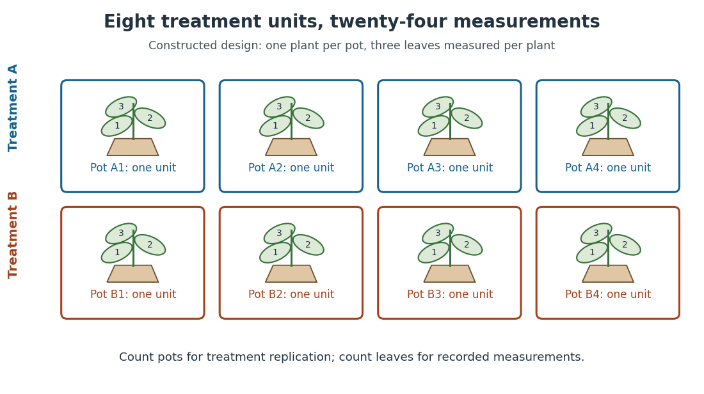
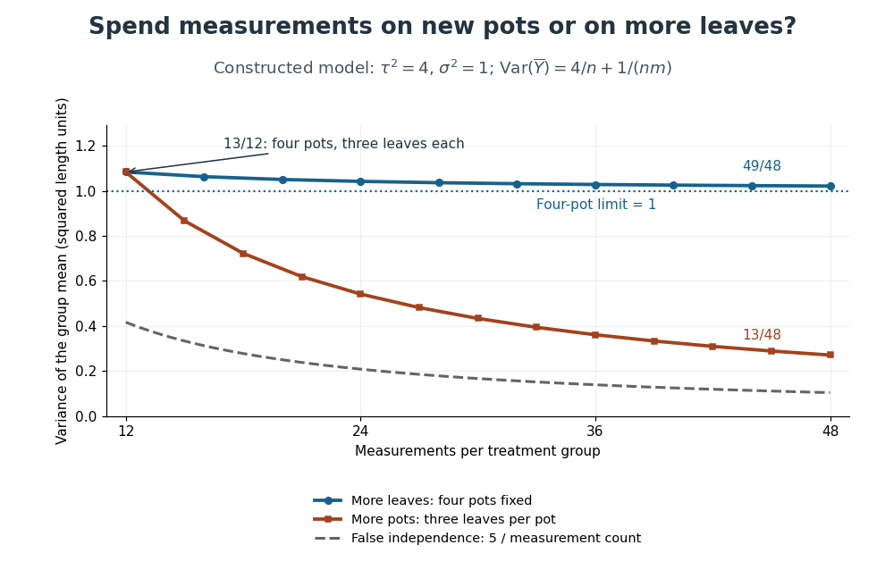

# Design of experiments

↑ **Parent:** [Statistical modelling](statistical-modelling.md)  
ⓦ [Wiki](https://en.wikipedia.org/wiki/Design_of_experiments)

[Design of experiments](design-of-experiments.md) chooses [experimental units](#experimental-unit), [treatments](causal-inference.md#treatment), [replication](#replication-in-experimental-design), [blocks in experimental design](#blocks-in-experimental-design) and [randomization](causal-inference.md#randomization) so that scientifically useful [treatment contrasts](normal-linear-model.md#treatment-contrast) can be estimated with meaningful [standard errors](statistical-inference.md#standard-error). Allocation determines which measurements supply independent treatment information.

**Table of contents**

- [Positive control](#positive-control)
- [Negative control](#negative-control)
  - [Vehicle control](#vehicle-control)
- [Pair feeding](#pair-feeding)
- [Blinding](#blinding)
- [Sham treatment](#sham-treatment)
- [Construct validity](#construct-validity)
- [Ecological validity](#ecological-validity)
- [Before-after control-impact design](#before-after-control-impact-design)
- [Batch effect](#batch-effect)
- [Cross-fostering](#cross-fostering)
- [Optimal experimental design](#optimal-experimental-design)
  - [General equivalence theorem for optimal design](#general-equivalence-theorem-for-optimal-design)
  - [G-optimal design](#g-optimal-design)
  - [D-optimal design](#d-optimal-design)
  - [Approximate experimental design](#approximate-experimental-design)
    - [Information matrix of an experimental design](#information-matrix-of-an-experimental-design)
      - [Design sensitivity function](#design-sensitivity-function)
- [Latin square](#latin-square)
  - [Analysis of variance for a Latin square](#analysis-of-variance-for-a-latin-square)
  - [Mutually orthogonal Latin squares](#mutually-orthogonal-latin-squares)
    - [Graeco-Latin square](#graeco-latin-square)
- [Contrast (statistics)](#contrast-statistics)
- [Response surface methodology](#response-surface-methodology)
  - [Center-point curvature contrast](#center-point-curvature-contrast)
  - [Steepest ascent in response surface methodology](#steepest-ascent-in-response-surface-methodology)
  - [Coded experimental variable](#coded-experimental-variable)
  - [Rotatable design](#rotatable-design)
  - [Central composite design](#central-composite-design)
- [Split-plot design](#split-plot-design)
- [Factorial design](#factorial-design)
  - [Main effect](#main-effect)
  - [Factorial contrast](#factorial-contrast)
  - [Fractional factorial design](#fractional-factorial-design)
    - [Resolution of a fractional factorial design](#resolution-of-a-fractional-factorial-design)
    - [Defining contrast subgroup](#defining-contrast-subgroup)
      - [Aliasing in a fractional factorial design](#aliasing-in-a-fractional-factorial-design)
- [Crossover design](#crossover-design)
  - [Carryover effect](#carryover-effect)
- [Completely randomized design](#completely-randomized-design)
- [Blocks in experimental design](#blocks-in-experimental-design)
  - [Estimability from within-block differences](#estimability-from-within-block-differences)
  - [Block confounding in a factorial design](#block-confounding-in-a-factorial-design)
  - [Block design](#block-design)
    - [Balanced incomplete block design](#balanced-incomplete-block-design)
      - [Symmetric balanced incomplete block design](#symmetric-balanced-incomplete-block-design)
        - [Even-order symmetric design square obstruction](#even-order-symmetric-design-square-obstruction)
      - [Fisher's inequality for block designs](#fisher-s-inequality-for-block-designs)
    - [Row-column design](#row-column-design)
    - [Randomized complete block design](#randomized-complete-block-design)
    - [Orthogonal block design](#orthogonal-block-design)
- [Replication in experimental design](#replication-in-experimental-design)
  - [Replicate](#replicate)
  - [Nested measurements](#nested-measurements)
    - [Variance of nested measurements](#variance-of-nested-measurements)
  - [Biological replicate](#biological-replicate)
    - [Between-replicate variation](#between-replicate-variation)
  - [Technical replicate](#technical-replicate)
- [Experimental unit](#experimental-unit)
  - [Observational unit](#observational-unit)

## Positive control

↑ **Parent:** [Design of experiments](design-of-experiments.md)

## Negative control

↑ **Parent:** [Design of experiments](design-of-experiments.md)

### Vehicle control

↑ **Parent:** [Negative control](#negative-control)

A comparison receiving the solvent or delivery formulation without the active compound. It separates compound-associated effects from effects of the formulation.

## Pair feeding

↑ **Parent:** [Design of experiments](design-of-experiments.md)

A dietary control in which a comparison group receives an amount of food matched to the intake of another group. The timing, energy density and method of matching determine which intake-related explanations it addresses.

## Blinding

↑ **Parent:** [Design of experiments](design-of-experiments.md)

Withholding treatment or hypothesis information from participants, handlers or scorers where appropriate to reduce expectation-dependent differences. What was blinded and which cues remained available should be reported.

## Sham treatment

↑ **Parent:** [Design of experiments](design-of-experiments.md)

A control reproducing handling or other incidental aspects of an intervention while omitting its intended active feature. A sham mark should match tactile and olfactory properties while differing in visibility.

## Construct validity

↑ **Parent:** [Design of experiments](design-of-experiments.md)

Whether an operational measurement supports the intended theoretical interpretation. Successful hidden-mark localization supports a narrower claim than a general claim about consciousness.

## Ecological validity

↑ **Parent:** [Design of experiments](design-of-experiments.md)

Relevance of a test’s cues, actions and setting to the processes of interest outside that test. A task can be controlled yet poorly suited to a [species](biology.md#species)’ sensory or motivational capacities.

## Before-after control-impact design

↑ **Parent:** [Design of experiments](design-of-experiments.md)

Comparison of changes at affected and control sites to separate an intervention from background temporal change.

## Batch effect

↑ **Parent:** [Design of experiments](design-of-experiments.md)

A systematic difference associated with sample processing groups rather than the biological contrast of interest. Balanced allocation and recorded metadata help separate these effects; statistical adjustment cannot fully recover a contrast perfectly confounded with batch.

## Cross-fostering

↑ **Parent:** [Design of experiments](design-of-experiments.md)

Transfer of offspring between providers to separate offspring origin from rearing environment. Egg composition, prenatal influences and handling require additional controls.

## Optimal experimental design

↑ **Parent:** [Design of experiments](design-of-experiments.md)  
ⓦ [Wiki](https://en.wikipedia.org/wiki/Optimal_experimental_design)

[Optimal experimental design](#optimal-experimental-design) chooses observation locations and allocations to optimize a specified criterion for a specified [statistical model](statistical-model.md). Criteria can control the [determinant](multilinear-algebra.md#determinant) of an estimator's [covariance matrix](variance.md#covariance-matrix) or its worst prediction [variance](variance.md). Optimality depends on the model and the permitted design class, including whether allocations are integer or approximate.

### General equivalence theorem for optimal design

↑ **Parent:** [Optimal experimental design](#optimal-experimental-design)

For continuous regressors spanning a $p$-dimensional space on a compact design region, and approximate designs with nonsingular [information matrix of an experimental design](#information-matrix-of-an-experimental-design), the following are equivalent: [D-optimal design](#d-optimal-design), [G-optimal design](#g-optimal-design), and $\sup_x d(x,\xi)=p$. A D-optimal design has nonpositive directional derivatives $d(x,\xi)-p$. Conversely, if every such derivative is nonpositive, [concavity](real-analysis.md#concave-function) of $\log\det$ bounds every competing information [matrix](vector-space.md#matrix) by the tangent at $M(\xi)$, proving D-optimality. The sensitivity average is $p$, and a D-optimal design exists by compactness of the information-matrix set and the spanning assumption; hence the optimal G-value is $p$. Sensitivity equals $p$ at every support point of an optimal design. The equivalence concerns approximate allocations; integer restrictions can change exact-design optima.

### G-optimal design

↑ **Parent:** [Optimal experimental design](#optimal-experimental-design)

A G-optimal design minimizes the maximum [design sensitivity function](#design-sensitivity-function) over the full design region. Thus it minimizes the worst [variance of a fitted regression mean](normal-linear-model.md#variance-of-a-fitted-regression-mean), excluding the separate noise [variance](variance.md) of a new observation. The sensitivity average is $p$, so its supremum is at least $p$.

### D-optimal design

↑ **Parent:** [Optimal experimental design](#optimal-experimental-design)

A D-optimal design maximizes the [determinant](multilinear-algebra.md#determinant) of the [information matrix of an experimental design](#information-matrix-of-an-experimental-design), equivalently minimizing the [determinant](multilinear-algebra.md#determinant) of the [covariance matrix](variance.md#covariance-matrix) of a fixed-size [least-squares estimator](normal-linear-model.md#ordinary-least-squares-estimators). It minimizes the volume of a fixed-level confidence ellipsoid for the model coefficients under the usual [Gaussian](probability-distribution.md#normal-distribution) model.

### Approximate experimental design

↑ **Parent:** [Optimal experimental design](#optimal-experimental-design)

An approximate design is a [probability measure](probability-space.md#probability-measure) on the design region, with weight $w_i$ specifying a proportion of observations at $x_i$. For $N$ independent observations and common error [variance](variance.md) $\sigma^2$, a [linear regression](linear-regression.md) with vector $f(x)$ has normalized [information matrix of an experimental design](#information-matrix-of-an-experimental-design) $M(\xi)=\int f(x)f(x)^T\,d\xi(x)$; its [least-squares estimator](normal-linear-model.md#ordinary-least-squares-estimators) has [covariance](variance.md#covariance) $\sigma^2M(\xi)^{-1}/N$ when the allocations realize these proportions. Exact designs restrict $Nw_i$ to integers.

#### Information matrix of an experimental design

↑ **Parent:** [Approximate experimental design](#approximate-experimental-design)

The normalized information [matrix](vector-space.md#matrix) for a homoscedastic [linear regression](linear-regression.md) model is the average outer product of its regressor vector. It is [positive-definite](bilinear-form.md#positive-definite-bilinear-form) precisely when the supported regressors span the parameter space. The full [Fisher information matrix](statistical-modelling.md#fisher-information-matrix) under [normal](probability-distribution.md#normal-distribution) errors is $NM(\xi)/\sigma^2$.

##### Design sensitivity function

↑ **Parent:** [Information matrix of an experimental design](#information-matrix-of-an-experimental-design)

The sensitivity function is the normalized [variance of a fitted regression mean](normal-linear-model.md#variance-of-a-fitted-regression-mean). Its average under the design is the number $p$ of model coefficients, since $\int d\,d\xi=\operatorname{tr}(M^{-1}M)=p$. The directional derivative of $\log\det M$ towards a point mass at $x$ is $d(x,\xi)-p$.

## Latin square

↑ **Parent:** [Design of experiments](design-of-experiments.md)  
ⓦ [Wiki](https://en.wikipedia.org/wiki/Latin_square)

A Latin square of order $q$ is a $q\times q$ array of $q$ symbols, each occurring once in each row and column. Used as a [row-column design](#row-column-design), its symbols label [treatments](causal-inference.md#treatment). Centered [treatment](causal-inference.md#treatment) indicators are [orthogonal](inner-product.md#orthogonal-vectors) to both row and column indicators, because every row-treatment and column-treatment pair occurs once. This balance separates additive effects from two nuisance directions.

### Analysis of variance for a Latin square

↑ **Parent:** [Latin square](#latin-square)

For one response per cell in an order-$q$ [Latin square](#latin-square), fit an [intercept](linear-regression.md#regression-intercept) and additive row, column and [treatment](causal-inference.md#treatment) effects with sum-to-zero constraints. Each factor contributes $q-1$ [statistical degrees of freedom](statistical-inference.md#statistical-degrees-of-freedom); the residual has $q^2-1-3(q-1)=(q-1)(q-2)$. The centered factor spaces are mutually [orthogonal](inner-product.md#orthogonal-vectors), so sequential sums of squares do not depend on fitting order. With an additional [orthogonal](inner-product.md#orthogonal-vectors) symbol factor from a [Graeco-Latin square](#graeco-latin-square), residual [statistical degrees of freedom](statistical-inference.md#statistical-degrees-of-freedom) become $(q-1)(q-3)$. Exact [F-tests](probability-and-statistics.md#f-test) require independent equal-variance [normal](probability-distribution.md#normal-distribution) errors; unmodeled [interactions](statistical-model.md#interaction-statistics) can invalidate the error term.

### Mutually orthogonal Latin squares

↑ **Parent:** [Latin square](#latin-square)  
ⓦ [Wiki](https://en.wikipedia.org/wiki/Mutually_orthogonal_Latin_squares)

[Latin squares](#latin-square) on the same array are mutually [orthogonal](inner-product.md#orthogonal-vectors) when every ordered pair of symbols from any two squares occurs exactly once on superposition. Pairwise balance makes the centered symbol-indicator spaces [orthogonal](inner-product.md#orthogonal-vectors) in an additive [linear regression](linear-regression.md) model.

#### Graeco-Latin square

↑ **Parent:** [Mutually orthogonal Latin squares](#mutually-orthogonal-latin-squares)

A Graeco-Latin square is the superposition of two [orthogonal](inner-product.md#orthogonal-vectors) [Latin squares](#latin-square) of the same order. Each symbol of either square occurs once per row and column, and every cross-square pair occurs once. It permits four mutually [orthogonal](inner-product.md#orthogonal-vectors) additive factor spaces: rows, columns, and the two symbol factors.

## Contrast (statistics)

↑ **Parent:** [Design of experiments](design-of-experiments.md)

A contrast is a [linear combination](vector-space.md#linear-combination) $\sum_i c_i\mu_i$ of group means with $\sum_i c_i=0$. It compares responses without depending on a common additive level. [Treatment contrasts](normal-linear-model.md#treatment-contrast) and [factorial contrasts](#factorial-contrast) specify comparisons in a [design of experiments](design-of-experiments.md).

## Response surface methodology

↑ **Parent:** [Design of experiments](design-of-experiments.md)  
ⓦ [Wiki](https://en.wikipedia.org/wiki/Response_surface_methodology)

[Response surface methodology](#response-surface-methodology) fits local [regression](statistical-modelling.md#regression-analysis) approximations to a quantitative response as experimental settings change. A first-order model estimates a local gradient; augmenting the design permits [quadratic regression](linear-regression.md#quadratic-regression), curvature assessment and local optimization. Extrapolating a fitted surface outside the experimentally supported region requires caution.

### Center-point curvature contrast

↑ **Parent:** [Response surface methodology](#response-surface-methodology)

In a two-factor design with four corner observations and $n_0$ independent center replicates, the difference between the corner mean and center mean has [variance](variance.md) $\sigma^2(1/4+1/n_0)$. Under a full [quadratic regression](linear-regression.md#quadratic-regression) surface it estimates $\beta_{11}+\beta_{22}$; the linear and interaction terms average to zero at the corners. With $n_0\geq2$, the center [pure error](normal-linear-model.md#pure-error) estimate makes its squared standardized contrast an $F_{1,n_0-1}$ test under a first-order mean model. Zero contrast does not exclude curvature, since the two squared-term coefficients may cancel.

### Steepest ascent in response surface methodology

↑ **Parent:** [Response surface methodology](#response-surface-methodology)

For a fitted local first-order response $\widehat m(x)=\widehat\beta_0+\widehat b^Tx$, the unit direction maximizing its directional derivative in coded Euclidean distance is $d=\widehat b/\|\widehat b\|$, by the [Cauchy-Schwarz inequality](probability-and-statistics.md#cauchy-schwarz-inequality). Run sequential feasible settings $x_0+hd$, increase $h$ while measured response improves, and refit near promising settings. Physical increments are $h_jhd_j$, so coded and unscaled physical gradients need not give the same experimental path. A near-zero gradient calls for further modeling rather than division by zero.

### Coded experimental variable

↑ **Parent:** [Response surface methodology](#response-surface-methodology)

A coded experimental variable rescales a physical setting $\xi_j$ around its center $c_j$, dividing by a chosen positive half-range $h_j$. The endpoints $c_j\pm h_j$ become $\pm1$, giving dimensionless [factorial design](#factorial-design) coordinates. The choice of scale affects the metric used for [steepest ascent in response surface methodology](#steepest-ascent-in-response-surface-methodology).

### Rotatable design

↑ **Parent:** [Response surface methodology](#response-surface-methodology)

A design for a specified polynomial model is rotatable when the [variance of a fitted regression mean](normal-linear-model.md#variance-of-a-fitted-regression-mean) depends on a setting only through its distance from the centre. For a full $2^d$ factorial portion plus symmetric axial points in a [central composite design](#central-composite-design), fourth-order rotational symmetry requires $\sum x_i^4=3\sum x_i^2x_j^2$. These sums are $2^d+2\alpha^4$ and $2^d$, giving $\alpha=(2^d)^{1/4}$. Sign symmetry removes odd moments and equal second moments complete the required moment symmetry for a full quadratic model.

### Central composite design

↑ **Parent:** [Response surface methodology](#response-surface-methodology)  
ⓦ [Wiki](https://en.wikipedia.org/wiki/Central_composite_design)

A central composite design augments a factorial portion with axial points $\pm\alpha e_j$ and replicated centre points. It supports a full quadratic response model: intercept, linear terms, cross-products and squared coordinates. Centre-point [replication](#replication-in-experimental-design) estimates [pure error](normal-linear-model.md#pure-error). Choosing the axial distance appropriately gives a [rotatable design](#rotatable-design).

## Split-plot design

↑ **Parent:** [Design of experiments](design-of-experiments.md)

A [split-plot design](#split-plot-design) randomizes one factor to whole plots and another to subplots within each whole plot. Whole-plot treatment effects and subplot treatment effects therefore use different error [ANOVA strata](linear-regression.md#anova-stratum). Whole plots provide [replication](#replication-in-experimental-design) for the first factor; their subplots do not supply extra independent whole-plot replication. Within-whole-plot comparisons can remove a shared additive whole-plot [variance component](generalized-linear-model.md#variance-component).

## Factorial design

↑ **Parent:** [Design of experiments](design-of-experiments.md)

A [factorial design](#factorial-design) includes every combination of specified factor levels. Balanced [replication](#replication-in-experimental-design) permits separate estimation of marginal effects and [interaction terms](statistical-model.md#interaction-term). The factor allocation, not the number of subsamples, determines the appropriate error term for each effect.

### Main effect

↑ **Parent:** [Factorial design](#factorial-design)  
ⓦ [Wiki](https://en.wikipedia.org/wiki/Main_effect)

A main effect compares the mean response at different levels of one factor after averaging over the other factors according to the design. With sign coding, its two-level difference is twice the singleton [factorial contrast](#factorial-contrast) coefficient. In a [fractional factorial design](#fractional-factorial-design), that coefficient can include aliased higher-order effects.

### Factorial contrast

↑ **Parent:** [Factorial design](#factorial-design)

In a two-level [factorial design](#factorial-design), a factor subset defines a sign column. The coefficient of this column is its response [contrast](#contrast-statistics) divided by the number of runs when the columns are [orthogonal](inner-product.md#orthogonal-vectors). A singleton describes a [main effect](#main-effect) and a pair describes a [two-factor interaction](statistical-model.md#two-factor-interaction). On the full cube, distinct columns have zero [inner product](inner-product.md): summing over any coordinate in their [symmetric difference](set.md#symmetric-difference) cancels the terms.

### Fractional factorial design

↑ **Parent:** [Factorial design](#factorial-design)  
ⓦ [Wiki](https://en.wikipedia.org/wiki/Fractional_factorial_design)

A fractional [factorial design](#factorial-design) uses a selected subset of the full factor-level combinations. In a regular two-level fraction, encode levels by signs and impose $k$ independent equations $\prod_{j\in G_i}x_j=s_i$. Independence of the generator incidence vectors over $\mathbb F_2$ leaves $2^{m-k}$ runs. Reduced run count creates [aliasing in a fractional factorial design](#aliasing-in-a-fractional-factorial-design), which must be evaluated against the effects scientifically required.

#### Resolution of a fractional factorial design

↑ **Parent:** [Fractional factorial design](#fractional-factorial-design)

The resolution of a regular fraction is the shortest nonidentity word in its [defining contrast subgroup](#defining-contrast-subgroup). Two effects alias only when their word product belongs to that subgroup. Thus resolution VI separates all [main effects](#main-effect) and [two-factor interactions](statistical-model.md#two-factor-interaction) from one another and from three-factor interactions, though some three-factor interactions alias in complementary pairs.

#### Defining contrast subgroup

↑ **Parent:** [Fractional factorial design](#fractional-factorial-design)

Factor subsets multiply by [symmetric difference](set.md#symmetric-difference); their sign columns multiply pointwise. The subgroup generated by independent defining words has $2^k$ elements. On a selected [fractional factorial design](#fractional-factorial-design), every word in this subgroup is constant, with sign determined by the chosen generator signs. The cosets classify identical or opposite contrast columns.

##### Aliasing in a fractional factorial design

↑ **Parent:** [Defining contrast subgroup](#defining-contrast-subgroup)

Two [factorial contrasts](#factorial-contrast) are aliased if their columns are proportional on the selected [fractional factorial design](#fractional-factorial-design). A word $G$ that has fixed sign $s_G$ gives $\chi_{AG}=s_G\chi_A$. Conversely, averaging a character over the fraction vanishes unless its word belongs to the [defining contrast subgroup](#defining-contrast-subgroup), so every alias class is exactly a subgroup coset. In a half fraction each class has two distinct words; their separate coefficients cannot be identified without assumptions or additional runs.

## Crossover design

↑ **Parent:** [Design of experiments](design-of-experiments.md)

A [crossover design](#crossover-design) assigns each subject a sequence of [treatments](causal-inference.md#treatment) in successive periods. Subject blocking can reduce between-subject variation; balanced sequences can separate treatment from period effects. A [carryover effect](#carryover-effect) or irreversible change can invalidate a simple within-subject comparison.

### Carryover effect

↑ **Parent:** [Crossover design](#crossover-design)

A [carryover effect](#carryover-effect) is an effect of a previous [treatment](causal-inference.md#treatment) on a later response. Balanced transitions help prevent a treatment from being preceded disproportionately by one particular alternative, but do not ensure that [carryover effects](#carryover-effect) vanish or are separately identifiable in every model.

## Completely randomized design

↑ **Parent:** [Design of experiments](design-of-experiments.md)  
ⓦ [Wiki](https://en.wikipedia.org/wiki/Completely_randomized_design)

A [completely randomized design](#completely-randomized-design) assigns [treatments](causal-inference.md#treatment) directly to available [experimental units](#experimental-unit) using [complete randomization](causal-inference.md#complete-randomization), without blocking. Fixed group sizes can be enforced. The residual then includes uncontrolled between-unit variation.

## Blocks in experimental design

↑ **Parent:** [Design of experiments](design-of-experiments.md)

A block groups [experimental units](#experimental-unit) expected to have similar background responses. Comparing [treatments](causal-inference.md#treatment) within blocks can reduce the [variance of an estimator](statistical-modelling.md#variance-of-an-estimator). Block allocation must be specified before responses are used to evaluate treatment effects.

### Estimability from within-block differences

↑ **Parent:** [Blocks in experimental design](#blocks-in-experimental-design)

For a [linear regression](linear-regression.md) model $Y_{bj}=\alpha_b+f(x_{bj})^T\beta+\epsilon_{bj}$ with one unrestricted [intercept](linear-regression.md#regression-intercept) per two-run [experimental block](#blocks-in-experimental-design), differencing the responses removes all [experimental block](#blocks-in-experimental-design) effects. The parameter vector $\beta$ is identifiable precisely when the [matrix](vector-space.md#matrix) whose rows are $f(x_{b1})-f(x_{b2})$ has full column [rank](quadratic-form.md#rank-one-quadratic-form). This criterion applies to arbitrary pairings, including nonregular [factorial designs](#factorial-design); requiring regular [orthogonal](inner-product.md#orthogonal-vectors) confounding is a stronger constraint.

### Block confounding in a factorial design

↑ **Parent:** [Blocks in experimental design](#blocks-in-experimental-design)

Partition a regular [factorial design](#factorial-design) by fixed signs of independent [factorial contrasts](#factorial-contrast). Products of those block-generating columns span the block effects. A treatment contrast that is constant on each block is therefore confounded with block differences. Select generators so that only scientifically dispensable treatment effects enter this space; randomize the assignment of blocks and the run order within each block.

### Block design

↑ **Parent:** [Blocks in experimental design](#blocks-in-experimental-design)

A [block design](#block-design) assigns [treatments](causal-inference.md#treatment) to [experimental units](#experimental-unit) partitioned into blocks. Its incidence counts $n_{ij}$ record how often [treatment](causal-inference.md#treatment) $i$ occurs in block $j$. Balance and connectedness determine which [treatment contrasts](normal-linear-model.md#treatment-contrast) are estimable and how much adjustment for blocks costs.

#### Balanced incomplete block design

↑ **Parent:** [Block design](#block-design)  
ⓦ [Wiki](https://en.wikipedia.org/wiki/Balanced_incomplete_block_design)

A binary [block design](#block-design) has $t$ [treatments](causal-inference.md#treatment), $b$ blocks of size $k<t$, every treatment in $r$ blocks, and every distinct pair in $\lambda$ blocks. Counting occurrences and pairs gives $tr=bk$ and $r(k-1)=\lambda(t-1)$. Its [incidence matrix of a set system](extremal-set-theory.md#incidence-matrix-of-a-set-system) $N$ satisfies $NN^T=(r-\lambda)I+\lambda\mathbf1\mathbf1^T$. For statistical comparison of all treatment effects one also needs connectedness; $\lambda>0$ guarantees it, whereas singleton blocks with $\lambda=0$ do not.

##### Symmetric balanced incomplete block design

↑ **Parent:** [Balanced incomplete block design](#balanced-incomplete-block-design)

A [balanced incomplete block design](#balanced-incomplete-block-design) is symmetric when its number of blocks equals its number of treatments. The identity $bk=tr$ then gives $r=k$. Its square [incidence matrix of a set system](extremal-set-theory.md#incidence-matrix-of-a-set-system) $N$ obeys $NN^T=(r-\lambda)I+\lambda J$, with eigenvalues $r-\lambda$ of multiplicity $t-1$ and $r^2$ of multiplicity one.

###### Even-order symmetric design square obstruction

↑ **Parent:** [Symmetric balanced incomplete block design](#symmetric-balanced-incomplete-block-design)

In a nontrivial [symmetric balanced incomplete block design](#symmetric-balanced-incomplete-block-design), $\det(N)^2=r^2(r-\lambda)^{t-1}$. If $t$ is even, $t-1$ is odd. For every prime, the exponent in the left side is even and that in $r^2$ is even, so its exponent in $r-\lambda$ must be even. Thus $r-\lambda$ is a perfect square. This supplies an elementary necessary existence condition without claiming it is sufficient.

<h5 id="fisher-s-inequality-for-block-designs">Fisher's inequality for block designs</h5>

↑ **Parent:** [Balanced incomplete block design](#balanced-incomplete-block-design)

For a [balanced incomplete block design](#balanced-incomplete-block-design) with $r>\lambda$, $NN^T$ has [eigenvalues](linear-operator-theory.md#eigenvalue) $r-\lambda>0$ on the zero-sum subspace and $r+(t-1)\lambda>0$ on the constant vector. Thus its [rank](quadratic-form.md#rank-one-quadratic-form) is $t$. As $N$ is $t\times b$, $t=\operatorname{rank}(NN^T)\leq\operatorname{rank}(N)\leq b$.

#### Row-column design

↑ **Parent:** [Block design](#block-design)

A [row-column design](#row-column-design) has two crossed partitions of [experimental units](#experimental-unit) into rows and columns. Equal treatment proportions in every row and every column make treatment contrasts [orthogonal](inner-product.md#orthogonal-vectors) to both centered block spaces. A repeated three-treatment arrangement in a six-by-six array can give a balanced example.

#### Randomized complete block design

↑ **Parent:** [Block design](#block-design)

A [randomized complete block design](#randomized-complete-block-design) places every [treatment](causal-inference.md#treatment) in every block, with a common replication pattern, and uses independent within-block [randomization](causal-inference.md#randomization). The usual basic version has one occurrence of each [treatment](causal-inference.md#treatment) per block; equal repeated occurrences give a replicated complete-block version. Such equal-proportion designs are [orthogonal block designs](#orthogonal-block-design).

#### Orthogonal block design

↑ **Parent:** [Block design](#block-design)

An [orthogonal block design](#orthogonal-block-design) has centered treatment-indicator vectors [orthogonal](inner-product.md#orthogonal-vectors) to centered block-indicator vectors on the [experimental units](#experimental-unit). With treatment replication $r_i$, block size $k_j$ and total $n$, this is equivalent to $n_{ij}=r_i k_j/n$. It permits additive block adjustment without changing treatment estimates.

## Replication in experimental design

↑ **Parent:** [Design of experiments](design-of-experiments.md)

[Replication in experimental design](#replication-in-experimental-design) repeats a [treatment](causal-inference.md#treatment) on multiple independent [experimental units](#experimental-unit), so that variation between those units can inform a [treatment contrast](normal-linear-model.md#treatment-contrast) and its [standard error](statistical-inference.md#standard-error). Repeated measurements on one [experimental unit](#experimental-unit) can improve measurement precision without providing additional independent [treatment](causal-inference.md#treatment) [replication](#replication-in-experimental-design). The [experimental unit](#experimental-unit) is identified by where the [treatment](causal-inference.md#treatment) is applied, rather than by how many responses are recorded.[Experimental unit, “Why is the experimental unit important?” and “Know your experimental unit”, revised 31 October 2023](mathematics-bibliography.md#experimental-unit-nc3rs-experimental-design-assistant)

For a constructed example, grow one [plant](organism.md#plant) in each of eight separate pots. Apply [treatment](causal-inference.md#treatment) A to four pots and [treatment](causal-inference.md#treatment) B to four pots, without sharing drainage water between pots. Measure the [length](physics.md#length) of three [leaves](organism.md#leaf) per pot. The pot is the [experimental unit](#experimental-unit); the [leaf](organism.md#leaf) is the [observational unit](#observational-unit). There are four [treatment](causal-inference.md#treatment) [replicates](#replicate) per group, eight [experimental units](#experimental-unit) overall, and $8\cdot3=24$ measurements. The three [leaves](organism.md#leaf) in one pot are [nested measurements](#nested-measurements), because they share the same [plant](organism.md#plant) and [treatment](causal-inference.md#treatment) application. The setup assumes that pots do not affect one another; simply putting them in separate containers does not establish statistical [independence](random-variable.md#independent-random-variables).

**[Figure 1](#image-constructed-two-treatment-design-eight-pot-experimental-units-contain-twenty-four-leaf-observational-units). Constructed two-treatment design: eight pot experimental units contain twenty-four leaf observational units**. Each outlined pot receives one [treatment](causal-inference.md#treatment) application and supplies three [nested measurements](#nested-measurements). A pot label marks an [experimental unit](#experimental-unit), not a measured response value.

[Randomization](causal-inference.md#randomization) chooses which [experimental units](#experimental-unit) receive which [treatments](causal-inference.md#treatment); [replication](#replication-in-experimental-design) supplies multiple [experimental units](#experimental-unit) receiving the same [treatment](causal-inference.md#treatment). These solve different problems. In the balanced allocation above, choose the four A pots uniformly among the $\binom84=70$ possible [subsets](set.md#subset). A particular pot has [probability](probability-theory.md#probability) $1/2$ of receiving A. Given that one pot receives A, a second receives A with [conditional probability](probability-theory.md#conditional-probability) $3/7$, rather than $1/2$. Thus the assignments are not [independent random variables](random-variable.md#independent-random-variables), even though the [experimental units](#experimental-unit) can supply independent responses conditional on those assignments in a suitable [statistical model](statistical-model.md).

An actual [ecology](ecology.md) experiment illustrates why the distinction matters. In [Stuart H. Hurlbert](ecology.md#stuart-h-hurlbert)'s account, twelve experimental ponds initially received zero, fifty or 450 [fish](organism.md#fish), with five, four and three ponds respectively. Preparation included assessing variation between ponds before introducing [fish](organism.md#fish); allocation considered both location and existing differences between ponds. The zero-[fish](organism.md#fish) ponds supplied the [scientific control](statistical-modelling.md#scientific-control). These were repeated [treatment](causal-inference.md#treatment) applications to ponds, not twelve samples from one pond.[Pseudoreplication and the Design of Ecological Field Experiments, pp. 194–195, combined or hybrid allocation approach and the Hurlbert–Mulla experiment](mathematics-bibliography.md#pseudoreplication-and-the-design-of-ecological-field-experiments-by-stuart-h-hurlbert)

The original article followed the southern California ponds for ten months. Its readouts included [zooplankton](ecology.md#zooplankton) populations and total [phytoplankton](ecology.md#phytoplankton); it reported decreases in some [zooplankton](ecology.md#zooplankton) populations and increased total [phytoplankton](ecology.md#phytoplankton).[Impacts of mosquitofish (Gambusia affinis) predation on plankton communities, abstract, Hydrobiologia 83, pp. 125–151, August 1981](biology-bibliography.md#impacts-of-mosquitofish-gambusia-affinis-predation-on-plankton-communities-by-stuart-h-hurlbert-and-mir-subhan-mulla) Repeated sampling within a pond helps describe its response through time, while ponds supply [treatment](causal-inference.md#treatment) [replication](#replication-in-experimental-design). Unequal group sizes and initial pond variation matter for the [statistical model](statistical-model.md); the [treatment](causal-inference.md#treatment) counts alone do not establish equal [variances](variance.md) or independent responses.

### Replicate

↑ **Parent:** [Replication in experimental design](#replication-in-experimental-design)

A [replicate](#replicate) is an instance of a [treatment](causal-inference.md#treatment) on a distinct [experimental unit](#experimental-unit). Independent [replicates](#replicate) permit estimation of response variation between [experimental units](#experimental-unit); subsamples within one [experimental unit](#experimental-unit) do not supply additional independent [treatment](causal-inference.md#treatment) [replication](#replication-in-experimental-design). In the pot example, another pot receiving A supplies another A [replicate](#replicate), while another [leaf](organism.md#leaf) from an existing A pot supplies another [observational unit](#observational-unit).

### Nested measurements

↑ **Parent:** [Replication in experimental design](#replication-in-experimental-design)

[Nested measurements](#nested-measurements) are responses grouped inside larger units, with each measured object belonging to just one such unit. Three [leaves](organism.md#leaf) within each pot give [nested measurements](#nested-measurements); repeatedly reading one [leaf](organism.md#leaf) gives another level of repetition. Either can yield [clustered data](statistical-modelling.md#clustered-data). A common [random effect](latent-variable.md#random-effect) can describe the shared influence of the containing [experimental unit](#experimental-unit).

For the constructed pot example, label [treatments](causal-inference.md#treatment) by $g\in\{A,B\}$, pots within each group by $i=1,\ldots,n$, and [leaves](organism.md#leaf) within each pot by $j=1,\ldots,m$. Consider the [statistical model](statistical-model.md)

$$
Y_{gij}=\mu+\alpha_g+U_{gi}+\varepsilon_{gij},
\qquad
\mathbb E[U_{gi}]=\mathbb E[\varepsilon_{gij}]=0,
\qquad
\operatorname{Var}(U_{gi})=\tau^2,
\quad
\operatorname{Var}(\varepsilon_{gij})=\sigma^2.
$$

Here $Y_{gij}$ is a [leaf](organism.md#leaf) [length](physics.md#length), $\mu+\alpha_g$ is its group [expected value](expected-value.md), $U_{gi}$ is a pot [random effect](latent-variable.md#random-effect), and $\varepsilon_{gij}$ describes remaining variation among [leaves](organism.md#leaf) and [measurement error](probability-and-statistics.md#measurement-error). Assume that all pot [random effects](latent-variable.md#random-effect) are mutually [independent](random-variable.md#independent-random-variables), all remaining errors are mutually [independent](random-variable.md#independent-random-variables), and the two collections are [independent](random-variable.md#independent-random-variables) of one another and of the [randomization](causal-inference.md#randomization). These are explicit modelling assumptions, conditional on the assigned [treatments](causal-inference.md#treatment); no [normal distribution](probability-distribution.md#normal-distribution) assumption is needed for the following [variance](variance.md) calculation.

Two distinct [leaf](organism.md#leaf) measurements in one pot share $U_{gi}$. Their [covariance](variance.md#covariance) is $\tau^2$, their individual [variance](variance.md) is $\tau^2+\sigma^2$, and their [intraclass correlation coefficient](variance.md#intraclass-correlation-coefficient) is

$$
\rho=\frac{\tau^2}{\tau^2+\sigma^2}
\qquad (\tau^2+\sigma^2>0).
$$

Measurements from different pots have zero [covariance](variance.md#covariance) and are [independent](random-variable.md#independent-random-variables) under the stated [statistical model](statistical-model.md). Statistical [independence](random-variable.md#independent-random-variables) therefore concerns the whole response structure, not just the fact that the measured [leaves](organism.md#leaf) are different objects.

#### Variance of nested measurements

↑ **Parent:** [Nested measurements](#nested-measurements)

For $n$ pots per [treatment](causal-inference.md#treatment) and $m$ [leaves](organism.md#leaf) per pot, the group [sample mean](variance.md#sample-mean) decomposes into two averages:

$$
\overline Y_g=\frac1{nm}\sum_{i=1}^n\sum_{j=1}^mY_{gij}
=\mu+\alpha_g+\frac1n\sum_{i=1}^nU_{gi}
+\frac1{nm}\sum_{i=1}^n\sum_{j=1}^m\varepsilon_{gij}.
$$

The [variance of a sum](variance.md#variance-of-a-sum) adds the [variances](variance.md) of the [independent](random-variable.md#independent-random-variables) terms. Every pot [random effect](latent-variable.md#random-effect) has weight $1/n$, whereas each remaining error has weight $1/(nm)$, giving the short proof

$$
\operatorname{Var}(\overline Y_g)
=n\frac{\tau^2}{n^2}+nm\frac{\sigma^2}{n^2m^2}
=\frac{\tau^2}{n}+\frac{\sigma^2}{nm}.
$$

This is also the [variance](variance.md) of the [arithmetic mean](arithmetic.md#arithmetic-mean) of the $n$ pot [sample means](variance.md#sample-mean), each with [variance](variance.md) $\tau^2+\sigma^2/m$. Equal numbers of [leaves](organism.md#leaf) per pot make the two averaging procedures identical.

If all $nm$ [leaf](organism.md#leaf) measurements were falsely treated as [independent](random-variable.md#independent-random-variables), the predicted [variance](variance.md) would instead be $(\tau^2+\sigma^2)/(nm)$. The ratio of correct to false [variance](variance.md) is

$$
\frac{m\tau^2+\sigma^2}{\tau^2+\sigma^2}
=1+(m-1)\rho.
$$

Thus [pseudoreplication](statistical-modelling.md#pseudoreplication) can underestimate a [standard error](statistical-inference.md#standard-error) by the square root of this ratio. Equality holds when $m=1$ or $\tau^2=0$; sharing a pot creates an error here precisely when the shared influence has positive [variance](variance.md).

Choose $\tau^2=4$, $\sigma^2=1$, $n=4$ and $m=3$ as constructed model parameters in squared [length](physics.md#length) units. These are assumptions rather than fitted experimental values. For each group,

$$
\operatorname{Var}(\overline Y_g)=\frac44+\frac1{12}=\frac{13}{12},
\qquad
\operatorname{Var}_{\mathrm{false}}(\overline Y_g)=\frac5{12},
\qquad \rho=\frac45.
$$

The [treatment contrast](normal-linear-model.md#treatment-contrast) $\widehat\Delta=\overline Y_B-\overline Y_A$ has [expected value](expected-value.md) $\alpha_B-\alpha_A$. Since the group errors are [independent](random-variable.md#independent-random-variables) conditional on the allocation, its [variance](variance.md) is twice the group [variance](variance.md), namely $13/6$, whereas the false calculation gives $5/6$. Its correct [standard error](statistical-inference.md#standard-error) is $\sqrt{13/6}\approx1.472$ [length](physics.md#length) units; the false value is $\sqrt{5/6}\approx0.913$. The [variance](variance.md) ratio is $13/5=2.6$.

**[Figure 2](#image-constructed-variance-predictions-adding-pots-reduces-uncertainty-faster-than-adding-leaf-measurements-within-four-pots). Constructed variance predictions: adding pots reduces uncertainty faster than adding leaf measurements within four pots**. Each curve uses $\tau^2=4$ and $\sigma^2=1$; the horizontal axis counts measurements per [treatment](causal-inference.md#treatment). The solid designs agree at four pots with three [leaves](organism.md#leaf) each. The dashed curve assumes all measurements are [independent](random-variable.md#independent-random-variables) and therefore illustrates [pseudoreplication](statistical-modelling.md#pseudoreplication); none of the curves are observed experimental data.

With four pots fixed, increasing $m$ drives the error contribution $\sigma^2/(4m)$ towards zero, but the [limit](calculus.md#limit-of-a-function) of the group [variance](variance.md) remains $\tau^2/4=1$. Measuring twelve [leaves](organism.md#leaf) on each of four pots gives $49/48$. Using the same forty-eight measurements on sixteen pots, with three [leaves](organism.md#leaf) per pot, gives $13/48$. More independent [experimental units](#experimental-unit) reduce both contributions. Extra [nested measurements](#nested-measurements) are useful for characterizing each [experimental unit](#experimental-unit), but cannot average away its shared [random effect](latent-variable.md#random-effect). This is why sample collection effort and the number of independent [treatment](causal-inference.md#treatment) [replicates](#replicate) answer different questions.[Pseudoreplication and the Design of Ecological Field Experiments, p. 201, “Multiple samples per experimental unit”](mathematics-bibliography.md#pseudoreplication-and-the-design-of-ecological-field-experiments-by-stuart-h-hurlbert)

### Biological replicate

↑ **Parent:** [Replication in experimental design](#replication-in-experimental-design)

A [biological replicate](#biological-replicate) repeats a procedure using a distinct biological preparation, such as another [plant](organism.md#plant) or a separately established [cell culture](biological-cell.md#cell-culture). The relevant level must be specified: several [cell cultures](biological-cell.md#cell-culture) derived from one donor can still form [nested measurements](#nested-measurements) for a donor-level question. Calling a sample a [biological replicate](#biological-replicate) does not by itself establish an independent [experimental unit](#experimental-unit).

#### Between-replicate variation

↑ **Parent:** [Biological replicate](#biological-replicate)

Variation among independent biological samples. Pooling reads can conceal this variation; treating within-sample technical observations as independent biological replicates causes [pseudoreplication](statistical-modelling.md#pseudoreplication).

### Technical replicate

↑ **Parent:** [Replication in experimental design](#replication-in-experimental-design)

A [technical replicate](#technical-replicate) repeats a measurement or analytical procedure on the same biological preparation. For example, read the [length](physics.md#length) of the same [leaf](organism.md#leaf) three times to assess [measurement error](probability-and-statistics.md#measurement-error). Measuring three different [leaves](organism.md#leaf) within one pot instead samples variation within the [plant](organism.md#plant); it should be described explicitly rather than silently equated with repeated readings of one [leaf](organism.md#leaf). Neither procedure supplies another pot-level [treatment](causal-inference.md#treatment) [replicate](#replicate).

## Experimental unit

↑ **Parent:** [Design of experiments](design-of-experiments.md)

An [experimental unit](#experimental-unit) is a unit to which a [treatment](causal-inference.md#treatment) is assigned under the experimental allocation. A whole orchard can be an [experimental unit](#experimental-unit) even when responses are recorded separately on its trees. Different factors in a [split-plot design](#split-plot-design) can have different [experimental units](#experimental-unit).

### Observational unit

↑ **Parent:** [Experimental unit](#experimental-unit)

An [observational unit](#observational-unit) is the object or occasion supplying a recorded response. Several [observational units](#observational-unit) can belong to one [experimental unit](#experimental-unit); counting them as independent treatment [replicates](#replicate) creates [pseudoreplication](statistical-modelling.md#pseudoreplication).

## ↑ Ancestors (6)

1. [Statistical modelling](statistical-modelling.md)
2. [Statistical model](statistical-model.md)
3. [Probability and statistics](probability-and-statistics.md)
4. [Area of mathematics](mathematics.md#area-of-mathematics)
5. [Mathematics](mathematics.md)
6. [Codex Wiki](README.md)

## ← Incoming links (2)

- [Contrast (statistics)](#contrast-statistics)
- [Design of experiments](design-of-experiments.md)
