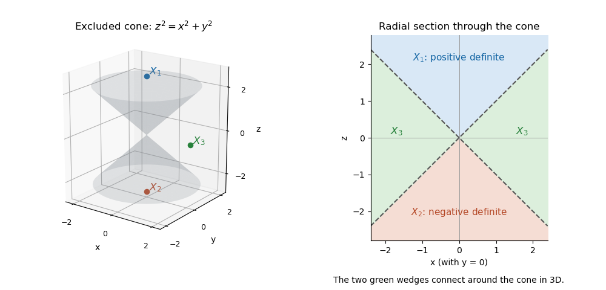

# Determinant cone for real symmetric two-by-two matrices

↑ **Parent:** [Symmetric matrix](symmetric-matrix.md)

The singular real [symmetric matrices](symmetric-matrix.md) of size two form the double cone $z^2=x^2+y^2$ in these coordinates. Its complement has three [connected components](connected-component.md): $z>\sqrt{x^2+y^2}$ is positive definite, $z<-\sqrt{x^2+y^2}$ is negative definite, and $|z|<\sqrt{x^2+y^2}$ is indefinite. This follows also from the [eigenvalues](eigenvalue.md) $z\pm\sqrt{x^2+y^2}$. The definite cones are convex. In the indefinite region, first move $z$ to zero, then move the nonzero planar vector $(x,y)$ within the punctured plane, proving path-connectedness. Continuous determinant and trace signs prevent joining different regions without crossing singular matrices.

**[Figure 25](#image-the-determinant-cone-for-real-symmetric-two-by-two-matrices-and-a-radial-section). The determinant cone for real symmetric two-by-two matrices and a radial section**. The cone itself is excluded. The two indefinite wedges visible in the section belong to one connected region in the full three-dimensional space.

## ↑ Ancestors (6)

1. [Symmetric matrix](symmetric-matrix.md)
2. [Linear algebra](linear-algebra-split.md)
3. [Algebra](algebra-split.md)
4. [Area of mathematics](area-of-mathematics.md)
5. [Mathematics](mathematics-split.md)
6. [Codex Wiki](split.md)

## ← Incoming links (2)

- [Determinant cone for real symmetric two-by-two matrices](determinant-cone-for-real-symmetric-two-by-two-matrices.md)
- [Solution](past-exam-of-the-metric-spaces-and-complex-analysis-course-of-the-university-of-oxford/2017/2/b/ii/solution.md)
