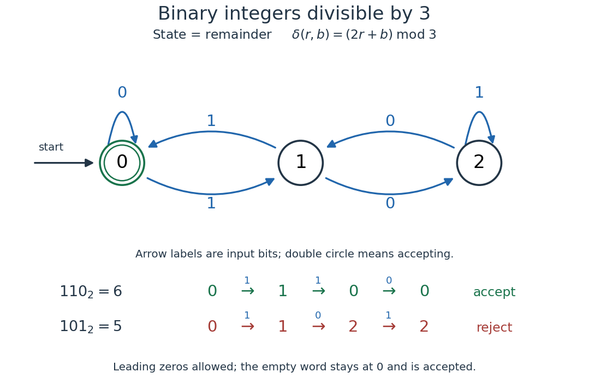

# Deterministic finite automaton

↑ **Parent:** [Finite-state machine](finite-state-machine.md)  
ⓦ [Wiki](https://en.wikipedia.org/wiki/Deterministic_finite_automaton)

A [deterministic finite automaton](deterministic-finite-automaton.md) has exactly one [automaton transition](automaton-transition.md) for every [automaton state](automaton-state.md) and input symbol. Formally, a [DFA](deterministic-finite-automaton.md) is a [tuple](finite-tuple.md) $(Q,\Sigma,\delta,q_0,F)$: $Q$ is a nonempty [finite set](finite-set.md) of [automaton states](automaton-state.md), $\Sigma$ a finite [alphabet](alphabet.md), $\delta:Q\times\Sigma\to Q$ a [function](function-split.md), $q_0$ the initial [automaton state](automaton-state.md), and $F\subseteq Q$ the accepting [automaton states](automaton-state.md). Its unique path on a [word](string.md) accepts if it ends in $F$ after consuming the entire input. Visiting $F$ earlier does not suffice.

For a concrete [binary divisibility automaton](binary-divisibility-automaton.md), recognize the [words](string.md) whose values in the [binary numeral system](binary-numeral-system.md) are divisible by three. Choose $Q=\{0,1,2\}$, $\Sigma=\{0,1\}$, $q_0=0$, and $F=\{0\}$. Each [automaton state](automaton-state.md) names the [congruence class](congruence-class.md) of the [integer](integer-split.md) read so far. Appending a [binary digit](binary-digit.md) $b$ changes its value $n$ to $2n+b$, so the [automaton transition](automaton-transition.md) is

$$
\delta(r,b)=(2r+b)\bmod 3.
$$

The [modular arithmetic](modular-arithmetic-split.md) therefore needs only three [automaton states](automaton-state.md), whatever the input length. The full [function](function-split.md) is $\delta(0,0)=0$, $\delta(0,1)=1$, $\delta(1,0)=2$, $\delta(1,1)=0$, $\delta(2,0)=1$, and $\delta(2,1)=2$.

**[Figure 1](#image-a-three-state-dfa-for-binary-digits-representing-integers-divisible-by-three-with-accepted-and-rejected-traces). A three-state DFA for binary digits representing integers divisible by three, with accepted and rejected traces**.

For $110_2=6$, the successive [automaton states](automaton-state.md) are $0\to1\to0\to0$, so the [word](string.md) is accepted. For $101_2=5$, they are $0\to1\to2\to2$, so it is rejected. Leading zeros are allowed: they leave the initial [automaton state](automaton-state.md) unchanged. We explicitly assign value zero to the [empty word](empty-word.md), which is accepted because the initial [automaton state](automaton-state.md) is accepting. This is a convention for a [formal language](formal-language.md), rather than a claim that ordinary written numerals include a blank numeral.

The generator checks every [word](string.md) of up to eight [binary digits](binary-digit.md), comparing the final [automaton state](automaton-state.md) with the [integer](integer-split.md) value modulo three. Each length $n$ includes all $2^n$ [words](string.md), preserving leading zeros as distinct inputs:

| Length $n$ | [Words](string.md) checked | Accepted by the [DFA](deterministic-finite-automaton.md) | Values divisible by three |
| --- | --- | --- | --- |
| 0 | 1 | 1 | 1 |
| 1 | 2 | 1 | 1 |
| 2 | 4 | 2 | 2 |
| 3 | 8 | 3 | 3 |
| 4 | 16 | 6 | 6 |
| 5 | 32 | 11 | 11 |
| 6 | 64 | 22 | 22 |
| 7 | 128 | 43 | 43 |
| 8 | 256 | 86 | 86 |

All 511 checks agree. They are useful for catching a reversed arrow or mistaken label, but the reason the [DFA](deterministic-finite-automaton.md) works at every length is its invariant: after reading any [word](string.md) of value $n$, its [automaton state](automaton-state.md) is $n\bmod3$. The update $n\mapsto2n+b$ preserves that statement by [mathematical induction](mathematical-induction.md). Through the [extended transition function of a deterministic finite automaton](extended-transition-function-of-a-deterministic-finite-automaton.md), this becomes $\widehat\delta(0,w)=\operatorname{value}(w)\bmod3$.

**Table of contents**

- [Extended transition function of a deterministic finite automaton](extended-transition-function-of-a-deterministic-finite-automaton.md)
- [Accessible state of a deterministic finite automaton](accessible-state-of-a-deterministic-finite-automaton.md)
- [Indistinguishable states of a deterministic finite automaton](indistinguishable-states-of-a-deterministic-finite-automaton.md)
  - [Quotient deterministic finite automaton by indistinguishable states](quotient-deterministic-finite-automaton-by-indistinguishable-states.md)
- [Irreducible deterministic finite automaton](irreducible-deterministic-finite-automaton.md)
- [Parity-counting deterministic finite automaton](parity-counting-deterministic-finite-automaton.md)
- [Bounded-run deterministic finite automaton](bounded-run-deterministic-finite-automaton.md)
- [DFA minimization](dfa-minimization.md)
  - [Minimal deterministic finite automaton](minimal-deterministic-finite-automaton.md)
    - [Canonical residual automaton](canonical-residual-automaton.md)
    - [Cycle state in a minimal deterministic finite automaton for a finite language](cycle-state-in-a-minimal-deterministic-finite-automaton-for-a-finite-language.md)
    - [Binary divisibility automaton](binary-divisibility-automaton.md)
    - [Accessible unary deterministic finite automaton](accessible-unary-deterministic-finite-automaton.md)

## ↑ Ancestors (6)

1. [Finite-state machine](finite-state-machine.md)
2. [Formal language theory](formal-language-theory.md)
3. [Foundations of mathematics](foundations-of-mathematics-split.md)
4. [Area of mathematics](area-of-mathematics.md)
5. [Mathematics](mathematics-split.md)
6. [Codex Wiki](split.md)

## ← Incoming links (23)

- [Cycle state in a minimal deterministic finite automaton for a finite language](cycle-state-in-a-minimal-deterministic-finite-automaton-for-a-finite-language.md)
- [Dead state of a finite automaton](dead-state-of-a-finite-automaton.md)
- [Deterministic finite automaton](deterministic-finite-automaton.md)
- [Graph search](graph-search.md)
- [Myhill-Nerode equivalence](myhill-nerode-equivalence.md)
- [Solution](past-exam-of-the-mathematics-course-of-the-university-of-cambridge/2013/iii/paper-20/1/solution.md)
- [Solution](past-exam-of-the-mathematics-course-of-the-university-of-cambridge/2014/iii/paper-21/2/i/solution.md)
- [Solution](past-exam-of-the-mathematics-course-of-the-university-of-cambridge/2014/iii/paper-21/2/ii/solution.md)
- [Solution](past-exam-of-the-mathematics-course-of-the-university-of-cambridge/2017/ii/paper-1/11h/a/solution.md)
- [Solution](past-exam-of-the-mathematics-course-of-the-university-of-cambridge/2017/ii/paper-1/11h/b/solution.md)
- [Solution](past-exam-of-the-mathematics-course-of-the-university-of-cambridge/2017/ii/paper-1/4h/a/solution.md)
- [Solution](past-exam-of-the-mathematics-course-of-the-university-of-cambridge/2018/ii/paper-2/4g/a/solution.md)
- [Solution](past-exam-of-the-mathematics-course-of-the-university-of-cambridge/2018/ii/paper-3/12g/a/solution.md)
- [Solution](past-exam-of-the-mathematics-course-of-the-university-of-cambridge/2020/ii/paper-3/12f/solution.md)
- [Solution](past-exam-of-the-mathematics-course-of-the-university-of-cambridge/2021/ii/paper-2/4f/solution.md)
- [Solution](past-exam-of-the-mathematics-course-of-the-university-of-cambridge/2021/ii/paper-3/4f/solution.md)
- [Solution](past-exam-of-the-mathematics-course-of-the-university-of-cambridge/2021/iii/paper-120/1/solution.md)
- [Solution](past-exam-of-the-mathematics-course-of-the-university-of-cambridge/2023/ii/paper-3/12i/iv/solution.md)
- [Solution](past-exam-of-the-mathematics-course-of-the-university-of-cambridge/2026/iii/paper-120/3/g/solution.md)
- [Prime-exponent encoding of a finite list](prime-exponent-encoding-of-a-finite-list.md)
- [Pumping lemma for regular languages](pumping-lemma-for-regular-languages.md)
- [Right-linear grammar](right-linear-grammar.md)
- [Subset construction with epsilon transitions](subset-construction-with-epsilon-transitions.md)
