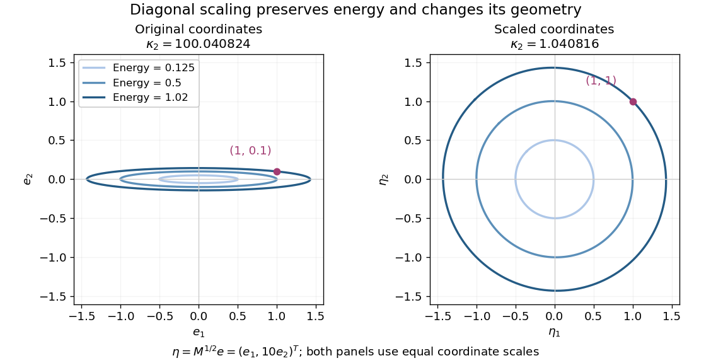

# Diagonal scaling for a two-dimensional linear system

↑ **Parent:** [Matrix preconditioning](matrix-preconditioning.md)

Consider the original [linear system](system-of-linear-equations.md)

$$
A=\begin{pmatrix}1&1/5\\1/5&100\end{pmatrix},\qquad b=\begin{pmatrix}1\\1\end{pmatrix},\qquad M=\begin{pmatrix}1&0\\0&100\end{pmatrix}.
$$

Completing the square proves that $A$ is a [symmetric positive-definite matrix](symmetric-positive-definite-matrix.md):

$$
e^TAe=(e_1+e_2/5)^2+\frac{2499}{25}e_2^2>0\qquad(e\ne0).
$$

The [Jacobi preconditioner](jacobi-preconditioner.md) $M$ has $S=\operatorname{diag}(1,10)$. [Symmetric positive-definite preconditioning](symmetric-positive-definite-preconditioning.md) gives

$$
B=\begin{pmatrix}1&1/50\\1/50&1\end{pmatrix},\qquad c=\begin{pmatrix}1\\1/10\end{pmatrix}.
$$

Its [eigenvectors](eigenvector.md) $(1,1)^T$ and $(1,-1)^T$ have [eigenvalues](eigenvalue.md) $51/50$ and $49/50$. Hence

$$
\kappa_2(B)=\frac{51}{49}\approx1.040816.
$$

The [characteristic polynomial](characteristic-polynomial.md) of $A$ is $\lambda^2-101\lambda+2499/25$. Its [eigenvalues](eigenvalue.md) and [spectral condition number of a positive-definite matrix](spectral-condition-number-of-a-positive-definite-matrix.md) are

$$
\lambda_\pm=\frac{505\pm\sqrt{245029}}{10},\qquad \kappa_2(A)=\frac{\lambda_+}{\lambda_-}\approx100.040824.
$$

The [ellipse](ellipse.md) axis ratio drops from about $10.0020$ to $1.0202$. The transformation multiplies the second coordinate by ten, bringing the two energy scales together.

**[Figure 1](#image-diagonal-scaling-changes-thin-energy-ellipses-into-nearly-circular-energy-ellipses). Diagonal scaling changes thin energy ellipses into nearly circular energy ellipses**.

Both panels show the same energy [level sets](level-set.md), expressed in error coordinates $e=x-x_*$ and $\eta=M^{1/2}e$. Their coordinate axes have equal scales. The marked displacement $(1,0.1)^T$ becomes $(1,1)^T$; its energy remains $e^TAe/2=1.02$. These are exact contours of the specified [quadratic form](quadratic-form-split.md).

Solving the original equations gives

$$
x_*=\frac1{2499}\begin{pmatrix}2495\\20\end{pmatrix},\qquad y_*=\frac1{2499}\begin{pmatrix}2495\\200\end{pmatrix}.
$$

Direct [matrix multiplication](matrix-multiplication.md) checks both [linear-system residuals](linear-system-residual.md):

$$
Ax_* = \frac1{2499}\begin{pmatrix}2495+4\\499+2000\end{pmatrix}=b,\qquad By_* = \frac1{2499}\begin{pmatrix}2495+4\\499/10+200\end{pmatrix}=c.
$$

By contrast, [left preconditioning](left-preconditioning.md) gives $M^{-1}A=\begin{pmatrix}1&1/5\\1/500&1\end{pmatrix}$, which is visibly not a [symmetric matrix](symmetric-matrix.md), despite having the same positive [eigenvalues](eigenvalue.md) as $B$.

A bad scaling can reverse the benefit: the still valid [symmetric positive-definite matrix](symmetric-positive-definite-matrix.md) $M_{\rm bad}=\operatorname{diag}(100,1)$ gives $B_{\rm bad}=\begin{pmatrix}1/100&1/50\\1/50&100\end{pmatrix}$. Its [Rayleigh quotients](rayleigh-quotient.md) on the coordinate [unit vectors](unit-vector.md) are $0.01$ and $100$, so $\kappa_2(B_{\rm bad})\ge10000$. Cheapness and positive definiteness do not guarantee improved conditioning.

## ↑ Ancestors (7)

1. [Matrix preconditioning](matrix-preconditioning.md)
2. [Numerical linear algebra](numerical-linear-algebra-split.md)
3. [Numerical analysis](numerical-analysis-split.md)
4. [Analysis](analysis-split.md)
5. [Area of mathematics](area-of-mathematics.md)
6. [Mathematics](mathematics-split.md)
7. [Codex Wiki](split.md)

## ← Incoming links (2)

- [Matrix preconditioning](matrix-preconditioning.md)
- [Preconditioned steepest descent](preconditioned-steepest-descent.md)
