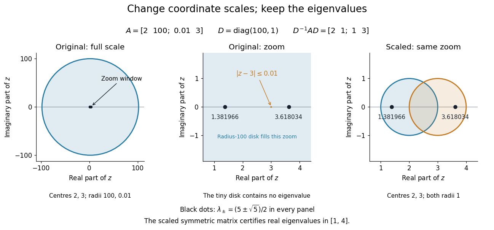

# Diagonal scaling of Gershgorin discs

↑ **Parent:** [Gershgorin circle theorem](gershgorin-circle-theorem.md)

A positive [diagonal matrix](diagonal-matrix.md) $D=\operatorname{diag}(d_1,\ldots,d_n)$, with $d_i>0$, is an [invertible matrix](invertible-matrix.md) and changes the coordinate scales through the [similarity transformation](similarity-transformation.md) $B=D^{-1}AD$. Its diagonal entries are still $a_{ii}$, while $b_{ij}=a_{ij}d_j/d_i$. Thus the [Gershgorin discs](gershgorin-disc.md) have the same centres but different radii. [Matrix similarity](matrix-similarity.md) preserves the [characteristic polynomial](characteristic-polynomial.md) and [eigenvalues](eigenvalue.md), so the original and scaled disk unions are both valid bounds and may be intersected. Suitable scaling can compensate for badly unbalanced off-diagonal entries; it need not shrink every radius.[Chi-Kwong Li, Math 408 lecture notes, §6.1: similarity transformations for eigenvalue localization](https://cklixx.people.wm.edu/teaching/math408/408-note.pdf)

For example,

$$
A=\begin{pmatrix}2&100\\0.01&3\end{pmatrix},\qquad D=\begin{pmatrix}100&0\\0&1\end{pmatrix},\qquad D^{-1}AD=\begin{pmatrix}2&1\\1&3\end{pmatrix}.
$$

The original [Gershgorin discs](gershgorin-disc.md) are $|z-2|\leq100$ and $|z-3|\leq0.01$. Their union is simply the huge first [disk](disk-mathematics.md); the small second [disk](disk-mathematics.md) contains no [eigenvalue](eigenvalue.md). After scaling, both radii are $1$, giving $|z-2|\leq1$ or $|z-3|\leq1$. The two [Gershgorin discs](gershgorin-disc.md) overlap, so their individual [eigenvalue](eigenvalue.md) counts are not certified. The scaled [matrix](matrix.md) is a real [symmetric matrix](symmetric-matrix.md), however, so [matrix similarity](matrix-similarity.md) now proves that the original [matrix](matrix.md) has real [eigenvalues](eigenvalue.md) in $[1,4]$ and is an [invertible matrix](invertible-matrix.md). Directly, both [matrices](matrix.md) have [characteristic polynomial](characteristic-polynomial.md) $\lambda^2-5\lambda+5$, hence

$$
\lambda_\pm=\frac{5\pm\sqrt5}{2}\approx1.381966,\ 3.618034.
$$

The scaling changes the available bounds, while these [eigenvalues](eigenvalue.md) stay fixed.

**[Figure 14](#image-diagonal-similarity-scaling-replaces-a-radius-100-gershgorin-disc-by-two-radius-1-discs-while-preserving-both-eigenvalues). Diagonal similarity scaling replaces a radius-100 Gershgorin disc by two radius-1 discs while preserving both eigenvalues**.

## ↑ Ancestors (6)

1. [Gershgorin circle theorem](gershgorin-circle-theorem.md)
2. [Numerical analysis](numerical-analysis-split.md)
3. [Analysis](analysis-split.md)
4. [Area of mathematics](area-of-mathematics.md)
5. [Mathematics](mathematics-split.md)
6. [Codex Wiki](split.md)
