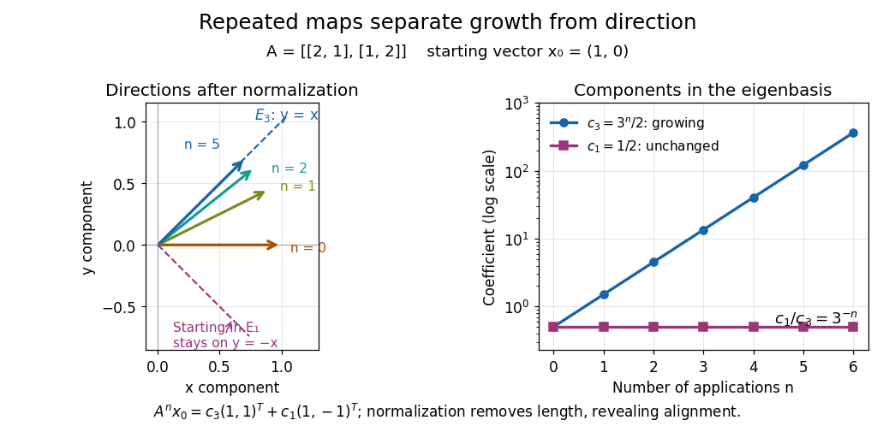

# Diagonalizable matrix

↑ **Parent:** [Eigenvalue](eigenvalue.md)  
ⓦ [Wiki](https://en.wikipedia.org/wiki/Diagonalizable_matrix)

A finite-dimensional [linear operator](linear-operator.md) is diagonalizable over a specified [field](field.md) when it has an [eigenbasis](eigenbasis.md). Equivalently, its [matrix](matrix.md) $A$ admits

$$
A=PDP^{-1},\qquad D=\operatorname{diag}(\lambda_1,\ldots,\lambda_n),
$$

where $P$ is an [invertible matrix](invertible-matrix.md) whose columns are [eigenvectors](eigenvector.md), and $D$ is a [diagonal matrix](diagonal-matrix.md) of the corresponding [eigenvalues](eigenvalue.md). This [change of basis](change-of-basis.md) reveals a [linear map](linear-map.md) as independent one-dimensional scalings. The [matrix](matrix.md) may look coupled in the original coordinates, but each coordinate in the [eigenbasis](eigenbasis.md) evolves on its own.

For the [symmetric matrix](symmetric-matrix.md) $A=\left(\begin{smallmatrix}2&1\\1&2\end{smallmatrix}\right)$ computed in [eigenvector](eigenvector.md), take

$$
P=\begin{pmatrix}1&1\\1&-1\end{pmatrix},\qquad P^{-1}=\frac12\begin{pmatrix}1&1\\1&-1\end{pmatrix},\qquad D=\begin{pmatrix}3&0\\0&1\end{pmatrix}.
$$

Then $AP=PD$, hence $P^{-1}AP=D$. The [orthonormal basis](orthonormal-basis.md) version is $Q=P/\sqrt2$, an [orthogonal matrix](orthogonal-matrix.md) satisfying $Q^TAQ=D$. Every real [symmetric matrix](symmetric-matrix.md) has an [orthonormal eigenbasis](orthonormal-eigenbasis.md) by the [spectral theorem](spectral-theorem.md); a general [diagonalizable matrix](diagonalizable-matrix.md) need not have [orthogonal](orthogonal-vectors.md) [eigenvectors](eigenvector.md).

The immediate payoff is repeated application: adjacent factors $P^{-1}P$ cancel, giving $A^n=PD^nP^{-1}$. In this example,

$$
A^n=\frac12\begin{pmatrix}3^n+1&3^n-1\\3^n-1&3^n+1\end{pmatrix},\qquad A^n\begin{pmatrix}1\\0\end{pmatrix}=\frac12\left(3^n\begin{pmatrix}1\\1\end{pmatrix}+\begin{pmatrix}1\\-1\end{pmatrix}\right).
$$

The component in $E_3$ grows while the component in $E_1$ stays fixed. After division by its [Euclidean norm](euclidean-norm.md), this particular sequence approaches $(1,1)^T/\sqrt2$. This is the mechanism behind the [power method](power-method.md); an initial [vector](vector.md) entirely in $E_1$ would stay there and never find the [dominant eigenvalue](dominant-eigenvalue.md) $3$.

**[Figure 5](#image-repeated-maps-eigenvalue-growth-alignment-and-the-exceptional-starting-direction). Repeated maps: eigenvalue growth, alignment, and the exceptional starting direction**.

Two different obstructions deserve comparison. The [planar rotation](planar-rotation.md) $R$ in [eigenvector](eigenvector.md) is [diagonalizable](diagonalizable-matrix.md) over $\mathbb C$ but not over $\mathbb R$, because its [eigenvalues](eigenvalue.md) are $i$ and $-i$. By contrast, the [shear mapping](shear-mapping.md)

$$
S=\begin{pmatrix}1&1\\0&1\end{pmatrix},\qquad (S-I)\begin{pmatrix}x\\y\end{pmatrix}=\begin{pmatrix}y\\0\end{pmatrix}
$$

has only $\lambda=1$, of [algebraic multiplicity](algebraic-multiplicity.md) two, and $E_1=\operatorname{span}\{(1,0)^T\}$, of [geometric multiplicity](geometric-multiplicity.md) one. There is no second independent [eigenvector](eigenvector.md), even over $\mathbb C$. This is a [defective matrix](defective-matrix.md), already a two-dimensional [Jordan block](jordan-block.md). Its powers are

$$
S^n=\begin{pmatrix}1&n\\0&1\end{pmatrix},\qquad S^n\begin{pmatrix}0\\1\end{pmatrix}=\begin{pmatrix}n\\1\end{pmatrix}.
$$

Thus even though both [eigenvalues](eigenvalue.md) are one, repeated application can produce growth. [Eigenvalues](eigenvalue.md) alone miss the coupling recorded by a [Jordan block](jordan-block.md). A repeated [eigenvalue](eigenvalue.md) is harmless when it has enough independent [eigenvectors](eigenvector.md), as $I$ demonstrates. More generally, a [matrix](matrix.md) is [diagonalizable](diagonalizable-matrix.md) exactly when its [characteristic polynomial](characteristic-polynomial.md) splits over the chosen [field](field.md) and every [eigenvalue](eigenvalue.md) has equal [geometric multiplicity](geometric-multiplicity.md) and [algebraic multiplicity](algebraic-multiplicity.md). The proof outline is to join [bases](basis.md) of the distinct [eigenspaces](eigenspace.md); their [direct sum](direct-sum.md) fills the space exactly under these conditions.

A physical motivation is the separation of [normal modes](normal-mode.md). Consider two equal [masses](mass.md) $m$ between three identical [springs](spring.md) of stiffness $k$, with the outer ends fixed. By [Hooke's law](hooke-s-law.md) and [Newton's second law](newton-s-second-law.md), the displacement [vector](vector.md) $q=(q_1,q_2)^T$ obeys

$$
m\ddot q=-kKq,\qquad K=\begin{pmatrix}2&-1\\-1&2\end{pmatrix}.
$$

The [eigenvectors](eigenvector.md) $(1,1)^T$ and $(1,-1)^T$ have [eigenvalues](eigenvalue.md) $1$ and $3$: the [masses](mass.md) move together in the first [normal mode](normal-mode.md) and oppositely in the second. Writing $q=a(t)(1,1)^T+b(t)(1,-1)^T$ separates the coupled equations into two [harmonic oscillators](simple-harmonic-motion.md),

$$
\ddot a+\frac{k}{m}a=0,\qquad \ddot b+\frac{3k}{m}b=0.
$$

Their [angular frequencies](angular-frequency.md) are $\sqrt{k/m}$ and $\sqrt{3k/m}$; the [eigenvalues](eigenvalue.md) give squared [angular frequencies](angular-frequency.md) after multiplication by $k/m$. This is the beauty of [diagonalization](diagonalization-of-a-matrix.md): finding the right directions turns interacting motions into independent patterns. For a physical treatment, see Yen-Jie Lee's "Coupled Oscillators, Normal Modes" (MIT 8.03SC, 2016), and the local article [normal modes of two equal masses between three springs](normal-modes-of-two-equal-masses-between-three-springs.md).[Lee's 2016 lecture notes on coupled oscillators and normal modes](https://ocw.mit.edu/courses/8-03sc-physics-iii-vibrations-and-waves-fall-2016/resources/mit8_03scf16_hw_lec4/)

**Table of contents**

- [Diagonalization of a matrix](diagonalization-of-a-matrix.md)
- [Diagonalizability inherited from an invertible power](diagonalizability-inherited-from-an-invertible-power.md)
- [Complex similarity of real matrices implies real similarity](complex-similarity-of-real-matrices-implies-real-similarity.md)
- [Distinct eigenvalues imply diagonalizability](distinct-eigenvalues-imply-diagonalizability.md)
- [Spectral decomposition](spectral-decomposition.md)
  - [Dominant eigenvalue](dominant-eigenvalue.md)
  - [Spectral gap](spectral-gap.md)
    - [Ground-space perturbation bound](ground-space-perturbation-bound.md)
    - [Davis-Kahan theorem](davis-kahan-theorem.md)
      - [Davis-Kahan curvature lemma](davis-kahan-curvature-lemma.md)
        - [Rank-one eigenprojector perturbation bound](rank-one-eigenprojector-perturbation-bound.md)

## ↑ Ancestors (7)

1. [Eigenvalue](eigenvalue.md)
2. [Operator theory](linear-operator-theory-split.md)
3. [Linear algebra](linear-algebra-split.md)
4. [Algebra](algebra-split.md)
5. [Area of mathematics](area-of-mathematics.md)
6. [Mathematics](mathematics-split.md)
7. [Codex Wiki](split.md)

## ← Incoming links (26)

- [Active spectrum of the power method](active-spectrum-of-the-power-method.md)
- [Defective matrix](defective-matrix.md)
- [Density of diagonalizable complex matrices](density-of-diagonalizable-complex-matrices.md)
- [Diagonalizable matrix](diagonalizable-matrix.md)
- [Matrix trace](matrix-trace.md)
- [Solution](past-exam-of-the-mathematics-course-of-the-university-of-cambridge/2001/ia/paper-3/5f/solution.md)
- [Solution](past-exam-of-the-mathematics-course-of-the-university-of-cambridge/2004/iii/paper-69/7/solution.md)
- [Solution](past-exam-of-the-mathematics-course-of-the-university-of-cambridge/2006/ia/paper-3/1d/i/solution.md)
- [Solution](past-exam-of-the-mathematics-course-of-the-university-of-cambridge/2007/ia/paper-3/7d/ii/solution.md)
- [Solution](past-exam-of-the-mathematics-course-of-the-university-of-cambridge/2007/ia/paper-3/7d/iii/solution.md)
- [Solution](past-exam-of-the-mathematics-course-of-the-university-of-cambridge/2007/ia/paper-3/7d/iv/solution.md)
- [Solution](past-exam-of-the-mathematics-course-of-the-university-of-cambridge/2010/ia/paper-1/8b/i/solution.md)
- [Solution](past-exam-of-the-mathematics-course-of-the-university-of-cambridge/2014/ia/paper-1/2a/b/solution.md)
- [Solution](past-exam-of-the-mathematics-course-of-the-university-of-cambridge/2014/iii/paper-40/3/ii/solution.md)
- [Solution](past-exam-of-the-mathematics-course-of-the-university-of-cambridge/2015/ia/paper-2/8b/ii/solution.md)
- [Solution](past-exam-of-the-mathematics-course-of-the-university-of-cambridge/2016/ia/paper-1/7b/solution.md)
- [Solution](past-exam-of-the-mathematics-course-of-the-university-of-cambridge/2018/ia/paper-1/7b/a/iii/solution.md)
- [Solution](past-exam-of-the-mathematics-course-of-the-university-of-cambridge/2018/iii/paper-331/4/a/i/solution.md)
- [Solution](past-exam-of-the-mathematics-course-of-the-university-of-cambridge/2019/ia/paper-3/10b/a/solution.md)
- [Solution](past-exam-of-the-mathematics-course-of-the-university-of-cambridge/2019/ib/paper-2/10f/d/solution.md)
- [Solution](past-exam-of-the-mathematics-course-of-the-university-of-cambridge/2019/ib/paper-4/1f/solution.md)
- [Solution](past-exam-of-the-mathematics-course-of-the-university-of-cambridge/2020/ii/paper-4/10c/iv/solution.md)
- [Positive diagonal symmetrization of a matrix](positive-diagonal-symmetrization-of-a-matrix.md)
- [Power iteration convergence for a diagonalizable matrix](power-iteration-convergence-for-a-diagonalizable-matrix.md)
- [Power iteration failure cases](power-iteration-failure-cases.md)
- [Power method](power-method.md)
