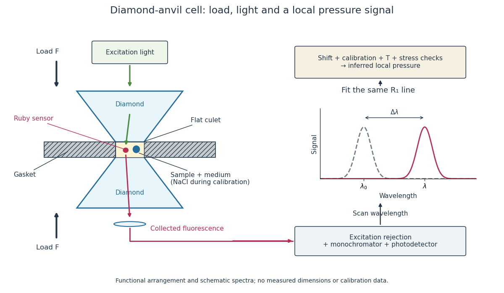

# Diamond anvil cell

↑ **Parent:** [High-pressure experimental metrology](high-pressure-experimental-metrology.md)  
ⓦ [Wiki](https://en.wikipedia.org/wiki/Diamond_anvil_cell)

A [diamond anvil cell](diamond-anvil-cell.md) compresses a sample between opposed [diamond](diamond.md) tips. The flat [diamond anvil culets](diamond-anvil-culet.md) load a metal [gasket](gasket.md) whose hole holds the specimen and a [pressure](pressure-split.md)-transmitting medium. Transparent [diamond](diamond.md) admits excitation and returning [fluorescence](fluorescence-split.md), enabling an internal [ruby](ruby.md) [pressure sensor](pressure-sensor.md).[Sections 2–3, Figures 1 and 5: anvils, optical path and gasket](high-pressure-x-ray-crystallography-with-the-diamond-cell-at-nist%E2%81%84nbs-by-gasper-j-piermarini.md)

**[Figure 9](#image-diamond-anvil-cell-compression-optical-access-and-internal-ruby-readout). Diamond anvil cell: compression, optical access and internal ruby readout**. Original functional section, not a reconstruction or a scale drawing. The separate excitation and collection paths depict one possible arrangement. A [monochromator](monochromator.md) and [photodetector](photodetector.md) resolve the [fluorescence emission spectrum](fluorescence-emission-spectrum.md); the inference uses a [spectral line](spectral-line.md) position rather than its brightness. The optional [sodium chloride](sodium-chloride.md) reference belongs to the calibration experiment, rather than to every subsequent sample measurement.

The functions in the drawing answer different questions. The drive applies [force](force-split.md), the [gasket](gasket.md) confines the sample, the medium transmits [stress](stress.md), and the [ruby pressure scale](ruby-pressure-scale.md) assigns a local [pressure](pressure-split.md) from an optical signal. A large drive reading cannot establish either the sample's [pressure](pressure-split.md) or the absence of [deviatoric stress](deviatoric-stress.md). Optical access also permits repeated readings without unloading the sample: a change during a long measurement can be detected rather than silently folded into a material-property curve.

**Table of contents**

- [Diamond anvil culet](diamond-anvil-culet.md)
- [Ruby pressure scale](ruby-pressure-scale.md)
  - [Ruby R-line shift](ruby-r-line-shift.md)
  - [Ruby calibration against sodium chloride](ruby-calibration-against-sodium-chloride.md)
  - [Ruby pressure uncertainty worked example](ruby-pressure-uncertainty-worked-example.md)
  - [Nonhydrostatic stress in ruby pressure measurement](nonhydrostatic-stress-in-ruby-pressure-measurement.md)

## ↑ Ancestors (8)

1. [High-pressure experimental metrology](high-pressure-experimental-metrology.md)
2. [Pressure measurement](pressure-measurement.md)
3. [Pressure](pressure-split.md)
4. [Thermodynamics](thermodynamics-split.md)
5. [Statistical physics](statistical-physics-split.md)
6. [Branches of physics](branches-of-physics.md)
7. [Physics](physics-split.md)
8. [Codex Wiki](split.md)

## ← Incoming links (5)

- [Diamond anvil cell](diamond-anvil-cell.md)
- [Gasket](gasket.md)
- [Multi-anvil press](multi-anvil-press.md)
- [Solution](past-exam-of-the-materials-science-course-of-the-university-of-cambridge/2015/paper-1/6/b/solution.md)
- [Solution](past-exam-of-the-materials-science-course-of-the-university-of-cambridge/2022/paper-1/7/a/solution.md)
