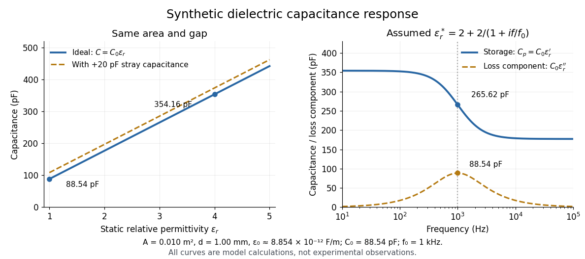

# Dielectric capacitance measurement

↑ **Parent:** [Permittivity](permittivity.md)

The motivating observation is that inserting an insulating material between fixed [capacitor](capacitor.md) plates increases its [capacitance](capacitance.md). [Feynman, Leighton and Sands, II.10–1, opening paragraphs: observed increase in capacitance with an inserted insulator](https://www.feynmanlectures.caltech.edu/II_10.html#Ch10-S1). To investigate this response, use two flat parallel metal electrodes with measured overlapping [area](surface-area.md) $A$ and separation $d$, a uniform specimen filling the gap, and an instrument that measures [electrical impedance](electrical-impedance.md). Record the [capacitance](capacitance.md) with and without the specimen at the same small applied [electric potential difference](electric-potential-difference.md), [frequency](frequency.md) and [temperature](temperature.md), after [capacitance measurement calibration](capacitance-measurement-calibration.md). An increase in corrected [capacitance](capacitance.md) indicates a larger [permittivity](permittivity.md), provided the geometry is unchanged. A guard electrode reduces the contribution of the [fringing field of a capacitor](fringing-field-of-a-capacitor.md). [Materials Measurement: Dielectric Materials](materials-measurement-dielectric-materials.md).

For negligible [dielectric loss](dielectric-loss.md) in the [parallel-plate capacitor](parallel-plate-capacitor.md) approximation,

$$
C=\frac{\epsilon A}{d},\qquad C_0=\frac{\epsilon_0A}{d},\qquad
\epsilon_r=\frac{C}{C_0}=\frac{Cd}{\epsilon_0A}.
$$

An air reference approximates $C_0$; it is not an exact [vacuum](vacuum.md) reference. For the following synthetic example, stipulate $A=0.010\,\mathrm{m^2}$, $d=1.00\,\mathrm{mm}$ and the rounded [vacuum permittivity](vacuum-permittivity.md) $\epsilon_0\approx8.854\times10^{-12}\,\mathrm{F/m}$. Then $C_0=88.54\,\mathrm{pF}$ in this model, and [relative permittivity](relative-permittivity.md) four gives $C=354.16\,\mathrm{pF}$. A residual parallel [capacitance](capacitance.md) of $20\,\mathrm{pF}$ would make an uncorrected sample/reference ratio $374.16/108.54\approx3.447$, rather than four. This additive error does not cancel in a ratio.

**[Figure 15](#image-synthetic-capacitance-response-to-relative-permittivity-and-frequency). Synthetic capacitance response to relative permittivity and frequency**. Left: the ideal scalar [capacitance](capacitance.md) and a hypothetical additive stray [capacitance](capacitance.md) of $20\,\mathrm{pF}$. Right: a hypothetical [dielectric relaxation](dielectric-relaxation.md) model, $\epsilon_r^*=2+2/(1+if/f_0)$ with $f_0=1\,\mathrm{kHz}$, for the same geometry. The solid curve is the parallel [capacitance](capacitance.md) $C_p=C_0\epsilon_r'$; the dashed curve is the loss component $C_0\epsilon_r''$, not an independently measured storage [capacitance](capacitance.md). Every plotted value is synthetic.

At nonzero [frequency](frequency.md) $f$, measure both magnitude and [phase](phase-waves.md) of the [electric current](electric-current.md) relative to the applied [electric potential difference](electric-potential-difference.md). Define $Y=I/V=1/Z$, where $Z$ is [electrical impedance](electrical-impedance.md). For the stated [complex permittivity](complex-permittivity.md) convention, the ideal uniform specimen gives

$$
Y=i\omega C_0\epsilon_r^*=\omega C_0\epsilon_r''+i\omega C_0\epsilon_r',\qquad
C_p=\frac{\operatorname{Im}Y}{\omega},\qquad \omega=2\pi f.
$$

Thus a parallel [capacitor](capacitor.md) and [electrical conductance](electrical-conductance.md) describe the readout at that [frequency](frequency.md); a single scalar [capacitance](capacitance.md) cannot describe both components. The diagram's assumed [dielectric relaxation](dielectric-relaxation.md) gives $C_p=265.62\,\mathrm{pF}$ and $C_0\epsilon_r''=88.54\,\mathrm{pF}$ at $1\,\mathrm{kHz}$. These are model predictions, not observations.

Repeat the reference measurement after removing the specimen and vary the small applied [electric potential difference](electric-potential-difference.md) to test drift and [linearity](linearity.md). Record specimen thickness, electrode [area](surface-area.md), contact conditions, [frequency](frequency.md) and [temperature](temperature.md). Air gaps act as additional layers in series and can lower inferred [relative permittivity](relative-permittivity.md); roughness, uncertain thickness and the [fringing field of a capacitor](fringing-field-of-a-capacitor.md) limit the geometric formula. At sufficiently high [frequency](frequency.md), the fixture itself changes the [electromagnetic field](electromagnetic-field.md), so low-[frequency](frequency.md) guarding and a lumped [capacitor](capacitor.md) model require reassessment. [Materials Measurement: Dielectric Materials](materials-measurement-dielectric-materials.md).

**Table of contents**

- [Capacitance measurement calibration](capacitance-measurement-calibration.md)

## ↑ Ancestors (5)

1. [Permittivity](permittivity.md)
2. [Electromagnetism](electromagnetism-split.md)
3. [Branches of physics](branches-of-physics.md)
4. [Physics](physics-split.md)
5. [Codex Wiki](split.md)

## ← Incoming links (1)

- [Dielectric loss](dielectric-loss.md)
