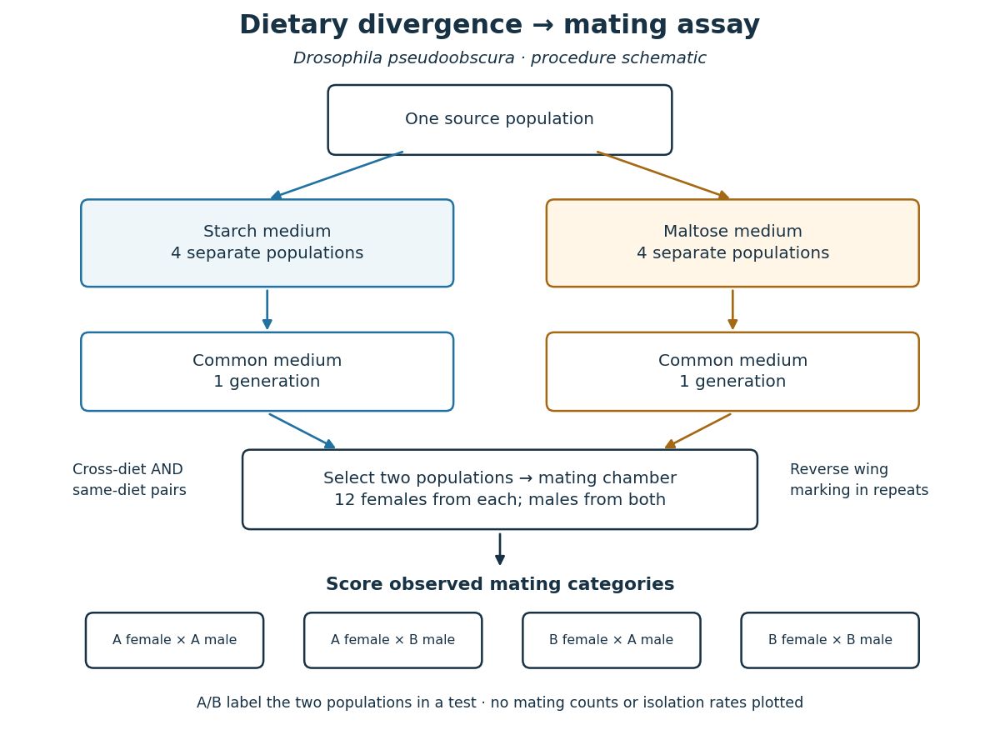

# Dietary divergence and mating isolation in Drosophila pseudoobscura

↑ **Parent:** [Reproductive isolation](reproductive-isolation.md)

The 1989 experiment used eight [Drosophila pseudoobscura](drosophila-pseudoobscura.md) [biological populations](population-biology.md) from one Bryce Canyon population: four maintained on starch medium, four on maltose, in cages at $25\,{}^\circ\mathrm{C}$. Testing began about a year after establishment. [p. 1308, population origin, media and cage conditions](reproductive-isolation-as-a-consequence-of-adaptive-divergence-in-drosophila-pseudoobscura-by-diane-m-b-dodd.md)

Before testing, flies spent one generation on cornmeal–molasses–agar. Virgins aged 3–6 days entered multiple-choice chambers: twelve females from each population, followed by males from both populations introduced nearly simultaneously without anesthesia. Observers scored matings for 60–90 minutes under bright indirect lighting. One group's right wing tips were clipped for identification, with clipping reversed between replicates. [p. 1308, mating-preference procedure and wing-marking control](reproductive-isolation-as-a-consequence-of-adaptive-divergence-in-drosophila-pseudoobscura-by-diane-m-b-dodd.md)

All sixteen cross-diet comparisons had positive [mating assortment contrasts](mating-assortment-contrast.md); eleven departed significantly from [random mating](panmixia.md). Same-diet comparisons did not show significant departures. Common-medium rearing addressed immediate diet conditioning; same-diet controls addressed separation and establishment [population bottlenecks](population-bottleneck.md). Mate choice was not the selection target; the [biological populations](population-biology.md) were maintained separately. The result supports partial [premating isolation](premating-isolation.md) accompanying dietary divergence, not completed [speciation](speciation.md). [pp. 1309–1310, Tables 1–2 and discussion of conditioning and physical isolation](reproductive-isolation-as-a-consequence-of-adaptive-divergence-in-drosophila-pseudoobscura-by-diane-m-b-dodd.md)

**[Figure 36](#image-design-of-the-dietary-divergence-and-mating-isolation-in-drosophila-pseudoobscura-assay). Design of the dietary divergence and mating isolation in Drosophila pseudoobscura assay**. Original design schematic. Arrows indicate procedure, not a measured [reproductive isolation](reproductive-isolation.md) rate. The four mating categories are possible outcomes; no invented counts are shown.

The [causal inference](causal-inference-split.md) remains limited. A negative same-diet [hypothesis test](statistical-hypothesis-test-split.md) does not prove zero [reproductive isolation](reproductive-isolation.md). One generation under common conditions does not exclude every persistent environmental influence. The chamber readout alone cannot identify a particular [gene](gene.md), establish offspring fertility, or predict [gene flow](gene-flow.md) after sustained contact in nature. Further experiments would need to target those questions separately.

## ↑ Ancestors (5)

1. [Reproductive isolation](reproductive-isolation.md)
2. [Speciation](speciation.md)
3. [Evolution](evolution.md)
4. [Biology](biology-split.md)
5. [Codex Wiki](split.md)

## ← Incoming links (4)

- [Dietary divergence and mating isolation in Drosophila pseudoobscura](dietary-divergence-and-mating-isolation-in-drosophila-pseudoobscura.md)
- [Drosophila pseudoobscura](drosophila-pseudoobscura.md)
- [Mating assortment contrast](mating-assortment-contrast.md)
- [Premating isolation](premating-isolation.md)
