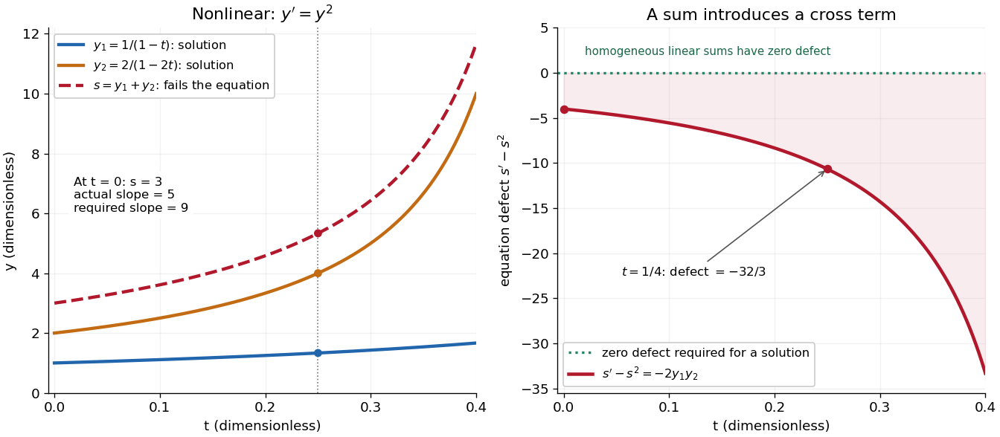

# Differential equation

↑ **Parent:** [Analysis](analysis.md)  
ⓦ [Wiki](https://en.wikipedia.org/wiki/Differential_equation)

A [differential equation](differential-equation.md) is an equation relating an unknown [function](function.md) to its [derivatives](calculus.md#derivative). It specifies how change depends on the present state, and sometimes on the independent variables themselves. A [solution of a differential equation](#solution-of-a-differential-equation) is a [function](function.md) satisfying that relation throughout a stated domain; giving a formula without its domain can conceal a point where the equation is undefined.

The central idea is to turn a local law into a whole trajectory. For example, $y'=ry$, with constant $r$, says that the instantaneous [derivative](calculus.md#derivative) is proportional to the current value. If $y(0)=100$ and $r=0.2$ per day, the [solution of a differential equation](#solution-of-a-differential-equation) is $y(t)=100e^{0.2t}$, so $y(5)=100e\approx271.83$. This is an ideal growth model assuming a constant proportional rate; the [exponential function](calculus.md#exponential-function) emerges from repeatedly applying the same local rule. Changing the sign of $r$ gives [exponential decay](analysis.md#exponential-decay).

An [ordinary differential equation](#ordinary-differential-equation) uses one independent variable. A [partial differential equation](partial-differential-equation.md) can involve several, such as space and time, and uses [partial derivatives](calculus.md#partial-derivative). Additional information selects a particular [solution of a differential equation](#solution-of-a-differential-equation): an [initial condition](#initial-condition) describes a starting state, whereas a [boundary condition](#boundary-condition) imposes constraints at the edge of a domain. The useful questions extend beyond finding a formula: does a [solution of a differential equation](#solution-of-a-differential-equation) exist, is it unique, and what happens to it over time?

**Table of contents**

- [Direction field](#direction-field)
- [Isocline](#isocline)
- [Jump condition](#jump-condition)
- [Delay differential equation](#delay-differential-equation)
- [Solution of a differential equation](#solution-of-a-differential-equation)
- [Ordinary differential equation](#ordinary-differential-equation)
  - [First integral of an ordinary differential equation](#first-integral-of-an-ordinary-differential-equation)
  - [Second-order differential equation](#second-order-differential-equation)
  - [Painlevé equation](#painleve-equation)
    - [Painlevé II equation](#painleve-ii-equation)
    - [Painlevé transcendent](#painleve-transcendent)
  - [Complex ordinary differential equation](#complex-ordinary-differential-equation)
    - [Painlevé property](#painleve-property)
    - [Painlevé determinateness theorem](#painleve-determinateness-theorem)
    - [Movable singularity of a complex differential equation](#movable-singularity-of-a-complex-differential-equation)
    - [Fixed singularity of a complex differential equation](#fixed-singularity-of-a-complex-differential-equation)
    - [Holomorphic dependence of ordinary differential equations on parameters](#holomorphic-dependence-of-ordinary-differential-equations-on-parameters)
  - [Periodic solution](#periodic-solution)
  - [Variational equation](#variational-equation)
  - [Osgood uniqueness criterion](#osgood-uniqueness-criterion)
  - [Distributional regularity of a constant-coefficient ordinary differential equation](#distributional-regularity-of-a-constant-coefficient-ordinary-differential-equation)
    - [Coordinate-degenerate constant-coefficient differential equation](#coordinate-degenerate-constant-coefficient-differential-equation)
    - [Exponential polynomial solution of a constant-coefficient differential equation](#exponential-polynomial-solution-of-a-constant-coefficient-differential-equation)
  - [Implicit solution](#implicit-solution)
  - [Exact first-order ordinary differential equation](#exact-first-order-ordinary-differential-equation)
  - [Continuous dependence of an ODE solution on parameters](#continuous-dependence-of-an-ode-solution-on-parameters)
  - [Exponential relaxation time](#exponential-relaxation-time)
  - [Initial value problem](#initial-value-problem)
    - [L2 initial condition](#l2-initial-condition)
  - [Degenerate ordinary differential equation](#degenerate-ordinary-differential-equation)
    - [Continuation through a zero of the leading ODE coefficient](#continuation-through-a-zero-of-the-leading-ode-coefficient)
  - [Compact support solvability for a constant-coefficient ordinary differential equation](#compact-support-solvability-for-a-constant-coefficient-ordinary-differential-equation)
  - [Singular point of a differential equation](#singular-point-of-a-differential-equation)
  - [Dissipative vector field](#dissipative-vector-field)
  - [Peano existence theorem](#peano-existence-theorem)
  - [Separable differential equation](#separable-differential-equation)
    - [Cubic logistic differential equation](#cubic-logistic-differential-equation)
  - [Nonlinear ordinary differential equation](#nonlinear-ordinary-differential-equation)
    - [Ermakov-Pinney equation](#ermakov-pinney-equation)
      - [Exact amplitude-phase equation](#exact-amplitude-phase-equation)
    - [Position-dependent damping](#position-dependent-damping)
    - [Logistic differential equation](#logistic-differential-equation)
      - [Euler discretization of logistic growth](#euler-discretization-of-logistic-growth)
  - [Picard-Lindelöf theorem](#picard-lindelof-theorem)
    - [Picard iteration](#picard-iteration)
    - [Finite-dimensional continuation criterion](#finite-dimensional-continuation-criterion)
    - [Bielecki norm method](#bielecki-norm-method)
  - [Finite-time blowup](#finite-time-blowup)
  - [Linear differential equation](#linear-differential-equation)
    - [Fuchsian linear differential system](#fuchsian-linear-differential-system)
      - [Analytic solution at a maximal integer Fuchsian exponent](#analytic-solution-at-a-maximal-integer-fuchsian-exponent)
      - [Residue and monodromy of a constant Fuchsian system](#residue-and-monodromy-of-a-constant-fuchsian-system)
    - [Fundamental matrix of a linear differential equation](#fundamental-matrix-of-a-linear-differential-equation)
      - [Gauge transformation of a linear differential system](#gauge-transformation-of-a-linear-differential-system)
        - [Formal cubic-exponential two-by-two system](#formal-cubic-exponential-two-by-two-system)
      - [Liouville formula for a fundamental matrix](#liouville-formula-for-a-fundamental-matrix)
    - [Floquet theory](#floquet-theory)
      - [Floquet exponent](#floquet-exponent)
      - [Floquet growth rate](#floquet-growth-rate)
      - [Monodromy matrix of a periodic linear system](#monodromy-matrix-of-a-periodic-linear-system)
    - [Characteristic root of a constant-coefficient differential equation](#characteristic-root-of-a-constant-coefficient-differential-equation)
    - [Laplace contour-integral method for a linear differential equation](#laplace-contour-integral-method-for-a-linear-differential-equation)
    - [Homogeneous linear differential equation](#homogeneous-linear-differential-equation)
      - [Solution space of a homogeneous linear differential equation](#solution-space-of-a-homogeneous-linear-differential-equation)
    - [Linearized equation](#linearized-equation)
    - [Inhomogeneous linear differential equation](#inhomogeneous-linear-differential-equation)
      - [Forcing term](#forcing-term)
  - [Local existence for a scalar autonomous ordinary differential equation with continuous vector field](#local-existence-for-a-scalar-autonomous-ordinary-differential-equation-with-continuous-vector-field)
  - [Singular perturbation](#singular-perturbation)
    - [Beyond-all-orders boundary-value sensitivity](#beyond-all-orders-boundary-value-sensitivity)
    - [Adiabatic elimination](#adiabatic-elimination)
    - [Matched asymptotic expansion](#matched-asymptotic-expansion)
      - [Endpoint derivative in a negative-drift boundary layer](#endpoint-derivative-in-a-negative-drift-boundary-layer)
      - [Logistic crossover in a weakly nonlinear Euler equation](#logistic-crossover-in-a-weakly-nonlinear-euler-equation)
        - [Nonlinear crossover delayed by a small unstable-mode coefficient](#nonlinear-crossover-delayed-by-a-small-unstable-mode-coefficient)
      - [Nonlinear endpoint layer with a quadratic reaction](#nonlinear-endpoint-layer-with-a-quadratic-reaction)
        - [One-third-power scaling at a nonlinear turning endpoint](#one-third-power-scaling-at-a-nonlinear-turning-endpoint)
      - [Asymptotic matching condition](#asymptotic-matching-condition)
      - [Square-root reaction problem with nested boundary layers](#square-root-reaction-problem-with-nested-boundary-layers)
        - [First integral of a square-root reaction layer](#first-integral-of-a-square-root-reaction-layer)
      - [Nested layers at an essential singular endpoint](#nested-layers-at-an-essential-singular-endpoint)
      - [Matched expansion with square-root and logarithmic corrections](#matched-expansion-with-square-root-and-logarithmic-corrections)
      - [Logarithmic matching in a small-exponent boundary layer](#logarithmic-matching-in-a-small-exponent-boundary-layer)
      - [Gaussian interior layer of a conservative drift equation](#gaussian-interior-layer-of-a-conservative-drift-equation)
      - [Oscillatory endpoint with a quadratically vanishing drift](#oscillatory-endpoint-with-a-quadratically-vanishing-drift)
      - [First-order composite expansion for a positive drift](#first-order-composite-expansion-for-a-positive-drift)
      - [Logarithmically enhanced nonlinear boundary layer](#logarithmically-enhanced-nonlinear-boundary-layer)
      - [Boundary layer around a moving endpoint](#boundary-layer-around-a-moving-endpoint)
      - [Square-root boundary layer at a vanishing drift](#square-root-boundary-layer-at-a-vanishing-drift)
        - [Error-function logarithmic switchback](#error-function-logarithmic-switchback)
      - [Overlap region](#overlap-region)
      - [Intermediate asymptotic region](#intermediate-asymptotic-region)
      - [Interior layer at a simple zero of advection](#interior-layer-at-a-simple-zero-of-advection)
        - [Endpoint layers for reversed diffusion](#endpoint-layers-for-reversed-diffusion)
      - [Distinguished limit](#distinguished-limit)
      - [Inner expansion](#inner-expansion)
        - [Square-root-degenerate endpoint layer](#square-root-degenerate-endpoint-layer)
        - [Inner variable](#inner-variable)
      - [Outer expansion](#outer-expansion)
      - [Additive composite expansion](#additive-composite-expansion)
      - [Multiplicative composite expansion](#multiplicative-composite-expansion)
      - [Outflow boundary layer](#outflow-boundary-layer)
      - [Switchback term](#switchback-term)
        - [Logarithmic overlap creates a switchback term](#logarithmic-overlap-creates-a-switchback-term)
    - [Method of multiple scales](#method-of-multiple-scales)
      - [Slow oscillator damping by a relaxing auxiliary variable](#slow-oscillator-damping-by-a-relaxing-auxiliary-variable)
      - [Averaged oscillator damping by a power of velocity](#averaged-oscillator-damping-by-a-power-of-velocity)
      - [Second-order resonance from quadratic oscillator coupling](#second-order-resonance-from-quadratic-oscillator-coupling)
      - [Averaged amplitude for position-dependent damping](#averaged-amplitude-for-position-dependent-damping)
        - [Absolute-value damping amplitude law](#absolute-value-damping-amplitude-law)
        - [Van der Pol amplitude evolution](#van-der-pol-amplitude-evolution)
          - [Shifted Van der Pol amplitude evolution](#shifted-van-der-pol-amplitude-evolution)
        - [Odd position-dependent damping has zero first-order amplitude drift](#odd-position-dependent-damping-has-zero-first-order-amplitude-drift)
      - [Secular term](#secular-term)
      - [Whitham modulation theory](#whitham-modulation-theory)
        - [Averaged Lagrangian](#averaged-lagrangian)
          - [Modulated-wave first integral](#modulated-wave-first-integral)
          - [Whitham modulation equation](#whitham-modulation-equation)
            - [Wave-action density](#wave-action-density)
              - [Wave-action conservation law](#wave-action-conservation-law)
      - [Amplitude-phase equations for a weakly perturbed oscillator](#amplitude-phase-equations-for-a-weakly-perturbed-oscillator)
        - [Oscillator coupled to slow damping feedback](#oscillator-coupled-to-slow-damping-feedback)
        - [Velocity-only forcing in averaged oscillator equations](#velocity-only-forcing-in-averaged-oscillator-equations)
          - [Quadratically damped oscillator](#quadratically-damped-oscillator)
          - [Cubic velocity anti-damping](#cubic-velocity-anti-damping)
        - [Conservative forcing in averaged oscillator equations](#conservative-forcing-in-averaged-oscillator-equations)
      - [Slow time](#slow-time)
      - [Weakly nonlinear expansion](#weakly-nonlinear-expansion)
        - [Quadratic wave interaction](#quadratic-wave-interaction)
          - [Resonant three-wave triad](#resonant-three-wave-triad)
          - [Detuning of a wave resonance](#detuning-of-a-wave-resonance)
          - [Phase matching for a quadratic wave interaction](#phase-matching-for-a-quadratic-wave-interaction)
            - [Two-to-one resonance of dispersive waves](#two-to-one-resonance-of-dispersive-waves)
              - [Explosive two-to-one amplitude system](#explosive-two-to-one-amplitude-system)
      - [Harmonic balance](#harmonic-balance)
      - [Solvability condition in the method of multiple scales](#solvability-condition-in-the-method-of-multiple-scales)
      - [Parametric resonance](#parametric-resonance)
        - [Primary instability tongue of a weak Mathieu oscillator](#primary-instability-tongue-of-a-weak-mathieu-oscillator)
        - [Primary parametric resonance of a two-to-one oscillator pair](#primary-parametric-resonance-of-a-two-to-one-oscillator-pair)
        - [Second instability tongue of a weak Mathieu oscillator](#second-instability-tongue-of-a-weak-mathieu-oscillator)
          - [Slow amplitudes for the second Mathieu instability tongue](#slow-amplitudes-for-the-second-mathieu-instability-tongue)
          - [Fourth-order edges of the second Mathieu instability tongue](#fourth-order-edges-of-the-second-mathieu-instability-tongue)
  - [Lie point symmetry of an ordinary differential equation](#lie-point-symmetry-of-an-ordinary-differential-equation)
    - [Prolongation of a vector field](#prolongation-of-a-vector-field)
      - [First prolongation](#first-prolongation)
      - [Jet space of a scalar ordinary differential equation](#jet-space-of-a-scalar-ordinary-differential-equation)
        - [Solution manifold](#solution-manifold)
      - [Lie-symmetry determining equation for a first-order ordinary differential equation](#lie-symmetry-determining-equation-for-a-first-order-ordinary-differential-equation)
      - [Second prolongation of the rotation generator for plane graphs](#second-prolongation-of-the-rotation-generator-for-plane-graphs)
      - [Total derivative operator](#total-derivative-operator)
      - [Schwarzian derivative](#schwarzian-derivative)
        - [Prolongations of the projective vector fields on the line](#prolongations-of-the-projective-vector-fields-on-the-line)
        - [Projective transformation weights of the Schwarzian derivative](#projective-transformation-weights-of-the-schwarzian-derivative)
      - [Affine-scaling symmetry of u double prime equals u prime squared over u minus u squared](#affine-scaling-symmetry-of-u-double-prime-equals-u-prime-squared-over-u-minus-u-squared)
  - [Boundary value problem](#boundary-value-problem)
    - [Neumann boundary-value problem](#neumann-boundary-value-problem)
    - [Boundary trace of a function](#boundary-trace-of-a-function)
    - [Oblique derivative boundary condition](#oblique-derivative-boundary-condition)
      - [Corner compatibility for collinear oblique derivative data](#corner-compatibility-for-collinear-oblique-derivative-data)
      - [Rational-angle oblique derivative problem on a quadrant](#rational-angle-oblique-derivative-problem-on-a-quadrant)
        - [Quarter-plane oblique boundary spectral functions](#quarter-plane-oblique-boundary-spectral-functions)
          - [Single-function spectral elimination for a rational-angle quadrant](#single-function-spectral-elimination-for-a-rational-angle-quadrant)
        - [Homogeneous corner ambiguity in a quadrant Laplace problem](#homogeneous-corner-ambiguity-in-a-quadrant-laplace-problem)
    - [Dirichlet-to-Neumann map](#dirichlet-to-neumann-map)
      - [Semistrip Dirichlet-to-Neumann sine transforms](#semistrip-dirichlet-to-neumann-sine-transforms)
    - [Riemann-Hilbert problem](#riemann-hilbert-problem)
      - [Sectorial half-line mKdV Riemann-Hilbert reconstruction](#sectorial-half-line-mkdv-riemann-hilbert-reconstruction)
      - [Half-line NLS Riemann-Hilbert reconstruction](#half-line-nls-riemann-hilbert-reconstruction)
      - [Negative-index scalar Riemann-Hilbert moment conditions](#negative-index-scalar-riemann-hilbert-moment-conditions)
      - [Matrix NLS reconstruction from a normalized Riemann-Hilbert problem](#matrix-nls-reconstruction-from-a-normalized-riemann-hilbert-problem)
      - [Canonical factorization of a rational scalar Riemann-Hilbert jump](#canonical-factorization-of-a-rational-scalar-riemann-hilbert-jump)
    - [Wiener-Hopf method](#wiener-hopf-method)
      - [Mixed Dirichlet-Neumann half-plane diffraction](#mixed-dirichlet-neumann-half-plane-diffraction)
      - [Wiener-Hopf factorization](#wiener-hopf-factorization)
      - [Wiener-Hopf equation](#wiener-hopf-equation)
        - [Wiener-Hopf kernel](#wiener-hopf-kernel)
        - [Pole subtraction in a Wiener-Hopf equation](#pole-subtraction-in-a-wiener-hopf-equation)
    - [Fokas method](#fokas-method)
      - [Two-trace half-line cubic dispersion representation](#two-trace-half-line-cubic-dispersion-representation)
      - [Boundary spectral representation of a holomorphic function on a semistrip](#boundary-spectral-representation-of-a-holomorphic-function-on-a-semistrip)
      - [Quadrant modified Helmholtz spectral reconstruction](#quadrant-modified-helmholtz-spectral-reconstruction)
      - [Neumann spectral formula for half-line constant drift](#neumann-spectral-formula-for-half-line-constant-drift)
      - [Dirichlet spectral formula for half-line constant drift](#dirichlet-spectral-formula-for-half-line-constant-drift)
      - [Local relation](#local-relation)
      - [Dispersion symmetry elimination of a boundary trace](#dispersion-symmetry-elimination-of-a-boundary-trace)
        - [Cubic-dispersion elimination of one missing boundary trace](#cubic-dispersion-elimination-of-one-missing-boundary-trace)
        - [Cubic Stokes dispersion symmetry](#cubic-stokes-dispersion-symmetry)
      - [Upper-quadrant cancellation of reflected boundary transforms](#upper-quadrant-cancellation-of-reflected-boundary-transforms)
    - [Global relation for a linear boundary value problem](#global-relation-for-a-linear-boundary-value-problem)
      - [Dirichlet spectral formula for Airy flow with negative transport](#dirichlet-spectral-formula-for-airy-flow-with-negative-transport)
      - [Finite-interval Airy global relation](#finite-interval-airy-global-relation)
        - [Finite-interval Airy spectral determinant](#finite-interval-airy-spectral-determinant)
      - [Semistrip Laplace spectral global relation](#semistrip-laplace-spectral-global-relation)
      - [Drift-diffusion half-line global relation](#drift-diffusion-half-line-global-relation)
      - [Half-line linear dispersive Stokes global relation](#half-line-linear-dispersive-stokes-global-relation)
        - [Dirichlet spectral representation for the linear dispersive Stokes equation](#dirichlet-spectral-representation-for-the-linear-dispersive-stokes-equation)
      - [Half-line Schrodinger boundary-trace elimination](#half-line-schrodinger-boundary-trace-elimination)
      - [Finite-time spectral boundary transform](#finite-time-spectral-boundary-transform)
        - [Finite-horizon extension of a boundary transform](#finite-horizon-extension-of-a-boundary-transform)
      - [Polygonal modified Helmholtz global relation](#polygonal-modified-helmholtz-global-relation)
        - [Dirichlet reconstruction in an equilateral triangle](#dirichlet-reconstruction-in-an-equilateral-triangle)
      - [Half-line drift global relation](#half-line-drift-global-relation)
        - [Exponential-decay contour for half-line drift diffusion](#exponential-decay-contour-for-half-line-drift-diffusion)
      - [Collocation points for a global relation](#collocation-points-for-a-global-relation)
      - [Conjugate global relations for the modified Helmholtz equation](#conjugate-global-relations-for-the-modified-helmholtz-equation)
        - [Rotationally invariant Neumann reconstruction in an equilateral triangle](#rotationally-invariant-neumann-reconstruction-in-an-equilateral-triangle)
        - [Sine collocation of square modified Helmholtz global relations](#sine-collocation-of-square-modified-helmholtz-global-relations)
          - [Square modified Helmholtz Dirichlet-to-Neumann coefficients](#square-modified-helmholtz-dirichlet-to-neumann-coefficients)
          - [Diagonal dominance of paired square global-relation collocation](#diagonal-dominance-of-paired-square-global-relation-collocation)
    - [Spectral parameter for a linear boundary value problem](#spectral-parameter-for-a-linear-boundary-value-problem)
    - [Boundary lifting](#boundary-lifting)
      - [Uniform half-line Schrodinger representation by boundary lifting](#uniform-half-line-schrodinger-representation-by-boundary-lifting)
  - [Boundary condition](#boundary-condition)
    - [Dynamic boundary condition for the heat equation](#dynamic-boundary-condition-for-the-heat-equation)
      - [Dirichlet energy dissipation with a dynamic heat boundary condition](#dirichlet-energy-dissipation-with-a-dynamic-heat-boundary-condition)
      - [Repeated-root dynamic-boundary heat kernel](#repeated-root-dynamic-boundary-heat-kernel)
        - [Repeated-root unstable heat boundary mode](#repeated-root-unstable-heat-boundary-mode)
    - [Clamped boundary condition](#clamped-boundary-condition)
    - [Periodic boundary conditions](#periodic-boundary-conditions)
    - [Vanishing boundary condition](#vanishing-boundary-condition)
    - [Initial condition](#initial-condition)
      - [Initial velocity](#initial-velocity)
      - [Initial displacement](#initial-displacement)
    - [Dirichlet boundary condition](#dirichlet-boundary-condition)
      - [Dirichlet boundary data](#dirichlet-boundary-data)
      - [Perfectly conducting thermal boundary condition](#perfectly-conducting-thermal-boundary-condition)
    - [Neumann boundary condition](#neumann-boundary-condition)
      - [Neumann boundary data](#neumann-boundary-data)
      - [Initial incompatibility with a Neumann boundary condition](#initial-incompatibility-with-a-neumann-boundary-condition)
      - [Neumann eigenfunction](#neumann-eigenfunction)
    - [Tangential boundary derivative](#tangential-boundary-derivative)
    - [Robin boundary condition](#robin-boundary-condition)
      - [Poisson uniqueness with a nonnegative Robin normal coefficient](#poisson-uniqueness-with-a-nonnegative-robin-normal-coefficient)
      - [Symmetric Robin strip transform](#symmetric-robin-strip-transform)
        - [Solvability of a decaying Robin strip](#solvability-of-a-decaying-robin-strip)
      - [Weak Robin problem for a uniformly elliptic operator](#weak-robin-problem-for-a-uniformly-elliptic-operator)
    - [Mixed boundary condition](#mixed-boundary-condition)
    - [Far-field boundary condition](#far-field-boundary-condition)
  - [Sign-decay differential equation](#sign-decay-differential-equation)
    - [Explicit Euler method for the sign-decay equation](#explicit-euler-method-for-the-sign-decay-equation)
  - [Parameter sensitivity equation](#parameter-sensitivity-equation)
  - [Differential inequality](#differential-inequality)
  - [Bernoulli differential equation](#bernoulli-differential-equation)
    - [Bernoulli power substitution](#bernoulli-power-substitution)
    - [Reciprocal Bernoulli equation with finite-time blowup](#reciprocal-bernoulli-equation-with-finite-time-blowup)
    - [Finite-time extinction in a sublinear Bernoulli equation](#finite-time-extinction-in-a-sublinear-bernoulli-equation)
  - [Tangent addition functional equation](#tangent-addition-functional-equation)
  - [Linear ordinary differential equation](#linear-ordinary-differential-equation)
    - [Characteristic equation of a constant-coefficient differential equation](#characteristic-equation-of-a-constant-coefficient-differential-equation)
    - [Method of undetermined coefficients](#method-of-undetermined-coefficients)
      - [Resonant exponential particular solution](#resonant-exponential-particular-solution)
    - [Weighted energy estimate for two coupled modes](#weighted-energy-estimate-for-two-coupled-modes)
    - [Newton's law of cooling](#newton-s-law-of-cooling)
      - [Impulse versus finite-duration cooling](#impulse-versus-finite-duration-cooling)
      - [Cumulative thermal destruction under exponential warming and cooling](#cumulative-thermal-destruction-under-exponential-warming-and-cooling)
      - [Newton cooling with an instantaneous temperature jump](#newton-cooling-with-an-instantaneous-temperature-jump)
      - [Heat transfer coefficient](#heat-transfer-coefficient)
    - [Homogeneous solution](#homogeneous-solution)
    - [Particular solution](#particular-solution)
    - [General solution](#general-solution)
    - [Dominant eigenmode in a forced linear system](#dominant-eigenmode-in-a-forced-linear-system)
    - [Second-order linear differential equation](#second-order-linear-differential-equation)
      - [Quadratic-variable reduction of a singular oscillator](#quadratic-variable-reduction-of-a-singular-oscillator)
      - [Repeated-root constant-coefficient differential equation](#repeated-root-constant-coefficient-differential-equation)
      - [Singular point of a second-order linear ODE](#singular-point-of-a-second-order-linear-ode)
      - [Reciprocal-coordinate reduction of a beam-type equation](#reciprocal-coordinate-reduction-of-a-beam-type-equation)
      - [Liouville transformation of a second-order equation](#liouville-transformation-of-a-second-order-equation)
      - [Power substitution for an oscillatory second-order equation](#power-substitution-for-an-oscillatory-second-order-equation)
      - [Mathieu equation](#mathieu-equation)
        - [Mathieu characteristic value](#mathieu-characteristic-value)
      - [Airy ordinary differential equation](#airy-ordinary-differential-equation)
        - [Forced Airy boundary-value problem](#forced-airy-boundary-value-problem)
        - [Airy power-series fundamental pair](#airy-power-series-fundamental-pair)
        - [Airy function](#airy-function)
          - [Airy displacement integral](#airy-displacement-integral)
      - [Elimination of the first derivative](#elimination-of-the-first-derivative)
      - [Sturm-Picone comparison theorem](#sturm-picone-comparison-theorem)
        - [Sturm comparison theorem](#sturm-comparison-theorem)
          - [Wronskian proof of Sturm comparison](#wronskian-proof-of-sturm-comparison)
      - [Power-series solution of a differential equation](#power-series-solution-of-a-differential-equation)
      - [Kummer differential equation](#kummer-differential-equation)
        - [Confluent hypergeometric function](#confluent-hypergeometric-function)
          - [Confluent hypergeometric function of the first kind](#confluent-hypergeometric-function-of-the-first-kind)
      - [Wronskian](#wronskian)
        - [Abel's identity](#abel-s-identity)
      - [Variation of parameters](#variation-of-parameters)
      - [Reduction of order](#reduction-of-order)
        - [First correction to a regular singular solution by reduction of order](#first-correction-to-a-regular-singular-solution-by-reduction-of-order)
        - [Reduction of order across a zero of the known solution](#reduction-of-order-across-a-zero-of-the-known-solution)
      - [Cauchy-Euler equation](#cauchy-euler-equation)
        - [Euler-Cauchy classification from two regular singular points](#euler-cauchy-classification-from-two-regular-singular-points)
        - [Euler-Cauchy equation](#euler-cauchy-equation)
        - [General solution of an Euler-Cauchy equation](#general-solution-of-an-euler-cauchy-equation)
          - [Power-law ansatz](#power-law-ansatz)
            - [Indicial equation](#indicial-equation)
              - [Indicial root](#indicial-root)
              - [Indicial exponent](#indicial-exponent)
            - [Log-periodic oscillation](#log-periodic-oscillation)
      - [Legendre differential equation](#legendre-differential-equation)
        - [Associated Legendre differential equation](#associated-legendre-differential-equation)
        - [Associated Legendre function](#associated-legendre-function)
        - [Legendre polynomial](#legendre-polynomial)
          - [Weighted orthogonality of Legendre polynomial derivatives](#weighted-orthogonality-of-legendre-polynomial-derivatives)
          - [Generating function and norm of Legendre polynomials](#generating-function-and-norm-of-legendre-polynomials)
          - [Orthogonality of Legendre polynomials](#orthogonality-of-legendre-polynomials)
          - [Legendre polynomial recurrence relation](#legendre-polynomial-recurrence-relation)
          - [Schläfli contour integral for Legendre polynomials](#schlafli-contour-integral-for-legendre-polynomials)
          - [Debye asymptotic for Legendre polynomials](#debye-asymptotic-for-legendre-polynomials)
            - [Hyperbolic Debye asymptotic for Legendre polynomials](#hyperbolic-debye-asymptotic-for-legendre-polynomials)
              - [Legendre boundary layer at x equals one](#legendre-boundary-layer-at-x-equals-one)
      - [Change of independent variable in a second-order ODE](#change-of-independent-variable-in-a-second-order-ode)
    - [First-order linear differential equation](#first-order-linear-differential-equation)
      - [Causal response of a first-order relaxation equation](#causal-response-of-a-first-order-relaxation-equation)
      - [Resonant exponential forcing in a first-order equation](#resonant-exponential-forcing-in-a-first-order-equation)
    - [Integrating factor](#integrating-factor)
      - [Heaviside forcing in a first-order integrating-factor equation](#heaviside-forcing-in-a-first-order-integrating-factor-equation)
      - [Integrating factor for a differential one-form](#integrating-factor-for-a-differential-one-form)
      - [Bounded solution selected by a terminal condition](#bounded-solution-selected-by-a-terminal-condition)
    - [Resonance in a differential equation](#resonance-in-a-differential-equation)
      - [Resonance condition](#resonance-condition)
      - [Resonant forcing](#resonant-forcing)
    - [Linear system of differential equations](#linear-system-of-differential-equations)
      - [Exponential forcing of a constant-coefficient differential system](#exponential-forcing-of-a-constant-coefficient-differential-system)
      - [Cauchy-Euler differential system](#cauchy-euler-differential-system)
      - [Eigenvector method for a differential equation](#eigenvector-method-for-a-differential-equation)
      - [State transition matrix](#state-transition-matrix)
      - [Complex form of a planar linear system](#complex-form-of-a-planar-linear-system)
    - [Jump condition for an impulse](#jump-condition-for-an-impulse)
      - [Impulse cancellation of a harmonic oscillator](#impulse-cancellation-of-a-harmonic-oscillator)
  - [First integral](#first-integral)

## Direction field

↑ **Parent:** [Differential equation](differential-equation.md)

A [direction field](#direction-field) for $y'=f(t,y)$ places a short segment with slope $f(t,y)$ at each sampled point where $f$ is defined. A [function graph](function.md#graph-of-a-function) of a [solution of a differential equation](#solution-of-a-differential-equation) follows these segments: its [tangent line](calculus.md#tangent-line) has exactly the prescribed slope. Segment length is a drawing choice, rather than a speed; arrows, if used, point toward increasing $t$. An [isocline](#isocline) collects points with one common slope.

For [Newton's law of cooling](#newton-s-law-of-cooling), $y'=-0.1(y-20)$ with time in minutes and [temperature](thermodynamics.md#temperature) in degrees Celsius, the slopes at $y=80,40,20,10$ are respectively $-6,-2,0,1$ degrees Celsius per minute. Each horizontal row is an [isocline](#isocline), because this [autonomous differential equation](dynamical-systems.md#autonomous-system-mathematics) has no explicit time dependence. Above $20$ the [solutions of a differential equation](#solution-of-a-differential-equation) descend, below $20$ they rise, and $y=20$ is an [equilibrium point](dynamical-systems.md#equilibrium-point-of-a-dynamical-system).

**[Figure 1](#image-cooling-trajectories-follow-the-direction-field-toward-the-ambient-temperature). Cooling trajectories follow the direction field toward the ambient temperature**.

The highlighted [initial condition](#initial-condition) $y(0)=80$ selects one curve from the family. The picture reveals approach to the [equilibrium point](dynamical-systems.md#equilibrium-point-of-a-dynamical-system) before any algebra is done. Under the hypotheses of the [Picard-Lindelöf theorem](#picard-lindelof-theorem), distinct [function graphs](function.md#graph-of-a-function) of solutions cannot cross or even meet in the time-state plane. A [direction field](#direction-field) alone does not guarantee uniqueness: several curves can share a [tangent line](calculus.md#tangent-line) at the same point when those hypotheses fail. See the delayed-start example under [initial value problem](#initial-value-problem).

This geometric interpretation is developed in [Direction Fields, Isoclines, Integral Curves](mathematics-bibliography.md#18-03sc-differential-equations-fall-2011/direction-fields-isoclines-integral-curves).

## Isocline

↑ **Parent:** [Differential equation](differential-equation.md)

For the first-order [ordinary differential equation](#ordinary-differential-equation) $y'=f(x,y)$ defined on an [open subset](topology.md#open-set) $D$ of the plane, an [isocline](#isocline) of [slope](geometry-and-topology.md#slope) $k$ is the [level set](topology.md#level-set)

$$
\{(x,y)\in D:f(x,y)=k\}.
$$

Here $k$ is a constant. At every point of this [isocline](#isocline), the [direction field](#direction-field) prescribes a [tangent vector](differential-geometry.md#tangent-vector) proportional to $(1,k)$ for a [solution of a differential equation](#solution-of-a-differential-equation). It does not generally prescribe the [tangent line](calculus.md#tangent-line) of the [isocline](#isocline) itself. The [level set](topology.md#level-set) can have several components or fail to be a smooth curve, and points outside $D$ are excluded.

For example, take $y'=x-y$ on the whole plane. Its [isoclines](#isocline) are the parallel [straight lines](geometry-and-topology.md#straight-line)

$$
x-y=k,\qquad y=x-k.
$$

Each [line](geometry-and-topology.md#straight-line) has [slope](geometry-and-topology.md#slope) $1$, while the [direction field](#direction-field) along it has [slope](geometry-and-topology.md#slope) $k$. Thus the [isocline](#isocline) $y=x$ carries horizontal segments even though the [line](geometry-and-topology.md#straight-line) itself rises. A [function graph](function.md#graph-of-a-function) of a [solution of a differential equation](#solution-of-a-differential-equation) follows the segments, rather than following this [line](geometry-and-topology.md#straight-line). Only the [isocline](#isocline) with $k=1$, namely $y=x-1$, is also a [solution of a differential equation](#solution-of-a-differential-equation).[pp. 1–2: constant-slope loci and the example y prime equals x minus y](mathematics-bibliography.md#18-03sc-differential-equations-fall-2011/direction-fields-isoclines-integral-curves)

**[Figure 2](#image-isoclines-label-the-prescribed-slopes-while-exact-solution-graphs-follow-the-direction-field). Isoclines label the prescribed slopes while exact solution graphs follow the direction field**.

The [first-order linear differential equation](#first-order-linear-differential-equation) has the exact family

$$
y(x)=x-1+Ae^{-x},\qquad y'(x)=1-Ae^{-x}=x-y(x).
$$

The [initial condition](#initial-condition) $y(x_0)=y_0$ selects $A=(y_0-x_0+1)e^{x_0}$ and hence a unique [solution of a differential equation](#solution-of-a-differential-equation) for every real $x$. The picture shows $y(0)=-1,0,1,2$. For $A=0$ the [solution of a differential equation](#solution-of-a-differential-equation) stays on the $k=1$ [isocline](#isocline); for other $A$ it moves through different [isoclines](#isocline). These formulas check the pictured trajectories by direct [differentiation](calculus.md#differentiation), independently of how the [direction field](#direction-field) was sampled.

The zero-slope [isocline](#isocline) $f(x,y)=0$ is called a [nullcline](dynamical-systems.md#nullcline). Below the [nullcline](dynamical-systems.md#nullcline) $y=x$ in this example, $y'>0$; above it, $y'<0$. For $A>0$, the [solution of a differential equation](#solution-of-a-differential-equation) meets it at $x=\log A$, where $y'=0$ and $y''=1$, a strict [local minimum](analysis.md#local-minimum). The [nullcline](dynamical-systems.md#nullcline) is therefore a useful guide to turning points, although it is not itself a [solution of a differential equation](#solution-of-a-differential-equation). In the equivalent planar [autonomous differential equation](dynamical-systems.md#autonomous-system-mathematics) $\dot x=1$, $\dot y=x-y$, it is the [nullcline](dynamical-systems.md#nullcline) for the second component; there is no [equilibrium point](dynamical-systems.md#equilibrium-point-of-a-dynamical-system), because the first component never vanishes.

This makes [isoclines](#isocline) useful even when no explicit [solution of a differential equation](#solution-of-a-differential-equation) is available: organize a [direction field](#direction-field) by common [slopes](geometry-and-topology.md#slope), read where [function graphs](function.md#graph-of-a-function) rise or fall, and identify possible turning points on [nullclines](dynamical-systems.md#nullcline).

## Jump condition

↑ **Parent:** [Differential equation](differential-equation.md)

A jump condition relates the one-sided limits of a solution or its derivatives across a discontinuity or singular forcing. Integrating a [differential equation](differential-equation.md) across a shrinking interval containing a [Dirac delta](distribution-theory.md#dirac-delta-function) source determines the permitted jump. A [jump condition for an impulse](#jump-condition-for-an-impulse) and [Rankine-Hugoniot condition](partial-differential-equation.md#rankine-hugoniot-conditions) are specific instances with different governing equations.

## Delay differential equation

↑ **Parent:** [Differential equation](differential-equation.md)  
ⓦ [Wiki](https://en.wikipedia.org/wiki/Delay_differential_equation)

A [delay differential equation](#delay-differential-equation) relates a derivative at the current argument to values at earlier arguments. For example, the [Buchstab function](analytic-number-theory.md#buchstab-function) obeys $\frac{d}{du}(u w(u))=w(u-1)$ for $u>2$.

## Solution of a differential equation

↑ **Parent:** [Differential equation](differential-equation.md)

A classical solution is a sufficiently differentiable [function](function.md) that satisfies a [differential equation](differential-equation.md) and any prescribed initial or boundary conditions. A [weak solution](partial-differential-equation.md#weak-solution) instead satisfies an appropriate integral or distributional identity in a specified [function space](functional-analysis.md#function-space). For a smooth locally [Lipschitz continuous](real-analysis.md#lipschitz-continuity) vector field, an [ordinary differential equation](#ordinary-differential-equation) has a unique local solution for each initial state; this does not by itself ensure global existence or boundedness.

## Ordinary differential equation

↑ **Parent:** [Differential equation](differential-equation.md)  
ⓦ [Wiki](https://en.wikipedia.org/wiki/Ordinary_differential_equation)

An [ordinary differential equation](#ordinary-differential-equation) relates an unknown [function](function.md) of one independent variable to its ordinary [derivatives](calculus.md#derivative). Its order is the highest [derivative](calculus.md#derivative) appearing. Thus $y'=-k(y-T_a)$ is first order, while the [harmonic oscillator equation](classical-mechanics.md#simple-harmonic-motion) $y''+\omega^2y=0$ is second order. A first-order equation in explicit form is

$$
y'(t)=f(t,y(t)).
$$

Here $t$ need not be time, and $y$ can be a [vector](vector-space.md#vector), giving a system of coupled [ordinary differential equations](#ordinary-differential-equation). A classical [solution of a differential equation](#solution-of-a-differential-equation) is a sufficiently [differentiable function](analysis.md#differentiable-function) on an [interval](real-analysis.md#interval-mathematics) which satisfies the equation at every point. For the explicit first-order equation, if $f$ is continuous, this [solution of a differential equation](#solution-of-a-differential-equation) has a continuous [derivative](calculus.md#derivative).

For [Newton's law of cooling](#newton-s-law-of-cooling), the state is a single [temperature](thermodynamics.md#temperature); for a [second-order differential equation](#second-order-differential-equation), a first-order system also records its first [derivative](calculus.md#derivative). This is why a starting position alone does not specify a [harmonic oscillator](classical-mechanics.md#simple-harmonic-motion) trajectory: its starting velocity matters too.

The power of an [ordinary differential equation](#ordinary-differential-equation) is that one rule describes a whole family of histories. An [initial value problem](#initial-value-problem) chooses one history when uniqueness holds. An [autonomous differential equation](dynamical-systems.md#autonomous-system-mathematics) has $f$ independent of $t$; its [equilibrium points](dynamical-systems.md#equilibrium-point-of-a-dynamical-system) satisfy $f(y_*)=0$ and give constant [solutions of a differential equation](#solution-of-a-differential-equation). Equations with explicit time dependence can instead respond to a changing environment.

### First integral of an ordinary differential equation

↑ **Parent:** [Ordinary differential equation](#ordinary-differential-equation)

A first integral of $y'=f(t,y)$ is a differentiable function $I(t,y)$ whose value is constant along solutions through every time and state in its domain. The [chain rule](calculus.md#chain-rule) makes this equivalent to the displayed pointwise identity. For $I(y)=y^TSy$ with symmetric $S$, it becomes $y^TSf(t,y)=0$. This identity at the implicit stage is what proves exact [Runge-Kutta conservation of quadratic invariants](numerical-analysis.md#runge-kutta-conservation-of-quadratic-invariants) for the [implicit midpoint rule](numerical-analysis.md#implicit-midpoint-rule). Invariance asserted only on the image of one initial-time flow needs that image to contain the stage under consideration.

### Second-order differential equation

↑ **Parent:** [Ordinary differential equation](#ordinary-differential-equation)

A second-order [ordinary differential equation](#ordinary-differential-equation) involves a second [derivative](calculus.md#derivative) as its highest derivative. In explicit form $y''=f(x,y,y')$, introducing $v=y'$ converts it into the first-order system $y'=v$, $v'=f(x,y,v)$. Under local regularity and [Lipschitz continuity](real-analysis.md#lipschitz-continuity) in the dependent variables, an [initial value problem](#initial-value-problem) is specified by both $y(x_0)$ and $y'(x_0)$. The linear case is a [second-order linear differential equation](#second-order-linear-differential-equation).

<h3 id="painleve-equation">Painlevé equation</h3>

↑ **Parent:** [Ordinary differential equation](#ordinary-differential-equation)

<h4 id="painleve-ii-equation">Painlevé II equation</h4>

↑ **Parent:** [Painlevé equation](#painleve-equation)

The second [Painlevé equation](#painleve-equation), in its standard normalization. [Similarity reductions](partial-differential-equation.md#similarity-reduction) of some [integrable systems](integrable-systems.md) give equations of this form, after rescaling variables.

<h4 id="painleve-transcendent">Painlevé transcendent</h4>

↑ **Parent:** [Painlevé equation](#painleve-equation)  
ⓦ [Wiki](https://en.wikipedia.org/wiki/Painlevé_transcendent)

A special-function solution of one of the six [Painlevé equations](#painleve-equation).

### Complex ordinary differential equation

↑ **Parent:** [Ordinary differential equation](#ordinary-differential-equation)

A first-order [ordinary differential equation](#ordinary-differential-equation) with complex independent and dependent variables is solved by a [holomorphic function](complex-analysis.md#holomorphic-function) on an ordinary domain, and its [analytic continuation](complex-analysis.md#analytic-continuation) can have [branch points](complex-analysis.md#branch-point). A [holomorphic](complex-analysis.md#holomorphic-function) right-hand side gives local existence and uniqueness by the integral [contraction mapping](analysis.md#contraction-mapping) used in the [Picard-Lindelöf theorem](#picard-lindelof-theorem).

<h4 id="painleve-property">Painlevé property</h4>

↑ **Parent:** [Complex ordinary differential equation](#complex-ordinary-differential-equation)

The [Painlevé property](#painleve-property) excludes movable critical singularities, such as [branch points](complex-analysis.md#branch-point), of the analytically continued general solution of a complex [differential equation](differential-equation.md). A common stronger formulation requires every movable singularity to be a [pole](isolated-singularity.md#pole), so local solutions are meromorphic there. Fixed singularities determined by the coefficients are distinguished from movable ones whose locations depend on initial data. [Riccati equations](analysis.md#riccati-equation) with meromorphic coefficients have only movable [poles](isolated-singularity.md#pole) at [ordinary points](complex-analysis.md#ordinary-point-criterion-for-a-second-order-equation): linearization expresses their solutions as [logarithmic derivatives](analytic-number-theory.md#logarithmic-derivative) of linear-system solutions. More generally, set $w=f/g$ and solve the holomorphic linear system $f'=bf+cg$, $g'=-af$. Its quotient satisfies $w'=aw^2+bw+c$ directly. Initial data $g(z_0)=1$, $f(z_0)=w(z_0)$ recover every local solution, and holomorphic $f,g$ make the quotient a [meromorphic function](isolated-singularity.md#meromorphic-function), even at zeros of $a$. At a zero of $g$ with $a\ne0$, uniqueness prevents $f=0$ there, so $g'=-af\ne0$ and the [pole](isolated-singularity.md#pole) is simple. This proves the absence of movable branching without assuming that the quadratic coefficient never vanishes.

<h4 id="painleve-determinateness-theorem">Painlevé determinateness theorem</h4>

↑ **Parent:** [Complex ordinary differential equation](#complex-ordinary-differential-equation)

For a first-order [ordinary differential equation](#ordinary-differential-equation) rational in the dependent variable, with coefficients [meromorphic](isolated-singularity.md#meromorphic-function) on the chosen independent-variable surface, [analytic continuation](complex-analysis.md#analytic-continuation) along an arc ending outside the fixed exceptional set has a definite limit in the [Riemann sphere](complex-analysis.md#riemann-sphere). Its movable singularities are [poles](isolated-singularity.md#pole) or [algebraic branch points](complex-analysis.md#algebraic-branch-point). To see the limiting assertion, the cluster set of a continuous lifted arc is connected and compact. Any cluster value where the vector field is [holomorphic](complex-analysis.md#holomorphic-function) permits uniform local continuation by the [Picard-Lindelöf theorem](#picard-lindelof-theorem). Otherwise the cluster set lies in finitely many coefficient poles, so it is a singleton. At a pole of the vector field, the inverse equation is [holomorphic](complex-analysis.md#holomorphic-function); its solution has a finite-order critical point, giving a convergent root expansion. The reciprocal dependent variable handles infinity. Points where both reduced numerator and denominator vanish belong to the fixed exceptional set and are excluded from this argument.

#### Movable singularity of a complex differential equation

↑ **Parent:** [Complex ordinary differential equation](#complex-ordinary-differential-equation)

A solution has a movable singularity if its location varies with the initial data. For example $w'=w^2$ has solutions $w=-1/(z-c)$, whose [pole](isolated-singularity.md#pole) moves with $c$. The [Painlevé determinateness theorem](#painleve-determinateness-theorem) restricts movable singularities of first-order equations rational in the dependent variable to [poles](isolated-singularity.md#pole) and [algebraic branch points](complex-analysis.md#algebraic-branch-point).

#### Fixed singularity of a complex differential equation

↑ **Parent:** [Complex ordinary differential equation](#complex-ordinary-differential-equation)

A singular location is fixed if its position is determined by the coefficients, independently of the initial data. Not every solution must actually be singular there. For a rational first-order equation, coefficient poles and exceptional fibres where the reduced numerator and denominator have common zeros are included among the possible fixed locations.

#### Holomorphic dependence of ordinary differential equations on parameters

↑ **Parent:** [Complex ordinary differential equation](#complex-ordinary-differential-equation)

If the right-hand side and initial data are jointly [holomorphic](complex-analysis.md#holomorphic-function), the local solution is jointly [holomorphic](complex-analysis.md#holomorphic-function) in its independent variable and parameters. On a smaller closed [polydisc](complex-geometry.md#polydisc), bound $|A|$ by $M$ and $|\partial_w A|$ by $L$. Choose $r$ so that $rM$ stays inside the dependent-variable disc and $rL<1$. The integral [contraction mapping](analysis.md#contraction-mapping) has jointly [holomorphic](complex-analysis.md#holomorphic-function) iterates converging uniformly, so [locally uniform convergence of holomorphic functions](complex-analysis.md#locally-uniform-convergence-of-holomorphic-functions) proves the assertion. Shifting the dependent variable turns initial values into parameters.

### Periodic solution

↑ **Parent:** [Ordinary differential equation](#ordinary-differential-equation)

A solution with a period $T>0$. A nonconstant periodic solution of an autonomous system traces a [periodic orbit](dynamical-systems.md#periodic-orbit); constant equilibria are also periodic functions, so they must be excluded when asserting absence of periodic orbits.

### Variational equation

↑ **Parent:** [Ordinary differential equation](#ordinary-differential-equation)

Differentiating a smooth [characteristic flow map](partial-differential-equation.md#characteristic-flow-map) in its initial point gives this linear equation, with $Y(s)=I$. The [Liouville formula for a fundamental matrix](#liouville-formula-for-a-fundamental-matrix) then gives $\det Y(t)=\exp(\int_s^t\operatorname{div}b(r,X(r))\,dr)$. Incompressible [Hamiltonian flows](classical-mechanics.md#hamiltonian-flow) preserve [Lebesgue measure](measure-theory.md#lebesgue-measure) because this [divergence](calculus.md#divergence) vanishes.

### Osgood uniqueness criterion

↑ **Parent:** [Ordinary differential equation](#ordinary-differential-equation)

If a continuous nondecreasing modulus $\mu$ satisfies this divergence condition, an estimate $|b(t,x)-b(t,y)|\leq A(t)\mu(|x-y|)$ with locally integrable $A$ gives uniqueness of [characteristic curves](partial-differential-equation.md#characteristic-curve). Apply a regularized integral comparison to their separation. For the [log-Lipschitz modulus](topological-analysis.md#log-lipschitz-modulus), $\delta'(t)\leq A(t)\delta(1-\log\delta)$ gives $\delta(t)\leq\exp(1-(1-\log\delta(0))\exp(-\int_0^tA))$ while $\delta\leq1$. Zero initial separation stays zero. Unlike the usual linear [Gronwall inequality](probability-and-statistics.md#gronwall-inequality), this criterion allows non-Lipschitz vector fields.

### Distributional regularity of a constant-coefficient ordinary differential equation

↑ **Parent:** [Ordinary differential equation](#ordinary-differential-equation)

For a nonzero constant-coefficient polynomial differential operator in one variable, every homogeneous [distribution](distribution-theory.md#distribution-mathematical-analysis) solution is a [classical solution](partial-differential-equation.md#classical-solution), indeed analytic. Factor the [polynomial](polynomial.md) into powers of distinct [characteristic roots of a constant-coefficient differential equation](#characteristic-root-of-a-constant-coefficient-differential-equation). The [kernel decomposition for coprime polynomials](linear-operator-theory.md#kernel-decomposition-for-coprime-polynomials) reduces the equation to $(D-\lambda)^m v=0$, and [multiplication of a distribution by a smooth function](distribution-theory.md#multiplication-of-a-distribution-by-a-smooth-function) reduces this to $D^m(e^{-\lambda x}v)=0$. The fact that [a distribution with zero derivative is constant](distribution-theory.md#a-distribution-with-zero-derivative-is-constant), iterated, makes the latter distribution a [polynomial](polynomial.md) of degree less than $m$.

#### Coordinate-degenerate constant-coefficient differential equation

↑ **Parent:** [Distributional regularity of a constant-coefficient ordinary differential equation](#distributional-regularity-of-a-constant-coefficient-ordinary-differential-equation)

For a positive-order constant-coefficient [ordinary differential equation](#ordinary-differential-equation), the [kernel of multiplication by a coordinate](distribution-theory.md#kernel-of-multiplication-by-a-coordinate) gives $xP(D)u=0$ exactly when $P(D)u=C\delta_0$. Hence every solution is $u=v+CE$, where $P(D)v=0$ and $E$ is any [fundamental solution of a linear differential operator](distribution-theory.md#fundamental-solution-of-a-linear-differential-operator). Taking a [retarded fundamental solution of a constant-coefficient ordinary differential operator](distribution-theory.md#retarded-fundamental-solution-of-a-constant-coefficient-ordinary-differential-operator) shows that the extra freedom is a single jump in the derivative of order one below the operator order. The coordinate multiplies the already differentiated distribution: this is a different operator from $P(D)(xu)$.

#### Exponential polynomial solution of a constant-coefficient differential equation

↑ **Parent:** [Distributional regularity of a constant-coefficient ordinary differential equation](#distributional-regularity-of-a-constant-coefficient-ordinary-differential-equation)

If a degree-$n$ characteristic [polynomial](polynomial.md) has distinct [roots of a polynomial](polynomial.md#root-of-a-polynomial) $\lambda_j$ of multiplicities $m_j$, all homogeneous [distribution](distribution-theory.md#distribution-mathematical-analysis) solutions are the displayed combinations. There are $\sum_jm_j=n$ independent coefficients. Repeated [characteristic roots of a constant-coefficient differential equation](#characteristic-root-of-a-constant-coefficient-differential-equation) account for the polynomial factors multiplying exponentials; conjugate pairs give real sine and cosine combinations when real solutions are desired.

### Implicit solution

↑ **Parent:** [Ordinary differential equation](#ordinary-differential-equation)

An [implicit solution](#implicit-solution) describes a [solution of a differential equation](#solution-of-a-differential-equation) through a relation $F(x,y)=C$, instead of isolating $y$ in an explicit formula. The relation describes a [level set](topology.md#level-set); an actual scalar [solution of a differential equation](#solution-of-a-differential-equation) must be a [differentiable function](analysis.md#differentiable-function) $y(x)$ on an [interval](real-analysis.md#interval-mathematics) whose [function graph](function.md#graph-of-a-function) lies in the equation's domain. A whole [level set](topology.md#level-set) need not be one such [function graph](function.md#graph-of-a-function).

For example, consider

$$
y'=-\frac{x}{y},\qquad D=\{(x,y):y\ne0\}.
$$

[Implicit differentiation](calculus.md#implicit-differentiation) of $x^2+y^2=C$ gives $2x+2yy'=0$. For $C>0$, the [circle](topology.md#circle) contains two [solutions of a differential equation](#solution-of-a-differential-equation),

$$
y_+(x)=\sqrt{C-x^2},\qquad y_-(x)=-\sqrt{C-x^2},\qquad -\sqrt C<x<\sqrt C.
$$

Both satisfy the equation on the stated [open interval](topology.md#open-interval), and their [function graphs](function.md#graph-of-a-function) stay in $D$. An [initial condition](#initial-condition) $(x_0,y_0)\in D$ fixes $C=x_0^2+y_0^2$ and selects the sign of $y_0$. In particular, $y(0)=2$ gives $C=4$ and the upper branch on $(-2,2)$. The constant alone does not select the branch.[§1.3.2 Implicit solutions: implicit differentiation, multiple branches, and selection by an initial condition](mathematics-bibliography.md#notes-on-diffy-qs-differential-equations-for-engineers-by-jiri-lebl/1-3-separable-equations)

**[Figure 3](#image-a-circular-level-set-gives-local-solution-graphs-away-from-vertical-tangencies-while-a-singular-level-needs-separate-analysis). A circular level set gives local solution graphs away from vertical tangencies, while a singular level needs separate analysis**.

The precise local criterion uses the [implicit function theorem](calculus.md#implicit-function-theorem). Let $F$ be [continuously differentiable](calculus.md#continuously-differentiable-function) on an [open subset](topology.md#open-set) of the plane, with $F(x_0,y_0)=C$. If its [partial derivative](calculus.md#partial-derivative) $F_y(x_0,y_0)\ne0$, the nearby [level set](topology.md#level-set) is a unique [continuously differentiable](calculus.md#continuously-differentiable-function) [function graph](function.md#graph-of-a-function) $y=g(x)$ through that point. The [chain rule](calculus.md#chain-rule) gives

$$
F_x(x,g(x))+F_y(x,g(x))g'(x)=0,\qquad g'(x)=-\frac{F_x(x,g(x))}{F_y(x,g(x))}.
$$

This proves that the local [function graph](function.md#graph-of-a-function) solves $y'=-F_x/F_y$ there. For a different prescribed equation $y'=f(x,y)$, one must also check $F_x+F_yf=0$ along that branch and that it stays in the domain of $f$. A [level set](topology.md#level-set) by itself does not verify an arbitrary [ordinary differential equation](#ordinary-differential-equation).[§8.5.1, Theorem 8.5.6 and the preceding circle example: local existence, uniqueness and derivative of an implicit graph](mathematics-bibliography.md#basic-analysis-introduction-to-real-analysis-volume-ii-by-jiri-lebl/8-5-inverse-and-implicit-function-theorems)

For $F=x^2+y^2$, the upper branch through $(1,\sqrt3)$ has $F_y=2\sqrt3$ and [tangent line](calculus.md#tangent-line) [slope](geometry-and-topology.md#slope) $-1/\sqrt3$. At $(2,0)$, however, $F_y=0$ and $F_x=4$. The [circle](topology.md#circle) remains a smooth [regular level set](topology.md#regular-level-set) with a vertical [tangent line](calculus.md#tangent-line): it can be written locally as $x=\sqrt{4-y^2}$, but not as a single [function graph](function.md#graph-of-a-function) $y=g(x)$ over an [open interval](topology.md#open-interval) containing $2$. Moreover, $-x/y$ is undefined there, so the scalar [solution of a differential equation](#solution-of-a-differential-equation) cannot include this point in its domain. Changing the parameter draws the curve through the point but does not extend that scalar [initial value problem](#initial-value-problem).

When both [partial derivatives](calculus.md#partial-derivative) vanish, even the geometry needs separate inspection. The level $x^2+y^2=0$ is an isolated point, not a [function graph](function.md#graph-of-a-function) on any nonempty [open interval](topology.md#open-interval). The zero [level set](topology.md#level-set) of $G(x,y)=y^2-x^2$ instead consists of the two [lines](geometry-and-topology.md#straight-line) $y=x$ and $y=-x$ crossing at the origin, where $\nabla G=0$. Each [line](geometry-and-topology.md#straight-line) satisfies the implicit [ordinary differential equation](#ordinary-differential-equation) $yy'=x$, including at the origin; the explicit form $y'=x/y$ excludes the origin. Thus algebraically dividing by a vanishing coefficient changes the domain and can change which [solutions of a differential equation](#solution-of-a-differential-equation) are admissible. Vanishing $F_y$ alone is only failure of a sufficient test: $F(x,y)=y^3$ has the smooth zero [function graph](function.md#graph-of-a-function) $y=0$ despite $F_y=0$ everywhere on it.

[Implicit solutions](#implicit-solution) are especially useful for [exact first-order ordinary differential equations](#exact-first-order-ordinary-differential-equation) and for finding a [first integral of an ordinary differential equation](#first-integral-of-an-ordinary-differential-equation): a conserved relation can reveal allowed states without an explicit formula. For the normalized [harmonic oscillator](classical-mechanics.md#simple-harmonic-motion) written as $\dot x=y$, $\dot y=-x$, the [energy](classical-mechanics.md#energy) $H=(x^2+y^2)/2$ has $\dot H=x\dot x+y\dot y=0$. Its positive [level sets](topology.md#level-set) are the same [circles](topology.md#circle). Where $y\ne0$, eliminating time gives $dy/dx=-x/y$ and the local [implicit solution](#implicit-solution) above. The [harmonic oscillator](classical-mechanics.md#simple-harmonic-motion)'s [parametric curve](topology.md#parametric-curve) continues through $y=0$ because its [vector field](calculus.md#vector-field) governing evolution in time is defined there; treating $x$ as the independent variable fails at that turn. The origin is an [equilibrium point](dynamical-systems.md#equilibrium-point-of-a-dynamical-system) of the [harmonic oscillator](classical-mechanics.md#simple-harmonic-motion), although it is excluded from the scalar equation $y'=-x/y$.

### Exact first-order ordinary differential equation

↑ **Parent:** [Ordinary differential equation](#ordinary-differential-equation)

An equation $P(x,y)+Q(x,y)y'=0$ is exact if $P\,dx+Q\,dy$ is an [exact differential form](differential-form.md#exact-differential-form): there is a potential $F$ with $F_x=P$ and $F_y=Q$. Its solution curves are levels $F=C$. For continuously differentiable coefficients, $P_y=Q_x$ suffices locally and globally on a [simply connected](algebraic-topology.md#simply-connected-space) domain. Global topology matters; a closed form on a punctured domain need not be exact.

### Continuous dependence of an ODE solution on parameters

↑ **Parent:** [Ordinary differential equation](#ordinary-differential-equation)

On a common compact solution domain, a right-hand side continuous in parameters and uniformly Lipschitz in the state yields continuous dependence of the solution on those parameters. The [Gronwall inequality](probability-and-statistics.md#gronwall-inequality) controls the difference of two solutions. A transverse zero of an event function persists under a small parameter change, which allows a simple stellar surface in the [Newtonian limit](general-relativity.md#newtonian-limit) to persist in relativistic models.

### Exponential relaxation time

↑ **Parent:** [Ordinary differential equation](#ordinary-differential-equation)

For a stable first-order linear equation $u'=-(u-u_\infty)/\tau$, the time $\tau>0$ is the interval over which a deviation from equilibrium decays by the factor $e^{-1}$. This is the dynamical exponential-decay sense, distinct from a Markov chain's spectral relaxation time.

### Initial value problem

↑ **Parent:** [Ordinary differential equation](#ordinary-differential-equation)  
ⓦ [Wiki](https://en.wikipedia.org/wiki/Initial_value_problem)

An [initial value problem](#initial-value-problem) combines an [ordinary differential equation](#ordinary-differential-equation) with an [initial condition](#initial-condition), for example $y'=f(t,y)$ and $y(t_0)=y_0$. The task is to find a [solution of a differential equation](#solution-of-a-differential-equation) on an [interval](real-analysis.md#interval-mathematics) containing $t_0$ which has that starting value. For a continuous [linear differential equation](#linear-differential-equation) $u'=A(t)u$, every prescribed finite [vector](vector-space.md#vector) $u_0$ determines a unique solution on the coefficient [interval](real-analysis.md#interval-mathematics). A [boundary value problem](#boundary-value-problem) can instead prescribe values at distinct endpoints.

For the cooling [initial value problem](#initial-value-problem) $y'=-k(y-T_a)$, $y(t_0)=y_0$, where $k>0$ and $T_a$ are constant, the unique solution is

$$
y(t)=T_a+(y_0-T_a)e^{-k(t-t_0)}.
$$

Take $T_a=20$ degrees Celsius, $y_0=80$ degrees Celsius, $t_0=0$, and $k=0.1$ per minute. Then $y(10)=20+60e^{-1}\approx42.07$ degrees Celsius. Reaching $30$ degrees Celsius requires $60e^{-0.1t}=10$, so $t=10\log6\approx17.92$ minutes. The [time constant](analysis.md#time-constant) $1/k=10$ minutes reduces the excess [temperature](thermodynamics.md#temperature) by a factor $e^{-1}$; it does not reduce the absolute [temperature](thermodynamics.md#temperature) by that factor.

Uniqueness needs assumptions. If $f$ is a [continuous function](calculus.md#continuous-function) on an open neighborhood of $(t_0,y_0)$ and satisfies a local [Lipschitz condition](real-analysis.md#lipschitz-continuity) in $y$, uniformly in $t$, the [Picard-Lindelöf theorem](#picard-lindelof-theorem) gives a unique local solution. Concretely, a finite $L$ bounds $|f(t,u)-f(t,v)|\leq L|u-v|$ in a sufficiently small rectangle. Cooling satisfies this with $L=k$. Local existence does not promise existence for all future time: $y'=y^2$, $y(0)=1$, has $y(t)=1/(1-t)$ on $(-\infty,1)$ and [finite-time blowup](#finite-time-blowup) at $t=1$.

[Continuity](calculus.md#continuous-function) alone is insufficient for uniqueness. Consider the dimensionless [initial value problem](#initial-value-problem) involving a [square root](algebra.md#square-root) and an [absolute value](real-analysis.md#absolute-value):

$$
y'=\sqrt{|y|},\qquad y(0)=0.
$$

Besides $y(t)\equiv0$, each delay $a\geq0$ gives a solution for $t\geq0$:

$$
y_a(t)=\begin{cases}0,&0\leq t\leq a,\\(t-a)^2/4,&t>a.\end{cases}
$$

At $t=4$, delays $a=0,1,2$ give $y=4,9/4,1$, despite identical starting data. These are valid [solutions of a differential equation](#solution-of-a-differential-equation): for $a>0$, both one-sided [derivatives](calculus.md#derivative) at the join are zero; for $a=0$, the right [derivative](calculus.md#derivative) at the starting time is zero. After the join, $y_a'=(t-a)/2=\sqrt{|y_a|}$ because $t>a$. Squaring alone would also suggest a parabola before the join, but its negative [derivative](calculus.md#derivative) there would violate the equation. Since $y'\geq0$, a forward solution starting from zero stays nonnegative.

**[Figure 4](#image-one-initial-value-permits-infinitely-many-delayed-start-solutions-without-a-lipschitz-condition). One initial value permits infinitely many delayed-start solutions without a Lipschitz condition**.

The right-hand side is a [continuous function](calculus.md#continuous-function) but fails the [Lipschitz condition](real-analysis.md#lipschitz-continuity) at zero: for $h>0$, $|\sqrt{|h|}-0|/|h|=1/\sqrt h$ is unbounded. Thus the [Peano existence theorem](#peano-existence-theorem) still supplies local existence, while the [Picard-Lindelöf theorem](#picard-lindelof-theorem) does not supply uniqueness. Related waiting-time examples and a sufficient uniqueness condition appear in [MIT 18.034, Lecture 2: Fundamental Principles](https://ocw.mit.edu/courses/18-034-honors-differential-equations-spring-2009/a8c15198f81e85870da85da9792565b9_MIT18_034s09_lec02.pdf).

A brief proof outline explains the mechanism: rewrite the [initial value problem](#initial-value-problem) as the [integral equation](analysis.md#integral-equation) $y(t)=y_0+\int_{t_0}^t f(s,y(s))\,ds$. On a short enough [interval](real-analysis.md#interval-mathematics), the [Lipschitz condition](real-analysis.md#lipschitz-continuity) makes the right-hand side a [contraction mapping](analysis.md#contraction-mapping) on a closed set of continuous [functions](function.md) near $y_0$. The [contraction mapping theorem](analysis.md#contraction-mapping-theorem) gives a unique fixed point; the [fundamental theorem of calculus](calculus.md#fundamental-theorem-of-calculus) turns it back into a solution.

#### L2 initial condition

↑ **Parent:** [Initial value problem](#initial-value-problem)

An L2 initial condition specifies a square-integrable initial function up to equality almost everywhere. It need not have pointwise nodal values or classical derivatives. [L2-compatible initialization of grid data](finite-difference.md#l2-compatible-initialization-of-grid-data) uses bounded averaging or projection, and evolution estimates use the relevant [L2 norm](real-analysis.md#l2-norm).

### Degenerate ordinary differential equation

↑ **Parent:** [Ordinary differential equation](#ordinary-differential-equation)

A degenerate ordinary differential equation has a highest-derivative coefficient that vanishes somewhere in its domain. Its solutions can have lower regularity at that point than in the interior. A [boundary value problem](#boundary-value-problem) normally imposes endpoint values by continuous extension while requiring the differential equation in the interior. Requiring it pointwise at a degenerate endpoint with all derivatives finite can impose an extra condition and destroy existence. In a [square-root-degenerate endpoint layer](#square-root-degenerate-endpoint-layer), the product of a vanishing square-root coefficient with a diverging second derivative has a finite nonzero interior limit.

#### Continuation through a zero of the leading ODE coefficient

↑ **Parent:** [Degenerate ordinary differential equation](#degenerate-ordinary-differential-equation)

An equation $a(x)y''+b(x)y'+c(x)y=0$ can remain meaningful at a zero of $a$ even though its normalized [second-order linear differential equation](#second-order-linear-differential-equation) has singular coefficients. A global continuation problem must specify its solution regularity. Across a point where a homogeneous solution vanishes to second order, its coefficient may change in a piecewise $C^1$ continuation; requiring continuity of the second derivative can eliminate that freedom. The usual continuous-coefficient [uniqueness theorem for ordinary differential equations](analysis.md#uniqueness-theorem-for-ordinary-differential-equations) cannot simply be applied across such a point.

### Compact support solvability for a constant-coefficient ordinary differential equation

↑ **Parent:** [Ordinary differential equation](#ordinary-differential-equation)

Use $D=-i\partial_x$. For a nonzero one-variable [polynomial](polynomial.md) $P$ and $v\in\mathcal E'(\mathbb R)$, a compactly supported solution to $P(D)u=v$ exists exactly when $v$ annihilates every smooth solution of the transposed equation $P(-D)\varphi=0$. For simple roots $\alpha_j$, these test solutions span the exponentials $e^{-i\alpha_jx}$, so the condition is $\widehat v(\alpha_j)=0$. Dividing the entire transform by $P$ and applying [polynomial division preservation of exponential type](distribution-theory.md#polynomial-division-preservation-of-exponential-type) and the [Paley–Wiener–Schwartz theorem](distribution-theory.md#paley-wiener-schwartz-theorem) constructs the compactly supported solution. It is unique because an entire function killed by a nonzero polynomial must vanish identically. For a root of multiplicity $r$, the conditions become $\widehat v^{(k)}(\alpha)=0$ for $0\leq k<r$, corresponding to $x^ke^{-i\alpha x}$.

### Singular point of a differential equation

↑ **Parent:** [Ordinary differential equation](#ordinary-differential-equation)

### Dissipative vector field

↑ **Parent:** [Ordinary differential equation](#ordinary-differential-equation)

A real [vector field](calculus.md#vector-field) $f$ is dissipative in an [inner product](linear-algebra.md#inner-product) if

$$
\langle f(x)-f(y),x-y\rangle\leq0
$$

for all $x,y$. Two solutions of the [ordinary differential equation](#ordinary-differential-equation) $y'=f(y)$ satisfy

$$
\frac{d}{dt}\|x(t)-y(t)\|^2
=2\langle f(x(t))-f(y(t)),x(t)-y(t)\rangle\leq0.
$$

Thus their distance never increases. The linear case $f(y)=Ay$ recovers the [dissipative operator](functional-analysis.md#dissipative-operator) condition. [B-stability](numerical-analysis.md#b-stability) asks whether a [Runge-Kutta method](numerical-analysis.md#runge-kutta-method) preserves this contraction for every positive [step size](convex-optimization.md#step-size).

### Peano existence theorem

↑ **Parent:** [Ordinary differential equation](#ordinary-differential-equation)  
ⓦ [Wiki](https://en.wikipedia.org/wiki/Peano_existence_theorem)

A continuous finite-dimensional [vector field](calculus.md#vector-field) has a local solution through every initial point. The theorem asserts existence without uniqueness; local [Lipschitz continuity](real-analysis.md#lipschitz-continuity) supplies uniqueness through the [Picard-Lindelöf theorem](#picard-lindelof-theorem).

### Separable differential equation

↑ **Parent:** [Ordinary differential equation](#ordinary-differential-equation)  
ⓦ [Wiki](https://en.wikipedia.org/wiki/Separable_differential_equation)

A first-order [ordinary differential equation](#ordinary-differential-equation) is separable if its explicit form factors as $y'=a(t)b(y)$. On an [interval](real-analysis.md#interval-mathematics) where $b(y)\ne0$, write $dy/b(y)=a(t)\,dt$ and take [antiderivatives](calculus.md#antiderivative) to obtain an [implicit solution](#implicit-solution):

$$
\int\frac{dy}{b(y)}=\int a(t)\,dt+C.
$$

An [initial condition](#initial-condition) determines $C$ and selects a branch and domain. The useful simplification is that the two [integrals](calculus.md#integral) each involve only one variable, even when the original equation is nonlinear.

For [Newton's law of cooling](#newton-s-law-of-cooling), division by $y-T_a$ gives $dy/(y-T_a)=-k\,dt$. To keep the [logarithm](calculus.md#logarithm) dimensionless, integrate relative to the initial excess [temperature](thermodynamics.md#temperature):

$$
\log\left|\frac{y(t)-T_a}{y_0-T_a}\right|=-k(t-t_0).
$$

When $y_0\ne T_a$, [continuity](calculus.md#continuous-function) preserves the sign of the excess [temperature](thermodynamics.md#temperature) until any potential zero, giving $y-T_a=(y_0-T_a)e^{-k(t-t_0)}$. This formula never reaches zero at finite time. Taking its [derivative](calculus.md#derivative) verifies the [ordinary differential equation](#ordinary-differential-equation), and substitution at $t_0$ verifies the [initial condition](#initial-condition).

Always check what division removed. Each zero $b(y_*)=0$ gives a constant [solution of a differential equation](#solution-of-a-differential-equation) $y=y_*$. Cooling therefore also has the [equilibrium point](dynamical-systems.md#equilibrium-point-of-a-dynamical-system) $y=T_a$, omitted by division but included in the final explicit formula. For the nonunique [initial value problem](#initial-value-problem) $y'=\sqrt{|y|}$, division by $\sqrt{|y|}$ only describes the moving pieces: a valid solution may remain zero for an arbitrary time before joining one. Separation is a method for finding solutions, not a uniqueness theorem.

#### Cubic logistic differential equation

↑ **Parent:** [Separable differential equation](#separable-differential-equation)

The substitution $z=y^{-2}$ turns the nonzero solutions into $\dot z=1-z$. Thus $y=\pm(1+Ke^{-t})^{-1/2}$ where the denominator is positive, together with $y=0$. The nonzero [equilibrium points](dynamical-systems.md#equilibrium-point-of-a-dynamical-system) $\pm1$ are attracting and $0$ is unstable. The sign of nonzero initial data is preserved.

### Nonlinear ordinary differential equation

↑ **Parent:** [Ordinary differential equation](#ordinary-differential-equation)

A [nonlinear ordinary differential equation](#nonlinear-ordinary-differential-equation) depends nonlinearly on the unknown [function](function.md) or its [derivatives](calculus.md#derivative): it cannot be written in the form defining a [linear differential equation](#linear-differential-equation). For example, $y'=y^2$ contains a square of the unknown [function](function.md), and $y'=y(1-y)$ is a [logistic differential equation](#logistic-differential-equation). A [coefficient](vector-space.md#coefficient) such as $t^2$ depending only on the independent variable does not make an [ordinary differential equation](#ordinary-differential-equation) nonlinear. This distinction concerns dependence on the unknown, rather than the shape of its [function graph](function.md#graph-of-a-function).

For a concrete [initial value problem](#initial-value-problem), consider $y'=y^2$, $y(0)=y_0>0$. Its [solution of a differential equation](#solution-of-a-differential-equation) is

$$
y(t)=\frac{y_0}{1-y_0t},\qquad -\infty<t<\frac1{y_0}.
$$

Taking its [derivative](calculus.md#derivative) gives $y'=y_0^2/(1-y_0t)^2=y^2$, and evaluating at zero checks the [initial condition](#initial-condition). The stated [interval](real-analysis.md#interval-mathematics) contains zero and ends at [finite-time blowup](#finite-time-blowup): $y$ tends to positive infinity as $t$ approaches $1/y_0$ from below. Increasing the positive [initial condition](#initial-condition) brings [finite-time blowup](#finite-time-blowup) closer. This is a simple mathematical example with [dimensionless](physics.md#dimensionless-quantity) $t$ and $y$, rather than a calibrated physical model.

Choose $y_0=1$ and $y_0=2$, giving $y_1=1/(1-t)$ and $y_2=2/(1-2t)$. At $t=1/4$ they have values $4/3$ and $4$, so their sum $s=y_1+y_2$ has value $16/3$. On the common [interval](real-analysis.md#interval-mathematics) $0\leq t\leq0.4$, both are valid [solutions of a differential equation](#solution-of-a-differential-equation), but their sum fails the same [ordinary differential equation](#ordinary-differential-equation):

$$
s'-s^2=y_1^2+y_2^2-(y_1+y_2)^2=-2y_1y_2\ne0.
$$

Already at $t=0$, $s=3$ and its [derivative](calculus.md#derivative) is $1+4=5$, whereas $y'=y^2$ would require $9$. At $t=1/4$, the defect $s'-s^2$ is $-32/3$. The cross term explains the failure of the [superposition principle](vector-space.md#superposition-principle), even though each individual [solution of a differential equation](#solution-of-a-differential-equation) is a [smooth function](analysis.md#smooth-function).

**[Figure 5](#image-two-solutions-of-a-differential-equation-for-y-y-2-have-a-sum-with-a-nonzero-defect). Two solutions of a differential equation for $y'=y^2$ have a sum with a nonzero defect**.

The first panel shows $y_1$, $y_2$ and their invalid sum only up to $t=0.4$, before either [finite-time blowup](#finite-time-blowup). The second measures the defect in the [ordinary differential equation](#ordinary-differential-equation), including the computed value at $t=1/4$. For a [homogeneous linear differential equation](#homogeneous-linear-differential-equation), the corresponding defect of a sum is zero. [Nonlinear ordinary differential equations](#nonlinear-ordinary-differential-equation) can describe state-dependent growth such as the [logistic differential equation](#logistic-differential-equation), whose negative quadratic term limits growth instead of accelerating it without bound. Recognizing the distinction tells us when we may assemble [solutions of a differential equation](#solution-of-a-differential-equation) from simpler pieces and when we must account for their interaction. See [MIT's worked counterexample to nonlinear superposition](https://ocw.mit.edu/courses/18-03sc-differential-equations-fall-2011/be944aa565ebdaa2f9e369e5128d4641_IrRgAWI6bmw.pdf).

#### Ermakov-Pinney equation

↑ **Parent:** [Nonlinear ordinary differential equation](#nonlinear-ordinary-differential-equation)

This nonlinear [ordinary differential equation](#ordinary-differential-equation) governs the amplitude of a complex oscillator solution. Independent real solutions of $y''+p(x)y=0$ can be combined into a nonvanishing complex solution; its modulus satisfies the equation with $c$ equal to the squared [Wronskian](#wronskian). A real positive amplitude and a conserved phase flux give an exact representation, not merely a [WKB approximation](analysis.md#wkb-approximation).

##### Exact amplitude-phase equation

↑ **Parent:** [Ermakov-Pinney equation](#ermakov-pinney-equation)

Substitution of $y=Ae^{i\epsilon^{-1}\int\sigma dX}$ into $\epsilon^2y''+k^2y=0$ gives the displayed real amplitude equation and conserved imaginary-part flux. Conversely these equations produce an exact complex solution wherever $A\ne0$. The [WKB approximation](analysis.md#wkb-approximation) is obtained by expanding this exact system where $|k|$ stays positive.

#### Position-dependent damping

↑ **Parent:** [Nonlinear ordinary differential equation](#nonlinear-ordinary-differential-equation)

In $x\prime\prime+\epsilon f(x)x\prime+x=0$, the damping coefficient depends on the displacement. The oscillator energy $E=(x\prime^2+x^2)/2$ satisfies $E\prime=-\epsilon f(x)x\prime^2$. Positive $f$ dissipates energy and negative $f$ supplies it; a changing sign can select a stable amplitude. The [averaged amplitude for position-dependent damping](#averaged-amplitude-for-position-dependent-damping) measures the net effect over an oscillation.

#### Logistic differential equation

↑ **Parent:** [Nonlinear ordinary differential equation](#nonlinear-ordinary-differential-equation)

The [logistic differential equation](#logistic-differential-equation) is the [nonlinear ordinary differential equation](#nonlinear-ordinary-differential-equation)

$$
\frac{dN}{dt}=rN\left(1-\frac{N}{K}\right),\qquad r>0,\quad K>0,\quad N(0)=N_0\geq0.
$$

As a [mathematical model](mathematics.md#mathematical-model) of [population dynamics](mathematical-biology.md#population-dynamics), it treats abundance $N$ as a continuous nonnegative quantity. The constant $r$ has units of inverse time, while the [carrying capacity](mathematical-biology.md#carrying-capacity) $K$ has the same units as $N$. The useful idea is to combine growth resembling [exponential growth](calculus.md#exponential-growth) at low abundance with a slowing approach to a finite abundance. The three trajectories below already show an important distinction: starting above the [carrying capacity](mathematical-biology.md#carrying-capacity) gives a decreasing curve, whereas starting below it gives an increasing one.

**[Figure 6](#image-logistic-trajectories-approach-the-carrying-capacity-from-below-or-above). Logistic trajectories approach the carrying capacity from below or above**. Here $K=1000$ and $r=0.4$ per day. The [initial conditions](#initial-condition) are $N_0=100,500,1200$; dashed horizontal lines show the two [equilibrium points](dynamical-systems.md#equilibrium-point-of-a-dynamical-system) $N=0$ and $N=K$. Only the $N_0=100$ trajectory has a future [inflection point](topology.md#inflection-point), marked at $N=500$ and $t\approx5.49306$ days. The other marked values are $N(5)\approx450.85306$ and $N(10)\approx858.48645$ for that same trajectory.

For $N>0$, dividing the [derivative](calculus.md#derivative) by abundance gives the instantaneous per-capita rate:

$$
\frac{N'}{N}=r\left(1-\frac{N}{K}\right).
$$

It decreases linearly with $N$: it approaches $r$ at low abundance, is $r/2$ at $N=K/2$, vanishes at the [carrying capacity](mathematical-biology.md#carrying-capacity), and is negative above it. This per-capita rate differs from the total rate $N'$, which also counts how many individuals contribute. It is an instantaneous rate, rather than a fixed percentage increase over a whole day. The linear per-capita assumption and the resulting qualitative picture are developed in [MIT 18.03SC's logistic-model notes](https://ocw.mit.edu/courses/18-03sc-differential-equations-fall-2011/9893a2556a1d21717cd31bbf6b29fe9a_MIT18_03SCF11_s10_1text.pdf).

Writing $f(N)=rN(1-N/K)$, the [equilibrium points](dynamical-systems.md#equilibrium-point-of-a-dynamical-system) satisfy $f(N)=0$, so the constant [solutions of a differential equation](#solution-of-a-differential-equation) are $N(t)=0$ and $N(t)=K$. The [phase line](dynamical-systems.md#phase-line) points upward for $0<N<K$ and downward for $N>K$. Also $f'(0)=r>0$ and $f'(K)=-r<0$: the criterion for [fixed point stability for an autonomous differential equation](dynamical-systems.md#fixed-point-stability-for-an-autonomous-differential-equation) makes zero an [unstable equilibrium](dynamical-systems.md#unstable-equilibrium) and $K$ an [asymptotically stable](dynamical-systems.md#asymptotic-stability) [equilibrium point](dynamical-systems.md#equilibrium-point-of-a-dynamical-system). Every positive [initial condition](#initial-condition) approaches $K$ as $t\to\infty$; $N_0=0$ stays exactly zero. Instability of zero means that a small positive population grows away from it, not that a zero population spontaneously appears.

For every $N_0>0$, the unique [solution of a differential equation](#solution-of-a-differential-equation) for all $t\geq0$ is

$$
N(t)=\frac{K}{1+\left(\frac{K}{N_0}-1\right)e^{-rt}}.
$$

The denominator is positive on this domain, including when $N_0>K$. For $0<N_0<K$, this is a translated and scaled [logistic function](statistical-learning.md#logistic-function); its extension to all real times is a [sigmoid function](statistical-learning.md#sigmoid-function). For $N_0>K$ the coefficient of the [exponential function](calculus.md#exponential-function) is negative, and the future curve instead decreases toward $K$. No nonconstant positive [solution of a differential equation](#solution-of-a-differential-equation) crosses $K$ or reaches it at finite time. A short derivation uses the [dimensionless variable](mathematics.md#dimensionless-variable) $z=K/N-1$: the [chain rule](calculus.md#chain-rule) gives $z'=-rz$, so [exponential decay](analysis.md#exponential-decay) yields $z(t)=(K/N_0-1)e^{-rt}$. The substitution divides by $N$, so the zero [equilibrium point](dynamical-systems.md#equilibrium-point-of-a-dynamical-system) must be included separately.

The total growth rate is a downward-opening [quadratic function](polynomial.md#quadratic-function) of abundance. Completing the square gives its maximum without solving the [differential equation](differential-equation.md):

$$
f(N)=\frac{rK}{4}-\frac{r}{K}\left(N-\frac{K}{2}\right)^2,
\qquad \max_{N\geq0}f(N)=\frac{rK}{4}\quad\text{at }N=\frac{K}{2}.
$$

The balance is beautiful: more individuals contribute to growth, but each contributes less, and the strongest total increase occurs halfway to the [carrying capacity](mathematical-biology.md#carrying-capacity). This is a maximum over possible abundances. A trajectory starting above $K/2$ never passes through that abundance in its future.

**[Figure 7](#image-total-logistic-growth-is-greatest-at-half-the-carrying-capacity). Total logistic growth is greatest at half the carrying capacity**. With $K=1000$ and $r=0.4$ per day, the maximum is $100$ individuals per day at $N=500$. The [function graph](function.md#graph-of-a-function) crosses zero at the [equilibrium points](dynamical-systems.md#equilibrium-point-of-a-dynamical-system) $N=0$ and $N=1000$; beyond $1000$ the rate is negative. The lower [phase line](dynamical-systems.md#phase-line) has arrows toward increasing abundance below $K$ and toward decreasing abundance above $K$, with a hollow mark for the [unstable equilibrium](dynamical-systems.md#unstable-equilibrium) and a filled mark for the [asymptotically stable](dynamical-systems.md#asymptotic-stability) [equilibrium point](dynamical-systems.md#equilibrium-point-of-a-dynamical-system).

The [chain rule](calculus.md#chain-rule) connects this maximum to the shape of the time trajectory through its [second derivative](calculus.md#second-derivative):

$$
N''=f'(N)N'=r\left(1-\frac{2N}{K}\right)N'.
$$

For $0<N_0<K/2$, the trajectory initially has [convexity](real-analysis.md#convex-function) and then [concavity](real-analysis.md#concave-function), with its one future [inflection point](topology.md#inflection-point) at

$$
t_{1/2}=\frac1r\ln\left(\frac{K}{N_0}-1\right),\qquad N(t_{1/2})=\frac{K}{2}.
$$

For $N_0=K/2$, this point lies at the initial time, with [concavity](real-analysis.md#concave-function) for $t>0$. For $K/2<N_0<K$, the [inflection point](topology.md#inflection-point) belongs to the past extension, so the future trajectory has [concavity](real-analysis.md#concave-function) throughout. Above $K$, the decreasing trajectory has [convexity](real-analysis.md#convex-function) and no [inflection point](topology.md#inflection-point). The two constant [solutions of a differential equation](#solution-of-a-differential-equation) have no change of [concavity](real-analysis.md#concave-function). Thus an entire [logistic function](statistical-learning.md#logistic-function) has an S shape, but its observed future segment need not show both bends. See also [OpenStax's logistic-equation solution and inflection calculation](https://openstax.org/books/calculus-volume-2/pages/4-4-the-logistic-equation).

For the plotted example with $K=1000$, $r=0.4\,\mathrm{day}^{-1}$ and $N_0=100$, time $t$ measured in days gives

$$
N(t)=\frac{1000}{1+9e^{-0.4t}},\qquad N(5)\approx450.85306,\qquad N(10)\approx858.48645.
$$

The initial total rate is $N'(0)=0.4\cdot100\cdot0.9=36$ individuals per day, and the initial per-capita rate is $0.36\,\mathrm{day}^{-1}$. The fastest total increase is $rK/4=100$ individuals per day, reached at $t_{1/2}=\ln9/0.4\approx5.49306$ days. At that time the per-capita rate has already fallen to $0.2\,\mathrm{day}^{-1}$.

These parameters are illustrative choices, rather than an empirical fit. The equation specifies [deterministic evolution](dynamical-systems.md#deterministic-evolution) under a phenomenological assumption: it summarizes how net growth depends on abundance without separately modelling every process that affects it. The [carrying capacity](mathematical-biology.md#carrying-capacity) is a parameter for a specified setting, not a universal constant for all populations. In his 1838 paper "Notice sur la loi que la population suit dans son accroissement", Correspondance mathématique et physique 10, pp. 113–121, Pierre-François Verhulst proposed $p'=mp-np^2$, equivalent to this equation with $r=m$ and $K=m/n$. He also noted that different assumed growth-retarding terms could describe the observations similarly while giving very different limiting populations. This is an early illustration of why a good-looking curve alone does not establish a unique long-term prediction.[Verhulst's 1838 paper, translated by D. H. Delphenich](https://www.neo-classical-physics.info/uploads/3/4/3/6/34363841/verhulst_-_law_of_population.pdf)

The [logistic differential equation](#logistic-differential-equation) describes continuous time. The [logistic map](dynamical-systems.md#logistic-map) instead advances in discrete steps and can exhibit a [period-doubling cascade](dynamical-systems.md#period-doubling-cascade) and [Devaney chaos](dynamical-systems.md#devaney-chaos); the monotone positive trajectories here cannot. Their connection through the [Forward Euler method](numerical-analysis.md#euler-method) is explained under [Euler discretization of logistic growth](#euler-discretization-of-logistic-growth), where a large step can introduce behaviour absent from the original [differential equation](differential-equation.md).

##### Euler discretization of logistic growth

↑ **Parent:** [Logistic differential equation](#logistic-differential-equation)

The [Forward Euler method](numerical-analysis.md#euler-method) applied to the [logistic differential equation](#logistic-differential-equation) $y'=ry(1-ay)$ becomes the [logistic map](dynamical-systems.md#logistic-map) after $u=a(\lambda-1)y/\lambda$, $\lambda=1+r\Delta t$. The positive [equilibrium point](dynamical-systems.md#equilibrium-point-of-a-dynamical-system) of the [differential equation](differential-equation.md) has perturbations decaying as $e^{-rt}$. Its discrete [fixed-point multiplier](dynamical-systems.md#multiplier-of-a-periodic-orbit-of-an-iteration) is $1-r\Delta t=2-\lambda$: for $r\Delta t>2$, the discretization has an artificial oscillatory [instability](dynamical-systems.md#instability), leading initially to alternation on successive steps. This contrasts with the positive perturbation multiplier $e^{-r\Delta t}$ of the exact time-step map.

<h3 id="picard-lindelof-theorem">Picard-Lindelöf theorem</h3>

↑ **Parent:** [Ordinary differential equation](#ordinary-differential-equation)  
ⓦ [Wiki](https://en.wikipedia.org/wiki/Picard–Lindelöf_theorem)

Let $U\subset\mathbb R\times\mathbb R^d$ be an [open set](topology.md#open-set) and $f:U\to\mathbb R^d$ a [continuous function](calculus.md#continuous-function). Suppose $f$ is [locally Lipschitz](real-analysis.md#locally-lipschitz-function) in the state $y$, with a [Lipschitz constant](real-analysis.md#lipschitz-constant) uniform on a sufficiently small time-state neighborhood of each point. Then each $(t_0,y_0)\in U$ determines a unique local [solution of a differential equation](#solution-of-a-differential-equation) to the displayed [initial value problem](#initial-value-problem), on an [interval](real-analysis.md#interval-mathematics) around $t_0$. This is the local theorem in [Gerald Teschl, Ordinary Differential Equations and Dynamical Systems, Theorem 2.2, pp. 37–38](https://www.mat.univie.ac.at/~gerald/ftp/book-ode/ode.pdf).

For example, $y'=y$, $y(0)=1$, has the [solution of a differential equation](#solution-of-a-differential-equation) $y(t)=e^t$: its [derivative](calculus.md#derivative) is itself and its starting value is $1$. The [Lipschitz constant](real-analysis.md#lipschitz-constant) is $L=1$, since $|u-v|=|f(t,u)-f(t,v)|$. Thus uniqueness follows even before computing $y(1)=e\approx2.71828183$. [Picard iteration](#picard-iteration) below constructs this [exponential function](calculus.md#exponential-function) one [polynomial](polynomial.md) at a time.

The [Lipschitz condition](real-analysis.md#lipschitz-continuity) has real content. For the [continuous function](calculus.md#continuous-function) involving a [square root](algebra.md#square-root),

$$
f(y)=2\sqrt{\max(y,0)},\qquad y'=f(y),\qquad y(0)=0,
$$

each waiting time $c\geq0$ gives a different forward [solution of a differential equation](#solution-of-a-differential-equation):

$$
y_c(t)=\begin{cases}0,&0\leq t\leq c,\\(t-c)^2,&t>c.\end{cases}
$$

The constant [solution of a differential equation](#solution-of-a-differential-equation) $y(t)=0$ is another choice. At $t=2$, delays $c=0,1,2$ give $y=4,1,0$ respectively. Before the join, both sides of the [ordinary differential equation](#ordinary-differential-equation) are zero; afterwards, $y_c'=2(t-c)=2\sqrt{y_c}$. Both one-sided [derivatives](calculus.md#derivative) at $c$ are zero, so the join is valid. All these trajectories can also be extended by zero to $t<0$. The failed [Lipschitz condition](real-analysis.md#lipschitz-continuity) is visible in the quotient

$$
\frac{|f(\varepsilon)-f(0)|}{|\varepsilon-0|}=\frac{2}{\sqrt\varepsilon}\longrightarrow\infty\qquad(\varepsilon\downarrow0).
$$

For $\varepsilon=10^{-2},10^{-4},10^{-6}$ this quotient is $20,200,2000$. [Continuity](calculus.md#continuous-function) still allows local existence by the [Peano existence theorem](#peano-existence-theorem); it cannot choose a waiting time. MIT's [18.034 Lecture 2, Example 2.3](https://ocw.mit.edu/courses/18-034-honors-differential-equations-spring-2009/a8c15198f81e85870da85da9792565b9_MIT18_034s09_lec02.pdf) develops the same waiting-time mechanism for a different [ordinary differential equation](#ordinary-differential-equation), $y'=3y^{2/3}$.

**[Figure 8](#image-failure-of-uniqueness-and-finite-time-blowup-are-different-obstructions). Failure of uniqueness and finite-time blowup are different obstructions**. Left: several delayed [solutions of a differential equation](#solution-of-a-differential-equation) of $y'=2\sqrt{\max(y,0)}$ share $y(0)=0$. Right: the unique [solution of a differential equation](#solution-of-a-differential-equation) $y=\tan t$ of $y'=1+y^2$, $y(0)=0$, has [finite-time blowup](#finite-time-blowup) at $T=\pi/2$. The right vertical axis ends at $10$; the curve continues upward beyond the plot, and there is no finite endpoint value.

The useful promise is that an [initial condition](#initial-condition) and a sufficiently regular local rule select one trajectory. It justifies comparing models and following trajectories without an arbitrary choice at each instant. A locally [Lipschitz continuous](real-analysis.md#lipschitz-continuity) rule need not keep that trajectory bounded: $y'=1+y^2$ meets the theorem's hypotheses everywhere but has [finite-time blowup](#finite-time-blowup). Longer existence is governed by the [finite-dimensional continuation criterion](#finite-dimensional-continuation-criterion).

#### Picard iteration

↑ **Parent:** [Picard-Lindelöf theorem](#picard-lindelof-theorem)

[Picard iteration](#picard-iteration) replaces a tentative trajectory by the accumulated [integral](calculus.md#integral) of its proposed rate. For an [initial value problem](#initial-value-problem) $y'=f(t,y)$, $y(t_0)=y_0$, define the Picard map and its starting [function](function.md) by

$$
(\mathcal P u)(t)=y_0+\int_{t_0}^t f(s,u(s))\,ds,\qquad y_0(t)\equiv y_0,\qquad y_{n+1}=\mathcal P y_n.
$$

Here $y_0(t)$ is the constant starting trajectory; the same symbol without its argument denotes the initial state. A [fixed point](function.md#fixed-point) of $\mathcal P$ solves this [integral equation](analysis.md#integral-equation), and the [fundamental theorem of calculus](calculus.md#fundamental-theorem-of-calculus) gives the original [ordinary differential equation](#ordinary-differential-equation).

For $y'=y$, $y(0)=1$, successive [integrals](calculus.md#integral) give

$$
\begin{aligned}
y_0(t)&=1,\\
y_1(t)&=1+t,\\
y_2(t)&=1+t+\frac{t^2}{2},\\
y_3(t)&=1+t+\frac{t^2}{2}+\frac{t^3}{6},\\
y_4(t)&=1+t+\frac{t^2}{2}+\frac{t^3}{6}+\frac{t^4}{24},\\
y_n(t)&=\sum_{k=0}^n\frac{t^k}{k!}.
\end{aligned}
$$

At $t=1$, the first five values are $1,2,2.5,2.66666667,2.70833333$, while $e\approx2.71828183$. The fourth [polynomial](polynomial.md) misses by about $0.00994850$. On $0\leq t\leq1$, every omitted term of the [exponential series](calculus.md#exponential-series) is nonnegative and increasing, so the largest error occurs at $t=1$. The tail tends to zero, giving [uniform convergence](real-analysis.md#uniform-convergence) to the [exponential function](calculus.md#exponential-function) on this [interval](real-analysis.md#interval-mathematics).

**[Figure 9](#image-picard-iteration-builds-the-exponential-solution-by-repeated-integration). Picard iteration builds the exponential solution by repeated integration**. The first five [polynomials](polynomial.md) $y_0,\ldots,y_4$ approach the [exponential function](calculus.md#exponential-function) on $0\leq t\leq1$. Endpoint values are listed in the legend; the last error is approximately $0.00994850$.

The beauty of [Picard iteration](#picard-iteration) is that each proposed trajectory supplies a better rate history for the next one. For this example, one [integration](calculus.md#integral) adds exactly the next term of the [exponential series](calculus.md#exponential-series). In general, the [integrals](calculus.md#integral) may be difficult to compute, but the construction still explains local existence and uniqueness.

The short [contraction mapping](analysis.md#contraction-mapping) argument needs two independent controls. Choose a time-state cylinder $[t_0-a,t_0+a]\times\overline B_r(y_0)\subset U$ on which

$$
\|f(t,z)\|\leq M,\qquad \|f(t,u)-f(t,v)\|\leq L\|u-v\|.
$$

The second bound is the uniform local [Lipschitz condition](real-analysis.md#lipschitz-continuity). Set $J=[t_0-h,t_0+h]$ with $0<h\leq a$, $Mh\leq r$ and $Lh<1$. In the [function space](functional-analysis.md#function-space) of [continuous functions](calculus.md#continuous-function) $J\to\mathbb R^d$, use the [supremum norm](functional-analysis.md#supremum-norm) $\|u\|_\infty=\sup_{t\in J}\|u(t)\|$. On its [closed ball](topological-analysis.md#closed-ball) $\|u-y_0\|_\infty\leq r$, direct [integral](calculus.md#integral) estimates give

$$
\|\mathcal P u-y_0\|_\infty\leq Mh\leq r,\qquad \|\mathcal P u-\mathcal P v\|_\infty\leq Lh\|u-v\|_\infty.
$$

Thus the map preserves the [closed ball](topological-analysis.md#closed-ball) and is a [contraction mapping](analysis.md#contraction-mapping) there. This [closed ball](topological-analysis.md#closed-ball) is a [complete metric space](topological-analysis.md#complete-metric-space), so the [contraction mapping theorem](analysis.md#contraction-mapping-theorem) gives convergence to exactly one [fixed point](function.md#fixed-point). Any other local [solution of a differential equation](#solution-of-a-differential-equation) stays in the same ball after shortening its [interval](real-analysis.md#interval-mathematics), and hence agrees there.

For $y'=y$, take $r=1$, so $|y|\leq2$ in the state ball and $M=2$, $L=1$. Choosing $h=1/2$ gives $Mh=1$ and $Lh=1/2$, with the actual solution satisfying $|e^{1/2}-1|\approx0.64872127<1$. The plotted [interval](real-analysis.md#interval-mathematics) $[0,1]$ is longer than this simple guarantee: the explicitly computed [exponential series](calculus.md#exponential-series) converges there anyway. The condition $Lh<1$ is sufficient for this one-step [contraction mapping](analysis.md#contraction-mapping) argument, rather than a necessary lifespan bound.

#### Finite-dimensional continuation criterion

↑ **Parent:** [Picard-Lindelöf theorem](#picard-lindelof-theorem)

Under the [Picard-Lindelöf theorem](#picard-lindelof-theorem)'s hypotheses on $U\subset\mathbb R\times\mathbb R^d$, extend a [solution of a differential equation](#solution-of-a-differential-equation) as far as possible, to a maximal [interval](real-analysis.md#interval-mathematics) $(T_-,T_+)$. If $T_+<\infty$, the time-state trajectory $(t,y(t))$ must eventually leave every [compact subset](topology.md#compact-space) of $U$. Equivalently, confinement near $T_+$ to one [compact subset](topology.md#compact-space) of $U$ permits continuation past $T_+$. See [Teschl, Section 2.6, Lemma 2.14 and Corollaries 2.15–2.16, pp. 52–53](https://www.mat.univie.ac.at/~gerald/ftp/book-ode/ode.pdf).

The domain restriction matters even for a bounded trajectory. Restrict $y'=1$, $y(0)=0$, to $U=\mathbb R\times(-1,1)$. Then $y(t)=t$ exists in this domain only for $-1<t<1$; at $t=1/2,3/4,9/10$ its values are $1/2,3/4,9/10$. As $t\uparrow1$, it approaches the excluded [boundary](topology.md#boundary-of-a-set) point $(1,1)$ while remaining bounded. Its trajectory cannot fit into any [compact subset](topology.md#compact-space) of $U$ near that endpoint. This is escape from a finite domain, without [finite-time blowup](#finite-time-blowup) in norm. Enlarging the domain to $\mathbb R\times\mathbb R$ gives the same formula $y(t)=t$ for every real $t$.

Conversely, $y'=y$, $y(0)=1$, stays in the [compact set](topology.md#compact-space) $[0,T]\times[1,e^T]$ for every fixed $T>0$. Its growing [exponential function](calculus.md#exponential-function) is unbounded over the entire future, but has no [finite-time blowup](#finite-time-blowup). At $T=2$, its largest value on $[0,2]$ is only $e^2\approx7.38905610$. The relevant question is boundedness before each finite endpoint, rather than one bound valid forever. The [tangent function](geometry-and-topology.md#tangent-function) in the diagram under the [Picard-Lindelöf theorem](#picard-lindelof-theorem) illustrates the other possibility: its norm escapes every bound before $T=\pi/2$.

This criterion is useful because an estimate can secure continuation without an explicit formula. In a [finite-dimensional vector space](vector-space.md#finite-dimensional-vector-space), a bounded [closed ball](topological-analysis.md#closed-ball) is [compact](topology.md#compact-space); a bounded state trajectory therefore supplies the needed [compact set](topology.md#compact-space) when its time-state closure is inside the domain. That final proviso prevents mistaking a domain boundary for [finite-time blowup](#finite-time-blowup).

A common sufficient estimate comes from global [Lipschitz continuity](real-analysis.md#lipschitz-continuity) in the state. Assume $U=I\times\mathbb R^d$ for an open time [interval](real-analysis.md#interval-mathematics) $I$, with $f$ continuous and a [Lipschitz constant](real-analysis.md#lipschitz-constant) $L\geq0$ valid for all states on each compact time [interval](real-analysis.md#interval-mathematics) under consideration. For $[t_0,T]\subset I$, let $B=\sup_{t_0\leq s\leq T}\|f(s,0)\|$, finite by [continuity](calculus.md#continuous-function). Then $\|f(t,y)\|\leq B+L\|y\|$, and the [Gronwall inequality](probability-and-statistics.md#gronwall-inequality) gives, for $t_0\leq t\leq T$ wherever the solution already exists,

$$
\|y(t)\|\leq\begin{cases}\|y_0\|e^{L(t-t_0)}+\dfrac{B}{L}\bigl(e^{L(t-t_0)}-1\bigr),&L>0,\\\|y_0\|+B(t-t_0),&L=0.\end{cases}
$$

For instance, $y'=y+1$, $y(0)=0$, has $L=B=1$ and the exact solution $y(t)=e^t-1$, attaining this estimate; at $t=1$ the value is $e-1\approx1.71828183$. Finite bounds of this kind give continuation throughout $I$, with the analogous estimate backwards in time. When $I=\mathbb R$, this gives existence for all real times. If $I$ has a finite endpoint, it gives no continuation beyond that prescribed domain. The underlying linear-growth criterion is [Teschl, Theorem 2.17, p. 53](https://www.mat.univie.ac.at/~gerald/ftp/book-ode/ode.pdf).

A brief explanation of the continuation mechanism suffices: within the protecting [compact set](topology.md#compact-space), the [continuous function](calculus.md#continuous-function) $f$ is bounded, say by $M$. The [integral equation](analysis.md#integral-equation) yields $\|y(t)-y(s)\|\leq M|t-s|$ near the finite endpoint, so $y(t)$ has a limit $y_*$. The protecting [compact set](topology.md#compact-space) puts $(T_+,y_*)$ inside $U$. Restarting the [initial value problem](#initial-value-problem) there and using local uniqueness joins the trajectories.

#### Bielecki norm method

↑ **Parent:** [Picard-Lindelöf theorem](#picard-lindelof-theorem)

On $C([a,b],X)$, an exponentially or polynomially weighted sup norm can make a Volterra integral operator contractive even when the ordinary sup norm does not. For integration from $1$ to $t$, the weight $t^{-c}$ gives contraction factor at most $Mb/(c+1)$ for an $M$-Lipschitz vector field.

### Finite-time blowup

↑ **Parent:** [Ordinary differential equation](#ordinary-differential-equation)

A [solution of a differential equation](#solution-of-a-differential-equation) has [finite-time blowup](#finite-time-blowup) in norm when $\|y(t)\|\to\infty$ as $t$ approaches a finite endpoint $T$ of its maximal [interval](real-analysis.md#interval-mathematics) of existence. This is stronger than merely approaching an excluded [boundary](topology.md#boundary-of-a-set) of an open state domain while staying bounded. The [finite-dimensional continuation criterion](#finite-dimensional-continuation-criterion) distinguishes these obstructions; for a locally [Lipschitz continuous](real-analysis.md#lipschitz-continuity) [ordinary differential equation](#ordinary-differential-equation) on $I\times\mathbb R^d$, a finite maximal endpoint inside $I$ necessarily entails [finite-time blowup](#finite-time-blowup).

A simple example with a smooth right-hand side is

$$
y'=1+y^2,\qquad y(0)=0,\qquad y(t)=\tan t,\qquad -\frac\pi2<t<\frac\pi2.
$$

The [derivative](calculus.md#derivative) identity $(\tan t)'=1+\tan^2t$ verifies the equation and the [initial condition](#initial-condition). Also $|u^2-v^2|=|u-v||u+v|\leq2R|u-v|$ for $|u|,|v|\leq R$, giving local [Lipschitz continuity](real-analysis.md#lipschitz-continuity) and therefore uniqueness. Yet the positive blowup time is $T=\pi/2\approx1.57079633$. Computed values show the accelerating growth:

$$
y(1)\approx1.55740772,\qquad y(1.4)\approx5.79788372,\qquad y(1.5)\approx14.10141995.
$$

The right panel under the [Picard-Lindelöf theorem](#picard-lindelof-theorem) deliberately clips its vertical axis at $10$: the trajectory has already left the picture at $t=\arctan10\approx1.47112767$, before reaching $T$. A plot ceiling is a display limit, not a finite value at blowup.

The [tangent function](geometry-and-topology.md#tangent-function) also quantifies the last part of the trajectory. With $\delta=T-t>0$,

$$
y(T-\delta)=\frac{\cos\delta}{\sin\delta},\qquad \delta\,y(T-\delta)\longrightarrow1\quad(\delta\downarrow0).
$$

Thus the height is approximately the reciprocal of the remaining time. At remaining times $\delta=0.1,0.01,0.001$, the heights are approximately $9.96664442,99.99666664,999.99966667$. These follow from the [sine](geometry-and-topology.md#sine) and [cosine](geometry-and-topology.md#cosine) limits at zero and explain the steep rise without relying on the appearance of a clipped [function graph](function.md#graph-of-a-function).

The distinction is useful when interpreting a [solution of a differential equation](#solution-of-a-differential-equation): uniqueness certifies a trajectory while it exists, while growth estimates decide how far it can be followed. For $y'=1+y^2$, the [Lipschitz constant](real-analysis.md#lipschitz-constant) $2R$ on a bounded state [interval](real-analysis.md#interval-mathematics) grows with $R$, and the right-hand side grows quadratically. There is no global [Lipschitz constant](real-analysis.md#lipschitz-constant) or linear-growth bound of the kind used by the [finite-dimensional continuation criterion](#finite-dimensional-continuation-criterion). Smoothness at every finite state is entirely compatible with [finite-time blowup](#finite-time-blowup).

### Linear differential equation

↑ **Parent:** [Ordinary differential equation](#ordinary-differential-equation)  
ⓦ [Wiki](https://en.wikipedia.org/wiki/Linear_differential_equation)

A scalar [linear differential equation](#linear-differential-equation) of order $n\geq1$ has the form

$$
L[y](t)=a_n(t)y^{(n)}(t)+a_{n-1}(t)y^{(n-1)}(t)+\cdots+a_1(t)y'(t)+a_0(t)y(t)=g(t).
$$

Here the [coefficients](vector-space.md#coefficient) $a_j$ and the [forcing term](#forcing-term) $g$ are prescribed [functions](function.md) of the independent variable $t$. A classical [solution of a differential equation](#solution-of-a-differential-equation) is an $n$-times [differentiable function](analysis.md#differentiable-function) satisfying the identity at every point of its [interval](real-analysis.md#interval-mathematics). The unknown [function](function.md) $y$ and its [derivatives](calculus.md#derivative) enter to the first power, without products between them or [coefficients](vector-space.md#coefficient) depending on $y$. Equivalently, the [differential operator](analysis.md#differential-operator) $L$ is a [linear map](vector-space.md#linear-map): for constant [scalars](vector-space.md#scalar) $\alpha,\beta$,

$$
L[\alpha u+\beta v]=\alpha L[u]+\beta L[v].
$$

The [forcing term](#forcing-term) may be zero, giving a [homogeneous linear differential equation](#homogeneous-linear-differential-equation), or nonzero, giving an [inhomogeneous linear differential equation](#inhomogeneous-linear-differential-equation). [Linearity](vector-space.md#linearity) of $L$ does not mean that every [function graph](function.md#graph-of-a-function) of a [solution of a differential equation](#solution-of-a-differential-equation) is a straight line.

To use the usual order-$n$ [initial value problem](#initial-value-problem) theory on an [interval](real-analysis.md#interval-mathematics) $I$, assume that $a_n(t)\ne0$ throughout $I$ and that all $a_j$ and $g$ are [continuous functions](calculus.md#continuous-function) there. Dividing by $a_n$ normalizes the highest [derivative](calculus.md#derivative); specifying $y(t_0),y'(t_0),\ldots,y^{(n-1)}(t_0)$ at $t_0\in I$ then selects one [solution of a differential equation](#solution-of-a-differential-equation) throughout $I$. A zero of $a_n$ needs separate analysis: one cannot divide through it and retain these conclusions. The first-order normalization appears in [OpenStax's definition and standard form of linear equations](https://openstax.org/books/calculus-volume-2/pages/4-5-first-order-linear-equations); the corresponding system theorem is in [MIT's existence and uniqueness notes for linear systems](https://ocw.mit.edu/courses/18-03sc-differential-equations-fall-2011/8ae57eb392d85ce692965b97dda608fc_MIT18_03SCF11_s35_4text.pdf).

The [coefficients](vector-space.md#coefficient) need not be [linear functions](vector-space.md#linear-function) of $t$. For example, $t^2y'+y=0$ is a [linear differential equation](#linear-differential-equation) on $t>0$, although $t^2$ is quadratic. Its [solution of a differential equation](#solution-of-a-differential-equation) with [initial condition](#initial-condition) $y(1)=1$ is $y(t)=e^{1/t-1}$: its [derivative](calculus.md#derivative) is $y'=-y/t^2$, so substitution gives $t^2y'+y=0$, and $y(2)=e^{-1/2}\approx0.60653$. The zero of the highest [coefficient](vector-space.md#coefficient) at $t=0$ explains the domain restriction. In contrast, $y'+y^2=0$, $yy'+y=0$ and $y'+\sin y=0$ are [nonlinear ordinary differential equations](#nonlinear-ordinary-differential-equation) because of their dependence on the unknown [function](function.md). Variable [coefficients](vector-space.md#coefficient) and [nonlinear ordinary differential equations](#nonlinear-ordinary-differential-equation) are different issues; see [MIT's definitions and examples of first-order linear equations](https://ocw.mit.edu/courses/18-03sc-differential-equations-fall-2011/acc65618b35025a2e9db939ec35b1de5_MIT18_03SCF11_s4_1text.pdf).

The practical benefit of [linearity](vector-space.md#linearity) is that it separates the effect of the [initial condition](#initial-condition) from the effect of the [forcing term](#forcing-term). Once one [particular solution](#particular-solution) $y_p$ satisfies $L[y_p]=g$, every [solution of a differential equation](#solution-of-a-differential-equation) is

$$
y=y_p+h,\qquad h\in\ker L.
$$

Here $\ker L$ is the [kernel of a linear map](linear-algebra.md#kernel-of-a-linear-map), consisting of [solutions of a differential equation](#solution-of-a-differential-equation) to the associated [homogeneous linear differential equation](#homogeneous-linear-differential-equation). Indeed, $L[y-y_p]=g-g=0$, and conversely $L[y_p+h]=g+0=g$. Thus the family for a fixed [forcing term](#forcing-term) is an [affine space](geometry-and-topology.md#affine-space) obtained by translating $\ker L$. If $g$ is not identically zero, the zero [function](function.md) is absent, so this family is not a [vector space](vector-space.md) under the usual operations on [functions](function.md). This short argument explains why a [general solution](#general-solution) is a [particular solution](#particular-solution) plus a [homogeneous solution](#homogeneous-solution).

#### Fuchsian linear differential system

↑ **Parent:** [Linear differential equation](#linear-differential-equation)

In a fixed frame, a first-order [linear differential equation](#linear-differential-equation) is Fuchsian at a finite point when its coefficient matrix has at most a [simple pole](isolated-singularity.md#simple-pole) there. Its residue is $R$. The global object is the matrix-valued one-form $A(z)\,dz$: in the coordinate $t=1/z$ its coefficient is $-t^{-2}A(1/t)$. A Fuchsian system has intrinsic [regular singular points](complex-analysis.md#regular-singular-point), but an intrinsically regular singular system may have higher-order coefficient poles in a different meromorphic frame.

##### Analytic solution at a maximal integer Fuchsian exponent

↑ **Parent:** [Fuchsian linear differential system](#fuchsian-linear-differential-system)

Suppose the [matrix](vector-space.md#matrix) $B$ is [holomorphic](complex-analysis.md#holomorphic-function) at zero and $0$ is an [eigenvalue](linear-operator-theory.md#eigenvalue) of $R$. Let $m$ be the largest nonnegative integer for which $-m$ is an [eigenvalue](linear-operator-theory.md#eigenvalue) of $R$. Seek $F=z^m\sum_{n\geq0}h_nz^n$, with $h_0\in\ker(mI+R)$ nonzero. The [Frobenius method](complex-analysis.md#frobenius-method) gives $((m+n)I+R)h_n=-\sum_{j=0}^{n-1}B_jh_{n-1-j}$ for $n\geq1$, where scalar terms multiply the identity. Every left-hand [matrix](vector-space.md#matrix) is invertible by the choice of $m$. Its inverse is $O(1/n)$, so a scalar convergent majorant proves convergence of the series. This yields a nonzero analytic solution; it is necessarily nonconstant when $m>0$, but can be constant when $m=0$. For the displayed sign convention, indicial exponents are eigenvalues of $-R$.

##### Residue and monodromy of a constant Fuchsian system

↑ **Parent:** [Fuchsian linear differential system](#fuchsian-linear-differential-system)

A [fundamental matrix](#fundamental-matrix-of-a-linear-differential-equation) for $F'=RF/z$ on a chosen logarithm branch is $\exp(R\log z)$. A counterclockwise circuit changes the logarithm by $2\pi i$, giving the displayed [monodromy](complex-analysis.md#monodromy) matrix and the cyclic group it generates. Changing the solution basis conjugates the matrix. The residue eigenvalues exponentiate to the monodromy eigenvalues; the latter do not determine the former uniquely.

#### Fundamental matrix of a linear differential equation

↑ **Parent:** [Linear differential equation](#linear-differential-equation)

For a system of [linear differential equations](#linear-differential-equation) $u'=A(t)u$, a fundamental matrix has columns forming a [basis](vector-space.md#basis) of its solution space. It solves $X'=A(t)X$ and is invertible at every time in its interval. Every solution is $u(t)=X(t)c$ for a constant vector $c$: differentiating $X^{-1}u$ gives zero. Invertibility at one time implies invertibility throughout the interval by uniqueness of the [initial value problem](#initial-value-problem). This notion is distinct from a Markov-chain fundamental matrix or the projective-geometric matrix used in stereo vision.

##### Gauge transformation of a linear differential system

↑ **Parent:** [Fundamental matrix of a linear differential equation](#fundamental-matrix-of-a-linear-differential-equation)

Writing $Y=GZ$ with an invertible [matrix](vector-space.md#matrix)-valued function gives $Z'=\Lambda Z$ exactly when $\Lambda=G^{-1}AG-G^{-1}G'$. For a [formal power series](commutative-algebra.md#formal-power-series) transformation at an [irregular singular point](complex-analysis.md#irregular-singular-point), coefficient comparison recursively removes off-diagonal terms when leading diagonal [eigenvalues](linear-operator-theory.md#eigenvalue) are distinct. This is a differential-system change of frame, not specifically an electromagnetic gauge transformation.

###### Formal cubic-exponential two-by-two system

↑ **Parent:** [Gauge transformation of a linear differential system](#gauge-transformation-of-a-linear-differential-system)

For $D=\operatorname{diag}(1,-1)$, $A=D\lambda^2+\left(\begin{smallmatrix}0&U\\V&0\end{smallmatrix}\right)\lambda+\left(\begin{smallmatrix}d&P\\R&-d\end{smallmatrix}\right)$, the formal diagonal exponent has $h=d+UV/2$ and $\theta=(UR+VP)/2$. Matching the gauge equation gives the off-diagonal first coefficient $(-U/2,V/2)$ and the diagonal one $\rho D$, where $\rho=UV(d+h)/4-PR/2$. The second coefficient has diagonal entries $\rho^2/2-UV/8\pm h\theta/2$ and off-diagonal entries $(U\rho-P)/2,(V\rho+R)/2$. With $G_0=I$ and negative-index coefficients zero, the coefficient comparison is

$$
[D,G_m]=-A_1G_{m-1}-A_2G_{m-2}+G_{m-2}hD+G_{m-3}[\theta D-(m-3)I].
$$

Its diagonal equations at $m=2,3,4,5$ give $h,\theta,\rho$ and the second diagonal coefficient respectively. Its off-diagonal equations determine the next coefficients because the [commutator](lie-algebra.md#commutator) with $D$ multiplies the upper and lower entries by $2$ and $-2$. This proves the expansion and supplies the recursion for all higher orders. The generally nonzero $\theta$ supplies [formal monodromy](complex-analysis.md#formal-monodromy).

##### Liouville formula for a fundamental matrix

↑ **Parent:** [Fundamental matrix of a linear differential equation](#fundamental-matrix-of-a-linear-differential-equation)

If $\dot\Phi=A(t)\Phi$ and $\Phi(0)=I$, differentiation of the [determinant](linear-algebra.md#determinant) gives $\det\Phi(t)=\exp(\int_0^t\operatorname{tr}A(s)\,ds)$. For a planar [periodic orbit](dynamical-systems.md#periodic-orbit) this gives the nontrivial [Floquet multiplier](dynamical-systems.md#floquet-multiplier), since the tangent multiplier is one.

#### Floquet theory

↑ **Parent:** [Linear differential equation](#linear-differential-equation)  
ⓦ [Wiki](https://en.wikipedia.org/wiki/Floquet_theory)

For a continuous periodic coefficient matrix $A(t+L)=A(t)$, a [fundamental matrix](#fundamental-matrix-of-a-linear-differential-equation) $X$ for $X'=A(t)X$, normalized by $X(0)=I$, obeys $X(t+L)=X(t)X(L)$. The invertible matrix $X(L)$ has a complex [matrix logarithm](vector-space.md#matrix-logarithm); set $B=L^{-1}\log X(L)$ and $P(t)=X(t)e^{-tB}$. Since $X(L)=e^{LB}$ commutes with $B$, direct substitution gives $P(t+L)=P(t)$ and proves the factorization. A real logarithm is not required for this complex representation.

The [eigenvalues](linear-operator-theory.md#eigenvalue) of $X(L)$ are [Floquet multipliers](dynamical-systems.md#floquet-multiplier). All solutions are bounded for forward time when every multiplier has modulus at most one and those on the unit circle have no nontrivial [Jordan blocks](linear-operator-theory.md#jordan-block). In a real undamped second-order scalar equation with no first-derivative term, the monodromy determinant is one. Distinct conjugate unit-modulus multipliers give bounded solutions; a nontrivial Jordan block at multiplier $1$ or $-1$ gives an unbounded second solution even when one periodic or antiperiodic solution exists.

##### Floquet exponent

↑ **Parent:** [Floquet theory](#floquet-theory)

For a [Floquet multiplier](dynamical-systems.md#floquet-multiplier) $m\ne0$ of a period-$T$ linear variational equation, a Floquet exponent is any logarithmic rate $\rho$ satisfying the displayed relation. Its real part is uniquely $T^{-1}\log|m|$, while its imaginary part is defined modulo $2\pi/T$. Negative transverse real parts give local attraction to a [periodic orbit](dynamical-systems.md#periodic-orbit); the autonomous phase direction has multiplier one and exponent zero. Constant-coefficient amplitude equations supply exponents directly as the [eigenvalues](linear-operator-theory.md#eigenvalue) of their [Jacobian matrix](calculus.md#jacobian-matrix).

##### Floquet growth rate

↑ **Parent:** [Floquet theory](#floquet-theory)

The maximal asymptotic growth rate of a finite-dimensional periodic [linear differential equation](#linear-differential-equation) is $P^{-1}\log\rho(N)$, where $P$ is the coefficient period and $N$ the [monodromy matrix of a periodic linear system](#monodromy-matrix-of-a-periodic-linear-system). The [spectral radius](analysis.md#spectral-radius) selects the dominant [Floquet multiplier](dynamical-systems.md#floquet-multiplier). Generic initial data attain this rate; data lying entirely in other invariant subspaces can grow or decay at different rates.

##### Monodromy matrix of a periodic linear system

↑ **Parent:** [Floquet theory](#floquet-theory)

For $\dot Y=K(t)Y$ with coefficient period $P$, the monodromy matrix maps $Y(0)$ to $Y(P)$. Its [eigenvalues](linear-operator-theory.md#eigenvalue) are the [Floquet multipliers](dynamical-systems.md#floquet-multiplier). For piecewise constant coefficients it is the time-ordered product of the segment [matrix exponentials](linear-operator-theory.md#matrix-exponential), with the earliest segment on the right. Its determinant is $\exp(\int_0^P\operatorname{tr}K(t)\,dt)$.

#### Characteristic root of a constant-coefficient differential equation

↑ **Parent:** [Linear differential equation](#linear-differential-equation)

For the homogeneous [linear differential equation](#linear-differential-equation) $P(\partial_x)u=0$, a characteristic root is a [root of a polynomial](polynomial.md#root-of-a-polynomial) $P(r)=0$. A simple root supplies an exponential solution $e^{rx}$; a root of multiplicity $m$ supplies $x^je^{rx}$ for $0\leq j<m$. The sign of the [real part](complex-analysis.md#real-part) of $r$ determines spatial growth or decay.

#### Laplace contour-integral method for a linear differential equation

↑ **Parent:** [Linear differential equation](#linear-differential-equation)

The Laplace contour-integral method seeks a solution in the form

$$
w(z)=\int_\gamma e^{zt}f(t)\,dt.
$$

Replacing multiplication by $z$ with differentiation of $e^{zt}$ in $t$ and integrating by parts turns the differential equation for $w$ into a first-order equation for $f$. The contour $\gamma$ must make the resulting endpoint term vanish; finite endpoints are often branch points of $f$, while infinite ends must enter sectors where the exponential decays.

#### Homogeneous linear differential equation

↑ **Parent:** [Linear differential equation](#linear-differential-equation)

A [homogeneous linear differential equation](#homogeneous-linear-differential-equation) is a [linear differential equation](#linear-differential-equation) with identically zero [forcing term](#forcing-term), $L[y]=0$. On a common [interval](real-analysis.md#interval-mathematics), its [solutions of a differential equation](#solution-of-a-differential-equation) form the [vector space](vector-space.md) $\ker L$, the [kernel of a linear map](linear-algebra.md#kernel-of-a-linear-map). They include the zero [function](function.md) and are closed under [addition](arithmetic.md#addition) and [scalar multiplication](vector-space.md#scalar-multiplication). For any two [solutions of a differential equation](#solution-of-a-differential-equation) $u,v$ and constant [scalars](vector-space.md#scalar) $\alpha,\beta$, [linearity](vector-space.md#linearity) gives $L[\alpha u+\beta v]=\alpha\,0+\beta\,0=0$: this is the [superposition principle](vector-space.md#superposition-principle). The [scalars](vector-space.md#scalar) must be constant; variable multipliers introduce extra [derivatives](calculus.md#derivative).

For example, $y'+2y=0$ has [general solution](#general-solution) $y=Ce^{-2t}$, where $C$ is any constant [real number](arithmetic.md#real-number). A short verification uses the [product rule](calculus.md#product-rule): $(e^{2t}y)'=e^{2t}(y'+2y)=0$, so $e^{2t}y$ is constant. For $y_1=e^{-2t}$ and $y_2=2e^{-2t}$, the sum is $3e^{-2t}$ and also solves the same [homogeneous linear differential equation](#homogeneous-linear-differential-equation). At $t=1$, their values are approximately $0.13534$, $0.27067$ and $0.40601$. Every curve is a multiple of one [exponential function](calculus.md#exponential-function); the [solution space of a homogeneous linear differential equation](#solution-space-of-a-homogeneous-linear-differential-equation) has [dimension](vector-space.md#dimension-vector-space) one. Both $t$ and $y$ in this example and the following diagram are [dimensionless](physics.md#dimensionless-quantity) mathematical variables.

Now keep the same [differential operator](analysis.md#differential-operator) $L[y]=y'+2y$ but prescribe the [forcing term](#forcing-term) $1$. The [inhomogeneous linear differential equation](#inhomogeneous-linear-differential-equation) $y'+2y=1$ has [particular solution](#particular-solution) $y_p=1/2$ and [general solution](#general-solution) $y=1/2+Ce^{-2t}$. The [initial conditions](#initial-condition) $y(0)=0,1,2$ select, respectively,

$$
u_0(t)=\frac12(1-e^{-2t}),\qquad u_1(t)=\frac12+\frac12e^{-2t},\qquad u_2(t)=\frac12+\frac32e^{-2t}.
$$

At $t=1$, their values are approximately $0.43233$, $0.56767$ and $0.70300$. The midpoint $\frac12(u_0+u_2)=u_1$ solves the same [inhomogeneous linear differential equation](#inhomogeneous-linear-differential-equation), because $L[\frac12(u_0+u_2)]=\frac12(1+1)=1$. The sum $s=u_0+u_2=1+e^{-2t}$ instead satisfies $s'+2s=2$, so it fails the equation with [forcing term](#forcing-term) $1$. More generally, a [linear combination](vector-space.md#linear-combination) of [solutions of a differential equation](#solution-of-a-differential-equation) for the same fixed nonzero [forcing term](#forcing-term) retains that [forcing term](#forcing-term) precisely when its [scalar](vector-space.md#scalar) weights add to one. This is the [affine space](geometry-and-topology.md#affine-space) structure, rather than unrestricted [superposition](vector-space.md#superposition-principle) within that fixed family.

**[Figure 10](#image-homogeneous-solutions-obey-superposition-while-a-fixed-forcing-term-gives-a-particular-solution-plus-homogeneous-solutions). Homogeneous solutions obey superposition, while a fixed forcing term gives a particular solution plus homogeneous solutions**.

On the left, all three curves solve the same [homogeneous linear differential equation](#homogeneous-linear-differential-equation). On the right, $u_0,u_1,u_2$ share the [particular solution](#particular-solution) $1/2$, and the shaded difference $u_2-1/2$ is the [homogeneous solution](#homogeneous-solution) $\frac32e^{-2t}$. The dashed sum has twice the [forcing term](#forcing-term), even though its starting value coincides with that of $u_2$. Adding the two [initial conditions](#initial-condition) also adds their inputs; taking their midpoint averages both. This distinction makes the [superposition principle](vector-space.md#superposition-principle) useful for assembling responses to different inputs without mistaking that assembly for a [solution of a differential equation](#solution-of-a-differential-equation) with the original input. See [MIT's superposition notes, including the particular solution one half](https://ocw.mit.edu/courses/18-03sc-differential-equations-fall-2011/ac7afe1bf9429f8f9ee84592b79aa692_MIT18_03SCF11_s4_5text.pdf).

##### Solution space of a homogeneous linear differential equation

↑ **Parent:** [Homogeneous linear differential equation](#homogeneous-linear-differential-equation)

The solutions of a homogeneous linear differential equation on a common domain form a [vector space](vector-space.md). For a regular scalar equation of order $n$, prescribing the first $n$ initial data at an ordinary point gives an isomorphism of this solution space with the scalar field to the power $n$.

#### Linearized equation

↑ **Parent:** [Linear differential equation](#linear-differential-equation)

A linearized equation retains terms first order in a perturbation about a reference solution. Its coefficients are determined by derivatives of the original nonlinear equation evaluated on that reference solution.

#### Inhomogeneous linear differential equation

↑ **Parent:** [Linear differential equation](#linear-differential-equation)

An [inhomogeneous linear differential equation](#inhomogeneous-linear-differential-equation) has a nonzero [forcing term](#forcing-term). Its [general solution](#general-solution) is one [particular solution](#particular-solution) plus the [general solution](#general-solution) of the associated [homogeneous linear differential equation](#homogeneous-linear-differential-equation).

##### Forcing term

↑ **Parent:** [Inhomogeneous linear differential equation](#inhomogeneous-linear-differential-equation)

For a [linear differential equation](#linear-differential-equation) written $Ly=f$, the prescribed right-hand side $f$ is the forcing term. It may represent an external input or source, and can be constant or time dependent. Setting $f=0$ gives the associated [homogeneous linear differential equation](#homogeneous-linear-differential-equation).

### Local existence for a scalar autonomous ordinary differential equation with continuous vector field

↑ **Parent:** [Ordinary differential equation](#ordinary-differential-equation)

For continuous $\phi:\mathbb R\to\mathbb R$, the initial-value problem

$$
f'(t)=\phi(f(t)),
\qquad f(0)=0,
$$

has a local continuously differentiable solution. If $\phi(0)=0$, use the constant solution; otherwise locally invert $F(x)=\int_0^xdu/\phi(u)$.

### Singular perturbation

↑ **Parent:** [Ordinary differential equation](#ordinary-differential-equation)  
ⓦ [Wiki](https://en.wikipedia.org/wiki/Singular_perturbation)

A singular perturbation multiplies a highest derivative or otherwise changes the limiting equation's order when its small parameter is set to zero. It commonly separates fast and slow time scales.

#### Beyond-all-orders boundary-value sensitivity

↑ **Parent:** [Singular perturbation](#singular-perturbation)

A homogeneous mode can be order one inside an interval and exponentially small at an endpoint. Adjusting an endpoint value beyond all algebraic orders can then change the interior solution by order one. In the [nested layers at an essential singular endpoint](#nested-layers-at-an-essential-singular-endpoint) example, the mode $\exp(-x/\epsilon-2\epsilon^2/x)$ has this behavior: prescribed exact endpoint values give a unique solution for each fixed positive $\epsilon$, but leading asymptotic endpoint data do not select a unique bounded family.

#### Adiabatic elimination

↑ **Parent:** [Singular perturbation](#singular-perturbation)

[Adiabatic elimination](#adiabatic-elimination) replaces a rapidly relaxing variable by its instantaneous stable quasistatic value. If $\dot R=-\Gamma(t)R+P(t)$ with $\Gamma>0$, write $R=R_0+\delta R$, $R_0=P/\Gamma$. Then $\dot{\delta R}+\Gamma\delta R=-\dot R_0$. After the transient, $\delta R\simeq-\dot R_0/\Gamma$ when coefficients vary slowly compared with $\Gamma^{-1}$. This gives both the leading reduction and its time-scale error; rapid relaxation alone does not justify an additional Taylor expansion in another parameter.

#### Matched asymptotic expansion

↑ **Parent:** [Singular perturbation](#singular-perturbation)  
ⓦ [Wiki](https://en.wikipedia.org/wiki/Matched_asymptotic_expansion)

A matched asymptotic expansion constructs approximations in regions with different distinguished scalings and determines their free constants by requiring agreement in an overlap region.

##### Endpoint derivative in a negative-drift boundary layer

↑ **Parent:** [Matched asymptotic expansion](#matched-asymptotic-expansion)

For $\epsilon y''-(1+x)y'+y=0$, $y(0)=1$, $y(1)=1+\epsilon$, the exact outer solution is $1+x$ and the mismatch is at the right endpoint. In $X=(1-x)/\epsilon$, matching gives $Y_0=2-e^{-2X}$ and $Y_1=-X+(1-X-X^2/2)e^{-2X}$. Differentiation at $X=0$ gives the displayed endpoint slope. The order-one term requires the first inner correction; differentiating only the leading boundary layer loses it.

##### Logistic crossover in a weakly nonlinear Euler equation

↑ **Parent:** [Matched asymptotic expansion](#matched-asymptotic-expansion)

A growing linear mode can make a formally small [derivative](calculus.md#derivative) nonlinearity order one at large distance. After the crossover scaling, the equation $XH''-H'+(H')^2=0$ reduces to a [logistic differential equation](#logistic-differential-equation) in $\log X$ for $H'$. Matching $H\sim X^2/2$ at small $X$ gives $H'=X/(1+X)$ and the displayed primitive with $H(0)=0$. It changes from quadratic growth to linear growth without a finite turning singularity.

###### Nonlinear crossover delayed by a small unstable-mode coefficient

↑ **Parent:** [Logistic crossover in a weakly nonlinear Euler equation](#logistic-crossover-in-a-weakly-nonlinear-euler-equation)

When the early growing solution is $Ax^2$ and the nonlinear coefficient depends on $\varepsilon y'$, its crossover occurs at the displayed scale. If $A$ is order one this is $x=O(\varepsilon^{-1})$; if the initial slope suppresses the leading mode and $A=O(\varepsilon)$, it is delayed to $x=O(\varepsilon^{-2})$. The first nonzero perturbative seed must therefore be computed before constructing the global leading approximation; setting the small parameter to zero can erase the mode that ultimately dominates.

##### Nonlinear endpoint layer with a quadratic reaction

↑ **Parent:** [Matched asymptotic expansion](#matched-asymptotic-expansion)

For $q>0$, matching $Y\to-q$, $Y'\to0$ fixes the [first integral](#first-integral) to $(Y')^2=(q-2Y)(Y+q)^2/3$. Hence endpoint values above $q/2$ cannot match this outer branch. The upper family is $Y=-q+(3q/2)\operatorname{sech}^2[\sqrt q(\xi-\xi_0)/2]$. An endpoint value strictly between $-q$ and $q/2$ admits two translations, one initially approaching $-q$ and one initially moving towards the turning value $q/2$. Values below $-q$ give the unique lower family $Y=-q-(3q/2)\operatorname{csch}^2[\sqrt q(\xi+\xi_0)/2]$ with $\xi_0>0$. Matching to zero instead gives $(Y')^2=-qY^2-2Y^3/3$, which forbids a nonconstant real approach to zero. These are leading [boundary layer](continuum-mechanics.md#boundary-layer) classifications, not exact multiplicity theorems at degenerate endpoint data.

###### One-third-power scaling at a nonlinear turning endpoint

↑ **Parent:** [Nonlinear endpoint layer with a quadratic reaction](#nonlinear-endpoint-layer-with-a-quadratic-reaction)

In $\epsilon y''+xy+y^2=0$, balancing all three terms where the outer branches $0$ and $-x$ meet gives the displayed [dominant balance](analysis.md#dominant-balance) and the inner equation $Y''+XY+Y^2=0$. Matching to $-X$ and writing $Y=-X+u$ gives $u''-Xu+u^2=0$. Its linearized decaying correction is an [Airy function](#airy-function); the growing correction is excluded. Matching to zero instead gives $Y''+XY=0$, whose nonzero [Airy function](#airy-function) combinations oscillate. Thus the acceptable matching branches differ qualitatively at the turning endpoint.

##### Asymptotic matching condition

↑ **Parent:** [Matched asymptotic expansion](#matched-asymptotic-expansion)

An asymptotic matching condition requires the [inner expansion](#inner-expansion) and [outer expansion](#outer-expansion), re-expressed in a common overlap region, to agree to the retained order. Both function values and slopes may constrain the free constants. In the [square-root reaction problem with nested boundary layers](#square-root-reaction-problem-with-nested-boundary-layers), the shared small plateau sets the [first integral of a square-root reaction layer](#first-integral-of-a-square-root-reaction-layer), while its large-field fourth-power tail fixes the neighboring broad layer.

##### Square-root reaction problem with nested boundary layers

↑ **Parent:** [Matched asymptotic expansion](#matched-asymptotic-expansion)

For fixed $k>0$ and endpoint values $y(0)=0$, $y(1)=1$, the [outer solution](#outer-expansion) is $y\sim\varepsilon^2k^2$. The left [boundary layer](continuum-mechanics.md#boundary-layer) has width $\varepsilon$. At the right, a layer of width $\sqrt\varepsilon$ carries the order-one rise, and a translated layer of width $\varepsilon$ connects its inner edge to the small plateau. The [dominant balance](analysis.md#dominant-balance) depends on both amplitude and derivative scale; using the same scale at both ends loses a necessary match.

###### First integral of a square-root reaction layer

↑ **Parent:** [Square-root reaction problem with nested boundary layers](#square-root-reaction-problem-with-nested-boundary-layers)

After $y=\varepsilon^2Y$ and $x=\varepsilon\xi$ or a translated version, the layer equation is $Y''-\sqrt Y+k=0$. Multiplying by $Y'$ and matching $Y=k^2$, $Y'=0$ fixes the energy constant to $k^3/3$ and gives the displayed factorization. The increasing branch below $k^2$ approaches it at positive infinity; the increasing branch above it leaves it at negative infinity and grows like $\xi^4/144$. This supplies both interfaces of the [square-root reaction problem with nested boundary layers](#square-root-reaction-problem-with-nested-boundary-layers).

##### Nested layers at an essential singular endpoint

↑ **Parent:** [Matched asymptotic expansion](#matched-asymptotic-expansion)

Multiplication by $x^2$ makes this example exactly integrable once: $\epsilon x^2y\prime+(x^2-2\epsilon^3)y=C$. Its homogeneous solution is $\exp(-x/\epsilon-2\epsilon^2/x)$. A solution with $y(1)=\epsilon^3$ that remains uniformly bounded needs $C\sim\epsilon^3$, hence $y(0)\sim-1/2$. The scales $x=O(\epsilon)$ and $x=O(\epsilon^2)$ connect the small outer solution to the order-one endpoint value. Bounded homogeneous contributions remain invisible to algebraic matching at the right boundary.

##### Matched expansion with square-root and logarithmic corrections

↑ **Parent:** [Matched asymptotic expansion](#matched-asymptotic-expansion)

A decaying algebraic tail in an inner [asymptotic expansion](analysis.md#asymptotic-expansion) can become a fractional-order outer correction after rescaling. For an inner tail proportional to $r^{-1/2}$ and outer variable $x=\epsilon r$, the outer correction is proportional to $\epsilon^{1/2}x^{-1/2}$. If the next outer correction contains $\epsilon\log x$, expressing it in the inner variable produces both $\epsilon\log r$ and $\epsilon\log\epsilon$. Omitting the latter loses a term larger than a plain $O(\epsilon)$ correction. Matching must include all these scales and constants, rather than only the leading algebraic powers.

##### Logarithmic matching in a small-exponent boundary layer

↑ **Parent:** [Matched asymptotic expansion](#matched-asymptotic-expansion)

In a singular first-order equation with coefficient $x+\epsilon$, an outer correction proportional to $\epsilon\log x$ cannot be evaluated at the endpoint. The inner scale $x=\epsilon X$ changes it to $\epsilon\log\epsilon+\epsilon\log(1+X)$. Matching retains the logarithmic constant, which is larger than a plain order-epsilon correction. For $(x+\epsilon)y'=\epsilon y$, $y(1)=1$, the exact solution $[(x+\epsilon)/(1+\epsilon)]^\epsilon$ verifies the displayed endpoint asymptotic and its remainder.

##### Gaussian interior layer of a conservative drift equation

↑ **Parent:** [Matched asymptotic expansion](#matched-asymptotic-expansion)

The equation $\epsilon y''+xy'+y=0$ integrates to $\epsilon y'+xy=C$. Equal endpoint data $y(-1)=y(1)=A$ force $C=0$ and give the unique Gaussian solution above. Its central width is $\sqrt\epsilon$, with amplitude $A e^{1/(2\epsilon)}$. The exponentially large central mode is missed by an assumed bounded algebraic [outer expansion](#outer-expansion) $C/x$. Changes of order one relative to either endpoint value occur over distance $O(\epsilon)$ from that endpoint.

##### Oscillatory endpoint with a quadratically vanishing drift

↑ **Parent:** [Matched asymptotic expansion](#matched-asymptotic-expansion)

For $\epsilon y''+s^2y'+y=0$ on $s\geq0$, removing the drift by $y=e^{-s^3/(6\epsilon)}v$ gives

$$
\epsilon^2v''=(s^4/4+\epsilon s-\epsilon)v.
$$

The transformed potential changes sign at $s_t\sim\sqrt2\epsilon^{1/4}$. [WKB approximation](analysis.md#wkb-approximation) is oscillatory inside and exponential outside this turning region; an [Airy turning-point connection formula](analysis.md#airy-turning-point-connection-formula) applies over width $\epsilon^{5/12}$. At the endpoint the wavelength is $\sqrt\epsilon$, while the physical exponential prefactor changes on the envelope scale $\epsilon^{1/3}$. Balancing only diffusion and drift and declaring a single $\epsilon^{1/3}$ layer misses the zeroth-order term and the turning region. Matching constants may be singular at homogeneous boundary-value resonances.

##### First-order composite expansion for a positive drift

↑ **Parent:** [Matched asymptotic expansion](#matched-asymptotic-expansion)

For $\epsilon y''+a(x)y'+b(x)y=0$ with smooth $a$ bounded positively away from zero, the first-order equation for the [outer expansion](#outer-expansion) is selected by the right [boundary condition](#boundary-condition). The left mismatch is repaired on the scale $\xi=x/\epsilon$. If $a(0)=a_0>0$, the leading inner transient is $B e^{-a_0\xi}$. Its next equation is $Y_1''+a_0Y_1'=-a'(0)\xi Y_0'-b(0)Y_0$. Matching its constant and linear large-$\xi$ terms to the [outer expansion](#outer-expansion) permits an order-$\epsilon$ composite approximation. A sign reversal of the drift places the transient at the opposite endpoint.

##### Logarithmically enhanced nonlinear boundary layer

↑ **Parent:** [Matched asymptotic expansion](#matched-asymptotic-expansion)

If a leading [outer expansion](#outer-expansion) diverges as $\log x$ and a [derivative](calculus.md#derivative) coefficient contains $x-\varepsilon z$, balancing that nonlinear correction gives a layer larger than $O(\varepsilon)$. Write $x=\varepsilon L X$ with $L=\log(1/\varepsilon)$ and subtract the large negative constant from $z$. Matching often introduces a $\log L$ correction and yields an endpoint slope of order $1/(\varepsilon L)$. The balance must be derived from the actual equation; logarithmic divergence alone does not fix a universal layer width.

##### Boundary layer around a moving endpoint

↑ **Parent:** [Matched asymptotic expansion](#matched-asymptotic-expansion)

For $\varepsilon xw''+w'+2xw=0$ with left endpoint $x=\varepsilon$, diffusion there is of size $\varepsilon^2$. The distinguished coordinate is $z=(x-\varepsilon)/\varepsilon^2$, giving $(1+\varepsilon z)W''+W'+2\varepsilon^3(1+\varepsilon z)W=0$. Matching to one with zero left value gives $W=1-e^{-z}-\varepsilon z(z+2)e^{-z}/2+O(\varepsilon^2)$. The layer width is different from the endpoint's distance from zero.

##### Square-root boundary layer at a vanishing drift

↑ **Parent:** [Matched asymptotic expansion](#matched-asymptotic-expansion)

In $\varepsilon y''+2xy'-2xy=0$, the drift vanishes at the endpoint $x=0$. Balancing diffusion against drift gives the [inner expansion](#inner-expansion) coordinate $z=x/\sqrt\varepsilon$. The leading layer equation is $Y''+2zY'=0$, with a bounded [error function](calculus.md#error-function) profile. A regular outer first-order calculation alone cannot impose both endpoint values.

###### Error-function logarithmic switchback

↑ **Parent:** [Square-root boundary layer at a vanishing drift](#square-root-boundary-layer-at-a-vanishing-drift)

If an [outer expansion](#outer-expansion) contains $-(\varepsilon/2)\log x$ and the layer coordinate is $x=\sqrt\varepsilon z$, its overlap contains $-(\varepsilon/2)\log z-(\varepsilon/4)\log\varepsilon$. Matching forces an [inner expansion](#inner-expansion) term $-(\varepsilon/4)\log\varepsilon\operatorname{erf}z$ when that homogeneous profile tends to one in the overlap and vanishes at the boundary. The logarithm multiplies the matching profile, rather than an arbitrary constant.

##### Overlap region

↑ **Parent:** [Matched asymptotic expansion](#matched-asymptotic-expansion)

An overlap region is a parameter-dependent range in which two neighboring [asymptotic expansions](analysis.md#asymptotic-expansion) have simultaneously ordered common limits. Between scales $\epsilon^2$ and $\epsilon$, it is $\epsilon^2\ll x\ll\epsilon$: the narrow coordinate tends to infinity while the wider coordinate tends to zero. Matching uses these limiting descriptions, not an assertion that either expansion is uniform at all values of the other's scaled variable.

##### Intermediate asymptotic region

↑ **Parent:** [Matched asymptotic expansion](#matched-asymptotic-expansion)

An intermediate asymptotic region has a scale between two other scales and provides their connecting [matched asymptotic expansion](#matched-asymptotic-expansion). It can be needed because a coefficient changes its dominant form before the narrowest region's highest-derivative balance is reached. For example, a coefficient $x+\epsilon$ changes near $x=O(\epsilon)$ even when the fast [inner expansion](#inner-expansion) has width $O(\epsilon^2)$. The intermediate solution must be matched at both ends rather than assigned an independent boundary value.

##### Interior layer at a simple zero of advection

↑ **Parent:** [Matched asymptotic expansion](#matched-asymptotic-expansion)

In $\varepsilon^2y''+a(x)y'+\cdots=f$, a simple zero $a(x_*)=0$, $a'(x_*)\ne0$, balances diffusion and advection on width $\varepsilon$. With $a(x)\simeq2(x-x_*)$, the leading homogeneous inner equation is $Y''+2zY'=0$, whose bounded solutions are constants and the [error function](calculus.md#error-function). Thus distinct order-one [outer solutions](#outer-expansion) can match across an interior transition. Reversing the diffusion sign makes the nonconstant homogeneous solution grow at both ends, changing the matching structure.

###### Endpoint layers for reversed diffusion

↑ **Parent:** [Interior layer at a simple zero of advection](#interior-layer-at-a-simple-zero-of-advection)

For $-\varepsilon^2y''+2(x-x_*)y'+\cdots=f$ on an interval straddling $x_*$, the bounded leading interior solution cannot connect unequal constants. A common bulk value is instead selected by an inner [solvability condition](linear-operator-theory.md#solvability-condition), and width-$\varepsilon^2$ endpoint layers enforce the two boundary values. At endpoints $x=0,2$ with $x_*=1$, their leading decaying factors are $e^{-2x/\varepsilon^2}$ and $e^{-2(2-x)/\varepsilon^2}$. The interior layer still corrects derivative mismatches at smaller amplitude.

##### Distinguished limit

↑ **Parent:** [Matched asymptotic expansion](#matched-asymptotic-expansion)

A distinguished limit rescales variables so that two or more effects enter the leading asymptotic balance together. It identifies a region whose governing equation differs from the equations in adjacent scales.

##### Inner expansion

↑ **Parent:** [Matched asymptotic expansion](#matched-asymptotic-expansion)  
ⓦ [Wiki](https://en.wikipedia.org/wiki/Inner_expansion)

An inner expansion resolves a region in which a stretched independent variable makes otherwise small effects enter the leading balance.

###### Square-root-degenerate endpoint layer

↑ **Parent:** [Inner expansion](#inner-expansion)

The [singular perturbation](#singular-perturbation) equation $\epsilon\sqrt x\,u''+u'=0$ balances its derivatives on the width $x=\epsilon^2X$. The inner equation is $\sqrt X\,U''+U'=0$, so $U'=Ce^{-2\sqrt X}$. Its solution with $U(0)=0$ and $U(\infty)=1$ is the displayed $H$, since $\int_0^\infty e^{-2\sqrt q}dq=1/2$. Near zero $H=2X-8X^{3/2}/3+O(X^2)$, so the first derivative is finite while the second is singular. Treat the differential equation on the open interval and impose the endpoint value by continuous extension.

###### Inner variable

↑ **Parent:** [Inner expansion](#inner-expansion)

An inner variable is a stretched coordinate such as $\xi=(x-x_0)/\delta(\epsilon)$ that remains order one inside a thin region of width $\delta(\epsilon)$.

##### Outer expansion

↑ **Parent:** [Matched asymptotic expansion](#matched-asymptotic-expansion)  
ⓦ [Wiki](https://en.wikipedia.org/wiki/Outer_expansion)

An outer expansion describes the solution away from a thin or distant inner region and is matched to the inner expansion in their common limit.

##### Additive composite expansion

↑ **Parent:** [Matched asymptotic expansion](#matched-asymptotic-expansion)

An additive composite expansion combines inner and outer approximations by adding them and subtracting their common overlap. It is uniformly valid across both regions to the retained order.

##### Multiplicative composite expansion

↑ **Parent:** [Matched asymptotic expansion](#matched-asymptotic-expansion)

When inner and outer approximations share a nonzero multiplicative overlap, a multiplicative composite divides their product by that common part. It is especially convenient when different regions contribute separate exponential or boundary-layer factors.

##### Outflow boundary layer

↑ **Parent:** [Matched asymptotic expansion](#matched-asymptotic-expansion)

For $\epsilon y''+a(x)y'+b(x)y=0$ with $a>0$, the reduced first-order outer problem takes its boundary condition at the right endpoint. A rapidly decaying exponential in $x/\epsilon$ supplies the otherwise unsatisfied left-end condition, so the layer lies at the outflow end for the fast mode associated with this sign convention.

##### Switchback term

↑ **Parent:** [Matched asymptotic expansion](#matched-asymptotic-expansion)

A switchback term such as $\epsilon\log\epsilon$ is forced into a matched expansion when logarithms of a stretched coordinate split into parameter-dependent and local pieces in the overlap region.

###### Logarithmic overlap creates a switchback term

↑ **Parent:** [Switchback term](#switchback-term)

If a stretched variable is $x=\epsilon r$ and an [outer expansion](#outer-expansion) contains $\epsilon^2\log x$, its expression in the fixed-$r$ region is $\epsilon^2\log r+\epsilon^2\log\epsilon$. The parameter logarithm must therefore be present in the [inner expansion](#inner-expansion), often multiplying a homogeneous solution selected by a boundary condition. An ansatz containing only integer powers with parameter-independent coefficients misses this [switchback term](#switchback-term). The same reasoning applies to other powers of $\epsilon$ and other stretched-coordinate scalings.

#### Method of multiple scales

↑ **Parent:** [Singular perturbation](#singular-perturbation)  
ⓦ [Wiki](https://en.wikipedia.org/wiki/Method_of_multiple_scales)

The method of multiple scales treats fast and slow variables such as $t$ and $T=\epsilon t$ as independent, then removes resonant forcing to obtain slow amplitude and phase equations.

##### Slow oscillator damping by a relaxing auxiliary variable

↑ **Parent:** [Method of multiple scales](#method-of-multiple-scales)

For $x''+3\epsilon yx'+x=2(y')^2$ and $y'=\epsilon(1+x-y)$ with leading oscillation $x=A(\tau)\sin t$, $\tau=\epsilon t$, averaging the auxiliary equation gives $Y'=1-Y$. Cancellation of resonant forcing in the oscillator gives $2A'+3YA=0$. With $Y(0)=3$ and $A(0)=1$, $Y=1+2e^{-\tau}$ and the displayed amplitude follows. Bounded oscillatory corrections repair the instantaneous auxiliary equation; secular terms in a fixed-time expansion show why the slow scale is needed.

##### Averaged oscillator damping by a power of velocity

↑ **Parent:** [Method of multiple scales](#method-of-multiple-scales)

For $y''+\epsilon(y')^n+y=0$, the [method of multiple scales](#method-of-multiple-scales) gives no first-order phase drift. If $n$ is odd, the [amplitude](physics.md#wave-amplitude) obeys the displayed damping law with $C_n=2^{-(n+1)}\binom{n+1}{(n+1)/2}$. If $n$ is even, the average is zero and the amplitude is unchanged on the first slow time $T=\epsilon t$. The odd case dissipates [mechanical energy](classical-mechanics.md#mechanical-energy), whereas the even case is reversible and its force is not damping of both velocity signs.

##### Second-order resonance from quadratic oscillator coupling

↑ **Parent:** [Method of multiple scales](#method-of-multiple-scales)

Two fundamental harmonics of [frequency](physics.md#frequency) one multiply into only a constant and second harmonics. The first-order [solvability condition in the method of multiple scales](#solvability-condition-in-the-method-of-multiple-scales) therefore has no amplitude-changing resonant coupling. Their first-order particular corrections can mix back into the fundamental at second order, selecting the possible scale $t=O(\epsilon^{-2})$. Detuning may suppress the resulting [resonance](dynamical-systems.md#resonance), so identifying this scale alone does not prove instability for every initial state.

##### Averaged amplitude for position-dependent damping

↑ **Parent:** [Method of multiple scales](#method-of-multiple-scales)

For $x\prime\prime+\epsilon f(x)x\prime+x=0$, write $x_0=A(T)\cos(t+\theta)$ and $T=\epsilon t$. Removing [secular terms](#secular-term) gives $A_T=-A\langle f(A\cos\psi)\sin^2\psi\rangle$ and $\theta_T=0$, where the brackets mean a period average. This is the first-order [solvability condition in the method of multiple scales](#solvability-condition-in-the-method-of-multiple-scales), with a slowly evolving amplitude and no first-order frequency correction.

###### Absolute-value damping amplitude law

↑ **Parent:** [Averaged amplitude for position-dependent damping](#averaged-amplitude-for-position-dependent-damping)

For $x''+\varepsilon|x|x'+x=0$ and unit initial amplitude, averaging uses $\langle|\cos\psi|\sin^2\psi\rangle=2/(3\pi)$. Thus $A_T=-2A^2/(3\pi)$ and the displayed algebraic envelope follows. The leading phase has no first-order drift. The dissipation is amplitude dependent, so an exponential envelope with a constant decay rate would give the wrong long-time scale.

###### Van der Pol amplitude evolution

↑ **Parent:** [Averaged amplitude for position-dependent damping](#averaged-amplitude-for-position-dependent-damping)

For $x''+\varepsilon(x^2-1)x'+x=0$, the [averaged amplitude for position-dependent damping](#averaged-amplitude-for-position-dependent-damping) has the displayed logistic-type equation. With $A(0)=1$, its positive solution is $A(T)=2/\sqrt{1+3e^{-T}}$. Small amplitudes grow and large ones decay toward the stable value two; the leading oscillation is $A(\varepsilon t)\cos t$.

###### Shifted Van der Pol amplitude evolution

↑ **Parent:** [Van der Pol amplitude evolution](#van-der-pol-amplitude-evolution)

For $x''+\epsilon c(1-x^2)x'+x=k$, use $T=\epsilon t$ and $x=k-r(T)\cos(t+\phi(T))$. Removal of [secular terms](#secular-term) gives $\phi_T=0$ and the displayed [amplitude equation](dynamical-systems.md#amplitude-equation). With $R=r^2$, $R_T=c(k^2-1)R+(c/4)R^2$, which is explicitly integrable. If $c$ is replaced by a slowly varying coefficient $C(T)$, the same solution uses the accumulated time $\int_0^T C(s)\,ds$. The [method of multiple scales](#method-of-multiple-scales) is uniform on bounded slow-time intervals only while its [amplitude](physics.md#wave-amplitude) and correction estimates remain bounded.

###### Odd position-dependent damping has zero first-order amplitude drift

↑ **Parent:** [Averaged amplitude for position-dependent damping](#averaged-amplitude-for-position-dependent-damping)

If $f$ is odd, its average $\langle f(A\cos\psi)\sin^2\psi\rangle$ vanishes under a half-period shift. Hence the [averaged amplitude for position-dependent damping](#averaged-amplitude-for-position-dependent-damping) is constant at first order. Odd-power damping creates only even harmonics when multiplied by the leading oscillator velocity; these do not resonate with the fundamental harmonic. Higher-order drift is still possible.

##### Secular term

↑ **Parent:** [Method of multiple scales](#method-of-multiple-scales)

A secular term grows in a nominal perturbation correction and eventually invalidates an otherwise ordered expansion. In the [method of multiple scales](#method-of-multiple-scales), a solvability condition removes resonant forcing that would generate such growth.

##### Whitham modulation theory

↑ **Parent:** [Method of multiple scales](#method-of-multiple-scales)

Whitham modulation theory averages a variational wave equation over a fast periodic phase and derives slow equations for its local wavenumber, frequency, and amplitude.

###### Averaged Lagrangian

↑ **Parent:** [Whitham modulation theory](#whitham-modulation-theory)

The averaged Lagrangian is the phase average of a Lagrangian evaluated on a periodic wave profile. Variation with respect to profile parameters gives the local dispersion relation, while variation of the slow phase gives a modulation conservation law.

###### Modulated-wave first integral

↑ **Parent:** [Averaged Lagrangian](#averaged-lagrangian)

Multiplying a one-dimensional Euler--Lagrange wave equation by the derivative of its periodic profile with respect to fast phase produces a phase first integral plus slow divergence terms. Phase averaging removes the periodic derivative and yields the slow phase equation.

###### Whitham modulation equation

↑ **Parent:** [Averaged Lagrangian](#averaged-lagrangian)

For local wavenumber $k=\Theta_X$, frequency $\omega=-\Theta_T$, and averaged Lagrangian $\overline L(k,\omega,\ldots)$, slow-phase variation gives

$$
\partial_X\overline L_k-\partial_T\overline L_\omega=0.
$$

###### Wave-action density

↑ **Parent:** [Whitham modulation equation](#whitham-modulation-equation)

For an averaged Lagrangian, the wave-action density is $W=\partial\overline L/\partial\omega$, up to the sign convention used for the fast phase.

###### Wave-action conservation law

↑ **Parent:** [Wave-action density](#wave-action-density)

In a slowly varying conservative medium, wave action obeys a continuity equation with flux equal to wave-action density times group velocity.

##### Amplitude-phase equations for a weakly perturbed oscillator

↑ **Parent:** [Method of multiple scales](#method-of-multiple-scales)

For $u''+u=\epsilon f(u,u',\epsilon t)$, write $u_0=R(T)\cos(t+\phi(T))$ with $T=\epsilon t$. Removing resonant sine and cosine forcing gives

$$
R'=-\langle f\sin(t+\phi)\rangle,
\qquad
R\phi'=-\langle f\cos(t+\phi)\rangle.
$$

###### Oscillator coupled to slow damping feedback

↑ **Parent:** [Amplitude-phase equations for a weakly perturbed oscillator](#amplitude-phase-equations-for-a-weakly-perturbed-oscillator)

For $x''+x=-2\varepsilon yx'$ and $y'=\varepsilon g(x)$, the [method of multiple scales](#method-of-multiple-scales) gives the displayed [amplitude-phase equations](#amplitude-phase-equations-for-a-weakly-perturbed-oscillator), together with constant leading phase. For $g(x)=x$, $Y$ is constant and $R$ changes exponentially. For $g(x)=\log|x|$ and positive amplitude, the integrable phase average is $\log(R/2)$. Thus $L=\log(R/2)$ obeys $L_{TT}+L=0$ with $L_T=-Y$. The identically zero oscillator is inadmissible for logarithmic feedback, whose force is undefined there.

###### Velocity-only forcing in averaged oscillator equations

↑ **Parent:** [Amplitude-phase equations for a weakly perturbed oscillator](#amplitude-phase-equations-for-a-weakly-perturbed-oscillator)

When the weak force depends only on [velocity](classical-mechanics.md#velocity), the phase average is a periodic total [derivative](calculus.md#derivative) and vanishes. The leading phase is constant, while the amplitude evolves according to the remaining average. The sign of that drift determines damping or growth and must be checked from the force, rather than inferred from its [velocity](classical-mechanics.md#velocity) dependence alone.

###### Quadratically damped oscillator

↑ **Parent:** [Velocity-only forcing in averaged oscillator equations](#velocity-only-forcing-in-averaged-oscillator-equations)

For initial amplitude one, the [method of multiple scales](#method-of-multiple-scales) gives $x\simeq A(\epsilon t)\sin t$ with $A_T=-4A^2/(3\pi)$, hence $A=1/(1+4\epsilon t/(3\pi))$. Positive damping causes algebraic decay. Negative damping yields a formal finite-time amplitude pole, but the weak-damping assumption fails before it because $|\epsilon|A$ becomes order one. A leading approximation has order-$|\epsilon|$ displacement error on fixed slow-time intervals away from that pole.

###### Cubic velocity anti-damping

↑ **Parent:** [Velocity-only forcing in averaged oscillator equations](#velocity-only-forcing-in-averaged-oscillator-equations)

For $y''+y=\varepsilon(y')^3$ with positive $\varepsilon$, the oscillator [energy](classical-mechanics.md#energy) increases at rate $\varepsilon(y')^4$. The [amplitude-phase equations](#amplitude-phase-equations-for-a-weakly-perturbed-oscillator) give $R(T)=R_0(1-3R_0^2T/4)^{-1/2}$. The [weakly nonlinear expansion](#weakly-nonlinear-expansion) fails when the growing amplitude makes $\varepsilon R^2$ large, so its formal finite-time divergence does not itself control the exact late-time trajectory.

###### Conservative forcing in averaged oscillator equations

↑ **Parent:** [Amplitude-phase equations for a weakly perturbed oscillator](#amplitude-phase-equations-for-a-weakly-perturbed-oscillator)

For a weak force depending only on [position](classical-mechanics.md#position), the amplitude average is a periodic total [derivative](calculus.md#derivative) and vanishes. The leading harmonic amplitude is constant, while the phase may drift. The [method of multiple scales](#method-of-multiple-scales) agrees with the exact [conservation of energy](physics.md#conservation-of-energy) for bounded orbits in the effective potential. A cubic [position](classical-mechanics.md#position) force on the right side of the oscillator equation lowers the [frequency](physics.md#frequency) at first order when its coefficient is positive.

##### Slow time

↑ **Parent:** [Method of multiple scales](#method-of-multiple-scales)

A slow time resolves evolution occurring over many periods of a faster process. It is treated as an independent variable in the [method of multiple scales](#method-of-multiple-scales).

##### Weakly nonlinear expansion

↑ **Parent:** [Method of multiple scales](#method-of-multiple-scales)

A weakly nonlinear expansion writes a small disturbance as powers of an amplitude parameter while resolving its evolution on a [slow time](#slow-time). Near a critical [eigenvalue](linear-operator-theory.md#eigenvalue), linear detuning and nonlinear interactions enter the same perturbation order. The [Fredholm solvability condition for a self-adjoint operator](linear-operator-theory.md#fredholm-solvability-condition-for-a-self-adjoint-operator), or its adjoint form for a general operator, yields an [amplitude equation](dynamical-systems.md#amplitude-equation) without requiring the full higher-order correction.

###### Quadratic wave interaction

↑ **Parent:** [Weakly nonlinear expansion](#weakly-nonlinear-expansion)

A quadratic product of [plane waves](quantum-mechanics.md#plane-wave) generates sums and differences of their [wavenumbers](wave-equation.md#wavenumber) and [angular frequencies](classical-mechanics.md#angular-frequency). A component drives a [secular term](#secular-term) when its generated pair also satisfies the linear [dispersion relation](wave-equation.md#dispersion-relation). A [solvability condition in the method of multiple scales](#solvability-condition-in-the-method-of-multiple-scales) then determines the coupled [amplitude equations](dynamical-systems.md#amplitude-equation) on a [slow time](#slow-time).

###### Resonant three-wave triad

↑ **Parent:** [Quadratic wave interaction](#quadratic-wave-interaction)

Three [Fourier modes](fourier-analysis.md#fourier-mode) form a spatial resonance when their wavevectors sum to zero. Products of the conjugate second and third modes then force the first mode, with cyclic counterparts. Such terms couple both amplitudes and phases, unlike self-saturation terms proportional only to squared magnitudes. For three equal [wavenumbers](wave-equation.md#wavenumber), the vectors are separated by $120$ degrees and support hexagonal pattern interactions.

###### Detuning of a wave resonance

↑ **Parent:** [Quadratic wave interaction](#quadratic-wave-interaction)

Detuning measures the small mismatch from a [resonance condition](#resonance-condition). When the mismatch and nonlinear forcing are both $O(\epsilon)$, they enter the same [slow time](#slow-time) equation. A small shift of the [wavenumber](wave-equation.md#wavenumber) can therefore balance a quadratic interaction and permit a locked periodic [travelling wave](analysis.md#travelling-wave).

###### Phase matching for a quadratic wave interaction

↑ **Parent:** [Quadratic wave interaction](#quadratic-wave-interaction)

A resonant interaction requires matching both [wavenumber](wave-equation.md#wavenumber) and [angular frequency](classical-mechanics.md#angular-frequency): $k_3=k_1+k_2$ and $\omega_3=\omega_1+\omega_2$ for a sum interaction, with corresponding sign changes for differences. A common [phase velocity](wave-equation.md#phase-velocity) alone does not guarantee that a generated harmonic lies on the [dispersion relation](wave-equation.md#dispersion-relation).

###### Two-to-one resonance of dispersive waves

↑ **Parent:** [Phase matching for a quadratic wave interaction](#phase-matching-for-a-quadratic-wave-interaction)

A fundamental wave and its second harmonic satisfy [phase matching for a quadratic wave interaction](#phase-matching-for-a-quadratic-wave-interaction) when $\omega(2k)=2\omega(k)$. The square of the fundamental drives the second harmonic, while its product with the conjugate second harmonic drives the fundamental. Projecting these terms onto the resonant modes gives coupled [amplitude equations](dynamical-systems.md#amplitude-equation) rather than a uniformly valid correction at fixed amplitude.

###### Explosive two-to-one amplitude system

↑ **Parent:** [Two-to-one resonance of dispersive waves](#two-to-one-resonance-of-dispersive-waves)

For $A_T=-\overline AB/2$ and $B_T=-A^2/4$, write $A=Re^{i\theta}$, $B=Pe^{i\phi}$ and $\delta=\phi-2\theta$. The polar equations are

$$
R_T=-\frac{RP}2\cos\delta,\qquad \theta_T=-\frac P2\sin\delta,\qquad P_T=-\frac{R^2}4\cos\delta,\qquad \phi_T=\frac{R^2}{4P}\sin\delta.
$$

Where the polar phases are defined, direct [differentiation](calculus.md#differentiation) gives the [first integrals](#first-integral) $R^2-2P^2$ and $R^2P\sin\delta$. In particular $R^2\theta_T$ and $P^2\phi_T$ are constant. If $\delta=\pi$ and $R^2-2P^2=C>0$, then $P_T=P^2/2+C/4$, a [Riccati equation](analysis.md#riccati-equation) whose positive solution develops a finite-time pole. This is [finite-time blowup](#finite-time-blowup) of the reduced amplitude system; it does not establish blowup of the full wave equation beyond the domain of the [weakly nonlinear expansion](#weakly-nonlinear-expansion).

##### Harmonic balance

↑ **Parent:** [Method of multiple scales](#method-of-multiple-scales)  
ⓦ [Wiki](https://en.wikipedia.org/wiki/Harmonic_balance)

Harmonic balance substitutes a finite [Fourier series](fourier-series.md) into a differential equation and projects the residual onto the retained harmonics. It determines their amplitudes and phases. A nonlinear equation generally generates additional harmonics, so vanishing of the projected residual alone does not make the finite series an exact solution. In a [weakly nonlinear expansion](#weakly-nonlinear-expansion), nonresonant generated harmonics can be found at the next order by solving their linear equations.

##### Solvability condition in the method of multiple scales

↑ **Parent:** [Method of multiple scales](#method-of-multiple-scales)

At each perturbation order, the coefficient of a homogeneous oscillatory mode must vanish from the forcing to prevent secular growth. This solvability condition determines the slow evolution of lower-order amplitudes.

##### Parametric resonance

↑ **Parent:** [Method of multiple scales](#method-of-multiple-scales)  
ⓦ [Wiki](https://en.wikipedia.org/wiki/Parametric_resonance)

Parametric resonance occurs when periodic variation of a system parameter couples oscillatory modes and produces exponential amplitude growth. Multiple-scale solvability identifies the instability tongues and their detuning widths.

###### Primary instability tongue of a weak Mathieu oscillator

↑ **Parent:** [Parametric resonance](#parametric-resonance)

For $y''+(\omega^2+\epsilon\cos t)y=0$, use the [method of multiple scales](#method-of-multiple-scales) with $T=\epsilon t$ and $y_0=a(T)\cos(t/2)+b(T)\sin(t/2)$. Removing [secular terms](#secular-term) gives $a_T=(k-1/2)b$ and $b_T=-(k+1/2)a$. The slow [eigenvalues](linear-operator-theory.md#eigenvalue) satisfy $\lambda^2=1/4-k^2$, so an exponentially growing mode exists inside the displayed leading instability interval. At its leading endpoints the slow matrix is nilpotent; higher-order corrections are needed to determine the exact edges. [Floquet theory](#floquet-theory) distinguishes this exponential instability from algebraic growth at a repeated multiplier.

###### Primary parametric resonance of a two-to-one oscillator pair

↑ **Parent:** [Parametric resonance](#parametric-resonance)

For weak quadratic coupling between [frequencies](physics.md#frequency) one and two, the first oscillator's [complex amplitude](physics.md#complex-amplitude) can obey $2iA_T+\alpha A+b\overline A=0$ with a constant real second-oscillator amplitude $b$. In real coordinates this is a linear slow system with squared growth rate $(b^2-\alpha^2)/4$. Exponential amplification occurs when the modulation amplitude exceeds detuning, $|b|>|\alpha|$. The [method of multiple scales](#method-of-multiple-scales) is valid over bounded slow time while the physical amplitudes remain in the weak-coupling regime. At equality the slow matrix can have a [Jordan block](linear-operator-theory.md#jordan-block) and produce linear growth for some initial phases.

###### Second instability tongue of a weak Mathieu oscillator

↑ **Parent:** [Parametric resonance](#parametric-resonance)

For $u''+[1+\epsilon\sin t+\epsilon^2f]u=0$, the second parametric-instability tongue is $-1/12<f<5/12$ to leading order. Outside its closure every leading slow amplitude is oscillatory.

###### Slow amplitudes for the second Mathieu instability tongue

↑ **Parent:** [Second instability tongue of a weak Mathieu oscillator](#second-instability-tongue-of-a-weak-mathieu-oscillator)

For $x''+[1+\epsilon\cos t+f\epsilon^2]x=0$, let $T=\epsilon^2t$ and $x_0=a(T)\cos t+b(T)\sin t$. First-order forcing produces a constant and second harmonics, not a resonant harmonic. Their feedback at second order gives the displayed [solvability condition in the method of multiple scales](#solvability-condition-in-the-method-of-multiple-scales). The slow squared growth rate is $(f+1/12)(5/12-f)/4$. Consequently the leading instability interval is $-1/12<f<5/12$; outside its closure the slow amplitudes oscillate. The endpoints are degenerate and require the [fourth-order edges of the second Mathieu instability tongue](#fourth-order-edges-of-the-second-mathieu-instability-tongue) for exact small-parameter stability.

###### Fourth-order edges of the second Mathieu instability tongue

↑ **Parent:** [Second instability tongue of a weak Mathieu oscillator](#second-instability-tongue-of-a-weak-mathieu-oscillator)

For $u''+[1+k\epsilon^2+\epsilon\cos t]u=0$, set $t=2s$. The [Mathieu equation](#mathieu-equation) has $a=4+4k\epsilon^2$ and $q=-2\epsilon$. Near the value $4$, the orthonormal even [Fourier series](fourier-series.md) basis $1,\cos2s,\cos4s,\cos6s$ gives diagonal entries $0,4,16,36$ and adjacent couplings $\sqrt2q,q,q$. The odd basis $\sin2s,\sin4s,\sin6s$ gives diagonal entries $4,16,36$ and adjacent couplings $q,q$. Higher modes require at least six coupling steps to affect the root near $4$, so these truncations determine its coefficients through $q^4$.

Substituting $a=4+c_2q^2+c_4q^4$ into the two [characteristic polynomials](linear-operator-theory.md#characteristic-polynomial) and equating coefficients yields

$$
a_2=4+\frac5{12}q^2-\frac{763}{13824}q^4+O(q^6),\qquad
b_2=4-\frac1{12}q^2+\frac5{13824}q^4+O(q^6).
$$

Converting back gives the displayed gap edges with remainders $O(\epsilon^4)$ in $k$. In a fixed bounded neighborhood of this [parametric resonance](#parametric-resonance), the true unstable gap is $k_-<k<k_+$. The leading slow-amplitude calculation cannot decide exact stability at $k=-1/12$ or $5/12$; the fourth-order shifts put those fixed values just outside the gap for sufficiently small positive $\epsilon$. This does not provide a bound uniform in $\epsilon$ for their transient amplification.

### Lie point symmetry of an ordinary differential equation

↑ **Parent:** [Ordinary differential equation](#ordinary-differential-equation)

A Lie point symmetry is a local one-parameter transformation of the independent and dependent variables that maps solution graphs of a differential equation to solution graphs.

#### Prolongation of a vector field

↑ **Parent:** [Lie point symmetry of an ordinary differential equation](#lie-point-symmetry-of-an-ordinary-differential-equation)

For $V=\xi(x,u)\partial_x+\eta(x,u)\partial_u$, its prolongation to derivatives through order $n$ is

$$
\operatorname{pr}^{(n)}V
=V+\sum_{j=1}^n\eta^{(j)}\partial_{u^{(j)}},
\qquad
\eta^{(j)}=D_x\eta^{(j-1)}-u^{(j)}D_x\xi.
$$

It generates a symmetry of $\Delta=0$ exactly when $\operatorname{pr}^{(n)}V(\Delta)$ vanishes on the equation manifold.

Prolongation lifts a [vector field](calculus.md#vector-field) to the [jet bundle of maps](differential-geometry.md#jet-bundle-of-maps) so that its flow acts on derivatives of the dependent variables as well as on their values.

##### First prolongation

↑ **Parent:** [Prolongation of a vector field](#prolongation-of-a-vector-field)

For $V=\xi(x,u)\partial_x+\eta(x,u)\partial_u$, the first prolongation is

$$
\operatorname{pr}^{(1)}V
=V+\left[\eta_x+(\eta_u-\xi_x)u'-\xi_u(u')^2\right]\partial_{u'}.
$$

##### Jet space of a scalar ordinary differential equation

↑ **Parent:** [Prolongation of a vector field](#prolongation-of-a-vector-field)

The $n$th jet space for a scalar function $u(x)$ has local coordinates

$$
(x,u,u_x,u_{xx},\ldots,u^{(n)}).
$$

It records the value of a function and its derivatives through order $n$ at one point, allowing an order-$n$ [ordinary differential equation](#ordinary-differential-equation) to be treated as a hypersurface and a point transformation to act through its [prolongation of a vector field](#prolongation-of-a-vector-field).

###### Solution manifold

↑ **Parent:** [Jet space of a scalar ordinary differential equation](#jet-space-of-a-scalar-ordinary-differential-equation)

An ordinary differential equation $\Delta(x,u,u',\ldots,u^{(n)})=0$ defines a solution manifold in [jet space](#jet-space-of-a-scalar-ordinary-differential-equation). The prolonged graph of every classical solution lies in this manifold.

##### Lie-symmetry determining equation for a first-order ordinary differential equation

↑ **Parent:** [Prolongation of a vector field](#prolongation-of-a-vector-field)

For $u'=F(x,u)$, a point-symmetry generator $V=\xi\partial_x+\eta\partial_u$ must satisfy

$$
\eta_x+(\eta_u-\xi_x-F\xi_u)F-\xi F_x-\eta F_u=0.
$$

It follows by applying the [first prolongation](#first-prolongation) to $u'-F=0$ and restricting to its [solution manifold](#solution-manifold).

##### Second prolongation of the rotation generator for plane graphs

↑ **Parent:** [Prolongation of a vector field](#prolongation-of-a-vector-field)

The infinitesimal generator $V=u\partial_x-x\partial_u$ of rotations of the $(x,u)$ plane has second prolongation

$$
\operatorname{pr}^{(2)}V
=u\partial_x-x\partial_u
-(1+u_x^2)\partial_{u_x}
-3u_xu_{xx}\partial_{u_{xx}}.
$$

Consequently it preserves both $u_{xx}=0$ and $u_{xx}=(1+u_x^2)^{3/2}$, the equations for straight lines and consistently oriented unit-circle arcs.

##### Total derivative operator

↑ **Parent:** [Prolongation of a vector field](#prolongation-of-a-vector-field)

On jet coordinates,

$$
D_x=\partial_x+u'\partial_u+u''\partial_{u'}+\cdots.
$$

It differentiates a differential function along prolonged solution graphs.

##### Schwarzian derivative

↑ **Parent:** [Prolongation of a vector field](#prolongation-of-a-vector-field)  
ⓦ [Wiki](https://en.wikipedia.org/wiki/Schwarzian_derivative)

For a thrice differentiable function with $u'\ne0$, the Schwarzian derivative is

$$
S[u]=\frac{u'''}{u'}-\frac32\left(\frac{u''}{u'}\right)^2.
$$

It vanishes exactly for fractional linear functions $u(x)=(ax+b)/(cx+d)$ on intervals where the denominator does not vanish. In a [two-dimensional conformal field theory](string-theory.md#two-dimensional-conformal-field-theory), it is the inhomogeneous term in the finite conformal transformation of a stress-energy tensor with nonzero central charge.

###### Prolongations of the projective vector fields on the line

↑ **Parent:** [Schwarzian derivative](#schwarzian-derivative)

For $u_j=u^{(j)}$, the $n$th [prolongations](#prolongation-of-a-vector-field) of the translation, dilation, and special projective generators acting on the independent variable are

$$
\begin{aligned}
\operatorname{pr}^{(n)}(\partial_x)
&=\partial_x,\\
\operatorname{pr}^{(n)}(x\partial_x)
&=x\partial_x-\sum_{j=1}^n j u_j\partial_{u_j},\\
\operatorname{pr}^{(n)}(x^2\partial_x)
&=x^2\partial_x-\sum_{j=1}^n
\bigl(2jx u_j+j(j-1)u_{j-1}\bigr)\partial_{u_j}.
\end{aligned}
$$

###### Projective transformation weights of the Schwarzian derivative

↑ **Parent:** [Schwarzian derivative](#schwarzian-derivative)

For $V_1=\partial_x$, $V_2=x\partial_x$, and $V_3=x^2\partial_x$, direct application of their third [prolongations](#prolongation-of-a-vector-field) gives

$$
\operatorname{pr}^{(3)}V_1(S)=0,
\qquad
\operatorname{pr}^{(3)}V_2(S)=-2S,
\qquad
\operatorname{pr}^{(3)}V_3(S)=-4xS.
$$

Thus the Schwarzian is invariant under translation and has weight minus two under dilation; the third identity is its infinitesimal projective transformation law.

##### Affine-scaling symmetry of u double prime equals u prime squared over u minus u squared

↑ **Parent:** [Prolongation of a vector field](#prolongation-of-a-vector-field)

The vector fields $(cx+d)\partial_x-2cu\partial_u$ generate

$$
(x,u)\longmapsto(\lambda x+a,\lambda^{-2}u).
$$

Their second prolongations multiply the differential equation by $-4c$, so they are infinitesimal Lie symmetries.

### Boundary value problem

↑ **Parent:** [Ordinary differential equation](#ordinary-differential-equation)  
ⓦ [Wiki](https://en.wikipedia.org/wiki/Boundary_value_problem)

A boundary value problem asks for a differential-equation solution satisfying conditions at more than one point or boundary component.

#### Neumann boundary-value problem

↑ **Parent:** [Boundary value problem](#boundary-value-problem)

A [boundary value problem](#boundary-value-problem) with prescribed outward [normal derivative](differential-geometry.md#normal-derivative), or the associated weighted flux, on the boundary. Its boundary data are [Neumann boundary data](#neumann-boundary-data). For an elliptic divergence-form operator without a zeroth-order term, integration over the domain imposes a compatibility condition between total source and boundary flux. A connected domain generally leaves a constant undetermined, fixed by a mean or reference value.

#### Boundary trace of a function

↑ **Parent:** [Boundary value problem](#boundary-value-problem)

For a sufficiently regular [function](function.md) on a domain $\Omega$, its boundary trace is the restriction to $\partial\Omega$, using the limit from within the domain when necessary. In a half-line evolution problem, the traces $f_j(t)=\partial_x^ju(0,t)$ are boundary values of the spatial [derivatives](calculus.md#derivative). An initial value does not generally determine every such trace without the [partial differential equation](partial-differential-equation.md) and suitable [boundary conditions](#boundary-condition). The [Sobolev trace operator](sobolev-space.md#trace-operator) extends classical restriction continuously to appropriate [Sobolev spaces](sobolev-space.md), where pointwise values need not be defined.

#### Oblique derivative boundary condition

↑ **Parent:** [Boundary value problem](#boundary-value-problem)

An oblique derivative boundary condition prescribes a linear combination of the outward [normal derivative](differential-geometry.md#normal-derivative) and the tangential [derivative](calculus.md#derivative) on a boundary. Its strictly oblique case has a nonzero normal coefficient; a zero normal coefficient is a limiting tangential condition. Both trace directions must be tracked when constructing a [global relation](#global-relation-for-a-linear-boundary-value-problem). On unbounded domains, regularity at corners and a growth condition at infinity are separate parts of an admissible [boundary value problem](#boundary-value-problem).

##### Corner compatibility for collinear oblique derivative data

↑ **Parent:** [Oblique derivative boundary condition](#oblique-derivative-boundary-condition)

For a solution with a continuous [gradient](calculus.md#gradient) at a quadrant corner, the prescribed derivative directions are $( -\sin\beta_1,\cos\beta_1)$ and $(\cos\beta_2,-\sin\beta_2)$. When $\beta_1+\beta_2=\pi/2$, these vectors are negatives of one another. Their corner data must therefore be opposite. Imposing $h_1(0)=h_2(0)$ as well forces both to vanish. Smooth decay of separate boundary functions alone does not ensure this local [compatibility condition for an overdetermined linear system](integrable-systems.md#compatibility-condition-for-an-overdetermined-linear-system).

// Target: analysis.bigb

##### Rational-angle oblique derivative problem on a quadrant

↑ **Parent:** [Oblique derivative boundary condition](#oblique-derivative-boundary-condition)

For a complex-valued [harmonic function](partial-differential-equation.md#harmonic-function) in the first quadrant, write $\Phi=q_z$ and $\Psi(\bar z)=q_{\bar z}$ as independent [holomorphic functions](complex-analysis.md#holomorphic-function). Prescribe $i(e^{i\beta_1}\Phi-e^{-i\beta_1}\Psi)=g_1$ on the imaginary axis and $e^{-i\beta_2}\Phi+e^{i\beta_2}\Psi=g_2$ on the real axis. If $\beta_1+\beta_2=n\pi/2$, set $\epsilon=(-1)^n$. Reflection into four quadrants produces a scalar [Riemann-Hilbert problem](#riemann-hilbert-problem) with parity $H(-z)=-\epsilon H(z)$ and known jumps. Provided its corner and large-arc contributions vanish, the [Cauchy integral formula](analysis.md#cauchy-integral-formula) gives

$$
\Phi(z)=\frac1{2\pi i}\left[e^{i\beta_2}\int_0^\infty g_2(s)\left(\frac1{s-z}-\frac\epsilon{s+z}\right)ds-e^{-i\beta_1}\int_0^\infty g_1(s)\left(\frac1{is-z}-\frac\epsilon{is+z}\right)ds\right].
$$

Complex boundary data do not justify replacing $q_{\bar z}$ by the conjugate of $q_z$.

###### Quarter-plane oblique boundary spectral functions

↑ **Parent:** [Rational-angle oblique derivative problem on a quadrant](#rational-angle-oblique-derivative-problem-on-a-quadrant)

For real [harmonic](partial-differential-equation.md#harmonic-function) $q$, prescribe $-\sin\beta_1q_x+\cos\beta_1q_y=h_1$ on the vertical axis and $\cos\beta_2q_x-\sin\beta_2q_y=h_2$ on the horizontal axis. Their orthogonal derivatives $j_1,j_2$ determine the missing gradient components. If $H_1,J_1$ use the kernel $e^{ky}$ and $H_2,J_2$ use $e^{-ikx}$, the clockwise spectra $\widehat q_1=\int_0^{i\infty}e^{-ikz}q_z\,dz$, $\widehat q_2=-\int_0^\infty e^{-ikz}q_z\,dz$ have the displayed expressions. Their [global relation](#global-relation-for-a-linear-boundary-value-problem) is $\widehat q_1+\widehat q_2=0$ in the third spectral quadrant.

// Target: analysis.bigb

###### Single-function spectral elimination for a rational-angle quadrant

↑ **Parent:** [Quarter-plane oblique boundary spectral functions](#quarter-plane-oblique-boundary-spectral-functions)

Reality of the boundary derivatives gives $H_1(\bar k)=\overline{H_1(k)}$ and $H_2(-\bar k)=\overline{H_2(k)}$, and the same identities for $J_1,J_2$. The [global relation](#global-relation-for-a-linear-boundary-value-problem) and its conjugate express both [quarter-plane oblique boundary spectral functions](#quarter-plane-oblique-boundary-spectral-functions) in terms of the known $H_1,H_2$ and the single bounded [holomorphic function](complex-analysis.md#holomorphic-function) $\Phi$ in the upper half-plane. For $\gamma=\beta_1+\beta_2\in\{0,\pi/2,\pi\}$, its coefficients on the positive real and positive imaginary reconstruction rays are opposite, because $e^{4i\gamma}=1$. Closing the first-quadrant contour removes $\Phi$ by the [Cauchy integral theorem](complex-analysis.md#cauchy-s-integral-theorem).

// Target: analysis.bigb

###### Homogeneous corner ambiguity in a quadrant Laplace problem

↑ **Parent:** [Rational-angle oblique derivative problem on a quadrant](#rational-angle-oblique-derivative-problem-on-a-quadrant)

For tangential data with $\beta_1=\beta_2=0$, the [harmonic function](partial-differential-equation.md#harmonic-function) $q=xy$ has zero prescribed data on both axes but a growing nonzero derivative. For normal data with $\beta_1=\beta_2=\pi/2$, $q=\log|z|$ also has zero prescribed data, and $q_z=1/(2z)$ decays at infinity but is singular at the corner. Thus decay of the data, and even decay of the solution gradient, does not alone determine the quadrant representation. Requiring the reflected gradient to decay at infinity and satisfy $|z|H(z)\to0$ at the corner removes both examples. Without such conditions, add homogeneous [holomorphic](complex-analysis.md#holomorphic-function) terms obeying the reflection parity.

#### Dirichlet-to-Neumann map

↑ **Parent:** [Boundary value problem](#boundary-value-problem)

Given a uniquely solvable [Dirichlet problem](analysis.md#dirichlet-problem), this map sends prescribed [Dirichlet boundary data](#dirichlet-boundary-data) to the solution's outward [normal derivative](differential-geometry.md#normal-derivative). It depends on the differential operator and domain. Spectral [global relations](#global-relation-for-a-linear-boundary-value-problem) offer one way to compute it numerically from boundary traces, while a finite collocation scheme still requires a rank and conditioning check.

##### Semistrip Dirichlet-to-Neumann sine transforms

↑ **Parent:** [Dirichlet-to-Neumann map](#dirichlet-to-neumann-map)

In the [semistrip Laplace spectral global relation](#semistrip-laplace-spectral-global-relation), reality makes $W(\pm\kappa)$ real for $\kappa>0$. Its imaginary parts at those two arguments remove the unknown vertical-side [normal derivative](differential-geometry.md#normal-derivative). With $G_j^s(\kappa)=\int_0^\infty\sin(\kappa x)g_j(x)\,dx$ and $S_j(\kappa)=\int_0^\infty\sin(\kappa x)q_y(x,j)\,dx$, the result is

$$
S_0=\frac{\kappa[-\cosh(\kappa l)G_0^s+G_l^s+\int_0^l\sinh(\kappa(l-y))h(y)\,dy]}{\sinh(\kappa l)},\qquad
S_l=\frac{\kappa[-G_0^s+\cosh(\kappa l)G_l^s-\int_0^l\sinh(\kappa y)h(y)\,dy]}{\sinh(\kappa l)}.
$$

The lower outward [normal derivative](differential-geometry.md#normal-derivative) is $-q_y$, so its [Dirichlet-to-Neumann map](#dirichlet-to-neumann-map) coefficient is $-S_0$, whereas the upper coefficient is $S_l$.

// Target: analysis.bigb

#### Riemann-Hilbert problem

↑ **Parent:** [Boundary value problem](#boundary-value-problem)

Find functions analytic on the two sides of a contour whose boundary values obey a prescribed jump, with suitable normalization at infinity and other distinguished points. An additive jump $J$ on a counterclockwise closed contour is solved by the [Cauchy integral formula](analysis.md#cauchy-integral-formula) $F(k)=(2\pi i)^{-1}\int J(\zeta)/(\zeta-k)d\zeta$, subject to the normalization and compatibility conditions. The [Sokhotski–Plemelj theorem](complex-analysis.md#sokhotski-plemelj-theorem) verifies the jump.

##### Sectorial half-line mKdV Riemann-Hilbert reconstruction

↑ **Parent:** [Riemann-Hilbert problem](#riemann-hilbert-problem)

Use the bounded columns supplied by [Volterra analyticity sectors for reverse-dispersion mKdV](integrable-systems.md#volterra-analyticity-sectors-for-reverse-dispersion-mkdv) and divide the necessary columns by their determinants. This gives a normalized meromorphic matrix on the six-ray contour $\arg k=m\pi/3$. The constant [scattering data](integrable-systems.md#scattering-data) connection matrices generate its jumps by conjugation with $e^{i(kx-4k^3t)\sigma_3}$. Zeros of column determinants require residue conditions; in a sufficiently small-data, zero-free regime only jumps are needed. The off-diagonal expansion coefficient reconstructs $q=-2i\lim_{k\to\infty}kM_{12}$ for this sign convention.

##### Half-line NLS Riemann-Hilbert reconstruction

↑ **Parent:** [Riemann-Hilbert problem](#riemann-hilbert-problem)

Combine columns of the three normalized [Lax pair](integrable-systems.md#lax-pair) eigenfunctions in their common [Volterra analyticity sectors for a half-line NLS Lax pair](integrable-systems.md#volterra-analyticity-sectors-for-a-half-line-nls-lax-pair), dividing by the relevant determinants $a,d,d^\sharp,a^\sharp$. The resulting matrix is normalized to the identity at infinity and has jumps on the real and imaginary axes. Connection matrices determine each jump explicitly. Zeros of those determinants require residue conditions or local contour deformations.

##### Negative-index scalar Riemann-Hilbert moment conditions

↑ **Parent:** [Riemann-Hilbert problem](#riemann-hilbert-problem)

Suppose a scalar canonical factor has exterior growth $X_-(z)\sim z^q$ with index $-q<0$, and the original exterior unknown must decay as $O(z^{-1})$. Dividing by the canonical factor gives an additive jump $D_+-D_-=g$ with exterior decay $O(z^{-q-1})$. The exterior [Cauchy integral](complex-analysis.md#cauchy-transform) expands in moments $-\int_Lt^jg(t)dt/(2\pi iz^{j+1})$. Its first $q$ coefficients must therefore vanish, yielding the displayed solvability conditions. Under this decay there is no nonzero entire [polynomial](polynomial.md) addition. A nonlocal moment appearing in $g$ must additionally agree with the moment of the reconstructed original jump.

##### Matrix NLS reconstruction from a normalized Riemann-Hilbert problem

↑ **Parent:** [Riemann-Hilbert problem](#riemann-hilbert-problem)

Assume a regular invertible normalized [Riemann-Hilbert problem](#riemann-hilbert-problem) solution $\mu=I+\mu_1/k+\mu_2/k^2+\cdots$ with jump tending to the identity and conjugated by $e^{-i(kx+2k^2t)\sigma_3}$. Residuals of its two differential equations have no jump and vanish at infinity, so [Liouville theorem](complex-analysis.md#liouville-theorem) gives a [Lax pair](integrable-systems.md#lax-pair). Coefficient comparison gives the displayed reconstruction and $A=2Q$; compatibility yields $iQ_t-Q_{xx}\sigma_3+2Q^3\sigma_3=0$. A jump matrix tending to zero instead is inconsistent with the normalization. Recovering the initial jump from a prescribed initial potential still requires direct scattering.

##### Canonical factorization of a rational scalar Riemann-Hilbert jump

↑ **Parent:** [Riemann-Hilbert problem](#riemann-hilbert-problem)

A rational jump with no zeros or poles on the contour can be split into factors analytic and nonvanishing on the two sides. The exterior factor may carry a power of $z$ recording the winding number. For a circle enclosing $0,\pm1$, the jump $G=z/(z^2-1)$ has the canonical factors $X_+=1$, $X_-=z-z^{-1}$. The exterior growth of $X_-$ imposes compatibility conditions when a Cauchy transform is required to vanish at infinity.

#### Wiener-Hopf method

↑ **Parent:** [Boundary value problem](#boundary-value-problem)

The Wiener-Hopf method solves a [boundary value problem](#boundary-value-problem) with complementary half-line traces by [Wiener-Hopf factorization](#wiener-hopf-factorization) and additive splitting into upper- and lower-half-plane analytic functions. Analytic continuation gives a common entire function, whose growth and edge conditions determine its admissible value.

##### Mixed Dirichlet-Neumann half-plane diffraction

↑ **Parent:** [Wiener-Hopf method](#wiener-hopf-method)

For a scalar wave above a line with a Dirichlet half and a Neumann half, the boundary transform factors into $\beta_+(\alpha)=\sqrt{k+\alpha}$ and $\beta_-(\alpha)=\sqrt{k-\alpha}$. For $e^{-i\omega t}$, the [limiting absorption principle](gravity-wave.md#limiting-absorption-principle) puts $-k$ below and $k$ above the inversion contour. With Dirichlet conditions on the negative half-line and incident tangential wavenumber $a$, pole subtraction gives the diffracted trace $U_+=2i\sqrt{k-a}/[(\alpha+a)\sqrt{k+\alpha}]$. Its large-transform decay gives a bounded field with a square-root edge trace. The normal derivative has an inverse-square-root singularity on the Dirichlet half; it is identically zero on the Neumann half.

##### Wiener-Hopf factorization

↑ **Parent:** [Wiener-Hopf method](#wiener-hopf-method)

The plus factor is analytic and nonzero above the transform contour, and the minus factor below it. Their continuations inherit singularities and zeros in the opposite half-planes. Allocation of branch cuts and modal poles must agree with the physical outgoing continuation; no factor may have a zero inside its designated analytic domain.

##### Wiener-Hopf equation

↑ **Parent:** [Wiener-Hopf method](#wiener-hopf-method)

A scalar Wiener-Hopf equation couples two [Half-range Fourier transforms](analysis.md#half-range-fourier-transform) analytic in complementary half-planes. After dividing by a kernel factor, additive splitting separates the known forcing. Source poles, boundary terms and contour prescriptions are part of the problem data.

###### Wiener-Hopf kernel

↑ **Parent:** [Wiener-Hopf equation](#wiener-hopf-equation)

The scalar coefficient multiplying an unknown half-line transform in a [Wiener-Hopf equation](#wiener-hopf-equation) is its kernel. This is a transform-domain [function](function.md), distinct from the [null space](linear-algebra.md#kernel-of-a-linear-map) of a [linear map](vector-space.md#linear-map). Its analytic zeros, [poles](isolated-singularity.md#pole) and [winding number](complex-analysis.md#winding-number) govern [Wiener-Hopf factorization](#wiener-hopf-factorization). For mixed scalar Helmholtz half-plane diffraction a typical kernel is the outgoing vertical [wavenumber](wave-equation.md#wavenumber) $\sqrt{k^2-\alpha^2}$.

###### Pole subtraction in a Wiener-Hopf equation

↑ **Parent:** [Wiener-Hopf equation](#wiener-hopf-equation)

A forcing pole can be split between analytic half-planes by subtracting a factor's value at the pole. For instance,

$$
\frac{L^+(k)}{k+k_0}=\frac{L^+(-k_0)}{k+k_0}
+\frac{L^+(k)-L^+(-k_0)}{k+k_0}.
$$

The second quotient has a removable pole and belongs to the plus expression; the first keeps the prescribed minus-side forcing pole. After [Wiener-Hopf factorization](#wiener-hopf-factorization), analytic continuation identifies an entire remainder, whose value is fixed by growth and edge conditions. The pole prescription must be stated together with the [Fourier transform](analysis.md#fourier-transform) convention.

#### Fokas method

↑ **Parent:** [Boundary value problem](#boundary-value-problem)  
ⓦ [Wiki](https://en.wikipedia.org/wiki/Fokas_method)

The Fokas method uses a [global relation for a linear boundary value problem](#global-relation-for-a-linear-boundary-value-problem) between transformed boundary traces, complex spectral symmetries, and [contour integration](complex-analysis.md#contour-integration) to eliminate unknown traces or construct a numerical boundary scheme. The distinction between the domains of analyticity of the transforms and the decay sectors of spectral exponentials controls valid contour deformations.

##### Two-trace half-line cubic dispersion representation

↑ **Parent:** [Fokas method](#fokas-method)

For $q_t+q_x-q_{xxx}=0$ on $x>0$, its [local relation](#local-relation) has flux $(1+k^2)q-ikq_x-q_{xx}$. With $Q_0(k)=\int_0^\infty e^{-ikx}q(x,0)dx$ and $G_j(k,T)=\int_0^T e^{w(k)s}\partial_x^jq(0,s)ds$, its [global relation](#global-relation-for-a-linear-boundary-value-problem) is $e^{wT}\widehat q=Q_0+(1+k^2)G_0-ikG_1-G_2$. In $D_+=\{\operatorname{Im}k>0,\operatorname{Re}w(k)<0\}$, choose the other cubic root $\nu(k)$ in the lower half-plane. Then the known spectral density is $-Q_0(\nu)+(k^2-\nu^2)G_0-i(k-\nu)G_1$. The remaining final-state transform has zero integral around $\partial D_+$ by the [Cauchy integral theorem](complex-analysis.md#cauchy-s-integral-theorem) and exponential decay. The full boundary includes the real axis and the hyperbola $\operatorname{Im}k=\sqrt{1+3(\operatorname{Re}k)^2}$, oriented with the domain on the left.

##### Boundary spectral representation of a holomorphic function on a semistrip

↑ **Parent:** [Fokas method](#fokas-method)

For a [holomorphic function](complex-analysis.md#holomorphic-function) on $x>0$, $0<y<l$, define boundary spectra by counterclockwise traversal: $\rho_L=\int_{il}^0e^{-ikw}f(w)\,dw$, $\rho_B=\int_0^\infty e^{-ikx}f(x)\,dx$, and $\rho_T=-e^{kl}\int_0^\infty e^{-ikx}f(x+il)\,dx$. The displayed reconstruction follows from the [Cauchy integral formula](analysis.md#cauchy-integral-formula) and the ray identity $\int_0^{e^{i\theta}\infty}e^{ik(z-w)}\,dk=i/(z-w)$ whenever that exponential decays. The three rays are selected by the inward normals of the three sides.

// Target: analysis.bigb

##### Quadrant modified Helmholtz spectral reconstruction

↑ **Parent:** [Fokas method](#fokas-method)

For $\lambda>0$, put $a=k-\lambda/k$, $b=k+\lambda/k$. The spectral integral uses the positive real and positive imaginary rays, both oriented outward. On the first ray its density is $\rho_x=i\int_0^\infty e^{-iax}[bq(x,0)-q_y(x,0)]dx$; on the second it is $\rho_y=\int_0^\infty e^{by}[a q(0,y)-i q_x(0,y)]dy$. The [global relation](#global-relation-for-a-linear-boundary-value-problem) $\rho_x+\rho_y=0$ holds in the third spectral quadrant. Primitives from the corner and from each infinite boundary end give an additive [Riemann-Hilbert problem](#riemann-hilbert-problem). Their limits are $-q$ at infinity and $q$ at zero, which explains the factor $1/(4\pi i)$.

##### Neumann spectral formula for half-line constant drift

↑ **Parent:** [Fokas method](#fokas-method)

The reflected [global relation](#global-relation-for-a-linear-boundary-value-problem) expresses the unknown value trace in terms of the prescribed derivative trace. Multiplying the [half-line drift null contour identity](analysis.md#half-line-drift-null-contour-identity) by $(ik+\alpha)/(ik)$ removes the reflected time-dependent transform. Its pole at $k=0$ lies below the contour and is not crossed. The formula concerns the derivative $q_x(0,t)$, rather than the outward derivative $-q_x(0,t)$.

##### Dirichlet spectral formula for half-line constant drift

↑ **Parent:** [Fokas method](#fokas-method)

Let $I_C[F]=(2\pi)^{-1}\int_Ce^{ikx-(k^2-i\alpha k)t}F(k)dk$. The [drift-diffusion half-line global relation](#drift-diffusion-half-line-global-relation) and the [half-line drift null contour identity](analysis.md#half-line-drift-null-contour-identity) give the formula in the secondary title. Its real-space kernel is the difference of two drifted [Gaussian heat kernels](diffusion-equation.md#gaussian-heat-kernel), and its boundary-forcing kernel is $x(2\sqrt\pi t^{3/2})^{-1}\exp[-(x+\alpha t)^2/(4t)]$. This kernel is an [approximate identity](fourier-analysis.md#approximate-identity) in time as $x\downarrow0$, which verifies the [Dirichlet boundary condition](#dirichlet-boundary-condition).

##### Local relation

↑ **Parent:** [Fokas method](#fokas-method)

A spectral-parameter-dependent divergence identity equivalent to a partial differential equation. Integrating it over a space-time region gives a [global relation](#global-relation-for-a-linear-boundary-value-problem) between transformed initial and boundary data. For the half-line free [Schrödinger equation](physics.md#schrodinger-equation), take $P=e^{-ikx+ik^2t}q$ and $Q=e^{-ikx+ik^2t}(-kq+iq_x)$.

##### Dispersion symmetry elimination of a boundary trace

↑ **Parent:** [Fokas method](#fokas-method)

To eliminate an unknown boundary transform by a [dispersion relation](wave-equation.md#dispersion-relation) symmetry, evaluate the [global relation](#global-relation-for-a-linear-boundary-value-problem) at $\nu(k)$ only where the spatial transform remains analytic. Substitute the resulting trace identity into the contour representation. An unwanted transform vanishes only if its transformed argument and exponential admit a valid [contour deformation](complex-analysis.md#contour-deformation) and decay estimate. For constant drift, $\nu(k)=i\alpha-k$ maps the upper domain $\operatorname{Re}(k^2-i\alpha k)<0$ into the lower transform half-plane.

###### Cubic-dispersion elimination of one missing boundary trace

↑ **Parent:** [Dispersion symmetry elimination of a boundary trace](#dispersion-symmetry-elimination-of-a-boundary-trace)

For the [backward-sign Airy half-line global relation](integrable-systems.md#backward-sign-airy-half-line-global-relation), suppose exactly one trace of derivative order $j\in\{0,1,2\}$ is unknown. Its spectral multiplier is a constant times $k^r$, $r=2-j$. Use the [rotated null contours for half-range Fourier inversion](analysis.md#rotated-null-contours-for-half-range-fourier-inversion) with the displayed coefficients. The unknown contribution becomes an integral over the boundary of the middle upper sector $\pi/3<\arg k<2\pi/3$. There $\operatorname{Im}k^3<0$, so

$$
e^{-ik^3t}F_j(k,t)=\int_0^t e^{-ik^3(t-s)}f_j(s)\,ds
$$

is bounded, while $e^{ikx}$ decays exponentially. The [Cauchy integral theorem](complex-analysis.md#cauchy-s-integral-theorem) therefore removes that entire unknown contribution. The resulting solution depends on the initial transform and the two prescribed boundary transforms only.

// Target: analysis.bigb

###### Cubic Stokes dispersion symmetry

↑ **Parent:** [Dispersion symmetry elimination of a boundary trace](#dispersion-symmetry-elimination-of-a-boundary-trace)

For the [linear dispersive Stokes equation](integrable-systems.md#linear-dispersive-stokes-equation), $\omega(\nu)=\omega(k)$ factors as $(\nu-k)(\nu^2+k\nu+k^2-1)=0$. In $D_+=\{\operatorname{Im}k>0,\operatorname{Re}\omega(k)<0\}$ the two displayed other roots lie in the lower half-plane, so both can be used in the [global relation](#global-relation-for-a-linear-boundary-value-problem). To check the root locations, at $k=ib$ they have imaginary part $-b/2$. A root could reach the real axis only where $\operatorname{Re}\omega(k)=0$, so continuity preserves their signs throughout this connected domain. The branch points $\pm2/\sqrt3$ lie outside its closure. The weights $A_1=(k-\nu_2)/(\nu_1-\nu_2)$ and $A_2=(\nu_1-k)/(\nu_1-\nu_2)$ obey $A_1+A_2=1$ and $\nu_j'=-A_j$.

##### Upper-quadrant cancellation of reflected boundary transforms

↑ **Parent:** [Fokas method](#fokas-method)

If $P(k)$ is analytic in the upper half-plane with suitable growth, paired integrals along the positive real and imaginary rays cancel when their exponential is $e^{ik(x+iy)}$ with $x,y>0$. For $0<y<\ell$, the analogous pair along the imaginary and negative real rays cancels with $e^{ik(x+i(y-\ell))}$. These two applications of the [Cauchy integral theorem](complex-analysis.md#cauchy-s-integral-theorem) eliminate reflected unknown transforms from a strip [global relation](#global-relation-for-a-linear-boundary-value-problem); an individual ray integral need not vanish.

#### Global relation for a linear boundary value problem

↑ **Parent:** [Boundary value problem](#boundary-value-problem)

A global relation is an identity connecting transforms or integrals of the boundary traces of a solution. For a formally self-adjoint operator $L=\Delta-k^2$, [Green second identity](partial-differential-equation.md#green-second-identity) gives

$$
\int_{\partial\Omega}(v\partial_nu-u\partial_nv)\,ds=0
$$

for every homogeneous adjoint solution $Lv=0$. Exponential adjoint families turn this into a spectral identity between the [Dirichlet boundary condition](#dirichlet-boundary-condition) and unknown [normal derivative](differential-geometry.md#normal-derivative).

##### Dirichlet spectral formula for Airy flow with negative transport

↑ **Parent:** [Global relation for a linear boundary value problem](#global-relation-for-a-linear-boundary-value-problem)

Let $F(k)=\int_0^\infty e^{-ikx}q_0(x)dx$ and $G_0(k,t)=\int_0^t e^{w(k)s}g_0(s)ds$. Using the roots of [cubic dispersion symmetry with negative transport](integrable-systems.md#cubic-dispersion-symmetry-with-negative-transport), put $\mathcal T F=[(k-\nu_2)F(\nu_1)+(\nu_1-k)F(\nu_2)]/(\nu_1-\nu_2)$. The [Fokas method](#fokas-method) formula is an initial real-line integral minus an integral over $\partial D_+$ of $e^{ikx-wt}[\mathcal TF+(3k^2+1)G_0]$, both divided by $2\pi$. The boundary is oriented with $D_+$ on the left. Its unknown final-state transform has zero integral by analyticity and upper-half-plane decay.

##### Finite-interval Airy global relation

↑ **Parent:** [Global relation for a linear boundary value problem](#global-relation-for-a-linear-boundary-value-problem)

For the [Airy equation](integrable-systems.md#airy-equation) $q_t+q_{xxx}=0$ on $0<x<L$, define $F_j=\int_0^t e^{-ik^3s}\partial_x^jq(0,s)ds$ and $G_j$ analogously at $L$. Set $\mathcal F=k^2F_0-ikF_1-F_2$ and $\mathcal G=k^2G_0-ikG_1-G_2$. Integrating the [local relation](#local-relation) with flux $-q_{xx}-ikq_x+k^2q$ proves the displayed [global relation](#global-relation-for-a-linear-boundary-value-problem). The [dispersion relation](wave-equation.md#dispersion-relation) is invariant under multiplication of $k$ by a cube root of unity; the resulting three equations determine the three missing boundary transforms for data $q(0,t),q(L,t),q_x(L,t)$.

###### Finite-interval Airy spectral determinant

↑ **Parent:** [Finite-interval Airy global relation](#finite-interval-airy-global-relation)

Here $\alpha=e^{2\pi i/3}$. The missing-trace matrix has determinant $-\sqrt3k\Delta(k)$. Its nonzero zeros are the [eigenvalues](linear-operator-theory.md#eigenvalue) in the parametrization $Av=ik^3v$ of $A=-d^3/dx^3$ with $v(0)=v(L)=v'(L)=0$. [Integration by parts](calculus.md#integration-by-parts) gives $\operatorname{Re}\langle v,Av\rangle=-|v'(0)|^2/2$. No nonzero zero lies in $\operatorname{Re}(-ik^3)\leq0$: on its boundary the determinant equation reduces, after rotation, to an equality between a unit-modulus exponential and $\cosh u-i\sqrt3\sinh u$, whose modulus exceeds one unless $u=0$. The zero at the origin is removable in the original boundary problem. There are nevertheless infinitely many genuine negative [eigenvalues](linear-operator-theory.md#eigenvalue) of $A$, obtained from $e^{-3s/2}=2\cos(\sqrt3s/2+\pi/3)$, $s>0$, with $k=-is/L$. Absence of contour poles in the [Fokas method](#fokas-method) does not imply absence of [discrete spectrum](functional-analysis.md#discrete-spectrum) of the operator.

##### Semistrip Laplace spectral global relation

↑ **Parent:** [Global relation for a linear boundary value problem](#global-relation-for-a-linear-boundary-value-problem)

Let $q$ be a real [harmonic function](partial-differential-equation.md#harmonic-function) in a semistrip, $g_0(x)=q(x,0)$, $g_l(x)=q(x,l)$ and $h(y)=q(0,y)$. Let $G_j,N_j$ be the negative-exponential [Half-range Fourier transforms](analysis.md#half-range-fourier-transform) of $g_j$ and $q_y(x,j)$, and put $H(k)=\int_0^l e^{ky}h(y)\,dy$, $W(k)=\int_0^l e^{ky}q_x(0,y)\,dy$. The [closed differential form](differential-form.md#closed-differential-form) $e^{-ikz}q_z\,dz$ has zero boundary integral. [Integration by parts](calculus.md#integration-by-parts) of tangential derivatives cancels all corner values and gives the displayed [global relation](#global-relation-for-a-linear-boundary-value-problem), for $\operatorname{Im}k\leq0$.

// Target: analysis.bigb

##### Drift-diffusion half-line global relation

↑ **Parent:** [Global relation for a linear boundary value problem](#global-relation-for-a-linear-boundary-value-problem)

For $q_t=q_{xx}+\alpha q_x$ on $x>0$, write $Q(k)=\int_0^\infty e^{-ikx}q(x,0)dx$ and $G_j(k,t)=\int_0^t e^{\omega(k)s}\partial_x^jq(0,s)ds$. Twice integrating by parts gives $e^{\omega(k)t}\widehat q(k,t)=Q(k)-G_1(k,t)-(ik+\alpha)G_0(k,t)$ in the lower transform half-plane. The [dispersion relation](wave-equation.md#dispersion-relation) is invariant under $k\mapsto i\alpha-k$. This [global relation](#global-relation-for-a-linear-boundary-value-problem) eliminates one unknown boundary trace after the symmetry maps the inversion contour into the transform's analytic domain.

##### Half-line linear dispersive Stokes global relation

↑ **Parent:** [Global relation for a linear boundary value problem](#global-relation-for-a-linear-boundary-value-problem)

For the [linear dispersive Stokes equation](integrable-systems.md#linear-dispersive-stokes-equation) $q_t+q_x+q_{xxx}=0$, let $\omega(k)=i(k-k^3)$. Its [local relation](#local-relation) is obtained with $X=q_{xx}+ikq_x+(1-k^2)q$. Integrating $\partial_t(e^{-ikx+\omega t}q)+\partial_x(e^{-ikx+\omega t}X)=0$ over the half-line gives the displayed [global relation](#global-relation-for-a-linear-boundary-value-problem), with negative-exponential [Half-range Fourier transforms](analysis.md#half-range-fourier-transform) and $G_j(k,t)=\int_0^t e^{\omega(k)s}\partial_x^jq(0,s)\,ds$. The spatial transforms are [holomorphic](complex-analysis.md#holomorphic-function) for $\operatorname{Im}k<0$, whereas the finite-time boundary transforms are [entire functions](complex-analysis.md#entire-function).

###### Dirichlet spectral representation for the linear dispersive Stokes equation

↑ **Parent:** [Half-line linear dispersive Stokes global relation](#half-line-linear-dispersive-stokes-global-relation)

Let $A_j$ be the weights of the [cubic Stokes dispersion symmetry](#cubic-stokes-dispersion-symmetry) and set $F(k)=\sum_jA_j(k)\widehat q_0(\nu_j(k))$. Orient $\partial D_+$ with $D_+$ on its left. Evaluating the [global relation](#global-relation-for-a-linear-boundary-value-problem) at its two lower-half-plane roots and interpolating the linear expression $ikG_1+G_2$ removes both unknown boundary traces. The resulting [Fokas method](#fokas-method) formula is

$$
q(x,t)=\frac1{2\pi}\int_{\mathbb R}e^{ikx-\omega t}\widehat q_0(k)\,dk+\frac1{2\pi}\int_{\partial D_+}e^{ikx-\omega t}\bigl[(1-3k^2)G_0(k,t)-F(k)\bigr]dk.
$$

The discarded transform of the solution is [holomorphic](complex-analysis.md#holomorphic-function) in $D_+$ and has zero [integral](calculus.md#integral) after closing its [contour](complex-analysis.md#complex-integration-contour) for $x>0$. Initial compatibility and sufficient smoothness and spatial decay are required. At the boundary, use a fixed time horizon later than $t$ before [Fourier inversion](fourier-analysis.md#fourier-inversion-theorem), to avoid an endpoint half-value.

##### Half-line Schrodinger boundary-trace elimination

↑ **Parent:** [Global relation for a linear boundary value problem](#global-relation-for-a-linear-boundary-value-problem)

Orient the upper-quadrant contour from $i\infty$ down to zero and then to $+\infty$. The reflected half-line transform has zero inverse contribution for positive $x$. Adding $c$ times this contribution, and deforming boundary integrands through the second quadrant where $|e^{ikx-ik^2(t-\tau)}|\leq e^{-x\operatorname{Im}k}$, gives boundary coefficients $(1-c)k\widetilde g_0-i(1+c)\widetilde g_1$. Thus $c=-1$ removes the unknown Neumann trace for a prescribed Dirichlet value, while $c=1$ removes the unknown Dirichlet trace for a prescribed Neumann value. The initial reflected term has coefficient $c$ and cannot be discarded after the time-dependent spectral decomposition.

##### Finite-time spectral boundary transform

↑ **Parent:** [Global relation for a linear boundary value problem](#global-relation-for-a-linear-boundary-value-problem)

A boundary trace transformed over a finite time interval using the [dispersion relation](wave-equation.md#dispersion-relation) of a linear [partial differential equation](partial-differential-equation.md). For integrable trace data and a polynomial dispersion function, it is an [entire function](complex-analysis.md#entire-function) of the complex [spectral parameter](integrable-systems.md#spectral-parameter). Its growth depends on $\operatorname{Re}\omega(k)$; multiplying by $e^{-\omega(k)t}$ changes the integrand to the causal factor $e^{-\omega(k)(t-s)}$.

###### Finite-horizon extension of a boundary transform

↑ **Parent:** [Finite-time spectral boundary transform](#finite-time-spectral-boundary-transform)

In a [Fokas method](#fokas-method) boundary [integral](calculus.md#integral) over $\partial D_+$, where $\operatorname{Re}\omega<0$ inside, the contribution of replacing $G(k,t)$ by $G(k,T)$ is an [integral](calculus.md#integral) of $e^{ikx}\int_t^T e^{\omega(k)(s-t)}g(s)\,ds$ times an [holomorphic](complex-analysis.md#holomorphic-function) coefficient. For $x>0$ it vanishes by the [Cauchy integral theorem](complex-analysis.md#cauchy-s-integral-theorem) and the exponential decay in the upper domain. The transformed amplitude is then independent of the observation time, which simplifies differentiation of the [partial differential equation](partial-differential-equation.md). Temporal inversion at $0<t<T$ recovers the full boundary value rather than the half-value of a truncated transform at its endpoint.

##### Polygonal modified Helmholtz global relation

↑ **Parent:** [Global relation for a linear boundary value problem](#global-relation-for-a-linear-boundary-value-problem)

For $u_{z\bar z}=\beta^2u$, pull back its spectral [closed differential one-form](differential-form.md#closed-differential-one-form) along each straight side $z=m_j+sh_j$. Under counterclockwise traversal and outward [normal derivatives](differential-geometry.md#normal-derivative) $q_j$, the side density is $i e^{-i\beta(\lambda z-\bar z/\lambda)}[|h_j|q_j+\beta(\lambda h_j+\bar h_j/\lambda)g_j]$, where $g_j$ is the [Dirichlet boundary data](#dirichlet-boundary-data). The [Generalized Stokes theorem](differential-form.md#generalized-stokes-theorem) gives the displayed [global relation](#global-relation-for-a-linear-boundary-value-problem). Clockwise traversal reverses the normal-derivative coefficient; all orientations must be changed consistently.

###### Dirichlet reconstruction in an equilateral triangle

↑ **Parent:** [Polygonal modified Helmholtz global relation](#polygonal-modified-helmholtz-global-relation)

For equal oriented [Dirichlet boundary data](#dirichlet-boundary-data) on all three sides and a uniquely solvable elliptic problem, rotation invariance makes their outward [normal derivatives](differential-geometry.md#normal-derivative) equal. Pairing the global relation with its [Schwarz conjugation of a spectral function](complex-analysis.md#schwarz-conjugation-of-a-spectral-function) at $\ell(k+\lambda/k)=2\pi in$ determines every Fourier coefficient of the common normal trace. The zero mode at $\lambda=0$ follows from zero total flux. At negative parameters, uniqueness and possible removable spectral denominators must be checked rather than assumed.

##### Half-line drift global relation

↑ **Parent:** [Global relation for a linear boundary value problem](#global-relation-for-a-linear-boundary-value-problem)

For the [advection-diffusion equation](diffusion-equation.md#advection-diffusion-equation) $u_t=u_{xx}+\alpha u_x$ on $x>0$, the spectral [divergence form](analysis.md#divergence-form) uses $\omega=k^2-i\alpha k$ and factor $e^{-ikx+\omega t}$. With negative-exponential [Half-range Fourier transforms](analysis.md#half-range-fourier-transform), integration gives the displayed [global relation](#global-relation-for-a-linear-boundary-value-problem) for $\operatorname{Im}k\le0$. The boundary transform $G_1$ refers to $u_x(0,t)$, the negative of the outward [normal derivative](differential-geometry.md#normal-derivative).

###### Exponential-decay contour for half-line drift diffusion

↑ **Parent:** [Half-line drift global relation](#half-line-drift-global-relation)

For $q_t=q_{xx}+\alpha q_x$ with $\alpha>0$, the [dispersion relation](wave-equation.md#dispersion-relation) is $\omega=k^2-i\alpha k$ and its symmetry is $\nu=i\alpha-k$. On the upper domain $\operatorname{Re}\omega<0$, $\operatorname{Im}k>\alpha$ and therefore $\operatorname{Im}\nu<0$. After removing the unknown trace through the [global relation](#global-relation-for-a-linear-boundary-value-problem), deform the boundary [contour](complex-analysis.md#complex-integration-contour) to the displayed two rays, with $0<\theta<\pi/4$, oriented from left infinity to $i\alpha$ to right infinity. The factor $e^{ikx}$ decays like $e^{-r x\sin\theta}$, while $e^{-\omega t}$ has Gaussian decay for large $r$. Apparent poles introduced by splitting a finite-time forcing transform must be treated as removable singularities of the unsplit expression.

##### Collocation points for a global relation

↑ **Parent:** [Global relation for a linear boundary value problem](#global-relation-for-a-linear-boundary-value-problem)

These are chosen complex values of a [spectral parameter for a linear boundary value problem](#spectral-parameter-for-a-linear-boundary-value-problem) at which a truncated [global relation for a linear boundary value problem](#global-relation-for-a-linear-boundary-value-problem) is enforced. Their directions and magnitudes determine which boundary side and which tangential mode are tested. Suitable row combinations can give much better conditioning than arbitrary raw samples.

##### Conjugate global relations for the modified Helmholtz equation

↑ **Parent:** [Global relation for a linear boundary value problem](#global-relation-for-a-linear-boundary-value-problem)

The two [modified Helmholtz adjoint plane waves](partial-differential-equation.md#modified-helmholtz-adjoint-plane-wave) $v_\lambda$ and $\widetilde v_\lambda=\overline{v_{\overline\lambda}}$ give boundary identities $\mathcal G(\lambda)=0$ and $\widetilde{\mathcal G}(\lambda)=0$. For real solution traces, $\widetilde{\mathcal G}(\lambda)=\overline{\mathcal G(\overline\lambda)}$. Reality is needed for this conjugation argument; the parametrization separately yields the reciprocal identity $\widetilde{\mathcal G}(\lambda)=\mathcal G(1/\lambda)$.

###### Rotationally invariant Neumann reconstruction in an equilateral triangle

↑ **Parent:** [Conjugate global relations for the modified Helmholtz equation](#conjugate-global-relations-for-the-modified-helmholtz-equation)

For the [modified Helmholtz equation](partial-differential-equation.md#modified-helmholtz-equation) $\Delta q-4\lambda q=0$ with identical oriented outward [Neumann boundary data](#neumann-boundary-data) on all sides of an [equilateral triangle](geometry-and-topology.md#equilateral-triangle), uniqueness forces rotation invariance. Put $\chi(k)=l(k+\lambda/k)/2$, $\Psi(k)=\int_{-l/2}^{l/2}e^{(k+\lambda/k)s}f(s)ds$, and $a=e^{2\pi i/3}$. At $\chi(k_n)=i\pi n$, paired [global relations](#global-relation-for-a-linear-boundary-value-problem) give

$$
Q_n=\frac{i[\cosh\chi(\bar a k_n)\Psi(k_n)+(-1)^n\Psi(\bar a k_n)+\Psi(a k_n)]}{(k_n-\lambda/k_n)\sinh\chi(\bar a k_n)}.
$$

For $\lambda>0$ one may choose $k_n=i[\pi n/l+\sqrt{(\pi n/l)^2+\lambda}]$; both denominator factors are nonzero. The derivation retains the tangential-derivative term in each side spectrum. Its endpoint contribution vanishes at these samples because rotation invariance makes all vertex values equal. For $\lambda=0$ the data must have zero total flux and an additive constant remains; negative parameters at [Neumann Laplacian](partial-differential-equation.md#neumann-laplacian) eigenvalues require the [Fredholm solvability condition](analysis.md#fredholm-solvability-condition) and allow homogeneous additions.

###### Sine collocation of square modified Helmholtz global relations

↑ **Parent:** [Conjugate global relations for the modified Helmholtz equation](#conjugate-global-relations-for-the-modified-helmholtz-equation)

On the square $[-1,1]^2$, write normal traces in $\phi_n(s)=\sin[n\pi(s+1)/2]$. Set $p_n=n\pi/2$, $\omega_n=\sqrt{k^2+p_n^2}$, $r_n=(\omega_n+p_n)/k$. Paired spectral samples $\{r_n,r_n^{-1}\}$, $\{-r_n,-r_n^{-1}\}$, $\{ir_n,i/r_n\}$, $\{-ir_n,-i/r_n\}$ give adjoint tests $e^{\mp\omega_ny}\phi_n(x)$ and $e^{\mp\omega_nx}\phi_n(y)$. Each test vanishes on the adjacent sides, removing their unknown [normal derivatives](differential-geometry.md#normal-derivative).

###### Square modified Helmholtz Dirichlet-to-Neumann coefficients

↑ **Parent:** [Sine collocation of square modified Helmholtz global relations](#sine-collocation-of-square-modified-helmholtz-global-relations)

Let $R_{jn}=\int_{\partial\Omega}f\partial_nv_{jn}ds$ for a square sine adjoint test, and put $\rho_{jn}=e^{-\omega_n}R_{jn}$, $\delta_n=e^{-2\omega_n}$. The opposite-side normal-trace coefficients obey

$$
c_{Bn}=\frac{\rho_{Bn}-\delta_n\rho_{Tn}}{1-\delta_n^2},\qquad c_{Tn}=\frac{\rho_{Tn}-\delta_n\rho_{Bn}}{1-\delta_n^2},
$$

with the same formulas for $L,R$. When the known [Dirichlet boundary condition](#dirichlet-boundary-condition) is integrated exactly, these are exact coefficients, since [orthogonality](linear-algebra.md#orthogonal-vectors) eliminates all other unknown modes.

###### Diagonal dominance of paired square global-relation collocation

↑ **Parent:** [Sine collocation of square modified Helmholtz global relations](#sine-collocation-of-square-modified-helmholtz-global-relations)

For [sine collocation of square modified Helmholtz global relations](#sine-collocation-of-square-modified-helmholtz-global-relations), each opposite-side mode has a scaled matrix

$$
\begin{pmatrix}1&\delta_n\\\delta_n&1\end{pmatrix},\qquad\delta_n=e^{-2\sqrt{k^2+(n\pi/2)^2}}<e^{-\pi}.
$$

The assembled system has [strict diagonal dominance](vector-space.md#strictly-diagonally-dominant-matrix), and its [spectral condition number of a positive-definite matrix](linear-algebra.md#spectral-condition-number-of-a-positive-definite-matrix) is below $(1+e^{-\pi})/(1-e^{-\pi})<1.091$. The conclusion concerns the explicit paired sine rows, not arbitrary uncombined complex rows.

#### Spectral parameter for a linear boundary value problem

↑ **Parent:** [Boundary value problem](#boundary-value-problem)

A complex parameter labels auxiliary solutions of a linear [differential equation](differential-equation.md), such as exponential adjoint solutions used in a [global relation for a linear boundary value problem](#global-relation-for-a-linear-boundary-value-problem). It need not be a discrete [eigenvalue](linear-operator-theory.md#eigenvalue) or a parameter of a nonlinear [Lax pair](integrable-systems.md#lax-pair). Analytic dependence on it allows transformed boundary identities to be sampled or inverted.

#### Boundary lifting

↑ **Parent:** [Boundary value problem](#boundary-value-problem)

Subtract a known function with the required boundary trace so that the remaining unknown has homogeneous [boundary conditions](#boundary-condition). For an interval with [Dirichlet boundary conditions](#dirichlet-boundary-condition) $g(t),h(t)$, $\ell=(1-x/L)g+(x/L)h$ is a simple lifting. In $w_t=w_{xx}-cw$, $z=w-\ell$ has forcing $-\ell_t-c\ell$ and zero endpoint values. This improves [Fourier sine series](fourier-series.md#fourier-sine-series) convergence.

##### Uniform half-line Schrodinger representation by boundary lifting

↑ **Parent:** [Boundary lifting](#boundary-lifting)

For the [free Schrodinger equation](physics.md#free-schrodinger-equation) with compatible smooth initial and boundary data, subtract $g(t)e^{-x}$ before taking a [Fourier sine transform](analysis.md#fourier-sine-transform). The lifted initial datum vanishes at the endpoint, making its sine transform $O(k^{-2})$ if its second derivative is integrable. The transformed forcing is $k(ig-g')/(1+k^2)$; time integration followed by [integration by parts](calculus.md#integration-by-parts) makes its solution contribution uniformly $O(k^{-3})$. An integrable spectral majorant proves [uniform convergence](real-analysis.md#uniform-convergence) even at the compatible initial-boundary corner.

### Boundary condition

↑ **Parent:** [Ordinary differential equation](#ordinary-differential-equation)  
ⓦ [Wiki](https://en.wikipedia.org/wiki/Boundary_condition)

A boundary condition prescribes values of an unknown [function](function.md) or its [derivatives](calculus.md#derivative) at the boundary of the domain of a [differential equation](differential-equation.md).

#### Dynamic boundary condition for the heat equation

↑ **Parent:** [Boundary condition](#boundary-condition)

A dynamic [boundary condition](#boundary-condition) includes a time derivative of the boundary trace. For a half-line [heat equation](diffusion-equation.md#heat-equation), $u_t(0,t)+\alpha u_x(0,t)+\beta u(0,t)=f(t)$ gives a separate boundary evolution coupled to the interior flux. Its [Laplace transform](analysis.md#laplace-transform) contains the initial trace $u_0(0)$. The sign of $u_x$ differs from that of the outward [normal derivative](differential-geometry.md#normal-derivative) at a left endpoint.

##### Dirichlet energy dissipation with a dynamic heat boundary condition

↑ **Parent:** [Dynamic boundary condition for the heat equation](#dynamic-boundary-condition-for-the-heat-equation)

For a smooth [heat equation](diffusion-equation.md#heat-equation) solution $w_t=\Delta w$ with $w_t+\alpha\partial_nw=0$ on the [boundary](topology.md#boundary-of-a-set) and nonnegative $\alpha$, [Green's first identity](partial-differential-equation.md#green-s-first-identity) gives the displayed dissipation identity for $E=\int_V|\nabla w|^2$. The outward [normal derivative](differential-geometry.md#normal-derivative) is used. Writing the [boundary](topology.md#boundary-of-a-set) loss as $\alpha(\partial_nw)^2$ avoids division by $\alpha$ and remains valid where $\alpha=0$. A stationary solution is harmonic with $\alpha\partial_nw=0$; it need not be a particular fixed-data [Dirichlet problem](analysis.md#dirichlet-problem) solution.

##### Repeated-root dynamic-boundary heat kernel

↑ **Parent:** [Dynamic boundary condition for the heat equation](#dynamic-boundary-condition-for-the-heat-equation)

For the [dynamic boundary condition for the heat equation](#dynamic-boundary-condition-for-the-heat-equation) with $\alpha=2a$, $\beta=a^2$, the boundary resolvent denominator is $(\sqrt p-a)^2$. With the [principal square root](analysis.md#principal-square-root-of-a-complex-number), its inverse kernel is

$$
J_a(x,t)=(1-ax+2a^2t)e^{-ax+a^2t}\operatorname{erfc}\!\left(\frac{x}{2\sqrt t}-a\sqrt t\right)+2a\sqrt{t/\pi}\,e^{-x^2/(4t)}.
$$

Equivalently, $J_a=\int_0^\infty r e^{ar}P(x+r,t)dr$ using the [Heat Poisson kernel](diffusion-equation.md#heat-poisson-kernel). This representation fixes the repeated-root sign and remains valid for either sign of $a$.

###### Repeated-root unstable heat boundary mode

↑ **Parent:** [Repeated-root dynamic-boundary heat kernel](#repeated-root-dynamic-boundary-heat-kernel)

For $a>0$, the [heat equation](diffusion-equation.md#heat-equation) on a half-line with $u_t+2au_x+a^2u=0$ at the left endpoint admits $u=e^{-ax+a^2t}$. The solution is spatially decaying and temporally growing. The boundary resolvent has a double pole at $p=a^2$, allowing generalized contributions proportional to $t e^{a^2t}$. For $a<0$ the root $\sqrt p=a$ is absent on the [principal square root](analysis.md#principal-square-root-of-a-complex-number) branch.

#### Clamped boundary condition

↑ **Parent:** [Boundary condition](#boundary-condition)

A clamped endpoint of a fourth-order beam or eigenvalue problem imposes both zero displacement and zero slope, $y=y'=0$. These conditions remove the boundary terms produced by integrating a fourth derivative by parts twice.

#### Periodic boundary conditions

↑ **Parent:** [Boundary condition](#boundary-condition)  
ⓦ [Wiki](https://en.wikipedia.org/wiki/Periodic_boundary_conditions)

A periodic boundary condition identifies opposite ends of a domain by requiring the solution and the derivatives needed by the equation to agree there.

#### Vanishing boundary condition

↑ **Parent:** [Boundary condition](#boundary-condition)

A vanishing boundary condition requires the relevant field, variation, or flux to tend to zero on the boundary. It removes boundary terms produced by [integration by parts](calculus.md#integration-by-parts).

#### Initial condition

↑ **Parent:** [Boundary condition](#boundary-condition)  
ⓦ [Wiki](https://en.wikipedia.org/wiki/Initial_condition)

An initial condition prescribes the state of a time-dependent problem at a chosen initial time.

##### Initial velocity

↑ **Parent:** [Initial condition](#initial-condition)

Initial velocity specifies the time derivative of the [displacement field](continuum-mechanics.md#displacement-field-mechanics) at the starting time. A second-order [wave equation](wave-equation.md) requires it independently of [initial displacement](#initial-displacement). Both vanish for a causal scattered field before an incident pulse reaches its scatterer.

##### Initial displacement

↑ **Parent:** [Initial condition](#initial-condition)

Initial displacement specifies the configuration of a [wave equation](wave-equation.md) at the starting time. For a second-order evolution equation it is paired with the [initial velocity](#initial-velocity). Specifying only the boundary forcing does not determine these initial data.

#### Dirichlet boundary condition

↑ **Parent:** [Boundary condition](#boundary-condition)  
ⓦ [Wiki](https://en.wikipedia.org/wiki/Dirichlet_boundary_condition)

A Dirichlet boundary condition prescribes the value of the unknown function on the boundary.

##### Dirichlet boundary data

↑ **Parent:** [Dirichlet boundary condition](#dirichlet-boundary-condition)

Dirichlet boundary data prescribe the boundary values of a solution as a function $\varphi$ on the boundary of its domain. Continuity on a polygon requires agreement of the values at corners, but continuity alone does not ensure solvability if the equation loses [uniform ellipticity](elliptic-boundary-value-problem.md#uniformly-elliptic-operator) at a boundary side.

##### Perfectly conducting thermal boundary condition

↑ **Parent:** [Dirichlet boundary condition](#dirichlet-boundary-condition)

In a fixed-temperature [convection](fluid-mechanics.md#convection) problem, the boundary [temperature](thermodynamics.md#temperature) is prescribed, and its perturbation satisfies a thermal [Dirichlet boundary condition](#dirichlet-boundary-condition). A homogeneous condition means the boundary follows the prescribed conductive background [temperature](thermodynamics.md#temperature). This does not necessarily mean a vertical wall has a spatially constant [temperature](thermodynamics.md#temperature); that additional assumption can conflict with a background vertical [gradient](calculus.md#gradient).

#### Neumann boundary condition

↑ **Parent:** [Boundary condition](#boundary-condition)  
ⓦ [Wiki](https://en.wikipedia.org/wiki/Neumann_boundary_condition)

A Neumann boundary condition prescribes the outward normal derivative of the unknown function on the boundary.

##### Neumann boundary data

↑ **Parent:** [Neumann boundary condition](#neumann-boundary-condition)

[Neumann boundary data](#neumann-boundary-data) are prescribed values of the outward [normal derivative](differential-geometry.md#normal-derivative) of a function on the boundary of a [boundary value problem](#boundary-value-problem). They enter a [Neumann boundary condition](#neumann-boundary-condition) as $\partial_nu=g_N$. Directional derivatives defined using a fixed coordinate direction must be converted to the outward-normal convention: for example, on the bottom of an upper domain, $\partial_nu=-u_y$.

##### Initial incompatibility with a Neumann boundary condition

↑ **Parent:** [Neumann boundary condition](#neumann-boundary-condition)

Initial data whose normal [derivative](calculus.md#derivative) is nonzero at a wall cannot satisfy homogeneous [Neumann boundary conditions](#neumann-boundary-condition) continuously all the way to the initial time. For example, $-\operatorname{erf}(ay)$ has wall [derivative](calculus.md#derivative) $-2ae^{-a^2}/\sqrt\pi$ at $y=\pm1$, which is nonzero for finite $a>0$. A parabolic [mild solution of an abstract Cauchy problem](functional-analysis.md#mild-solution-of-an-abstract-cauchy-problem) can still take those initial data in an integral or square-integrable sense and satisfy the boundary condition for every positive time. An exactly compatible smooth profile is needed for a classical solution on the closed time interval.

##### Neumann eigenfunction

↑ **Parent:** [Neumann boundary condition](#neumann-boundary-condition)

A Neumann eigenfunction is an [eigenfunction](linear-operator-theory.md#eigenfunction) of a spatial [differential operator](analysis.md#differential-operator) whose normal [derivative](calculus.md#derivative) vanishes on the boundary. A [Sturm-Liouville eigenfunction expansion](analysis.md#sturm-liouville-eigenfunction-expansion) in these functions gives a [heat kernel](diffusion-equation.md#heat-kernel) for homogeneous [Neumann boundary conditions](#neumann-boundary-condition).

#### Tangential boundary derivative

↑ **Parent:** [Boundary condition](#boundary-condition)

A tangential boundary derivative differentiates the boundary restriction of a [function](function.md) along a [tangent vector](differential-geometry.md#tangent-vector). Prescribing it fixes the boundary value only up to a constant on each connected boundary component. This differs from a [Neumann boundary condition](#neumann-boundary-condition), which specifies a normal [derivative](calculus.md#derivative).

#### Robin boundary condition

↑ **Parent:** [Boundary condition](#boundary-condition)  
ⓦ [Wiki](https://en.wikipedia.org/wiki/Robin_boundary_condition)

A Robin boundary condition prescribes a linear combination of a function and its outward normal derivative on the boundary.

##### Poisson uniqueness with a nonnegative Robin normal coefficient

↑ **Parent:** [Robin boundary condition](#robin-boundary-condition)

On a bounded region, two sufficiently regular solutions of the [Poisson equation](partial-differential-equation.md#poisson-equation) with the same forcing and boundary condition $\alpha\partial_n\phi+\phi=\gamma$, where $\alpha\ge0$, have harmonic difference $w$. [Green's first identity](partial-differential-equation.md#green-s-first-identity) gives $\int|\nabla w|^2=\int_{\partial V}w\partial_nw=-\int_{\partial V}\alpha(\partial_nw)^2\le0$. Hence $w$ is constant on each component, and the boundary condition makes that constant zero. The proof never divides by $\alpha$, so it includes variable coefficients and Dirichlet portions where $\alpha=0$.

##### Symmetric Robin strip transform

↑ **Parent:** [Robin boundary condition](#robin-boundary-condition)

For a decaying harmonic function on a semi-infinite strip with equal outward [Robin boundary conditions](#robin-boundary-condition) and reflection-symmetric end data, the top and bottom value traces agree. The [global relation](#global-relation-for-a-linear-boundary-value-problem) and its reflected spectral companion express their transforms through $D(k)$. With $H(k)=\tfrac12\int_0^\ell e^{ky}g(y)dy$, the relation is $\psi(-ik)+\psi(ik)=2H(k)/D(k)$. Real zeros of $D$ require compatible data; unrestricted negative Robin parameters do not guarantee a decaying solution.

###### Solvability of a decaying Robin strip

↑ **Parent:** [Symmetric Robin strip transform](#symmetric-robin-strip-transform)

Let $\lambda_n$ be the transverse [eigenvalues](linear-operator-theory.md#eigenvalue) of a [Sturm-Liouville problem](analysis.md#sturm-liouville-problem) for the two [Robin boundary conditions](#robin-boundary-condition). For a harmonic strip solution decaying in the longitudinal direction, projection of the prescribed end [Neumann boundary condition](#neumann-boundary-condition) onto every nonpositive eigenvalue must vanish. Positive modes give $q_n(x)=-g_ne^{-\sqrt{\lambda_n}x}/\sqrt{\lambda_n}$. Zero modes are affine and negative modes are oscillatory, so neither can contribute to a decaying solution. The condition also establishes uniqueness within the decay class.

##### Weak Robin problem for a uniformly elliptic operator

↑ **Parent:** [Robin boundary condition](#robin-boundary-condition)

For $Lu=-\partial_j(a^{ij}\partial_i u)+b^i\partial_i u+cu$ with smooth coefficients on a bounded smooth domain, the [weak formulation](partial-differential-equation.md#weak-formulation) of $(L+\lambda)u=f$ and conormal [Robin boundary condition](#robin-boundary-condition) $a^{ij}\partial_i u\,\nu_j+\beta u=0$ is

$$
\int_U\bigl(a^{ij}\partial_i u\partial_j v+b^i\partial_i u\,v+(c+\lambda)uv\bigr)
+\int_{\partial U}\beta TuTv=\int_Ufv\qquad(v\in H^1(U)).
$$

The [bilinear form](linear-algebra.md#bilinear-form) is bounded by the [Sobolev trace theorem](sobolev-space.md#sobolev-trace-theorem). If $a^{ij}$ satisfy the positive [uniformly elliptic operator](elliptic-boundary-value-problem.md#uniformly-elliptic-operator) inequality, the [multiplicative trace inequality on a bounded smooth domain](sobolev-space.md#multiplicative-trace-inequality-on-a-bounded-smooth-domain) and the [Young inequality](nonlinear-analysis.md#young-s-inequality-for-products) show that the form is [coercive](linear-algebra.md#coercive-bilinear-form) when $\lambda$ is sufficiently large, even if $\beta$ and $c$ have negative parts. The [Lax-Milgram theorem](functional-analysis.md#lax-milgram-theorem) then gives a unique [weak solution](partial-differential-equation.md#weak-solution) for every $f\in L^2(U)$.

#### Mixed boundary condition

↑ **Parent:** [Boundary condition](#boundary-condition)  
ⓦ [Wiki](https://en.wikipedia.org/wiki/Mixed_boundary_condition)

A mixed boundary condition imposes different kinds of [boundary conditions](#boundary-condition) on different portions of the boundary. A common elliptic example combines a [Dirichlet boundary condition](#dirichlet-boundary-condition) on one portion with a [Neumann boundary condition](#neumann-boundary-condition) on the remainder.

#### Far-field boundary condition

↑ **Parent:** [Boundary condition](#boundary-condition)

A far-field boundary condition prescribes the limiting behavior of a solution as one or more spatial coordinates tend to infinity.

### Sign-decay differential equation

↑ **Parent:** [Ordinary differential equation](#ordinary-differential-equation)

For $y_0>0$, the initial-value problem

$$
y'=-\operatorname{sign}(y),
\qquad y(0)=y_0,
$$

has the continuous piecewise differentiable solution

$$
y(t)=\max\{y_0-t,0\}.
$$

The vector field is not Lipschitz at zero, but the direction on each side prevents any solution from leaving zero, so this solution is unique in the piecewise differentiable class.

#### Explicit Euler method for the sign-decay equation

↑ **Parent:** [Sign-decay differential equation](#sign-decay-differential-equation)

The iteration $y_{n+1}=y_n-h\operatorname{sign}(y_n)$ agrees with the exact linear descent until the first step past zero. It then either remains at zero or alternates between two values of magnitude at most $h$. Consequently its uniform grid-point error is at most $h$ for arbitrarily long finite time intervals.

### Parameter sensitivity equation

↑ **Parent:** [Ordinary differential equation](#ordinary-differential-equation)

Differentiating a parameter-dependent initial-value problem with respect to its parameter gives a linear inhomogeneous equation for the solution sensitivity, with initial data obtained by differentiating the original initial condition.

### Differential inequality

↑ **Parent:** [Ordinary differential equation](#ordinary-differential-equation)  
ⓦ [Wiki](https://en.wikipedia.org/wiki/Differential_inequality)

A differential inequality bounds derivatives rather than specifying them exactly; comparison and integration turn it into bounds on the function.

### Bernoulli differential equation

↑ **Parent:** [Ordinary differential equation](#ordinary-differential-equation)  
ⓦ [Wiki](https://en.wikipedia.org/wiki/Bernoulli_differential_equation)

A [Bernoulli differential equation](#bernoulli-differential-equation) is a first-order [ordinary differential equation](#ordinary-differential-equation) of the displayed form, with $P$ and $Q$ [continuous functions](calculus.md#continuous-function) on an [interval](real-analysis.md#interval-mathematics) and a fixed real exponent $n$. A nonlinear power can hide a [first-order linear differential equation](#first-order-linear-differential-equation): on a suitable branch, the [Bernoulli power substitution](#bernoulli-power-substitution) $z=y^{1-n}$ removes it exactly. The transformed [solution of a differential equation](#solution-of-a-differential-equation) can be completely regular even when recovering $y$ produces [finite-time blowup](#finite-time-blowup).

For example, the [reciprocal Bernoulli equation with finite-time blowup](#reciprocal-bernoulli-equation-with-finite-time-blowup) $y'+y=e^xy^2$ becomes $z'-z=-e^x$ under $z=1/y$. The [initial conditions](#initial-condition) $y(0)=1/2$ and $y(0)=-1$ select a positive trajectory blowing up at $x=2$ and a negative trajectory tending to zero as $x\to\infty$, respectively. The [integrating factor](#integrating-factor) exposes both behaviors with the same short calculation.

The cases $n=0$ and $n=1$ are already [first-order linear differential equations](#first-order-linear-differential-equation): respectively $y'+Py=Q$, with the zeroth-power term interpreted as the constant $1$, and $y'+(P-Q)y=0$. There is no need for a nonlinear change of variable; for $n=1$, $y^{1-n}=1$ would discard the unknown entirely. For other exponents, the substitution must respect the domain of [exponentiation](arithmetic.md#exponentiation) and may lose the zero [solution of a differential equation](#solution-of-a-differential-equation).[Notes on Diffy Qs, §1.5.2 Bernoulli equations: substitution v equals y to the power 1 minus n; n equals 0 or 1 is already linear; Example 1.5.1 selects the positive root using its initial condition](mathematics-bibliography.md#notes-on-diffy-qs-differential-equations-for-engineers-by-jiri-lebl/1-5-substitution)

#### Bernoulli power substitution

↑ **Parent:** [Bernoulli differential equation](#bernoulli-differential-equation)

For arbitrary real $n\ne0,1$, work first on an [interval](real-analysis.md#interval-mathematics) where $y>0$. Define [exponentiation](arithmetic.md#exponentiation) by $y^r=\exp(r\log y)$, using the real [logarithm](calculus.md#logarithm). The change of variable is differentiable and invertible there, and the [chain rule](calculus.md#chain-rule) gives

$$
z'= (1-n)y^{-n}y',\qquad y=z^{1/(1-n)},\quad z>0.
$$

Multiplying the [Bernoulli differential equation](#bernoulli-differential-equation) by $(1-n)y^{-n}$ yields the [first-order linear differential equation](#first-order-linear-differential-equation)

$$
z'+(1-n)P(x)z=(1-n)Q(x).
$$

This is an exact transformation of nonzero [solutions of a differential equation](#solution-of-a-differential-equation) on the chosen branch; it is valid far from any reference state and does not discard higher powers as a local [linearization](algebra.md#linearization) would.

Given the [initial condition](#initial-condition) $y(x_0)=y_0>0$, the [integrating factor](#integrating-factor) and transformed [solution of a differential equation](#solution-of-a-differential-equation) are

$$
\mu(x)=\exp\!\left((1-n)\int_{x_0}^xP(s)\,ds\right),\qquad z(x)=\frac{y_0^{1-n}+(1-n)\int_{x_0}^x\mu(s)Q(s)\,ds}{\mu(x)}.
$$

The [product rule](calculus.md#product-rule) verifies $(\mu z)'=(1-n)\mu Q$. Recover $y=z^{1/(1-n)}$ only on the [connected component](geometry-and-topology.md#connected-component) of $\{x:z(x)>0\}$ containing $x_0$, inside the original coefficient [interval](real-analysis.md#interval-mathematics). The [first-order linear differential equation](#first-order-linear-differential-equation) can have a longer existence [interval](real-analysis.md#interval-mathematics) than this inverse transformation allows.[Notes on Diffy Qs, §1.4 Linear equations and the integrating factor: product derivative, formula (1.4), and Remark 1.4.1 on existence throughout a coefficient-continuity interval](mathematics-bibliography.md#notes-on-diffy-qs-differential-equations-for-engineers-by-jiri-lebl/1-4-linear-equations-and-the-integrating-factor)

Negative values need a separately justified real branch. For [integer](number-theory.md#integer) $n$, the required powers are real and differentiable for $y<0$ too, but the inverse must retain the sign selected by the [initial condition](#initial-condition). For $n=3$, $z=y^{-2}>0$ represents either $y=+1/\sqrt z$ or $y=-1/\sqrt z$; both [square roots](algebra.md#square-root) are taken of positive $z$. For $n=2$, $z=1/y$ retains the sign directly. For a general noninteger exponent, use the positive branch unless a specific differentiable real negative branch has been established. Never evaluate a real fractional power of a negative value merely because the linear formula has become negative.

Division by $y^n$ excludes $y=0$. When $n>0$ and the original real power is defined at zero, $y\equiv0$ is an additional [solution of a differential equation](#solution-of-a-differential-equation) and must be checked in the original equation. When $n<0$, the equation as written is undefined at zero. On a positive branch the right-hand side is [locally Lipschitz](real-analysis.md#locally-lipschitz-function) in $y$, so the [Picard-Lindelöf theorem](#picard-lindelof-theorem) gives local uniqueness. At zero, the same hypothesis needs a fresh check: it holds for the polynomial $n=2$ example, whereas for $0<n<1$ a nonzero power coefficient prevents local [Lipschitz continuity](real-analysis.md#lipschitz-continuity) there. If $z\downarrow0$, the inverse sends $y\to\infty$ for $n>1$, but sends $y\downarrow0$ for $0<n<1$. The latter endpoint can lead to [finite-time extinction in a sublinear Bernoulli equation](#finite-time-extinction-in-a-sublinear-bernoulli-equation), where the original equation determines how to join to zero.

#### Reciprocal Bernoulli equation with finite-time blowup

↑ **Parent:** [Bernoulli differential equation](#bernoulli-differential-equation)

Consider the original analytic [initial value problem](#initial-value-problem)

$$
y'+y=e^xy^2,\qquad y(0)=a.
$$

Here $x$ and $y$ are dimensionless variables in a stipulated mathematical model. The trajectories below are exact [solutions of a differential equation](#solution-of-a-differential-equation), with no measured data or empirical parameter fit. For $a\ne0$, the [Bernoulli power substitution](#bernoulli-power-substitution) $z=1/y$ gives

$$
z'-z=-e^x,\qquad (e^{-x}z)'=-1,\qquad z(x)=e^x(C-x),\qquad y(x)=\frac{e^{-x}}{C-x},\qquad C=\frac1a.
$$

The [integrating factor](#integrating-factor) is $e^{-x}$. Direct [differentiation](calculus.md#differentiation) gives $y'=-y+e^xy^2$, independently checking the transformation. The linear $z$ exists for every real $x$, while the nonlinear [solution of a differential equation](#solution-of-a-differential-equation) uses only the [interval](real-analysis.md#interval-mathematics) containing $0$ where $z\ne0$:

$$
\begin{array}{c|c|c}
\text{initial value}&\text{maximal interval}&\text{forward behavior}\\
a>0&(-\infty,1/a)&y\to+\infty\text{ as }x\uparrow1/a\\
a<0&(1/a,\infty)&y\to0\text{ from below as }x\to\infty\\
a=0&\mathbb R&y\equiv0.
\end{array}
$$

For $a<0$, $y'>0$, so its absolute value decreases toward zero. The lost zero [solution of a differential equation](#solution-of-a-differential-equation) is recovered by substitution into the original equation. Since $f(x,y)=-y+e^xy^2$ is [locally Lipschitz](real-analysis.md#locally-lipschitz-function) in $y$ everywhere, the [Picard-Lindelöf theorem](#picard-lindelof-theorem) ensures uniqueness through every finite point, including $y=0$. Thus a nonzero trajectory never meets or crosses zero at a finite $x$.

**[Figure 11](#image-two-bernoulli-trajectories-and-their-exact-linearized-coordinates). Two Bernoulli trajectories and their exact linearized coordinates**. The [initial conditions](#initial-condition) are $y(0)=1/2$ in orange and $y(0)=-1$ in blue. Left: the positive trajectory reaches [finite-time blowup](#finite-time-blowup) at $x=2$, while the negative trajectory approaches zero. The vertical axis clips the positive curve at $4$; this is a display limit. Right: the corresponding $z=1/y$ trajectories satisfy $z'-z=-e^x$. The dashed orange continuation past $z=0$ solves the [first-order linear differential equation](#first-order-linear-differential-equation) but cannot extend the original positive [initial value problem](#initial-value-problem) across blowup.

For $a=1/2$, the exact [solution of a differential equation](#solution-of-a-differential-equation) is $y=e^{-x}/(2-x)$ on $(-\infty,2)$. It first decreases, reaches a [local minimum](analysis.md#local-minimum) $y(1)=e^{-1}$, then increases without bound. At the endpoint,

$$
\lim_{x\uparrow2}(2-x)y(x)=e^{-2}.
$$

The [finite-time blowup](#finite-time-blowup) comes from a simple zero of $z$ at $2$, where $z'(2)=-e^2$, rather than from a singular coefficient in the [first-order linear differential equation](#first-order-linear-differential-equation). The same algebraic expression for $y$ is negative on $(2,\infty)$, but that is a separate [solution of a differential equation](#solution-of-a-differential-equation) on a disjoint [interval](real-analysis.md#interval-mathematics); infinity supplies no finite joining value. For $a=-1$, $y=-e^{-x}/(1+x)$ on $(-1,\infty)$, giving a distinct decaying branch whose finite blowup is instead in the past.

The [direction field](#direction-field) also explains the positive turning point. Its [nullclines](dynamical-systems.md#nullcline) are $y=0$ and $y=e^{-x}$, because

$$
y'=y(e^xy-1).
$$

Above the positive [nullcline](dynamical-systems.md#nullcline), $y'>0$; between it and zero, $y'<0$; below zero, $y'>0$. The moving [nullcline](dynamical-systems.md#nullcline) $y=e^{-x}$ is not a [solution of a differential equation](#solution-of-a-differential-equation): its [derivative](calculus.md#derivative) is $-e^{-x}$, whereas the prescribed [slope](geometry-and-topology.md#slope) there is zero. The $a=1/2$ trajectory crosses it at $x=1$, exactly its [local minimum](analysis.md#local-minimum).

**[Figure 12](#image-the-bernoulli-direction-field-and-the-disconnected-inverse-branches-at-blowup). The Bernoulli direction field and the disconnected inverse branches at blowup**. Left: the [direction field](#direction-field), its two [nullclines](dynamical-systems.md#nullcline), and the exact $a=1/2$ and $a=-1$ trajectories. Right: $y=e^{-x}/(2-x)$ has a positive branch on $x<2$ and a negative branch on $x>2$; the excluded point separates them. The zero [solution of a differential equation](#solution-of-a-differential-equation) belongs to the original equation but has no finite reciprocal coordinate. The branches continue beyond the plotted vertical limits.

#### Finite-time extinction in a sublinear Bernoulli equation

↑ **Parent:** [Bernoulli differential equation](#bernoulli-differential-equation)

For $y'=y-Ay^p$, $A>0$ and $0<p<1$, put $u=y^{1-p}$ while $y>0$. Then $u'=(1-p)(u-A)$. If $0<y_0<A^{1/(1-p)}$, $u$ decreases to zero at the displayed finite time. The positive branch joins the zero solution with zero first derivative, giving a nonnegative forward solution. The equilibrium at zero is one-sided stable even though the vector field is not locally [Lipschitz continuous](real-analysis.md#lipschitz-continuity) there; the positive equilibrium is unstable.

### Tangent addition functional equation

↑ **Parent:** [Ordinary differential equation](#ordinary-differential-equation)

A differentiable real function satisfying

$$
f(x+y)=\frac{f(x)+f(y)}{1-f(x)f(y)}
$$

on an interval has $f(0)=0$ and $f'=C(1+f^2)$, hence $f(x)=\tan(Cx)$ wherever the tangent remains finite.

### Linear ordinary differential equation

↑ **Parent:** [Ordinary differential equation](#ordinary-differential-equation)  
ⓦ [Wiki](https://en.wikipedia.org/wiki/Linear_ordinary_differential_equation)

A linear ordinary differential equation is linear in the unknown function and its derivatives.

#### Characteristic equation of a constant-coefficient differential equation

↑ **Parent:** [Linear ordinary differential equation](#linear-ordinary-differential-equation)

For the homogeneous [linear ordinary differential equation](#linear-ordinary-differential-equation) $\sum_{j=0}^n a_j y^{(j)}=0$, substitute $y=e^{rx}$. Dividing by the nonzero exponential gives the polynomial equation $P(r)=\sum_j a_jr^j=0$. A simple root gives an exponential solution; a root of multiplicity $m$ gives $x^ke^{rx}$ for $0\le k<m$. Real equations admit real sine and cosine combinations of conjugate roots. These [characteristic roots](#characteristic-root-of-a-constant-coefficient-differential-equation) determine growth, decay and oscillation of the linearized modes.

#### Method of undetermined coefficients

↑ **Parent:** [Linear ordinary differential equation](#linear-ordinary-differential-equation)  
ⓦ [Wiki](https://en.wikipedia.org/wiki/Method_of_undetermined_coefficients)

Choose a finite trial family of polynomial-exponential or trigonometric functions for a [particular solution](#particular-solution), substitute it into a constant-coefficient linear equation, and solve for its coefficients. If the forcing exponent is a characteristic root of multiplicity $m$, multiply the ordinary trial by $t^m$ to leave the homogeneous [kernel](linear-algebra.md#kernel-of-a-linear-map). The method is efficient for forcing families preserved by differentiation.

##### Resonant exponential particular solution

↑ **Parent:** [Method of undetermined coefficients](#method-of-undetermined-coefficients)

For a constant-coefficient [linear differential equation](#linear-differential-equation) $P(D)y=e^{rx}$, where $D$ denotes differentiation, a simple root $P(r)=0$ forces a resonant trial. Factor $P(z)=(z-r)Q(z)$; since $(D-r)(xe^{rx})=e^{rx}$, commuting the differential operators gives $P(D)(xe^{rx})=Q(r)e^{rx}=P'(r)e^{rx}$. Thus the displayed expression is a [particular solution](#particular-solution). More generally, if the root has multiplicity $m$, the same factorization gives $P(D)(x^me^{rx})=P^{(m)}(r)e^{rx}$, so $y_p=x^me^{rx}/P^{(m)}(r)$. This is the extra polynomial factor required by [resonance in a differential equation](#resonance-in-a-differential-equation).

#### Weighted energy estimate for two coupled modes

↑ **Parent:** [Linear ordinary differential equation](#linear-ordinary-differential-equation)

Suppose two complex amplitudes satisfy $\partial_t|A|^2\leq2a|A||B|-2d|A|^2$ and $\partial_t|B|^2\leq2c|A||B|-2d|B|^2$, with positive $a,c$ and $d\geq0$. Then $N=c|A|^2+a|B|^2\geq2\sqrt{ac}|A||B|$ gives $\dot N\leq2(\sqrt{ac}-d)N$. A positive weighted norm avoids treating two coupling rates of different size as a single arithmetic sum. This is useful for nonautonomous [linear ordinary differential equations](#linear-ordinary-differential-equation) and the [bounded-modulation alpha-Omega growth estimate](astrophysical-fluid-dynamics.md#bounded-modulation-alpha-omega-growth-estimate).

<h4 id="newton-s-law-of-cooling">Newton's law of cooling</h4>

↑ **Parent:** [Linear ordinary differential equation](#linear-ordinary-differential-equation)  
ⓦ [Wiki](https://en.wikipedia.org/wiki/Newton's_law_of_cooling)

[Newton's law of cooling](#newton-s-law-of-cooling) models an object's [temperature](thermodynamics.md#temperature) $y$ using a positive constant rate $k$ and ambient [temperature](thermodynamics.md#temperature) $T_a$. The displayed [ordinary differential equation](#ordinary-differential-equation) assumes one [temperature](thermodynamics.md#temperature) represents the object, the environment remains at $T_a$, and the proportional rate stays fixed over the modeled range. It also describes warming when $y<T_a$. These are modeling assumptions: [MIT's notes on modeling by first-order linear equations](https://ocw.mit.edu/courses/18-03sc-differential-equations-fall-2011/1ce2cf783d5f1d15ee411ec2e5f928ec_MIT18_03SCF11_s1_6text.pdf) explain the proportional law through a [tangent line](calculus.md#tangent-line) approximation and caution about large [temperature](thermodynamics.md#temperature) differences.

[Dimensional analysis](physics.md#dimensional-analysis) requires $k$ to have units of inverse time. The product $k(t-t_0)$ in the [exponential function](calculus.md#exponential-function) solution is therefore dimensionless. The [equilibrium point](dynamical-systems.md#equilibrium-point-of-a-dynamical-system) $y=T_a$ attracts both warmer and colder starting states: the excess [temperature](thermodynamics.md#temperature) undergoes [exponential decay](analysis.md#exponential-decay). See [initial value problem](#initial-value-problem) for computed cooling times, [direction field](#direction-field) for the family of trajectories, and [separable differential equation](#separable-differential-equation) for a derivation.

##### Impulse versus finite-duration cooling

↑ **Parent:** [Newton's law of cooling](#newton-s-law-of-cooling)

For equal initial temperatures and the same [Newton's law of cooling](#newton-s-law-of-cooling) coefficient $a>0$, compare a unit [Dirac delta function](distribution-theory.md#dirac-delta-function) cooling impulse at time one with unit-rate cooling on the interval from one to two. The impulse produces a temperature jump of minus one. The finite-duration forcing gives a continuous temperature with change $-(1-e^{-a(t-1)})/a$ while it is active. Relative to the common unforced cooling curve, the impulse contributes $-e^{-a(t-1)}$. Consequently the temperatures cross at $t=1+\log(1+a)/a$, strictly between one and two. After time two the impulse-cooled body is warmer: the later cooling receives less subsequent exponential attenuation.

##### Cumulative thermal destruction under exponential warming and cooling

↑ **Parent:** [Newton's law of cooling](#newton-s-law-of-cooling)

In an ideal linear temperature-dependent destruction model with equal warming and cooling durations, normalized temperature is $1-e^{-\alpha t}$ during warming and $(1-e^{-\alpha T})e^{-\alpha(t-T)}$ during cooling. Integrating the destruction rate gives $D(T)$, the [logarithm](calculus.md#logarithm) of the surviving-count reduction factor. If the endpoint destruction rate and thermal relaxation constant stay fixed, changing the temperature gap alone leaves this integral unchanged. This is a property of the stipulated model.

##### Newton cooling with an instantaneous temperature jump

↑ **Parent:** [Newton's law of cooling](#newton-s-law-of-cooling)

Under [Newton's law of cooling](#newton-s-law-of-cooling) with fixed ambient temperature $T_0$ and $k>0$, an instantaneous jump $\beta$ at $t_*$ sets $T(t_*+)=T(t_*-)+\beta$. The subsequent temperature is $T_0+[T(t_*-)+\beta-T_0]e^{-k(t-t_*)}$. Equivalently, for an initial temperature $T_i$, the full solution is

$$
T(t)=T_0+(T_i-T_0)e^{-kt}+\beta H(t-t_*)e^{-k(t-t_*)}.
$$

This piecewise model has the [distributional derivative](distribution-theory.md#distributional-derivative) equation $T'+k(T-T_0)=\beta\delta(t-t_*)$, with the [Dirac delta distribution](distribution-theory.md#dirac-delta-function) representing the added temperature.

##### Heat transfer coefficient

↑ **Parent:** [Newton's law of cooling](#newton-s-law-of-cooling)  
ⓦ [Wiki](https://en.wikipedia.org/wiki/Heat_transfer_coefficient)

A heat transfer coefficient relates [heat flux](thermodynamics.md#heat-flux-density) through a boundary to a temperature difference: $F=\lambda\Delta T$. Its dimensions are power per area per temperature. In a quasistatic ice layer, atmospheric boundary resistance $1/\lambda_A$ and conductive resistance $h/k$ add in series, giving effective conductance $(1/\lambda_A+h/k)^{-1}$.

#### Homogeneous solution

↑ **Parent:** [Linear ordinary differential equation](#linear-ordinary-differential-equation)

A homogeneous solution solves the associated linear equation with zero forcing. The difference of any two solutions to the same forced linear equation is homogeneous.

A homogeneous solution satisfies the associated [homogeneous linear differential equation](#homogeneous-linear-differential-equation), obtained by setting the forcing term to zero. Such solutions form the kernel of the differential operator.

#### Particular solution

↑ **Parent:** [Linear ordinary differential equation](#linear-ordinary-differential-equation)  
ⓦ [Wiki](https://en.wikipedia.org/wiki/Particular_solution)

A particular solution is any one solution of a forced linear differential equation. Every solution is the sum of that particular solution and an arbitrary [homogeneous solution](#homogeneous-solution).

#### General solution

↑ **Parent:** [Linear ordinary differential equation](#linear-ordinary-differential-equation)

The general solution of a [differential equation](differential-equation.md) is a family containing every solution, usually parameterized by arbitrary constants or initial data. For a forced [linear ordinary differential equation](#linear-ordinary-differential-equation), it is the sum of one [particular solution](#particular-solution) and the general [homogeneous solution](#homogeneous-solution).

#### Dominant eigenmode in a forced linear system

↑ **Parent:** [Linear ordinary differential equation](#linear-ordinary-differential-equation)

After diagonalising a constant-coefficient system, each eigenmode satisfies a scalar forced equation. The large-time behaviour is determined by the largest exponential rate whose coefficient does not vanish, including rates introduced by the forcing.

#### Second-order linear differential equation

↑ **Parent:** [Linear ordinary differential equation](#linear-ordinary-differential-equation)

A second-order linear equation has the form $y\prime\prime+p(x)y\prime+q(x)y=f(x)$.

##### Quadratic-variable reduction of a singular oscillator

↑ **Parent:** [Second-order linear differential equation](#second-order-linear-differential-equation)

The [chain rule](calculus.md#chain-rule) with $y(x)=Y(x^2)$ gives $xy''-y'=4x^3Y''$ and transforms the equation, away from zero, into $Y''+Y=0$. Thus its solution space is spanned by $\cos(x^2)$ and $\sin(x^2)$. Both extend smoothly through the [regular singular point](complex-analysis.md#regular-singular-point) at zero. Their even [power series](real-analysis.md#power-series) allow the independent data $y(0)$ and $y''(0)$ to select the two solutions; every smooth solution has $y'(0)=0$.

##### Repeated-root constant-coefficient differential equation

↑ **Parent:** [Second-order linear differential equation](#second-order-linear-differential-equation)

The homogeneous equation has [linearly independent](vector-space.md#linear-independence) solutions $e^{rx}$ and $xe^{rx}$, with nonzero [Wronskian](#wronskian) $e^{2rx}$. Setting $y=e^{rx}u$ converts the forced equation to $u''=e^{-rx}f$. For resonant forcing $f=e^{rx}$, the particular response is $x^2e^{rx}/2$. This substitution explains the extra powers of $x$ required by repeated-root resonance.

##### Singular point of a second-order linear ODE

↑ **Parent:** [Second-order linear differential equation](#second-order-linear-differential-equation)

For a normalized second-order equation, a point is singular when its coefficient functions are not both analytic there. If multiplying them by the first and second powers of distance to the point makes them analytic, it is a [regular singular point](complex-analysis.md#regular-singular-point). This classification concerns the equation; some individual solutions may nevertheless extend analytically through the point.

##### Reciprocal-coordinate reduction of a beam-type equation

↑ **Parent:** [Second-order linear differential equation](#second-order-linear-differential-equation)

For $t>0$, the [change of variables](calculus.md#change-of-variables-formula) $\tau=1/t$ and $u(t)=v(\tau)/\tau$ converts $t^4u''+\lambda^2u=0$ into $v''+\lambda^2v=0$. The [chain rule](calculus.md#chain-rule) gives $u'=v-\tau v'$ and $u''=\tau^3v''$. Thus $u=t[A\cos(\lambda/t)+B\sin(\lambda/t)]$. The prefactor cancels the derivative term introduced by inverting the independent variable.

##### Liouville transformation of a second-order equation

↑ **Parent:** [Second-order linear differential equation](#second-order-linear-differential-equation)

A smooth invertible [change of variables](calculus.md#change-of-variables-formula) in $u_{xx}-f(x)u=0$ introduces a first derivative in time. Rescaling by $\dot x^{-1/2}$ removes it. Choosing $\dot x=f^{-1/2}$ locally for $f>0$ produces the constant leading coefficient used in the [WKB approximation](analysis.md#wkb-approximation); negative $f$ requires a complex branch or the corresponding oscillatory real formulation.

##### Power substitution for an oscillatory second-order equation

↑ **Parent:** [Second-order linear differential equation](#second-order-linear-differential-equation)

For $\gamma\ne0$ and $x>0$, the [change of variables](calculus.md#change-of-variables-formula) $u=x^\gamma$ converts

$$
x^{2-2\gamma}y''+(1-\gamma)x^{1-2\gamma}y'+\gamma^2y=0
$$

into $Y_{uu}+Y=0$, where $y(x)=Y(u)$. The [chain rule](calculus.md#chain-rule) cancels the first-derivative terms. Thus $\cos(x^\gamma)$ and $\sin(x^\gamma)$ form a pair of [linearly independent](vector-space.md#linear-independence) solutions, with [Wronskian](#wronskian) $\gamma x^{\gamma-1}$. This is a variable-speed reparametrization of the [harmonic oscillator equation](classical-mechanics.md#simple-harmonic-motion).

##### Mathieu equation

↑ **Parent:** [Second-order linear differential equation](#second-order-linear-differential-equation)

The Mathieu equation is the displayed [linear differential equation](#linear-differential-equation) with periodic coefficients. [Floquet theory](#floquet-theory) describes its bounded and exponentially growing solutions, while its periodic [Mathieu characteristic values](#mathieu-characteristic-value) mark the edges of [parametric resonance](#parametric-resonance) gaps. The forcing normalization matters: replacing $t$ by $t/2$ rescales both the constant and periodic coefficients.

###### Mathieu characteristic value

↑ **Parent:** [Mathieu equation](#mathieu-equation)

The Mathieu characteristic values are the parameter values $a$ for which the [Mathieu equation](#mathieu-equation) has the even periodic mode traditionally denoted $\operatorname{ce}_n$, or the odd periodic mode $\operatorname{se}_n$. They are [eigenvalues](linear-operator-theory.md#eigenvalue) of $-d^2/dt^2+2q\cos2t$ with the corresponding periodic or antiperiodic [boundary conditions](#boundary-condition). Their small-$q$ expansions can be derived by projecting onto a [Fourier series](fourier-series.md) and perturbing the resulting tridiagonal [matrix](vector-space.md#matrix).

##### Airy ordinary differential equation

↑ **Parent:** [Second-order linear differential equation](#second-order-linear-differential-equation)

This second-order [ordinary differential equation](#ordinary-differential-equation) has the independent entire [Airy functions](#airy-function) $\operatorname{Ai}$ and $\operatorname{Bi}$ as a standard basis. It is distinct from the dispersive PDE in [Airy equation](integrable-systems.md#airy-equation). Its general solution is $a_1\operatorname{Ai}(Z)+a_2\operatorname{Bi}(Z)$.

###### Forced Airy boundary-value problem

↑ **Parent:** [Airy ordinary differential equation](#airy-ordinary-differential-equation)

On the unit interval, the weak form is $a(u,v)=\int_0^1fv$, with $a(u,v)=\int_0^1(u'v'+xuv)$ on the [zero-boundary Sobolev space](sobolev-space.md#zero-boundary-sobolev-space). The nonnegative potential makes this form coercive in the derivative [norm](functional-analysis.md#norm), and the [Poincaré inequality](sobolev-space.md#poincare-inequality) makes that [norm](functional-analysis.md#norm) equivalent to the [Sobolev norm](sobolev-space.md#sobolev-norm). The [Lax-Milgram theorem](functional-analysis.md#lax-milgram-theorem) gives a unique solution. A conforming [Ritz method](numerical-analysis.md#rayleigh-ritz-method) minimizes the corresponding strictly convex quadratic energy and produces a symmetric positive-definite [tridiagonal](vector-space.md#tridiagonal-matrix) [matrix](vector-space.md#matrix) for piecewise-linear hats.

###### Airy power-series fundamental pair

↑ **Parent:** [Airy ordinary differential equation](#airy-ordinary-differential-equation)

For the [Airy ordinary differential equation](#airy-ordinary-differential-equation) $y''=xy$, a [power series](real-analysis.md#power-series) obeys $a_2=0$ and $a_{m+3}=a_m/[(m+3)(m+2)]$. Setting its first two coefficients to $(1,0)$ or $(0,1)$ gives

$$
y_1(x)=\sum_{k\geq0}\frac{x^{3k}}{\prod_{j=1}^k(3j)(3j-1)},\qquad
y_2(x)=\sum_{k\geq0}\frac{x^{3k+1}}{\prod_{j=1}^k(3j)(3j+1)}.
$$

Empty products are one. The [ratio test](real-analysis.md#ratio-test) proves convergence on the whole complex plane. Termwise differentiation verifies the equation, and the initial normalization gives [Wronskian](#wronskian) one. By the [Abel identity](#abel-s-identity), the [Wronskian](#wronskian) remains one everywhere, so these solutions span the whole solution space.

###### Airy function

↑ **Parent:** [Airy ordinary differential equation](#airy-ordinary-differential-equation)

The standard Airy functions solve the [Airy ordinary differential equation](#airy-ordinary-differential-equation). Their [Wronskian](#wronskian) is $\operatorname{Ai}(Z)\operatorname{Bi}'(Z)-\operatorname{Ai}'(Z)\operatorname{Bi}(Z)=1/\pi$, so they form a fundamental solution pair, including for complex $Z$.

###### Airy displacement integral

↑ **Parent:** [Airy function](#airy-function)

For $q=e^{i\pi/6}$ define $I_0(C)=\int_0^\infty\operatorname{Ai}(q(s-C))ds$ and $I_1(C)=\int_0^\infty s\operatorname{Ai}(q(s-C))ds$. Both converge by [Airy function](#airy-function) decay. Integrating its differential equation gives $I_1-CI_0=iq\operatorname{Ai}\prime(-qC)$. These moments convert a decaying vorticity profile into its velocity and displacement for [three-layer long-wave shear-flow matching](hydrodynamic-stability.md#three-layer-long-wave-shear-flow-matching).

##### Elimination of the first derivative

↑ **Parent:** [Second-order linear differential equation](#second-order-linear-differential-equation)

For a [second-order linear differential equation](#second-order-linear-differential-equation)

$$
y''+p(x)y'+q(x)y=0,
$$

the substitution $y=u\exp[-\tfrac12\int p(x)\,dx]$ eliminates the first-derivative term and gives

$$
u''+\left(q-\frac12p'-\frac14p^2\right)u=0.
$$

##### Sturm-Picone comparison theorem

↑ **Parent:** [Second-order linear differential equation](#second-order-linear-differential-equation)  
ⓦ [Wiki](https://en.wikipedia.org/wiki/Sturm–Picone_comparison_theorem)

For two real self-adjoint equations $(p_i y_i\prime)\prime+q_i y_i=0$ with continuous coefficients, $0<p_2\leq p_1$ and $q_1\leq q_2$, between consecutive zeros of a nontrivial first solution a nontrivial second solution either has a zero or is proportional to the first there. This comparison controls oscillation through the coefficients.

###### Sturm comparison theorem

↑ **Parent:** [Sturm-Picone comparison theorem](#sturm-picone-comparison-theorem)

If $q_1\leq q_2$, then between consecutive zeros of a nontrivial solution of

$$
y''+q_1(x)y=0
$$

there is a zero of every nontrivial solution of $y''+q_2(x)y=0$, unless the two coefficients agree throughout that interval.

###### Wronskian proof of Sturm comparison

↑ **Parent:** [Sturm comparison theorem](#sturm-comparison-theorem)

For solutions $\varphi_i''+q_i\varphi_i=0$, the mixed Wronskian

$$
W=\varphi_1'\varphi_2-\varphi_1\varphi_2'
$$

satisfies

$$
W'=(q_2-q_1)\varphi_1\varphi_2.
$$

Its endpoint signs between consecutive zeros of a positive $\varphi_1$ force a zero of $\varphi_2$ unless $q_1=q_2$.

##### Power-series solution of a differential equation

↑ **Parent:** [Second-order linear differential equation](#second-order-linear-differential-equation)  
ⓦ [Wiki](https://en.wikipedia.org/wiki/Power-series_solution_of_a_differential_equation)

##### Kummer differential equation

↑ **Parent:** [Second-order linear differential equation](#second-order-linear-differential-equation)

Kummer's equation is

$$
xy''+(b-x)y'-ay=0.
$$

Its solution analytic at zero is the [confluent hypergeometric function of the first kind](#confluent-hypergeometric-function-of-the-first-kind)

$$
M(a,b,x)=\sum_{m=0}^{\infty}
\frac{(a)_m}{(b)_m\,m!}x^m.
$$

When $b$ is not an integer, a second local solution is

$$
x^{1-b}M(a-b+1,2-b,x).
$$

###### Confluent hypergeometric function

↑ **Parent:** [Kummer differential equation](#kummer-differential-equation)  
ⓦ [Wiki](https://en.wikipedia.org/wiki/Confluent_hypergeometric_function)

Confluent hypergeometric functions solve the [Kummer differential equation](#kummer-differential-equation) $zy''+(b-z)y'-ay=0$. The regular solution is the [confluent hypergeometric function of the first kind](#confluent-hypergeometric-function-of-the-first-kind); a second standard solution is conventionally denoted $U(a,b,z)$. The family arises by coalescing singular points of the [Gauss hypergeometric equation](complex-analysis.md#gauss-hypergeometric-equation).

###### Confluent hypergeometric function of the first kind

↑ **Parent:** [Confluent hypergeometric function](#confluent-hypergeometric-function)

For $b$ not a nonpositive integer, the regular solution normalized by $M(a,b,0)=1$ has the [power series](real-analysis.md#power-series)

$$
M(a,b,z)=\sum_{n=0}^{\infty}\frac{(a)_n}{(b)_n}\frac{z^n}{n!}.
$$

Here $(a)_n$ is the [rising factorial](combinatorics.md#rising-factorial). Substitution into the [Kummer differential equation](#kummer-differential-equation) proves the coefficient recurrence. This normalization agrees with [NIST's definitions](https://dlmf.nist.gov/13.2).

##### Wronskian

↑ **Parent:** [Second-order linear differential equation](#second-order-linear-differential-equation)  
ⓦ [Wiki](https://en.wikipedia.org/wiki/Wronskian)

<h6 id="abel-s-identity">Abel's identity</h6>

↑ **Parent:** [Wronskian](#wronskian)  
ⓦ [Wiki](https://en.wikipedia.org/wiki/Abel's_identity)

For $y\prime\prime+py\prime+qy=0$, the Wronskian satisfies $W\prime=-pW$.

##### Variation of parameters

↑ **Parent:** [Second-order linear differential equation](#second-order-linear-differential-equation)  
ⓦ [Wiki](https://en.wikipedia.org/wiki/Variation_of_parameters)

Variation of parameters replaces the constants in a complementary solution by functions to construct a particular solution.

##### Reduction of order

↑ **Parent:** [Second-order linear differential equation](#second-order-linear-differential-equation)  
ⓦ [Wiki](https://en.wikipedia.org/wiki/Reduction_of_order)

Given one nonzero solution of a homogeneous second-order linear equation, reduction of order constructs a second by writing it as a variable multiple of the first.

###### First correction to a regular singular solution by reduction of order

↑ **Parent:** [Reduction of order](#reduction-of-order)

Suppose $y''-P(x)y'/x-Q(x)y/x=0$ has analytic $P,Q$ near zero, $P(x)=P_0+P_1x+\cdots$, and a solution $y_1=1+\beta x+\cdots$, with $P_0$ a positive integer. The [indicial roots](#indicial-root) are $0,P_0+1$. The [Abel identity](#abel-s-identity) gives $W=Cx^{P_0}(1+P_1x+\cdots)$. Dividing by $y_1^2$ gives $Cx^{P_0}[1+(P_1-2\beta)x+\cdots]$. Integrating this [reduction of order](#reduction-of-order) expression from zero, multiplying by $y_1$, and choosing $C=P_0+1$ proves the displayed normalized expansion. The integral's zero constant eliminates the added multiple of $y_1$. Its nonzero [Wronskian](#wronskian) proves independence. In this setting the assumed exponent-zero solution prevents a logarithm in the constructed exponent-$P_0+1$ solution.

###### Reduction of order across a zero of the known solution

↑ **Parent:** [Reduction of order](#reduction-of-order)

The integral representation $y_2=y_1\int e^{-\int p}/y_1^2$ is derived where $y_1\ne0$. At a zero, its integral factor may have a pole while the product has a removable singularity. For regular coefficients, continue the actual second solution by its finite initial data and initial-value uniqueness; the [Abel identity](#abel-s-identity) preserves a nonzero [Wronskian](#wronskian). In the degree-one [Legendre differential equation](#legendre-differential-equation), $y_1=x$ and $y_2=x\operatorname{arctanh}x-1$ illustrate this cancellation at zero.

##### Cauchy-Euler equation

↑ **Parent:** [Second-order linear differential equation](#second-order-linear-differential-equation)  
ⓦ [Wiki](https://en.wikipedia.org/wiki/Cauchy–Euler_equation)

A Cauchy–Euler equation has powers of the independent variable matched to derivative order and is solved using power laws or a logarithmic change of variable.

###### Euler-Cauchy classification from two regular singular points

↑ **Parent:** [Cauchy-Euler equation](#cauchy-euler-equation)

Normalize the second-order equation as $y''+P(z)y'+Q(z)y=0$. If every point other than zero and infinity is ordinary and both exceptions are at worst [regular singular points](complex-analysis.md#regular-singular-point), then $zP$ and $z^2Q$ extend holomorphically across zero and stay bounded at infinity. [Liouville's theorem](complex-analysis.md#liouville-theorem) makes them constants, yielding the displayed [Euler-Cauchy equation](#euler-cauchy-equation). If both exceptions must be genuinely singular, exclude $(A,B)=(0,0)$ and $(2,0)$, which make zero and infinity respectively ordinary.

###### Euler-Cauchy equation

↑ **Parent:** [Cauchy-Euler equation](#cauchy-euler-equation)  
ⓦ [Wiki](https://en.wikipedia.org/wiki/Euler-Cauchy_equation)

###### General solution of an Euler-Cauchy equation

↑ **Parent:** [Cauchy-Euler equation](#cauchy-euler-equation)

For

$$
z^2w''+azw'+bw=0,
$$

the power ansatz $w=z^\lambda$ gives the indicial equation $\lambda(\lambda-1)+a\lambda+b=0$. Distinct roots give $C_1z^{\lambda_1}+C_2z^{\lambda_2}$; a repeated root $\lambda$ gives $z^\lambda(C_1+C_2\log z)$ on a chosen logarithm branch.

###### Power-law ansatz

↑ **Parent:** [General solution of an Euler-Cauchy equation](#general-solution-of-an-euler-cauchy-equation)

A power-law ansatz assumes that an unknown function is a monomial $y=x^s$. Scale-invariant differential equations then reduce to an algebraic equation for the exponent $s$.

###### Indicial equation

↑ **Parent:** [Power-law ansatz](#power-law-ansatz)  
ⓦ [Wiki](https://en.wikipedia.org/wiki/Indicial_equation)

An indicial equation is the algebraic equation for the leading exponent of a power-law or Frobenius solution near a regular singular point.

###### Indicial root

↑ **Parent:** [Indicial equation](#indicial-equation)

An [indicial root](#indicial-root) is a root of the [indicial equation](#indicial-equation) obtained from a [power-law ansatz](#power-law-ansatz). For a [Cauchy-Euler differential equation](#cauchy-euler-equation), such roots give the exponents of its power solutions. Their sign determines which modes remain bounded near a singular endpoint.

###### Indicial exponent

↑ **Parent:** [Indicial equation](#indicial-equation)

An indicial exponent is a root of the [indicial equation](#indicial-equation) at a [regular singular point](complex-analysis.md#regular-singular-point). It gives the leading local power in a [Frobenius method](complex-analysis.md#frobenius-method); resonant roots can require logarithmic terms.

###### Log-periodic oscillation

↑ **Parent:** [Power-law ansatz](#power-law-ansatz)

A log-periodic oscillation is periodic in the logarithm of its argument, for example $\cos(\mu\log x)$. Its successive zeros or extrema therefore occur at radii in a geometric progression.

##### Legendre differential equation

↑ **Parent:** [Second-order linear differential equation](#second-order-linear-differential-equation)

The equation $(1-x^2)y\prime\prime-2xy\prime+\ell(\ell+1)y=0$ has polynomial solutions for nonnegative integer $\ell$.

The equation $(1-x^2)y\prime\prime-2xy\prime+\ell(\ell+1)y=0$ has the [Legendre polynomial](#legendre-polynomial) of degree $\ell$ as its normalized regular polynomial solution when $\ell$ is a nonnegative integer.

###### Associated Legendre differential equation

↑ **Parent:** [Legendre differential equation](#legendre-differential-equation)

This second-order linear differential equation extends the [Legendre differential equation](#legendre-differential-equation) by its order parameter $m$. Its solutions are [associated Legendre functions](#associated-legendre-function). In a degree-one potential problem, with $x=\tanh\eta$, two explicit solutions are $e^{m\eta}(m-\tanh\eta)$ and $e^{-m\eta}(m+\tanh\eta)$. Their [Wronskian](#wronskian) with respect to $\eta$ is $2m(1-m^2)$, so the two formulas are not a fundamental pair at $m=0$ or $m=\pm1$.

###### Associated Legendre function

↑ **Parent:** [Legendre differential equation](#legendre-differential-equation)

Associated Legendre functions solve $(1-x^2)y''-2xy'+[\nu(\nu+1)-\mu^2/(1-x^2)]y=0$. For integers $\ell\geq0$ and $0\leq m\leq\ell$, the regular solution is $P_\ell^m(x)=(-1)^m(1-x^2)^{m/2}(d/dx)^mP_\ell(x)$, using a [Legendre polynomial](#legendre-polynomial). It enters normalized [spherical harmonics](analysis.md#spherical-harmonic). Despite the traditional term associated Legendre polynomial, the factor $(1-x^2)^{m/2}$ is not a polynomial when $m$ is odd. Negative integer orders satisfy $P_\ell^{-m}=(-1)^m(\ell-m)!P_\ell^m/(\ell+m)!$.

###### Legendre polynomial

↑ **Parent:** [Legendre differential equation](#legendre-differential-equation)  
ⓦ [Wiki](https://en.wikipedia.org/wiki/Legendre_polynomial)

The polynomial solution of degree l normalized by P\_l(1)=1 is the Legendre polynomial P\_l.

###### Weighted orthogonality of Legendre polynomial derivatives

↑ **Parent:** [Legendre polynomial](#legendre-polynomial)

Differentiating the [Legendre differential equation](#legendre-differential-equation) gives $((1-x^2)^2R_n')'+(n-1)(n+2)(1-x^2)R_n=0$ for $R_n=P_n'$. Multiply the equations for two distinct indices by the opposite polynomial and subtract. The endpoint term vanishes because of $(1-x^2)^2$, giving the displayed weighted [orthogonality](linear-algebra.md#orthogonal-vectors). The zero polynomial $R_0$ is not a nonzero eigenfunction.

###### Generating function and norm of Legendre polynomials

↑ **Parent:** [Legendre polynomial](#legendre-polynomial)

With $P_n(1)=1$, the generating function satisfies $\partial_x(x^2\partial_xG)+\partial_t((1-t^2)\partial_tG)=0$. Expanding in [Legendre polynomials](#legendre-polynomial) gives $x^2a_n''+2xa_n'-n(n+1)a_n=0$. Boundedness at zero removes $x^{-n-1}$, and the value at $t=1$ makes $a_n=x^n$. Orthogonality then gives $\int_{-1}^1G^2dt=\sum_nk_nx^{2n}$. The integral is $x^{-1}\log((1+x)/(1-x))$, so $k_n=2/(2n+1)$. Uniform analyticity on compact subdiscs $|x|<1$ justifies the generating expansion and termwise calculations.

###### Orthogonality of Legendre polynomials

↑ **Parent:** [Legendre polynomial](#legendre-polynomial)

The Legendre polynomials are orthogonal on $[-1,1]$ with unit weight:

$$
\int_{-1}^1P_\ell(x)P_m(x)\,dx
=\frac{2}{2\ell+1}\delta_{\ell m}.
$$

###### Legendre polynomial recurrence relation

↑ **Parent:** [Legendre polynomial](#legendre-polynomial)

The three-term recurrence

$$
(2\ell+1)xP_\ell(x)
=(\ell+1)P_{\ell+1}(x)+\ell P_{\ell-1}(x)
$$

turns multiplication by $x$ into coupling between adjacent Legendre multipoles.

<h6 id="schlafli-contour-integral-for-legendre-polynomials">Schläfli contour integral for Legendre polynomials</h6>

↑ **Parent:** [Legendre polynomial](#legendre-polynomial)

For a contour enclosing $t$,

$$
P_n(t)=\frac1{2^{n+1}\pi i}
\oint\frac{(z^2-1)^n}{(z-t)^{n+1}}\,dz.
$$

###### Debye asymptotic for Legendre polynomials

↑ **Parent:** [Legendre polynomial](#legendre-polynomial)

For fixed $0<\theta<\pi$,

$$
P_n(\cos\theta)
\sim
\sqrt{\frac{2}{\pi n\sin\theta}}
\cos\left(\left(n+\frac12\right)\theta-\frac\pi4\right).
$$

###### Hyperbolic Debye asymptotic for Legendre polynomials

↑ **Parent:** [Debye asymptotic for Legendre polynomials](#debye-asymptotic-for-legendre-polynomials)

For fixed $\xi>0$,

$$
P_n(\cosh\xi)
\sim
\frac{e^{(n+1/2)\xi}}{\sqrt{2\pi n\sinh\xi}}.
$$

###### Legendre boundary layer at x equals one

↑ **Parent:** [Hyperbolic Debye asymptotic for Legendre polynomials](#hyperbolic-debye-asymptotic-for-legendre-polynomials)

The endpoint [Laplace method](analysis.md#laplace-s-method) for a [Legendre polynomial](#legendre-polynomial) ceases to localize when $n\sqrt{x-1}=O(1)$. On the scale $x=1+\nu/n^2$, its real integral representation gives

$$
P_n(1+\nu/n^2)\longrightarrow \frac1\pi\int_0^\pi e^{\sqrt{2\nu}\cos\theta}\,d\theta=I_0(\sqrt{2\nu}).
$$

The [Modified Bessel function of the first kind](analysis.md#modified-bessel-function-of-the-first-kind) equals one at $\nu=0$ and has large-$\nu$ behavior $e^{\sqrt{2\nu}}/\sqrt{2\pi\sqrt{2\nu}}$, matching the [Hyperbolic Debye asymptotic for Legendre polynomials](#hyperbolic-debye-asymptotic-for-legendre-polynomials). This [boundary layer](continuum-mechanics.md#boundary-layer) resolves an increasingly steep function at an endpoint where its value remains fixed.

##### Change of independent variable in a second-order ODE

↑ **Parent:** [Second-order linear differential equation](#second-order-linear-differential-equation)

For $z=z(x)$, the second derivative transforms as $w_{xx}=z_x^2w_{zz}+z_{xx}w_z$.

#### First-order linear differential equation

↑ **Parent:** [Linear ordinary differential equation](#linear-ordinary-differential-equation)

A first-order linear differential equation has the form $y'+p(x)y=q(x)$. Multiplication by an integrating factor $\mu$ satisfying $\mu'=p\mu$ turns it into $(\mu y)'=\mu q$.

##### Causal response of a first-order relaxation equation

↑ **Parent:** [First-order linear differential equation](#first-order-linear-differential-equation)

For $\alpha>0$, the retarded [impulse response](analysis.md#impulse-response) of $\alpha y'+y=f$ is the displayed function, with $H$ the [Heaviside step function](analysis.md#heaviside-step-function). The corresponding [convolution](fourier-analysis.md#convolution) $y(t)=\alpha^{-1}\int_{-\infty}^t e^{-(t-s)/\alpha}f(s)\,ds$ is the unique solution tending to zero in the remote past whenever the integral exists and has that limit. For example, bounded forcing that tends to zero as $t\to-\infty$ satisfies these conditions. A general forcing need not: $f\equiv1$ admits no such solution. A unit-duration pulse with $\alpha=1$ gives $y=0$ before zero, $y=1-e^{-t}$ between zero and one, and $y=(1-e^{-1})e^{-(t-1)}$ thereafter.

##### Resonant exponential forcing in a first-order equation

↑ **Parent:** [First-order linear differential equation](#first-order-linear-differential-equation)

For $y\prime-ay=e^{\lambda x}$, subtracting an appropriate [homogeneous solution](#homogeneous-solution) from the [particular solution](#particular-solution) removes its apparent singularity as $\lambda\to a$. The resulting derivative in the parameter produces the resonant particular solution $xe^{ax}$. The arbitrary constant must be reparametrized before taking the limit.

#### Integrating factor

↑ **Parent:** [Linear ordinary differential equation](#linear-ordinary-differential-equation)  
ⓦ [Wiki](https://en.wikipedia.org/wiki/Integrating_factor)

An [integrating factor](#integrating-factor) is a nonzero multiplier that makes a [differential equation](differential-equation.md) directly integrable. For a [first-order linear differential equation](#first-order-linear-differential-equation), it gathers the unknown [function](function.md) and its [derivative](calculus.md#derivative) into one [product rule](calculus.md#product-rule) expression. Suppose $a$ and $b$ are [continuous functions](calculus.md#continuous-function) on an [interval](real-analysis.md#interval-mathematics) containing $t_0$, and consider the [initial value problem](#initial-value-problem)

$$
y'+a(t)y=b(t),\qquad y(t_0)=y_0.
$$

Define $A(t)=\int_{t_0}^t a(s)\,ds$ and $\mu(t)=e^{A(t)}$. The exact [solution of a differential equation](#solution-of-a-differential-equation) throughout that [interval](real-analysis.md#interval-mathematics) is

$$
y(t)=e^{-A(t)}\left[y_0+\int_{t_0}^t e^{A(s)}b(s)\,ds\right].
$$

The [definite integral](calculus.md#definite-integral) fixes $\mu(t_0)=1$, so the [initial condition](#initial-condition) appears without an extra constant to determine. If the equation originally has a coefficient multiplying $y'$, first divide by that coefficient on an [interval](real-analysis.md#interval-mathematics) where it is nonzero; a zero of that coefficient needs separate attention. See [OpenStax's first-order linear equations chapter](https://openstax.org/books/calculus-volume-2/pages/4-5-first-order-linear-equations) for this normalization and the [integrating factor](#integrating-factor) procedure.

For a concrete balance, solve $y'+2y=3$ with $y(0)=0$. Here $\mu=e^{2t}$, so multiplying the entire [ordinary differential equation](#ordinary-differential-equation) gives $(e^{2t}y)'=3e^{2t}$. Accumulating from zero to $t$ gives

$$
e^{2t}y(t)=\int_0^t3e^{2s}\,ds=\frac32(e^{2t}-1),\qquad y(t)=\frac32(1-e^{-2t}).
$$

The computed values are $y(0.5)\approx0.94818$, $y(1)\approx1.29700$ and $y(2)\approx1.47253$. Its [derivative](calculus.md#derivative) is $3e^{-2t}$, which verifies $y'+2y=3$ exactly. Interpreting $3$ as a steady input and $2y$ as proportional removal explains the shape: initially all input increases $y$, then removal catches up. The constant [particular solution](#particular-solution) $y_p=3/2$ balances input and removal, and the [homogeneous solution](#homogeneous-solution) $y_h=-\frac32e^{-2t}$ is the [transient response](dynamical-systems.md#transient-response) that corrects it to the [initial condition](#initial-condition). Because this [autonomous differential equation](dynamical-systems.md#autonomous-system-mathematics) has a time-independent right-hand side, $3/2$ is also an [equilibrium point](dynamical-systems.md#equilibrium-point-of-a-dynamical-system).

**[Figure 13](#image-a-steady-input-becomes-a-constant-particular-solution-plus-a-decaying-transient). A steady input becomes a constant particular solution plus a decaying transient**.

The first panel adds the [particular solution](#particular-solution) and [homogeneous solution](#homogeneous-solution); the second shows the same balance in rates, $3=y'+2y$. This links the algebra to a physical accounting rule. [Newton's law of cooling](#newton-s-law-of-cooling) has this form with $a=k$ and $b=kT_a$, while an [electrical circuit](electromagnetism.md#electrical-circuit) can have a varying input. In both cases the [integrating factor](#integrating-factor) systematically handles the input rather than requiring a guess for a [particular solution](#particular-solution).

Variable coefficients work just as directly. For $y'+2ty=t$, $y(0)=0$, the [integrating factor](#integrating-factor) is $e^{t^2}$, and

$$
(e^{t^2}y)'=te^{t^2},\qquad e^{t^2}y(t)=\frac12(e^{t^2}-1),\qquad y(t)=\frac12(1-e^{-t^2}).
$$

Thus $y(0.5)\approx0.11060$, $y(1)\approx0.31606$ and $y(2)\approx0.49084$. The [derivative](calculus.md#derivative) $y'=te^{-t^2}$ verifies $y'+2ty=t$, including at zero, where both coefficient and input vanish. No division by $t$ is necessary. The [general solution](#general-solution) is $y=1/2+Ce^{-t^2}$: $1/2$ is a constant [particular solution](#particular-solution), and $Ce^{-t^2}$ solves the associated [homogeneous linear differential equation](#homogeneous-linear-differential-equation). Although this special [forcing term](#forcing-term) admits a constant trajectory, this is a [nonautonomous differential equation](dynamical-systems.md#nonautonomous-differential-equation): it depends explicitly on time. Merely setting its right-hand side to zero at one instant would not establish a constant [solution of a differential equation](#solution-of-a-differential-equation); at $t=0$ every state has zero slope.

**[Figure 14](#image-variable-rate-trajectories-share-a-constant-particular-solution-and-forget-initial-data-by-a-factor-of-exp-minus-t-squared). Variable-rate trajectories share a constant particular solution and forget initial data by a factor of exp minus t squared**.

The [direction field](#direction-field) shows the selected trajectory leaving its initially horizontal [tangent line](calculus.md#tangent-line). For $t\geq0$, the difference between any two [solutions of a differential equation](#solution-of-a-differential-equation) is multiplied by $e^{-t^2}$, rather than $e^{-2t}$ in the constant-rate example. This dependence on elapsed history is clearer if the exact formula is rewritten as

$$
y(t)=y_0e^{-\int_{t_0}^t a(u)\,du}+\int_{t_0}^t e^{-\int_s^t a(u)\,du}b(s)\,ds.
$$

For $t\geq t_0$, each contribution from the input at $s$ is weighted by the accumulated coefficient between $s$ and $t$. The [homogeneous solution](#homogeneous-solution) remembers the [initial condition](#initial-condition); the [particular solution](#particular-solution) given by the second term accumulates the [forcing term](#forcing-term) with zero initial value. This decomposition differs from choosing a constant [particular solution](#particular-solution), but gives the same total. Initial-data memory tends to zero when $\int_{t_0}^t a\to+\infty$; a negative accumulated coefficient instead amplifies it. The reciprocal relation between [integrating factor](#integrating-factor) and [homogeneous solution](#homogeneous-solution) is developed in [MIT's notes on solutions to linear first-order equations](https://ocw.mit.edu/courses/18-03sc-differential-equations-fall-2011/539a2280949de0de6ec2d420067af6b2_MIT18_03SCF11_s5_1text.pdf).

Why does the trick work? The [fundamental theorem of calculus](calculus.md#fundamental-theorem-of-calculus) and [chain rule](calculus.md#chain-rule) give $\mu'=a\mu$. Consequently the [product rule](calculus.md#product-rule) gives

$$
(\mu y)'=\mu y'+\mu'y=\mu(y'+ay)=\mu b.
$$

Integrating this identity and dividing by the positive [exponential function](calculus.md#exponential-function) $\mu$ produces the stated formula. Any nonzero constant multiple of $\mu$ works equally well; normalization is a convenience. This is the beauty of the method: a sum involving an unknown [function](function.md) becomes one exact [derivative](calculus.md#derivative), leaving only an [integral](calculus.md#integral) of known functions. See [Oregon State's product-rule derivation](https://sites.science.oregonstate.edu/math/home/programs/undergrad/CalculusQuestStudyGuides/ode/first/linear/linear.html). The related [integrating factor for a differential one-form](#integrating-factor-for-a-differential-one-form) extends the idea of making an expression exact beyond this linear setting.

##### Heaviside forcing in a first-order integrating-factor equation

↑ **Parent:** [Integrating factor](#integrating-factor)

For $y'+a(x)y=H(x)$ with continuous $a$, the [integrating factor](#integrating-factor) $\mu=\exp(\int a)$ gives the displayed solution. It is continuous at the step and solves the [differential equation](differential-equation.md) classically on each side; the derivative jumps by one. The value assigned to the [Heaviside step function](analysis.md#heaviside-step-function) at the single point zero does not affect the integral. A discontinuity in $y$ would instead produce an unintended delta term in its distributional derivative.

##### Integrating factor for a differential one-form

↑ **Parent:** [Integrating factor](#integrating-factor)

For the [differential one-form](differential-form.md#one-form) $f\,dy+g\,dx$, a nonzero integrating factor $\mu$ makes $\mu f\,dy+\mu g\,dx$ an [exact differential form](differential-form.md#exact-differential-form) locally. If it equals $dF$, then $F_y=\mu f$, $F_x=\mu g$, and equality of mixed [partial derivatives](calculus.md#partial-derivative) gives the displayed compatibility condition. Conversely this condition is local sufficiency for smooth coefficients on a small rectangle; global exactness additionally depends on the domain. Zeros of the multiplying factor can change the solution set, so equivalence is asserted only where the factor is nonzero.

##### Bounded solution selected by a terminal condition

↑ **Parent:** [Integrating factor](#integrating-factor)

For a first-order linear equation whose homogeneous solution grows at infinity, boundedness fixes the integration constant by rewriting the particular integral as a tail integral from the current point to infinity.

#### Resonance in a differential equation

↑ **Parent:** [Linear ordinary differential equation](#linear-ordinary-differential-equation)

Resonance occurs when forcing overlaps a homogeneous mode, requiring multiplication of the usual particular ansatz by an extra power or logarithm.

##### Resonance condition

↑ **Parent:** [Resonance in a differential equation](#resonance-in-a-differential-equation)

A resonance condition is the relation between forcing parameters and a homogeneous mode that makes the forcing operator singular on that mode. A repeated inversion then produces algebraic amplitude growth.

##### Resonant forcing

↑ **Parent:** [Resonance in a differential equation](#resonance-in-a-differential-equation)  
ⓦ [Wiki](https://en.wikipedia.org/wiki/Resonant_forcing)

When forcing matches a natural frequency, the oscillator response acquires a linearly growing amplitude.

#### Linear system of differential equations

↑ **Parent:** [Linear ordinary differential equation](#linear-ordinary-differential-equation)

A linear differential system has vector form $x\prime=A(t)x+b(t)$.

##### Exponential forcing of a constant-coefficient differential system

↑ **Parent:** [Linear system of differential equations](#linear-system-of-differential-equations)

For $x'-Ax=e^{\lambda t}v$, substituting an exponential particular solution reduces the differential equation to $(\lambda I-A)u=v$. The displayed solution exists whenever $\lambda$ is not an [eigenvalue](linear-operator-theory.md#eigenvalue) of $A$. Resonance can require polynomial factors in time. The general solution adds $e^{tA}c$, expressed using the [matrix exponential](linear-operator-theory.md#matrix-exponential).

##### Cauchy-Euler differential system

↑ **Parent:** [Linear system of differential equations](#linear-system-of-differential-equations)

An [eigenvector](linear-operator-theory.md#eigenvector) of $A$ with [eigenvalue](linear-operator-theory.md#eigenvalue) $\lambda$ gives a homogeneous solution $t^\lambda\mathbf v$ for $t>0$. If $A$ is diagonalizable, these powers form a fundamental system. A constant vector forcing has a particular solution $t(I-A)^{-1}\mathbf b$ when $1$ is not an [eigenvalue](linear-operator-theory.md#eigenvalue). At a resonant [eigenvalue](linear-operator-theory.md#eigenvalue) or a nontrivial Jordan block, logarithmic factors in $t$ can occur, equivalently by changing time to $\log t$ and solving a constant-coefficient linear system.

##### Eigenvector method for a differential equation

↑ **Parent:** [Linear system of differential equations](#linear-system-of-differential-equations)

For a constant coefficient system, eigenvectors split the homogeneous equation into scalar exponential or power-law modes.

##### State transition matrix

↑ **Parent:** [Linear system of differential equations](#linear-system-of-differential-equations)  
ⓦ [Wiki](https://en.wikipedia.org/wiki/State_transition_matrix)

A state transition matrix maps the state of a homogeneous linear system between two times.

##### Complex form of a planar linear system

↑ **Parent:** [Linear system of differential equations](#linear-system-of-differential-equations)  
ⓦ [Wiki](https://en.wikipedia.org/wiki/Complex_form_of_a_planar_linear_system)

Encoding two planar components as one complex variable turns a rotation-dilation system into a scalar complex equation.

#### Jump condition for an impulse

↑ **Parent:** [Linear ordinary differential equation](#linear-ordinary-differential-equation)

Integrating an equation through a Dirac impulse determines the jump in the derivative or state while nonsingular lower-order terms contribute no jump.

##### Impulse cancellation of a harmonic oscillator

↑ **Parent:** [Jump condition for an impulse](#jump-condition-for-an-impulse)

For the [harmonic oscillator equation](classical-mechanics.md#simple-harmonic-motion) $y''+\omega^2y=J\delta(t-t_*)$, with $\omega>0$, the displacement is continuous and the velocity increases by $J$ at the impulse. If the incoming displacement is zero and $J=-y'(t_*-)$, the outgoing displacement and velocity both vanish. The subsequent [homogeneous solution](#homogeneous-solution) is identically zero. Equivalently, the causal forced response $(J/\omega)H(t-t_*)\sin(\omega(t-t_*))$ cancels the pre-existing oscillation, where $H$ is the [Heaviside step function](analysis.md#heaviside-step-function).

### First integral

↑ **Parent:** [Ordinary differential equation](#ordinary-differential-equation)  
ⓦ [Wiki](https://en.wikipedia.org/wiki/First_integral)

A first integral is a function of time, state, and derivatives that remains constant along every solution.

## ↑ Ancestors (4)

1. [Analysis](analysis.md)
2. [Area of mathematics](mathematics.md#area-of-mathematics)
3. [Mathematics](mathematics.md)
4. [Codex Wiki](README.md)

## ← Incoming links (81)

- [Boundary condition](#boundary-condition)
- [Calculus](calculus.md)
- [Catenary from hyperbolic cosine](calculus.md#catenary-from-hyperbolic-cosine)
- [Classical solution](partial-differential-equation.md#classical-solution)
- [Classical solution of an abstract Cauchy problem](functional-analysis.md#classical-solution-of-an-abstract-cauchy-problem)
- [Collocation method](numerical-analysis.md#collocation-method)
- [Constant of integration](calculus.md#constant-of-integration)
- [Deterministic evolution](dynamical-systems.md#deterministic-evolution)
- [Difference equation](real-analysis.md#difference-equation)
- [Differential equation](differential-equation.md)
- [Equality case of the Heisenberg uncertainty relation](quantum-theory.md#equality-case-of-the-heisenberg-uncertainty-relation)
- [Euler discretization of logistic growth](#euler-discretization-of-logistic-growth)
- [Fréchet space](topological-vector-space.md#frechet-space)
- [Fundamental theorem of calculus](calculus.md#fundamental-theorem-of-calculus)
- [General solution](#general-solution)
- [Geodesic reparametrization under projective equivalence](fiber-bundle.md#geodesic-reparametrization-under-projective-equivalence)
- [Heaviside forcing in a first-order integrating-factor equation](#heaviside-forcing-in-a-first-order-integrating-factor-equation)
- [Integral representation](calculus.md#integral-representation)
- [Integrating factor](#integrating-factor)
- [Jump condition](#jump-condition)
- [Large-argument asymptotic expansion of a modified Bessel function](analysis.md#large-argument-asymptotic-expansion-of-a-modified-bessel-function)
- [Lie algebra](lie-algebra.md)
- [Lie theory](lie-theory.md)
- [Logistic differential equation](#logistic-differential-equation)
- [Mathematical biology](mathematical-biology.md)
- [Mehrstellen method](finite-difference.md#mehrstellen-method)
- [Mode shape](wave-equation.md#mode-shape)
- [Modified Bessel differential equation](analysis.md#modified-bessel-differential-equation)
- [Newton's second law](classical-mechanics.md#newton-s-second-law)
- [Nonautonomous differential equation](dynamical-systems.md#nonautonomous-differential-equation)
- [Normalizable zero mode of a polynomial factorized Hamiltonian](quantum-mechanics.md#normalizable-zero-mode-of-a-polynomial-factorized-hamiltonian)
- [Optimal control](control-theory.md#optimal-control)
- [Painlevé property](#painleve-property)
- [Solution](past-exam-of-the-mathematics-course-of-the-university-of-cambridge/2002/ia/paper-1.md#11c/solution)
- [Solution](past-exam-of-the-mathematics-course-of-the-university-of-cambridge/2002/ia/paper-1.md#12c/solution)
- [Solution](past-exam-of-the-mathematics-course-of-the-university-of-cambridge/2002/ia/paper-2.md#5d/solution)
- [Solution](past-exam-of-the-mathematics-course-of-the-university-of-cambridge/2002/ia/paper-2.md#6d/solution)
- [Solution](past-exam-of-the-mathematics-course-of-the-university-of-cambridge/2002/ia/paper-2.md#7d/solution)
- [Solution](past-exam-of-the-mathematics-course-of-the-university-of-cambridge/2002/iii/paper-26.md#2/iii/solution)
- [Solution](past-exam-of-the-mathematics-course-of-the-university-of-cambridge/2002/iii/paper-57.md#3/b/solution)
- [Solution](past-exam-of-the-mathematics-course-of-the-university-of-cambridge/2002/iii/paper-66.md#4/b/solution)
- [Solution](past-exam-of-the-mathematics-course-of-the-university-of-cambridge/2003/iii/paper-28.md#5/solution)
- [Solution](past-exam-of-the-mathematics-course-of-the-university-of-cambridge/2003/iii/paper-8.md#2/solution)
- [Solution](past-exam-of-the-mathematics-course-of-the-university-of-cambridge/2003/iii/paper-8.md#3/solution)
- [Solution](past-exam-of-the-mathematics-course-of-the-university-of-cambridge/2004/ia/paper-2.md#1b/solution)
- [Solution](past-exam-of-the-mathematics-course-of-the-university-of-cambridge/2004/ia/paper-2.md#5b/solution)
- [Solution](past-exam-of-the-mathematics-course-of-the-university-of-cambridge/2004/ia/paper-4.md#4a/solution)
- [Solution](past-exam-of-the-mathematics-course-of-the-university-of-cambridge/2004/ia/paper-4.md#9a/solution)
- [Solution](past-exam-of-the-mathematics-course-of-the-university-of-cambridge/2004/iii/paper-55.md#3/solution)
- [Solution](past-exam-of-the-mathematics-course-of-the-university-of-cambridge/2004/iii/paper-76.md#3/solution)
- [Solution](past-exam-of-the-mathematics-course-of-the-university-of-cambridge/2005/ia/paper-2.md#1b/solution)
- [Solution](past-exam-of-the-mathematics-course-of-the-university-of-cambridge/2005/ia/paper-2.md#6b/solution)
- [Solution](past-exam-of-the-mathematics-course-of-the-university-of-cambridge/2005/ib/paper-2.md#15e/solution)
- [Solution](past-exam-of-the-mathematics-course-of-the-university-of-cambridge/2006/ib/paper-2.md#16b/solution)
- [Solution](past-exam-of-the-mathematics-course-of-the-university-of-cambridge/2006/iii/paper-68.md#2/a/solution)
- [Solution](past-exam-of-the-mathematics-course-of-the-university-of-cambridge/2006/iii/paper-68.md#7/solution)
- [Solution](past-exam-of-the-mathematics-course-of-the-university-of-cambridge/2006/iii/paper-83.md#4/solution)
- [Solution](past-exam-of-the-mathematics-course-of-the-university-of-cambridge/2007/ia/paper-2.md#1b/solution)
- [Solution](past-exam-of-the-mathematics-course-of-the-university-of-cambridge/2007/ia/paper-2.md#7b/i/a/solution)
- [Solution](past-exam-of-the-mathematics-course-of-the-university-of-cambridge/2008/iii/paper-33.md#1/solution)
- [Solution](past-exam-of-the-mathematics-course-of-the-university-of-cambridge/2009/ii/paper-2.md#34d/solution)
- [Solution](past-exam-of-the-mathematics-course-of-the-university-of-cambridge/2014/iii/paper-59.md#1/solution)
- [Solution](past-exam-of-the-mathematics-course-of-the-university-of-cambridge/2015/ii/paper-2.md#28b/b/solution)
- [Solution](past-exam-of-the-mathematics-course-of-the-university-of-cambridge/2015/ii/paper-2.md#29d/b/solution)
- [Solution](past-exam-of-the-mathematics-course-of-the-university-of-cambridge/2016/ib/paper-1.md#14a/b/ii/solution)
- [Solution](past-exam-of-the-mathematics-course-of-the-university-of-cambridge/2016/iii/paper-336.md#3/solution)
- [Solution](past-exam-of-the-mathematics-course-of-the-university-of-cambridge/2017/ib/paper-1.md#14b/a/ii/solution)
- [Solution](past-exam-of-the-mathematics-course-of-the-university-of-cambridge/2017/ii/paper-1.md#31a/solution)
- [Solution](past-exam-of-the-mathematics-course-of-the-university-of-cambridge/2017/ii/paper-4.md#30e/solution)
- [Solution](past-exam-of-the-mathematics-course-of-the-university-of-cambridge/2017/ii/paper-4.md#7e/solution)
- [Solution](past-exam-of-the-mathematics-course-of-the-university-of-cambridge/2019/iii/paper-349.md#1/solution)
- [Solution](past-exam-of-the-mathematics-course-of-the-university-of-cambridge/2023/ib/paper-2.md#17b/a/solution)
- [Planar London screening](electromagnetism.md#planar-london-screening)
- [Quantum mechanics](quantum-mechanics.md)
- [Self-inductance](electromagnetism.md#self-inductance)
- [Solution of a differential equation](#solution-of-a-differential-equation)
- [Spectral parameter for a linear boundary value problem](#spectral-parameter-for-a-linear-boundary-value-problem)
- [Synthetic insulin-glucagon response model](biology.md#synthetic-insulin-glucagon-response-model)
- [Thermal resistance](thermodynamics.md#thermal-resistance)
- [Trace and local volume change](linear-algebra.md#trace-and-local-volume-change)
- [Transfer function](control-theory.md#transfer-function)
