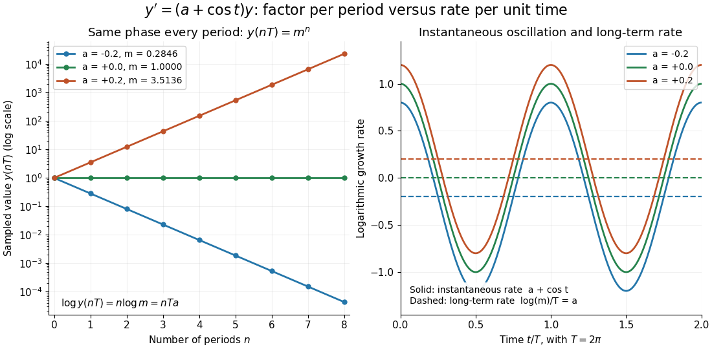

# Differential equation

↑ **Parent:** [Analysis](analysis.md)  
ⓦ [Wiki](https://en.wikipedia.org/wiki/Differential_equation)

A [differential equation](differential-equation.md) is an equation relating an unknown [function](function.md) to its [derivatives](calculus.md#derivative). It specifies how change depends on the present state, and sometimes on the independent variables themselves. A [solution of a differential equation](#solution-of-a-differential-equation) is a [function](function.md) satisfying that relation throughout a stated domain; giving a formula without its domain can conceal a point where the equation is undefined.

The central idea is to turn a local law into a whole trajectory. For example, $y'=ry$, with constant $r$, says that the instantaneous [derivative](calculus.md#derivative) is proportional to the current value. If $y(0)=100$ and $r=0.2$ per day, the [solution of a differential equation](#solution-of-a-differential-equation) is $y(t)=100e^{0.2t}$, so $y(5)=100e\approx271.83$. This is an ideal growth model assuming a constant proportional rate; the [exponential function](calculus.md#exponential-function) emerges from repeatedly applying the same local rule. Changing the sign of $r$ gives [exponential decay](analysis.md#exponential-decay).

An [ordinary differential equation](#ordinary-differential-equation) uses one independent variable. A [partial differential equation](partial-differential-equation.md) can involve several, such as space and time, and uses [partial derivatives](multivariable-calculus.md#partial-derivative). Additional information selects a particular [solution of a differential equation](#solution-of-a-differential-equation): an [initial condition](#initial-condition) describes a starting state, whereas a [boundary condition](#boundary-condition) imposes constraints at the edge of a domain. The useful questions extend beyond finding a formula: does a [solution of a differential equation](#solution-of-a-differential-equation) exist, is it unique, and what happens to it over time?

**Table of contents**

- [Orthogonal trajectory](#orthogonal-trajectory)
- [Stationary solution](#stationary-solution)
- [Direction field](#direction-field)
- [Isocline](#isocline)
- [Jump condition](#jump-condition)
- [Delay differential equation](#delay-differential-equation)
  - [Retarded delay differential equation](#retarded-delay-differential-equation)
    - [History function of a delay differential equation](#history-function-of-a-delay-differential-equation)
    - [Exact polynomial steps for a delay equation](#exact-polynomial-steps-for-a-delay-equation)
- [Solution of a differential equation](#solution-of-a-differential-equation)
- [Ordinary differential equation](#ordinary-differential-equation)
  - [Equilibrium solution of an ordinary differential equation](#equilibrium-solution-of-an-ordinary-differential-equation)
  - [First-order ordinary differential equation](#first-order-ordinary-differential-equation)
    - [Slope substitution for equations involving x y'-y](#slope-substitution-for-equations-involving-x-y-y)
  - [Inverse-function linearization of a first-order equation](#inverse-function-linearization-of-a-first-order-equation)
  - [Clairaut's equation](#clairaut-s-equation)
  - [Homogeneous first-order differential equation](#homogeneous-first-order-differential-equation)
    - [Endpoint obstruction in a homogeneous differential equation](#endpoint-obstruction-in-a-homogeneous-differential-equation)
    - [Slope parameter for a homogeneous first-order equation](#slope-parameter-for-a-homogeneous-first-order-equation)
  - [First integral of an ordinary differential equation](#first-integral-of-an-ordinary-differential-equation)
  - [Second-order differential equation](#second-order-differential-equation)
  - [Painlevé equation](#painleve-equation)
    - [Painlevé II equation](#painleve-ii-equation)
    - [Painlevé transcendent](#painleve-transcendent)
  - [Complex ordinary differential equation](#complex-ordinary-differential-equation)
    - [Painlevé property](#painleve-property)
    - [Painlevé determinateness theorem](#painleve-determinateness-theorem)
    - [Movable singularity of a complex differential equation](#movable-singularity-of-a-complex-differential-equation)
    - [Fixed singularity of a complex differential equation](#fixed-singularity-of-a-complex-differential-equation)
    - [Holomorphic dependence of ordinary differential equations on parameters](#holomorphic-dependence-of-ordinary-differential-equations-on-parameters)
  - [Periodic solution](#periodic-solution)
  - [Variational equation](#variational-equation)
  - [Osgood uniqueness criterion](#osgood-uniqueness-criterion)
  - [Distributional regularity of a constant-coefficient ordinary differential equation](#distributional-regularity-of-a-constant-coefficient-ordinary-differential-equation)
    - [Coordinate-degenerate constant-coefficient differential equation](#coordinate-degenerate-constant-coefficient-differential-equation)
    - [Exponential polynomial solution of a constant-coefficient differential equation](#exponential-polynomial-solution-of-a-constant-coefficient-differential-equation)
  - [Implicit solution](#implicit-solution)
  - [Exact first-order ordinary differential equation](#exact-first-order-ordinary-differential-equation)
  - [Continuous dependence of an ODE solution on parameters](#continuous-dependence-of-an-ode-solution-on-parameters)
  - [Exponential relaxation time](#exponential-relaxation-time)
  - [Initial value problem](#initial-value-problem)
    - [Implicit factorization can reveal nonunique initial solutions](#implicit-factorization-can-reveal-nonunique-initial-solutions)
    - [L2 initial condition](#l2-initial-condition)
  - [Degenerate ordinary differential equation](#degenerate-ordinary-differential-equation)
    - [Continuation through a zero of the leading ODE coefficient](#continuation-through-a-zero-of-the-leading-ode-coefficient)
  - [Compact support solvability for a constant-coefficient ordinary differential equation](#compact-support-solvability-for-a-constant-coefficient-ordinary-differential-equation)
  - [Singular point of a differential equation](#singular-point-of-a-differential-equation)
  - [Dissipative vector field](#dissipative-vector-field)
  - [Peano existence theorem](#peano-existence-theorem)
    - [Delayed solutions of a square-root differential equation](#delayed-solutions-of-a-square-root-differential-equation)
      - [Sticking solutions of a bounded square-root differential equation](#sticking-solutions-of-a-bounded-square-root-differential-equation)
  - [Separable differential equation](#separable-differential-equation)
    - [Product substitution for a first-order equation](#product-substitution-for-a-first-order-equation)
    - [Cubic logistic differential equation](#cubic-logistic-differential-equation)
  - [Nonlinear ordinary differential equation](#nonlinear-ordinary-differential-equation)
    - [Ermakov-Pinney equation](#ermakov-pinney-equation)
      - [Exact amplitude-phase equation](#exact-amplitude-phase-equation)
    - [Position-dependent damping](#position-dependent-damping)
    - [Logistic differential equation](#logistic-differential-equation)
      - [Euler discretization of logistic growth](#euler-discretization-of-logistic-growth)
  - [Picard-Lindelöf theorem](#picard-lindelof-theorem)
    - [Picard iteration](#picard-iteration)
    - [Finite-dimensional continuation criterion](#finite-dimensional-continuation-criterion)
    - [Bielecki norm method](#bielecki-norm-method)
  - [Finite-time blowup](#finite-time-blowup)
  - [Linear differential equation](#linear-differential-equation)
    - [Fuchsian linear differential system](#fuchsian-linear-differential-system)
      - [Analytic solution at a maximal integer Fuchsian exponent](#analytic-solution-at-a-maximal-integer-fuchsian-exponent)
      - [Residue and monodromy of a constant Fuchsian system](#residue-and-monodromy-of-a-constant-fuchsian-system)
    - [Fundamental matrix of a linear differential equation](#fundamental-matrix-of-a-linear-differential-equation)
      - [Gauge transformation of a linear differential system](#gauge-transformation-of-a-linear-differential-system)
        - [Formal cubic-exponential two-by-two system](#formal-cubic-exponential-two-by-two-system)
      - [Liouville formula for a fundamental matrix](#liouville-formula-for-a-fundamental-matrix)
    - [Floquet theory](#floquet-theory)
      - [Floquet exponent](#floquet-exponent)
      - [Floquet growth rate](#floquet-growth-rate)
      - [Monodromy matrix of a periodic linear system](#monodromy-matrix-of-a-periodic-linear-system)
    - [Characteristic root of a constant-coefficient differential equation](#characteristic-root-of-a-constant-coefficient-differential-equation)
    - [Laplace contour-integral method for a linear differential equation](#laplace-contour-integral-method-for-a-linear-differential-equation)
    - [Homogeneous linear differential equation](#homogeneous-linear-differential-equation)
      - [Solution space of a homogeneous linear differential equation](#solution-space-of-a-homogeneous-linear-differential-equation)
    - [Linearized equation](#linearized-equation)
    - [Inhomogeneous linear differential equation](#inhomogeneous-linear-differential-equation)
      - [Forcing term](#forcing-term)
  - [Local existence for a scalar autonomous ordinary differential equation with continuous vector field](#local-existence-for-a-scalar-autonomous-ordinary-differential-equation-with-continuous-vector-field)
  - [Singular perturbation](singular-perturbation.md)
    - [Beyond-all-orders boundary-value sensitivity](singular-perturbation.md#beyond-all-orders-boundary-value-sensitivity)
    - [Adiabatic elimination](singular-perturbation.md#adiabatic-elimination)
    - [Matched asymptotic expansion](singular-perturbation.md#matched-asymptotic-expansion)
      - [Endpoint derivative in a negative-drift boundary layer](singular-perturbation.md#endpoint-derivative-in-a-negative-drift-boundary-layer)
      - [Logistic crossover in a weakly nonlinear Euler equation](singular-perturbation.md#logistic-crossover-in-a-weakly-nonlinear-euler-equation)
        - [Nonlinear crossover delayed by a small unstable-mode coefficient](singular-perturbation.md#nonlinear-crossover-delayed-by-a-small-unstable-mode-coefficient)
      - [Nonlinear endpoint layer with a quadratic reaction](singular-perturbation.md#nonlinear-endpoint-layer-with-a-quadratic-reaction)
        - [One-third-power scaling at a nonlinear turning endpoint](singular-perturbation.md#one-third-power-scaling-at-a-nonlinear-turning-endpoint)
      - [Asymptotic matching condition](singular-perturbation.md#asymptotic-matching-condition)
      - [Square-root reaction problem with nested boundary layers](singular-perturbation.md#square-root-reaction-problem-with-nested-boundary-layers)
        - [First integral of a square-root reaction layer](singular-perturbation.md#first-integral-of-a-square-root-reaction-layer)
      - [Nested layers at an essential singular endpoint](singular-perturbation.md#nested-layers-at-an-essential-singular-endpoint)
      - [Matched expansion with square-root and logarithmic corrections](singular-perturbation.md#matched-expansion-with-square-root-and-logarithmic-corrections)
      - [Logarithmic matching in a small-exponent boundary layer](singular-perturbation.md#logarithmic-matching-in-a-small-exponent-boundary-layer)
      - [Gaussian interior layer of a conservative drift equation](singular-perturbation.md#gaussian-interior-layer-of-a-conservative-drift-equation)
      - [Oscillatory endpoint with a quadratically vanishing drift](singular-perturbation.md#oscillatory-endpoint-with-a-quadratically-vanishing-drift)
      - [First-order composite expansion for a positive drift](singular-perturbation.md#first-order-composite-expansion-for-a-positive-drift)
      - [Logarithmically enhanced nonlinear boundary layer](singular-perturbation.md#logarithmically-enhanced-nonlinear-boundary-layer)
      - [Boundary layer around a moving endpoint](singular-perturbation.md#boundary-layer-around-a-moving-endpoint)
      - [Square-root boundary layer at a vanishing drift](singular-perturbation.md#square-root-boundary-layer-at-a-vanishing-drift)
        - [Error-function logarithmic switchback](singular-perturbation.md#error-function-logarithmic-switchback)
      - [Overlap region](singular-perturbation.md#overlap-region)
      - [Intermediate asymptotic region](singular-perturbation.md#intermediate-asymptotic-region)
      - [Interior layer at a simple zero of advection](singular-perturbation.md#interior-layer-at-a-simple-zero-of-advection)
        - [Endpoint layers for reversed diffusion](singular-perturbation.md#endpoint-layers-for-reversed-diffusion)
      - [Distinguished limit](singular-perturbation.md#distinguished-limit)
      - [Inner expansion](singular-perturbation.md#inner-expansion)
        - [Square-root-degenerate endpoint layer](singular-perturbation.md#square-root-degenerate-endpoint-layer)
        - [Inner variable](singular-perturbation.md#inner-variable)
      - [Outer expansion](singular-perturbation.md#outer-expansion)
      - [Additive composite expansion](singular-perturbation.md#additive-composite-expansion)
      - [Multiplicative composite expansion](singular-perturbation.md#multiplicative-composite-expansion)
      - [Outflow boundary layer](singular-perturbation.md#outflow-boundary-layer)
      - [Switchback term](singular-perturbation.md#switchback-term)
        - [Logarithmic overlap creates a switchback term](singular-perturbation.md#logarithmic-overlap-creates-a-switchback-term)
    - [Method of multiple scales](singular-perturbation.md#method-of-multiple-scales)
      - [Slow oscillator damping by a relaxing auxiliary variable](singular-perturbation.md#slow-oscillator-damping-by-a-relaxing-auxiliary-variable)
      - [Averaged oscillator damping by a power of velocity](singular-perturbation.md#averaged-oscillator-damping-by-a-power-of-velocity)
      - [Second-order resonance from quadratic oscillator coupling](singular-perturbation.md#second-order-resonance-from-quadratic-oscillator-coupling)
      - [Averaged amplitude for position-dependent damping](singular-perturbation.md#averaged-amplitude-for-position-dependent-damping)
        - [Absolute-value damping amplitude law](singular-perturbation.md#absolute-value-damping-amplitude-law)
        - [Van der Pol amplitude evolution](singular-perturbation.md#van-der-pol-amplitude-evolution)
          - [Shifted Van der Pol amplitude evolution](singular-perturbation.md#shifted-van-der-pol-amplitude-evolution)
        - [Odd position-dependent damping has zero first-order amplitude drift](singular-perturbation.md#odd-position-dependent-damping-has-zero-first-order-amplitude-drift)
      - [Secular term](singular-perturbation.md#secular-term)
      - [Whitham modulation theory](singular-perturbation.md#whitham-modulation-theory)
        - [Averaged Lagrangian](singular-perturbation.md#averaged-lagrangian)
          - [Modulated-wave first integral](singular-perturbation.md#modulated-wave-first-integral)
          - [Whitham modulation equation](singular-perturbation.md#whitham-modulation-equation)
            - [Wave-action density](singular-perturbation.md#wave-action-density)
              - [Wave-action conservation law](singular-perturbation.md#wave-action-conservation-law)
      - [Amplitude-phase equations for a weakly perturbed oscillator](singular-perturbation.md#amplitude-phase-equations-for-a-weakly-perturbed-oscillator)
        - [Oscillator coupled to slow damping feedback](singular-perturbation.md#oscillator-coupled-to-slow-damping-feedback)
        - [Velocity-only forcing in averaged oscillator equations](singular-perturbation.md#velocity-only-forcing-in-averaged-oscillator-equations)
          - [Quadratically damped oscillator](singular-perturbation.md#quadratically-damped-oscillator)
          - [Cubic velocity anti-damping](singular-perturbation.md#cubic-velocity-anti-damping)
        - [Conservative forcing in averaged oscillator equations](singular-perturbation.md#conservative-forcing-in-averaged-oscillator-equations)
      - [Slow time](singular-perturbation.md#slow-time)
      - [Weakly nonlinear expansion](singular-perturbation.md#weakly-nonlinear-expansion)
        - [Quadratic wave interaction](singular-perturbation.md#quadratic-wave-interaction)
          - [Resonant three-wave triad](singular-perturbation.md#resonant-three-wave-triad)
          - [Detuning of a wave resonance](singular-perturbation.md#detuning-of-a-wave-resonance)
          - [Phase matching for a quadratic wave interaction](singular-perturbation.md#phase-matching-for-a-quadratic-wave-interaction)
            - [Two-to-one resonance of dispersive waves](singular-perturbation.md#two-to-one-resonance-of-dispersive-waves)
              - [Explosive two-to-one amplitude system](singular-perturbation.md#explosive-two-to-one-amplitude-system)
      - [Harmonic balance](singular-perturbation.md#harmonic-balance)
      - [Solvability condition in the method of multiple scales](singular-perturbation.md#solvability-condition-in-the-method-of-multiple-scales)
      - [Parametric resonance](singular-perturbation.md#parametric-resonance)
        - [Primary instability tongue of a weak Mathieu oscillator](singular-perturbation.md#primary-instability-tongue-of-a-weak-mathieu-oscillator)
        - [Primary parametric resonance of a two-to-one oscillator pair](singular-perturbation.md#primary-parametric-resonance-of-a-two-to-one-oscillator-pair)
        - [Second instability tongue of a weak Mathieu oscillator](singular-perturbation.md#second-instability-tongue-of-a-weak-mathieu-oscillator)
          - [Slow amplitudes for the second Mathieu instability tongue](singular-perturbation.md#slow-amplitudes-for-the-second-mathieu-instability-tongue)
          - [Fourth-order edges of the second Mathieu instability tongue](singular-perturbation.md#fourth-order-edges-of-the-second-mathieu-instability-tongue)
  - [Lie point symmetry of an ordinary differential equation](#lie-point-symmetry-of-an-ordinary-differential-equation)
    - [Prolongation of a vector field](#prolongation-of-a-vector-field)
      - [First prolongation](#first-prolongation)
      - [Jet space of a scalar ordinary differential equation](#jet-space-of-a-scalar-ordinary-differential-equation)
        - [Solution manifold](#solution-manifold)
      - [Lie-symmetry determining equation for a first-order ordinary differential equation](#lie-symmetry-determining-equation-for-a-first-order-ordinary-differential-equation)
      - [Second prolongation of the rotation generator for plane graphs](#second-prolongation-of-the-rotation-generator-for-plane-graphs)
      - [Total derivative operator](#total-derivative-operator)
      - [Schwarzian derivative](#schwarzian-derivative)
        - [Prolongations of the projective vector fields on the line](#prolongations-of-the-projective-vector-fields-on-the-line)
        - [Projective transformation weights of the Schwarzian derivative](#projective-transformation-weights-of-the-schwarzian-derivative)
      - [Affine-scaling symmetry of u double prime equals u prime squared over u minus u squared](#affine-scaling-symmetry-of-u-double-prime-equals-u-prime-squared-over-u-minus-u-squared)
  - [Boundary value problem](boundary-value-problem.md)
    - [Neumann boundary-value problem](boundary-value-problem.md#neumann-boundary-value-problem)
      - [Uniqueness of the Neumann problem](boundary-value-problem.md#uniqueness-of-the-neumann-problem)
    - [Boundary trace of a function](boundary-value-problem.md#boundary-trace-of-a-function)
    - [Oblique derivative boundary condition](boundary-value-problem.md#oblique-derivative-boundary-condition)
      - [Corner compatibility for collinear oblique derivative data](boundary-value-problem.md#corner-compatibility-for-collinear-oblique-derivative-data)
      - [Rational-angle oblique derivative problem on a quadrant](boundary-value-problem.md#rational-angle-oblique-derivative-problem-on-a-quadrant)
        - [Quarter-plane oblique boundary spectral functions](boundary-value-problem.md#quarter-plane-oblique-boundary-spectral-functions)
          - [Single-function spectral elimination for a rational-angle quadrant](boundary-value-problem.md#single-function-spectral-elimination-for-a-rational-angle-quadrant)
        - [Homogeneous corner ambiguity in a quadrant Laplace problem](boundary-value-problem.md#homogeneous-corner-ambiguity-in-a-quadrant-laplace-problem)
    - [Dirichlet-to-Neumann map](boundary-value-problem.md#dirichlet-to-neumann-map)
      - [Semistrip Dirichlet-to-Neumann sine transforms](boundary-value-problem.md#semistrip-dirichlet-to-neumann-sine-transforms)
    - [Riemann-Hilbert problem](boundary-value-problem.md#riemann-hilbert-problem)
      - [Sectorial half-line mKdV Riemann-Hilbert reconstruction](boundary-value-problem.md#sectorial-half-line-mkdv-riemann-hilbert-reconstruction)
      - [Half-line NLS Riemann-Hilbert reconstruction](boundary-value-problem.md#half-line-nls-riemann-hilbert-reconstruction)
      - [Negative-index scalar Riemann-Hilbert moment conditions](boundary-value-problem.md#negative-index-scalar-riemann-hilbert-moment-conditions)
      - [Matrix NLS reconstruction from a normalized Riemann-Hilbert problem](boundary-value-problem.md#matrix-nls-reconstruction-from-a-normalized-riemann-hilbert-problem)
      - [Canonical factorization of a rational scalar Riemann-Hilbert jump](boundary-value-problem.md#canonical-factorization-of-a-rational-scalar-riemann-hilbert-jump)
    - [Wiener-Hopf method](boundary-value-problem.md#wiener-hopf-method)
      - [Mixed Dirichlet-Neumann half-plane diffraction](boundary-value-problem.md#mixed-dirichlet-neumann-half-plane-diffraction)
      - [Wiener-Hopf factorization](boundary-value-problem.md#wiener-hopf-factorization)
      - [Wiener-Hopf equation](boundary-value-problem.md#wiener-hopf-equation)
        - [Wiener-Hopf kernel](boundary-value-problem.md#wiener-hopf-kernel)
        - [Pole subtraction in a Wiener-Hopf equation](boundary-value-problem.md#pole-subtraction-in-a-wiener-hopf-equation)
    - [Fokas method](boundary-value-problem.md#fokas-method)
      - [Two-trace half-line cubic dispersion representation](boundary-value-problem.md#two-trace-half-line-cubic-dispersion-representation)
      - [Boundary spectral representation of a holomorphic function on a semistrip](boundary-value-problem.md#boundary-spectral-representation-of-a-holomorphic-function-on-a-semistrip)
      - [Quadrant modified Helmholtz spectral reconstruction](boundary-value-problem.md#quadrant-modified-helmholtz-spectral-reconstruction)
      - [Neumann spectral formula for half-line constant drift](boundary-value-problem.md#neumann-spectral-formula-for-half-line-constant-drift)
      - [Dirichlet spectral formula for half-line constant drift](boundary-value-problem.md#dirichlet-spectral-formula-for-half-line-constant-drift)
      - [Local relation](boundary-value-problem.md#local-relation)
      - [Dispersion symmetry elimination of a boundary trace](boundary-value-problem.md#dispersion-symmetry-elimination-of-a-boundary-trace)
        - [Cubic-dispersion elimination of one missing boundary trace](boundary-value-problem.md#cubic-dispersion-elimination-of-one-missing-boundary-trace)
        - [Cubic Stokes dispersion symmetry](boundary-value-problem.md#cubic-stokes-dispersion-symmetry)
      - [Upper-quadrant cancellation of reflected boundary transforms](boundary-value-problem.md#upper-quadrant-cancellation-of-reflected-boundary-transforms)
    - [Global relation for a linear boundary value problem](boundary-value-problem.md#global-relation-for-a-linear-boundary-value-problem)
      - [Dirichlet spectral formula for Airy flow with negative transport](boundary-value-problem.md#dirichlet-spectral-formula-for-airy-flow-with-negative-transport)
      - [Finite-interval Airy global relation](boundary-value-problem.md#finite-interval-airy-global-relation)
        - [Finite-interval Airy spectral determinant](boundary-value-problem.md#finite-interval-airy-spectral-determinant)
      - [Semistrip Laplace spectral global relation](boundary-value-problem.md#semistrip-laplace-spectral-global-relation)
      - [Drift-diffusion half-line global relation](boundary-value-problem.md#drift-diffusion-half-line-global-relation)
      - [Half-line linear dispersive Stokes global relation](boundary-value-problem.md#half-line-linear-dispersive-stokes-global-relation)
        - [Dirichlet spectral representation for the linear dispersive Stokes equation](boundary-value-problem.md#dirichlet-spectral-representation-for-the-linear-dispersive-stokes-equation)
      - [Half-line Schrodinger boundary-trace elimination](boundary-value-problem.md#half-line-schrodinger-boundary-trace-elimination)
      - [Finite-time spectral boundary transform](boundary-value-problem.md#finite-time-spectral-boundary-transform)
        - [Finite-horizon extension of a boundary transform](boundary-value-problem.md#finite-horizon-extension-of-a-boundary-transform)
      - [Polygonal modified Helmholtz global relation](boundary-value-problem.md#polygonal-modified-helmholtz-global-relation)
        - [Dirichlet reconstruction in an equilateral triangle](boundary-value-problem.md#dirichlet-reconstruction-in-an-equilateral-triangle)
      - [Half-line drift global relation](boundary-value-problem.md#half-line-drift-global-relation)
        - [Exponential-decay contour for half-line drift diffusion](boundary-value-problem.md#exponential-decay-contour-for-half-line-drift-diffusion)
      - [Collocation points for a global relation](boundary-value-problem.md#collocation-points-for-a-global-relation)
      - [Conjugate global relations for the modified Helmholtz equation](boundary-value-problem.md#conjugate-global-relations-for-the-modified-helmholtz-equation)
        - [Rotationally invariant Neumann reconstruction in an equilateral triangle](boundary-value-problem.md#rotationally-invariant-neumann-reconstruction-in-an-equilateral-triangle)
        - [Sine collocation of square modified Helmholtz global relations](boundary-value-problem.md#sine-collocation-of-square-modified-helmholtz-global-relations)
          - [Square modified Helmholtz Dirichlet-to-Neumann coefficients](boundary-value-problem.md#square-modified-helmholtz-dirichlet-to-neumann-coefficients)
          - [Diagonal dominance of paired square global-relation collocation](boundary-value-problem.md#diagonal-dominance-of-paired-square-global-relation-collocation)
    - [Spectral parameter for a linear boundary value problem](boundary-value-problem.md#spectral-parameter-for-a-linear-boundary-value-problem)
    - [Boundary lifting](boundary-value-problem.md#boundary-lifting)
      - [Uniform half-line Schrodinger representation by boundary lifting](boundary-value-problem.md#uniform-half-line-schrodinger-representation-by-boundary-lifting)
  - [Boundary condition](#boundary-condition)
    - [Dynamic boundary condition for the heat equation](#dynamic-boundary-condition-for-the-heat-equation)
      - [Dirichlet energy dissipation with a dynamic heat boundary condition](#dirichlet-energy-dissipation-with-a-dynamic-heat-boundary-condition)
      - [Repeated-root dynamic-boundary heat kernel](#repeated-root-dynamic-boundary-heat-kernel)
        - [Repeated-root unstable heat boundary mode](#repeated-root-unstable-heat-boundary-mode)
    - [Clamped boundary condition](#clamped-boundary-condition)
    - [Periodic boundary conditions](#periodic-boundary-conditions)
      - [Twisted boundary condition](#twisted-boundary-condition)
        - [Antiperiodic boundary condition](#antiperiodic-boundary-condition)
    - [Vanishing boundary condition](#vanishing-boundary-condition)
    - [Initial condition](#initial-condition)
      - [Initial velocity](#initial-velocity)
      - [Initial displacement](#initial-displacement)
    - [Dirichlet boundary condition](#dirichlet-boundary-condition)
      - [Initial corner compatibility for a Dirichlet heat problem](#initial-corner-compatibility-for-a-dirichlet-heat-problem)
      - [Dirichlet boundary data](#dirichlet-boundary-data)
      - [Perfectly conducting thermal boundary condition](#perfectly-conducting-thermal-boundary-condition)
    - [Neumann boundary condition](#neumann-boundary-condition)
      - [Neumann boundary data](#neumann-boundary-data)
      - [Initial incompatibility with a Neumann boundary condition](#initial-incompatibility-with-a-neumann-boundary-condition)
      - [Neumann eigenfunction](#neumann-eigenfunction)
    - [Tangential boundary derivative](#tangential-boundary-derivative)
    - [Robin boundary condition](#robin-boundary-condition)
      - [Poisson uniqueness with a nonnegative Robin normal coefficient](#poisson-uniqueness-with-a-nonnegative-robin-normal-coefficient)
      - [Symmetric Robin strip transform](#symmetric-robin-strip-transform)
        - [Solvability of a decaying Robin strip](#solvability-of-a-decaying-robin-strip)
      - [Weak Robin problem for a uniformly elliptic operator](#weak-robin-problem-for-a-uniformly-elliptic-operator)
    - [Mixed boundary condition](#mixed-boundary-condition)
    - [Far-field boundary condition](#far-field-boundary-condition)
  - [Sign-decay differential equation](#sign-decay-differential-equation)
    - [Explicit Euler method for the sign-decay equation](#explicit-euler-method-for-the-sign-decay-equation)
  - [Parameter sensitivity equation](#parameter-sensitivity-equation)
  - [Differential inequality](#differential-inequality)
  - [Bernoulli differential equation](#bernoulli-differential-equation)
    - [Bernoulli power substitution](#bernoulli-power-substitution)
    - [Reciprocal Bernoulli equation with finite-time blowup](#reciprocal-bernoulli-equation-with-finite-time-blowup)
    - [Finite-time extinction in a sublinear Bernoulli equation](#finite-time-extinction-in-a-sublinear-bernoulli-equation)
  - [Tangent addition functional equation](#tangent-addition-functional-equation)
  - [Linear ordinary differential equation](linear-ordinary-differential-equation.md)
    - [Exponential forcing response with zero initial data](linear-ordinary-differential-equation.md#exponential-forcing-response-with-zero-initial-data)
    - [Product-derivative reduction of a second-order differential equation](linear-ordinary-differential-equation.md#product-derivative-reduction-of-a-second-order-differential-equation)
    - [Characteristic equation of a constant-coefficient differential equation](linear-ordinary-differential-equation.md#characteristic-equation-of-a-constant-coefficient-differential-equation)
    - [Method of undetermined coefficients](linear-ordinary-differential-equation.md#method-of-undetermined-coefficients)
      - [Resonant exponential particular solution](linear-ordinary-differential-equation.md#resonant-exponential-particular-solution)
    - [Weighted energy estimate for two coupled modes](linear-ordinary-differential-equation.md#weighted-energy-estimate-for-two-coupled-modes)
    - [Newton's law of cooling](linear-ordinary-differential-equation.md#newton-s-law-of-cooling)
      - [Impulse versus finite-duration cooling](linear-ordinary-differential-equation.md#impulse-versus-finite-duration-cooling)
      - [Cumulative thermal destruction under exponential warming and cooling](linear-ordinary-differential-equation.md#cumulative-thermal-destruction-under-exponential-warming-and-cooling)
      - [Newton cooling with an instantaneous temperature jump](linear-ordinary-differential-equation.md#newton-cooling-with-an-instantaneous-temperature-jump)
      - [Heat transfer coefficient](linear-ordinary-differential-equation.md#heat-transfer-coefficient)
    - [Homogeneous solution](linear-ordinary-differential-equation.md#homogeneous-solution)
    - [Particular solution](linear-ordinary-differential-equation.md#particular-solution)
    - [General solution](linear-ordinary-differential-equation.md#general-solution)
    - [Dominant eigenmode in a forced linear system](linear-ordinary-differential-equation.md#dominant-eigenmode-in-a-forced-linear-system)
    - [Second-order linear differential equation](linear-ordinary-differential-equation.md#second-order-linear-differential-equation)
      - [Laguerre differential equation](linear-ordinary-differential-equation.md#laguerre-differential-equation)
        - [Frobenius series for the Laguerre differential equation](linear-ordinary-differential-equation.md#frobenius-series-for-the-laguerre-differential-equation)
      - [Quadratic-variable reduction of a singular oscillator](linear-ordinary-differential-equation.md#quadratic-variable-reduction-of-a-singular-oscillator)
      - [Repeated-root constant-coefficient differential equation](linear-ordinary-differential-equation.md#repeated-root-constant-coefficient-differential-equation)
      - [Singular point of a second-order linear ODE](linear-ordinary-differential-equation.md#singular-point-of-a-second-order-linear-ode)
      - [Reciprocal-coordinate reduction of a beam-type equation](linear-ordinary-differential-equation.md#reciprocal-coordinate-reduction-of-a-beam-type-equation)
      - [Liouville transformation of a second-order equation](linear-ordinary-differential-equation.md#liouville-transformation-of-a-second-order-equation)
      - [Power substitution for an oscillatory second-order equation](linear-ordinary-differential-equation.md#power-substitution-for-an-oscillatory-second-order-equation)
      - [Mathieu equation](linear-ordinary-differential-equation.md#mathieu-equation)
        - [Mathieu characteristic value](linear-ordinary-differential-equation.md#mathieu-characteristic-value)
      - [Airy ordinary differential equation](linear-ordinary-differential-equation.md#airy-ordinary-differential-equation)
        - [Forced Airy boundary-value problem](linear-ordinary-differential-equation.md#forced-airy-boundary-value-problem)
        - [Airy power-series fundamental pair](linear-ordinary-differential-equation.md#airy-power-series-fundamental-pair)
        - [Airy function](linear-ordinary-differential-equation.md#airy-function)
          - [Airy displacement integral](linear-ordinary-differential-equation.md#airy-displacement-integral)
      - [Elimination of the first derivative](linear-ordinary-differential-equation.md#elimination-of-the-first-derivative)
      - [Sturm-Picone comparison theorem](linear-ordinary-differential-equation.md#sturm-picone-comparison-theorem)
        - [Sturm comparison theorem](linear-ordinary-differential-equation.md#sturm-comparison-theorem)
          - [Wronskian proof of Sturm comparison](linear-ordinary-differential-equation.md#wronskian-proof-of-sturm-comparison)
      - [Power-series solution of a differential equation](linear-ordinary-differential-equation.md#power-series-solution-of-a-differential-equation)
      - [Kummer differential equation](linear-ordinary-differential-equation.md#kummer-differential-equation)
        - [Exponential reduction of a confluent hypergeometric equation with equal parameters](linear-ordinary-differential-equation.md#exponential-reduction-of-a-confluent-hypergeometric-equation-with-equal-parameters)
        - [Confluent hypergeometric function](linear-ordinary-differential-equation.md#confluent-hypergeometric-function)
          - [Confluent hypergeometric function of the first kind](linear-ordinary-differential-equation.md#confluent-hypergeometric-function-of-the-first-kind)
      - [Wronskian](linear-ordinary-differential-equation.md#wronskian)
        - [Abel's identity](linear-ordinary-differential-equation.md#abel-s-identity)
      - [Variation of parameters](linear-ordinary-differential-equation.md#variation-of-parameters)
      - [Reduction of order](linear-ordinary-differential-equation.md#reduction-of-order)
        - [First correction to a regular singular solution by reduction of order](linear-ordinary-differential-equation.md#first-correction-to-a-regular-singular-solution-by-reduction-of-order)
        - [Reduction of order across a zero of the known solution](linear-ordinary-differential-equation.md#reduction-of-order-across-a-zero-of-the-known-solution)
      - [Cauchy-Euler equation](linear-ordinary-differential-equation.md#cauchy-euler-equation)
        - [Logarithmic change of variable in a Sturm-Liouville problem](linear-ordinary-differential-equation.md#logarithmic-change-of-variable-in-a-sturm-liouville-problem)
          - [Dirichlet spectrum with inverse-square weight](linear-ordinary-differential-equation.md#dirichlet-spectrum-with-inverse-square-weight)
          - [Constant forcing in a logarithmic Dirichlet Sturm-Liouville problem](linear-ordinary-differential-equation.md#constant-forcing-in-a-logarithmic-dirichlet-sturm-liouville-problem)
        - [Euler-Cauchy classification from two regular singular points](linear-ordinary-differential-equation.md#euler-cauchy-classification-from-two-regular-singular-points)
        - [Euler-Cauchy equation](linear-ordinary-differential-equation.md#euler-cauchy-equation)
        - [General solution of an Euler-Cauchy equation](linear-ordinary-differential-equation.md#general-solution-of-an-euler-cauchy-equation)
          - [Power-law ansatz](linear-ordinary-differential-equation.md#power-law-ansatz)
            - [Indicial equation](linear-ordinary-differential-equation.md#indicial-equation)
              - [Indicial root](linear-ordinary-differential-equation.md#indicial-root)
              - [Indicial exponent](linear-ordinary-differential-equation.md#indicial-exponent)
            - [Log-periodic oscillation](linear-ordinary-differential-equation.md#log-periodic-oscillation)
      - [Legendre differential equation](linear-ordinary-differential-equation.md#legendre-differential-equation)
        - [Frobenius recurrence for the Legendre equation](linear-ordinary-differential-equation.md#frobenius-recurrence-for-the-legendre-equation)
        - [Legendre function of the second kind](linear-ordinary-differential-equation.md#legendre-function-of-the-second-kind)
        - [Associated Legendre differential equation](linear-ordinary-differential-equation.md#associated-legendre-differential-equation)
        - [Associated Legendre function](linear-ordinary-differential-equation.md#associated-legendre-function)
        - [Legendre polynomial](linear-ordinary-differential-equation.md#legendre-polynomial)
          - [Rodrigues formula for Legendre polynomials](linear-ordinary-differential-equation.md#rodrigues-formula-for-legendre-polynomials)
          - [Weighted orthogonality of Legendre polynomial derivatives](linear-ordinary-differential-equation.md#weighted-orthogonality-of-legendre-polynomial-derivatives)
          - [Generating function and norm of Legendre polynomials](linear-ordinary-differential-equation.md#generating-function-and-norm-of-legendre-polynomials)
          - [Orthogonality of Legendre polynomials](linear-ordinary-differential-equation.md#orthogonality-of-legendre-polynomials)
          - [Legendre polynomial recurrence relation](linear-ordinary-differential-equation.md#legendre-polynomial-recurrence-relation)
          - [Schläfli contour integral for Legendre polynomials](linear-ordinary-differential-equation.md#schlafli-contour-integral-for-legendre-polynomials)
          - [Debye asymptotic for Legendre polynomials](linear-ordinary-differential-equation.md#debye-asymptotic-for-legendre-polynomials)
            - [Hyperbolic Debye asymptotic for Legendre polynomials](linear-ordinary-differential-equation.md#hyperbolic-debye-asymptotic-for-legendre-polynomials)
              - [Legendre boundary layer at x equals one](linear-ordinary-differential-equation.md#legendre-boundary-layer-at-x-equals-one)
      - [Change of independent variable in a second-order ODE](linear-ordinary-differential-equation.md#change-of-independent-variable-in-a-second-order-ode)
    - [First-order linear differential equation](linear-ordinary-differential-equation.md#first-order-linear-differential-equation)
      - [Finite-pulse response of a first-order linear equation](linear-ordinary-differential-equation.md#finite-pulse-response-of-a-first-order-linear-equation)
      - [Causal response of a first-order relaxation equation](linear-ordinary-differential-equation.md#causal-response-of-a-first-order-relaxation-equation)
      - [Resonant exponential forcing in a first-order equation](linear-ordinary-differential-equation.md#resonant-exponential-forcing-in-a-first-order-equation)
    - [Integrating factor](linear-ordinary-differential-equation.md#integrating-factor)
      - [Heaviside forcing in a first-order integrating-factor equation](linear-ordinary-differential-equation.md#heaviside-forcing-in-a-first-order-integrating-factor-equation)
      - [Integrating factor for a differential one-form](linear-ordinary-differential-equation.md#integrating-factor-for-a-differential-one-form)
        - [Integrating factor depending on one coordinate](linear-ordinary-differential-equation.md#integrating-factor-depending-on-one-coordinate)
        - [Monomial integrating factor](linear-ordinary-differential-equation.md#monomial-integrating-factor)
      - [Bounded solution selected by a terminal condition](linear-ordinary-differential-equation.md#bounded-solution-selected-by-a-terminal-condition)
    - [Resonance in a differential equation](linear-ordinary-differential-equation.md#resonance-in-a-differential-equation)
      - [Resonance condition](linear-ordinary-differential-equation.md#resonance-condition)
      - [Resonant forcing](linear-ordinary-differential-equation.md#resonant-forcing)
    - [Linear system of differential equations](linear-ordinary-differential-equation.md#linear-system-of-differential-equations)
      - [Exponential forcing of a constant-coefficient differential system](linear-ordinary-differential-equation.md#exponential-forcing-of-a-constant-coefficient-differential-system)
      - [Cauchy-Euler differential system](linear-ordinary-differential-equation.md#cauchy-euler-differential-system)
      - [Eigenvector method for a differential equation](linear-ordinary-differential-equation.md#eigenvector-method-for-a-differential-equation)
      - [State transition matrix](linear-ordinary-differential-equation.md#state-transition-matrix)
      - [Complex form of a planar linear system](linear-ordinary-differential-equation.md#complex-form-of-a-planar-linear-system)
    - [Jump condition for an impulse](linear-ordinary-differential-equation.md#jump-condition-for-an-impulse)
      - [Impulse cancellation of a harmonic oscillator](linear-ordinary-differential-equation.md#impulse-cancellation-of-a-harmonic-oscillator)
  - [First integral](#first-integral)

## Orthogonal trajectory

↑ **Parent:** [Differential equation](differential-equation.md)  
ⓦ [Wiki](https://en.wikipedia.org/wiki/Orthogonal_trajectory)

An orthogonal trajectory intersects every regular member of a specified family of plane curves at a right angle. If eliminating the family parameter gives its tangent slope $dy/dx=F(x,y)$, the [dot product](inner-product.md#dot-product) of the two tangent directions gives the orthogonal slope $dy/dx=-1/F(x,y)$ wherever both slopes are finite and nonzero. Vertical and horizontal tangent directions are interpreted geometrically. For the family $y=cx^n$ with $n>0$, eliminating $c$ gives $F=ny/x$, and the orthogonal trajectories satisfy $x^2+ny^2=C$. For $n=2$ these are [ellipses](euclidean-geometry.md#ellipse); for $n=1$ they are [circles](topology.md#circle).

## Stationary solution

↑ **Parent:** [Differential equation](differential-equation.md)

A stationary solution of an evolution [differential equation](differential-equation.md) is independent of time. Substituting $\partial_tu=0$ leaves the spatial [boundary value problem](boundary-value-problem.md) that determines its profile. For an [ordinary differential equation](#ordinary-differential-equation) this is an [equilibrium](dynamical-systems.md#equilibrium-point-of-a-dynamical-system); for a [partial differential equation](partial-differential-equation.md) it may vary in space. A stationary profile need not have zero [flux](mathematical-physics.md#flux), although zero [flux](mathematical-physics.md#flux) is forced in a one-dimensional conserved system with reflecting endpoints.

## Direction field

↑ **Parent:** [Differential equation](differential-equation.md)

A [direction field](#direction-field) for $y'=f(t,y)$ places a short segment with slope $f(t,y)$ at each sampled point where $f$ is defined. A [function graph](function.md#graph-of-a-function) of a [solution of a differential equation](#solution-of-a-differential-equation) follows these segments: its [tangent line](calculus.md#tangent-line) has exactly the prescribed slope. Segment length is a drawing choice, rather than a speed; arrows, if used, point toward increasing $t$. An [isocline](#isocline) collects points with one common slope.

For [Newton's law of cooling](linear-ordinary-differential-equation.md#newton-s-law-of-cooling), $y'=-0.1(y-20)$ with time in minutes and [temperature](temperature.md) in degrees Celsius, the slopes at $y=80,40,20,10$ are respectively $-6,-2,0,1$ degrees Celsius per minute. Each horizontal row is an [isocline](#isocline), because this [autonomous differential equation](dynamical-systems.md#autonomous-system-mathematics) has no explicit time dependence. Above $20$ the [solutions of a differential equation](#solution-of-a-differential-equation) descend, below $20$ they rise, and $y=20$ is an [equilibrium point](dynamical-systems.md#equilibrium-point-of-a-dynamical-system).

**[Figure 1](#image-cooling-trajectories-follow-the-direction-field-toward-the-ambient-temperature). Cooling trajectories follow the direction field toward the ambient temperature**.

The highlighted [initial condition](#initial-condition) $y(0)=80$ selects one curve from the family. The picture reveals approach to the [equilibrium point](dynamical-systems.md#equilibrium-point-of-a-dynamical-system) before any algebra is done. Under the hypotheses of the [Picard-Lindelöf theorem](#picard-lindelof-theorem), distinct [function graphs](function.md#graph-of-a-function) of solutions cannot cross or even meet in the time-state plane. A [direction field](#direction-field) alone does not guarantee uniqueness: several curves can share a [tangent line](calculus.md#tangent-line) at the same point when those hypotheses fail. See the delayed-start example under [initial value problem](#initial-value-problem).

This geometric interpretation is developed in [Direction Fields, Isoclines, Integral Curves](mathematics-bibliography.md#18-03sc-differential-equations-fall-2011/direction-fields-isoclines-integral-curves).

## Isocline

↑ **Parent:** [Differential equation](differential-equation.md)

For the first-order [ordinary differential equation](#ordinary-differential-equation) $y'=f(x,y)$ defined on an [open subset](topology.md#open-set) $D$ of the plane, an [isocline](#isocline) of [slope](euclidean-geometry.md#slope) $k$ is the [level set](topology.md#level-set)

$$
\{(x,y)\in D:f(x,y)=k\}.
$$

Here $k$ is a constant. At every point of this [isocline](#isocline), the [direction field](#direction-field) prescribes a [tangent vector](tangent-vector.md) proportional to $(1,k)$ for a [solution of a differential equation](#solution-of-a-differential-equation). It does not generally prescribe the [tangent line](calculus.md#tangent-line) of the [isocline](#isocline) itself. The [level set](topology.md#level-set) can have several components or fail to be a smooth curve, and points outside $D$ are excluded.

For example, take $y'=x-y$ on the whole plane. Its [isoclines](#isocline) are the parallel [straight lines](euclidean-geometry.md#straight-line)

$$
x-y=k,\qquad y=x-k.
$$

Each [line](euclidean-geometry.md#straight-line) has [slope](euclidean-geometry.md#slope) $1$, while the [direction field](#direction-field) along it has [slope](euclidean-geometry.md#slope) $k$. Thus the [isocline](#isocline) $y=x$ carries horizontal segments even though the [line](euclidean-geometry.md#straight-line) itself rises. A [function graph](function.md#graph-of-a-function) of a [solution of a differential equation](#solution-of-a-differential-equation) follows the segments, rather than following this [line](euclidean-geometry.md#straight-line). Only the [isocline](#isocline) with $k=1$, namely $y=x-1$, is also a [solution of a differential equation](#solution-of-a-differential-equation).[pp. 1–2: constant-slope loci and the example y prime equals x minus y](mathematics-bibliography.md#18-03sc-differential-equations-fall-2011/direction-fields-isoclines-integral-curves)

**[Figure 2](#image-isoclines-label-the-prescribed-slopes-while-exact-solution-graphs-follow-the-direction-field). Isoclines label the prescribed slopes while exact solution graphs follow the direction field**.

The [first-order linear differential equation](linear-ordinary-differential-equation.md#first-order-linear-differential-equation) has the exact family

$$
y(x)=x-1+Ae^{-x},\qquad y'(x)=1-Ae^{-x}=x-y(x).
$$

The [initial condition](#initial-condition) $y(x_0)=y_0$ selects $A=(y_0-x_0+1)e^{x_0}$ and hence a unique [solution of a differential equation](#solution-of-a-differential-equation) for every real $x$. The picture shows $y(0)=-1,0,1,2$. For $A=0$ the [solution of a differential equation](#solution-of-a-differential-equation) stays on the $k=1$ [isocline](#isocline); for other $A$ it moves through different [isoclines](#isocline). These formulas check the pictured trajectories by direct [differentiation](calculus.md#differentiation), independently of how the [direction field](#direction-field) was sampled.

The zero-slope [isocline](#isocline) $f(x,y)=0$ is called a [nullcline](dynamical-systems.md#nullcline). Below the [nullcline](dynamical-systems.md#nullcline) $y=x$ in this example, $y'>0$; above it, $y'<0$. For $A>0$, the [solution of a differential equation](#solution-of-a-differential-equation) meets it at $x=\log A$, where $y'=0$ and $y''=1$, a strict [local minimum](analysis.md#local-minimum). The [nullcline](dynamical-systems.md#nullcline) is therefore a useful guide to turning points, although it is not itself a [solution of a differential equation](#solution-of-a-differential-equation). In the equivalent planar [autonomous differential equation](dynamical-systems.md#autonomous-system-mathematics) $\dot x=1$, $\dot y=x-y$, it is the [nullcline](dynamical-systems.md#nullcline) for the second component; there is no [equilibrium point](dynamical-systems.md#equilibrium-point-of-a-dynamical-system), because the first component never vanishes.

This makes [isoclines](#isocline) useful even when no explicit [solution of a differential equation](#solution-of-a-differential-equation) is available: organize a [direction field](#direction-field) by common [slopes](euclidean-geometry.md#slope), read where [function graphs](function.md#graph-of-a-function) rise or fall, and identify possible turning points on [nullclines](dynamical-systems.md#nullcline).

## Jump condition

↑ **Parent:** [Differential equation](differential-equation.md)

A jump condition relates the one-sided limits of a solution or its derivatives across a discontinuity or singular forcing. Integrating a [differential equation](differential-equation.md) across a shrinking interval containing a [Dirac delta](distribution-theory.md#dirac-delta-function) source determines the permitted jump. A [jump condition for an impulse](linear-ordinary-differential-equation.md#jump-condition-for-an-impulse) and [Rankine-Hugoniot condition](transport-equation.md#rankine-hugoniot-conditions) are specific instances with different governing equations.

## Delay differential equation

↑ **Parent:** [Differential equation](differential-equation.md)  
ⓦ [Wiki](https://en.wikipedia.org/wiki/Delay_differential_equation)

A [delay differential equation](#delay-differential-equation) relates a derivative at the current argument to values at earlier arguments. For example, the [Buchstab function](analytic-number-theory.md#buchstab-function) obeys $\frac{d}{du}(u w(u))=w(u-1)$ for $u>2$.

The defining feature is memory: a [derivative](calculus.md#derivative) can depend on earlier values of the unknown [function](function.md). Constant delays, time-dependent delays, and delays depending on the unknown [function](function.md) belong to this wider class. The [retarded delay differential equation](#retarded-delay-differential-equation) below isolates a single positive constant delay.[Skip Thompson, Delay-differential equations, opening definition and equation (1): constant and state-dependent delays](mathematics-bibliography.md#delay-differential-equations-by-skip-thompson)

The [Malthusian delay differential equation](mathematical-biology.md#malthusian-delay-differential-equation) is a simple linear member of this class. The [method of steps for a delay differential equation](mathematical-biology.md#method-of-steps-for-a-delay-differential-equation) constructs its future from a [history function of a delay differential equation](#history-function-of-a-delay-differential-equation), and the [characteristic equation of a delay differential equation](mathematical-biology.md#characteristic-equation-of-a-delay-differential-equation) studies its [exponential function](calculus.md#exponential-function) modes. The [exact polynomial steps for a delay equation](#exact-polynomial-steps-for-a-delay-equation) below make that construction explicit without approximating the [solution of a differential equation](#solution-of-a-differential-equation). Applications include [population dynamics](mathematical-biology.md#population-dynamics) and [feedback control](control-theory.md#closed-loop-control); the [delayed negative feedback model](signal-transduction.md#delayed-negative-feedback-model) and [feedback delay](control-theory.md#feedback-delay) explain why the timing of a return matters as well as its sign.

### Retarded delay differential equation

↑ **Parent:** [Delay differential equation](#delay-differential-equation)

For a single constant delay $\tau>0$, a [retarded delay differential equation](#retarded-delay-differential-equation) has the displayed form: delayed values of the unknown [function](function.md) enter, but delayed first [derivatives](calculus.md#derivative) do not. The unknown can also be a [vector](vector-space.md#vector).[Skip Thompson, Delay-differential equations, opening definition and equation (1): delayed values versus delayed derivatives](mathematics-bibliography.md#delay-differential-equations-by-skip-thompson)

Here $t$ denotes time, and the rule applies for $t>0$, with a right [derivative](calculus.md#derivative) at $0$. On $0\leq t\leq\tau$, the argument $t-\tau$ lies in the prescribed past. Once this interval is known, it supplies the delayed values for $\tau\leq t\leq2\tau$. This is the [method of steps for a delay differential equation](mathematical-biology.md#method-of-steps-for-a-delay-differential-equation): solve successive [ordinary differential equations](#ordinary-differential-equation) with a known delayed input, keeping each new endpoint as the next [initial condition](#initial-condition). For a [continuous function](calculus.md#continuous-function) $f$ locally [Lipschitz continuous](real-analysis.md#lipschitz-continuity) in its two state arguments, locally uniformly in $t$, this gives local existence and uniqueness for each continuous [history function of a delay differential equation](#history-function-of-a-delay-differential-equation), while the [solution of a differential equation](#solution-of-a-differential-equation) remains in the domain of $f$. A nonlinear rule can still produce [finite-time blowup](#finite-time-blowup).

#### History function of a delay differential equation

↑ **Parent:** [Retarded delay differential equation](#retarded-delay-differential-equation)

A [history function of a delay differential equation](#history-function-of-a-delay-differential-equation) supplies the past interval needed to start a [retarded delay differential equation](#retarded-delay-differential-equation). A single [initial condition](#initial-condition) $y(0)=\phi(0)$ generally leaves earlier delayed values unspecified.[Skip Thompson, Delay-differential equations, Initial History Function: prescribing the solution before the starting time](mathematics-bibliography.md#delay-differential-equations-by-skip-thompson)

For a [continuous function](calculus.md#continuous-function) history, the natural state at time $t$ is the entire segment

$$
y_t(\theta)=y(t+\theta),\qquad -\tau\leq\theta\leq0.
$$

It belongs to the [function space](functional-analysis.md#function-space) $C([-\tau,0],\mathbb R)$, an [infinite-dimensional vector space](vector-space.md#infinite-dimensional-vector-space): the [functions](function.md) $1,\theta,\theta^2,\ldots$ are [linearly independent](vector-space.md#linear-independence). Shifting $y_t$ forward retains the part of the past that the equation can still read. Thus even one [scalar](vector-space.md#scalar) unknown can require a state in an [infinite-dimensional vector space](vector-space.md#infinite-dimensional-vector-space).

The insufficiency of one value is visible without any approximation. Consider $y'(t)=y(t-1)$ with the two [history functions of a delay differential equation](#history-function-of-a-delay-differential-equation)

$$
\phi_A(s)=1,\qquad \phi_B(s)=1+s,\qquad -1\leq s\leq0.
$$

Both give $y(0)=1$, yet on the first step the respective [derivatives](calculus.md#derivative) are $1$ and $t$. Direct [integration](integral.md) gives

$$
y_A(t)=1+t,\qquad y_B(t)=1+\frac{t^2}{2},\qquad 0\leq t\leq1.
$$

In particular $y_A(1)=2$ while $y_B(1)=3/2$. On the next step,

$$
y_A(t)=1+t+\frac{(t-1)^2}{2},\qquad
y_B(t)=\frac32+(t-1)+\frac{(t-1)^3}{6},\qquad 1\leq t\leq2.
$$

At $t=2$ they are $7/2$ and $8/3$, a gap of $5/6$. These different futures reflect different prescribed histories; each fully specified problem has a unique [solution of a differential equation](#solution-of-a-differential-equation). More strongly, for $y'(t)=a y(t-1)$ with $a\ne0$, observing the entire first-step [derivative](calculus.md#derivative) recovers every history value through $\phi(s)=y'(s+1)/a$ for $-1\leq s\leq0$, using the right [derivative](calculus.md#derivative) at $0$. The future can depend on the whole [function](function.md), rather than a finite list of its samples.

**[Figure 3](#image-equal-initial-values-and-different-histories-give-different-futures). Equal initial values and different histories give different futures**. Two exact [solutions of a differential equation](#solution-of-a-differential-equation) for $y'=y(t-1)$. Dashed curves are the prescribed [history functions of a delay differential equation](#history-function-of-a-delay-differential-equation); solid curves are their exact continuations. Both pass through $(0,1)$. The endpoint values $7/2$ and $8/3$ come from the displayed [polynomials](polynomial.md), with no numerical time stepping.

#### Exact polynomial steps for a delay equation

↑ **Parent:** [Retarded delay differential equation](#retarded-delay-differential-equation)

Use the [Malthusian delay differential equation](mathematical-biology.md#malthusian-delay-differential-equation) with time measured in units of its constant delay:

$$
y'(t)=a y(t-1),\qquad y(t)=1\quad(-1\leq t\leq0).
$$

Here $a$ is a real constant. On the first interval $y(t-1)=1$, hence $y(t)=1+at$. On the next interval the delayed input is $1+a(t-1)$, already known, so the [method of steps for a delay differential equation](mathematical-biology.md#method-of-steps-for-a-delay-differential-equation) gives

$$
y(t)=\begin{cases}
1+at,&0\leq t\leq1,\\
1+at+\dfrac{a^2}{2}(t-1)^2,&1\leq t\leq2,\\
1+at+\dfrac{a^2}{2}(t-1)^2+\dfrac{a^3}{6}(t-2)^3,&2\leq t\leq3.
\end{cases}
$$

Each [polynomial](polynomial.md) integrates the preceding interval's delayed [polynomial](polynomial.md), and its integration constant ensures [continuity](calculus.md#continuous-function). At $a=1$, the step endpoints are $y(1)=2$, $y(2)=7/2$, and $y(3)=37/6$. At $t=3/2$, the value is $21/8$, but its [derivative](calculus.md#derivative) is the earlier value $y(1/2)=3/2$. This is the geometric distinction from the [ordinary differential equation](#ordinary-differential-equation) $y'=y$, whose [derivative](calculus.md#derivative) would equal its current value.

**[Figure 4](#image-a-prescribed-past-becomes-successive-exact-polynomial-steps). A prescribed past becomes successive exact polynomial steps**. The [history function of a delay differential equation](#history-function-of-a-delay-differential-equation) is $1$ and $a=1$. Each colored interval supplies the delayed input for the next one; the lower panel gives that next interval's [derivative](calculus.md#derivative). The marked [tangent line](calculus.md#tangent-line) at $t=3/2$ has [slope](euclidean-geometry.md#slope) $y(1/2)=3/2$. All curves are evaluated from exact [polynomials](polynomial.md).

More generally, for any integer $n\geq0$,

$$
y(t)=1+\sum_{k=1}^{n+1}\frac{a^k}{k!}(t-k+1)^k,\qquad n\leq t\leq n+1.
$$

At an integer join the newly introduced term vanishes. Inside a step, [differentiation](calculus.md#differentiation) lowers each power by one and gives exactly $a$ times the preceding step evaluated at $t-1$. Together with $y(0)=1$, this verifies the formula by [mathematical induction](foundations-of-mathematics.md#mathematical-induction); it is an exact construction, not a truncated [power series](sequence-and-series.md#power-series).

The history and the new equation need not prescribe matching [derivatives](calculus.md#derivative) at the starting time; their mismatch can reappear later in higher [derivatives](calculus.md#derivative).[Skip Thompson, Delay-differential equations, Derivative Discontinuities: initial incompatibility and its propagation](mathematics-bibliography.md#delay-differential-equations-by-skip-thompson) In this example, $y'(0^-)=0$ and $y'(0^+)=a$. For $a\ne0$, $y'$ is continuous at $t=1$ but $y''$ jumps there by $a^2$; at $t=2$, the first jump is in $y'''$, of size $a^3$. The [solution of a differential equation](#solution-of-a-differential-equation) is therefore continuously differentiable for positive time, although it need not have continuous [derivatives](calculus.md#derivative) of every order at step boundaries.

## Solution of a differential equation

↑ **Parent:** [Differential equation](differential-equation.md)

A classical solution is a sufficiently differentiable [function](function.md) that satisfies a [differential equation](differential-equation.md) and any prescribed initial or boundary conditions. A [weak solution](partial-differential-equation.md#weak-solution) instead satisfies an appropriate integral or distributional identity in a specified [function space](functional-analysis.md#function-space). For a smooth locally [Lipschitz continuous](real-analysis.md#lipschitz-continuity) vector field, an [ordinary differential equation](#ordinary-differential-equation) has a unique local solution for each initial state; this does not by itself ensure global existence or boundedness.

## Ordinary differential equation

↑ **Parent:** [Differential equation](differential-equation.md)  
ⓦ [Wiki](https://en.wikipedia.org/wiki/Ordinary_differential_equation)

An [ordinary differential equation](#ordinary-differential-equation) relates an unknown [function](function.md) of one independent variable to its ordinary [derivatives](calculus.md#derivative). Its order is the highest [derivative](calculus.md#derivative) appearing. Thus $y'=-k(y-T_a)$ is first order, while the [harmonic oscillator equation](classical-mechanics.md#simple-harmonic-motion) $y''+\omega^2y=0$ is second order. A first-order equation in explicit form is

$$
y'(t)=f(t,y(t)).
$$

Here $t$ need not be time, and $y$ can be a [vector](vector-space.md#vector), giving a system of coupled [ordinary differential equations](#ordinary-differential-equation). A classical [solution of a differential equation](#solution-of-a-differential-equation) is a sufficiently [differentiable function](analysis.md#differentiable-function) on an [interval](real-analysis.md#interval-mathematics) which satisfies the equation at every point. For the explicit first-order equation, if $f$ is continuous, this [solution of a differential equation](#solution-of-a-differential-equation) has a continuous [derivative](calculus.md#derivative).

For [Newton's law of cooling](linear-ordinary-differential-equation.md#newton-s-law-of-cooling), the state is a single [temperature](temperature.md); for a [second-order differential equation](#second-order-differential-equation), a first-order system also records its first [derivative](calculus.md#derivative). This is why a starting position alone does not specify a [harmonic oscillator](classical-mechanics.md#simple-harmonic-motion) trajectory: its starting velocity matters too.

The power of an [ordinary differential equation](#ordinary-differential-equation) is that one rule describes a whole family of histories. An [initial value problem](#initial-value-problem) chooses one history when uniqueness holds. An [autonomous differential equation](dynamical-systems.md#autonomous-system-mathematics) has $f$ independent of $t$; its [equilibrium points](dynamical-systems.md#equilibrium-point-of-a-dynamical-system) satisfy $f(y_*)=0$ and give constant [solutions of a differential equation](#solution-of-a-differential-equation). Equations with explicit time dependence can instead respond to a changing environment.

### Equilibrium solution of an ordinary differential equation

↑ **Parent:** [Ordinary differential equation](#ordinary-differential-equation)

A constant [function](function.md) $y(x)=c$ is an equilibrium solution of $y'=F(x,y)$ on an interval when $F(x,c)=0$ throughout that interval. Dividing by a factor such as $y-c$ during [separation of variables](partial-differential-equation.md#separation-of-variables) excludes this solution, so it must be checked separately. For an [autonomous differential equation](dynamical-systems.md#autonomous-system-mathematics), the constant state is an [equilibrium point](dynamical-systems.md#equilibrium-point-of-a-dynamical-system).

### First-order ordinary differential equation

↑ **Parent:** [Ordinary differential equation](#ordinary-differential-equation)

A first-order [ordinary differential equation](#ordinary-differential-equation) contains the first [derivative](calculus.md#derivative) of its unknown function and no higher derivative. When solved for that derivative it has the displayed form. With an initial condition, local existence and uniqueness follow under appropriate regularity assumptions on $F$; the order alone does not guarantee either property.

#### Slope substitution for equations involving x y'-y

↑ **Parent:** [First-order ordinary differential equation](#first-order-ordinary-differential-equation)

On an interval with $x\ne0$, the substitution $y=xv$ and the [product rule](calculus.md#product-rule) give the displayed identity. An equation $xy'-y=g(y/x)$ becomes $v'=g(v)/x^2$ and permits [separation of variables](partial-differential-equation.md#separation-of-variables) wherever $g(v)\ne0$. Roots $g(v_0)=0$ also give solutions $y=v_0x$ and must be retained if division by $g$ was used. This substitution works for this displayed class even though its explicit factor $1/x$ means that $y'=y/x+g(y/x)/x$ need not be a homogeneous equation of the usual form $y'=F(y/x)$.

### Inverse-function linearization of a first-order equation

↑ **Parent:** [Ordinary differential equation](#ordinary-differential-equation)

On a branch where a differentiable [function](function.md) $y(x)$ has a nonzero [derivative](calculus.md#derivative), the [inverse function theorem](multivariable-calculus.md#inverse-function-theorem) allows the [ordinary differential equation](#ordinary-differential-equation) to be rewritten for $x(y)$. A nonlinear equation in one direction can become a [linear ordinary differential equation](linear-ordinary-differential-equation.md) in the other. For example, $y'=y/(x+y+c)$ becomes

$$
\frac{dx}{dy}-\frac{x}{y}=1+\frac{c}{y},\qquad y\ne0.
$$

The [integrating factor](linear-ordinary-differential-equation.md#integrating-factor) $1/y$ gives $(x/y)'=1/y+c/y^2$, hence $x+c=y(\ln|y|+C)$. This family must retain the original denominator restriction $x+y+c\ne0$. The separate zero solution $y=0$ on intervals avoiding $x=-c$ is lost by the inversion and must be restored.

<h3 id="clairaut-s-equation">Clairaut's equation</h3>

↑ **Parent:** [Ordinary differential equation](#ordinary-differential-equation)

For a twice differentiable solution, put $p=y'$. Differentiation gives $[x+f'(p)]p'=0$. One family consists of straight lines $y=Cx+f(C)$ with constant slope $C$. The other consists of the [envelope](geometry-and-topology.md#envelope-mathematics) of those lines, given parametrically by $x=-f'(p)$ and $y=f(p)-pf'(p)$ where these equations define a differentiable graph with derivative $p$. An [envelope](geometry-and-topology.md#envelope-mathematics) is a singular solution not obtained by fixing $C$. If only continuous first derivatives are required, a solution may also join a line to its [envelope](geometry-and-topology.md#envelope-mathematics) at their point of tangency, provided the joined function satisfies the original equation. Such joins need not have a continuous second derivative.

### Homogeneous first-order differential equation

↑ **Parent:** [Ordinary differential equation](#ordinary-differential-equation)

A [homogeneous first-order differential equation](#homogeneous-first-order-differential-equation) has the form $y'=F(y/x)$ on a domain where $x\ne0$. The substitution $v=y/x$, so $y'=v+xv'$, reduces it to

$$
xv'=F(v)-v.
$$

Where $F(v)-v\ne0$, this is a [separable differential equation](#separable-differential-equation), with $\int dv/[F(v)-v]=\ln|x|+C$. Values $v_0$ satisfying $F(v_0)=v_0$ give the additional straight-line solutions $y=v_0x$, which must be checked before division. This scaling-based use of “homogeneous” is different from a [homogeneous linear differential equation](#homogeneous-linear-differential-equation).

For example, $y'=y/x+x/y$ gives $F(v)=v+1/v$, so $vv'=1/x$ and $y^2=x^2(2\ln|x|+C)$. Real explicit branches are $y=\pm x\sqrt{2\ln|x|+C}$ on [intervals](real-analysis.md#interval-mathematics) where the expression under the square root is positive. Zeros of a denominator and endpoints of a branch must still be checked in the original [ordinary differential equation](#ordinary-differential-equation).

#### Endpoint obstruction in a homogeneous differential equation

↑ **Parent:** [Homogeneous first-order differential equation](#homogeneous-first-order-differential-equation)

For $x>0$ on a domain where the tangent is finite, put $v=y/x$. The [homogeneous first-order differential equation](#homogeneous-first-order-differential-equation) becomes $xv'=-\tan v$. Direct differentiation gives $(x\sin v)'=0$, hence $x\sin(y/x)=C$, without dividing by $\sin v$ and losing constant-ratio solutions. If $C=x_0>0$ and $y/x\to\pi/2$ as $x\downarrow x_0$, two branches are $y=x\arcsin(x_0/x)$ and $y=x[\pi-\arcsin(x_0/x)]$, defined for $x>x_0$. They approach the same finite endpoint but have unbounded [derivatives](calculus.md#derivative). The original tangent is undefined at the endpoint, so neither is a classical solution through that point. An implicit relation extending continuously to an initial point does not by itself solve an [initial value problem](#initial-value-problem) there.

#### Slope parameter for a homogeneous first-order equation

↑ **Parent:** [Homogeneous first-order differential equation](#homogeneous-first-order-differential-equation)

An implicit [homogeneous first-order differential equation](#homogeneous-first-order-differential-equation) $y/x=F(p)$, where $p=dy/dx$, can be reduced by treating the slope as an auxiliary variable. Differentiating $y=xF(p)$ gives

$$
p=F(p)+xF'(p)\frac{dp}{dx},\qquad
\frac{dx}{x}=\frac{F'(p)}{p-F(p)}\,dp.
$$

Where the divisions are valid, this is a [separable differential equation](#separable-differential-equation). Constant slopes lost when dividing by $p-F(p)$ must be checked in the original equation.

For $F(p)=2p/(1-p^2)$, the reduced equation is $2xp'=-p(1-p^2)$ and its nonconstant solutions obey $xp^2/(1-p^2)=C$. Substitution recovers the [parabolas](euclidean-geometry.md#parabola) $y^2=4C(x+C)$, together with the constant solution $y=0$. Real graph branches must have $p^2=C/(x+C)\geq0$, and the original restrictions $x\ne0$, $p\ne\pm1$ still apply. The constant slopes $p=\pm1$ solve the reduced equation but are excluded from the original equation.

### First integral of an ordinary differential equation

↑ **Parent:** [Ordinary differential equation](#ordinary-differential-equation)

A first integral of $y'=f(t,y)$ is a differentiable function $I(t,y)$ whose value is constant along solutions through every time and state in its domain. The [chain rule](calculus.md#chain-rule) makes this equivalent to the displayed pointwise identity. For $I(y)=y^TSy$ with symmetric $S$, it becomes $y^TSf(t,y)=0$. This identity at the implicit stage is what proves exact [Runge-Kutta conservation of quadratic invariants](runge-kutta-method.md#runge-kutta-conservation-of-quadratic-invariants) for the [implicit midpoint rule](runge-kutta-method.md#implicit-midpoint-rule). Invariance asserted only on the image of one initial-time flow needs that image to contain the stage under consideration.

### Second-order differential equation

↑ **Parent:** [Ordinary differential equation](#ordinary-differential-equation)

A second-order [ordinary differential equation](#ordinary-differential-equation) involves a second [derivative](calculus.md#derivative) as its highest derivative. In explicit form $y''=f(x,y,y')$, introducing $v=y'$ converts it into the first-order system $y'=v$, $v'=f(x,y,v)$. Under local regularity and [Lipschitz continuity](real-analysis.md#lipschitz-continuity) in the dependent variables, an [initial value problem](#initial-value-problem) is specified by both $y(x_0)$ and $y'(x_0)$. The linear case is a [second-order linear differential equation](linear-ordinary-differential-equation.md#second-order-linear-differential-equation).

<h3 id="painleve-equation">Painlevé equation</h3>

↑ **Parent:** [Ordinary differential equation](#ordinary-differential-equation)

<h4 id="painleve-ii-equation">Painlevé II equation</h4>

↑ **Parent:** [Painlevé equation](#painleve-equation)

The second [Painlevé equation](#painleve-equation), in its standard normalization. [Similarity reductions](partial-differential-equation.md#similarity-reduction) of some [integrable systems](integrable-systems.md) give equations of this form, after rescaling variables.

<h4 id="painleve-transcendent">Painlevé transcendent</h4>

↑ **Parent:** [Painlevé equation](#painleve-equation)  
ⓦ [Wiki](https://en.wikipedia.org/wiki/Painlevé_transcendent)

A special-function solution of one of the six [Painlevé equations](#painleve-equation).

### Complex ordinary differential equation

↑ **Parent:** [Ordinary differential equation](#ordinary-differential-equation)

A first-order [ordinary differential equation](#ordinary-differential-equation) with complex independent and dependent variables is solved by a [holomorphic function](holomorphic-function.md) on an ordinary domain, and its [analytic continuation](holomorphic-function.md#analytic-continuation) can have [branch points](complex-analysis.md#branch-point). A [holomorphic](holomorphic-function.md) right-hand side gives local existence and uniqueness by the integral [contraction mapping](analysis.md#contraction-mapping) used in the [Picard-Lindelöf theorem](#picard-lindelof-theorem).

<h4 id="painleve-property">Painlevé property</h4>

↑ **Parent:** [Complex ordinary differential equation](#complex-ordinary-differential-equation)

The [Painlevé property](#painleve-property) excludes movable critical singularities, such as [branch points](complex-analysis.md#branch-point), of the analytically continued general solution of a complex [differential equation](differential-equation.md). A common stronger formulation requires every movable singularity to be a [pole](isolated-singularity.md#pole), so local solutions are meromorphic there. Fixed singularities determined by the coefficients are distinguished from movable ones whose locations depend on initial data. [Riccati equations](analysis.md#riccati-equation) with meromorphic coefficients have only movable [poles](isolated-singularity.md#pole) at [ordinary points](complex-analysis.md#ordinary-point-criterion-for-a-second-order-equation): linearization expresses their solutions as [logarithmic derivatives](analytic-number-theory.md#logarithmic-derivative) of linear-system solutions. More generally, set $w=f/g$ and solve the holomorphic linear system $f'=bf+cg$, $g'=-af$. Its quotient satisfies $w'=aw^2+bw+c$ directly. Initial data $g(z_0)=1$, $f(z_0)=w(z_0)$ recover every local solution, and holomorphic $f,g$ make the quotient a [meromorphic function](isolated-singularity.md#meromorphic-function), even at zeros of $a$. At a zero of $g$ with $a\ne0$, uniqueness prevents $f=0$ there, so $g'=-af\ne0$ and the [pole](isolated-singularity.md#pole) is simple. This proves the absence of movable branching without assuming that the quadratic coefficient never vanishes.

<h4 id="painleve-determinateness-theorem">Painlevé determinateness theorem</h4>

↑ **Parent:** [Complex ordinary differential equation](#complex-ordinary-differential-equation)

For a first-order [ordinary differential equation](#ordinary-differential-equation) rational in the dependent variable, with coefficients [meromorphic](isolated-singularity.md#meromorphic-function) on the chosen independent-variable surface, [analytic continuation](holomorphic-function.md#analytic-continuation) along an arc ending outside the fixed exceptional set has a definite limit in the [Riemann sphere](riemann-surfaces.md#riemann-sphere). Its movable singularities are [poles](isolated-singularity.md#pole) or [algebraic branch points](complex-analysis.md#algebraic-branch-point). To see the limiting assertion, the cluster set of a continuous lifted arc is connected and compact. Any cluster value where the vector field is [holomorphic](holomorphic-function.md) permits uniform local continuation by the [Picard-Lindelöf theorem](#picard-lindelof-theorem). Otherwise the cluster set lies in finitely many coefficient poles, so it is a singleton. At a pole of the vector field, the inverse equation is [holomorphic](holomorphic-function.md); its solution has a finite-order critical point, giving a convergent root expansion. The reciprocal dependent variable handles infinity. Points where both reduced numerator and denominator vanish belong to the fixed exceptional set and are excluded from this argument.

#### Movable singularity of a complex differential equation

↑ **Parent:** [Complex ordinary differential equation](#complex-ordinary-differential-equation)

A solution has a movable singularity if its location varies with the initial data. For example $w'=w^2$ has solutions $w=-1/(z-c)$, whose [pole](isolated-singularity.md#pole) moves with $c$. The [Painlevé determinateness theorem](#painleve-determinateness-theorem) restricts movable singularities of first-order equations rational in the dependent variable to [poles](isolated-singularity.md#pole) and [algebraic branch points](complex-analysis.md#algebraic-branch-point).

#### Fixed singularity of a complex differential equation

↑ **Parent:** [Complex ordinary differential equation](#complex-ordinary-differential-equation)

A singular location is fixed if its position is determined by the coefficients, independently of the initial data. Not every solution must actually be singular there. For a rational first-order equation, coefficient poles and exceptional fibres where the reduced numerator and denominator have common zeros are included among the possible fixed locations.

#### Holomorphic dependence of ordinary differential equations on parameters

↑ **Parent:** [Complex ordinary differential equation](#complex-ordinary-differential-equation)

If the right-hand side and initial data are jointly [holomorphic](holomorphic-function.md), the local solution is jointly [holomorphic](holomorphic-function.md) in its independent variable and parameters. On a smaller closed [polydisc](complex-geometry.md#polydisc), bound $|A|$ by $M$ and $|\partial_w A|$ by $L$. Choose $r$ so that $rM$ stays inside the dependent-variable disc and $rL<1$. The integral [contraction mapping](analysis.md#contraction-mapping) has jointly [holomorphic](holomorphic-function.md) iterates converging uniformly, so [locally uniform convergence of holomorphic functions](complex-analysis.md#locally-uniform-convergence-of-holomorphic-functions) proves the assertion. Shifting the dependent variable turns initial values into parameters.

### Periodic solution

↑ **Parent:** [Ordinary differential equation](#ordinary-differential-equation)

A [periodic solution](#periodic-solution) is a [solution of a differential equation](#solution-of-a-differential-equation) which is a [periodic function](function.md#periodic-function): for some $T>0$, $x(t+T)=x(t)$ at every time. This demands repetition of the state, rather than merely repetition of the coefficients in the [differential equation](differential-equation.md). A nonconstant [periodic solution](#periodic-solution) of an [autonomous differential equation](dynamical-systems.md#autonomous-system-mathematics) traces a [periodic orbit](dynamical-systems.md#periodic-orbit); constant [equilibrium points](dynamical-systems.md#equilibrium-point-of-a-dynamical-system) are also [periodic functions](function.md#periodic-function), so they must be excluded when asserting absence of [periodic orbits](dynamical-systems.md#periodic-orbit).

For an explicit example, consider the [initial value problem](#initial-value-problem)

$$
y'=(a+b\cos t)y,\qquad y(0)=1,\qquad a,b\in\mathbb R.
$$

Its coefficient has period $T=2\pi$. Taking a [logarithmic derivative](analytic-number-theory.md#logarithmic-derivative) and then applying [integration](integral.md) gives

$$
\log y(t)=\int_0^t(a+b\cos s)\,ds=at+b\sin t,\qquad y(t)=e^{at+b\sin t}.
$$

Direct [differentiation](calculus.md#differentiation) verifies both the [differential equation](differential-equation.md) and the [initial condition](#initial-condition). After one coefficient period,

$$
y(t+2\pi)=e^{2\pi a}y(t).
$$

Thus the repeating coefficient generally produces a repeating shape with a changed amplitude. With $b=1$, the three cases $a=-0.2,0,+0.2$ have one-period factors approximately $0.2846,1,3.5136$, respectively. Only $a=0$ gives a [periodic solution](#periodic-solution) with this [initial condition](#initial-condition). For $a<0$ the positive [solution of a differential equation](#solution-of-a-differential-equation) tends to zero, and for $a>0$ it tends to infinity; neither can have any positive period. The zero [solution of a differential equation](#solution-of-a-differential-equation), obtained with a different [initial condition](#initial-condition), is periodic for every $a$.

**[Figure 5](#image-one-repeating-coefficient-can-produce-decay-periodic-motion-or-growth). One repeating coefficient can produce decay, periodic motion, or growth**. The original example $y'=\left(a+\cos t\right)y$, $y(0)=1$, shown over one coefficient period and four coefficient periods. Shading marks the bounds $e^{at-1}\leq y(t)\leq e^{at+1}$, and dashed curves mark $e^{at}$. The right column uses a logarithmic vertical scale.

The [exponential function](calculus.md#exponential-function) separates two roles:

$$
y(t)=\underbrace{e^{b\sin t}}_{\text{periodic modulation}}\underbrace{e^{at}}_{\text{exponential trend}},\qquad e^{at-|b|}\leq y(t)\leq e^{at+|b|}.
$$

For $b=1$, even the decaying case $a=-0.2$ initially rises, because $y'(0)=0.8>0$. The growing case $a=0.2$ has intervals of decline, because $a+\cos t$ becomes negative. This is the distinction between the instantaneous [logarithmic derivative](analytic-number-theory.md#logarithmic-derivative) $y'/y$ and the [Floquet growth rate](#floquet-growth-rate) measured over many periods.

More generally, for a real continuous [periodic function](function.md#periodic-function) $q$ of period $T$, the scalar [linear differential equation](#linear-differential-equation) $y'=q(t)y$ has

$$
y(t)=y(0)\exp\left(\int_0^t q(s)\,ds\right),\qquad m=\exp\left(\int_0^T q(s)\,ds\right).
$$

A nonzero [solution of a differential equation](#solution-of-a-differential-equation) is $T$-periodic exactly when $m=1$, or equivalently when the coefficient has zero integral over a period. This scalar calculation is the simplest example of a [Floquet multiplier](dynamical-systems.md#floquet-multiplier).[§3.6, printed p. 92, scalar example following Theorem 3.15](mathematics-bibliography.md#ordinary-differential-equations-and-dynamical-systems-by-gerald-teschl)

### Variational equation

↑ **Parent:** [Ordinary differential equation](#ordinary-differential-equation)

Differentiating a smooth [characteristic flow map](transport-equation.md#characteristic-flow-map) in its initial point gives this linear equation, with $Y(s)=I$. The [Liouville formula for a fundamental matrix](#liouville-formula-for-a-fundamental-matrix) then gives $\det Y(t)=\exp(\int_s^t\operatorname{div}b(r,X(r))\,dr)$. Incompressible [Hamiltonian flows](hamiltonian-mechanics.md#hamiltonian-flow) preserve [Lebesgue measure](measure-theory.md#lebesgue-measure) because this [divergence](multivariable-calculus.md#divergence) vanishes.

### Osgood uniqueness criterion

↑ **Parent:** [Ordinary differential equation](#ordinary-differential-equation)

If a continuous nondecreasing modulus $\mu$ satisfies this divergence condition, an estimate $|b(t,x)-b(t,y)|\leq A(t)\mu(|x-y|)$ with locally integrable $A$ gives uniqueness of [characteristic curves](transport-equation.md#characteristic-curve). Apply a regularized integral comparison to their separation. For the [log-Lipschitz modulus](topological-analysis.md#log-lipschitz-modulus), $\delta'(t)\leq A(t)\delta(1-\log\delta)$ gives $\delta(t)\leq\exp(1-(1-\log\delta(0))\exp(-\int_0^tA))$ while $\delta\leq1$. Zero initial separation stays zero. Unlike the usual linear [Gronwall inequality](probability-and-statistics.md#gronwall-inequality), this criterion allows non-Lipschitz vector fields.

### Distributional regularity of a constant-coefficient ordinary differential equation

↑ **Parent:** [Ordinary differential equation](#ordinary-differential-equation)

For a nonzero constant-coefficient polynomial differential operator in one variable, every homogeneous [distribution](distribution-theory.md#distribution-mathematical-analysis) solution is a [classical solution](partial-differential-equation.md#classical-solution), indeed analytic. Factor the [polynomial](polynomial.md) into powers of distinct [characteristic roots of a constant-coefficient differential equation](#characteristic-root-of-a-constant-coefficient-differential-equation). The [kernel decomposition for coprime polynomials](linear-operator-theory.md#kernel-decomposition-for-coprime-polynomials) reduces the equation to $(D-\lambda)^m v=0$, and [multiplication of a distribution by a smooth function](distribution-theory.md#multiplication-of-a-distribution-by-a-smooth-function) reduces this to $D^m(e^{-\lambda x}v)=0$. The fact that [a distribution with zero derivative is constant](distribution-theory.md#a-distribution-with-zero-derivative-is-constant), iterated, makes the latter distribution a [polynomial](polynomial.md) of degree less than $m$.

#### Coordinate-degenerate constant-coefficient differential equation

↑ **Parent:** [Distributional regularity of a constant-coefficient ordinary differential equation](#distributional-regularity-of-a-constant-coefficient-ordinary-differential-equation)

For a positive-order constant-coefficient [ordinary differential equation](#ordinary-differential-equation), the [kernel of multiplication by a coordinate](distribution-theory.md#kernel-of-multiplication-by-a-coordinate) gives $xP(D)u=0$ exactly when $P(D)u=C\delta_0$. Hence every solution is $u=v+CE$, where $P(D)v=0$ and $E$ is any [fundamental solution of a linear differential operator](distribution-theory.md#fundamental-solution-of-a-linear-differential-operator). Taking a [retarded fundamental solution of a constant-coefficient ordinary differential operator](distribution-theory.md#retarded-fundamental-solution-of-a-constant-coefficient-ordinary-differential-operator) shows that the extra freedom is a single jump in the derivative of order one below the operator order. The coordinate multiplies the already differentiated distribution: this is a different operator from $P(D)(xu)$.

#### Exponential polynomial solution of a constant-coefficient differential equation

↑ **Parent:** [Distributional regularity of a constant-coefficient ordinary differential equation](#distributional-regularity-of-a-constant-coefficient-ordinary-differential-equation)

If a degree-$n$ characteristic [polynomial](polynomial.md) has distinct [roots of a polynomial](polynomial.md#root-of-a-polynomial) $\lambda_j$ of multiplicities $m_j$, all homogeneous [distribution](distribution-theory.md#distribution-mathematical-analysis) solutions are the displayed combinations. There are $\sum_jm_j=n$ independent coefficients. Repeated [characteristic roots of a constant-coefficient differential equation](#characteristic-root-of-a-constant-coefficient-differential-equation) account for the polynomial factors multiplying exponentials; conjugate pairs give real sine and cosine combinations when real solutions are desired.

### Implicit solution

↑ **Parent:** [Ordinary differential equation](#ordinary-differential-equation)

An [implicit solution](#implicit-solution) describes a [solution of a differential equation](#solution-of-a-differential-equation) through a relation $F(x,y)=C$, instead of isolating $y$ in an explicit formula. The relation describes a [level set](topology.md#level-set); an actual scalar [solution of a differential equation](#solution-of-a-differential-equation) must be a [differentiable function](analysis.md#differentiable-function) $y(x)$ on an [interval](real-analysis.md#interval-mathematics) whose [function graph](function.md#graph-of-a-function) lies in the equation's domain. A whole [level set](topology.md#level-set) need not be one such [function graph](function.md#graph-of-a-function).

For example, consider

$$
y'=-\frac{x}{y},\qquad D=\{(x,y):y\ne0\}.
$$

[Implicit differentiation](multivariable-calculus.md#implicit-differentiation) of $x^2+y^2=C$ gives $2x+2yy'=0$. For $C>0$, the [circle](topology.md#circle) contains two [solutions of a differential equation](#solution-of-a-differential-equation),

$$
y_+(x)=\sqrt{C-x^2},\qquad y_-(x)=-\sqrt{C-x^2},\qquad -\sqrt C<x<\sqrt C.
$$

Both satisfy the equation on the stated [open interval](topology.md#open-interval), and their [function graphs](function.md#graph-of-a-function) stay in $D$. An [initial condition](#initial-condition) $(x_0,y_0)\in D$ fixes $C=x_0^2+y_0^2$ and selects the sign of $y_0$. In particular, $y(0)=2$ gives $C=4$ and the upper branch on $(-2,2)$. The constant alone does not select the branch.[§1.3.2 Implicit solutions: implicit differentiation, multiple branches, and selection by an initial condition](mathematics-bibliography.md#notes-on-diffy-qs-differential-equations-for-engineers-by-jiri-lebl/1-3-separable-equations)

**[Figure 6](#image-a-circular-level-set-gives-local-solution-graphs-away-from-vertical-tangencies-while-a-singular-level-needs-separate-analysis). A circular level set gives local solution graphs away from vertical tangencies, while a singular level needs separate analysis**.

The precise local criterion uses the [implicit function theorem](multivariable-calculus.md#implicit-function-theorem). Let $F$ be [continuously differentiable](multivariable-calculus.md#continuously-differentiable-function) on an [open subset](topology.md#open-set) of the plane, with $F(x_0,y_0)=C$. If its [partial derivative](multivariable-calculus.md#partial-derivative) $F_y(x_0,y_0)\ne0$, the nearby [level set](topology.md#level-set) is a unique [continuously differentiable](multivariable-calculus.md#continuously-differentiable-function) [function graph](function.md#graph-of-a-function) $y=g(x)$ through that point. The [chain rule](calculus.md#chain-rule) gives

$$
F_x(x,g(x))+F_y(x,g(x))g'(x)=0,\qquad g'(x)=-\frac{F_x(x,g(x))}{F_y(x,g(x))}.
$$

This proves that the local [function graph](function.md#graph-of-a-function) solves $y'=-F_x/F_y$ there. For a different prescribed equation $y'=f(x,y)$, one must also check $F_x+F_yf=0$ along that branch and that it stays in the domain of $f$. A [level set](topology.md#level-set) by itself does not verify an arbitrary [ordinary differential equation](#ordinary-differential-equation).[§8.5.1, Theorem 8.5.6 and the preceding circle example: local existence, uniqueness and derivative of an implicit graph](mathematics-bibliography.md#basic-analysis-introduction-to-real-analysis-volume-ii-by-jiri-lebl/8-5-inverse-and-implicit-function-theorems)

For $F=x^2+y^2$, the upper branch through $(1,\sqrt3)$ has $F_y=2\sqrt3$ and [tangent line](calculus.md#tangent-line) [slope](euclidean-geometry.md#slope) $-1/\sqrt3$. At $(2,0)$, however, $F_y=0$ and $F_x=4$. The [circle](topology.md#circle) remains a smooth [regular level set](topology.md#regular-level-set) with a vertical [tangent line](calculus.md#tangent-line): it can be written locally as $x=\sqrt{4-y^2}$, but not as a single [function graph](function.md#graph-of-a-function) $y=g(x)$ over an [open interval](topology.md#open-interval) containing $2$. Moreover, $-x/y$ is undefined there, so the scalar [solution of a differential equation](#solution-of-a-differential-equation) cannot include this point in its domain. Changing the parameter draws the curve through the point but does not extend that scalar [initial value problem](#initial-value-problem).

When both [partial derivatives](multivariable-calculus.md#partial-derivative) vanish, even the geometry needs separate inspection. The level $x^2+y^2=0$ is an isolated point, not a [function graph](function.md#graph-of-a-function) on any nonempty [open interval](topology.md#open-interval). The zero [level set](topology.md#level-set) of $G(x,y)=y^2-x^2$ instead consists of the two [lines](euclidean-geometry.md#straight-line) $y=x$ and $y=-x$ crossing at the origin, where $\nabla G=0$. Each [line](euclidean-geometry.md#straight-line) satisfies the implicit [ordinary differential equation](#ordinary-differential-equation) $yy'=x$, including at the origin; the explicit form $y'=x/y$ excludes the origin. Thus algebraically dividing by a vanishing coefficient changes the domain and can change which [solutions of a differential equation](#solution-of-a-differential-equation) are admissible. Vanishing $F_y$ alone is only failure of a sufficient test: $F(x,y)=y^3$ has the smooth zero [function graph](function.md#graph-of-a-function) $y=0$ despite $F_y=0$ everywhere on it.

[Implicit solutions](#implicit-solution) are especially useful for [exact first-order ordinary differential equations](#exact-first-order-ordinary-differential-equation) and for finding a [first integral of an ordinary differential equation](#first-integral-of-an-ordinary-differential-equation): a conserved relation can reveal allowed states without an explicit formula. For the normalized [harmonic oscillator](classical-mechanics.md#simple-harmonic-motion) written as $\dot x=y$, $\dot y=-x$, the [energy](energy.md) $H=(x^2+y^2)/2$ has $\dot H=x\dot x+y\dot y=0$. Its positive [level sets](topology.md#level-set) are the same [circles](topology.md#circle). Where $y\ne0$, eliminating time gives $dy/dx=-x/y$ and the local [implicit solution](#implicit-solution) above. The [harmonic oscillator](classical-mechanics.md#simple-harmonic-motion)'s [parametric curve](topology.md#parametric-curve) continues through $y=0$ because its [vector field](multivariable-calculus.md#vector-field) governing evolution in time is defined there; treating $x$ as the independent variable fails at that turn. The origin is an [equilibrium point](dynamical-systems.md#equilibrium-point-of-a-dynamical-system) of the [harmonic oscillator](classical-mechanics.md#simple-harmonic-motion), although it is excluded from the scalar equation $y'=-x/y$.

### Exact first-order ordinary differential equation

↑ **Parent:** [Ordinary differential equation](#ordinary-differential-equation)

An equation $P(x,y)+Q(x,y)y'=0$ is exact if $P\,dx+Q\,dy$ is an [exact differential form](differential-form.md#exact-differential-form): there is a potential $F$ with $F_x=P$ and $F_y=Q$. Its solution curves are levels $F=C$. For continuously differentiable coefficients, $P_y=Q_x$ suffices locally and globally on a [simply connected](algebraic-topology.md#simply-connected-space) domain. Global topology matters; a closed form on a punctured domain need not be exact.

### Continuous dependence of an ODE solution on parameters

↑ **Parent:** [Ordinary differential equation](#ordinary-differential-equation)

On a common compact solution domain, a right-hand side continuous in parameters and uniformly Lipschitz in the state yields continuous dependence of the solution on those parameters. The [Gronwall inequality](probability-and-statistics.md#gronwall-inequality) controls the difference of two solutions. A transverse zero of an event function persists under a small parameter change, which allows a simple stellar surface in the [Newtonian limit](linearized-gravity.md#newtonian-limit) to persist in relativistic models.

### Exponential relaxation time

↑ **Parent:** [Ordinary differential equation](#ordinary-differential-equation)

For a stable first-order linear equation $u'=-(u-u_\infty)/\tau$, the time $\tau>0$ is the interval over which a deviation from equilibrium decays by the factor $e^{-1}$. This is the dynamical exponential-decay sense, distinct from a Markov chain's spectral relaxation time.

### Initial value problem

↑ **Parent:** [Ordinary differential equation](#ordinary-differential-equation)  
ⓦ [Wiki](https://en.wikipedia.org/wiki/Initial_value_problem)

An [initial value problem](#initial-value-problem) combines an [ordinary differential equation](#ordinary-differential-equation) with an [initial condition](#initial-condition), for example $y'=f(t,y)$ and $y(t_0)=y_0$. The task is to find a [solution of a differential equation](#solution-of-a-differential-equation) on an [interval](real-analysis.md#interval-mathematics) containing $t_0$ which has that starting value. For a continuous [linear differential equation](#linear-differential-equation) $u'=A(t)u$, every prescribed finite [vector](vector-space.md#vector) $u_0$ determines a unique solution on the coefficient [interval](real-analysis.md#interval-mathematics). A [boundary value problem](boundary-value-problem.md) can instead prescribe values at distinct endpoints.

For the cooling [initial value problem](#initial-value-problem) $y'=-k(y-T_a)$, $y(t_0)=y_0$, where $k>0$ and $T_a$ are constant, the unique solution is

$$
y(t)=T_a+(y_0-T_a)e^{-k(t-t_0)}.
$$

Take $T_a=20$ degrees Celsius, $y_0=80$ degrees Celsius, $t_0=0$, and $k=0.1$ per minute. Then $y(10)=20+60e^{-1}\approx42.07$ degrees Celsius. Reaching $30$ degrees Celsius requires $60e^{-0.1t}=10$, so $t=10\log6\approx17.92$ minutes. The [time constant](analysis.md#time-constant) $1/k=10$ minutes reduces the excess [temperature](temperature.md) by a factor $e^{-1}$; it does not reduce the absolute [temperature](temperature.md) by that factor.

Uniqueness needs assumptions. If $f$ is a [continuous function](calculus.md#continuous-function) on an open neighborhood of $(t_0,y_0)$ and satisfies a local [Lipschitz condition](real-analysis.md#lipschitz-continuity) in $y$, uniformly in $t$, the [Picard-Lindelöf theorem](#picard-lindelof-theorem) gives a unique local solution. Concretely, a finite $L$ bounds $|f(t,u)-f(t,v)|\leq L|u-v|$ in a sufficiently small rectangle. Cooling satisfies this with $L=k$. Local existence does not promise existence for all future time: $y'=y^2$, $y(0)=1$, has $y(t)=1/(1-t)$ on $(-\infty,1)$ and [finite-time blowup](#finite-time-blowup) at $t=1$.

[Continuity](calculus.md#continuous-function) alone is insufficient for uniqueness. Consider the dimensionless [initial value problem](#initial-value-problem) involving a [square root](algebra.md#square-root) and an [absolute value](real-analysis.md#absolute-value):

$$
y'=\sqrt{|y|},\qquad y(0)=0.
$$

Besides $y(t)\equiv0$, each delay $a\geq0$ gives a solution for $t\geq0$:

$$
y_a(t)=\begin{cases}0,&0\leq t\leq a,\\(t-a)^2/4,&t>a.\end{cases}
$$

At $t=4$, delays $a=0,1,2$ give $y=4,9/4,1$, despite identical starting data. These are valid [solutions of a differential equation](#solution-of-a-differential-equation): for $a>0$, both one-sided [derivatives](calculus.md#derivative) at the join are zero; for $a=0$, the right [derivative](calculus.md#derivative) at the starting time is zero. After the join, $y_a'=(t-a)/2=\sqrt{|y_a|}$ because $t>a$. Squaring alone would also suggest a parabola before the join, but its negative [derivative](calculus.md#derivative) there would violate the equation. Since $y'\geq0$, a forward solution starting from zero stays nonnegative.

**[Figure 7](#image-one-initial-value-permits-infinitely-many-delayed-start-solutions-without-a-lipschitz-condition). One initial value permits infinitely many delayed-start solutions without a Lipschitz condition**.

The right-hand side is a [continuous function](calculus.md#continuous-function) but fails the [Lipschitz condition](real-analysis.md#lipschitz-continuity) at zero: for $h>0$, $|\sqrt{|h|}-0|/|h|=1/\sqrt h$ is unbounded. Thus the [Peano existence theorem](#peano-existence-theorem) still supplies local existence, while the [Picard-Lindelöf theorem](#picard-lindelof-theorem) does not supply uniqueness. Related waiting-time examples and a sufficient uniqueness condition appear in [MIT 18.034, Lecture 2: Fundamental Principles](https://ocw.mit.edu/courses/18-034-honors-differential-equations-spring-2009/a8c15198f81e85870da85da9792565b9_MIT18_034s09_lec02.pdf).

A brief proof outline explains the mechanism: rewrite the [initial value problem](#initial-value-problem) as the [integral equation](analysis.md#integral-equation) $y(t)=y_0+\int_{t_0}^t f(s,y(s))\,ds$. On a short enough [interval](real-analysis.md#interval-mathematics), the [Lipschitz condition](real-analysis.md#lipschitz-continuity) makes the right-hand side a [contraction mapping](analysis.md#contraction-mapping) on a closed set of continuous [functions](function.md) near $y_0$. The [contraction mapping theorem](analysis.md#contraction-mapping-theorem) gives a unique fixed point; the [fundamental theorem of calculus](calculus.md#fundamental-theorem-of-calculus) turns it back into a solution.

#### Implicit factorization can reveal nonunique initial solutions

↑ **Parent:** [Initial value problem](#initial-value-problem)

The displayed implicit [ordinary differential equation](#ordinary-differential-equation) has a singular initial point at the origin. On a nonconstant regular branch, treating $x$ as a function of $y$ gives $dx/dy+x\cot y=2\cos y$. The [integrating factor](linear-ordinary-differential-equation.md#integrating-factor) $\sin y$ yields the [first integral of an ordinary differential equation](#first-integral-of-an-ordinary-differential-equation)

$$
x\sin y-\sin^2y=C.
$$

One can verify this identity without dividing by $\sin y$: its [derivative](calculus.md#derivative) along a solution is $\sin y-(2\sin y-x)\cos y\,y'=0$.

The initial point forces $C=0$, so $\sin y(x-\sin y)=0$. Near the origin this gives the two differentiable solutions $y=0$ and $y=\arcsin x$, with initial slopes zero and one. A division by $\sin y$ would lose the first solution. A piecewise switch between the two at zero would fail [differentiability](analysis.md#differentiability) because their one-sided slopes differ.

There is no conflict with the [Picard-Lindelöf theorem](#picard-lindelof-theorem): solving explicitly for $y'$ requires division by $2\sin y-x$, which vanishes at the initial point. A regular implicit equation or a local uniqueness theorem must be checked before claiming a unique solution through a singular point.

#### L2 initial condition

↑ **Parent:** [Initial value problem](#initial-value-problem)

An L2 initial condition specifies a square-integrable initial function up to equality almost everywhere. It need not have pointwise nodal values or classical derivatives. [L2-compatible initialization of grid data](finite-difference.md#l2-compatible-initialization-of-grid-data) uses bounded averaging or projection, and evolution estimates use the relevant [L2 norm](real-analysis.md#l2-norm).

### Degenerate ordinary differential equation

↑ **Parent:** [Ordinary differential equation](#ordinary-differential-equation)

A degenerate ordinary differential equation has a highest-derivative coefficient that vanishes somewhere in its domain. Its solutions can have lower regularity at that point than in the interior. A [boundary value problem](boundary-value-problem.md) normally imposes endpoint values by continuous extension while requiring the differential equation in the interior. Requiring it pointwise at a degenerate endpoint with all derivatives finite can impose an extra condition and destroy existence. In a [square-root-degenerate endpoint layer](singular-perturbation.md#square-root-degenerate-endpoint-layer), the product of a vanishing square-root coefficient with a diverging second derivative has a finite nonzero interior limit.

#### Continuation through a zero of the leading ODE coefficient

↑ **Parent:** [Degenerate ordinary differential equation](#degenerate-ordinary-differential-equation)

An equation $a(x)y''+b(x)y'+c(x)y=0$ can remain meaningful at a zero of $a$ even though its normalized [second-order linear differential equation](linear-ordinary-differential-equation.md#second-order-linear-differential-equation) has singular coefficients. A global continuation problem must specify its solution regularity. Across a point where a homogeneous solution vanishes to second order, its coefficient may change in a piecewise $C^1$ continuation; requiring continuity of the second derivative can eliminate that freedom. The usual continuous-coefficient [uniqueness theorem for ordinary differential equations](analysis.md#uniqueness-theorem-for-ordinary-differential-equations) cannot simply be applied across such a point.

### Compact support solvability for a constant-coefficient ordinary differential equation

↑ **Parent:** [Ordinary differential equation](#ordinary-differential-equation)

Use $D=-i\partial_x$. For a nonzero one-variable [polynomial](polynomial.md) $P$ and $v\in\mathcal E'(\mathbb R)$, a compactly supported solution to $P(D)u=v$ exists exactly when $v$ annihilates every smooth solution of the transposed equation $P(-D)\varphi=0$. For simple roots $\alpha_j$, these test solutions span the exponentials $e^{-i\alpha_jx}$, so the condition is $\widehat v(\alpha_j)=0$. Dividing the entire transform by $P$ and applying [polynomial division preservation of exponential type](distribution-theory.md#polynomial-division-preservation-of-exponential-type) and the [Paley–Wiener–Schwartz theorem](distribution-theory.md#paley-wiener-schwartz-theorem) constructs the compactly supported solution. It is unique because an entire function killed by a nonzero polynomial must vanish identically. For a root of multiplicity $r$, the conditions become $\widehat v^{(k)}(\alpha)=0$ for $0\leq k<r$, corresponding to $x^ke^{-i\alpha x}$.

### Singular point of a differential equation

↑ **Parent:** [Ordinary differential equation](#ordinary-differential-equation)

### Dissipative vector field

↑ **Parent:** [Ordinary differential equation](#ordinary-differential-equation)

A real [vector field](multivariable-calculus.md#vector-field) $f$ is dissipative in an [inner product](inner-product.md) if

$$
\langle f(x)-f(y),x-y\rangle\leq0
$$

for all $x,y$. Two solutions of the [ordinary differential equation](#ordinary-differential-equation) $y'=f(y)$ satisfy

$$
\frac{d}{dt}\|x(t)-y(t)\|^2
=2\langle f(x(t))-f(y(t)),x(t)-y(t)\rangle\leq0.
$$

Thus their distance never increases. The linear case $f(y)=Ay$ recovers the [dissipative operator](functional-analysis.md#dissipative-operator) condition. [B-stability](numerical-analysis.md#b-stability) asks whether a [Runge-Kutta method](runge-kutta-method.md) preserves this contraction for every positive [step size](convex-optimization.md#step-size).

### Peano existence theorem

↑ **Parent:** [Ordinary differential equation](#ordinary-differential-equation)  
ⓦ [Wiki](https://en.wikipedia.org/wiki/Peano_existence_theorem)

Let $U\subset\mathbb R\times\mathbb R^d$ be an [open set](topology.md#open-set), $d<\infty$, and $f:U\to\mathbb R^d$ a [continuous function](calculus.md#continuous-function). Through every $(t_0,y_0)\in U$ there is a local [solution of a differential equation](#solution-of-a-differential-equation): a [continuously differentiable function](multivariable-calculus.md#continuously-differentiable-function) $y:I\to\mathbb R^d$ on an open [interval](real-analysis.md#interval-mathematics) containing $t_0$, satisfying the displayed [initial value problem](#initial-value-problem) pointwise. No [Lipschitz condition](real-analysis.md#lipschitz-continuity) is assumed.[Gerald Teschl, Ordinary Differential Equations and Dynamical Systems, §2.7, Theorem 2.19, printed p. 56: forward existence and the analogous backward result](mathematics-bibliography.md#ordinary-differential-equations-and-dynamical-systems-by-gerald-teschl)

[Continuity](calculus.md#continuous-function) of a proposed rate law therefore guarantees at least one trajectory for a short time. For a physical model, this is a first consistency check: can the stated rule and [initial condition](#initial-condition) actually be followed? Prediction also needs uniqueness. The [delayed solutions of a square-root differential equation](#delayed-solutions-of-a-square-root-differential-equation) below show how the same rule and [initial condition](#initial-condition) can leave a departure time undetermined. The [Picard-Lindelöf theorem](#picard-lindelof-theorem) supplies a sufficient additional hypothesis for uniqueness; failure of that hypothesis alone does not prove nonuniqueness.

For the [initial value problem](#initial-value-problem) $y'=2\sqrt{|y|}$, $y(0)=0$, a forward [solution of a differential equation](#solution-of-a-differential-equation) can stay zero until any $c\geq0$, then follow $y=(t-c)^2$. The [delayed solutions of a square-root differential equation](#delayed-solutions-of-a-square-root-differential-equation) verify this freedom exactly.

**[Figure 8](#image-one-initial-condition-admits-an-arbitrary-forward-waiting-time). One initial condition admits an arbitrary forward waiting time**. Colored curves leave zero at the marked waits $c=0,1,2,3$; the dashed curve stays zero forever. Every curve satisfies the same original differential equation for $t\geq0$.

Local existence gives neither a global [solution of a differential equation](#solution-of-a-differential-equation) nor a bound on all future values. The [continuous function](calculus.md#continuous-function) $f(t,y)=y^2$ already permits [finite-time blowup](#finite-time-blowup); the [finite-dimensional continuation criterion](#finite-dimensional-continuation-criterion) explains the additional issue of extending a trajectory within its domain.

Proof outline: choose a [compact set](topology.md#compact-space) $K=[t_0-a,t_0+a]\times\overline B_r(y_0)\subset U$. By the [extreme value theorem](real-analysis.md#extreme-value-theorem), $M=\max_K\|f\|<\infty$. Take $0<h\leq a$ with $Mh\leq r$. Forward [Euler method](numerical-analysis.md#euler-method) polygons remain in the [closed ball](topological-analysis.md#closed-ball) and satisfy $\|y_n(t)-y_n(s)\|\leq M|t-s|$. The [Arzelà-Ascoli theorem](topological-analysis.md#arzela-ascoli-theorem) yields a [convergent subsequence](real-analysis.md#convergent-subsequence) with [uniform convergence](sequence-and-series.md#uniform-convergence). [Uniform continuity](topological-analysis.md#uniform-continuity) of $f$ on $K$ makes their [integral equation](analysis.md#integral-equation) defect tend uniformly to zero, so the limit satisfies

$$
y(t)=y_0+\int_{t_0}^t f(s,y(s))\,ds.
$$

The [fundamental theorem of calculus](calculus.md#fundamental-theorem-of-calculus) gives a [continuously differentiable function](multivariable-calculus.md#continuously-differentiable-function). Repeat backward and join at $t_0$, where both [derivatives](calculus.md#derivative) equal $f(t_0,y_0)$.[Teschl, §2.7, printed pp. 54–56, equations (2.69), (2.71)–(2.76): polygon bounds, compactness, and vanishing integral defect](mathematics-bibliography.md#ordinary-differential-equations-and-dynamical-systems-by-gerald-teschl)

The [compact set](topology.md#compact-space) here uses a [finite-dimensional vector space](vector-space.md#finite-dimensional-vector-space); bounded closed balls in an arbitrary [Banach space](banach-space.md) need not be compact. When $M=0$, the constant [solution of a differential equation](#solution-of-a-differential-equation) $y=y_0$ works on the entire time [interval](real-analysis.md#interval-mathematics) in $K$. In general the proof selects a subsequence, without asserting that all polygons converge to one unique trajectory.

#### Delayed solutions of a square-root differential equation

↑ **Parent:** [Peano existence theorem](#peano-existence-theorem)

This [initial value problem](#initial-value-problem) uses a [square root](algebra.md#square-root) and [absolute value](real-analysis.md#absolute-value) to define a [continuous function](calculus.md#continuous-function) on all of $\mathbb R^2$. For every finite waiting time $c\geq0$, a forward [solution of a differential equation](#solution-of-a-differential-equation) on $t\geq0$ is

$$
y_c(t)=\begin{cases}0,&0\leq t\leq c,\\(t-c)^2,&t>c.\end{cases}
$$

The constant [solution of a differential equation](#solution-of-a-differential-equation) $y_\infty(t)=0$ is another choice. For example, at $t=3$, waits $c=0,1,2,3$ give values $9,4,1,0$. These are [dimensionless](physics.md#dimensionless-quantity) mathematical trajectories; no measured physical waiting time is being supplied.

Verification uses the original [ordinary differential equation](#ordinary-differential-equation), including the join. Before departure, both $y_c'$ and $2\sqrt{|y_c|}$ vanish. For $t>c$, their common value is $2(t-c)$. For $c>0$, the difference quotient at the join is

$$
\frac{y_c(c+s)-y_c(c)}s=\begin{cases}0,&s<0,\\s,&s>0,\end{cases}\qquad\longrightarrow0.
$$

Thus the [derivative](calculus.md#derivative) exists at $c$, equals the rate law there, and is continuous across the join. For $c=0$ the same computation gives the right [derivative](calculus.md#derivative) at the starting endpoint. For $c>0$, the left and right [second derivatives](calculus.md#second-derivative) at departure are $0$ and $2$: these forward [solutions of a differential equation](#solution-of-a-differential-equation) are [continuously differentiable functions](multivariable-calculus.md#continuously-differentiable-function), without being twice differentiable at departure. The local two-sided statement of the [Peano existence theorem](#peano-existence-theorem) is separate from this explicitly forward family.

The rate law tends to zero as $y\to0$, but its secant slopes from zero are unbounded:

$$
\frac{|f(\varepsilon)-f(0)|}{|\varepsilon-0|}=\frac{2}{\sqrt\varepsilon}\longrightarrow\infty\qquad(\varepsilon\downarrow0).
$$

No finite local [Lipschitz constant](real-analysis.md#lipschitz-constant) exists at zero. At $\varepsilon=10^{-2},10^{-4},10^{-6}$ the quotient is $20,200,2000$, even though the rates are shrinking to zero. [Continuity](calculus.md#continuous-function) controls the rate itself; [Lipschitz continuity](real-analysis.md#lipschitz-continuity) would control its change relative to the state displacement.

**[Figure 9](#image-a-continuous-square-root-rate-has-unbounded-secant-slopes-at-zero). A continuous square-root rate has unbounded secant slopes at zero**. Left: the continuous rate $f(y)=2\sqrt{|y|}$ on both sides of zero, with two positive-state secants. Right: their slope $2/\sqrt\varepsilon$ on logarithmic axes, including the values $20,200,2000$.

There is also a numerical lesson. The [forward Euler method](numerical-analysis.md#euler-method) starting exactly at zero gives $Y_{k+1}=Y_k+2\Delta t\sqrt{|Y_k|}=0$ at every step. It reproduces the constant [solution of a differential equation](#solution-of-a-differential-equation) for every positive [step size](convex-optimization.md#step-size), while the moving trajectories remain equally valid. A computation producing one trajectory cannot establish uniqueness. Likewise, the [separable differential equation](#separable-differential-equation) calculation that divides by $\sqrt{|y|}$ only describes the moving pieces: checking the original equation recovers the zero pieces and their joins.

##### Sticking solutions of a bounded square-root differential equation

↑ **Parent:** [Delayed solutions of a square-root differential equation](#delayed-solutions-of-a-square-root-differential-equation)

For the [autonomous differential equation](dynamical-systems.md#autonomous-system-mathematics) $v'=\sqrt{1-v^2}$, the real solutions are nondecreasing and lie in $[-1,1]$. On each nonconstant interval, [separation of variables](partial-differential-equation.md#separation-of-variables) gives $\arcsin v=t-C$, so the solution crosses from $-1$ to $1$ in exactly time $\pi$. Every nonconstant solution on the entire real time axis is consequently

$$
v(t)=\begin{cases}-1,&t\leq a,\\-\cos(t-a),&a<t<a+\pi,\\1,&t\geq a+\pi,\end{cases}
$$

for some real $a$. The two constant solutions $v\equiv\pm1$ complete the list; solutions on shorter intervals are restrictions of these. At the joins both the [derivative](calculus.md#derivative) and the right-hand side are zero, so these are [continuously differentiable functions](multivariable-calculus.md#continuously-differentiable-function). The right-hand side is continuous but fails [Lipschitz continuity](real-analysis.md#lipschitz-continuity) at both endpoints, allowing arbitrary waiting time at $-1$ before departure. Once $v$ reaches $1$, monotonicity forces it to stay there. The sine representation without the nonnegative-cosine restriction would incorrectly introduce decreasing pieces.

### Separable differential equation

↑ **Parent:** [Ordinary differential equation](#ordinary-differential-equation)  
ⓦ [Wiki](https://en.wikipedia.org/wiki/Separable_differential_equation)

A first-order [ordinary differential equation](#ordinary-differential-equation) is separable if its explicit form factors as $y'=a(t)b(y)$. On an [interval](real-analysis.md#interval-mathematics) where $b(y)\ne0$, write $dy/b(y)=a(t)\,dt$ and take [antiderivatives](integral.md#antiderivative) to obtain an [implicit solution](#implicit-solution):

$$
\int\frac{dy}{b(y)}=\int a(t)\,dt+C.
$$

An [initial condition](#initial-condition) determines $C$ and selects a branch and domain. The useful simplification is that the two [integrals](integral.md) each involve only one variable, even when the original equation is nonlinear.

For [Newton's law of cooling](linear-ordinary-differential-equation.md#newton-s-law-of-cooling), division by $y-T_a$ gives $dy/(y-T_a)=-k\,dt$. To keep the [logarithm](calculus.md#logarithm) dimensionless, integrate relative to the initial excess [temperature](temperature.md):

$$
\log\left|\frac{y(t)-T_a}{y_0-T_a}\right|=-k(t-t_0).
$$

When $y_0\ne T_a$, [continuity](calculus.md#continuous-function) preserves the sign of the excess [temperature](temperature.md) until any potential zero, giving $y-T_a=(y_0-T_a)e^{-k(t-t_0)}$. This formula never reaches zero at finite time. Taking its [derivative](calculus.md#derivative) verifies the [ordinary differential equation](#ordinary-differential-equation), and substitution at $t_0$ verifies the [initial condition](#initial-condition).

Always check what division removed. Each zero $b(y_*)=0$ gives a constant [solution of a differential equation](#solution-of-a-differential-equation) $y=y_*$. Cooling therefore also has the [equilibrium point](dynamical-systems.md#equilibrium-point-of-a-dynamical-system) $y=T_a$, omitted by division but included in the final explicit formula. For the nonunique [initial value problem](#initial-value-problem) $y'=\sqrt{|y|}$, division by $\sqrt{|y|}$ only describes the moving pieces: a valid solution may remain zero for an arbitrary time before joining one. Separation is a method for finding solutions, not a uniqueness theorem.

#### Product substitution for a first-order equation

↑ **Parent:** [Separable differential equation](#separable-differential-equation)

The [product rule](calculus.md#product-rule) gives $v'=xy'+y$ for $v=xy$, reducing the displayed equation to the autonomous [separable differential equation](#separable-differential-equation) $v'=F(v)$. On an interval where $F(v)\ne0$, integrate $\int dv/F(v)=x+C$ and recover $y=v/x$ for $x\ne0$. Zeros of $F$ give additional constant solutions for $v$ and must be considered before division. A solution for $y$ extends through zero only if the recovered quotient has the necessary finite derivatives and satisfies the undivided original equation there.

#### Cubic logistic differential equation

↑ **Parent:** [Separable differential equation](#separable-differential-equation)

The substitution $z=y^{-2}$ turns the nonzero solutions into $\dot z=1-z$. Thus $y=\pm(1+Ke^{-t})^{-1/2}$ where the denominator is positive, together with $y=0$. The nonzero [equilibrium points](dynamical-systems.md#equilibrium-point-of-a-dynamical-system) $\pm1$ are attracting and $0$ is unstable. The sign of nonzero initial data is preserved.

### Nonlinear ordinary differential equation

↑ **Parent:** [Ordinary differential equation](#ordinary-differential-equation)

A [nonlinear ordinary differential equation](#nonlinear-ordinary-differential-equation) depends nonlinearly on the unknown [function](function.md) or its [derivatives](calculus.md#derivative): it cannot be written in the form defining a [linear differential equation](#linear-differential-equation). For example, $y'=y^2$ contains a square of the unknown [function](function.md), and $y'=y(1-y)$ is a [logistic differential equation](#logistic-differential-equation). A [coefficient](vector-space.md#coefficient) such as $t^2$ depending only on the independent variable does not make an [ordinary differential equation](#ordinary-differential-equation) nonlinear. This distinction concerns dependence on the unknown, rather than the shape of its [function graph](function.md#graph-of-a-function).

For a concrete [initial value problem](#initial-value-problem), consider $y'=y^2$, $y(0)=y_0>0$. Its [solution of a differential equation](#solution-of-a-differential-equation) is

$$
y(t)=\frac{y_0}{1-y_0t},\qquad -\infty<t<\frac1{y_0}.
$$

Taking its [derivative](calculus.md#derivative) gives $y'=y_0^2/(1-y_0t)^2=y^2$, and evaluating at zero checks the [initial condition](#initial-condition). The stated [interval](real-analysis.md#interval-mathematics) contains zero and ends at [finite-time blowup](#finite-time-blowup): $y$ tends to positive infinity as $t$ approaches $1/y_0$ from below. Increasing the positive [initial condition](#initial-condition) brings [finite-time blowup](#finite-time-blowup) closer. This is a simple mathematical example with [dimensionless](physics.md#dimensionless-quantity) $t$ and $y$, rather than a calibrated physical model.

Choose $y_0=1$ and $y_0=2$, giving $y_1=1/(1-t)$ and $y_2=2/(1-2t)$. At $t=1/4$ they have values $4/3$ and $4$, so their sum $s=y_1+y_2$ has value $16/3$. On the common [interval](real-analysis.md#interval-mathematics) $0\leq t\leq0.4$, both are valid [solutions of a differential equation](#solution-of-a-differential-equation), but their sum fails the same [ordinary differential equation](#ordinary-differential-equation):

$$
s'-s^2=y_1^2+y_2^2-(y_1+y_2)^2=-2y_1y_2\ne0.
$$

Already at $t=0$, $s=3$ and its [derivative](calculus.md#derivative) is $1+4=5$, whereas $y'=y^2$ would require $9$. At $t=1/4$, the defect $s'-s^2$ is $-32/3$. The cross term explains the failure of the [superposition principle](vector-space.md#superposition-principle), even though each individual [solution of a differential equation](#solution-of-a-differential-equation) is a [smooth function](analysis.md#smooth-function).

**[Figure 10](#image-two-solutions-of-a-differential-equation-for-y-y-2-have-a-sum-with-a-nonzero-defect). Two solutions of a differential equation for $y'=y^2$ have a sum with a nonzero defect**.

The first panel shows $y_1$, $y_2$ and their invalid sum only up to $t=0.4$, before either [finite-time blowup](#finite-time-blowup). The second measures the defect in the [ordinary differential equation](#ordinary-differential-equation), including the computed value at $t=1/4$. For a [homogeneous linear differential equation](#homogeneous-linear-differential-equation), the corresponding defect of a sum is zero. [Nonlinear ordinary differential equations](#nonlinear-ordinary-differential-equation) can describe state-dependent growth such as the [logistic differential equation](#logistic-differential-equation), whose negative quadratic term limits growth instead of accelerating it without bound. Recognizing the distinction tells us when we may assemble [solutions of a differential equation](#solution-of-a-differential-equation) from simpler pieces and when we must account for their interaction. See [MIT's worked counterexample to nonlinear superposition](https://ocw.mit.edu/courses/18-03sc-differential-equations-fall-2011/be944aa565ebdaa2f9e369e5128d4641_IrRgAWI6bmw.pdf).

#### Ermakov-Pinney equation

↑ **Parent:** [Nonlinear ordinary differential equation](#nonlinear-ordinary-differential-equation)

This nonlinear [ordinary differential equation](#ordinary-differential-equation) governs the amplitude of a complex oscillator solution. Independent real solutions of $y''+p(x)y=0$ can be combined into a nonvanishing complex solution; its modulus satisfies the equation with $c$ equal to the squared [Wronskian](linear-ordinary-differential-equation.md#wronskian). A real positive amplitude and a conserved phase flux give an exact representation, not merely a [WKB approximation](analysis.md#wkb-approximation).

##### Exact amplitude-phase equation

↑ **Parent:** [Ermakov-Pinney equation](#ermakov-pinney-equation)

Substitution of $y=Ae^{i\epsilon^{-1}\int\sigma dX}$ into $\epsilon^2y''+k^2y=0$ gives the displayed real amplitude equation and conserved imaginary-part flux. Conversely these equations produce an exact complex solution wherever $A\ne0$. The [WKB approximation](analysis.md#wkb-approximation) is obtained by expanding this exact system where $|k|$ stays positive.

#### Position-dependent damping

↑ **Parent:** [Nonlinear ordinary differential equation](#nonlinear-ordinary-differential-equation)

In $x\prime\prime+\epsilon f(x)x\prime+x=0$, the damping coefficient depends on the displacement. The oscillator energy $E=(x\prime^2+x^2)/2$ satisfies $E\prime=-\epsilon f(x)x\prime^2$. Positive $f$ dissipates energy and negative $f$ supplies it; a changing sign can select a stable amplitude. The [averaged amplitude for position-dependent damping](singular-perturbation.md#averaged-amplitude-for-position-dependent-damping) measures the net effect over an oscillation.

#### Logistic differential equation

↑ **Parent:** [Nonlinear ordinary differential equation](#nonlinear-ordinary-differential-equation)

The [logistic differential equation](#logistic-differential-equation) is the [nonlinear ordinary differential equation](#nonlinear-ordinary-differential-equation)

$$
\frac{dN}{dt}=rN\left(1-\frac{N}{K}\right),\qquad r>0,\quad K>0,\quad N(0)=N_0\geq0.
$$

As a [mathematical model](mathematics.md#mathematical-model) of [population dynamics](mathematical-biology.md#population-dynamics), it treats abundance $N$ as a continuous nonnegative quantity. The constant $r$ has units of inverse time, while the [carrying capacity](mathematical-biology.md#carrying-capacity) $K$ has the same units as $N$. The useful idea is to combine growth resembling [exponential growth](calculus.md#exponential-growth) at low abundance with a slowing approach to a finite abundance. The three trajectories below already show an important distinction: starting above the [carrying capacity](mathematical-biology.md#carrying-capacity) gives a decreasing curve, whereas starting below it gives an increasing one.

**[Figure 11](#image-logistic-trajectories-approach-the-carrying-capacity-from-below-or-above). Logistic trajectories approach the carrying capacity from below or above**. Here $K=1000$ and $r=0.4$ per day. The [initial conditions](#initial-condition) are $N_0=100,500,1200$; dashed horizontal lines show the two [equilibrium points](dynamical-systems.md#equilibrium-point-of-a-dynamical-system) $N=0$ and $N=K$. Only the $N_0=100$ trajectory has a future [inflection point](topology.md#inflection-point), marked at $N=500$ and $t\approx5.49306$ days. The other marked values are $N(5)\approx450.85306$ and $N(10)\approx858.48645$ for that same trajectory.

For $N>0$, dividing the [derivative](calculus.md#derivative) by abundance gives the instantaneous per-capita rate:

$$
\frac{N'}{N}=r\left(1-\frac{N}{K}\right).
$$

It decreases linearly with $N$: it approaches $r$ at low abundance, is $r/2$ at $N=K/2$, vanishes at the [carrying capacity](mathematical-biology.md#carrying-capacity), and is negative above it. This per-capita rate differs from the total rate $N'$, which also counts how many individuals contribute. It is an instantaneous rate, rather than a fixed percentage increase over a whole day. The linear per-capita assumption and the resulting qualitative picture are developed in [MIT 18.03SC's logistic-model notes](https://ocw.mit.edu/courses/18-03sc-differential-equations-fall-2011/9893a2556a1d21717cd31bbf6b29fe9a_MIT18_03SCF11_s10_1text.pdf).

Writing $f(N)=rN(1-N/K)$, the [equilibrium points](dynamical-systems.md#equilibrium-point-of-a-dynamical-system) satisfy $f(N)=0$, so the constant [solutions of a differential equation](#solution-of-a-differential-equation) are $N(t)=0$ and $N(t)=K$. The [phase line](dynamical-systems.md#phase-line) points upward for $0<N<K$ and downward for $N>K$. Also $f'(0)=r>0$ and $f'(K)=-r<0$: the criterion for [fixed point stability for an autonomous differential equation](dynamical-systems.md#fixed-point-stability-for-an-autonomous-differential-equation) makes zero an [unstable equilibrium](dynamical-systems.md#unstable-equilibrium) and $K$ an [asymptotically stable](dynamical-systems.md#asymptotic-stability) [equilibrium point](dynamical-systems.md#equilibrium-point-of-a-dynamical-system). Every positive [initial condition](#initial-condition) approaches $K$ as $t\to\infty$; $N_0=0$ stays exactly zero. Instability of zero means that a small positive population grows away from it, not that a zero population spontaneously appears.

For every $N_0>0$, the unique [solution of a differential equation](#solution-of-a-differential-equation) for all $t\geq0$ is

$$
N(t)=\frac{K}{1+\left(\frac{K}{N_0}-1\right)e^{-rt}}.
$$

The denominator is positive on this domain, including when $N_0>K$. For $0<N_0<K$, this is a translated and scaled [logistic function](statistical-learning.md#logistic-function); its extension to all real times is a [sigmoid function](statistical-learning.md#sigmoid-function). For $N_0>K$ the coefficient of the [exponential function](calculus.md#exponential-function) is negative, and the future curve instead decreases toward $K$. No nonconstant positive [solution of a differential equation](#solution-of-a-differential-equation) crosses $K$ or reaches it at finite time. A short derivation uses the [dimensionless variable](mathematics.md#dimensionless-variable) $z=K/N-1$: the [chain rule](calculus.md#chain-rule) gives $z'=-rz$, so [exponential decay](analysis.md#exponential-decay) yields $z(t)=(K/N_0-1)e^{-rt}$. The substitution divides by $N$, so the zero [equilibrium point](dynamical-systems.md#equilibrium-point-of-a-dynamical-system) must be included separately.

The total growth rate is a downward-opening [quadratic function](polynomial.md#quadratic-function) of abundance. Completing the square gives its maximum without solving the [differential equation](differential-equation.md):

$$
f(N)=\frac{rK}{4}-\frac{r}{K}\left(N-\frac{K}{2}\right)^2,
\qquad \max_{N\geq0}f(N)=\frac{rK}{4}\quad\text{at }N=\frac{K}{2}.
$$

The balance is beautiful: more individuals contribute to growth, but each contributes less, and the strongest total increase occurs halfway to the [carrying capacity](mathematical-biology.md#carrying-capacity). This is a maximum over possible abundances. A trajectory starting above $K/2$ never passes through that abundance in its future.

**[Figure 12](#image-total-logistic-growth-is-greatest-at-half-the-carrying-capacity). Total logistic growth is greatest at half the carrying capacity**. With $K=1000$ and $r=0.4$ per day, the maximum is $100$ individuals per day at $N=500$. The [function graph](function.md#graph-of-a-function) crosses zero at the [equilibrium points](dynamical-systems.md#equilibrium-point-of-a-dynamical-system) $N=0$ and $N=1000$; beyond $1000$ the rate is negative. The lower [phase line](dynamical-systems.md#phase-line) has arrows toward increasing abundance below $K$ and toward decreasing abundance above $K$, with a hollow mark for the [unstable equilibrium](dynamical-systems.md#unstable-equilibrium) and a filled mark for the [asymptotically stable](dynamical-systems.md#asymptotic-stability) [equilibrium point](dynamical-systems.md#equilibrium-point-of-a-dynamical-system).

The [chain rule](calculus.md#chain-rule) connects this maximum to the shape of the time trajectory through its [second derivative](calculus.md#second-derivative):

$$
N''=f'(N)N'=r\left(1-\frac{2N}{K}\right)N'.
$$

For $0<N_0<K/2$, the trajectory initially has [convexity](real-analysis.md#convex-function) and then [concavity](real-analysis.md#concave-function), with its one future [inflection point](topology.md#inflection-point) at

$$
t_{1/2}=\frac1r\ln\left(\frac{K}{N_0}-1\right),\qquad N(t_{1/2})=\frac{K}{2}.
$$

For $N_0=K/2$, this point lies at the initial time, with [concavity](real-analysis.md#concave-function) for $t>0$. For $K/2<N_0<K$, the [inflection point](topology.md#inflection-point) belongs to the past extension, so the future trajectory has [concavity](real-analysis.md#concave-function) throughout. Above $K$, the decreasing trajectory has [convexity](real-analysis.md#convex-function) and no [inflection point](topology.md#inflection-point). The two constant [solutions of a differential equation](#solution-of-a-differential-equation) have no change of [concavity](real-analysis.md#concave-function). Thus an entire [logistic function](statistical-learning.md#logistic-function) has an S shape, but its observed future segment need not show both bends. See also [OpenStax's logistic-equation solution and inflection calculation](https://openstax.org/books/calculus-volume-2/pages/4-4-the-logistic-equation).

For the plotted example with $K=1000$, $r=0.4\,\mathrm{day}^{-1}$ and $N_0=100$, time $t$ measured in days gives

$$
N(t)=\frac{1000}{1+9e^{-0.4t}},\qquad N(5)\approx450.85306,\qquad N(10)\approx858.48645.
$$

The initial total rate is $N'(0)=0.4\cdot100\cdot0.9=36$ individuals per day, and the initial per-capita rate is $0.36\,\mathrm{day}^{-1}$. The fastest total increase is $rK/4=100$ individuals per day, reached at $t_{1/2}=\ln9/0.4\approx5.49306$ days. At that time the per-capita rate has already fallen to $0.2\,\mathrm{day}^{-1}$.

These parameters are illustrative choices, rather than an empirical fit. The equation specifies [deterministic evolution](dynamical-systems.md#deterministic-evolution) under a phenomenological assumption: it summarizes how net growth depends on abundance without separately modelling every process that affects it. The [carrying capacity](mathematical-biology.md#carrying-capacity) is a parameter for a specified setting, not a universal constant for all populations. In his 1838 paper "Notice sur la loi que la population suit dans son accroissement", Correspondance mathématique et physique 10, pp. 113–121, Pierre-François Verhulst proposed $p'=mp-np^2$, equivalent to this equation with $r=m$ and $K=m/n$. He also noted that different assumed growth-retarding terms could describe the observations similarly while giving very different limiting populations. This is an early illustration of why a good-looking curve alone does not establish a unique long-term prediction.[Verhulst's 1838 paper, translated by D. H. Delphenich](https://www.neo-classical-physics.info/uploads/3/4/3/6/34363841/verhulst_-_law_of_population.pdf)

The [logistic differential equation](#logistic-differential-equation) describes continuous time. The [logistic map](discrete-dynamical-system.md#logistic-map) instead advances in discrete steps and can exhibit a [period-doubling cascade](discrete-dynamical-system.md#period-doubling-cascade) and [Devaney chaos](dynamical-systems.md#devaney-chaos); the monotone positive trajectories here cannot. Their connection through the [forward Euler method](numerical-analysis.md#euler-method) is explained under [Euler discretization of logistic growth](#euler-discretization-of-logistic-growth), where a large step can introduce behaviour absent from the original [differential equation](differential-equation.md).

##### Euler discretization of logistic growth

↑ **Parent:** [Logistic differential equation](#logistic-differential-equation)

The [forward Euler method](numerical-analysis.md#euler-method) applied to the [logistic differential equation](#logistic-differential-equation) $y'=ry(1-ay)$ becomes the [logistic map](discrete-dynamical-system.md#logistic-map) after $u=a(\lambda-1)y/\lambda$, $\lambda=1+r\Delta t$. The positive [equilibrium point](dynamical-systems.md#equilibrium-point-of-a-dynamical-system) of the [differential equation](differential-equation.md) has perturbations decaying as $e^{-rt}$. Its discrete [fixed-point multiplier](discrete-dynamical-system.md#multiplier-of-a-periodic-orbit-of-an-iteration) is $1-r\Delta t=2-\lambda$: for $r\Delta t>2$, the discretization has an artificial oscillatory [instability](dynamical-systems.md#instability), leading initially to alternation on successive steps. This contrasts with the positive perturbation multiplier $e^{-r\Delta t}$ of the exact time-step map.

<h3 id="picard-lindelof-theorem">Picard-Lindelöf theorem</h3>

↑ **Parent:** [Ordinary differential equation](#ordinary-differential-equation)  
ⓦ [Wiki](https://en.wikipedia.org/wiki/Picard–Lindelöf_theorem)

Let $U\subset\mathbb R\times\mathbb R^d$ be an [open set](topology.md#open-set) and $f:U\to\mathbb R^d$ a [continuous function](calculus.md#continuous-function). Suppose $f$ is [locally Lipschitz](real-analysis.md#locally-lipschitz-function) in the state $y$, with a [Lipschitz constant](real-analysis.md#lipschitz-constant) uniform on a sufficiently small time-state neighborhood of each point. Then each $(t_0,y_0)\in U$ determines a unique local [solution of a differential equation](#solution-of-a-differential-equation) to the displayed [initial value problem](#initial-value-problem), on an [interval](real-analysis.md#interval-mathematics) around $t_0$. This is the local theorem in [Ordinary Differential Equations and Dynamical Systems by Gerald Teschl](mathematics-bibliography.md#ordinary-differential-equations-and-dynamical-systems-by-gerald-teschl).

For example, $y'=y$, $y(0)=1$, has the [solution of a differential equation](#solution-of-a-differential-equation) $y(t)=e^t$: its [derivative](calculus.md#derivative) is itself and its starting value is $1$. The [Lipschitz constant](real-analysis.md#lipschitz-constant) is $L=1$, since $|u-v|=|f(t,u)-f(t,v)|$. Thus uniqueness follows even before computing $y(1)=e\approx2.71828183$. [Picard iteration](#picard-iteration) below constructs this [exponential function](calculus.md#exponential-function) one [polynomial](polynomial.md) at a time.

The [Lipschitz condition](real-analysis.md#lipschitz-continuity) has real content. For the [continuous function](calculus.md#continuous-function) involving a [square root](algebra.md#square-root),

$$
f(y)=2\sqrt{\max(y,0)},\qquad y'=f(y),\qquad y(0)=0,
$$

each waiting time $c\geq0$ gives a different forward [solution of a differential equation](#solution-of-a-differential-equation):

$$
y_c(t)=\begin{cases}0,&0\leq t\leq c,\\(t-c)^2,&t>c.\end{cases}
$$

The constant [solution of a differential equation](#solution-of-a-differential-equation) $y(t)=0$ is another choice. At $t=2$, delays $c=0,1,2$ give $y=4,1,0$ respectively. Before the join, both sides of the [ordinary differential equation](#ordinary-differential-equation) are zero; afterwards, $y_c'=2(t-c)=2\sqrt{y_c}$. Both one-sided [derivatives](calculus.md#derivative) at $c$ are zero, so the join is valid. All these trajectories can also be extended by zero to $t<0$. The failed [Lipschitz condition](real-analysis.md#lipschitz-continuity) is visible in the quotient

$$
\frac{|f(\varepsilon)-f(0)|}{|\varepsilon-0|}=\frac{2}{\sqrt\varepsilon}\longrightarrow\infty\qquad(\varepsilon\downarrow0).
$$

For $\varepsilon=10^{-2},10^{-4},10^{-6}$ this quotient is $20,200,2000$. [Continuity](calculus.md#continuous-function) still allows local existence by the [Peano existence theorem](#peano-existence-theorem); it cannot choose a waiting time. MIT's [18.034 Lecture 2, Example 2.3](https://ocw.mit.edu/courses/18-034-honors-differential-equations-spring-2009/a8c15198f81e85870da85da9792565b9_MIT18_034s09_lec02.pdf) develops the same waiting-time mechanism for a different [ordinary differential equation](#ordinary-differential-equation), $y'=3y^{2/3}$.

**[Figure 13](#image-failure-of-uniqueness-and-finite-time-blowup-are-different-obstructions). Failure of uniqueness and finite-time blowup are different obstructions**. Left: several delayed [solutions of a differential equation](#solution-of-a-differential-equation) of $y'=2\sqrt{\max(y,0)}$ share $y(0)=0$. Right: the unique [solution of a differential equation](#solution-of-a-differential-equation) $y=\tan t$ of $y'=1+y^2$, $y(0)=0$, has [finite-time blowup](#finite-time-blowup) at $T=\pi/2$. The right vertical axis ends at $10$; the curve continues upward beyond the plot, and there is no finite endpoint value.

The useful promise is that an [initial condition](#initial-condition) and a sufficiently regular local rule select one trajectory. It justifies comparing models and following trajectories without an arbitrary choice at each instant. A locally [Lipschitz continuous](real-analysis.md#lipschitz-continuity) rule need not keep that trajectory bounded: $y'=1+y^2$ meets the theorem's hypotheses everywhere but has [finite-time blowup](#finite-time-blowup). Longer existence is governed by the [finite-dimensional continuation criterion](#finite-dimensional-continuation-criterion).

#### Picard iteration

↑ **Parent:** [Picard-Lindelöf theorem](#picard-lindelof-theorem)

[Picard iteration](#picard-iteration) replaces a tentative trajectory by the accumulated [integral](integral.md) of its proposed rate. For an [initial value problem](#initial-value-problem) $y'=f(t,y)$, $y(t_0)=y_0$, define the Picard map and its starting [function](function.md) by

$$
(\mathcal P u)(t)=y_0+\int_{t_0}^t f(s,u(s))\,ds,\qquad y_0(t)\equiv y_0,\qquad y_{n+1}=\mathcal P y_n.
$$

Here $y_0(t)$ is the constant starting trajectory; the same symbol without its argument denotes the initial state. A [fixed point](function.md#fixed-point) of $\mathcal P$ solves this [integral equation](analysis.md#integral-equation), and the [fundamental theorem of calculus](calculus.md#fundamental-theorem-of-calculus) gives the original [ordinary differential equation](#ordinary-differential-equation).

For $y'=y$, $y(0)=1$, successive [integrals](integral.md) give

$$
\begin{aligned}
y_0(t)&=1,\\
y_1(t)&=1+t,\\
y_2(t)&=1+t+\frac{t^2}{2},\\
y_3(t)&=1+t+\frac{t^2}{2}+\frac{t^3}{6},\\
y_4(t)&=1+t+\frac{t^2}{2}+\frac{t^3}{6}+\frac{t^4}{24},\\
y_n(t)&=\sum_{k=0}^n\frac{t^k}{k!}.
\end{aligned}
$$

At $t=1$, the first five values are $1,2,2.5,2.66666667,2.70833333$, while $e\approx2.71828183$. The fourth [polynomial](polynomial.md) misses by about $0.00994850$. On $0\leq t\leq1$, every omitted term of the [exponential series](calculus.md#exponential-series) is nonnegative and increasing, so the largest error occurs at $t=1$. The tail tends to zero, giving [uniform convergence](sequence-and-series.md#uniform-convergence) to the [exponential function](calculus.md#exponential-function) on this [interval](real-analysis.md#interval-mathematics).

**[Figure 14](#image-picard-iteration-builds-the-exponential-solution-by-repeated-integration). Picard iteration builds the exponential solution by repeated integration**. The first five [polynomials](polynomial.md) $y_0,\ldots,y_4$ approach the [exponential function](calculus.md#exponential-function) on $0\leq t\leq1$. Endpoint values are listed in the legend; the last error is approximately $0.00994850$.

The beauty of [Picard iteration](#picard-iteration) is that each proposed trajectory supplies a better rate history for the next one. For this example, one [integration](integral.md) adds exactly the next term of the [exponential series](calculus.md#exponential-series). In general, the [integrals](integral.md) may be difficult to compute, but the construction still explains local existence and uniqueness.

The short [contraction mapping](analysis.md#contraction-mapping) argument needs two independent controls. Choose a time-state cylinder $[t_0-a,t_0+a]\times\overline B_r(y_0)\subset U$ on which

$$
\|f(t,z)\|\leq M,\qquad \|f(t,u)-f(t,v)\|\leq L\|u-v\|.
$$

The second bound is the uniform local [Lipschitz condition](real-analysis.md#lipschitz-continuity). Set $J=[t_0-h,t_0+h]$ with $0<h\leq a$, $Mh\leq r$ and $Lh<1$. In the [function space](functional-analysis.md#function-space) of [continuous functions](calculus.md#continuous-function) $J\to\mathbb R^d$, use the [supremum norm](normed-vector-space.md#supremum-norm) $\|u\|_\infty=\sup_{t\in J}\|u(t)\|$. On its [closed ball](topological-analysis.md#closed-ball) $\|u-y_0\|_\infty\leq r$, direct [integral](integral.md) estimates give

$$
\|\mathcal P u-y_0\|_\infty\leq Mh\leq r,\qquad \|\mathcal P u-\mathcal P v\|_\infty\leq Lh\|u-v\|_\infty.
$$

Thus the map preserves the [closed ball](topological-analysis.md#closed-ball) and is a [contraction mapping](analysis.md#contraction-mapping) there. This [closed ball](topological-analysis.md#closed-ball) is a [complete metric space](topological-analysis.md#complete-metric-space), so the [contraction mapping theorem](analysis.md#contraction-mapping-theorem) gives convergence to exactly one [fixed point](function.md#fixed-point). Any other local [solution of a differential equation](#solution-of-a-differential-equation) stays in the same ball after shortening its [interval](real-analysis.md#interval-mathematics), and hence agrees there.

For $y'=y$, take $r=1$, so $|y|\leq2$ in the state ball and $M=2$, $L=1$. Choosing $h=1/2$ gives $Mh=1$ and $Lh=1/2$, with the actual solution satisfying $|e^{1/2}-1|\approx0.64872127<1$. The plotted [interval](real-analysis.md#interval-mathematics) $[0,1]$ is longer than this simple guarantee: the explicitly computed [exponential series](calculus.md#exponential-series) converges there anyway. The condition $Lh<1$ is sufficient for this one-step [contraction mapping](analysis.md#contraction-mapping) argument, rather than a necessary lifespan bound.

#### Finite-dimensional continuation criterion

↑ **Parent:** [Picard-Lindelöf theorem](#picard-lindelof-theorem)

Under the [Picard-Lindelöf theorem](#picard-lindelof-theorem)'s hypotheses on $U\subset\mathbb R\times\mathbb R^d$, extend a [solution of a differential equation](#solution-of-a-differential-equation) as far as possible, to a maximal [interval](real-analysis.md#interval-mathematics) $(T_-,T_+)$. If $T_+<\infty$, the time-state trajectory $(t,y(t))$ must eventually leave every [compact subset](topology.md#compact-space) of $U$. Equivalently, confinement near $T_+$ to one [compact subset](topology.md#compact-space) of $U$ permits continuation past $T_+$. See [Teschl, Section 2.6, Lemma 2.14 and Corollaries 2.15–2.16, pp. 52–53](https://www.mat.univie.ac.at/~gerald/ftp/book-ode/ode.pdf).

The domain restriction matters even for a bounded trajectory. Restrict $y'=1$, $y(0)=0$, to $U=\mathbb R\times(-1,1)$. Then $y(t)=t$ exists in this domain only for $-1<t<1$; at $t=1/2,3/4,9/10$ its values are $1/2,3/4,9/10$. As $t\uparrow1$, it approaches the excluded [boundary](topology.md#boundary-of-a-set) point $(1,1)$ while remaining bounded. Its trajectory cannot fit into any [compact subset](topology.md#compact-space) of $U$ near that endpoint. This is escape from a finite domain, without [finite-time blowup](#finite-time-blowup) in norm. Enlarging the domain to $\mathbb R\times\mathbb R$ gives the same formula $y(t)=t$ for every real $t$.

Conversely, $y'=y$, $y(0)=1$, stays in the [compact set](topology.md#compact-space) $[0,T]\times[1,e^T]$ for every fixed $T>0$. Its growing [exponential function](calculus.md#exponential-function) is unbounded over the entire future, but has no [finite-time blowup](#finite-time-blowup). At $T=2$, its largest value on $[0,2]$ is only $e^2\approx7.38905610$. The relevant question is boundedness before each finite endpoint, rather than one bound valid forever. The [tangent function](geometry-and-topology.md#tangent-function) in the diagram under the [Picard-Lindelöf theorem](#picard-lindelof-theorem) illustrates the other possibility: its norm escapes every bound before $T=\pi/2$.

This criterion is useful because an estimate can secure continuation without an explicit formula. In a [finite-dimensional vector space](vector-space.md#finite-dimensional-vector-space), a bounded [closed ball](topological-analysis.md#closed-ball) is [compact](topology.md#compact-space); a bounded state trajectory therefore supplies the needed [compact set](topology.md#compact-space) when its time-state closure is inside the domain. That final proviso prevents mistaking a domain boundary for [finite-time blowup](#finite-time-blowup).

A common sufficient estimate comes from global [Lipschitz continuity](real-analysis.md#lipschitz-continuity) in the state. Assume $U=I\times\mathbb R^d$ for an open time [interval](real-analysis.md#interval-mathematics) $I$, with $f$ continuous and a [Lipschitz constant](real-analysis.md#lipschitz-constant) $L\geq0$ valid for all states on each compact time [interval](real-analysis.md#interval-mathematics) under consideration. For $[t_0,T]\subset I$, let $B=\sup_{t_0\leq s\leq T}\|f(s,0)\|$, finite by [continuity](calculus.md#continuous-function). Then $\|f(t,y)\|\leq B+L\|y\|$, and the [Gronwall inequality](probability-and-statistics.md#gronwall-inequality) gives, for $t_0\leq t\leq T$ wherever the solution already exists,

$$
\|y(t)\|\leq\begin{cases}\|y_0\|e^{L(t-t_0)}+\dfrac{B}{L}\bigl(e^{L(t-t_0)}-1\bigr),&L>0,\\\|y_0\|+B(t-t_0),&L=0.\end{cases}
$$

For instance, $y'=y+1$, $y(0)=0$, has $L=B=1$ and the exact solution $y(t)=e^t-1$, attaining this estimate; at $t=1$ the value is $e-1\approx1.71828183$. Finite bounds of this kind give continuation throughout $I$, with the analogous estimate backwards in time. When $I=\mathbb R$, this gives existence for all real times. If $I$ has a finite endpoint, it gives no continuation beyond that prescribed domain. The underlying linear-growth criterion is [Teschl, Theorem 2.17, p. 53](mathematics-bibliography.md#ordinary-differential-equations-and-dynamical-systems-by-gerald-teschl).

A brief explanation of the continuation mechanism suffices: within the protecting [compact set](topology.md#compact-space), the [continuous function](calculus.md#continuous-function) $f$ is bounded, say by $M$. The [integral equation](analysis.md#integral-equation) yields $\|y(t)-y(s)\|\leq M|t-s|$ near the finite endpoint, so $y(t)$ has a limit $y_*$. The protecting [compact set](topology.md#compact-space) puts $(T_+,y_*)$ inside $U$. Restarting the [initial value problem](#initial-value-problem) there and using local uniqueness joins the trajectories.

#### Bielecki norm method

↑ **Parent:** [Picard-Lindelöf theorem](#picard-lindelof-theorem)

On $C([a,b],X)$, an exponentially or polynomially weighted sup norm can make a Volterra integral operator contractive even when the ordinary sup norm does not. For integration from $1$ to $t$, the weight $t^{-c}$ gives contraction factor at most $Mb/(c+1)$ for an $M$-Lipschitz vector field.

### Finite-time blowup

↑ **Parent:** [Ordinary differential equation](#ordinary-differential-equation)

A [solution of a differential equation](#solution-of-a-differential-equation) has [finite-time blowup](#finite-time-blowup) in norm when $\|y(t)\|\to\infty$ as $t$ approaches a finite endpoint $T$ of its maximal [interval](real-analysis.md#interval-mathematics) of existence. This is stronger than merely approaching an excluded [boundary](topology.md#boundary-of-a-set) of an open state domain while staying bounded. The [finite-dimensional continuation criterion](#finite-dimensional-continuation-criterion) distinguishes these obstructions; for a locally [Lipschitz continuous](real-analysis.md#lipschitz-continuity) [ordinary differential equation](#ordinary-differential-equation) on $I\times\mathbb R^d$, a finite maximal endpoint inside $I$ necessarily entails [finite-time blowup](#finite-time-blowup).

A simple example with a smooth right-hand side is

$$
y'=1+y^2,\qquad y(0)=0,\qquad y(t)=\tan t,\qquad -\frac\pi2<t<\frac\pi2.
$$

The [derivative](calculus.md#derivative) identity $(\tan t)'=1+\tan^2t$ verifies the equation and the [initial condition](#initial-condition). Also $|u^2-v^2|=|u-v||u+v|\leq2R|u-v|$ for $|u|,|v|\leq R$, giving local [Lipschitz continuity](real-analysis.md#lipschitz-continuity) and therefore uniqueness. Yet the positive blowup time is $T=\pi/2\approx1.57079633$. Computed values show the accelerating growth:

$$
y(1)\approx1.55740772,\qquad y(1.4)\approx5.79788372,\qquad y(1.5)\approx14.10141995.
$$

The right panel under the [Picard-Lindelöf theorem](#picard-lindelof-theorem) deliberately clips its vertical axis at $10$: the trajectory has already left the picture at $t=\arctan10\approx1.47112767$, before reaching $T$. A plot ceiling is a display limit, not a finite value at blowup.

The [tangent function](geometry-and-topology.md#tangent-function) also quantifies the last part of the trajectory. With $\delta=T-t>0$,

$$
y(T-\delta)=\frac{\cos\delta}{\sin\delta},\qquad \delta\,y(T-\delta)\longrightarrow1\quad(\delta\downarrow0).
$$

Thus the height is approximately the reciprocal of the remaining time. At remaining times $\delta=0.1,0.01,0.001$, the heights are approximately $9.96664442,99.99666664,999.99966667$. These follow from the [sine](geometry-and-topology.md#sine) and [cosine](geometry-and-topology.md#cosine) limits at zero and explain the steep rise without relying on the appearance of a clipped [function graph](function.md#graph-of-a-function).

The distinction is useful when interpreting a [solution of a differential equation](#solution-of-a-differential-equation): uniqueness certifies a trajectory while it exists, while growth estimates decide how far it can be followed. For $y'=1+y^2$, the [Lipschitz constant](real-analysis.md#lipschitz-constant) $2R$ on a bounded state [interval](real-analysis.md#interval-mathematics) grows with $R$, and the right-hand side grows quadratically. There is no global [Lipschitz constant](real-analysis.md#lipschitz-constant) or linear-growth bound of the kind used by the [finite-dimensional continuation criterion](#finite-dimensional-continuation-criterion). Smoothness at every finite state is entirely compatible with [finite-time blowup](#finite-time-blowup).

### Linear differential equation

↑ **Parent:** [Ordinary differential equation](#ordinary-differential-equation)  
ⓦ [Wiki](https://en.wikipedia.org/wiki/Linear_differential_equation)

A scalar [linear differential equation](#linear-differential-equation) of order $n\geq1$ has the form

$$
L[y](t)=a_n(t)y^{(n)}(t)+a_{n-1}(t)y^{(n-1)}(t)+\cdots+a_1(t)y'(t)+a_0(t)y(t)=g(t).
$$

Here the [coefficients](vector-space.md#coefficient) $a_j$ and the [forcing term](#forcing-term) $g$ are prescribed [functions](function.md) of the independent variable $t$. A classical [solution of a differential equation](#solution-of-a-differential-equation) is an $n$-times [differentiable function](analysis.md#differentiable-function) satisfying the identity at every point of its [interval](real-analysis.md#interval-mathematics). The unknown [function](function.md) $y$ and its [derivatives](calculus.md#derivative) enter to the first power, without products between them or [coefficients](vector-space.md#coefficient) depending on $y$. Equivalently, the [differential operator](analysis.md#differential-operator) $L$ is a [linear map](vector-space.md#linear-map): for constant [scalars](vector-space.md#scalar) $\alpha,\beta$,

$$
L[\alpha u+\beta v]=\alpha L[u]+\beta L[v].
$$

The [forcing term](#forcing-term) may be zero, giving a [homogeneous linear differential equation](#homogeneous-linear-differential-equation), or nonzero, giving an [inhomogeneous linear differential equation](#inhomogeneous-linear-differential-equation). [Linearity](vector-space.md#linearity) of $L$ does not mean that every [function graph](function.md#graph-of-a-function) of a [solution of a differential equation](#solution-of-a-differential-equation) is a straight line.

To use the usual order-$n$ [initial value problem](#initial-value-problem) theory on an [interval](real-analysis.md#interval-mathematics) $I$, assume that $a_n(t)\ne0$ throughout $I$ and that all $a_j$ and $g$ are [continuous functions](calculus.md#continuous-function) there. Dividing by $a_n$ normalizes the highest [derivative](calculus.md#derivative); specifying $y(t_0),y'(t_0),\ldots,y^{(n-1)}(t_0)$ at $t_0\in I$ then selects one [solution of a differential equation](#solution-of-a-differential-equation) throughout $I$. A zero of $a_n$ needs separate analysis: one cannot divide through it and retain these conclusions. The first-order normalization appears in [OpenStax's definition and standard form of linear equations](https://openstax.org/books/calculus-volume-2/pages/4-5-first-order-linear-equations); the corresponding system theorem is in [MIT's existence and uniqueness notes for linear systems](https://ocw.mit.edu/courses/18-03sc-differential-equations-fall-2011/8ae57eb392d85ce692965b97dda608fc_MIT18_03SCF11_s35_4text.pdf).

The [coefficients](vector-space.md#coefficient) need not be [linear functions](vector-space.md#linear-function) of $t$. For example, $t^2y'+y=0$ is a [linear differential equation](#linear-differential-equation) on $t>0$, although $t^2$ is quadratic. Its [solution of a differential equation](#solution-of-a-differential-equation) with [initial condition](#initial-condition) $y(1)=1$ is $y(t)=e^{1/t-1}$: its [derivative](calculus.md#derivative) is $y'=-y/t^2$, so substitution gives $t^2y'+y=0$, and $y(2)=e^{-1/2}\approx0.60653$. The zero of the highest [coefficient](vector-space.md#coefficient) at $t=0$ explains the domain restriction. In contrast, $y'+y^2=0$, $yy'+y=0$ and $y'+\sin y=0$ are [nonlinear ordinary differential equations](#nonlinear-ordinary-differential-equation) because of their dependence on the unknown [function](function.md). Variable [coefficients](vector-space.md#coefficient) and [nonlinear ordinary differential equations](#nonlinear-ordinary-differential-equation) are different issues; see [MIT's definitions and examples of first-order linear equations](https://ocw.mit.edu/courses/18-03sc-differential-equations-fall-2011/acc65618b35025a2e9db939ec35b1de5_MIT18_03SCF11_s4_1text.pdf).

The practical benefit of [linearity](vector-space.md#linearity) is that it separates the effect of the [initial condition](#initial-condition) from the effect of the [forcing term](#forcing-term). Once one [particular solution](linear-ordinary-differential-equation.md#particular-solution) $y_p$ satisfies $L[y_p]=g$, every [solution of a differential equation](#solution-of-a-differential-equation) is

$$
y=y_p+h,\qquad h\in\ker L.
$$

Here $\ker L$ is the [kernel of a linear map](kernel-of-a-linear-map.md), consisting of [solutions of a differential equation](#solution-of-a-differential-equation) to the associated [homogeneous linear differential equation](#homogeneous-linear-differential-equation). Indeed, $L[y-y_p]=g-g=0$, and conversely $L[y_p+h]=g+0=g$. Thus the family for a fixed [forcing term](#forcing-term) is an [affine space](geometry-and-topology.md#affine-space) obtained by translating $\ker L$. If $g$ is not identically zero, the zero [function](function.md) is absent, so this family is not a [vector space](vector-space.md) under the usual operations on [functions](function.md). This short argument explains why a [general solution](linear-ordinary-differential-equation.md#general-solution) is a [particular solution](linear-ordinary-differential-equation.md#particular-solution) plus a [homogeneous solution](linear-ordinary-differential-equation.md#homogeneous-solution).

#### Fuchsian linear differential system

↑ **Parent:** [Linear differential equation](#linear-differential-equation)

In a fixed frame, a first-order [linear differential equation](#linear-differential-equation) is Fuchsian at a finite point when its coefficient matrix has at most a [simple pole](isolated-singularity.md#simple-pole) there. Its residue is $R$. The global object is the matrix-valued one-form $A(z)\,dz$: in the coordinate $t=1/z$ its coefficient is $-t^{-2}A(1/t)$. A Fuchsian system has intrinsic [regular singular points](complex-analysis.md#regular-singular-point), but an intrinsically regular singular system may have higher-order coefficient poles in a different meromorphic frame.

##### Analytic solution at a maximal integer Fuchsian exponent

↑ **Parent:** [Fuchsian linear differential system](#fuchsian-linear-differential-system)

Suppose the [matrix](vector-space.md#matrix) $B$ is [holomorphic](holomorphic-function.md) at zero and $0$ is an [eigenvalue](linear-operator-theory.md#eigenvalue) of $R$. Let $m$ be the largest nonnegative integer for which $-m$ is an [eigenvalue](linear-operator-theory.md#eigenvalue) of $R$. Seek $F=z^m\sum_{n\geq0}h_nz^n$, with $h_0\in\ker(mI+R)$ nonzero. The [Frobenius method](complex-analysis.md#frobenius-method) gives $((m+n)I+R)h_n=-\sum_{j=0}^{n-1}B_jh_{n-1-j}$ for $n\geq1$, where scalar terms multiply the identity. Every left-hand [matrix](vector-space.md#matrix) is invertible by the choice of $m$. Its inverse is $O(1/n)$, so a scalar convergent majorant proves convergence of the series. This yields a nonzero analytic solution; it is necessarily nonconstant when $m>0$, but can be constant when $m=0$. For the displayed sign convention, indicial exponents are eigenvalues of $-R$.

##### Residue and monodromy of a constant Fuchsian system

↑ **Parent:** [Fuchsian linear differential system](#fuchsian-linear-differential-system)

A [fundamental matrix](#fundamental-matrix-of-a-linear-differential-equation) for $F'=RF/z$ on a chosen logarithm branch is $\exp(R\log z)$. A counterclockwise circuit changes the logarithm by $2\pi i$, giving the displayed [monodromy](complex-analysis.md#monodromy) matrix and the cyclic group it generates. Changing the solution basis conjugates the matrix. The residue eigenvalues exponentiate to the monodromy eigenvalues; the latter do not determine the former uniquely.

#### Fundamental matrix of a linear differential equation

↑ **Parent:** [Linear differential equation](#linear-differential-equation)

For a system of [linear differential equations](#linear-differential-equation) $u'=A(t)u$, a fundamental matrix has columns forming a [basis](vector-space.md#basis) of its solution space. It solves $X'=A(t)X$ and is invertible at every time in its interval. Every solution is $u(t)=X(t)c$ for a constant vector $c$: differentiating $X^{-1}u$ gives zero. Invertibility at one time implies invertibility throughout the interval by uniqueness of the [initial value problem](#initial-value-problem). This notion is distinct from a Markov-chain fundamental matrix or the projective-geometric matrix used in stereo vision.

##### Gauge transformation of a linear differential system

↑ **Parent:** [Fundamental matrix of a linear differential equation](#fundamental-matrix-of-a-linear-differential-equation)

Writing $Y=GZ$ with an invertible [matrix](vector-space.md#matrix)-valued function gives $Z'=\Lambda Z$ exactly when $\Lambda=G^{-1}AG-G^{-1}G'$. For a [formal power series](commutative-algebra.md#formal-power-series) transformation at an [irregular singular point](complex-analysis.md#irregular-singular-point), coefficient comparison recursively removes off-diagonal terms when leading diagonal [eigenvalues](linear-operator-theory.md#eigenvalue) are distinct. This is a differential-system change of frame, not specifically an electromagnetic gauge transformation.

###### Formal cubic-exponential two-by-two system

↑ **Parent:** [Gauge transformation of a linear differential system](#gauge-transformation-of-a-linear-differential-system)

For $D=\operatorname{diag}(1,-1)$, $A=D\lambda^2+\left(\begin{smallmatrix}0&U\\V&0\end{smallmatrix}\right)\lambda+\left(\begin{smallmatrix}d&P\\R&-d\end{smallmatrix}\right)$, the formal diagonal exponent has $h=d+UV/2$ and $\theta=(UR+VP)/2$. Matching the gauge equation gives the off-diagonal first coefficient $(-U/2,V/2)$ and the diagonal one $\rho D$, where $\rho=UV(d+h)/4-PR/2$. The second coefficient has diagonal entries $\rho^2/2-UV/8\pm h\theta/2$ and off-diagonal entries $(U\rho-P)/2,(V\rho+R)/2$. With $G_0=I$ and negative-index coefficients zero, the coefficient comparison is

$$
[D,G_m]=-A_1G_{m-1}-A_2G_{m-2}+G_{m-2}hD+G_{m-3}[\theta D-(m-3)I].
$$

Its diagonal equations at $m=2,3,4,5$ give $h,\theta,\rho$ and the second diagonal coefficient respectively. Its off-diagonal equations determine the next coefficients because the [commutator](lie-algebra.md#commutator) with $D$ multiplies the upper and lower entries by $2$ and $-2$. This proves the expansion and supplies the recursion for all higher orders. The generally nonzero $\theta$ supplies [formal monodromy](complex-analysis.md#formal-monodromy).

##### Liouville formula for a fundamental matrix

↑ **Parent:** [Fundamental matrix of a linear differential equation](#fundamental-matrix-of-a-linear-differential-equation)

If $\dot\Phi=A(t)\Phi$ and $\Phi(0)=I$, differentiation of the [determinant](multilinear-algebra.md#determinant) gives $\det\Phi(t)=\exp(\int_0^t\operatorname{tr}A(s)\,ds)$. For a planar [periodic orbit](dynamical-systems.md#periodic-orbit) this gives the nontrivial [Floquet multiplier](dynamical-systems.md#floquet-multiplier), since the tangent multiplier is one.

#### Floquet theory

↑ **Parent:** [Linear differential equation](#linear-differential-equation)  
ⓦ [Wiki](https://en.wikipedia.org/wiki/Floquet_theory)

For a continuous periodic coefficient matrix $A(t+L)=A(t)$, a [fundamental matrix](#fundamental-matrix-of-a-linear-differential-equation) $X$ for $X'=A(t)X$, normalized by $X(0)=I$, obeys $X(t+L)=X(t)X(L)$. The invertible matrix $X(L)$ has a complex [matrix logarithm](vector-space.md#matrix-logarithm); set $B=L^{-1}\log X(L)$ and $P(t)=X(t)e^{-tB}$. Since $X(L)=e^{LB}$ commutes with $B$, direct substitution gives $P(t+L)=P(t)$ and proves the factorization. A real logarithm is not required for this complex representation.

The [eigenvalues](linear-operator-theory.md#eigenvalue) of $X(L)$ are [Floquet multipliers](dynamical-systems.md#floquet-multiplier). All solutions are bounded for forward time when every multiplier has modulus at most one and those on the unit circle have no nontrivial [Jordan blocks](linear-operator-theory.md#jordan-block). In a real undamped second-order scalar equation with no first-derivative term, the monodromy determinant is one. Distinct conjugate unit-modulus multipliers give bounded solutions; a nontrivial Jordan block at multiplier $1$ or $-1$ gives an unbounded second solution even when one periodic or antiperiodic solution exists.

##### Floquet exponent

↑ **Parent:** [Floquet theory](#floquet-theory)

For a [Floquet multiplier](dynamical-systems.md#floquet-multiplier) $m\ne0$ of a period-$T$ linear variational equation, a Floquet exponent is any logarithmic rate $\rho$ satisfying the displayed relation. Its real part is uniquely $T^{-1}\log|m|$, while its imaginary part is defined modulo $2\pi/T$. Negative transverse real parts give local attraction to a [periodic orbit](dynamical-systems.md#periodic-orbit); the autonomous phase direction has multiplier one and exponent zero. Constant-coefficient amplitude equations supply exponents directly as the [eigenvalues](linear-operator-theory.md#eigenvalue) of their [Jacobian matrix](multivariable-calculus.md#jacobian-matrix).

##### Floquet growth rate

↑ **Parent:** [Floquet theory](#floquet-theory)

The [Floquet growth rate](#floquet-growth-rate) measures the exponential trend of a periodic [linear differential equation](#linear-differential-equation) over many coefficient periods. A [Floquet multiplier](dynamical-systems.md#floquet-multiplier) $m$ measures the factor per period $T$; the corresponding rate per unit time is

$$
\gamma_m=\frac{\log|m|}{T}=\operatorname{Re}\rho_m,\qquad e^{T\rho_m}=m,
$$

where $\rho_m$ is a [Floquet exponent](#floquet-exponent). Taking the [real part](complex-analysis.md#real-part) removes the ambiguity in the complex [logarithm](calculus.md#logarithm).

For the scalar example under [periodic solution](#periodic-solution), $m=e^{2\pi a}$ and the [Floquet growth rate](#floquet-growth-rate) is $a$, independently of $b$. Indeed,

$$
\frac{1}{t}\log\frac{y(t)}{y(0)}=a+b\frac{\sin t}{t}\longrightarrow a,\qquad \frac{y'(t)}{y(t)}=a+b\cos t.
$$

The instantaneous [logarithmic derivative](analytic-number-theory.md#logarithmic-derivative) keeps oscillating even though its average over complete periods is exactly $a$. Sampling at the same phase in each period removes the modulation altogether: $y(nT)=m^ny(0)$.

**[Figure 15](#image-the-multiplier-gives-a-factor-per-period-and-its-logarithm-gives-a-rate-per-unit-time). The multiplier gives a factor per period and its logarithm gives a rate per unit time**. Left: sampling $y'=\left(a+\cos t\right)y$ at $t=nT$, $T=2\pi$, gives $y(nT)=m^n$; straight lines on the logarithmic scale have slopes $\log m$ per period. Right: the instantaneous logarithmic derivatives $a+\cos t$ oscillate around the constant long-term rates $a=-0.2,0,+0.2$.

For the general finite-dimensional homogeneous [linear differential equation](#linear-differential-equation) $x'=A(t)x$, assume that $A$ is continuous on the real line and $T$-periodic, with $T>0$. Normalize its [fundamental matrix](#fundamental-matrix-of-a-linear-differential-equation) by $\Phi(0)=I$ and set $M=\Phi(T)$. The maximal asymptotic exponential rate, using any induced [matrix norm](vector-space.md#matrix-norm), is

$$
\gamma=\lim_{t\to\infty}\frac{\log\|\Phi(t)\|}{t}=\frac{\log\rho(M)}{T},\qquad \rho(M)=\max_j|m_j|.
$$

Here $\rho(M)$ is the [spectral radius](analysis.md#spectral-radius), $m_j$ are the [Floquet multipliers](dynamical-systems.md#floquet-multiplier), and invertibility gives $\rho(M)>0$. This concerns growth of the solution operator; it does not say that every [initial condition](#initial-condition) attains the maximum.[§3.6, printed pp. 91–93, equation (3.120), Theorem 3.15 and the multiplier/exponent relation](mathematics-bibliography.md#ordinary-differential-equations-and-dynamical-systems-by-gerald-teschl)

To prove the formula, write $t=nT+s$ with $0\leq s<T$. Periodicity and uniqueness give

$$
\Phi(t)=\Phi(s)M^n.
$$

Both $\Phi(s)$ and $\Phi(s)^{-1}$ have uniformly bounded [matrix norms](vector-space.md#matrix-norm) on a period. Consequently $\|\Phi(t)\|$ differs from $\|M^n\|$ by at most fixed multiplicative factors. The [spectral radius formula](analysis.md#spectral-radius-formula) gives $\|M^n\|^{1/n}\to\rho(M)$, proving the claimed limit without choosing a [matrix logarithm](vector-space.md#matrix-logarithm).

For a particular nonzero [initial condition](#initial-condition) $v$, decompose $v$ into the [generalized eigenspaces](linear-operator-theory.md#generalized-eigenspace) of $M$ over the complex numbers. The rate of $\Phi(t)v$ is the largest $T^{-1}\log|m_j|$ among components that are nonzero. Generic data have a component in the dominant [generalized eigenspaces](linear-operator-theory.md#generalized-eigenspace) and attain $\gamma$; data contained in the sum of the subdominant [generalized eigenspaces](linear-operator-theory.md#generalized-eigenspace) have a smaller rate. For example, with $A=\operatorname{diag}(0.2,-0.3)$, the maximal rate is $0.2$, while $v=(0,1)$ decays at rate $-0.3$. These [invariant subspaces](representation-theory.md#invariant-subspace) describe initial data at phase zero. Their transported versions $E(t)=\Phi(t)E(0)$ can vary with time and satisfy $E(t+T)=E(t)$.

A negative [Floquet growth rate](#floquet-growth-rate) allows temporary amplification. For the constant [non-normal matrix](linear-operator-theory.md#non-normal-matrix)

$$
A=\begin{pmatrix}-1&10\\0&-1\end{pmatrix},\qquad e^{tA}=e^{-t}\begin{pmatrix}1&10t\\0&1\end{pmatrix},
$$

the [initial condition](#initial-condition) $v=(0,1)$ has Euclidean [norm](normed-vector-space.md#norm) $e^{-t}\sqrt{100t^2+1}$, which rises from $1$ to about $3.697$ at $t=1$ before eventually decaying. Its exponential rate is still $-1$: the [Jordan block](linear-operator-theory.md#jordan-block) contributes a polynomial factor, whose [logarithm](calculus.md#logarithm) divided by $t$ tends to zero. At a unit-modulus [Floquet multiplier](dynamical-systems.md#floquet-multiplier), such polynomial growth can even be unbounded with zero exponential rate; $A=\left(\begin{smallmatrix}0&1\\0&0\end{smallmatrix}\right)$ gives $e^{tA}v=(t,1)$. Thus zero [Floquet growth rate](#floquet-growth-rate) alone proves neither boundedness nor a [periodic solution](#periodic-solution).

##### Monodromy matrix of a periodic linear system

↑ **Parent:** [Floquet theory](#floquet-theory)

For the homogeneous [linear differential equation](#linear-differential-equation) $\dot Y=K(t)Y$ with continuous coefficient matrix of period $P>0$, the [monodromy matrix of a periodic linear system](#monodromy-matrix-of-a-periodic-linear-system) is the one-period map from $Y(0)$ to $Y(P)$. If $X$ is any [fundamental matrix](#fundamental-matrix-of-a-linear-differential-equation),

$$
N=X(P)X(0)^{-1},\qquad Y(P)=NY(0).
$$

Its [eigenvalues](linear-operator-theory.md#eigenvalue) are the [Floquet multipliers](dynamical-systems.md#floquet-multiplier). Multipliers are nonzero, since a [fundamental matrix](#fundamental-matrix-of-a-linear-differential-equation) is invertible. Changing the starting phase conjugates $N$, so the [Floquet multipliers](dynamical-systems.md#floquet-multiplier) and [Jordan blocks](linear-operator-theory.md#jordan-block) are independent of that choice.[§3.6, printed pp. 91–93, equations (3.119), (3.122) and (3.127)](mathematics-bibliography.md#ordinary-differential-equations-and-dynamical-systems-by-gerald-teschl)

This turns a continuous-time problem into repeated [matrix multiplication](vector-space.md#matrix-multiplication):

$$
Y(nP)=N^nY(0).
$$

If $Nv=mv$, the associated [solution of a differential equation](#solution-of-a-differential-equation) obeys $Y(t+P)=mY(t)$ at every time, not merely at the sampled times. In particular, $Nv=v$ gives a nonzero $P$-[periodic solution](#periodic-solution), and every nonzero $P$-[periodic solution](#periodic-solution) arises this way. If $Nv=-v$, the state changes sign after one period and repeats after two. A unit-modulus [Floquet multiplier](dynamical-systems.md#floquet-multiplier) different from $1$ need not give repetition after one period, and a [generalized eigenvector](linear-operator-theory.md#generalized-eigenvector) in a nontrivial [Jordan block](linear-operator-theory.md#jordan-block) need not even give bounded motion.

For the scalar example under [periodic solution](#periodic-solution), $N$ is the one-by-one matrix $(e^{2\pi a})$. Numerically solving a matrix problem uses the same idea: integrate one [initial value problem](#initial-value-problem) for each column of $X(0)=I$ through one period, then compute the [eigenvalues](linear-operator-theory.md#eigenvalue) of $X(P)$. This is useful when an explicit [solution of a differential equation](#solution-of-a-differential-equation) is unavailable: one period determines the [Floquet growth rate](#floquet-growth-rate) over arbitrarily many periods.

For piecewise constant coefficients, which are also covered by the one-period construction, $N$ is the time-ordered product of the segment [matrix exponentials](linear-operator-theory.md#matrix-exponential), with the earliest segment on the right. For example, take period $P=2$ and alternate

$$
K_1=\begin{pmatrix}0&1\\0&0\end{pmatrix}\quad(0\leq t<1),\qquad K_2=\begin{pmatrix}0&0\\1&0\end{pmatrix}\quad(1\leq t<2).
$$

Since $K_1^2=K_2^2=0$,

$$
N=e^{K_2}e^{K_1}=\begin{pmatrix}1&1\\1&2\end{pmatrix},\qquad m_\pm=\frac{3\pm\sqrt5}{2},\qquad \gamma=\frac12\log\frac{3+\sqrt5}{2}\approx0.4812.
$$

Replacing the coefficient by its mean would instead give $e^{K_1+K_2}=\left(\begin{smallmatrix}\cosh1&\sinh1\\\sinh1&\cosh1\end{smallmatrix}\right)$ and the incorrect rate $0.5$. The [matrices](vector-space.md#matrix) do not commute. The scalar mean-coefficient formula therefore cannot simply be transferred to matrix systems. Nevertheless the [Liouville formula for a fundamental matrix](#liouville-formula-for-a-fundamental-matrix) gives the correct [determinant](multilinear-algebra.md#determinant) even in the noncommuting case:

$$
\det N=\exp\left(\int_0^P\operatorname{tr}K(t)\,dt\right).
$$

In the example, this is $1=m_+m_-$; it fixes the product of the [Floquet multipliers](dynamical-systems.md#floquet-multiplier), rather than either multiplier separately.

In Sur les équations différentielles linéaires à coefficients périodiques (1883), [Gaston Floquet](mathematics.md#gaston-floquet) calls a function satisfying $f(t+P)=mf(t)$ periodic of the second kind, and distinguishes the genuinely [periodic function](function.md#periodic-function) obtained when $m=1$. This historical terminology captures precisely the difference between repetition of the coefficient and repetition of the state.[Printed p. 48, definition of a function periodic of the second kind and its multiplier; p. 49, transformation of a fundamental solution system after one period](mathematics-bibliography.md#sur-les-equations-differentielles-lineaires-a-coefficients-periodiques-by-gaston-floquet-1883)

#### Characteristic root of a constant-coefficient differential equation

↑ **Parent:** [Linear differential equation](#linear-differential-equation)

For the homogeneous [linear differential equation](#linear-differential-equation) $P(\partial_x)u=0$, a characteristic root is a [root of a polynomial](polynomial.md#root-of-a-polynomial) $P(r)=0$. A simple root supplies an exponential solution $e^{rx}$; a root of multiplicity $m$ supplies $x^je^{rx}$ for $0\leq j<m$. The sign of the [real part](complex-analysis.md#real-part) of $r$ determines spatial growth or decay.

#### Laplace contour-integral method for a linear differential equation

↑ **Parent:** [Linear differential equation](#linear-differential-equation)

The Laplace contour-integral method seeks a solution in the form

$$
w(z)=\int_\gamma e^{zt}f(t)\,dt.
$$

Replacing multiplication by $z$ with differentiation of $e^{zt}$ in $t$ and integrating by parts turns the differential equation for $w$ into a first-order equation for $f$. The contour $\gamma$ must make the resulting endpoint term vanish; finite endpoints are often branch points of $f$, while infinite ends must enter sectors where the exponential decays.

#### Homogeneous linear differential equation

↑ **Parent:** [Linear differential equation](#linear-differential-equation)

A [homogeneous linear differential equation](#homogeneous-linear-differential-equation) is a [linear differential equation](#linear-differential-equation) with identically zero [forcing term](#forcing-term), $L[y]=0$. On a common [interval](real-analysis.md#interval-mathematics), its [solutions of a differential equation](#solution-of-a-differential-equation) form the [vector space](vector-space.md) $\ker L$, the [kernel of a linear map](kernel-of-a-linear-map.md). They include the zero [function](function.md) and are closed under [addition](arithmetic.md#addition) and [scalar multiplication](vector-space.md#scalar-multiplication). For any two [solutions of a differential equation](#solution-of-a-differential-equation) $u,v$ and constant [scalars](vector-space.md#scalar) $\alpha,\beta$, [linearity](vector-space.md#linearity) gives $L[\alpha u+\beta v]=\alpha\,0+\beta\,0=0$: this is the [superposition principle](vector-space.md#superposition-principle). The [scalars](vector-space.md#scalar) must be constant; variable multipliers introduce extra [derivatives](calculus.md#derivative).

For example, $y'+2y=0$ has [general solution](linear-ordinary-differential-equation.md#general-solution) $y=Ce^{-2t}$, where $C$ is any constant [real number](arithmetic.md#real-number). A short verification uses the [product rule](calculus.md#product-rule): $(e^{2t}y)'=e^{2t}(y'+2y)=0$, so $e^{2t}y$ is constant. For $y_1=e^{-2t}$ and $y_2=2e^{-2t}$, the sum is $3e^{-2t}$ and also solves the same [homogeneous linear differential equation](#homogeneous-linear-differential-equation). At $t=1$, their values are approximately $0.13534$, $0.27067$ and $0.40601$. Every curve is a multiple of one [exponential function](calculus.md#exponential-function); the [solution space of a homogeneous linear differential equation](#solution-space-of-a-homogeneous-linear-differential-equation) has [dimension](vector-space.md#dimension-vector-space) one. Both $t$ and $y$ in this example and the following diagram are [dimensionless](physics.md#dimensionless-quantity) mathematical variables.

Now keep the same [differential operator](analysis.md#differential-operator) $L[y]=y'+2y$ but prescribe the [forcing term](#forcing-term) $1$. The [inhomogeneous linear differential equation](#inhomogeneous-linear-differential-equation) $y'+2y=1$ has [particular solution](linear-ordinary-differential-equation.md#particular-solution) $y_p=1/2$ and [general solution](linear-ordinary-differential-equation.md#general-solution) $y=1/2+Ce^{-2t}$. The [initial conditions](#initial-condition) $y(0)=0,1,2$ select, respectively,

$$
u_0(t)=\frac12(1-e^{-2t}),\qquad u_1(t)=\frac12+\frac12e^{-2t},\qquad u_2(t)=\frac12+\frac32e^{-2t}.
$$

At $t=1$, their values are approximately $0.43233$, $0.56767$ and $0.70300$. The midpoint $\frac12(u_0+u_2)=u_1$ solves the same [inhomogeneous linear differential equation](#inhomogeneous-linear-differential-equation), because $L[\frac12(u_0+u_2)]=\frac12(1+1)=1$. The sum $s=u_0+u_2=1+e^{-2t}$ instead satisfies $s'+2s=2$, so it fails the equation with [forcing term](#forcing-term) $1$. More generally, a [linear combination](vector-space.md#linear-combination) of [solutions of a differential equation](#solution-of-a-differential-equation) for the same fixed nonzero [forcing term](#forcing-term) retains that [forcing term](#forcing-term) precisely when its [scalar](vector-space.md#scalar) weights add to one. This is the [affine space](geometry-and-topology.md#affine-space) structure, rather than unrestricted [superposition](vector-space.md#superposition-principle) within that fixed family.

**[Figure 16](#image-homogeneous-solutions-obey-superposition-while-a-fixed-forcing-term-gives-a-particular-solution-plus-homogeneous-solutions). Homogeneous solutions obey superposition, while a fixed forcing term gives a particular solution plus homogeneous solutions**.

On the left, all three curves solve the same [homogeneous linear differential equation](#homogeneous-linear-differential-equation). On the right, $u_0,u_1,u_2$ share the [particular solution](linear-ordinary-differential-equation.md#particular-solution) $1/2$, and the shaded difference $u_2-1/2$ is the [homogeneous solution](linear-ordinary-differential-equation.md#homogeneous-solution) $\frac32e^{-2t}$. The dashed sum has twice the [forcing term](#forcing-term), even though its starting value coincides with that of $u_2$. Adding the two [initial conditions](#initial-condition) also adds their inputs; taking their midpoint averages both. This distinction makes the [superposition principle](vector-space.md#superposition-principle) useful for assembling responses to different inputs without mistaking that assembly for a [solution of a differential equation](#solution-of-a-differential-equation) with the original input. See [MIT's superposition notes, including the particular solution one half](https://ocw.mit.edu/courses/18-03sc-differential-equations-fall-2011/ac7afe1bf9429f8f9ee84592b79aa692_MIT18_03SCF11_s4_5text.pdf).

##### Solution space of a homogeneous linear differential equation

↑ **Parent:** [Homogeneous linear differential equation](#homogeneous-linear-differential-equation)

The solutions of a homogeneous linear differential equation on a common domain form a [vector space](vector-space.md). For a regular scalar equation of order $n$, prescribing the first $n$ initial data at an ordinary point gives an isomorphism of this solution space with the scalar field to the power $n$.

#### Linearized equation

↑ **Parent:** [Linear differential equation](#linear-differential-equation)

A linearized equation retains terms first order in a perturbation about a reference solution. Its coefficients are determined by derivatives of the original nonlinear equation evaluated on that reference solution.

#### Inhomogeneous linear differential equation

↑ **Parent:** [Linear differential equation](#linear-differential-equation)

An [inhomogeneous linear differential equation](#inhomogeneous-linear-differential-equation) has a nonzero [forcing term](#forcing-term). Its [general solution](linear-ordinary-differential-equation.md#general-solution) is one [particular solution](linear-ordinary-differential-equation.md#particular-solution) plus the [general solution](linear-ordinary-differential-equation.md#general-solution) of the associated [homogeneous linear differential equation](#homogeneous-linear-differential-equation).

##### Forcing term

↑ **Parent:** [Inhomogeneous linear differential equation](#inhomogeneous-linear-differential-equation)

For a [linear differential equation](#linear-differential-equation) written $Ly=f$, the prescribed right-hand side $f$ is the forcing term. It may represent an external input or source, and can be constant or time dependent. Setting $f=0$ gives the associated [homogeneous linear differential equation](#homogeneous-linear-differential-equation).

### Local existence for a scalar autonomous ordinary differential equation with continuous vector field

↑ **Parent:** [Ordinary differential equation](#ordinary-differential-equation)

For continuous $\phi:\mathbb R\to\mathbb R$, the initial-value problem

$$
f'(t)=\phi(f(t)),
\qquad f(0)=0,
$$

has a local continuously differentiable solution. If $\phi(0)=0$, use the constant solution; otherwise locally invert $F(x)=\int_0^xdu/\phi(u)$.

### Singular perturbation

↑ **Parent:** [Ordinary differential equation](#ordinary-differential-equation)

[This section is present in another page, follow this link to view it.](singular-perturbation.md)

### Lie point symmetry of an ordinary differential equation

↑ **Parent:** [Ordinary differential equation](#ordinary-differential-equation)

A Lie point symmetry is a local one-parameter transformation of the independent and dependent variables that maps solution graphs of a differential equation to solution graphs.

#### Prolongation of a vector field

↑ **Parent:** [Lie point symmetry of an ordinary differential equation](#lie-point-symmetry-of-an-ordinary-differential-equation)

For $V=\xi(x,u)\partial_x+\eta(x,u)\partial_u$, its prolongation to derivatives through order $n$ is

$$
\operatorname{pr}^{(n)}V
=V+\sum_{j=1}^n\eta^{(j)}\partial_{u^{(j)}},
\qquad
\eta^{(j)}=D_x\eta^{(j-1)}-u^{(j)}D_x\xi.
$$

It generates a symmetry of $\Delta=0$ exactly when $\operatorname{pr}^{(n)}V(\Delta)$ vanishes on the equation manifold.

Prolongation lifts a [vector field](multivariable-calculus.md#vector-field) to the [jet bundle of maps](differential-geometry.md#jet-bundle-of-maps) so that its flow acts on derivatives of the dependent variables as well as on their values.

##### First prolongation

↑ **Parent:** [Prolongation of a vector field](#prolongation-of-a-vector-field)

For $V=\xi(x,u)\partial_x+\eta(x,u)\partial_u$, the first prolongation is

$$
\operatorname{pr}^{(1)}V
=V+\left[\eta_x+(\eta_u-\xi_x)u'-\xi_u(u')^2\right]\partial_{u'}.
$$

##### Jet space of a scalar ordinary differential equation

↑ **Parent:** [Prolongation of a vector field](#prolongation-of-a-vector-field)

The $n$th jet space for a scalar function $u(x)$ has local coordinates

$$
(x,u,u_x,u_{xx},\ldots,u^{(n)}).
$$

It records the value of a function and its derivatives through order $n$ at one point, allowing an order-$n$ [ordinary differential equation](#ordinary-differential-equation) to be treated as a hypersurface and a point transformation to act through its [prolongation of a vector field](#prolongation-of-a-vector-field).

###### Solution manifold

↑ **Parent:** [Jet space of a scalar ordinary differential equation](#jet-space-of-a-scalar-ordinary-differential-equation)

An ordinary differential equation $\Delta(x,u,u',\ldots,u^{(n)})=0$ defines a solution manifold in [jet space](#jet-space-of-a-scalar-ordinary-differential-equation). The prolonged graph of every classical solution lies in this manifold.

##### Lie-symmetry determining equation for a first-order ordinary differential equation

↑ **Parent:** [Prolongation of a vector field](#prolongation-of-a-vector-field)

For $u'=F(x,u)$, a point-symmetry generator $V=\xi\partial_x+\eta\partial_u$ must satisfy

$$
\eta_x+(\eta_u-\xi_x-F\xi_u)F-\xi F_x-\eta F_u=0.
$$

It follows by applying the [first prolongation](#first-prolongation) to $u'-F=0$ and restricting to its [solution manifold](#solution-manifold).

##### Second prolongation of the rotation generator for plane graphs

↑ **Parent:** [Prolongation of a vector field](#prolongation-of-a-vector-field)

The infinitesimal generator $V=u\partial_x-x\partial_u$ of rotations of the $(x,u)$ plane has second prolongation

$$
\operatorname{pr}^{(2)}V
=u\partial_x-x\partial_u
-(1+u_x^2)\partial_{u_x}
-3u_xu_{xx}\partial_{u_{xx}}.
$$

Consequently it preserves both $u_{xx}=0$ and $u_{xx}=(1+u_x^2)^{3/2}$, the equations for straight lines and consistently oriented unit-circle arcs.

##### Total derivative operator

↑ **Parent:** [Prolongation of a vector field](#prolongation-of-a-vector-field)

On jet coordinates,

$$
D_x=\partial_x+u'\partial_u+u''\partial_{u'}+\cdots.
$$

It differentiates a differential function along prolonged solution graphs.

##### Schwarzian derivative

↑ **Parent:** [Prolongation of a vector field](#prolongation-of-a-vector-field)  
ⓦ [Wiki](https://en.wikipedia.org/wiki/Schwarzian_derivative)

For a thrice differentiable function with $u'\ne0$, the Schwarzian derivative is

$$
S[u]=\frac{u'''}{u'}-\frac32\left(\frac{u''}{u'}\right)^2.
$$

It vanishes exactly for fractional linear functions $u(x)=(ax+b)/(cx+d)$ on intervals where the denominator does not vanish. In a [two-dimensional conformal field theory](bosonic-string-theory.md#two-dimensional-conformal-field-theory), it is the inhomogeneous term in the finite conformal transformation of a stress-energy tensor with nonzero central charge.

###### Prolongations of the projective vector fields on the line

↑ **Parent:** [Schwarzian derivative](#schwarzian-derivative)

For $u_j=u^{(j)}$, the $n$th [prolongations](#prolongation-of-a-vector-field) of the translation, dilation, and special projective generators acting on the independent variable are

$$
\begin{aligned}
\operatorname{pr}^{(n)}(\partial_x)
&=\partial_x,\\
\operatorname{pr}^{(n)}(x\partial_x)
&=x\partial_x-\sum_{j=1}^n j u_j\partial_{u_j},\\
\operatorname{pr}^{(n)}(x^2\partial_x)
&=x^2\partial_x-\sum_{j=1}^n
\bigl(2jx u_j+j(j-1)u_{j-1}\bigr)\partial_{u_j}.
\end{aligned}
$$

###### Projective transformation weights of the Schwarzian derivative

↑ **Parent:** [Schwarzian derivative](#schwarzian-derivative)

For $V_1=\partial_x$, $V_2=x\partial_x$, and $V_3=x^2\partial_x$, direct application of their third [prolongations](#prolongation-of-a-vector-field) gives

$$
\operatorname{pr}^{(3)}V_1(S)=0,
\qquad
\operatorname{pr}^{(3)}V_2(S)=-2S,
\qquad
\operatorname{pr}^{(3)}V_3(S)=-4xS.
$$

Thus the Schwarzian is invariant under translation and has weight minus two under dilation; the third identity is its infinitesimal projective transformation law.

##### Affine-scaling symmetry of u double prime equals u prime squared over u minus u squared

↑ **Parent:** [Prolongation of a vector field](#prolongation-of-a-vector-field)

The vector fields $(cx+d)\partial_x-2cu\partial_u$ generate

$$
(x,u)\longmapsto(\lambda x+a,\lambda^{-2}u).
$$

Their second prolongations multiply the differential equation by $-4c$, so they are infinitesimal Lie symmetries.

### Boundary value problem

↑ **Parent:** [Ordinary differential equation](#ordinary-differential-equation)

[This section is present in another page, follow this link to view it.](boundary-value-problem.md)

### Boundary condition

↑ **Parent:** [Ordinary differential equation](#ordinary-differential-equation)  
ⓦ [Wiki](https://en.wikipedia.org/wiki/Boundary_condition)

A boundary condition prescribes values of an unknown [function](function.md) or its [derivatives](calculus.md#derivative) at the boundary of the domain of a [differential equation](differential-equation.md).

#### Dynamic boundary condition for the heat equation

↑ **Parent:** [Boundary condition](#boundary-condition)

A dynamic [boundary condition](#boundary-condition) includes a time derivative of the boundary trace. For a half-line [heat equation](diffusion-equation.md#heat-equation), $u_t(0,t)+\alpha u_x(0,t)+\beta u(0,t)=f(t)$ gives a separate boundary evolution coupled to the interior flux. Its [Laplace transform](integral-transform.md#laplace-transform) contains the initial trace $u_0(0)$. The sign of $u_x$ differs from that of the outward [normal derivative](differential-geometry.md#normal-derivative) at a left endpoint.

##### Dirichlet energy dissipation with a dynamic heat boundary condition

↑ **Parent:** [Dynamic boundary condition for the heat equation](#dynamic-boundary-condition-for-the-heat-equation)

For a smooth [heat equation](diffusion-equation.md#heat-equation) solution $w_t=\Delta w$ with $w_t+\alpha\partial_nw=0$ on the [boundary](topology.md#boundary-of-a-set) and nonnegative $\alpha$, [Green's first identity](partial-differential-equation.md#green-s-first-identity) gives the displayed dissipation identity for $E=\int_V|\nabla w|^2$. The outward [normal derivative](differential-geometry.md#normal-derivative) is used. Writing the [boundary](topology.md#boundary-of-a-set) loss as $\alpha(\partial_nw)^2$ avoids division by $\alpha$ and remains valid where $\alpha=0$. A stationary solution is harmonic with $\alpha\partial_nw=0$; it need not be a particular fixed-data [Dirichlet problem](analysis.md#dirichlet-problem) solution.

##### Repeated-root dynamic-boundary heat kernel

↑ **Parent:** [Dynamic boundary condition for the heat equation](#dynamic-boundary-condition-for-the-heat-equation)

For the [dynamic boundary condition for the heat equation](#dynamic-boundary-condition-for-the-heat-equation) with $\alpha=2a$, $\beta=a^2$, the boundary resolvent denominator is $(\sqrt p-a)^2$. With the [principal square root](analysis.md#principal-square-root-of-a-complex-number), its inverse kernel is

$$
J_a(x,t)=(1-ax+2a^2t)e^{-ax+a^2t}\operatorname{erfc}\!\left(\frac{x}{2\sqrt t}-a\sqrt t\right)+2a\sqrt{t/\pi}\,e^{-x^2/(4t)}.
$$

Equivalently, $J_a=\int_0^\infty r e^{ar}P(x+r,t)dr$ using the [Heat Poisson kernel](diffusion-equation.md#heat-poisson-kernel). This representation fixes the repeated-root sign and remains valid for either sign of $a$.

###### Repeated-root unstable heat boundary mode

↑ **Parent:** [Repeated-root dynamic-boundary heat kernel](#repeated-root-dynamic-boundary-heat-kernel)

For $a>0$, the [heat equation](diffusion-equation.md#heat-equation) on a half-line with $u_t+2au_x+a^2u=0$ at the left endpoint admits $u=e^{-ax+a^2t}$. The solution is spatially decaying and temporally growing. The boundary resolvent has a double pole at $p=a^2$, allowing generalized contributions proportional to $t e^{a^2t}$. For $a<0$ the root $\sqrt p=a$ is absent on the [principal square root](analysis.md#principal-square-root-of-a-complex-number) branch.

#### Clamped boundary condition

↑ **Parent:** [Boundary condition](#boundary-condition)

A clamped endpoint of a fourth-order beam or eigenvalue problem imposes both zero displacement and zero slope, $y=y'=0$. These conditions remove the boundary terms produced by integrating a fourth derivative by parts twice.

#### Periodic boundary conditions

↑ **Parent:** [Boundary condition](#boundary-condition)  
ⓦ [Wiki](https://en.wikipedia.org/wiki/Periodic_boundary_conditions)

A periodic boundary condition identifies opposite ends of a domain by requiring the solution and the derivatives needed by the equation to agree there.

##### Twisted boundary condition

↑ **Parent:** [Periodic boundary conditions](#periodic-boundary-conditions)

A twisted [boundary condition](#boundary-condition) identifies the ends of an interval up to a fixed unit-modulus [complex number](complex-analysis.md#complex-number). For the kinetic [Hamiltonian operator](quantum-system.md#hamiltonian-quantum-mechanics) $-\hbar^2\partial_x^2/(2m)$, one also imposes $\psi'(x+L)=e^{i\theta}\psi'(x)$. In [integration by parts](calculus.md#integration-by-parts), the endpoint terms then cancel, giving the usual [self-adjoint](linear-operator-theory.md#self-adjoint-operator) ring realization. The allowed [plane waves](wave-function.md#plane-wave) have momenta $\hbar(2\pi n+\theta)/L$.

A constant [magnetic vector potential](electromagnetism.md#magnetic-vector-potential) can be removed from $(p-a)^2/(2m)$ locally by $\widetilde\psi=e^{-iax/\hbar}\psi$. If $\psi$ is periodic, $\widetilde\psi$ has twist $\theta=-aL/\hbar$. Thus the [Aharonov-Bohm effect](topological-quantum-matter.md#aharonov-bohm-effect) survives a locally vanishing vector potential as a global condition on the [wavefunction](wave-function.md).

###### Antiperiodic boundary condition

↑ **Parent:** [Twisted boundary condition](#twisted-boundary-condition)

An [antiperiodic boundary condition](#antiperiodic-boundary-condition) is a phase twist of $\pi$ across the boundary. A Fourier mode then has $k=2\pi(n+1/2)/L$. It occurs in the even-fermion sector of a periodic [Jordan–Wigner transformation](angular-momentum-operator.md#jordan-wigner-transformation) and in imaginary-time fermionic thermal fields, for different underlying reasons.

#### Vanishing boundary condition

↑ **Parent:** [Boundary condition](#boundary-condition)

A vanishing boundary condition requires the relevant field, variation, or flux to tend to zero on the boundary. It removes boundary terms produced by [integration by parts](calculus.md#integration-by-parts).

#### Initial condition

↑ **Parent:** [Boundary condition](#boundary-condition)  
ⓦ [Wiki](https://en.wikipedia.org/wiki/Initial_condition)

An initial condition prescribes the state of a time-dependent problem at a chosen initial time.

##### Initial velocity

↑ **Parent:** [Initial condition](#initial-condition)

Initial velocity specifies the time derivative of the [displacement field](elasticity-physics.md#displacement-field-mechanics) at the starting time. A second-order [wave equation](wave-equation.md) requires it independently of [initial displacement](#initial-displacement). Both vanish for a causal scattered field before an incident pulse reaches its scatterer.

##### Initial displacement

↑ **Parent:** [Initial condition](#initial-condition)

Initial displacement specifies the configuration of a [wave equation](wave-equation.md) at the starting time. For a second-order evolution equation it is paired with the [initial velocity](#initial-velocity). Specifying only the boundary forcing does not determine these initial data.

#### Dirichlet boundary condition

↑ **Parent:** [Boundary condition](#boundary-condition)  
ⓦ [Wiki](https://en.wikipedia.org/wiki/Dirichlet_boundary_condition)

A Dirichlet boundary condition prescribes the value of the unknown function on the boundary.

##### Initial corner compatibility for a Dirichlet heat problem

↑ **Parent:** [Dirichlet boundary condition](#dirichlet-boundary-condition)

For the forward [diffusion equation](diffusion-equation.md) $u_t=\kappa u_{yy}$ on $0<y<L$, with $\kappa>0$ and homogeneous [Dirichlet boundary conditions](#dirichlet-boundary-condition), a solution continuous on the closed initial-boundary domain can take initial data $u(0,y)=\phi(y)$ only if $\phi(0)=\phi(L)=0$. These equalities express the same corner value through the initial condition and the boundary condition.

An incompatible endpoint value does not prevent an interior or [L2 space](measure-theory.md#l2-space-is-a-hilbert-space) initial-data solution. For example, on $0<y<1$ the initial ramp $\phi(y)=y$ gives

$$
u(t,y)=\frac2\pi\sum_{n=1}^\infty\frac{(-1)^{n+1}}n e^{-\kappa n^2\pi^2t}\sin(n\pi y).
$$

It satisfies both zero endpoint values for every $t>0$ and tends to $y$ at every fixed $0<y<1$ as $t\downarrow0$, also in the [L2 norm](real-analysis.md#l2-norm). It cannot extend continuously to $(0,1)$ with both the initial value one and the boundary value zero. Each sine term vanishes at the endpoint, so the series cannot silently repair that pointwise contradiction.

If the equation is written $a u_t=u_{yy}$, the intended forward heat coefficient requires $a>0$. For $a<0$, the ramp's coefficients would grow like $e^{n^2\pi^2t/|a|}/n$, failing square summability for every $t>0$. This example distinguishes an incompatible corner from the separate ill-posedness of backward diffusion.

##### Dirichlet boundary data

↑ **Parent:** [Dirichlet boundary condition](#dirichlet-boundary-condition)

Dirichlet boundary data prescribe the boundary values of a solution as a function $\varphi$ on the boundary of its domain. Continuity on a polygon requires agreement of the values at corners, but continuity alone does not ensure solvability if the equation loses [uniform ellipticity](elliptic-boundary-value-problem.md#uniformly-elliptic-operator) at a boundary side.

##### Perfectly conducting thermal boundary condition

↑ **Parent:** [Dirichlet boundary condition](#dirichlet-boundary-condition)

In a fixed-temperature [convection](convection.md) problem, the boundary [temperature](temperature.md) is prescribed, and its perturbation satisfies a thermal [Dirichlet boundary condition](#dirichlet-boundary-condition). A homogeneous condition means the boundary follows the prescribed conductive background [temperature](temperature.md). This does not necessarily mean a vertical wall has a spatially constant [temperature](temperature.md); that additional assumption can conflict with a background vertical [gradient](multivariable-calculus.md#gradient).

#### Neumann boundary condition

↑ **Parent:** [Boundary condition](#boundary-condition)  
ⓦ [Wiki](https://en.wikipedia.org/wiki/Neumann_boundary_condition)

A Neumann boundary condition prescribes the outward normal derivative of the unknown function on the boundary.

##### Neumann boundary data

↑ **Parent:** [Neumann boundary condition](#neumann-boundary-condition)

[Neumann boundary data](#neumann-boundary-data) are prescribed values of the outward [normal derivative](differential-geometry.md#normal-derivative) of a function on the boundary of a [boundary value problem](boundary-value-problem.md). They enter a [Neumann boundary condition](#neumann-boundary-condition) as $\partial_nu=g_N$. Directional derivatives defined using a fixed coordinate direction must be converted to the outward-normal convention: for example, on the bottom of an upper domain, $\partial_nu=-u_y$.

##### Initial incompatibility with a Neumann boundary condition

↑ **Parent:** [Neumann boundary condition](#neumann-boundary-condition)

Initial data whose normal [derivative](calculus.md#derivative) is nonzero at a wall cannot satisfy homogeneous [Neumann boundary conditions](#neumann-boundary-condition) continuously all the way to the initial time. For example, $-\operatorname{erf}(ay)$ has wall [derivative](calculus.md#derivative) $-2ae^{-a^2}/\sqrt\pi$ at $y=\pm1$, which is nonzero for finite $a>0$. A parabolic [mild solution of an abstract Cauchy problem](functional-analysis.md#mild-solution-of-an-abstract-cauchy-problem) can still take those initial data in an integral or square-integrable sense and satisfy the boundary condition for every positive time. An exactly compatible smooth profile is needed for a classical solution on the closed time interval.

##### Neumann eigenfunction

↑ **Parent:** [Neumann boundary condition](#neumann-boundary-condition)

A Neumann eigenfunction is an [eigenfunction](linear-operator-theory.md#eigenfunction) of a spatial [differential operator](analysis.md#differential-operator) whose normal [derivative](calculus.md#derivative) vanishes on the boundary. A [Sturm-Liouville eigenfunction expansion](sturm-liouville-theory.md#sturm-liouville-eigenfunction-expansion) in these functions gives a [heat kernel](diffusion-equation.md#heat-kernel) for homogeneous [Neumann boundary conditions](#neumann-boundary-condition).

#### Tangential boundary derivative

↑ **Parent:** [Boundary condition](#boundary-condition)

A tangential boundary derivative differentiates the boundary restriction of a [function](function.md) along a [tangent vector](tangent-vector.md). Prescribing it fixes the boundary value only up to a constant on each connected boundary component. This differs from a [Neumann boundary condition](#neumann-boundary-condition), which specifies a normal [derivative](calculus.md#derivative).

#### Robin boundary condition

↑ **Parent:** [Boundary condition](#boundary-condition)  
ⓦ [Wiki](https://en.wikipedia.org/wiki/Robin_boundary_condition)

A Robin boundary condition prescribes a linear combination of a function and its outward normal derivative on the boundary.

##### Poisson uniqueness with a nonnegative Robin normal coefficient

↑ **Parent:** [Robin boundary condition](#robin-boundary-condition)

On a bounded region, two sufficiently regular solutions of the [Poisson equation](partial-differential-equation.md#poisson-s-equation) with the same forcing and boundary condition $\alpha\partial_n\phi+\phi=\gamma$, where $\alpha\ge0$, have harmonic difference $w$. [Green's first identity](partial-differential-equation.md#green-s-first-identity) gives $\int|\nabla w|^2=\int_{\partial V}w\partial_nw=-\int_{\partial V}\alpha(\partial_nw)^2\le0$. Hence $w$ is constant on each component, and the boundary condition makes that constant zero. The proof never divides by $\alpha$, so it includes variable coefficients and Dirichlet portions where $\alpha=0$.

##### Symmetric Robin strip transform

↑ **Parent:** [Robin boundary condition](#robin-boundary-condition)

For a decaying harmonic function on a semi-infinite strip with equal outward [Robin boundary conditions](#robin-boundary-condition) and reflection-symmetric end data, the top and bottom value traces agree. The [global relation](boundary-value-problem.md#global-relation-for-a-linear-boundary-value-problem) and its reflected spectral companion express their transforms through $D(k)$. With $H(k)=\tfrac12\int_0^\ell e^{ky}g(y)dy$, the relation is $\psi(-ik)+\psi(ik)=2H(k)/D(k)$. Real zeros of $D$ require compatible data; unrestricted negative Robin parameters do not guarantee a decaying solution.

###### Solvability of a decaying Robin strip

↑ **Parent:** [Symmetric Robin strip transform](#symmetric-robin-strip-transform)

Let $\lambda_n$ be the transverse [eigenvalues](linear-operator-theory.md#eigenvalue) of a [Sturm-Liouville problem](sturm-liouville-theory.md#sturm-liouville-problem) for the two [Robin boundary conditions](#robin-boundary-condition). For a harmonic strip solution decaying in the longitudinal direction, projection of the prescribed end [Neumann boundary condition](#neumann-boundary-condition) onto every nonpositive eigenvalue must vanish. Positive modes give $q_n(x)=-g_ne^{-\sqrt{\lambda_n}x}/\sqrt{\lambda_n}$. Zero modes are affine and negative modes are oscillatory, so neither can contribute to a decaying solution. The condition also establishes uniqueness within the decay class.

##### Weak Robin problem for a uniformly elliptic operator

↑ **Parent:** [Robin boundary condition](#robin-boundary-condition)

For $Lu=-\partial_j(a^{ij}\partial_i u)+b^i\partial_i u+cu$ with smooth coefficients on a bounded smooth domain, the [weak formulation](partial-differential-equation.md#weak-formulation) of $(L+\lambda)u=f$ and conormal [Robin boundary condition](#robin-boundary-condition) $a^{ij}\partial_i u\,\nu_j+\beta u=0$ is

$$
\int_U\bigl(a^{ij}\partial_i u\partial_j v+b^i\partial_i u\,v+(c+\lambda)uv\bigr)
+\int_{\partial U}\beta TuTv=\int_Ufv\qquad(v\in H^1(U)).
$$

The [bilinear form](bilinear-form.md) is bounded by the [Sobolev trace theorem](sobolev-space.md#sobolev-trace-theorem). If $a^{ij}$ satisfy the positive [uniformly elliptic operator](elliptic-boundary-value-problem.md#uniformly-elliptic-operator) inequality, the [multiplicative trace inequality on a bounded smooth domain](sobolev-space.md#multiplicative-trace-inequality-on-a-bounded-smooth-domain) and the [Young inequality](nonlinear-analysis.md#young-s-inequality-for-products) show that the form is [coercive](bilinear-form.md#coercive-bilinear-form) when $\lambda$ is sufficiently large, even if $\beta$ and $c$ have negative parts. The [Lax-Milgram theorem](functional-analysis.md#lax-milgram-theorem) then gives a unique [weak solution](partial-differential-equation.md#weak-solution) for every $f\in L^2(U)$.

#### Mixed boundary condition

↑ **Parent:** [Boundary condition](#boundary-condition)  
ⓦ [Wiki](https://en.wikipedia.org/wiki/Mixed_boundary_condition)

A mixed boundary condition imposes different kinds of [boundary conditions](#boundary-condition) on different portions of the boundary. A common elliptic example combines a [Dirichlet boundary condition](#dirichlet-boundary-condition) on one portion with a [Neumann boundary condition](#neumann-boundary-condition) on the remainder.

#### Far-field boundary condition

↑ **Parent:** [Boundary condition](#boundary-condition)

A far-field boundary condition prescribes the limiting behavior of a solution as one or more spatial coordinates tend to infinity.

### Sign-decay differential equation

↑ **Parent:** [Ordinary differential equation](#ordinary-differential-equation)

For $y_0>0$, the initial-value problem

$$
y'=-\operatorname{sign}(y),
\qquad y(0)=y_0,
$$

has the continuous piecewise differentiable solution

$$
y(t)=\max\{y_0-t,0\}.
$$

The vector field is not Lipschitz at zero, but the direction on each side prevents any solution from leaving zero, so this solution is unique in the piecewise differentiable class.

#### Explicit Euler method for the sign-decay equation

↑ **Parent:** [Sign-decay differential equation](#sign-decay-differential-equation)

The iteration $y_{n+1}=y_n-h\operatorname{sign}(y_n)$ agrees with the exact linear descent until the first step past zero. It then either remains at zero or alternates between two values of magnitude at most $h$. Consequently its uniform grid-point error is at most $h$ for arbitrarily long finite time intervals.

### Parameter sensitivity equation

↑ **Parent:** [Ordinary differential equation](#ordinary-differential-equation)

Differentiating a parameter-dependent initial-value problem with respect to its parameter gives a linear inhomogeneous equation for the solution sensitivity, with initial data obtained by differentiating the original initial condition.

### Differential inequality

↑ **Parent:** [Ordinary differential equation](#ordinary-differential-equation)  
ⓦ [Wiki](https://en.wikipedia.org/wiki/Differential_inequality)

A differential inequality bounds derivatives rather than specifying them exactly; comparison and integration turn it into bounds on the function.

### Bernoulli differential equation

↑ **Parent:** [Ordinary differential equation](#ordinary-differential-equation)  
ⓦ [Wiki](https://en.wikipedia.org/wiki/Bernoulli_differential_equation)

A [Bernoulli differential equation](#bernoulli-differential-equation) is a first-order [ordinary differential equation](#ordinary-differential-equation) of the displayed form, with $P$ and $Q$ [continuous functions](calculus.md#continuous-function) on an [interval](real-analysis.md#interval-mathematics) and a fixed real exponent $n$. A nonlinear power can hide a [first-order linear differential equation](linear-ordinary-differential-equation.md#first-order-linear-differential-equation): on a suitable branch, the [Bernoulli power substitution](#bernoulli-power-substitution) $z=y^{1-n}$ removes it exactly. The transformed [solution of a differential equation](#solution-of-a-differential-equation) can be completely regular even when recovering $y$ produces [finite-time blowup](#finite-time-blowup).

For example, the [reciprocal Bernoulli equation with finite-time blowup](#reciprocal-bernoulli-equation-with-finite-time-blowup) $y'+y=e^xy^2$ becomes $z'-z=-e^x$ under $z=1/y$. The [initial conditions](#initial-condition) $y(0)=1/2$ and $y(0)=-1$ select a positive trajectory blowing up at $x=2$ and a negative trajectory tending to zero as $x\to\infty$, respectively. The [integrating factor](linear-ordinary-differential-equation.md#integrating-factor) exposes both behaviors with the same short calculation.

The cases $n=0$ and $n=1$ are already [first-order linear differential equations](linear-ordinary-differential-equation.md#first-order-linear-differential-equation): respectively $y'+Py=Q$, with the zeroth-power term interpreted as the constant $1$, and $y'+(P-Q)y=0$. There is no need for a nonlinear change of variable; for $n=1$, $y^{1-n}=1$ would discard the unknown entirely. For other exponents, the substitution must respect the domain of [exponentiation](arithmetic.md#exponentiation) and may lose the zero [solution of a differential equation](#solution-of-a-differential-equation).[Notes on Diffy Qs, §1.5.2 Bernoulli equations: substitution v equals y to the power 1 minus n; n equals 0 or 1 is already linear; Example 1.5.1 selects the positive root using its initial condition](mathematics-bibliography.md#notes-on-diffy-qs-differential-equations-for-engineers-by-jiri-lebl/1-5-substitution)

#### Bernoulli power substitution

↑ **Parent:** [Bernoulli differential equation](#bernoulli-differential-equation)

For arbitrary real $n\ne0,1$, work first on an [interval](real-analysis.md#interval-mathematics) where $y>0$. Define [exponentiation](arithmetic.md#exponentiation) by $y^r=\exp(r\log y)$, using the real [logarithm](calculus.md#logarithm). The change of variable is differentiable and invertible there, and the [chain rule](calculus.md#chain-rule) gives

$$
z'= (1-n)y^{-n}y',\qquad y=z^{1/(1-n)},\quad z>0.
$$

Multiplying the [Bernoulli differential equation](#bernoulli-differential-equation) by $(1-n)y^{-n}$ yields the [first-order linear differential equation](linear-ordinary-differential-equation.md#first-order-linear-differential-equation)

$$
z'+(1-n)P(x)z=(1-n)Q(x).
$$

This is an exact transformation of nonzero [solutions of a differential equation](#solution-of-a-differential-equation) on the chosen branch; it is valid far from any reference state and does not discard higher powers as a local [linearization](algebra.md#linearization) would.

Given the [initial condition](#initial-condition) $y(x_0)=y_0>0$, the [integrating factor](linear-ordinary-differential-equation.md#integrating-factor) and transformed [solution of a differential equation](#solution-of-a-differential-equation) are

$$
\mu(x)=\exp\!\left((1-n)\int_{x_0}^xP(s)\,ds\right),\qquad z(x)=\frac{y_0^{1-n}+(1-n)\int_{x_0}^x\mu(s)Q(s)\,ds}{\mu(x)}.
$$

The [product rule](calculus.md#product-rule) verifies $(\mu z)'=(1-n)\mu Q$. Recover $y=z^{1/(1-n)}$ only on the [connected component](geometry-and-topology.md#connected-component) of $\{x:z(x)>0\}$ containing $x_0$, inside the original coefficient [interval](real-analysis.md#interval-mathematics). The [first-order linear differential equation](linear-ordinary-differential-equation.md#first-order-linear-differential-equation) can have a longer existence [interval](real-analysis.md#interval-mathematics) than this inverse transformation allows.[Notes on Diffy Qs, §1.4 Linear equations and the integrating factor: product derivative, formula (1.4), and Remark 1.4.1 on existence throughout a coefficient-continuity interval](mathematics-bibliography.md#notes-on-diffy-qs-differential-equations-for-engineers-by-jiri-lebl/1-4-linear-equations-and-the-integrating-factor)

Negative values need a separately justified real branch. For [integer](integer.md) $n$, the required powers are real and differentiable for $y<0$ too, but the inverse must retain the sign selected by the [initial condition](#initial-condition). For $n=3$, $z=y^{-2}>0$ represents either $y=+1/\sqrt z$ or $y=-1/\sqrt z$; both [square roots](algebra.md#square-root) are taken of positive $z$. For $n=2$, $z=1/y$ retains the sign directly. For a general noninteger exponent, use the positive branch unless a specific differentiable real negative branch has been established. Never evaluate a real fractional power of a negative value merely because the linear formula has become negative.

Division by $y^n$ excludes $y=0$. When $n>0$ and the original real power is defined at zero, $y\equiv0$ is an additional [solution of a differential equation](#solution-of-a-differential-equation) and must be checked in the original equation. When $n<0$, the equation as written is undefined at zero. On a positive branch the right-hand side is [locally Lipschitz](real-analysis.md#locally-lipschitz-function) in $y$, so the [Picard-Lindelöf theorem](#picard-lindelof-theorem) gives local uniqueness. At zero, the same hypothesis needs a fresh check: it holds for the polynomial $n=2$ example, whereas for $0<n<1$ a nonzero power coefficient prevents local [Lipschitz continuity](real-analysis.md#lipschitz-continuity) there. If $z\downarrow0$, the inverse sends $y\to\infty$ for $n>1$, but sends $y\downarrow0$ for $0<n<1$. The latter endpoint can lead to [finite-time extinction in a sublinear Bernoulli equation](#finite-time-extinction-in-a-sublinear-bernoulli-equation), where the original equation determines how to join to zero.

#### Reciprocal Bernoulli equation with finite-time blowup

↑ **Parent:** [Bernoulli differential equation](#bernoulli-differential-equation)

Consider the original analytic [initial value problem](#initial-value-problem)

$$
y'+y=e^xy^2,\qquad y(0)=a.
$$

Here $x$ and $y$ are dimensionless variables in a stipulated mathematical model. The trajectories below are exact [solutions of a differential equation](#solution-of-a-differential-equation), with no measured data or empirical parameter fit. For $a\ne0$, the [Bernoulli power substitution](#bernoulli-power-substitution) $z=1/y$ gives

$$
z'-z=-e^x,\qquad (e^{-x}z)'=-1,\qquad z(x)=e^x(C-x),\qquad y(x)=\frac{e^{-x}}{C-x},\qquad C=\frac1a.
$$

The [integrating factor](linear-ordinary-differential-equation.md#integrating-factor) is $e^{-x}$. Direct [differentiation](calculus.md#differentiation) gives $y'=-y+e^xy^2$, independently checking the transformation. The linear $z$ exists for every real $x$, while the nonlinear [solution of a differential equation](#solution-of-a-differential-equation) uses only the [interval](real-analysis.md#interval-mathematics) containing $0$ where $z\ne0$:

$$
\begin{array}{c|c|c}
\text{initial value}&\text{maximal interval}&\text{forward behavior}\\
a>0&(-\infty,1/a)&y\to+\infty\text{ as }x\uparrow1/a\\
a<0&(1/a,\infty)&y\to0\text{ from below as }x\to\infty\\
a=0&\mathbb R&y\equiv0.
\end{array}
$$

For $a<0$, $y'>0$, so its absolute value decreases toward zero. The lost zero [solution of a differential equation](#solution-of-a-differential-equation) is recovered by substitution into the original equation. Since $f(x,y)=-y+e^xy^2$ is [locally Lipschitz](real-analysis.md#locally-lipschitz-function) in $y$ everywhere, the [Picard-Lindelöf theorem](#picard-lindelof-theorem) ensures uniqueness through every finite point, including $y=0$. Thus a nonzero trajectory never meets or crosses zero at a finite $x$.

**[Figure 17](#image-two-bernoulli-trajectories-and-their-exact-linearized-coordinates). Two Bernoulli trajectories and their exact linearized coordinates**. The [initial conditions](#initial-condition) are $y(0)=1/2$ in orange and $y(0)=-1$ in blue. Left: the positive trajectory reaches [finite-time blowup](#finite-time-blowup) at $x=2$, while the negative trajectory approaches zero. The vertical axis clips the positive curve at $4$; this is a display limit. Right: the corresponding $z=1/y$ trajectories satisfy $z'-z=-e^x$. The dashed orange continuation past $z=0$ solves the [first-order linear differential equation](linear-ordinary-differential-equation.md#first-order-linear-differential-equation) but cannot extend the original positive [initial value problem](#initial-value-problem) across blowup.

For $a=1/2$, the exact [solution of a differential equation](#solution-of-a-differential-equation) is $y=e^{-x}/(2-x)$ on $(-\infty,2)$. It first decreases, reaches a [local minimum](analysis.md#local-minimum) $y(1)=e^{-1}$, then increases without bound. At the endpoint,

$$
\lim_{x\uparrow2}(2-x)y(x)=e^{-2}.
$$

The [finite-time blowup](#finite-time-blowup) comes from a simple zero of $z$ at $2$, where $z'(2)=-e^2$, rather than from a singular coefficient in the [first-order linear differential equation](linear-ordinary-differential-equation.md#first-order-linear-differential-equation). The same algebraic expression for $y$ is negative on $(2,\infty)$, but that is a separate [solution of a differential equation](#solution-of-a-differential-equation) on a disjoint [interval](real-analysis.md#interval-mathematics); infinity supplies no finite joining value. For $a=-1$, $y=-e^{-x}/(1+x)$ on $(-1,\infty)$, giving a distinct decaying branch whose finite blowup is instead in the past.

The [direction field](#direction-field) also explains the positive turning point. Its [nullclines](dynamical-systems.md#nullcline) are $y=0$ and $y=e^{-x}$, because

$$
y'=y(e^xy-1).
$$

Above the positive [nullcline](dynamical-systems.md#nullcline), $y'>0$; between it and zero, $y'<0$; below zero, $y'>0$. The moving [nullcline](dynamical-systems.md#nullcline) $y=e^{-x}$ is not a [solution of a differential equation](#solution-of-a-differential-equation): its [derivative](calculus.md#derivative) is $-e^{-x}$, whereas the prescribed [slope](euclidean-geometry.md#slope) there is zero. The $a=1/2$ trajectory crosses it at $x=1$, exactly its [local minimum](analysis.md#local-minimum).

**[Figure 18](#image-the-bernoulli-direction-field-and-the-disconnected-inverse-branches-at-blowup). The Bernoulli direction field and the disconnected inverse branches at blowup**. Left: the [direction field](#direction-field), its two [nullclines](dynamical-systems.md#nullcline), and the exact $a=1/2$ and $a=-1$ trajectories. Right: $y=e^{-x}/(2-x)$ has a positive branch on $x<2$ and a negative branch on $x>2$; the excluded point separates them. The zero [solution of a differential equation](#solution-of-a-differential-equation) belongs to the original equation but has no finite reciprocal coordinate. The branches continue beyond the plotted vertical limits.

#### Finite-time extinction in a sublinear Bernoulli equation

↑ **Parent:** [Bernoulli differential equation](#bernoulli-differential-equation)

For $y'=y-Ay^p$, $A>0$ and $0<p<1$, put $u=y^{1-p}$ while $y>0$. Then $u'=(1-p)(u-A)$. If $0<y_0<A^{1/(1-p)}$, $u$ decreases to zero at the displayed finite time. The positive branch joins the zero solution with zero first derivative, giving a nonnegative forward solution. The equilibrium at zero is one-sided stable even though the vector field is not locally [Lipschitz continuous](real-analysis.md#lipschitz-continuity) there; the positive equilibrium is unstable.

### Tangent addition functional equation

↑ **Parent:** [Ordinary differential equation](#ordinary-differential-equation)

A differentiable real function satisfying

$$
f(x+y)=\frac{f(x)+f(y)}{1-f(x)f(y)}
$$

on an interval has $f(0)=0$ and $f'=C(1+f^2)$, hence $f(x)=\tan(Cx)$ wherever the tangent remains finite.

### Linear ordinary differential equation

↑ **Parent:** [Ordinary differential equation](#ordinary-differential-equation)

[This section is present in another page, follow this link to view it.](linear-ordinary-differential-equation.md)

### First integral

↑ **Parent:** [Ordinary differential equation](#ordinary-differential-equation)  
ⓦ [Wiki](https://en.wikipedia.org/wiki/First_integral)

A first integral is a function of time, state, and derivatives that remains constant along every solution.

## ↑ Ancestors (4)

1. [Analysis](analysis.md)
2. [Area of mathematics](mathematics.md#area-of-mathematics)
3. [Mathematics](mathematics.md)
4. [Codex Wiki](README.md)

## ← Incoming links (124)

- [Additive composite expansion](singular-perturbation.md#additive-composite-expansion)
- [Asymptotic expansion](asymptotic-expansion.md)
- [Boundary condition](#boundary-condition)
- [Boundary layer](continuum-mechanics.md#boundary-layer)
- [Calculus](calculus.md)
- [Catenary from hyperbolic cosine](calculus.md#catenary-from-hyperbolic-cosine)
- [Cathode-ray attenuation with finite detector acceptance](relativistic-electromagnetism.md#cathode-ray-attenuation-with-finite-detector-acceptance)
- [Classical solution](partial-differential-equation.md#classical-solution)
- [Classical solution of an abstract Cauchy problem](functional-analysis.md#classical-solution-of-an-abstract-cauchy-problem)
- [Collocation method](numerical-analysis.md#collocation-method)
- [Constant of integration](integral.md#constant-of-integration)
- [Deterministic evolution](dynamical-systems.md#deterministic-evolution)
- [Difference equation](sequence-and-series.md#difference-equation)
- [Differential equation](differential-equation.md)
- [Equality case of the Heisenberg uncertainty relation](quantum-theory.md#equality-case-of-the-heisenberg-uncertainty-relation)
- [Euler discretization of logistic growth](#euler-discretization-of-logistic-growth)
- [Fréchet space](topological-vector-space.md#frechet-space)
- [Fundamental theorem of calculus](calculus.md#fundamental-theorem-of-calculus)
- [General solution](linear-ordinary-differential-equation.md#general-solution)
- [Geodesic reparametrization under projective equivalence](vector-bundle.md#geodesic-reparametrization-under-projective-equivalence)
- [Heaviside forcing in a first-order integrating-factor equation](linear-ordinary-differential-equation.md#heaviside-forcing-in-a-first-order-integrating-factor-equation)
- [Inner variable](singular-perturbation.md#inner-variable)
- [Integral representation](integral.md#integral-representation)
- [Integrating factor](linear-ordinary-differential-equation.md#integrating-factor)
- [Jump condition](#jump-condition)
- [Large-argument asymptotic expansion of a modified Bessel function](bessel-function.md#large-argument-asymptotic-expansion-of-a-modified-bessel-function)
- [Lie algebra](lie-algebra.md)
- [Lie theory](lie-theory.md)
- [Logistic differential equation](#logistic-differential-equation)
- [Mathematical biology](mathematical-biology.md)
- [Mehrstellen method](finite-difference.md#mehrstellen-method)
- [Mode shape](wave-equation.md#mode-shape)
- [Modified Bessel differential equation](bessel-function.md#modified-bessel-differential-equation)
- [Newton's second law](force.md#newton-s-second-law)
- [Nonautonomous differential equation](dynamical-systems.md#nonautonomous-differential-equation)
- [Normalizable zero mode of a polynomial factorized Hamiltonian](quantum-system.md#normalizable-zero-mode-of-a-polynomial-factorized-hamiltonian)
- [Optimal control](control-theory.md#optimal-control)
- [Painlevé property](#painleve-property)
- [Solution](past-exam-of-the-mathematics-course-of-the-university-of-cambridge/2002/ia/paper-1.md#11c/solution)
- [Solution](past-exam-of-the-mathematics-course-of-the-university-of-cambridge/2002/ia/paper-1.md#12c/solution)
- [Solution](past-exam-of-the-mathematics-course-of-the-university-of-cambridge/2002/ia/paper-2.md#5d/solution)
- [Solution](past-exam-of-the-mathematics-course-of-the-university-of-cambridge/2002/ia/paper-2.md#6d/solution)
- [Solution](past-exam-of-the-mathematics-course-of-the-university-of-cambridge/2002/ia/paper-2.md#7d/solution)
- [Solution](past-exam-of-the-mathematics-course-of-the-university-of-cambridge/2002/iii/paper-26.md#2/iii/solution)
- [Solution](past-exam-of-the-mathematics-course-of-the-university-of-cambridge/2002/iii/paper-57.md#3/b/solution)
- [Solution](past-exam-of-the-mathematics-course-of-the-university-of-cambridge/2002/iii/paper-66.md#4/b/solution)
- [Solution](past-exam-of-the-mathematics-course-of-the-university-of-cambridge/2003/iii/paper-28.md#5/solution)
- [Solution](past-exam-of-the-mathematics-course-of-the-university-of-cambridge/2003/iii/paper-8.md#2/solution)
- [Solution](past-exam-of-the-mathematics-course-of-the-university-of-cambridge/2003/iii/paper-8.md#3/solution)
- [Solution](past-exam-of-the-mathematics-course-of-the-university-of-cambridge/2004/ia/paper-2.md#1b/solution)
- [Solution](past-exam-of-the-mathematics-course-of-the-university-of-cambridge/2004/ia/paper-2.md#5b/solution)
- [Solution](past-exam-of-the-mathematics-course-of-the-university-of-cambridge/2004/ia/paper-4.md#4a/solution)
- [Solution](past-exam-of-the-mathematics-course-of-the-university-of-cambridge/2004/ia/paper-4.md#9a/solution)
- [Solution](past-exam-of-the-mathematics-course-of-the-university-of-cambridge/2004/iii/paper-55.md#3/solution)
- [Solution](past-exam-of-the-mathematics-course-of-the-university-of-cambridge/2004/iii/paper-76.md#3/solution)
- [Solution](past-exam-of-the-mathematics-course-of-the-university-of-cambridge/2005/ia/paper-2.md#1b/solution)
- [Solution](past-exam-of-the-mathematics-course-of-the-university-of-cambridge/2005/ia/paper-2.md#6b/solution)
- [Solution](past-exam-of-the-mathematics-course-of-the-university-of-cambridge/2005/ib/paper-2.md#15e/solution)
- [Solution](past-exam-of-the-mathematics-course-of-the-university-of-cambridge/2006/ib/paper-2.md#16b/solution)
- [Solution](past-exam-of-the-mathematics-course-of-the-university-of-cambridge/2006/iii/paper-68.md#2/a/solution)
- [Solution](past-exam-of-the-mathematics-course-of-the-university-of-cambridge/2006/iii/paper-68.md#7/solution)
- [Solution](past-exam-of-the-mathematics-course-of-the-university-of-cambridge/2006/iii/paper-83.md#4/solution)
- [Solution](past-exam-of-the-mathematics-course-of-the-university-of-cambridge/2007/ia/paper-2.md#1b/solution)
- [Solution](past-exam-of-the-mathematics-course-of-the-university-of-cambridge/2007/ia/paper-2.md#7b/i/a/solution)
- [Solution](past-exam-of-the-mathematics-course-of-the-university-of-cambridge/2008/iii/paper-33.md#1/solution)
- [Solution](past-exam-of-the-mathematics-course-of-the-university-of-cambridge/2009/ii/paper-2.md#34d/solution)
- [Solution](past-exam-of-the-mathematics-course-of-the-university-of-cambridge/2014/iii/paper-59.md#1/solution)
- [Solution](past-exam-of-the-mathematics-course-of-the-university-of-cambridge/2015/ii/paper-2.md#28b/b/solution)
- [Solution](past-exam-of-the-mathematics-course-of-the-university-of-cambridge/2015/ii/paper-2.md#29d/b/solution)
- [Solution](past-exam-of-the-mathematics-course-of-the-university-of-cambridge/2016/ib/paper-1.md#14a/b/ii/solution)
- [Solution](past-exam-of-the-mathematics-course-of-the-university-of-cambridge/2016/iii/paper-336.md#3/solution)
- [Solution](past-exam-of-the-mathematics-course-of-the-university-of-cambridge/2017/ib/paper-1.md#14b/a/ii/solution)
- [Solution](past-exam-of-the-mathematics-course-of-the-university-of-cambridge/2017/ii/paper-1.md#31a/solution)
- [Solution](past-exam-of-the-mathematics-course-of-the-university-of-cambridge/2017/ii/paper-4.md#30e/solution)
- [Solution](past-exam-of-the-mathematics-course-of-the-university-of-cambridge/2017/ii/paper-4.md#7e/solution)
- [Solution](past-exam-of-the-mathematics-course-of-the-university-of-cambridge/2019/iii/paper-349.md#1/solution)
- [Solution](past-exam-of-the-mathematics-course-of-the-university-of-cambridge/2023/ib/paper-2.md#17b/a/solution)
- [Solution](past-exam-of-the-mathematics-course-of-the-year-1-of-the-natural-sciences-course-of-the-university-of-cambridge/2001/paper-2.md#1/b/solution)
- [Solution](past-exam-of-the-mathematics-course-of-the-year-1-of-the-natural-sciences-course-of-the-university-of-cambridge/2010/paper-1.md#18/b/solution)
- [Solution](past-exam-of-the-mathematics-course-of-the-year-1-of-the-natural-sciences-course-of-the-university-of-cambridge/2010/paper-2.md#7/solution)
- [Solution](past-exam-of-the-mathematics-course-of-the-year-1-of-the-natural-sciences-course-of-the-university-of-cambridge/2011/paper-1.md#14/b/solution)
- [Solution](past-exam-of-the-mathematics-course-of-the-year-1-of-the-natural-sciences-course-of-the-university-of-cambridge/2011/paper-1.md#16/b/solution)
- [Solution](past-exam-of-the-mathematics-course-of-the-year-1-of-the-natural-sciences-course-of-the-university-of-cambridge/2011/paper-2.md#15/a/solution)
- [Solution](past-exam-of-the-mathematics-course-of-the-year-1-of-the-natural-sciences-course-of-the-university-of-cambridge/2012/paper-1.md#13/b/solution)
- [Solution](past-exam-of-the-mathematics-course-of-the-year-1-of-the-natural-sciences-course-of-the-university-of-cambridge/2012/paper-2.md#16/c/solution)
- [Solution](past-exam-of-the-mathematics-course-of-the-year-1-of-the-natural-sciences-course-of-the-university-of-cambridge/2017/paper-1.md#12/b/iii/solution)
- [Solution](past-exam-of-the-mathematics-course-of-the-year-1-of-the-natural-sciences-course-of-the-university-of-cambridge/2017/paper-1.md#20/a/solution)
- [Solution](past-exam-of-the-mathematics-course-of-the-year-1-of-the-natural-sciences-course-of-the-university-of-cambridge/2017/paper-2.md#15/a/i/solution)
- [Solution](past-exam-of-the-mathematics-course-of-the-year-1-of-the-natural-sciences-course-of-the-university-of-cambridge/2017/paper-2.md#15/a/ii/solution)
- [Solution](past-exam-of-the-mathematics-course-of-the-year-1-of-the-natural-sciences-course-of-the-university-of-cambridge/2019/paper-2.md#3/solution)
- [Solution](past-exam-of-the-mathematics-course-of-the-year-1-of-the-natural-sciences-course-of-the-university-of-cambridge/2022/paper-1.md#13/a/solution)
- [Solution](past-exam-of-the-mathematics-course-of-the-year-1-of-the-natural-sciences-course-of-the-university-of-cambridge/2022/paper-1.md#13/b/solution)
- [Solution](past-exam-of-the-mathematics-course-of-the-year-1-of-the-natural-sciences-course-of-the-university-of-cambridge/2023/paper-1.md#13/a/solution)
- [Solution](past-exam-of-the-mathematics-course-of-the-year-1-of-the-natural-sciences-course-of-the-university-of-cambridge/2023/paper-1.md#13/c/iii/solution)
- [Solution](past-exam-of-the-mathematics-course-of-the-year-2-of-the-natural-sciences-course-of-the-university-of-cambridge/2007/paper-1.md#10/solution)
- [Solution](past-exam-of-the-mathematics-course-of-the-year-2-of-the-natural-sciences-course-of-the-university-of-cambridge/2017/paper-1.md#8/a/solution)
- [Solution](past-exam-of-the-mathematics-course-of-the-year-2-of-the-natural-sciences-course-of-the-university-of-cambridge/2019/paper-2.md#1/b/solution)
- [Solution](past-exam-of-the-mathematics-course-of-the-year-2-of-the-natural-sciences-course-of-the-university-of-cambridge/2020/paper-1.md#2/a/i/solution)
- [Solution](past-exam-of-the-mathematics-course-of-the-year-2-of-the-natural-sciences-course-of-the-university-of-cambridge/2020/paper-1.md#4/c/solution)
- [Solution](past-exam-of-the-mathematics-course-of-the-year-2-of-the-natural-sciences-course-of-the-university-of-cambridge/2020/paper-1.md#5/solution)
- [Solution](past-exam-of-the-mathematics-course-of-the-year-2-of-the-natural-sciences-course-of-the-university-of-cambridge/2020/paper-1.md#6/b/solution)
- [Solution](past-exam-of-the-mathematics-course-of-the-year-2-of-the-natural-sciences-course-of-the-university-of-cambridge/2022/paper-1.md#8/b/ii/solution)
- [Solution](past-exam-of-the-mathematics-course-of-the-year-2-of-the-natural-sciences-course-of-the-university-of-cambridge/2023/paper-1.md#4/c/solution)
- [Solution](past-exam-of-the-mathematics-course-of-the-year-2-of-the-natural-sciences-course-of-the-university-of-cambridge/2023/paper-1.md#8/a/solution)
- [Solution](past-exam-of-the-mathematics-course-of-the-year-2-of-the-natural-sciences-course-of-the-university-of-cambridge/2024/paper-1.md#10/d/solution)
- [Solution](past-exam-of-the-mathematics-course-of-the-year-2-of-the-natural-sciences-course-of-the-university-of-cambridge/2024/paper-1.md#8/c/solution)
- [Solution](past-exam-of-the-mathematics-course-of-the-year-2-of-the-natural-sciences-course-of-the-university-of-cambridge/2025/paper-1.md#3/b/solution)
- [Solution](past-exam-of-the-mathematics-course-of-the-year-2-of-the-natural-sciences-course-of-the-university-of-cambridge/2025/paper-1.md#8/b/solution)
- [Solution](past-exam-of-the-relativity-course-of-the-university-of-cambridge/2018.md#section-b/b3/ii/solution)
- [Solution](past-exam-of-the-theoretical-physics-i-course-of-the-university-of-cambridge/2016/paper-1.md#3/d/solution)
- [Periodic solution](#periodic-solution)
- [Planar London screening](magnetic-field.md#planar-london-screening)
- [Quantum mechanics](quantum-mechanics.md)
- [Radiochemical neutrino counting model](stellar-astrophysics.md#radiochemical-neutrino-counting-model)
- [Real bounded Fourier modes of the Klein-Gordon equation](wave-equation.md#real-bounded-fourier-modes-of-the-klein-gordon-equation)
- [Self-inductance](electromagnetism.md#self-inductance)
- [Singular perturbation](singular-perturbation.md)
- [Solution of a differential equation](#solution-of-a-differential-equation)
- [Spectral parameter for a linear boundary value problem](boundary-value-problem.md#spectral-parameter-for-a-linear-boundary-value-problem)
- [Stationary solution](#stationary-solution)
- [Synthetic insulin-glucagon response model](physiology.md#synthetic-insulin-glucagon-response-model)
- [Thermal resistance](heat.md#thermal-resistance)
- [Trace and local volume change](linear-algebra.md#trace-and-local-volume-change)
- [Transfer function](control-theory.md#transfer-function)
