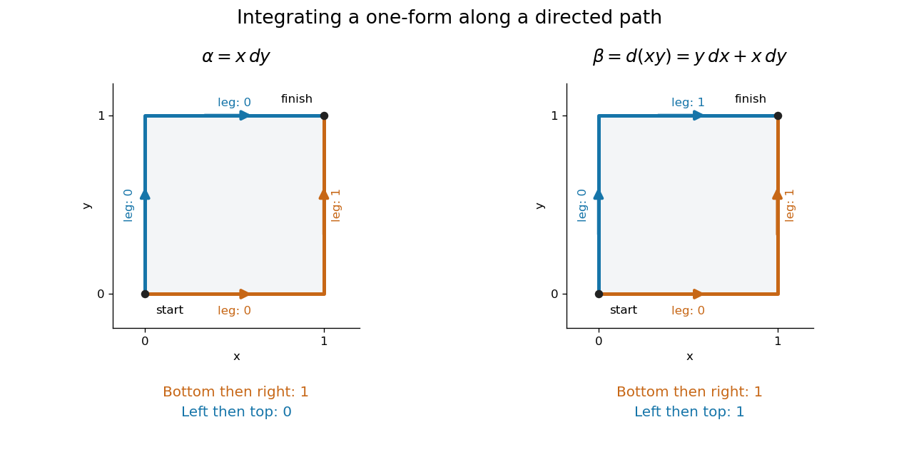

# Differential form

↑ **Parent:** [Geometry and topology](geometry-and-topology-split.md)  
ⓦ [Wiki](https://en.wikipedia.org/wiki/Differential_form)

A differential form is a smooth field of [alternating multilinear maps](alternating-multilinear-map.md) that can be integrated over an appropriately oriented [manifold](topological-manifold-split.md) of matching dimension. A [one-form](one-form.md) measures a directed displacement; a [two-form](2-form.md) measures an oriented area element. The point is to express what is being accumulated along a [curve](curve.md) or over a surface without tying the answer to one set of coordinates. This makes [line integrals](line-integral.md), [surface integrals](surface-integral.md), and the integral theorems of [vector calculus](vector-calculus.md) parts of one construction.

For a concrete [one-form](one-form.md), take $\alpha=x\,dy$ in the plane. Travel from $(0,0)$ to $(1,1)$ along the bottom and then the right edge of the unit square. The horizontal leg contributes zero because $dy=0$; the vertical leg has $x=1$ and contributes $\int_0^1dy=1$. Taking the left and then the top edge instead gives zero: the vertical leg has $x=0$, and the horizontal leg again has $dy=0$. **The two paths have the same endpoints but different integrals.**

Now replace $\alpha$ with the [exact differential](exact-differential.md) $\beta=d(xy)=y\,dx+x\,dy$. Both paths give $1$, because integrating an [exact differential](exact-differential.md) along a [curve](curve.md) gives the endpoint difference of its potential. Here that difference is $xy|_{(1,1)}-xy|_{(0,0)}=1$. This is the [fundamental theorem of calculus](fundamental-theorem-of-calculus.md) applied to a [function](function-split.md) along a [parametric curve](parametric-curve.md), and is the basic reason [conservative vector fields](conservative-vector-field.md) have path-independent [work](work.md).

**[Figure 1](#image-two-routes-between-the-same-endpoints-distinguish-a-path-dependent-one-form-from-an-exact-differential). Two routes between the same endpoints distinguish a path-dependent one-form from an exact differential**.

The [exterior derivative](exterior-derivative.md) records the local obstruction in the first example: $d(x\,dy)=dx\wedge dy$. The [Generalized Stokes theorem](generalized-stokes-theorem.md) turns the difference between the two path integrals into the integral of this [two-form](2-form.md) over the square, whose oriented area is $1$. Interior edges cancel when adjoining pieces are added; only the outer boundary survives. That cancellation connects a local calculation with a global measurement.

More precisely, a degree-$k$ [differential form](differential-form-split.md) assigns to each point $p$ a multilinear scalar-valued function of $k$ [tangent vectors](tangent-vector-split.md) at $p$. Interchanging two arguments changes its sign. A [one-form](one-form.md) is therefore a [covector field](one-form.md), while a [two-form](2-form.md) vanishes on a pair of parallel [vectors](vector.md). Degree zero simply means a smooth [function](function-split.md). The space $\Omega^k(M)$ is a [vector space](vector-space-split.md); the [wedge product of differential forms](wedge-product-of-differential-forms.md) combines degrees, and the [exterior derivative](exterior-derivative.md) raises degree by one.

The usefulness goes beyond bookkeeping. [Pullbacks of a differential form](pullback-of-a-differential-form.md) supply the right transformation law automatically under a coordinate change. The [Generalized Stokes theorem](generalized-stokes-theorem.md) unifies the [fundamental theorem of calculus](fundamental-theorem-of-calculus.md), [Green theorem](green-theorem.md), [Stokes theorem](stokes-theorem.md), and [divergence theorem](divergence-theorem.md). Meanwhile, the distinction between [closed differential forms](closed-differential-form.md) and [exact differential forms](exact-differential-form.md) detects holes through [de Rham cohomology](de-rham-cohomology.md). Reyer Sjamaar develops these connections in sections 5.4 and 9.3 of his university notes. [Sjamaar: Manifolds and differential forms](https://pi.math.cornell.edu/~sjamaar/manifolds/manifold.pdf).

**Table of contents**

- [Integration on an oriented manifold](integration-on-an-oriented-manifold.md)
- [Comass](comass.md)
- [Integral pairing of complex top forms](integral-pairing-of-complex-top-forms.md)
- [Differential three-form](differential-three-form.md)
  - [Eleven-dimensional three-form action variation](eleven-dimensional-three-form-action-variation.md)
- [Vector-bundle-valued differential form](vector-bundle-valued-differential-form.md)
  - [Sheaf of vector-bundle-valued differential forms](sheaf-of-vector-bundle-valued-differential-forms.md)
- [Sheaf of smooth differential forms](sheaf-of-smooth-differential-forms.md)
  - [Sheaf of differential forms of type (p, q)](sheaf-of-differential-forms-of-type-p-q.md)
- [Volume form](volume-form.md)
  - [Metric volume form](metric-volume-form.md)
  - [Area form](area-form.md)
  - [Metric volume tensor](metric-volume-tensor.md)
  - [Volume-preserving vector field](volume-preserving-vector-field.md)
    - [Boundary obstruction for commuting volume-preserving vector fields](boundary-obstruction-for-commuting-volume-preserving-vector-fields.md)
- [2-form](2-form.md)
- [Wedge product of differential forms](wedge-product-of-differential-forms.md)
  - [Exterior multiplication](exterior-multiplication.md)
- [Pullback of a differential form](pullback-of-a-differential-form.md)
- [Interior product](interior-product.md)
- [One-form](one-form.md)
  - [Pointwise representation of one-forms by vector-field functionals](pointwise-representation-of-one-forms-by-vector-field-functionals.md)
- [Exterior derivative](exterior-derivative.md)
  - [Antisymmetrized covector derivative is tensorial](antisymmetrized-covector-derivative-is-tensorial.md)
  - [Uniqueness of the exterior derivative from its axioms](uniqueness-of-the-exterior-derivative-from-its-axioms.md)
  - [Exterior derivative of a one-form evaluated on vector fields](exterior-derivative-of-a-one-form-evaluated-on-vector-fields.md)
  - [Generalized Stokes theorem](generalized-stokes-theorem.md)
  - [Closed and exact differential forms](closed-and-exact-differential-forms.md)
    - [Closed differential form](closed-differential-form.md)
      - [Nonexact angular one-form](nonexact-angular-one-form.md)
        - [Elliptically scaled angular one-form](elliptically-scaled-angular-one-form.md)
      - [Closed differential one-form](closed-differential-one-form.md)
        - [Closed one-forms on the two-sphere are exact](closed-one-forms-on-the-two-sphere-are-exact.md)
        - [Averaging closed one-forms on a surface unit tangent bundle](averaging-closed-one-forms-on-a-surface-unit-tangent-bundle.md)
      - [Poincaré lemma](poincare-lemma.md)
        - [Relative Poincaré lemma](relative-poincare-lemma.md)
        - [Radial homotopy operator](radial-homotopy-operator.md)
          - [Degree-zero correction to radial homotopy](degree-zero-correction-to-radial-homotopy.md)
          - [Radial homotopy primitive near a zero section](radial-homotopy-primitive-near-a-zero-section.md)
        - [Green-theorem proof of exactness on a disc](green-theorem-proof-of-exactness-on-a-disc.md)
        - [Local potential of a closed differential one-form](local-potential-of-a-closed-differential-one-form.md)
      - [Exact differential form](exact-differential-form.md)
        - [de Rham cohomology](de-rham-cohomology.md)
          - [Relative de Rham complex](relative-de-rham-complex.md)
          - [Degree-zero de Rham cohomology](degree-zero-de-rham-cohomology.md)
          - [de Rham cohomology of a finite disjoint union](de-rham-cohomology-of-a-finite-disjoint-union.md)
          - [de Rham theorem](de-rham-theorem.md)
          - [Top de Rham cohomology of a compact connected oriented manifold](top-de-rham-cohomology-of-a-compact-connected-oriented-manifold.md)
          - [First de Rham cohomology of the two-sphere](first-de-rham-cohomology-of-the-two-sphere.md)
          - [de Rham cohomology of a finite quotient](de-rham-cohomology-of-a-finite-quotient.md)
          - [Top-degree de Rham cohomology](top-degree-de-rham-cohomology.md)
            - [Top-degree de Rham cohomology of a compact Lie group](top-degree-de-rham-cohomology-of-a-compact-lie-group.md)
          - [Averaging differential forms over the circle](averaging-differential-forms-over-the-circle.md)
            - [de Rham cohomology of a product with a circle](de-rham-cohomology-of-a-product-with-a-circle.md)
          - [Homotopy invariance of de Rham cohomology](homotopy-invariance-of-de-rham-cohomology.md)
          - [Mayer--Vietoris sequence for de Rham cohomology](mayer-vietoris-sequence-for-de-rham-cohomology.md)
            - [Suspension isomorphism for top de Rham cohomology of spheres](suspension-isomorphism-for-top-de-rham-cohomology-of-spheres.md)
- [Hodge star operator](hodge-star-operator.md)
  - [Conjugate-linear Hodge star](conjugate-linear-hodge-star.md)
    - [Bundle-valued conjugate-linear Hodge star](bundle-valued-conjugate-linear-hodge-star.md)
  - [Hodge splitting of Euclidean two-forms](hodge-splitting-of-euclidean-two-forms.md)
    - [Wedge orthogonality of opposite-duality two-forms](wedge-orthogonality-of-opposite-duality-two-forms.md)
  - [Adjoint of the Hodge star on middle-degree forms](adjoint-of-the-hodge-star-on-middle-degree-forms.md)
  - [Hodge star on middle-degree differential forms is conformally invariant](hodge-star-on-middle-degree-differential-forms-is-conformally-invariant.md)
  - [Complex Hodge star operator](complex-hodge-star-operator.md)
    - [Hodge star eigenvalues on graded differential forms](hodge-star-eigenvalues-on-graded-differential-forms.md)
    - [Hodge star on top holomorphic forms](hodge-star-on-top-holomorphic-forms.md)
  - [Self-dual differential form](self-dual-differential-form.md)
    - ['t Hooft symbol](t-hooft-symbol.md)
    - [Self-dual frame in complex Euclidean coordinates](self-dual-frame-in-complex-euclidean-coordinates.md)
  - [Anti-self-dual differential form](anti-self-dual-differential-form.md)
    - [Exact anti-self-dual form on a compact four-manifold](exact-anti-self-dual-form-on-a-compact-four-manifold.md)
  - [Codifferential](codifferential.md)
    - [Hodge integration by parts in arbitrary degree](hodge-integration-by-parts-in-arbitrary-degree.md)
    - [Hodge integration by parts for one-forms](hodge-integration-by-parts-for-one-forms.md)
    - [Coclosed differential form](coclosed-differential-form.md)
  - [Hodge Laplacian](hodge-laplacian.md)
    - [Poisson equation for differential forms](poisson-equation-for-differential-forms.md)
      - [Solvability condition for the Hodge Poisson equation](solvability-condition-for-the-hodge-poisson-equation.md)
        - [Affine space of solutions of the Hodge Poisson equation](affine-space-of-solutions-of-the-hodge-poisson-equation.md)
    - [Bochner-Weitzenbock formula for one-forms](bochner-weitzenbock-formula-for-one-forms.md)
      - [Harmonic one-forms are parallel under nonnegative Ricci curvature](harmonic-one-forms-are-parallel-under-nonnegative-ricci-curvature.md)
        - [Dimension bound for harmonic one-forms under nonnegative Ricci curvature](dimension-bound-for-harmonic-one-forms-under-nonnegative-ricci-curvature.md)
          - [Betti-number obstruction to nonnegative Ricci curvature](betti-number-obstruction-to-nonnegative-ricci-curvature.md)
    - [Hodge star commutes with the Hodge Laplacian](hodge-star-commutes-with-the-hodge-laplacian.md)
    - [Nonnegativity of the Hodge Laplacian](nonnegativity-of-the-hodge-laplacian.md)
    - [Green operator of the Hodge Laplacian](green-operator-of-the-hodge-laplacian.md)
  - [Harmonic differential form](harmonic-differential-form.md)
    - [Harmonic top-degree forms on a closed oriented manifold](harmonic-top-degree-forms-on-a-closed-oriented-manifold.md)
    - [Harmonic one-form](harmonic-one-form.md)
    - [Harmonic forms are fixed by a connected isometric group action](harmonic-forms-are-fixed-by-a-connected-isometric-group-action.md)
    - [Hodge decomposition theorem](hodge-decomposition-theorem.md)
      - [Representing functionals on harmonic forms by wedge pairing](representing-functionals-on-harmonic-forms-by-wedge-pairing.md)
        - [Ambiguity of harmonic wedge-pairing representatives](ambiguity-of-harmonic-wedge-pairing-representatives.md)
      - [Self-dual primitive of an exact three-form](self-dual-primitive-of-an-exact-three-form.md)
- [Exact differential](exact-differential.md)
- [Lie derivative of a differential form](lie-derivative-of-a-differential-form.md)
  - [Cartan's magic formula](cartan-s-magic-formula.md)

## ↑ Ancestors (4)

1. [Geometry and topology](geometry-and-topology-split.md)
2. [Area of mathematics](area-of-mathematics.md)
3. [Mathematics](mathematics-split.md)
4. [Codex Wiki](split.md)

## ← Incoming links (101)

- [A-hat form](a-hat-form.md)
- [Averaging differential forms over the circle](averaging-differential-forms-over-the-circle.md)
- [Calibrated geometry](calibrated-geometry.md)
- [Calibration (differential geometry)](calibration-differential-geometry.md)
- [Cartan's magic formula](cartan-s-magic-formula.md)
- [Change of variables formula](change-of-variables-formula.md)
- [Coclosed differential form](coclosed-differential-form.md)
- [Complex torus](complex-torus.md)
- [de Rham cohomology of a finite disjoint union](de-rham-cohomology-of-a-finite-disjoint-union.md)
- [de Rham cohomology of a finite quotient](de-rham-cohomology-of-a-finite-quotient.md)
- [de Rham theorem](de-rham-theorem.md)
- [Differential form](differential-form-split.md)
- [Differential of a smooth function](differential-of-a-smooth-function.md)
- [Distance between two uniform points in a three-dimensional ball](distance-between-two-uniform-points-in-a-three-dimensional-ball.md)
- [Endomorphism-valued exterior product](endomorphism-valued-exterior-product.md)
- [Exterior algebra](exterior-algebra.md)
- [Exterior multiplication](exterior-multiplication.md)
- [Generalized Stokes theorem](generalized-stokes-theorem.md)
- [Hodge theory](hodge-theory.md)
- [Integration on an oriented manifold](integration-on-an-oriented-manifold.md)
- [Invariant primitive under a finite group action](invariant-primitive-under-a-finite-group-action.md)
- [Killing-Yano tensor](killing-yano-tensor.md)
- [Laplace operators in differential geometry](laplace-operators-in-differential-geometry.md)
- [Lefschetz operator of a Kähler manifold](lefschetz-operator-of-a-kahler-manifold.md)
- [Lie derivative of a tensor field](lie-derivative-of-a-tensor-field.md)
- [Modified Helmholtz closed spectral one-form](modified-helmholtz-closed-spectral-one-form.md)
- [Orientation of a smooth manifold](orientation-of-a-smooth-manifold.md)
- [Oriented atlas](oriented-atlas.md)
- [Solution](past-exam-of-the-mathematics-course-of-the-university-of-cambridge/2001/iii/paper-12/1/solution.md)
- [Solution](past-exam-of-the-mathematics-course-of-the-university-of-cambridge/2001/iii/paper-15/4/solution.md)
- [Solution](past-exam-of-the-mathematics-course-of-the-university-of-cambridge/2001/iii/paper-71/1/solution.md)
- [Solution](past-exam-of-the-mathematics-course-of-the-university-of-cambridge/2002/ia/paper-3/3a/a/solution.md)
- [Solution](past-exam-of-the-mathematics-course-of-the-university-of-cambridge/2002/ia/paper-3/3a/b/solution.md)
- [Solution](past-exam-of-the-mathematics-course-of-the-university-of-cambridge/2002/iii/paper-13/1/solution.md)
- [Solution](past-exam-of-the-mathematics-course-of-the-university-of-cambridge/2002/iii/paper-14/2/solution.md)
- [Solution](past-exam-of-the-mathematics-course-of-the-university-of-cambridge/2002/iii/paper-14/6/solution.md)
- [Solution](past-exam-of-the-mathematics-course-of-the-university-of-cambridge/2003/iii/paper-17/3/solution.md)
- [Solution](past-exam-of-the-mathematics-course-of-the-university-of-cambridge/2003/iii/paper-57/1/a/solution.md)
- [Solution](past-exam-of-the-mathematics-course-of-the-university-of-cambridge/2004/iii/paper-14/3/solution.md)
- [Solution](past-exam-of-the-mathematics-course-of-the-university-of-cambridge/2004/iii/paper-58/7/solution.md)
- [Solution](past-exam-of-the-mathematics-course-of-the-university-of-cambridge/2005/iii/paper-15/2/solution.md)
- [Solution](past-exam-of-the-mathematics-course-of-the-university-of-cambridge/2005/iii/paper-56/2/solution.md)
- [Solution](past-exam-of-the-mathematics-course-of-the-university-of-cambridge/2005/iii/paper-63/2/solution.md)
- [Solution](past-exam-of-the-mathematics-course-of-the-university-of-cambridge/2006/iii/paper-18/1/solution.md)
- [Solution](past-exam-of-the-mathematics-course-of-the-university-of-cambridge/2006/iii/paper-20/1/solution.md)
- [Solution](past-exam-of-the-mathematics-course-of-the-university-of-cambridge/2006/iii/paper-57/2/solution.md)
- [Solution](past-exam-of-the-mathematics-course-of-the-university-of-cambridge/2007/iii/paper-15/3/a/solution.md)
- [Solution](past-exam-of-the-mathematics-course-of-the-university-of-cambridge/2007/iii/paper-63/1/solution.md)
- [Solution](past-exam-of-the-mathematics-course-of-the-university-of-cambridge/2007/iii/paper-86/2/a/solution.md)
- [Solution](past-exam-of-the-mathematics-course-of-the-university-of-cambridge/2008/iii/paper-19/3/solution.md)
- [Solution](past-exam-of-the-mathematics-course-of-the-university-of-cambridge/2008/iii/paper-65/1/solution.md)
- [Solution](past-exam-of-the-mathematics-course-of-the-university-of-cambridge/2009/iii/paper-17/2/a/solution.md)
- [Solution](past-exam-of-the-mathematics-course-of-the-university-of-cambridge/2010/iii/paper-15/3/a/solution.md)
- [Solution](past-exam-of-the-mathematics-course-of-the-university-of-cambridge/2010/iii/paper-15/3/b/solution.md)
- [Solution](past-exam-of-the-mathematics-course-of-the-university-of-cambridge/2010/iii/paper-15/3/c/solution.md)
- [Solution](past-exam-of-the-mathematics-course-of-the-university-of-cambridge/2010/iii/paper-7/1/solution.md)
- [Solution](past-exam-of-the-mathematics-course-of-the-university-of-cambridge/2010/iii/paper-7/3/c/solution.md)
- [Solution](past-exam-of-the-mathematics-course-of-the-university-of-cambridge/2012/iii/paper-14/4/solution.md)
- [Solution](past-exam-of-the-mathematics-course-of-the-university-of-cambridge/2012/iii/paper-17/2/1/solution.md)
- [Solution](past-exam-of-the-mathematics-course-of-the-university-of-cambridge/2012/iii/paper-22/3/solution.md)
- [Solution](past-exam-of-the-mathematics-course-of-the-university-of-cambridge/2013/iii/paper-17/1/solution.md)
- [Solution](past-exam-of-the-mathematics-course-of-the-university-of-cambridge/2013/iii/paper-17/2/solution.md)
- [Solution](past-exam-of-the-mathematics-course-of-the-university-of-cambridge/2013/iii/paper-50/2/solution.md)
- [Solution](past-exam-of-the-mathematics-course-of-the-university-of-cambridge/2014/iii/paper-15/1/solution.md)
- [Solution](past-exam-of-the-mathematics-course-of-the-university-of-cambridge/2014/iii/paper-16/2/a/solution.md)
- [Solution](past-exam-of-the-mathematics-course-of-the-university-of-cambridge/2014/iii/paper-16/5/b/solution.md)
- [Solution](past-exam-of-the-mathematics-course-of-the-university-of-cambridge/2014/iii/paper-17/1/a/solution.md)
- [Solution](past-exam-of-the-mathematics-course-of-the-university-of-cambridge/2014/iii/paper-50/1/b/ii/solution.md)
- [Solution](past-exam-of-the-mathematics-course-of-the-university-of-cambridge/2014/iii/paper-51/3/solution.md)
- [Solution](past-exam-of-the-mathematics-course-of-the-university-of-cambridge/2015/iii/paper-17/5/solution.md)
- [Solution](past-exam-of-the-mathematics-course-of-the-university-of-cambridge/2015/iii/paper-18/2/a/solution.md)
- [Solution](past-exam-of-the-mathematics-course-of-the-university-of-cambridge/2015/iii/paper-56/2/solution.md)
- [Solution](past-exam-of-the-mathematics-course-of-the-university-of-cambridge/2015/iii/paper-56/3/solution.md)
- [Solution](past-exam-of-the-mathematics-course-of-the-university-of-cambridge/2016/iii/paper-115/2/solution.md)
- [Solution](past-exam-of-the-mathematics-course-of-the-university-of-cambridge/2016/iii/paper-116/5/solution.md)
- [Solution](past-exam-of-the-mathematics-course-of-the-university-of-cambridge/2016/iii/paper-308/2/solution.md)
- [Solution](past-exam-of-the-mathematics-course-of-the-university-of-cambridge/2017/iii/paper-115/3/b/solution.md)
- [Solution](past-exam-of-the-mathematics-course-of-the-university-of-cambridge/2017/iii/paper-115/3/c/solution.md)
- [Solution](past-exam-of-the-mathematics-course-of-the-university-of-cambridge/2017/iii/paper-309/3/b/solution.md)
- [Solution](past-exam-of-the-mathematics-course-of-the-university-of-cambridge/2018/iii/paper-140/1/c/solution.md)
- [Solution](past-exam-of-the-mathematics-course-of-the-university-of-cambridge/2021/iii/paper-115/1/a/solution.md)
- [Solution](past-exam-of-the-mathematics-course-of-the-university-of-cambridge/2024/iii/paper-115/1/a/solution.md)
- [Solution](past-exam-of-the-mathematics-course-of-the-year-1-of-the-natural-sciences-course-of-the-university-of-cambridge/2011/paper-1/18/c/solution.md)
- [Solution](past-exam-of-the-mathematics-course-of-the-year-1-of-the-natural-sciences-course-of-the-university-of-cambridge/2015/paper-1/12/a/i/solution.md)
- [Solution](past-exam-of-the-mathematics-course-of-the-year-1-of-the-natural-sciences-course-of-the-university-of-cambridge/2018/paper-1/13/c/solution.md)
- [Solution](past-exam-of-the-mathematics-course-of-the-year-1-of-the-natural-sciences-course-of-the-university-of-cambridge/2019/paper-1/13/a/solution.md)
- [Solution](past-exam-of-the-mathematics-course-of-the-year-1-of-the-natural-sciences-course-of-the-university-of-cambridge/2025/paper-1/15/b/solution.md)
- [Poisson equation for differential forms](poisson-equation-for-differential-forms.md)
- [Pullback of a differential form](pullback-of-a-differential-form.md)
- [Radial-gauge potential for a divergence-free magnetic field](radial-gauge-potential-for-a-divergence-free-magnetic-field.md)
- [Radial homotopy operator](radial-homotopy-operator.md)
- [Right-invariant differential form](right-invariant-differential-form.md)
- [Sheaf of smooth differential forms](sheaf-of-smooth-differential-forms.md)
- [State function](state-function.md)
- [Symplectic volume form](symplectic-volume-form.md)
- [Tensor bundle](tensor-bundle.md)
- [Time-dependent vector field](time-dependent-vector-field.md)
- [Top-degree de Rham cohomology](top-degree-de-rham-cohomology.md)
- [Uniqueness of the exterior derivative from its axioms](uniqueness-of-the-exterior-derivative-from-its-axioms.md)
- [Vector calculus](vector-calculus.md)
- [Wedge product of differential forms](wedge-product-of-differential-forms.md)
