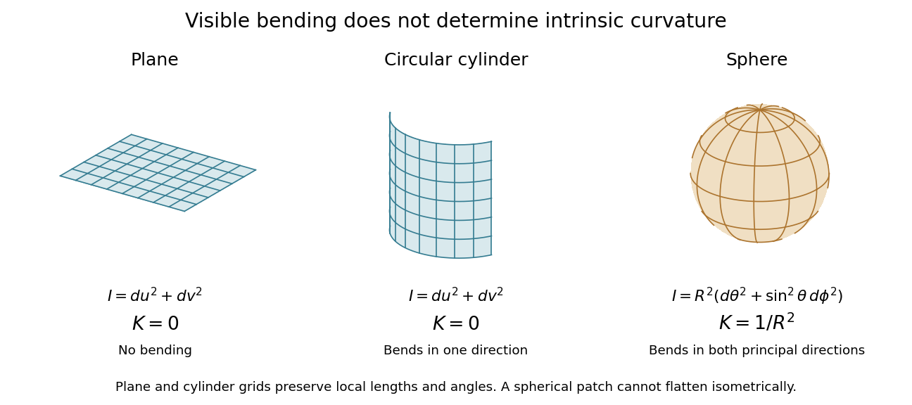
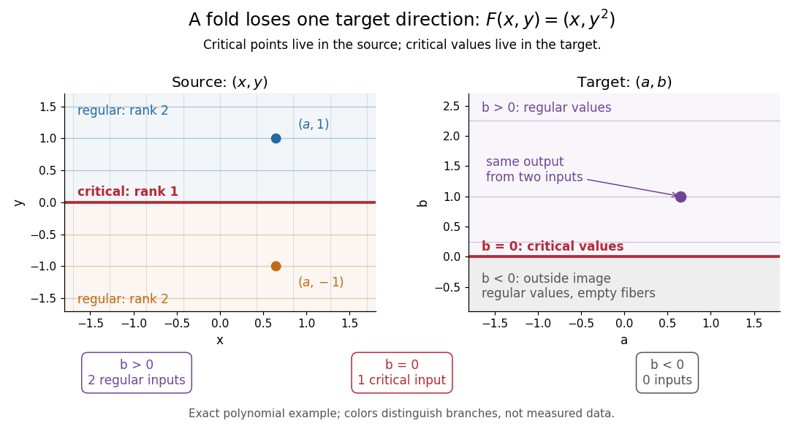
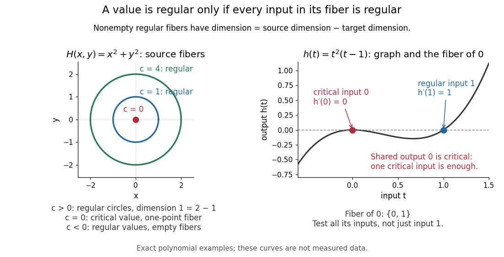
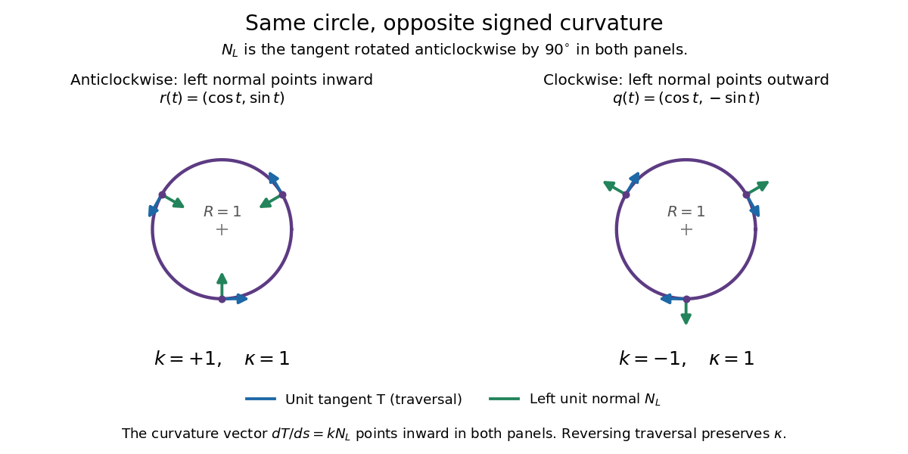
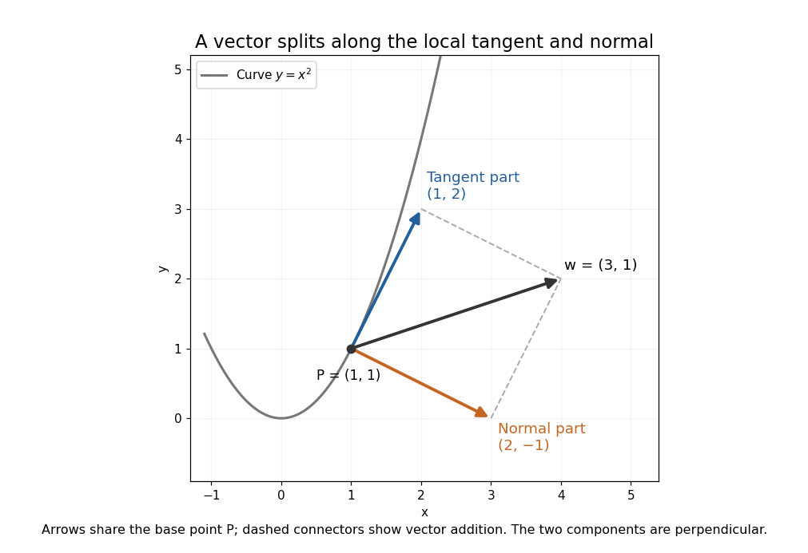
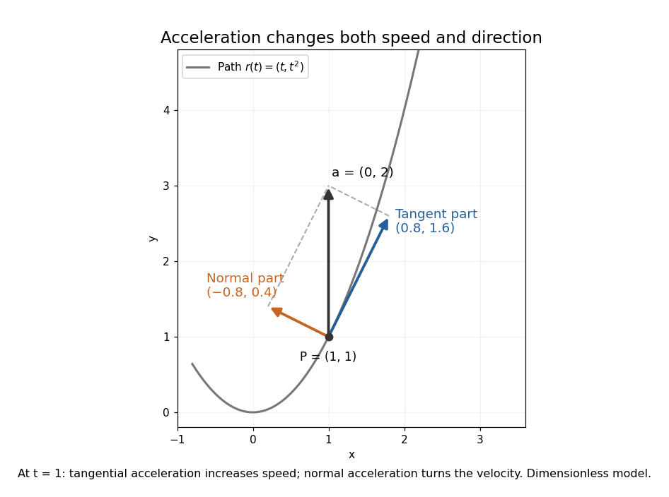
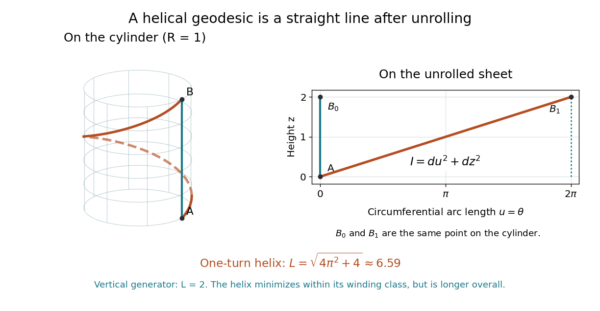

# Differential geometry

↑ **Parent:** [Geometry and topology](geometry-and-topology.md)  
ⓦ [Wiki](https://en.wikipedia.org/wiki/Differential_geometry)

Differential geometry uses [calculus](calculus.md) to study [smooth curves](#smooth-curve), [smooth surfaces](#smooth-surface), and [smooth manifolds](smooth-manifold.md). A [tangent space](tangent-vector.md#tangent-space) describes possible instantaneous motions; a [Riemannian metric](riemannian-metric.md) turns those motions into measurable [lengths](physics.md#length) and [angles](geometry-and-topology.md#angle); [curvature](#curvature) records how the resulting geometry differs from [Euclidean geometry](euclidean-geometry.md). Local calculations with [derivatives](calculus.md#derivative) can therefore answer geometric questions about whole shapes.

An especially revealing experiment is rolling a flat sheet into a [circular cylinder](#circular-cylinder) without stretching it. The sheet visibly bends, yet a small creature measuring only [arc lengths](riemannian-geometry.md#arc-length), [angles](geometry-and-topology.md#angle), and [surface areas](#surface-area) detects the same geometry. This separates geometry measured within a surface from its bending in the surrounding [Euclidean space](normed-vector-space.md#euclidean-norm). The [first fundamental form](#first-fundamental-form) encodes the measurements; the [second fundamental form](second-fundamental-form.md) encodes the bending. The [Theorema Egregium](#theorema-egregium) explains why a [sphere](euclidean-geometry.md#sphere) behaves differently, while [geodesics on a circular cylinder](#geodesics-on-a-circular-cylinder) turn a route-planning problem into drawing a straight line.

**Table of contents**

- [Analytic torsion](#analytic-torsion)
- [Differential geometry of surfaces](#differential-geometry-of-surfaces)
- [Pullback (differential geometry)](#pullback-differential-geometry)
- [Laplace operators in differential geometry](#laplace-operators-in-differential-geometry)
- [Critical point of a smooth map](#critical-point-of-a-smooth-map)
  - [Critical value](#critical-value)
- [Calibrated geometry](#calibrated-geometry)
  - [Generalized calibration](#generalized-calibration)
  - [Calibrated submanifold](#calibrated-submanifold)
    - [Calibration implies volume minimization](#calibration-implies-volume-minimization)
  - [Calibration (differential geometry)](#calibration-differential-geometry)
    - [Spinor calibration form](#spinor-calibration-form)
- [Carnot-Carathéodory distance](#carnot-caratheodory-distance)
  - [Chow-Rashevskii theorem](#chow-rashevskii-theorem)
- [Hodge theory](#hodge-theory)
  - [Hodge structure](#hodge-structure)
    - [Variation of Hodge structure](#variation-of-hodge-structure)
      - [Griffiths transversality](#griffiths-transversality)
      - [Gauss–Manin connection](#gauss-manin-connection)
    - [Polarized Hodge structure](#polarized-hodge-structure)
      - [Period domain](#period-domain)
        - [K3 period domain](#k3-period-domain)
        - [Siegel upper half-space](#siegel-upper-half-space)
        - [Compact dual of a period domain](#compact-dual-of-a-period-domain)
    - [Hodge filtration](#hodge-filtration)
- [Jet bundle of maps](#jet-bundle-of-maps)
- [Harmonic map](#harmonic-map)
- [Submanifold](#submanifold)
- [Morse theory](#morse-theory)
  - [Morse chain complex](#morse-chain-complex)
    - [Morse-Smale complex](#morse-smale-complex)
      - [Integral Morse complex of the Klein bottle](#integral-morse-complex-of-the-klein-bottle)
      - [Projective quadratic Morse complex](#projective-quadratic-morse-complex)
    - [Morse inequalities](#morse-inequalities)
  - [Morse handle-attachment theorem](#morse-handle-attachment-theorem)
  - [Morse cell-attachment theorem for geodesic energy](#morse-cell-attachment-theorem-for-geodesic-energy)
  - [Morse-Bott critical manifold](#morse-bott-critical-manifold)
  - [Morse index theorem](#morse-index-theorem)
    - [Conjugate points and indices of round-sphere geodesics](#conjugate-points-and-indices-of-round-sphere-geodesics)
- [Pseudo-Riemannian manifold](#pseudo-riemannian-manifold)
  - [Splitting theorem](#splitting-theorem)
  - [Pseudo-Riemannian metric](#pseudo-riemannian-metric)
  - [Ricci-flat manifold](#ricci-flat-manifold)
- [Curvature](#curvature)
  - [Signed curvature](#signed-curvature)
    - [Turning tangent theorem](#turning-tangent-theorem)
  - [Signed curvature of a plane graph](#signed-curvature-of-a-plane-graph)
- [Morse function](#morse-function)
  - [Gradient-like vector field](#gradient-like-vector-field)
  - [Cobordism Morse function](#cobordism-morse-function)
    - [Two-critical-point obstruction to a trivial cobordism](#two-critical-point-obstruction-to-a-trivial-cobordism)
  - [Product of Morse functions](#product-of-morse-functions)
    - [Minimal Morse critical count on a circle times an orientable surface](#minimal-morse-critical-count-on-a-circle-times-an-orientable-surface)
  - [Perfect Morse function](#perfect-morse-function)
  - [Exponential convergence of a Morse gradient flow](#exponential-convergence-of-a-morse-gradient-flow)
  - [Morse index](#morse-index)
  - [Morse lemma](#morse-lemma)
    - [Smooth completing-square proof of the Morse lemma](#smooth-completing-square-proof-of-the-morse-lemma)
- [Distribution (differential geometry)](#distribution-differential-geometry)
  - [Coorientation](#coorientation)
  - [Involutive distribution](#involutive-distribution)
  - [Integrable distribution](#integrable-distribution)
    - [Integral manifold](#integral-manifold)
      - [Dense immersed cylinder in a three-dimensional torus](#dense-immersed-cylinder-in-a-three-dimensional-torus)
      - [Global confinement to an immersed leaf](#global-confinement-to-an-immersed-leaf)
    - [Frobenius theorem](#frobenius-theorem)
      - [Hypersurface orthogonality](#hypersurface-orthogonality)
        - [Normalized Killing one-form](#normalized-killing-one-form)
      - [Coordinate proof of the Frobenius theorem](#coordinate-proof-of-the-frobenius-theorem)
  - [Plane distribution](#plane-distribution)
    - [Integrability criterion for a plane distribution](#integrability-criterion-for-a-plane-distribution)
    - [Contact structure](#contact-structure)
      - [Gray stability theorem](#gray-stability-theorem)
        - [Contact conformal factor along an isotopy](#contact-conformal-factor-along-an-isotopy)
        - [Horizontal generator of contact stability](#horizontal-generator-of-contact-stability)
      - [Contact distribution](#contact-distribution)
        - [Contact distribution symplectic form](#contact-distribution-symplectic-form)
      - [Contact form](#contact-form)
        - [Reeb vector field](#reeb-vector-field)
          - [Irrational contact ellipsoid flow on the three-sphere](#irrational-contact-ellipsoid-flow-on-the-three-sphere)
- [Submersion](#submersion)
  - [Riemannian submersion](#riemannian-submersion)
    - [Eigenfunction pullback by a Riemannian submersion](#eigenfunction-pullback-by-a-riemannian-submersion)
    - [Basic-function Laplacian identity](#basic-function-laplacian-identity)
    - [Basic function](#basic-function)
  - [Submersion theorem](#submersion-theorem)
  - [Horizontal lift of a vector field through a submersion](#horizontal-lift-of-a-vector-field-through-a-submersion)
  - [Fiber diffeomorphism for a proper submersion](#fiber-diffeomorphism-for-a-proper-submersion)
- [Immersion](#immersion)
  - [Isometric immersion](#isometric-immersion)
  - [Smooth embedding](#smooth-embedding)
    - [Finite-chart Euclidean embedding of a compact smooth manifold](#finite-chart-euclidean-embedding-of-a-compact-smooth-manifold)
    - [Stability of compact smooth embeddings](#stability-of-compact-smooth-embeddings)
    - [C1 metric on a smooth mapping space](#c1-metric-on-a-smooth-mapping-space)
    - [Tubular neighborhood](#tubular-neighborhood)
      - [Tubular neighborhood theorem](#tubular-neighborhood-theorem)
      - [Pontryagin-Thom collapse](#pontryagin-thom-collapse)
  - [Immersed submanifold](#immersed-submanifold)
    - [Irrational winding of the torus](#irrational-winding-of-the-torus)
    - [Compact injective immersion is an embedding](#compact-injective-immersion-is-an-embedding)
  - [Isothermal coordinates](#isothermal-coordinates)
    - [Conformal flattening of a surface of revolution](#conformal-flattening-of-a-surface-of-revolution)
- [Lie bracket of vector fields](#lie-bracket-of-vector-fields)
  - [Vanishing Lie bracket is equivalent to commuting local flows](#vanishing-lie-bracket-is-equivalent-to-commuting-local-flows)
  - [Coordinate invariance of the Lie bracket](#coordinate-invariance-of-the-lie-bracket)
  - [Commuting coordinate basis](#commuting-coordinate-basis)
    - [Noncommuting orthonormal polar frame](#noncommuting-orthonormal-polar-frame)
- [Laplace-Beltrami operator](#laplace-beltrami-operator)
  - [Laplacian spectrum](#laplacian-spectrum)
  - [Cartesian formula for the angular Laplacian](#cartesian-formula-for-the-angular-laplacian)
  - [Geodesic trace formula for the Laplace-Beltrami operator](#geodesic-trace-formula-for-the-laplace-beltrami-operator)
  - [Positive Laplace-Beltrami operator](#positive-laplace-beltrami-operator)
    - [Product rule for the positive Laplace-Beltrami operator](#product-rule-for-the-positive-laplace-beltrami-operator)
  - [Geodesic Hessian formula](#geodesic-hessian-formula)
  - [A function with nonnegative Laplacian on a closed manifold is locally constant](#a-function-with-nonnegative-laplacian-on-a-closed-manifold-is-locally-constant)
  - [Spherical Hessian identity](#spherical-hessian-identity)
  - [Surface Laplacian](#surface-laplacian)
  - [Laplacian at a local maximum](#laplacian-at-a-local-maximum)
- [Smooth surface](#smooth-surface)
  - [Parallel surface](#parallel-surface)
    - [Variable normal offset](#variable-normal-offset)
  - [Parametric surface](#parametric-surface)
    - [General conical surface](#general-conical-surface)
    - [Triangular Bézier patch](#triangular-bezier-patch)
    - [Parametric surface interrogation](#parametric-surface-interrogation)
      - [Shadow tracing for a parametric curve](#shadow-tracing-for-a-parametric-curve)
    - [Tensor-product surface basis](#tensor-product-surface-basis)
      - [Tensor-product inheritance of geometric basis properties](#tensor-product-inheritance-of-geometric-basis-properties)
  - [Hyperboloid](#hyperboloid)
    - [One-sheet hyperboloid](#one-sheet-hyperboloid)
      - [Plane-section geodesics of the unit one-sheet hyperboloid](#plane-section-geodesics-of-the-unit-one-sheet-hyperboloid)
      - [Geodesic trapped in one half of the unit one-sheet hyperboloid](#geodesic-trapped-in-one-half-of-the-unit-one-sheet-hyperboloid)
      - [Isometry-invariant waist geodesic of the unit one-sheet hyperboloid](#isometry-invariant-waist-geodesic-of-the-unit-one-sheet-hyperboloid)
    - [Two-sheeted hyperboloid](#two-sheeted-hyperboloid)
      - [Symmetric-matrix model of the two-sheeted hyperboloid](#symmetric-matrix-model-of-the-two-sheeted-hyperboloid)
  - [Inextendible embedded surface](#inextendible-embedded-surface)
- [Riemannian metric](riemannian-metric.md)
  - [Rotationally symmetric surface metric](riemannian-metric.md#rotationally-symmetric-surface-metric)
    - [Cyclic angular momentum in a rotational metric](riemannian-metric.md#cyclic-angular-momentum-in-a-rotational-metric)
  - [Line element](riemannian-metric.md#line-element)
    - [Line element on a sphere](riemannian-metric.md#line-element-on-a-sphere)
  - [Riemannian orthonormal frame](riemannian-metric.md#riemannian-orthonormal-frame)
    - [Normal orthonormal frame](riemannian-metric.md#normal-orthonormal-frame)
  - [Nowhere locally homogeneous metric](riemannian-metric.md#nowhere-locally-homogeneous-metric)
    - [Sunada local isometry lemma](riemannian-metric.md#sunada-local-isometry-lemma)
  - [Local flattening of a Riemannian metric](riemannian-metric.md#local-flattening-of-a-riemannian-metric)
  - [Riemannian gradient](riemannian-metric.md#riemannian-gradient)
  - [Euclidean metric](riemannian-metric.md#euclidean-metric)
  - [Product Riemannian metric](riemannian-metric.md#product-riemannian-metric)
  - [Musical isomorphism](riemannian-metric.md#musical-isomorphism)
  - [Pullback of a Riemannian metric](riemannian-metric.md#pullback-of-a-riemannian-metric)
  - [Conformal rescaling of a Riemannian metric](riemannian-metric.md#conformal-rescaling-of-a-riemannian-metric)
    - [Levi-Civita connection under conformal rescaling](riemannian-metric.md#levi-civita-connection-under-conformal-rescaling)
      - [Critical-point criterion for equal conformal connections](riemannian-metric.md#critical-point-criterion-for-equal-conformal-connections)
    - [Scalar curvature under conformal rescaling](riemannian-metric.md#scalar-curvature-under-conformal-rescaling)
  - [Riemannian volume form](riemannian-metric.md#riemannian-volume-form)
    - [Riemannian volume](riemannian-metric.md#riemannian-volume)
    - [Coordinate invariance of the Riemannian volume form](riemannian-metric.md#coordinate-invariance-of-the-riemannian-volume-form)
    - [Interior contraction of the Riemannian volume form](riemannian-metric.md#interior-contraction-of-the-riemannian-volume-form)
      - [Exterior derivative of contracted volume form](riemannian-metric.md#exterior-derivative-of-contracted-volume-form)
        - [Integration by parts for Riemannian divergence](riemannian-metric.md#integration-by-parts-for-riemannian-divergence)
    - [Parallelism of the Riemannian volume form](riemannian-metric.md#parallelism-of-the-riemannian-volume-form)
    - [Localized volume perturbation](riemannian-metric.md#localized-volume-perturbation)
    - [Volume of a Euclidean unit sphere](riemannian-metric.md#volume-of-a-euclidean-unit-sphere)
    - [Parallel differential form](riemannian-metric.md#parallel-differential-form)
    - [Dirichlet energy on a Riemannian manifold](riemannian-metric.md#dirichlet-energy-on-a-riemannian-manifold)
      - [Dirichlet energy of a map](riemannian-metric.md#dirichlet-energy-of-a-map)
- [Smooth manifold](smooth-manifold.md)
  - [Smooth embedded surface](smooth-manifold.md#smooth-embedded-surface)
  - [Four-manifold realization of finitely presented groups](smooth-manifold.md#four-manifold-realization-of-finitely-presented-groups)
  - [Product manifold](smooth-manifold.md#product-manifold)
  - [Band sum](smooth-manifold.md#band-sum)
  - [Compact manifold](smooth-manifold.md#compact-manifold)
  - [Closed manifold](smooth-manifold.md#closed-manifold)
    - [Closed surface](smooth-manifold.md#closed-surface)
    - [Connected sum of oriented manifolds](smooth-manifold.md#connected-sum-of-oriented-manifolds)
      - [Connected-sum gluing of functions](smooth-manifold.md#connected-sum-gluing-of-functions)
      - [Permutation diffeomorphisms of identical connected summands](smooth-manifold.md#permutation-diffeomorphisms-of-identical-connected-summands)
      - [Separating projective three-space in a positive connected sum](smooth-manifold.md#separating-projective-three-space-in-a-positive-connected-sum)
      - [Euler characteristic of a connected sum](smooth-manifold.md#euler-characteristic-of-a-connected-sum)
      - [Cohomology ring of the connected sum of two complex projective planes](smooth-manifold.md#cohomology-ring-of-the-connected-sum-of-two-complex-projective-planes)
      - [Cohomology ring of a connected sum of odd-dimensional sphere products](smooth-manifold.md#cohomology-ring-of-a-connected-sum-of-odd-dimensional-sphere-products)
  - [Manifold with boundary](smooth-manifold.md#manifold-with-boundary)
    - [Collar neighbourhood](smooth-manifold.md#collar-neighbourhood)
  - [Parallelizable manifold](smooth-manifold.md#parallelizable-manifold)
    - [Parallelizable sphere](smooth-manifold.md#parallelizable-sphere)
      - [Quaternionic left-invariant frame on the three-sphere](smooth-manifold.md#quaternionic-left-invariant-frame-on-the-three-sphere)
  - [Full-row-rank matrix manifold](smooth-manifold.md#full-row-rank-matrix-manifold)
  - [Isotopy](smooth-manifold.md#isotopy)
    - [Ambient isotopy](smooth-manifold.md#ambient-isotopy)
    - [Smooth isotopy](smooth-manifold.md#smooth-isotopy)
  - [Boundary connected sum](smooth-manifold.md#boundary-connected-sum)
  - [Embedded submanifold](smooth-manifold.md#embedded-submanifold)
    - [Normal-bundle obstruction to being a regular level set](smooth-manifold.md#normal-bundle-obstruction-to-being-a-regular-level-set)
    - [Slice chart for an embedded submanifold](smooth-manifold.md#slice-chart-for-an-embedded-submanifold)
    - [Smooth extension criterion for an immersed submanifold](smooth-manifold.md#smooth-extension-criterion-for-an-immersed-submanifold)
    - [Vanishing ideal of an embedded submanifold](smooth-manifold.md#vanishing-ideal-of-an-embedded-submanifold)
      - [Tangency under the Lie bracket](smooth-manifold.md#tangency-under-the-lie-bracket)
    - [Transverse intersection theorem](smooth-manifold.md#transverse-intersection-theorem)
    - [Clean intersection](smooth-manifold.md#clean-intersection)
      - [Transverse intersection](smooth-manifold.md#transverse-intersection)
        - [Smooth intersection number](smooth-manifold.md#smooth-intersection-number)
  - [Hypersurface](smooth-manifold.md#hypersurface)
    - [Non-null hypersurface projection](smooth-manifold.md#non-null-hypersurface-projection)
    - [Defining line bundle of a properly embedded hypersurface](smooth-manifold.md#defining-line-bundle-of-a-properly-embedded-hypersurface)
    - [Extrinsic curvature](smooth-manifold.md#extrinsic-curvature)
      - [Totally geodesic hypersurface](smooth-manifold.md#totally-geodesic-hypersurface)
  - [Abstract smooth surface](smooth-manifold.md#abstract-smooth-surface)
    - [Smooth quotient by a free finite group action](smooth-manifold.md#smooth-quotient-by-a-free-finite-group-action)
  - [Smooth map between manifolds](smooth-manifold.md#smooth-map-between-manifolds)
    - [Smooth approximation of maps into Euclidean space](smooth-manifold.md#smooth-approximation-of-maps-into-euclidean-space)
    - [Transversality of a map to a submanifold](smooth-manifold.md#transversality-of-a-map-to-a-submanifold)
      - [General position for curves in a manifold](smooth-manifold.md#general-position-for-curves-in-a-manifold)
      - [Transverse preimage theorem](smooth-manifold.md#transverse-preimage-theorem)
    - [Pushforward of a curve](smooth-manifold.md#pushforward-of-a-curve)
    - [Pullback of a smooth function](smooth-manifold.md#pullback-of-a-smooth-function)
    - [Differential of a smooth map](smooth-manifold.md#differential-of-a-smooth-map)
      - [Differential of a smooth function](smooth-manifold.md#differential-of-a-smooth-function)
      - [Zero-differential constancy theorem](smooth-manifold.md#zero-differential-constancy-theorem)
      - [Pushforward of a contravariant tensor](smooth-manifold.md#pushforward-of-a-contravariant-tensor)
      - [Pullback of a covariant tensor](smooth-manifold.md#pullback-of-a-covariant-tensor)
        - [Pullback of a covector](smooth-manifold.md#pullback-of-a-covector)
      - [Pushforward of a vector field](smooth-manifold.md#pushforward-of-a-vector-field)
        - [Diffeomorphism invariance of a vector field is equivalent to commuting with its local flow](smooth-manifold.md#diffeomorphism-invariance-of-a-vector-field-is-equivalent-to-commuting-with-its-local-flow)
        - [Projectable vector field](smooth-manifold.md#projectable-vector-field)
  - [Local flow](smooth-manifold.md#local-flow)
    - [Complete vector field](smooth-manifold.md#complete-vector-field)
      - [Complete vector fields need not be closed under addition or Lie brackets](smooth-manifold.md#complete-vector-fields-need-not-be-closed-under-addition-or-lie-brackets)
    - [Straightening theorem](smooth-manifold.md#straightening-theorem)
  - [Partition of unity](smooth-manifold.md#partition-of-unity)
  - [Orientable smooth manifold](smooth-manifold.md#orientable-smooth-manifold)
    - [Orientation of a smooth manifold](smooth-manifold.md#orientation-of-a-smooth-manifold)
    - [Oriented atlas](smooth-manifold.md#oriented-atlas)
    - [Outward-normal-first boundary orientation](smooth-manifold.md#outward-normal-first-boundary-orientation)
    - [Equivalent formulations of orientability of a smooth manifold](smooth-manifold.md#equivalent-formulations-of-orientability-of-a-smooth-manifold)
    - [Orientability of factors of a product manifold](smooth-manifold.md#orientability-of-factors-of-a-product-manifold)
    - [Orientation-reversing diffeomorphism](smooth-manifold.md#orientation-reversing-diffeomorphism)
- [Tangent vector](tangent-vector.md)
  - [Derivation at a point](tangent-vector.md#derivation-at-a-point)
  - [Tangent space](tangent-vector.md#tangent-space)
    - [Tangent plane](tangent-vector.md#tangent-plane)
    - [Tangent space by point derivations](tangent-vector.md#tangent-space-by-point-derivations)
    - [Cotangent space](tangent-vector.md#cotangent-space)
      - [Inner product on exterior powers of a cotangent space](tangent-vector.md#inner-product-on-exterior-powers-of-a-cotangent-space)
    - [Tangent space from a local parametrization](tangent-vector.md#tangent-space-from-a-local-parametrization)
    - [Closedness of tangent spaces under convergent base points](tangent-vector.md#closedness-of-tangent-spaces-under-convergent-base-points)
    - [Coordinate basis](tangent-vector.md#coordinate-basis)
  - [Unit tangent vector](tangent-vector.md#unit-tangent-vector)
  - [Velocity vector](tangent-vector.md#velocity-vector)
- [Dimension jump in a smooth family of manifolds](#dimension-jump-in-a-smooth-family-of-manifolds)
- [Normal vector](#normal-vector)
  - [Upward unit normal to an upper circular cone](#upward-unit-normal-to-an-upper-circular-cone)
  - [Unit normal](#unit-normal)
    - [Normal and tangential components](#normal-and-tangential-components)
      - [Tangential and normal acceleration](#tangential-and-normal-acceleration)
      - [Normal component](#normal-component)
      - [Tangential component](#tangential-component)
    - [Normal derivative](#normal-derivative)
- [Orientation of a surface](#orientation-of-a-surface)
  - [Orientable surface](#orientable-surface)
    - [Outward conormal of a surface boundary](#outward-conormal-of-a-surface-boundary)
  - [Oriented surface](#oriented-surface)
  - [Boundary orientation](#boundary-orientation)
- [First fundamental form](#first-fundamental-form)
  - [Local isometry](#local-isometry)
    - [Local isometries are determined by first-order data](#local-isometries-are-determined-by-first-order-data)
    - [Complete local isometry is a covering](#complete-local-isometry-is-a-covering)
    - [Geodesic preservation by a local isometry](#geodesic-preservation-by-a-local-isometry)
      - [Geodesic-preserving homothety that is not a local isometry](#geodesic-preserving-homothety-that-is-not-a-local-isometry)
    - [Riemannian isometry](#riemannian-isometry)
      - [Orientation-reversing Riemannian isometry](#orientation-reversing-riemannian-isometry)
    - [Local isometry from a circular cone to the plane](#local-isometry-from-a-circular-cone-to-the-plane)
      - [Geodesics on a punctured circular cone](#geodesics-on-a-punctured-circular-cone)
  - [Area element of a surface](#area-element-of-a-surface)
    - [Surface area](#surface-area)
      - [Signed area](#signed-area)
    - [Vector area element](#vector-area-element)
      - [Vector area element of an implicit surface](#vector-area-element-of-an-implicit-surface)
      - [Vector area](#vector-area)
        - [Vector areas of a closed polyhedron sum to zero](#vector-areas-of-a-closed-polyhedron-sum-to-zero)
        - [Vector area of a polygonal boundary](#vector-area-of-a-polygonal-boundary)
- [Gauss map](#gauss-map)
  - [A conformal Gauss map does not imply a minimal surface](#a-conformal-gauss-map-does-not-imply-a-minimal-surface)
- [Second fundamental form](second-fundamental-form.md)
  - [Totally umbilic hypersurface](second-fundamental-form.md#totally-umbilic-hypersurface)
    - [Scalar curvature of an umbilic vacuum hypersurface](second-fundamental-form.md#scalar-curvature-of-an-umbilic-vacuum-hypersurface)
  - [Zero second fundamental form implies planar image](second-fundamental-form.md#zero-second-fundamental-form-implies-planar-image)
  - [Fundamental forms of an elliptic ring torus](second-fundamental-form.md#fundamental-forms-of-an-elliptic-ring-torus)
  - [Second fundamental form of a ring torus](second-fundamental-form.md#second-fundamental-form-of-a-ring-torus)
    - [Gaussian curvature of a ring torus](second-fundamental-form.md#gaussian-curvature-of-a-ring-torus)
  - [Gauss–Codazzi equations](second-fundamental-form.md#gauss-codazzi-equations)
    - [Gauss–Codazzi equations for a non-null hypersurface](second-fundamental-form.md#gauss-codazzi-equations-for-a-non-null-hypersurface)
    - [Gauss formula](second-fundamental-form.md#gauss-formula)
    - [Gauss equation](second-fundamental-form.md#gauss-equation)
      - [Gauss equation in a curved ambient manifold](second-fundamental-form.md#gauss-equation-in-a-curved-ambient-manifold)
        - [Gauss equation for a nonnull hypersurface](second-fundamental-form.md#gauss-equation-for-a-nonnull-hypersurface)
        - [Gauss equation with reversed curvature convention](second-fundamental-form.md#gauss-equation-with-reversed-curvature-convention)
        - [Curvature comparison for a geodesically ruled surface](second-fundamental-form.md#curvature-comparison-for-a-geodesically-ruled-surface)
      - [Sectional curvature](second-fundamental-form.md#sectional-curvature)
        - [Ricci curvature](second-fundamental-form.md#ricci-curvature)
          - [Bishop-Gromov inequality](second-fundamental-form.md#bishop-gromov-inequality)
            - [Bishop volume comparison with a positive-curvature model](second-fundamental-form.md#bishop-volume-comparison-with-a-positive-curvature-model)
              - [Spherical rigidity of maximal total volume](second-fundamental-form.md#spherical-rigidity-of-maximal-total-volume)
                - [Maximal diameter rigidity from disjoint comparison balls](second-fundamental-form.md#maximal-diameter-rigidity-from-disjoint-comparison-balls)
            - [Euclidean rigidity of maximal asymptotic volume ratio](second-fundamental-form.md#euclidean-rigidity-of-maximal-asymptotic-volume-ratio)
          - [Normalized Ricci curvature](second-fundamental-form.md#normalized-ricci-curvature)
          - [Isotropic Ricci curvature](second-fundamental-form.md#isotropic-ricci-curvature)
          - [Einstein manifold](second-fundamental-form.md#einstein-manifold)
            - [Einstein metric](second-fundamental-form.md#einstein-metric)
            - [Constant Ricci curvature without constant sectional curvature](second-fundamental-form.md#constant-ricci-curvature-without-constant-sectional-curvature)
          - [Sectional curvatures from Ricci curvature in dimension three](second-fundamental-form.md#sectional-curvatures-from-ricci-curvature-in-dimension-three)
          - [Scalar curvature](second-fundamental-form.md#scalar-curvature)
            - [Constant scalar curvature does not imply an Einstein metric](second-fundamental-form.md#constant-scalar-curvature-does-not-imply-an-einstein-metric)
          - [Ricci-flat Riemannian manifold](second-fundamental-form.md#ricci-flat-riemannian-manifold)
          - [Myers's theorem](second-fundamental-form.md#myers-s-theorem)
            - [Complete positively curved paraboloid](second-fundamental-form.md#complete-positively-curved-paraboloid)
            - [Finite fundamental group from a uniform positive Ricci bound](second-fundamental-form.md#finite-fundamental-group-from-a-uniform-positive-ricci-bound)
            - [Incomplete positively curved strip with infinite diameter](second-fundamental-form.md#incomplete-positively-curved-strip-with-infinite-diameter)
          - [Cheeger-Gromoll splitting theorem](second-fundamental-form.md#cheeger-gromoll-splitting-theorem)
            - [Ricci-flat obstruction for a closed three-manifold times a line](second-fundamental-form.md#ricci-flat-obstruction-for-a-closed-three-manifold-times-a-line)
        - [Flat manifold](second-fundamental-form.md#flat-manifold)
          - [Isometry dimension of a compact flat manifold](second-fundamental-form.md#isometry-dimension-of-a-compact-flat-manifold)
          - [Bieberbach theorem](second-fundamental-form.md#bieberbach-theorem)
          - [Holonomy groups of closed orientable flat three-manifolds](second-fundamental-form.md#holonomy-groups-of-closed-orientable-flat-three-manifolds)
            - [Hantzsche-Wendt manifold](second-fundamental-form.md#hantzsche-wendt-manifold)
            - [Sixth-turn flat three-manifold](second-fundamental-form.md#sixth-turn-flat-three-manifold)
            - [Third-turn flat three-manifold](second-fundamental-form.md#third-turn-flat-three-manifold)
            - [Half-turn flat three-manifold](second-fundamental-form.md#half-turn-flat-three-manifold)
          - [Quarter-turn flat three-manifold](second-fundamental-form.md#quarter-turn-flat-three-manifold)
          - [Flat torus](second-fundamental-form.md#flat-torus)
            - [Short-vector cancellation for flat tori](second-fundamental-form.md#short-vector-cancellation-for-flat-tori)
            - [Spectrum of a flat torus](second-fundamental-form.md#spectrum-of-a-flat-torus)
              - [Two-dimensional lattice reconstruction from vector lengths](second-fundamental-form.md#two-dimensional-lattice-reconstruction-from-vector-lengths)
        - [Cartan-Hadamard theorem](second-fundamental-form.md#cartan-hadamard-theorem)
        - [Curvature of the round unit sphere](second-fundamental-form.md#curvature-of-the-round-unit-sphere)
    - [Codazzi equation](second-fundamental-form.md#codazzi-equation)
  - [Tangential derivative of a normal field](second-fundamental-form.md#tangential-derivative-of-a-normal-field)
  - [Totally geodesic submanifold](second-fundamental-form.md#totally-geodesic-submanifold)
    - [An isometry fixed set is totally geodesic](second-fundamental-form.md#an-isometry-fixed-set-is-totally-geodesic)
  - [Normal curvature](second-fundamental-form.md#normal-curvature)
    - [Euler formula for normal curvature](second-fundamental-form.md#euler-formula-for-normal-curvature)
      - [Equally spaced normal curvatures average to mean curvature](second-fundamental-form.md#equally-spaced-normal-curvatures-average-to-mean-curvature)
  - [Symmetry of the second fundamental form](second-fundamental-form.md#symmetry-of-the-second-fundamental-form)
  - [Shape operator](second-fundamental-form.md#shape-operator)
    - [Shape operator in a normal direction](second-fundamental-form.md#shape-operator-in-a-normal-direction)
      - [Weingarten formula](second-fundamental-form.md#weingarten-formula)
    - [Principal curvature](second-fundamental-form.md#principal-curvature)
      - [Principal direction](second-fundamental-form.md#principal-direction)
      - [Umbilical point](second-fundamental-form.md#umbilical-point)
    - [Euclidean invariance of the shape operator](second-fundamental-form.md#euclidean-invariance-of-the-shape-operator)
  - [Gaussian curvature](second-fundamental-form.md#gaussian-curvature)
    - [Curvature of a two-dimensional warped metric](second-fundamental-form.md#curvature-of-a-two-dimensional-warped-metric)
    - [Supporting sphere](second-fundamental-form.md#supporting-sphere)
      - [Supporting-sphere curvature bound](second-fundamental-form.md#supporting-sphere-curvature-bound)
        - [Elliptic point](second-fundamental-form.md#elliptic-point)
    - [Gaussian curvature of a cone away from its vertex](second-fundamental-form.md#gaussian-curvature-of-a-cone-away-from-its-vertex)
  - [Mean curvature](second-fundamental-form.md#mean-curvature)
    - [Mean curvature vector](second-fundamental-form.md#mean-curvature-vector)
    - [Mean curvature of a sphere and cylinder](second-fundamental-form.md#mean-curvature-of-a-sphere-and-cylinder)
    - [Mean curvature of a catenoid](second-fundamental-form.md#mean-curvature-of-a-catenoid)
    - [Minimal surface](second-fundamental-form.md#minimal-surface)
      - [Coercive-height intersection lemma for a minimal surface](second-fundamental-form.md#coercive-height-intersection-lemma-for-a-minimal-surface)
      - [Outer area-minimizing surface](second-fundamental-form.md#outer-area-minimizing-surface)
      - [Enneper surface](second-fundamental-form.md#enneper-surface)
      - [First variation of area formula](second-fundamental-form.md#first-variation-of-area-formula)
      - [Laplacian of a restricted ambient function](second-fundamental-form.md#laplacian-of-a-restricted-ambient-function)
        - [Nonexistence of compact Euclidean minimal submanifolds](second-fundamental-form.md#nonexistence-of-compact-euclidean-minimal-submanifolds)
      - [Stable minimal surface](second-fundamental-form.md#stable-minimal-surface)
    - [Soap film pressure balance](second-fundamental-form.md#soap-film-pressure-balance)
      - [Soap film between coaxial rings](second-fundamental-form.md#soap-film-between-coaxial-rings)
    - [Orientation reversal of surface curvature](second-fundamental-form.md#orientation-reversal-of-surface-curvature)
  - [Fundamental forms of a graph surface](second-fundamental-form.md#fundamental-forms-of-a-graph-surface)
    - [Gaussian curvature of a graph surface](second-fundamental-form.md#gaussian-curvature-of-a-graph-surface)
    - [Mean-curvature comparison at tangential contact](second-fundamental-form.md#mean-curvature-comparison-at-tangential-contact)
      - [Gaussian curvature has no tangential-contact comparison principle](second-fundamental-form.md#gaussian-curvature-has-no-tangential-contact-comparison-principle)
    - [Tangency to a plane along a curve forces zero Gaussian curvature](second-fundamental-form.md#tangency-to-a-plane-along-a-curve-forces-zero-gaussian-curvature)
    - [Minimal surface equation for a graph](second-fundamental-form.md#minimal-surface-equation-for-a-graph)
      - [Bernstein theorem for minimal graphs](second-fundamental-form.md#bernstein-theorem-for-minimal-graphs)
      - [Ellipticity of the minimal surface flux](second-fundamental-form.md#ellipticity-of-the-minimal-surface-flux)
      - [Gradient maximum principle for a minimal graph](second-fundamental-form.md#gradient-maximum-principle-for-a-minimal-graph)
        - [Minimal graphical cone is a plane](second-fundamental-form.md#minimal-graphical-cone-is-a-plane)
- [Smooth curve](#smooth-curve)
  - [Curve parameter](#curve-parameter)
  - [Reparametrization](#reparametrization)
  - [Regular curve](#regular-curve)
    - [Embedded curve](#embedded-curve)
    - [Arc-length parametrization](#arc-length-parametrization)
      - [Prescribed-speed time parametrization of a curve](#prescribed-speed-time-parametrization-of-a-curve)
- [Curvature and torsion](#curvature-and-torsion)
  - [Curvature of a space curve](#curvature-of-a-space-curve)
    - [Curvature of a plane curve](#curvature-of-a-plane-curve)
      - [Osculating circle](#osculating-circle)
      - [Radius of curvature](#radius-of-curvature)
      - [Travel time at reciprocal-curvature speed](#travel-time-at-reciprocal-curvature-speed)
      - [Level-line curvature](#level-line-curvature)
    - [Plane curve reconstructed from curvature](#plane-curve-reconstructed-from-curvature)
  - [Total curvature](#total-curvature)
    - [Fenchel theorem](#fenchel-theorem)
  - [Torsion of a curve](#torsion-of-a-curve)
  - [Planar curves have zero torsion](#planar-curves-have-zero-torsion)
- [Steiner symmetrization](#steiner-symmetrization)
  - [Cavalieri's principle](#cavalieri-s-principle)
  - [Area preservation under Steiner symmetrization](#area-preservation-under-steiner-symmetrization)
  - [Perimeter decrease under Steiner symmetrization](#perimeter-decrease-under-steiner-symmetrization)
    - [Equality case in the Steiner perimeter inequality](#equality-case-in-the-steiner-perimeter-inequality)
  - [Symmetrization rigidity for a perimeter minimizer](#symmetrization-rigidity-for-a-perimeter-minimizer)
- [Frenet-Serret formulas](#frenet-serret-formulas)
  - [Fundamental theorem of regular space curves](#fundamental-theorem-of-regular-space-curves)
  - [Frenet frame](#frenet-frame)
    - [Binormal vector](#binormal-vector)
    - [Principal normal vector](#principal-normal-vector)
      - [Constant tangent component forces perpendicular principal normals](#constant-tangent-component-forces-perpendicular-principal-normals)
  - [Euclidean motion of Euclidean three-space](#euclidean-motion-of-euclidean-three-space)
    - [Proper Euclidean motion of Euclidean three-space](#proper-euclidean-motion-of-euclidean-three-space)
      - [Infinitesimal proper Euclidean motion](#infinitesimal-proper-euclidean-motion)
        - [Orbit of a one-parameter proper Euclidean motion](#orbit-of-a-one-parameter-proper-euclidean-motion)
          - [Continuous rigid-motion symmetry of a simple closed space curve](#continuous-rigid-motion-symmetry-of-a-simple-closed-space-curve)
  - [Circular helix](#circular-helix)
  - [Pointwise Euclidean invariant of a curve](#pointwise-euclidean-invariant-of-a-curve)
    - [Pointwise Euclidean invariants need not depend only on current curvature and torsion](#pointwise-euclidean-invariants-need-not-depend-only-on-current-curvature-and-torsion)
  - [Curvature decomposition for a spherical curve](#curvature-decomposition-for-a-spherical-curve)
- [Geodesic curvature](#geodesic-curvature)
  - [Transitive curve symmetry makes geodesic-curvature magnitude constant](#transitive-curve-symmetry-makes-geodesic-curvature-magnitude-constant)
  - [Isometric halves give zero total boundary geodesic curvature](#isometric-halves-give-zero-total-boundary-geodesic-curvature)
  - [Homogeneous nongeodesic latitude](#homogeneous-nongeodesic-latitude)
  - [Antipodally symmetric nongeodesic spherical curve](#antipodally-symmetric-nongeodesic-spherical-curve)
- [Gauss-Bonnet theorem](#gauss-bonnet-theorem)
  - [Spherical-triangle proof of the polyhedron Euler formula](#spherical-triangle-proof-of-the-polyhedron-euler-formula)
  - [Smooth nonnegative-curvature replacement of a flat disc is flat](#smooth-nonnegative-curvature-replacement-of-a-flat-disc-is-flat)
  - [Spherical excess formula](#spherical-excess-formula)
  - [Area of a hyperbolic geodesic polygon](#area-of-a-hyperbolic-geodesic-polygon)
  - [Spherical isoperimetric inequality](#spherical-isoperimetric-inequality)
    - [Spherical inclusion area discrepancy](#spherical-inclusion-area-discrepancy)
  - [Gaussian curvature of a torus](#gaussian-curvature-of-a-torus)
    - [Ring torus](#ring-torus)
      - [Second vertical moment of a solid ring torus](#second-vertical-moment-of-a-solid-ring-torus)
  - [Total Gaussian curvature](#total-gaussian-curvature)
    - [Total Gaussian curvature of a punctured surface with a singular compactification point](#total-gaussian-curvature-of-a-punctured-surface-with-a-singular-compactification-point)
  - [Intersection of closed geodesics on a positively curved sphere](#intersection-of-closed-geodesics-on-a-positively-curved-sphere)
- [Preimage theorem](#preimage-theorem)
- [Theorema Egregium](#theorema-egregium)
- [Riemannian geometry](riemannian-geometry.md)
  - [Minimal submanifold](riemannian-geometry.md#minimal-submanifold)
  - [Ricci soliton](riemannian-geometry.md#ricci-soliton)
    - [Steady gradient Ricci soliton scalar identity](riemannian-geometry.md#steady-gradient-ricci-soliton-scalar-identity)
  - [Riemannian Hessian](riemannian-geometry.md#riemannian-hessian)
  - [Spectral geometry](riemannian-geometry.md#spectral-geometry)
    - [Wave trace](riemannian-geometry.md#wave-trace)
      - [Duistermaat-Guillemin trace formula](riemannian-geometry.md#duistermaat-guillemin-trace-formula)
    - [Weyl law](riemannian-geometry.md#weyl-law)
    - [Spectral zeta function](riemannian-geometry.md#spectral-zeta-function)
      - [Zero-mode correction to the spectral zeta value](riemannian-geometry.md#zero-mode-correction-to-the-spectral-zeta-value)
    - [Heat trace](riemannian-geometry.md#heat-trace)
      - [Euler characteristic from the heat trace of a bordered surface](riemannian-geometry.md#euler-characteristic-from-the-heat-trace-of-a-bordered-surface)
    - [Spectrum of the Laplacian on a sphere](riemannian-geometry.md#spectrum-of-the-laplacian-on-a-sphere)
      - [Ambient restriction formula for the spherical Laplacian](riemannian-geometry.md#ambient-restriction-formula-for-the-spherical-laplacian)
    - [Isospectral manifolds](riemannian-geometry.md#isospectral-manifolds)
      - [Compact isospectral sets of closed surfaces](riemannian-geometry.md#compact-isospectral-sets-of-closed-surfaces)
      - [Tetra and Didi](riemannian-geometry.md#tetra-and-didi)
      - [Finiteness of isospectral hyperbolic surfaces](riemannian-geometry.md#finiteness-of-isospectral-hyperbolic-surfaces)
      - [Sunada theorem](riemannian-geometry.md#sunada-theorem)
        - [Sunada orbital heat-trace formula](riemannian-geometry.md#sunada-orbital-heat-trace-formula)
        - [Sunada unitary equivalence without a finite heat trace](riemannian-geometry.md#sunada-unitary-equivalence-without-a-finite-heat-trace)
        - [Intersection test for nonisometric finite covers](riemannian-geometry.md#intersection-test-for-nonisometric-finite-covers)
          - [Generic isolation of lifted simple geodesics](riemannian-geometry.md#generic-isolation-of-lifted-simple-geodesics)
          - [Cycle intersections count intersections of lifted curves](riemannian-geometry.md#cycle-intersections-count-intersections-of-lifted-curves)
        - [Cone-torus construction of genus-four Sunada surfaces](riemannian-geometry.md#cone-torus-construction-of-genus-four-sunada-surfaces)
          - [Lambert quadrilateral construction of a cone torus](riemannian-geometry.md#lambert-quadrilateral-construction-of-a-cone-torus)
        - [Triangle cover construction for Sunada surfaces](riemannian-geometry.md#triangle-cover-construction-for-sunada-surfaces)
          - [Reflection intertwining of triangle-cover coset actions](riemannian-geometry.md#reflection-intertwining-of-triangle-cover-coset-actions)
        - [Curvature markers distinguishing finite-cover quotients](riemannian-geometry.md#curvature-markers-distinguishing-finite-cover-quotients)
        - [Area separation of convergent Sunada families](riemannian-geometry.md#area-separation-of-convergent-sunada-families)
        - [Binary family of nonhomeomorphic Sunada quotients](riemannian-geometry.md#binary-family-of-nonhomeomorphic-sunada-quotients)
      - [Transplantation theorem](riemannian-geometry.md#transplantation-theorem)
        - [Orthogonalization of a transplantation matrix](riemannian-geometry.md#orthogonalization-of-a-transplantation-matrix)
        - [Seven-triangle Dirichlet transplantation](riemannian-geometry.md#seven-triangle-dirichlet-transplantation)
        - [Four-tile mixed-boundary transplantation between a disk and a nonorientable surface](riemannian-geometry.md#four-tile-mixed-boundary-transplantation-between-a-disk-and-a-nonorientable-surface)
        - [Eight-tile Neumann transplantation across orientability](riemannian-geometry.md#eight-tile-neumann-transplantation-across-orientability)
        - [Pure Neumann reflection transplantation preserves Euler characteristic](riemannian-geometry.md#pure-neumann-reflection-transplantation-preserves-euler-characteristic)
        - [Transplantation by reflection parity](riemannian-geometry.md#transplantation-by-reflection-parity)
        - [Propeller domains](riemannian-geometry.md#propeller-domains)
      - [Spectral rigidity](riemannian-geometry.md#spectral-rigidity)
        - [Wolpert generic spectral rigidity theorem](riemannian-geometry.md#wolpert-generic-spectral-rigidity-theorem)
  - [Riemannian manifold](riemannian-geometry.md#riemannian-manifold)
    - [Cartan-Ambrose-Hicks theorem](riemannian-geometry.md#cartan-ambrose-hicks-theorem)
    - [Classification of complete positive constant-curvature manifolds](riemannian-geometry.md#classification-of-complete-positive-constant-curvature-manifolds)
    - [Locally symmetric Riemannian manifold](riemannian-geometry.md#locally-symmetric-riemannian-manifold)
      - [Jacobi fields in a locally symmetric Riemannian manifold](riemannian-geometry.md#jacobi-fields-in-a-locally-symmetric-riemannian-manifold)
    - [Boundary normal coordinates](riemannian-geometry.md#boundary-normal-coordinates)
    - [Simple Riemannian manifold](riemannian-geometry.md#simple-riemannian-manifold)
      - [Geodesic scattering relation](riemannian-geometry.md#geodesic-scattering-relation)
        - [Boundary distance determines geodesic scattering](riemannian-geometry.md#boundary-distance-determines-geodesic-scattering)
      - [Boundary distance function](riemannian-geometry.md#boundary-distance-function)
    - [Homogeneous Riemannian manifold](riemannian-geometry.md#homogeneous-riemannian-manifold)
      - [Two-point homogeneous Riemannian manifold](riemannian-geometry.md#two-point-homogeneous-riemannian-manifold)
        - [Unit tangent transitivity characterizes two-point homogeneity](riemannian-geometry.md#unit-tangent-transitivity-characterizes-two-point-homogeneity)
      - [Completeness of homogeneous Riemannian manifolds](riemannian-geometry.md#completeness-of-homogeneous-riemannian-manifolds)
    - [Conical singularity](riemannian-geometry.md#conical-singularity)
    - [Killing-Yano tensor](riemannian-geometry.md#killing-yano-tensor)
      - [Killing-Yano two-form](riemannian-geometry.md#killing-yano-two-form)
        - [Square of a Killing-Yano two-form](riemannian-geometry.md#square-of-a-killing-yano-two-form)
    - [Killing tensor](riemannian-geometry.md#killing-tensor)
      - [Rank-two Killing tensor](riemannian-geometry.md#rank-two-killing-tensor)
        - [Quadratic geodesic first integral](riemannian-geometry.md#quadratic-geodesic-first-integral)
    - [Spin manifold](riemannian-geometry.md#spin-manifold)
      - [Spinor bundle](riemannian-geometry.md#spinor-bundle)
      - [Spin structure](riemannian-geometry.md#spin-structure)
        - [Spin-c structure](riemannian-geometry.md#spin-c-structure)
      - [Spinor field](riemannian-geometry.md#spinor-field)
        - [Dirac operator](riemannian-geometry.md#dirac-operator)
          - [Chiral phase of the round-sphere Dirac operator](riemannian-geometry.md#chiral-phase-of-the-round-sphere-dirac-operator)
            - [Degree-one compression of a chiral sphere phase](riemannian-geometry.md#degree-one-compression-of-a-chiral-sphere-phase)
          - [Atiyah-Singer index theorem](riemannian-geometry.md#atiyah-singer-index-theorem)
            - [Getzler rescaling](riemannian-geometry.md#getzler-rescaling)
          - [Twisted Dirac operator](riemannian-geometry.md#twisted-dirac-operator)
            - [Lichnerowicz formula for a twisted Dirac operator](riemannian-geometry.md#lichnerowicz-formula-for-a-twisted-dirac-operator)
          - [Equivariant index theorem](riemannian-geometry.md#equivariant-index-theorem)
    - [Induced metric](riemannian-geometry.md#induced-metric)
  - [Riemannian surface](riemannian-geometry.md#riemannian-surface)
  - [Arc length](riemannian-geometry.md#arc-length)
    - [Polar arc length](riemannian-geometry.md#polar-arc-length)
    - [Length of a curve](riemannian-geometry.md#length-of-a-curve)
    - [Riemannian distance](riemannian-geometry.md#riemannian-distance)
      - [Riemannian distance on a circular cylinder](riemannian-geometry.md#riemannian-distance-on-a-circular-cylinder)
      - [Riemannian distance induces the manifold topology](riemannian-geometry.md#riemannian-distance-induces-the-manifold-topology)
      - [Distance splitting through a small geodesic sphere](riemannian-geometry.md#distance-splitting-through-a-small-geodesic-sphere)
      - [Minimizing geodesic](riemannian-geometry.md#minimizing-geodesic)
        - [A minimizing broken geodesic has no corner](riemannian-geometry.md#a-minimizing-broken-geodesic-has-no-corner)
        - [Cut locus](riemannian-geometry.md#cut-locus)
          - [Riemannian cut point](riemannian-geometry.md#riemannian-cut-point)
            - [Cut and conjugate times in round real projective space](riemannian-geometry.md#cut-and-conjugate-times-in-round-real-projective-space)
            - [Cut-point dichotomy for complete Riemannian manifolds](riemannian-geometry.md#cut-point-dichotomy-for-complete-riemannian-manifolds)
  - [Riemannian product](riemannian-geometry.md#riemannian-product)
    - [Product Laplacian eigenspace decomposition](riemannian-geometry.md#product-laplacian-eigenspace-decomposition)
      - [Isospectral stabilization by a small flat torus](riemannian-geometry.md#isospectral-stabilization-by-a-small-flat-torus)
  - [Isometry](riemannian-geometry.md#isometry)
    - [Isometry group](riemannian-geometry.md#isometry-group)
      - [Finite orientation-preserving plane isometry groups are cyclic](riemannian-geometry.md#finite-orientation-preserving-plane-isometry-groups-are-cyclic)
      - [Isometry dimensions in dimension three](riemannian-geometry.md#isometry-dimensions-in-dimension-three)
      - [Isometry group of a Riemannian quotient](riemannian-geometry.md#isometry-group-of-a-riemannian-quotient)
      - [Myers-Steenrod theorem](riemannian-geometry.md#myers-steenrod-theorem)
      - [Fixed point of a finite Euclidean isometry group](riemannian-geometry.md#fixed-point-of-a-finite-euclidean-isometry-group)
    - [Fixed-point set](riemannian-geometry.md#fixed-point-set)
    - [Euclidean isometry](riemannian-geometry.md#euclidean-isometry)
      - [Rigidity of a scalene triangle](riemannian-geometry.md#rigidity-of-a-scalene-triangle)
      - [Rotation (mathematics)](riemannian-geometry.md#rotation-mathematics)
      - [Translation subgroup](riemannian-geometry.md#translation-subgroup)
        - [Translation lattice](riemannian-geometry.md#translation-lattice)
      - [Frieze group](riemannian-geometry.md#frieze-group)
      - [Glide reflection](riemannian-geometry.md#glide-reflection)
      - [Finite reflection decomposition of a Euclidean isometry](riemannian-geometry.md#finite-reflection-decomposition-of-a-euclidean-isometry)
        - [Reflection length of a Euclidean orthogonal map](riemannian-geometry.md#reflection-length-of-a-euclidean-orthogonal-map)
    - [Isometric embedding](riemannian-geometry.md#isometric-embedding)
      - [Isometric extension](riemannian-geometry.md#isometric-extension)
  - [Geodesic](riemannian-geometry.md#geodesic)
    - [Conjugate points](riemannian-geometry.md#conjugate-points)
    - [Local extension of geodesic velocity](riemannian-geometry.md#local-extension-of-geodesic-velocity)
    - [Liouville metric geodesic integral](riemannian-geometry.md#liouville-metric-geodesic-integral)
    - [Spacelike geodesic](riemannian-geometry.md#spacelike-geodesic)
    - [Closed geodesic](riemannian-geometry.md#closed-geodesic)
      - [Primitive closed geodesic](riemannian-geometry.md#primitive-closed-geodesic)
    - [Uniqueness of a closed geodesic on a negatively curved cylinder](riemannian-geometry.md#uniqueness-of-a-closed-geodesic-on-a-negatively-curved-cylinder)
    - [Pregeodesic](riemannian-geometry.md#pregeodesic)
      - [Null pregeodesic](riemannian-geometry.md#null-pregeodesic)
    - [Geodesic convexity](riemannian-geometry.md#geodesic-convexity)
    - [Geodesic segment](riemannian-geometry.md#geodesic-segment)
    - [Distance minimizers on a punctured sphere](riemannian-geometry.md#distance-minimizers-on-a-punctured-sphere)
    - [Geodesic variation](riemannian-geometry.md#geodesic-variation)
      - [Deviation vector](riemannian-geometry.md#deviation-vector)
      - [Realization of Jacobi fields by geodesic variations](riemannian-geometry.md#realization-of-jacobi-fields-by-geodesic-variations)
    - [Geodesic triangle](riemannian-geometry.md#geodesic-triangle)
    - [Surface covariant derivative](riemannian-geometry.md#surface-covariant-derivative)
      - [Surface tangent projector](riemannian-geometry.md#surface-tangent-projector)
        - [Sphere surface derivative identities](riemannian-geometry.md#sphere-surface-derivative-identities)
      - [Surface gradient](riemannian-geometry.md#surface-gradient)
        - [Radial curl of angular gradient fields](riemannian-geometry.md#radial-curl-of-angular-gradient-fields)
        - [Steepest descent on a graph surface](riemannian-geometry.md#steepest-descent-on-a-graph-surface)
      - [Surface divergence](riemannian-geometry.md#surface-divergence)
        - [Surface divergence theorem for a tangent field](riemannian-geometry.md#surface-divergence-theorem-for-a-tangent-field)
    - [Exponential map (Riemannian geometry)](riemannian-geometry.md#exponential-map-riemannian-geometry)
      - [Differential of the exponential map at zero](riemannian-geometry.md#differential-of-the-exponential-map-at-zero)
      - [Convex normal neighbourhood](riemannian-geometry.md#convex-normal-neighbourhood)
      - [Geodesic flow](riemannian-geometry.md#geodesic-flow)
        - [Geodesic hyperbolicity from negative Gaussian curvature](riemannian-geometry.md#geodesic-hyperbolicity-from-negative-gaussian-curvature)
        - [Generalized thermostat on a Riemannian surface](riemannian-geometry.md#generalized-thermostat-on-a-riemannian-surface)
          - [Linearized transverse equation for a surface thermostat](riemannian-geometry.md#linearized-transverse-equation-for-a-surface-thermostat)
          - [Gaussian thermostat](riemannian-geometry.md#gaussian-thermostat)
            - [Divergence of a Gaussian thermostat](riemannian-geometry.md#divergence-of-a-gaussian-thermostat)
        - [Magnetic flow on a Riemannian surface](riemannian-geometry.md#magnetic-flow-on-a-riemannian-surface)
          - [Contact rigidity of a zero-flux Anosov magnetic flow](riemannian-geometry.md#contact-rigidity-of-a-zero-flux-anosov-magnetic-flow)
        - [Geodesic Hamiltonian](riemannian-geometry.md#geodesic-hamiltonian)
      - [Domain of the exponential map](riemannian-geometry.md#domain-of-the-exponential-map)
        - [Exponential map of the punctured plane](riemannian-geometry.md#exponential-map-of-the-punctured-plane)
      - [Normal neighbourhood](riemannian-geometry.md#normal-neighbourhood)
        - [Radial distance in a normal neighbourhood](riemannian-geometry.md#radial-distance-in-a-normal-neighbourhood)
          - [Radial vector field in a normal neighbourhood](riemannian-geometry.md#radial-vector-field-in-a-normal-neighbourhood)
        - [Injectivity radius](riemannian-geometry.md#injectivity-radius)
        - [Geodesic normal coordinates](riemannian-geometry.md#geodesic-normal-coordinates)
          - [Christoffel symbols vanish at the center of normal coordinates](riemannian-geometry.md#christoffel-symbols-vanish-at-the-center-of-normal-coordinates)
          - [Geodesic sphere](riemannian-geometry.md#geodesic-sphere)
          - [Radial Christoffel-symbol criterion for geodesic coordinates](riemannian-geometry.md#radial-christoffel-symbol-criterion-for-geodesic-coordinates)
      - [Geodesic polar coordinates](riemannian-geometry.md#geodesic-polar-coordinates)
        - [Radial Riccati equation for distance spheres](riemannian-geometry.md#radial-riccati-equation-for-distance-spheres)
        - [Geodesic circle](riemannian-geometry.md#geodesic-circle)
          - [Close geodesic circles intersect twice](riemannian-geometry.md#close-geodesic-circles-intersect-twice)
        - [Gauss's lemma (Riemannian geometry)](riemannian-geometry.md#gauss-s-lemma-riemannian-geometry)
          - [Jacobi equation in geodesic polar coordinates](riemannian-geometry.md#jacobi-equation-in-geodesic-polar-coordinates)
            - [One-dimensional Rauch comparison inequality](riemannian-geometry.md#one-dimensional-rauch-comparison-inequality)
            - [Area of a geodesic polar ball with nonpositive curvature](riemannian-geometry.md#area-of-a-geodesic-polar-ball-with-nonpositive-curvature)
            - [Area of a small geodesic polar ball under an upper curvature bound](riemannian-geometry.md#area-of-a-small-geodesic-polar-ball-under-an-upper-curvature-bound)
    - [Complete geodesic](riemannian-geometry.md#complete-geodesic)
      - [Maximal geodesic](riemannian-geometry.md#maximal-geodesic)
        - [Extendible geodesic](riemannian-geometry.md#extendible-geodesic)
      - [Geodesic completeness](riemannian-geometry.md#geodesic-completeness)
        - [Upward stability of Riemannian completeness](riemannian-geometry.md#upward-stability-of-riemannian-completeness)
        - [Compact-core completeness for a Euclidean end](riemannian-geometry.md#compact-core-completeness-for-a-euclidean-end)
        - [Geodesic incompleteness](riemannian-geometry.md#geodesic-incompleteness)
          - [Curvature-blowup criterion for inextendibility of a surface](riemannian-geometry.md#curvature-blowup-criterion-for-inextendibility-of-a-surface)
            - [Incomplete surface z equals r to three halves](riemannian-geometry.md#incomplete-surface-z-equals-r-to-three-halves)
        - [Hopf-Rinow theorem](riemannian-geometry.md#hopf-rinow-theorem)
          - [Hopf-Rinow lemma](riemannian-geometry.md#hopf-rinow-lemma)
          - [Radial continuation proof of Hopf-Rinow](riemannian-geometry.md#radial-continuation-proof-of-hopf-rinow)
    - [Line in a Riemannian manifold](riemannian-geometry.md#line-in-a-riemannian-manifold)
      - [Disconnected at infinity](riemannian-geometry.md#disconnected-at-infinity)
        - [A line from disconnection at infinity](riemannian-geometry.md#a-line-from-disconnection-at-infinity)
    - [Tangency invariance of an ambient-surface geodesic](riemannian-geometry.md#tangency-invariance-of-an-ambient-surface-geodesic)
      - [Cylindrical-helix tangency construction](riemannian-geometry.md#cylindrical-helix-tangency-construction)
  - [Energy of a curve](riemannian-geometry.md#energy-of-a-curve)
    - [Fixed-endpoint variation of a curve](riemannian-geometry.md#fixed-endpoint-variation-of-a-curve)
    - [First variation of geodesic energy](riemannian-geometry.md#first-variation-of-geodesic-energy)
    - [Variation vector field](riemannian-geometry.md#variation-vector-field)
      - [Riemannian index form](riemannian-geometry.md#riemannian-index-form)
        - [Riccati factorization of the Riemannian index form](riemannian-geometry.md#riccati-factorization-of-the-riemannian-index-form)
        - [Jacobi fields form the radical of the fixed-endpoint index form](riemannian-geometry.md#jacobi-fields-form-the-radical-of-the-fixed-endpoint-index-form)
        - [Conjugate-point criterion for the Riemannian index form](riemannian-geometry.md#conjugate-point-criterion-for-the-riemannian-index-form)
          - [Loss of geodesic minimality beyond a conjugate point](riemannian-geometry.md#loss-of-geodesic-minimality-beyond-a-conjugate-point)
        - [Sine index-form bound for positive Ricci curvature](riemannian-geometry.md#sine-index-form-bound-for-positive-ricci-curvature)
        - [Second variation of geodesic energy](riemannian-geometry.md#second-variation-of-geodesic-energy)
          - [Instability of a closed geodesic in positive even-dimensional curvature](riemannian-geometry.md#instability-of-a-closed-geodesic-in-positive-even-dimensional-curvature)
        - [Second variation of Riemannian arc length](riemannian-geometry.md#second-variation-of-riemannian-arc-length)
          - [Moving-endpoint second variation of Riemannian arc length](riemannian-geometry.md#moving-endpoint-second-variation-of-riemannian-arc-length)
  - [Christoffel symbol](riemannian-geometry.md#christoffel-symbol)
    - [Christoffel symbols of a radially conformal polar metric](riemannian-geometry.md#christoffel-symbols-of-a-radially-conformal-polar-metric)
    - [Christoffel trace identity](riemannian-geometry.md#christoffel-trace-identity)
    - [Christoffel symbols of a diagonal spherical spacetime metric](riemannian-geometry.md#christoffel-symbols-of-a-diagonal-spherical-spacetime-metric)
  - [Geodesic equation](riemannian-geometry.md#geodesic-equation)
    - [Geodesics of the product-weighted diagonal plane metric](riemannian-geometry.md#geodesics-of-the-product-weighted-diagonal-plane-metric)
    - [Geodesic coordinate grid](riemannian-geometry.md#geodesic-coordinate-grid)
      - [Constant-angle geodesic coordinate grids are locally flat](riemannian-geometry.md#constant-angle-geodesic-coordinate-grids-are-locally-flat)
    - [Unparametrized geodesic equation](riemannian-geometry.md#unparametrized-geodesic-equation)
      - [Timelike length and energy have the same geodesic images](riemannian-geometry.md#timelike-length-and-energy-have-the-same-geodesic-images)
    - [Geodesic Lagrangian](riemannian-geometry.md#geodesic-lagrangian)
    - [Ambient acceleration criterion for a surface geodesic](riemannian-geometry.md#ambient-acceleration-criterion-for-a-surface-geodesic)
      - [Constant speed of an affinely parametrized geodesic](riemannian-geometry.md#constant-speed-of-an-affinely-parametrized-geodesic)
    - [Normal section of a surface](riemannian-geometry.md#normal-section-of-a-surface)
    - [Affine parameter](riemannian-geometry.md#affine-parameter)
      - [Proper-time normalization of an affine parameter](riemannian-geometry.md#proper-time-normalization-of-an-affine-parameter)
      - [Affine rescaling of a null geodesic tangent](riemannian-geometry.md#affine-rescaling-of-a-null-geodesic-tangent)
      - [Affine momentum normalization of a geodesic](riemannian-geometry.md#affine-momentum-normalization-of-a-geodesic)
  - [Geodesic polygon](riemannian-geometry.md#geodesic-polygon)
  - [Schur's lemma (Riemannian geometry)](riemannian-geometry.md#schur-s-lemma-riemannian-geometry)
  - [Complete manifold](riemannian-geometry.md#complete-manifold)
- [Embedded surface parametrization](#embedded-surface-parametrization)
- [Surface of revolution](#surface-of-revolution)
  - [Toroid](#toroid)
  - [Solid of revolution](#solid-of-revolution)
    - [Horizontal slices of a surface of revolution in spherical coordinates](#horizontal-slices-of-a-surface-of-revolution-in-spherical-coordinates)
    - [Disc integration](#disc-integration)
  - [First fundamental form of a surface of revolution](#first-fundamental-form-of-a-surface-of-revolution)
    - [Curvatures of a parametrized surface of revolution](#curvatures-of-a-parametrized-surface-of-revolution)
  - [Parallel of a surface of revolution](#parallel-of-a-surface-of-revolution)
    - [Geodesic parallels of a surface of revolution](#geodesic-parallels-of-a-surface-of-revolution)
  - [Meridian of a surface of revolution](#meridian-of-a-surface-of-revolution)
  - [Smooth endpoint criterion for a surface of revolution](#smooth-endpoint-criterion-for-a-surface-of-revolution)
  - [Catenoid](#catenoid)
    - [Catenoid existence threshold for equal rings](#catenoid-existence-threshold-for-equal-rings)
    - [Catenoid is a minimal surface](#catenoid-is-a-minimal-surface)
      - [Axisymmetric second variation of a catenoid](#axisymmetric-second-variation-of-a-catenoid)
  - [Constant strip-area density of a surface of revolution](#constant-strip-area-density-of-a-surface-of-revolution)
  - [Curvature-matching diffeomorphism between two surfaces of revolution](#curvature-matching-diffeomorphism-between-two-surfaces-of-revolution)
  - [First fundamental form of an arc-length surface of revolution](#first-fundamental-form-of-an-arc-length-surface-of-revolution)
    - [Curvatures of an arc-length surface of revolution](#curvatures-of-an-arc-length-surface-of-revolution)
      - [Constant Gaussian curvature surfaces of revolution](#constant-gaussian-curvature-surfaces-of-revolution)
        - [Non-spherical surface of constant Gaussian curvature one](#non-spherical-surface-of-constant-gaussian-curvature-one)
      - [Gaussian curvature of a surface of revolution](#gaussian-curvature-of-a-surface-of-revolution)
        - [Total Gaussian curvature of a surface-of-revolution strip](#total-gaussian-curvature-of-a-surface-of-revolution-strip)
  - [Circular cylinder](#circular-cylinder)
    - [Intrinsic flatness of a circular cylinder](#intrinsic-flatness-of-a-circular-cylinder)
      - [Geodesics on a circular cylinder](#geodesics-on-a-circular-cylinder)
        - [Shortest path on a circular cylinder](#shortest-path-on-a-circular-cylinder)
  - [Clairaut first integral for a surface of revolution](#clairaut-first-integral-for-a-surface-of-revolution)
    - [Spherical-geodesic first integral](#spherical-geodesic-first-integral)
      - [Azimuthal second-order equation for a spherical geodesic](#azimuthal-second-order-equation-for-a-spherical-geodesic)
      - [Turning polar angles of a spherical geodesic](#turning-polar-angles-of-a-spherical-geodesic)
    - [Geodesic image on a compact two-pole surface of revolution is not dense](#geodesic-image-on-a-compact-two-pole-surface-of-revolution-is-not-dense)
- [Helicoid](#helicoid)
- [Ruled surface](#ruled-surface)
  - [Gaussian curvature of a ruled surface](#gaussian-curvature-of-a-ruled-surface)
- [Flat cone](#flat-cone)
  - [Cone angle](#cone-angle)
    - [Cone point](#cone-point)
  - [Punctured circular cone](#punctured-circular-cone)
  - [Developing map](#developing-map)
  - [Isometry of a cone](#isometry-of-a-cone)
- [Manifold chart](#manifold-chart)
  - [Smooth atlas](#smooth-atlas)
    - [Smooth transition map](#smooth-transition-map)
  - [No compact manifold has a single Euclidean chart](#no-compact-manifold-has-a-single-euclidean-chart)
- [Regular value](#regular-value)
  - [Regular level set theorem](#regular-level-set-theorem)
    - [Regular zero hypersurfaces have disconnected complements](#regular-zero-hypersurfaces-have-disconnected-complements)
      - [Real projective hyperplane is not a global regular zero set](#real-projective-hyperplane-is-not-a-global-regular-zero-set)
    - [Normal bundle of a regular fibre is trivial](#normal-bundle-of-a-regular-fibre-is-trivial)
      - [Orientability of a regular fibre](#orientability-of-a-regular-fibre)
  - [Sard's theorem](#sard-s-theorem)
- [Degree modulo two](#degree-modulo-two)
  - [Exponential displacement map on a compact surface](#exponential-displacement-map-on-a-compact-surface)
- [Symplectic geometry](symplectic-geometry.md)
  - [Presymplectic form](symplectic-geometry.md#presymplectic-form)
  - [Symplectic capacity](symplectic-geometry.md#symplectic-capacity)
    - [Normalized symplectic capacity](symplectic-geometry.md#normalized-symplectic-capacity)
    - [Eliashberg–Gromov rigidity theorem](symplectic-geometry.md#eliashberg-gromov-rigidity-theorem)
    - [Linear capacity rigidity](symplectic-geometry.md#linear-capacity-rigidity)
    - [Capacity preservation under uniform limits](symplectic-geometry.md#capacity-preservation-under-uniform-limits)
  - [Geometric quantization](symplectic-geometry.md#geometric-quantization)
    - [Polarization in geometric quantization](symplectic-geometry.md#polarization-in-geometric-quantization)
      - [Blattner-Kostant-Sternberg pairing](symplectic-geometry.md#blattner-kostant-sternberg-pairing)
      - [Metaplectic correction](symplectic-geometry.md#metaplectic-correction)
    - [Prequantization](symplectic-geometry.md#prequantization)
      - [Kostant-Souriau prequantum operator](symplectic-geometry.md#kostant-souriau-prequantum-operator)
      - [Prequantum line bundle](symplectic-geometry.md#prequantum-line-bundle)
  - [Hamiltonian group action](symplectic-geometry.md#hamiltonian-group-action)
    - [Weakly Hamiltonian action](symplectic-geometry.md#weakly-hamiltonian-action)
      - [Hamiltonian existence for a semisimple symplectic action](symplectic-geometry.md#hamiltonian-existence-for-a-semisimple-symplectic-action)
    - [Symplectic reduction](symplectic-geometry.md#symplectic-reduction)
      - [Lagrangian lift through circle reduction](symplectic-geometry.md#lagrangian-lift-through-circle-reduction)
      - [Planar rotational symplectic reduction](symplectic-geometry.md#planar-rotational-symplectic-reduction)
      - [Symplectic reduction of an isotropic oscillator](symplectic-geometry.md#symplectic-reduction-of-an-isotropic-oscillator)
      - [Marsden-Weinstein theorem](symplectic-geometry.md#marsden-weinstein-theorem)
    - [Restriction of a Hamiltonian group action](symplectic-geometry.md#restriction-of-a-hamiltonian-group-action)
    - [Moment map](symplectic-geometry.md#moment-map)
      - [Unitary moment map of an isotropic oscillator](symplectic-geometry.md#unitary-moment-map-of-an-isotropic-oscillator)
      - [Moment-map equivariance obstruction](symplectic-geometry.md#moment-map-equivariance-obstruction)
        - [Fixed-point normalization removes the moment-map cocycle](symplectic-geometry.md#fixed-point-normalization-removes-the-moment-map-cocycle)
        - [Semisimple moment-map equivariance](symplectic-geometry.md#semisimple-moment-map-equivariance)
      - [Moment map for rotation of the complex projective line](symplectic-geometry.md#moment-map-for-rotation-of-the-complex-projective-line)
  - [Anti-symplectic map](symplectic-geometry.md#anti-symplectic-map)
    - [Anti-symplectic involution](symplectic-geometry.md#anti-symplectic-involution)
      - [Lagrangian fixed locus of an anti-symplectic involution](symplectic-geometry.md#lagrangian-fixed-locus-of-an-anti-symplectic-involution)
  - [Symplectic group](symplectic-geometry.md#symplectic-group)
    - [Symplectic group over a field](symplectic-geometry.md#symplectic-group-over-a-field)
    - [Symplectic matrix](symplectic-geometry.md#symplectic-matrix)
    - [Symplectic parabolic subgroup](symplectic-geometry.md#symplectic-parabolic-subgroup)
      - [Symplectic Lagrangian stabilizer](symplectic-geometry.md#symplectic-lagrangian-stabilizer)
      - [Symplectic point stabilizer](symplectic-geometry.md#symplectic-point-stabilizer)
      - [Unipotent radical count for a symplectic parabolic subgroup](symplectic-geometry.md#unipotent-radical-count-for-a-symplectic-parabolic-subgroup)
    - [Finite symplectic group order](symplectic-geometry.md#finite-symplectic-group-order)
    - [Symplectic group as a regular level set](symplectic-geometry.md#symplectic-group-as-a-regular-level-set)
    - [Tangent space of the symplectic group](symplectic-geometry.md#tangent-space-of-the-symplectic-group)
  - [Poisson manifold](symplectic-geometry.md#poisson-manifold)
    - [Momentum-space Poisson structure for a uniform magnetic field](symplectic-geometry.md#momentum-space-poisson-structure-for-a-uniform-magnetic-field)
    - [Symplectic foliation](symplectic-geometry.md#symplectic-foliation)
    - [Poisson map](symplectic-geometry.md#poisson-map)
    - [Poisson tensor](symplectic-geometry.md#poisson-tensor)
    - [Poisson structure](symplectic-geometry.md#poisson-structure)
      - [Poisson operator](symplectic-geometry.md#poisson-operator)
      - [Poisson pencil](symplectic-geometry.md#poisson-pencil)
        - [Lenard-Magri recursion](symplectic-geometry.md#lenard-magri-recursion)
          - [Obstruction to a Lenard-Magri recursion](symplectic-geometry.md#obstruction-to-a-lenard-magri-recursion)
          - [Commuting coefficients of a Poisson pencil Casimir](symplectic-geometry.md#commuting-coefficients-of-a-poisson-pencil-casimir)
    - [Lie-Poisson bracket](symplectic-geometry.md#lie-poisson-bracket)
    - [Poisson bivector](symplectic-geometry.md#poisson-bivector)
      - [Closure of the inverse of a nondegenerate Poisson bivector](symplectic-geometry.md#closure-of-the-inverse-of-a-nondegenerate-poisson-bivector)
      - [Coordinate Jacobi condition for a Poisson bivector](symplectic-geometry.md#coordinate-jacobi-condition-for-a-poisson-bivector)
    - [Casimir function of a Poisson manifold](symplectic-geometry.md#casimir-function-of-a-poisson-manifold)
    - [Symplectic leaf](symplectic-geometry.md#symplectic-leaf)
    - [Rotational Lie-Poisson structure on R3](symplectic-geometry.md#rotational-lie-poisson-structure-on-r3)
  - [Two-out-of-three property for unitary structures](symplectic-geometry.md#two-out-of-three-property-for-unitary-structures)
  - [Lagrangian subspace](symplectic-geometry.md#lagrangian-subspace)
    - [Lagrangian complement](symplectic-geometry.md#lagrangian-complement)
    - [Lagrangian Grassmannian](symplectic-geometry.md#lagrangian-grassmannian)
      - [Maslov cycle](symplectic-geometry.md#maslov-cycle)
        - [Vertical Maslov cycle of a surface thermostat](symplectic-geometry.md#vertical-maslov-cycle-of-a-surface-thermostat)
      - [Maslov index](symplectic-geometry.md#maslov-index)
        - [Maslov map](symplectic-geometry.md#maslov-map)
      - [Lagrangian Grassmannian bundle](symplectic-geometry.md#lagrangian-grassmannian-bundle)
        - [Euler class of the Lagrangian-line bundle of an oriented plane bundle](symplectic-geometry.md#euler-class-of-the-lagrangian-line-bundle-of-an-oriented-plane-bundle)
  - [Symplectic manifold](symplectic-geometry.md#symplectic-manifold)
    - [Symplectic vector field](symplectic-geometry.md#symplectic-vector-field)
    - [Coisotropic submanifold](symplectic-geometry.md#coisotropic-submanifold)
      - [Characteristic line field](symplectic-geometry.md#characteristic-line-field)
    - [Isotropic submanifold](symplectic-geometry.md#isotropic-submanifold)
    - [Symplectic volume](symplectic-geometry.md#symplectic-volume)
      - [Symplectic volume form](symplectic-geometry.md#symplectic-volume-form)
      - [Symplectic orientation](symplectic-geometry.md#symplectic-orientation)
    - [Exact symplectic manifold](symplectic-geometry.md#exact-symplectic-manifold)
      - [Liouville vector field](symplectic-geometry.md#liouville-vector-field)
        - [Cotangent fiber-dilation flow](symplectic-geometry.md#cotangent-fiber-dilation-flow)
      - [Symplectic cohomology obstruction](symplectic-geometry.md#symplectic-cohomology-obstruction)
    - [Symplectic form](symplectic-geometry.md#symplectic-form)
      - [Standard symplectic form](symplectic-geometry.md#standard-symplectic-form)
    - [Symplectic ball](symplectic-geometry.md#symplectic-ball)
    - [Symplectic embedding](symplectic-geometry.md#symplectic-embedding)
      - [Symplectic cylinder](symplectic-geometry.md#symplectic-cylinder)
        - [Capacity of a bounded set thickened by a symplectic subspace](symplectic-geometry.md#capacity-of-a-bounded-set-thickened-by-a-symplectic-subspace)
    - [Symplectic blowup](symplectic-geometry.md#symplectic-blowup)
      - [First Chern class formula for a symplectic blowup](symplectic-geometry.md#first-chern-class-formula-for-a-symplectic-blowup)
      - [Symplectic blowup size changes volume](symplectic-geometry.md#symplectic-blowup-size-changes-volume)
    - [Darboux theorem (symplectic geometry)](symplectic-geometry.md#darboux-theorem-symplectic-geometry)
      - [Darboux chart](symplectic-geometry.md#darboux-chart)
    - [Lefschetz pencil](symplectic-geometry.md#lefschetz-pencil)
      - [Odd-genus pencils from a four-divisible polarization](symplectic-geometry.md#odd-genus-pencils-from-a-four-divisible-polarization)
      - [Base-point count for a Lefschetz pencil on a symplectic four-torus](symplectic-geometry.md#base-point-count-for-a-lefschetz-pencil-on-a-symplectic-four-torus)
      - [Lefschetz fibration](symplectic-geometry.md#lefschetz-fibration)
      - [Euler characteristic of a Lefschetz pencil](symplectic-geometry.md#euler-characteristic-of-a-lefschetz-pencil)
      - [Genus of a symplectic Lefschetz pencil on the complex projective plane](symplectic-geometry.md#genus-of-a-symplectic-lefschetz-pencil-on-the-complex-projective-plane)
    - [Symplectic surface](symplectic-geometry.md#symplectic-surface)
      - [Symplectic area](symplectic-geometry.md#symplectic-area)
        - [Classification of compact symplectic surfaces](symplectic-geometry.md#classification-of-compact-symplectic-surfaces)
          - [Complementary areas obstruct symplectic equivalence of separating curves](symplectic-geometry.md#complementary-areas-obstruct-symplectic-equivalence-of-separating-curves)
    - [Symplectomorphism](symplectic-geometry.md#symplectomorphism)
      - [Group of Hamiltonian diffeomorphisms](symplectic-geometry.md#group-of-hamiltonian-diffeomorphisms)
        - [Compactly supported Hamiltonian diffeomorphism group](symplectic-geometry.md#compactly-supported-hamiltonian-diffeomorphism-group)
          - [Hofer metric](symplectic-geometry.md#hofer-metric)
            - [Hofer nondegeneracy from rational Lagrangian displacement](symplectic-geometry.md#hofer-nondegeneracy-from-rational-lagrangian-displacement)
            - [Displacement energy (symplectic geometry)](symplectic-geometry.md#displacement-energy-symplectic-geometry)
              - [Zero displacement energy for a compact set in a hyperplane](symplectic-geometry.md#zero-displacement-energy-for-a-compact-set-in-a-hyperplane)
            - [Hofer metric from the spatial supremum norm](symplectic-geometry.md#hofer-metric-from-the-spatial-supremum-norm)
      - [Symplectic isotopy](symplectic-geometry.md#symplectic-isotopy)
        - [Strong isotopy of symplectic forms](symplectic-geometry.md#strong-isotopy-of-symplectic-forms)
        - [Flux homomorphism](symplectic-geometry.md#flux-homomorphism)
    - [Hamiltonian vector field](symplectic-geometry.md#hamiltonian-vector-field)
      - [Hamiltonian transitivity on a connected symplectic manifold](symplectic-geometry.md#hamiltonian-transitivity-on-a-connected-symplectic-manifold)
      - [Hamiltonian Lie algebra homomorphism](symplectic-geometry.md#hamiltonian-lie-algebra-homomorphism)
      - [Hamiltonian perturbation preserving one regular level](symplectic-geometry.md#hamiltonian-perturbation-preserving-one-regular-level)
      - [Hamiltonian function](symplectic-geometry.md#hamiltonian-function)
      - [Hamiltonian isotopy](symplectic-geometry.md#hamiltonian-isotopy)
      - [Hamiltonian flow preserves the symplectic form](symplectic-geometry.md#hamiltonian-flow-preserves-the-symplectic-form)
        - [Compactly supported Hamiltonian translation](symplectic-geometry.md#compactly-supported-hamiltonian-translation)
    - [Lagrangian submanifold](symplectic-geometry.md#lagrangian-submanifold)
      - [Lagrangian graph](symplectic-geometry.md#lagrangian-graph)
      - [Lagrangian foliation](symplectic-geometry.md#lagrangian-foliation)
        - [Lagrangian leaf](symplectic-geometry.md#lagrangian-leaf)
      - [Special Lagrangian submanifold](symplectic-geometry.md#special-lagrangian-submanifold)
        - [Special Lagrangian graph equation](symplectic-geometry.md#special-lagrangian-graph-equation)
      - [Thermodynamic potential as a Lagrangian graph](symplectic-geometry.md#thermodynamic-potential-as-a-lagrangian-graph)
      - [Lagrangian torus](symplectic-geometry.md#lagrangian-torus)
      - [Lagrangian path-area functional](symplectic-geometry.md#lagrangian-path-area-functional)
        - [Relative symplectic-area independence](symplectic-geometry.md#relative-symplectic-area-independence)
      - [Lagrangian embedding](symplectic-geometry.md#lagrangian-embedding)
      - [Lagrangian immersion](symplectic-geometry.md#lagrangian-immersion)
        - [Product Lagrangian immersion](symplectic-geometry.md#product-lagrangian-immersion)
        - [Clean Lagrangian intersection](symplectic-geometry.md#clean-lagrangian-intersection)
      - [Lagrangian surgery](symplectic-geometry.md#lagrangian-surgery)
        - [Lagrangian connected sum](symplectic-geometry.md#lagrangian-connected-sum)
        - [Clean-circle resolution of a Lagrangian surface immersion](symplectic-geometry.md#clean-circle-resolution-of-a-lagrangian-surface-immersion)
          - [Givental construction of nonorientable Lagrangian surfaces](symplectic-geometry.md#givental-construction-of-nonorientable-lagrangian-surfaces)
      - [Cotangent bundle](symplectic-geometry.md#cotangent-bundle)
        - [Meromorphic n-differential](symplectic-geometry.md#meromorphic-n-differential)
        - [Graph of a differential one-form](symplectic-geometry.md#graph-of-a-differential-one-form)
        - [Cotangent bundle orientation](symplectic-geometry.md#cotangent-bundle-orientation)
        - [Cotangent coordinate transition](symplectic-geometry.md#cotangent-coordinate-transition)
        - [Canonical one-form on a cotangent bundle](symplectic-geometry.md#canonical-one-form-on-a-cotangent-bundle)
          - [Cotangent fiber translation](symplectic-geometry.md#cotangent-fiber-translation)
            - [Nontrivial exact fiber translation](symplectic-geometry.md#nontrivial-exact-fiber-translation)
        - [Cotangent lift of a diffeomorphism](symplectic-geometry.md#cotangent-lift-of-a-diffeomorphism)
          - [Symplectic cotangent lift with a closed momentum shift](symplectic-geometry.md#symplectic-cotangent-lift-with-a-closed-momentum-shift)
            - [Canonical momenta for a squared coordinate](symplectic-geometry.md#canonical-momenta-for-a-squared-coordinate)
          - [Rigidity of cotangent Liouville-form preservation](symplectic-geometry.md#rigidity-of-cotangent-liouville-form-preservation)
        - [Conormal bundle](symplectic-geometry.md#conormal-bundle)
        - [Twisted cotangent symplectic form](symplectic-geometry.md#twisted-cotangent-symplectic-form)
          - [Translation equivalence of exact twisted cotangent bundles](symplectic-geometry.md#translation-equivalence-of-exact-twisted-cotangent-bundles)
          - [Twisted Lagrangian graph criterion](symplectic-geometry.md#twisted-lagrangian-graph-criterion)
            - [Cohomological obstruction to a Lagrangian section](symplectic-geometry.md#cohomological-obstruction-to-a-lagrangian-section)
        - [Graph of a closed one-form is Lagrangian](symplectic-geometry.md#graph-of-a-closed-one-form-is-lagrangian)
      - [Weinstein neighborhood theorem](symplectic-geometry.md#weinstein-neighborhood-theorem)
        - [Symplectic splitting along a Lagrangian submanifold](symplectic-geometry.md#symplectic-splitting-along-a-lagrangian-submanifold)
        - [Nearby exact Lagrangian intersection lemma](symplectic-geometry.md#nearby-exact-lagrangian-intersection-lemma)
          - [Compact first-cohomology obstruction to a Lagrangian fibration](symplectic-geometry.md#compact-first-cohomology-obstruction-to-a-lagrangian-fibration)
      - [Hamiltonian flow preserves a constant-level Lagrangian](symplectic-geometry.md#hamiltonian-flow-preserves-a-constant-level-lagrangian)
      - [Lagrangian displacement (symplectic geometry)](symplectic-geometry.md#lagrangian-displacement-symplectic-geometry)
        - [Smooth non-displaceability from self-intersection](symplectic-geometry.md#smooth-non-displaceability-from-self-intersection)
        - [Symplectic non-displaceability of an area bisector](symplectic-geometry.md#symplectic-non-displaceability-of-an-area-bisector)
    - [Moser's trick](symplectic-geometry.md#moser-s-trick)
      - [Relative Moser theorem](symplectic-geometry.md#relative-moser-theorem)
      - [Moser theorem for volume forms](symplectic-geometry.md#moser-theorem-for-volume-forms)
      - [Symplectic equivalence of smooth projective hypersurfaces](symplectic-geometry.md#symplectic-equivalence-of-smooth-projective-hypersurfaces)
        - [Fermat hypersurface](symplectic-geometry.md#fermat-hypersurface)
          - [Fermat hypersurface diagonal symmetry](symplectic-geometry.md#fermat-hypersurface-diagonal-symmetry)
    - [Symplectic submanifold](symplectic-geometry.md#symplectic-submanifold)
      - [Symplectic smoothing of a positive transverse node](symplectic-geometry.md#symplectic-smoothing-of-a-positive-transverse-node)
      - [Symplectic adjunction formula](symplectic-geometry.md#symplectic-adjunction-formula)
      - [Positive intersection of J-holomorphic curves](symplectic-geometry.md#positive-intersection-of-j-holomorphic-curves)
      - [Symplectic normal bundle](symplectic-geometry.md#symplectic-normal-bundle)
        - [Symplectic neighborhood theorem](symplectic-geometry.md#symplectic-neighborhood-theorem)
      - [Symplectic sum](symplectic-geometry.md#symplectic-sum)
        - [Symplectic rational blowdown of a minus-four sphere](symplectic-geometry.md#symplectic-rational-blowdown-of-a-minus-four-sphere)
    - [Pseudoholomorphic curve](symplectic-geometry.md#pseudoholomorphic-curve)
      - [Removal of a finite-energy holomorphic puncture](symplectic-geometry.md#removal-of-a-finite-energy-holomorphic-puncture)
      - [Simple J-holomorphic curve](symplectic-geometry.md#simple-j-holomorphic-curve)
        - [Simple J-holomorphic sphere](symplectic-geometry.md#simple-j-holomorphic-sphere)
          - [Adjunction inequality for a simple J-holomorphic sphere](symplectic-geometry.md#adjunction-inequality-for-a-simple-j-holomorphic-sphere)
      - [J-holomorphic sphere](symplectic-geometry.md#j-holomorphic-sphere)
        - [Gromov compactness for spheres](symplectic-geometry.md#gromov-compactness-for-spheres)
          - [Fibre spheres in a sphere-torus product](symplectic-geometry.md#fibre-spheres-in-a-sphere-torus-product)
        - [Dimension formula for regular J-holomorphic spheres](symplectic-geometry.md#dimension-formula-for-regular-j-holomorphic-spheres)
      - [Cauchy–Riemann operator](symplectic-geometry.md#cauchy-riemann-operator)
        - [Riemann-Roch index for a real Cauchy-Riemann operator](symplectic-geometry.md#riemann-roch-index-for-a-real-cauchy-riemann-operator)
        - [Regularity of a J-holomorphic curve](symplectic-geometry.md#regularity-of-a-j-holomorphic-curve)
          - [Generic transversality for simple holomorphic spheres](symplectic-geometry.md#generic-transversality-for-simple-holomorphic-spheres)
          - [Negative-square exclusion under full sphere regularity](symplectic-geometry.md#negative-square-exclusion-under-full-sphere-regularity)
      - [Lagrangian boundary condition](symplectic-geometry.md#lagrangian-boundary-condition)
      - [Energy identity for a J-holomorphic curve](symplectic-geometry.md#energy-identity-for-a-j-holomorphic-curve)
      - [Monotonicity theorem for a J-holomorphic curve](symplectic-geometry.md#monotonicity-theorem-for-a-j-holomorphic-curve)
    - [Non-squeezing theorem](symplectic-geometry.md#non-squeezing-theorem)
      - [Arbitrarily large symplectic balls in a cotangent cylinder](symplectic-geometry.md#arbitrarily-large-symplectic-balls-in-a-cotangent-cylinder)
    - [Symplectic fiber sum along a square-zero surface](symplectic-geometry.md#symplectic-fiber-sum-along-a-square-zero-surface)
    - [Gompf realization theorem](symplectic-geometry.md#gompf-realization-theorem)
    - [Gromov width](symplectic-geometry.md#gromov-width)
      - [Gromov width of the monotone product of projective lines](symplectic-geometry.md#gromov-width-of-the-monotone-product-of-projective-lines)
    - [Liouville class of a Lagrangian submanifold](symplectic-geometry.md#liouville-class-of-a-lagrangian-submanifold)
      - [Holomorphic disk detects a nonzero Liouville class](symplectic-geometry.md#holomorphic-disk-detects-a-nonzero-liouville-class)
      - [Rational Lagrangian submanifold](symplectic-geometry.md#rational-lagrangian-submanifold)
        - [Least positive Liouville period](symplectic-geometry.md#least-positive-liouville-period)
- [Grassmannian](#grassmannian)
  - [Grassmannian of locally free quotients](#grassmannian-of-locally-free-quotients)
    - [Standard affine charts of the quotient Grassmannian](#standard-affine-charts-of-the-quotient-grassmannian)
  - [Plücker embedding](#plucker-embedding)
    - [Plücker coordinates](#plucker-coordinates)
      - [Line-plane incidence in Plücker coordinates](#line-plane-incidence-in-plucker-coordinates)
    - [Klein quadric](#klein-quadric)
  - [Flag manifold](#flag-manifold)
  - [Grassmann graph](#grassmann-graph)
  - [Grassmannian as projection matrices](#grassmannian-as-projection-matrices)
    - [Complex Grassmannian as orthogonal projections](#complex-grassmannian-as-orthogonal-projections)
      - [Diagonal trace Morse function on a complex Grassmannian](#diagonal-trace-morse-function-on-a-complex-grassmannian)
        - [Integral homology of complex Grassmannians](#integral-homology-of-complex-grassmannians)
    - [Rank-one orthogonal projection](#rank-one-orthogonal-projection)
    - [Real projective plane](#real-projective-plane)
      - [Parity of real projective plane-curve intersections](#parity-of-real-projective-plane-curve-intersections)
      - [Integral homology of two real projective planes](#integral-homology-of-two-real-projective-planes)
      - [Metric on the antipodal sphere quotient](#metric-on-the-antipodal-sphere-quotient)
- [Dirichlet energy](#dirichlet-energy)
- [Fundamental theorem of curves](#fundamental-theorem-of-curves)

## Analytic torsion

↑ **Parent:** [Differential geometry](differential-geometry.md)  
ⓦ [Wiki](https://en.wikipedia.org/wiki/Analytic_torsion)

Analytic torsion is a spectral invariant constructed from regularized determinants of the Laplacians on differential forms with suitable flat coefficients. It is the analytic counterpart of combinatorial Reidemeister torsion, whose refinements include [Turaev torsion](knot-theory.md#turaev-torsion); equality theorems relate the spectral and combinatorial invariants under appropriate hypotheses on the manifold and coefficients.

## Differential geometry of surfaces

↑ **Parent:** [Differential geometry](differential-geometry.md)  
ⓦ [Wiki](https://en.wikipedia.org/wiki/Differential_geometry_of_surfaces)

The differential geometry of [smooth surfaces](#smooth-surface) studies their induced [Riemannian metrics](riemannian-metric.md) and intrinsic or extrinsic [curvature](#curvature). The [first fundamental form](#first-fundamental-form) measures [lengths](physics.md#length), while the [second fundamental form](second-fundamental-form.md) and [shape operator](second-fundamental-form.md#shape-operator) describe bending in an ambient [Euclidean space](normed-vector-space.md#euclidean-norm). A regular [parametric surface](#parametric-surface) $X(u,v)$ must have linearly independent [tangent vectors](tangent-vector.md) $X_u,X_v$: otherwise its parameters cannot provide a [manifold chart](#manifold-chart) with two independent directions.

For a [sphere](euclidean-geometry.md#sphere) of radius $R>0$, use colatitude $0<\theta<\pi$ and longitude $\phi$:

$$
X(\theta,\phi)=R(\sin\theta\cos\phi,\sin\theta\sin\phi,\cos\theta),\qquad I=R^2d\theta^2+R^2\sin^2\theta\,d\phi^2.
$$

Thus a change $d\phi$ has [arc length](riemannian-geometry.md#arc-length) $R\sin\theta\,|d\phi|$: equally spaced longitudes draw closer together toward a pole. The coordinate degeneracy at the poles belongs to this parametrization, not to the [smooth surface](#smooth-surface).

Both [principal curvatures](second-fundamental-form.md#principal-curvature) of the [sphere](euclidean-geometry.md#sphere) have magnitude $1/R$ and the same sign, giving [Gaussian curvature](second-fundamental-form.md#gaussian-curvature) $K=1/R^2$. A [plane](geometry-and-topology.md#plane) has $K=0$, and a [circular cylinder](#circular-cylinder) also has $K=0$ because one [principal curvature](second-fundamental-form.md#principal-curvature) vanishes. These three familiar shapes show why visible bending alone cannot measure intrinsic [Gaussian curvature](second-fundamental-form.md#gaussian-curvature).

**[Figure 1](#image-visible-bending-and-gaussian-curvature-are-different-measurements). Visible bending and Gaussian curvature are different measurements**.

## Pullback (differential geometry)

↑ **Parent:** [Differential geometry](differential-geometry.md)  
ⓦ [Wiki](https://en.wikipedia.org/wiki/Pullback_(differential_geometry))

A [smooth map between manifolds](smooth-manifold.md#smooth-map-between-manifolds) $f:M\to N$ pulls a function back by composition and pulls a covariant tensor back by applying its [differential](smooth-manifold.md#differential-of-a-smooth-map) to each vector argument. The [pullback of a differential form](differential-form.md#pullback-of-a-differential-form) is the alternating-tensor case and commutes with the [exterior derivative](differential-form.md#exterior-derivative).

## Laplace operators in differential geometry

↑ **Parent:** [Differential geometry](differential-geometry.md)  
ⓦ [Wiki](https://en.wikipedia.org/wiki/Laplace_operators_in_differential_geometry)

This family includes the [Laplace-Beltrami operator](#laplace-beltrami-operator) on functions, the [Hodge Laplacian](differential-form.md#hodge-laplacian) on [differential forms](differential-form.md), and the [rough Laplacian](vector-bundle.md#rough-laplacian) associated with a [connection on a vector bundle](vector-bundle.md#connection-vector-bundle). Their domains and sign conventions must be specified when comparing them.

## Critical point of a smooth map

↑ **Parent:** [Differential geometry](differential-geometry.md)

Imagine folding a sheet along its horizontal axis by the [smooth map](smooth-manifold.md#smooth-map-between-manifolds) $F:\mathbb R^2\to\mathbb R^2$, $F(x,y)=(x,y^2)$. The inputs $(a,r)$ and $(a,-r)$ have the same output. Along $y=0$, horizontal motion still changes the output, but vertical motion produces no first-order change: $F(a,\varepsilon)-F(a,0)=(0,\varepsilon^2)$. These inputs are [critical points of a smooth map](#critical-point-of-a-smooth-map) even though their [differential](smooth-manifold.md#differential-of-a-smooth-map) is not the zero [linear map](vector-space.md#linear-map). The missing direction in the target [tangent space](tangent-vector.md#tangent-space) is what matters.

**[Figure 2](#critical-points-values-fold). The fold $F(x,y)=(x,y^2)$: critical inputs, critical outputs, and fibers**.

Precisely, let $f:X^m\to Y^n$ be a [smooth map](smooth-manifold.md#smooth-map-between-manifolds) between [smooth manifolds](smooth-manifold.md) without boundary. An input $p\in X$ is a [critical point of a smooth map](#critical-point-of-a-smooth-map) when its [differential](smooth-manifold.md#differential-of-a-smooth-map)

$$
df_p:T_pX\longrightarrow T_{f(p)}Y
$$

is not [surjective](algebra.md#surjective-function), equivalently when its [rank of a linear map](vector-space.md#rank-of-a-linear-map) is less than $n$. An input where it is [surjective](algebra.md#surjective-function) is a regular point; a map with no [critical points of a smooth map](#critical-point-of-a-smooth-map) is a [submersion](#submersion). The threshold is the target [dimension](vector-space.md#dimension-vector-space), not $\min(m,n)$. In [manifold charts](#manifold-chart), compute the [matrix rank](vector-space.md#matrix-rank) of the $n\times m$ [Jacobian matrix](multivariable-calculus.md#jacobian-matrix); changes of charts preserve that [matrix rank](vector-space.md#matrix-rank). [Eckhard Meinrenken, Differentiable Manifolds, Definitions 1.8 and 1.10](https://www.math.toronto.edu/mein/teaching/LectureNotes/Man.pdf)

For the fold,

$$
DF_{(x,y)}=\begin{pmatrix}1&0\\0&2y\end{pmatrix},\qquad
\operatorname{rank}DF_{(x,y)}=\begin{cases}2&y\ne0,\\1&y=0.\end{cases}
$$

Thus its set of [critical points of a smooth map](#critical-point-of-a-smooth-map) is the entire horizontal axis. Away from that axis, its [differential](smooth-manifold.md#differential-of-a-smooth-map) can produce every infinitesimal target displacement. At the axis, it can produce only horizontal ones. This diagnoses where the two inverse branches in the picture merge.

For a scalar [smooth function](analysis.md#smooth-function) $f:X\to\mathbb R$, the target [dimension](vector-space.md#dimension-vector-space) is one. A [linear map](vector-space.md#linear-map) to $\mathbb R$ fails to be [surjective](algebra.md#surjective-function) exactly when it is zero, so here a [critical point of a smooth map](#critical-point-of-a-smooth-map) means $df_p=0$. In [Euclidean space](normed-vector-space.md#euclidean-norm) this is precisely the familiar [critical point](analysis.md#critical-point) condition $\nabla f(p)=0$: every first [partial derivative](multivariable-calculus.md#partial-derivative) vanishes. On a [Riemannian manifold](riemannian-geometry.md#riemannian-manifold), it is equivalently $\nabla_gf(p)=0$ for the chosen [Riemannian metric](riemannian-metric.md); the [Riemannian gradient](riemannian-metric.md#riemannian-gradient) depends on that metric, but whether it vanishes does not. See [Loring W. Tu, An Introduction to Manifolds, Proposition 8.23](https://www.math.toronto.edu/~jeffrey/matd67/tu.pdf) for the scalar coordinate criterion. The scalar [smooth function](analysis.md#smooth-function) $f(t)=t^3$ has a [critical point](analysis.md#critical-point) at zero without a [local maximum](analysis.md#local-maximum) or [local minimum](analysis.md#local-minimum).

A source of lower [dimension](vector-space.md#dimension-vector-space) gives a different warning. For the [smooth map](smooth-manifold.md#smooth-map-between-manifolds) $G:\mathbb R\to\mathbb R^2$, $G(t)=(t,t^2)$, the [Jacobian matrix](multivariable-calculus.md#jacobian-matrix) is the column $(1,2t)^T$, of [matrix rank](vector-space.md#matrix-rank) one at every input. Every input is a [critical point of a smooth map](#critical-point-of-a-smooth-map), since the target [dimension](vector-space.md#dimension-vector-space) is two, even though this [parametric curve](topology.md#parametric-curve) has nonzero [velocity](classical-mechanics.md#velocity) everywhere and is an [immersion](#immersion). More generally, if $m<n$, no [differential](smooth-manifold.md#differential-of-a-smooth-map) $T_pX\to T_{f(p)}Y$ can be [surjective](algebra.md#surjective-function), so every input is critical. The terminology measures the ability to fill target directions, rather than whether the parametrized [curve](topology.md#curve) looks smooth.

### Critical value

↑ **Parent:** [Critical point of a smooth map](#critical-point-of-a-smooth-map)

A [critical point of a smooth map](#critical-point-of-a-smooth-map) is an input; a [critical value](#critical-value) is an output reached from at least one such input. For the fold $F(x,y)=(x,y^2)$, all inputs $(a,0)$ are [critical points of a smooth map](#critical-point-of-a-smooth-map), and all outputs $(a,0)$ are [critical values](#critical-value). The identical coordinate pairs live in different copies of $\mathbb R^2$. To classify an output $(a,b)$, inspect its entire [fiber of a function](function.md#fiber-of-a-function):

$$
F^{-1}(a,b)=\begin{cases}\{(a,\sqrt b),(a,-\sqrt b)\}&b>0,\\\{(a,0)\}&b=0,\\\varnothing&b<0.\end{cases}
$$

For $b>0$ both inputs have [matrix rank](vector-space.md#matrix-rank) two, so the output is a [regular value](#regular-value). For $b=0$ its input has [matrix rank](vector-space.md#matrix-rank) one, so the output is a [critical value](#critical-value). For $b<0$ the [fiber of a function](function.md#fiber-of-a-function) is the [empty set](set.md#empty-set), and the output is a [regular value](#regular-value) despite being outside the [image of a function](set-theory.md#image-of-a-function).

In general, for a [smooth map](smooth-manifold.md#smooth-map-between-manifolds) $f:X\to Y$, write $C_f$ for its set of [critical points of a smooth map](#critical-point-of-a-smooth-map). Its set of [critical values](#critical-value) is $f(C_f)\subseteq Y$. Equivalently, $q\in Y$ is a [critical value](#critical-value) if some $p\in f^{-1}(q)$ has a [differential](smooth-manifold.md#differential-of-a-smooth-map) that is not [surjective](algebra.md#surjective-function). A [regular value](#regular-value) requires a [surjective](algebra.md#surjective-function) [differential](smooth-manifold.md#differential-of-a-smooth-map) at every input in that [fiber of a function](function.md#fiber-of-a-function). The universal condition holds vacuously for an empty [fiber of a function](function.md#fiber-of-a-function): every output outside $f(X)$ is a [regular value](#regular-value). These quantifiers are explicit in [Loring W. Tu, An Introduction to Manifolds, Definition 8.22 and its two following remarks](https://www.math.toronto.edu/~jeffrey/matd67/tu.pdf).

**[Figure 3](#critical-points-values-fibers). Regular circular fibers and a critical value reached from both critical and regular inputs**.

The distinction is useful when solving equations. For a [smooth map](smooth-manifold.md#smooth-map-between-manifolds) $f:X^m\to Y^n$ between [smooth manifolds](smooth-manifold.md) without boundary and a [regular value](#regular-value) $q$ with nonempty [fiber of a function](function.md#fiber-of-a-function), the [regular level set theorem](#regular-level-set-theorem) makes $f^{-1}(q)$ an [embedded submanifold](smooth-manifold.md#embedded-submanifold) of [dimension](vector-space.md#dimension-vector-space) $m-n$, with [tangent space](tangent-vector.md#tangent-space)

$$
T_pf^{-1}(q)=\ker df_p.
$$

The [implicit function theorem](multivariable-calculus.md#implicit-function-theorem) explains the freedom count: locally, $n$ independent equations fix $n$ coordinates and leave $m-n$ free. The [rank-nullity theorem](kernel-of-a-linear-map.md#rank-nullity-theorem) gives the same count for the displayed [kernel of a linear map](kernel-of-a-linear-map.md). See [Eckhard Meinrenken, Differentiable Manifolds, Theorems 1.11 and 1.15](https://www.math.toronto.edu/mein/teaching/LectureNotes/Man.pdf) for the local projection description and its consequence for [level sets](topology.md#level-set).

For example, $H:\mathbb R^2\to\mathbb R$, $H(x,y)=x^2+y^2$, has [gradient](multivariable-calculus.md#gradient) $(2x,2y)$ and just one [critical point](analysis.md#critical-point), the origin, with [critical value](#critical-value) zero. For $c>0$, its [fiber of a function](function.md#fiber-of-a-function) is the [circle](topology.md#circle) of [radius](topology.md#radius) $\sqrt c$, a one-dimensional [embedded submanifold](smooth-manifold.md#embedded-submanifold); negative $c$ are [regular values](#regular-value) with empty [fibers](function.md#fiber-of-a-function). At $c=0$, the [fiber of a function](function.md#fiber-of-a-function) is a single point instead of a [circle](topology.md#circle). A [critical value](#critical-value) does not force its [fiber of a function](function.md#fiber-of-a-function) to be nonsmooth: that singleton is itself a zero-dimensional [embedded submanifold](smooth-manifold.md#embedded-submanifold), but the regular [dimension](vector-space.md#dimension-vector-space) conclusion $2-1=1$ does not apply.

Nor does a single regular input certify a [regular value](#regular-value). The scalar [smooth function](analysis.md#smooth-function) $h(t)=t^2(t-1)$ has $h^{-1}(0)=\{0,1\}$ and [derivative](calculus.md#derivative) $h'(t)=3t^2-2t$. The input zero is a [critical point](analysis.md#critical-point), while the input one is regular because $h'(1)=1$. Their shared output zero is nevertheless a [critical value](#critical-value). Conversely, different [critical points of a smooth map](#critical-point-of-a-smooth-map) can share one [critical value](#critical-value): $f(t)=(t^2-1)^2$ sends both critical inputs $-1$ and $1$ to zero. Counting inputs and counting critical outputs are different tasks.

Finally, for $G(t)=(t,t^2):\mathbb R\to\mathbb R^2$, every output on the [parabola](euclidean-geometry.md#parabola) is a [critical value](#critical-value), and every output off it is a [regular value](#regular-value) with empty [fiber of a function](function.md#fiber-of-a-function). There is no nonempty regular [fiber of a function](function.md#fiber-of-a-function) here, so the negative expression $1-2$ never becomes a claimed [manifold](topological-manifold.md) [dimension](vector-space.md#dimension-vector-space). Both diagrams show exact mathematical examples, not measured data.

## Calibrated geometry

↑ **Parent:** [Differential geometry](differential-geometry.md)  
ⓦ [Wiki](https://en.wikipedia.org/wiki/Calibrated_geometry)

Calibrated geometry constructs volume-minimizing submanifolds through closed [differential forms](differential-form.md) with a tangent-plane bound. It gives an algebraic sufficient condition for solving the nonlinear [minimal surface](second-fundamental-form.md#minimal-surface) problem.

### Generalized calibration

↑ **Parent:** [Calibrated geometry](#calibrated-geometry)

A generalized calibration bounds the full energy of a supersymmetric brane, including its potential or gauge couplings. For a membrane, compatible spinor bilinears obey $d\Omega=\iota_KF$. In a stationary gauge $\mathcal L_KA=0$, [Cartan's magic formula](differential-form.md#cartan-s-magic-formula) proves $d(\Omega+\iota_KA)=0$. The closed charge form then supplies the energy bound. This extends ordinary [calibration](#calibration-differential-geometry) from volume alone to charged branes, as developed in [Topological charges for branes in M-theory](https://arxiv.org/abs/hep-th/0306267).

### Calibrated submanifold

↑ **Parent:** [Calibrated geometry](#calibrated-geometry)

An oriented submanifold is calibrated by a [calibration](#calibration-differential-geometry) when its tangent planes attain the comass bound at every point. Closedness then compares its volume with homologous competitors by [Stokes theorem](multivariable-calculus.md#stokes-theorem).

#### Calibration implies volume minimization

↑ **Parent:** [Calibrated submanifold](#calibrated-submanifold)

If $\Sigma$ is calibrated by $\varphi$ and $\Sigma'$ is homologous with the same boundary, [Stokes theorem](multivariable-calculus.md#stokes-theorem) gives $\int_\Sigma\varphi=\int_{\Sigma'}\varphi$. The tangent-plane bound gives $\int_{\Sigma'}\varphi\leq\operatorname{Vol}(\Sigma')$, while calibration gives $\int_\Sigma\varphi=\operatorname{Vol}(\Sigma)$. Thus $\Sigma$ minimizes volume in its relative homology class and is a [minimal submanifold](riemannian-geometry.md#minimal-submanifold) wherever smooth.

### Calibration (differential geometry)

↑ **Parent:** [Calibrated geometry](#calibrated-geometry)

A calibration is a closed real [differential form](differential-form.md) whose [comass](differential-form.md#comass) is at most one. Restricting it to any oriented unit tangent plane therefore gives at most that plane's volume. A [calibrated submanifold](#calibrated-submanifold) attains equality everywhere, and [calibration implies volume minimization](#calibration-implies-volume-minimization) among homologous competitors.

#### Spinor calibration form

↑ **Parent:** [Calibration (differential geometry)](#calibration-differential-geometry)

In a flux-free static supergravity background with a parallel unit [Killing spinor](supersymmetry.md#killing-spinor), this two-form satisfies the membrane tangent-plane bound because $\Gamma_0\gamma(u)\gamma(v)$ is a Hermitian involution. Its eigenvalues are $\pm1$, so $\varphi(u,v)\leq1$, with equality precisely at the [kappa symmetry projector](supersymmetry.md#kappa-symmetry-projector) condition. Parallel transport gives $\nabla\varphi=0$ and hence $d\varphi=0$. This constructs an ordinary [calibration](#calibration-differential-geometry); flux backgrounds instead call for a [generalized calibration](#generalized-calibration).

<h2 id="carnot-caratheodory-distance">Carnot-Carathéodory distance</h2>

↑ **Parent:** [Differential geometry](differential-geometry.md)

On a graded nilpotent [Lie group](lie-theory.md#lie-group) whose first layer generates its [Lie algebra](lie-algebra.md), a horizontal curve obeys $\dot\gamma_t=(L_{\gamma_t})_*\dot x_t$ for a control in the first layer. The displayed infimum is over horizontal curves with prescribed endpoints. The distance is left invariant and homogeneous under the graded dilations. On a free nilpotent [Lie group](lie-theory.md#lie-group) it measures the least Euclidean length of a path realizing a prescribed truncated [path signature](analysis.md#signature-of-a-bounded-variation-path).

### Chow-Rashevskii theorem

↑ **Parent:** [Carnot-Carathéodory distance](#carnot-caratheodory-distance)

On a connected manifold, a smooth bracket-generating family of vector fields connects every pair of points by a piecewise smooth horizontal curve. For a [free step-N nilpotent Lie group](lie-theory.md#free-step-n-nilpotent-lie-group), this says that every group element is the [path signature](analysis.md#signature-of-a-bounded-variation-path) of a sufficiently regular path. In the planar step-two case, a closed rectangle prescribes the signed area and a following straight segment prescribes the displacement.

## Hodge theory

↑ **Parent:** [Differential geometry](differential-geometry.md)  
ⓦ [Wiki](https://en.wikipedia.org/wiki/Hodge_theory)

Hodge theory connects [de Rham cohomology](differential-form.md#de-rham-cohomology) with [harmonic differential forms](differential-form.md#harmonic-differential-form) through the [Hodge Laplacian](differential-form.md#hodge-laplacian) on a compact [Riemannian manifold](riemannian-geometry.md#riemannian-manifold). The [Hodge decomposition theorem](differential-form.md#hodge-decomposition-theorem) supplies a unique harmonic representative of each cohomology class. On a compact [Kähler manifold](complex-geometry.md#kahler-manifold), the decomposition additionally respects the complex bidegrees of [differential forms](differential-form.md).

### Hodge structure

↑ **Parent:** [Hodge theory](#hodge-theory)  
ⓦ [Wiki](https://en.wikipedia.org/wiki/Hodge_structure)

A pure integral Hodge structure is a finite-rank free abelian group with a complex decomposition satisfying $\overline{H^{p,q}}=H^{q,p}$ and $p+q=w$. The integer $w$ is its weight. Its equivalent [Hodge filtration](#hodge-filtration) is $F^p=\bigoplus_{r\ge p}H^{r,w-r}$.

#### Variation of Hodge structure

↑ **Parent:** [Hodge structure](#hodge-structure)  
ⓦ [Wiki](https://en.wikipedia.org/wiki/Variation_of_Hodge_structure)

A pure integral variation consists of a [local system](sheaf-of-modules.md#local-system) of free abelian groups, holomorphic filtration subbundles of its associated flat bundle, and fibrewise [Hodge structures](#hodge-structure) of fixed weight and Hodge numbers. Its flat connection satisfies [Griffiths transversality](#griffiths-transversality). A polarized variation additionally has a flat integral bilinear form polarizing every fibre.

##### Griffiths transversality

↑ **Parent:** [Variation of Hodge structure](#variation-of-hodge-structure)

In a [variation of Hodge structure](#variation-of-hodge-structure), differentiation lowers the filtration index by at most one. In the relative de Rham construction, an absolute form of degree at least $p$ contributes, after extracting one base differential, a relative form of degree at least $p-1$. This filtration shift proves the condition for geometric variations.

<h5 id="gauss-manin-connection">Gauss–Manin connection</h5>

↑ **Parent:** [Variation of Hodge structure](#variation-of-hodge-structure)  
ⓦ [Wiki](https://en.wikipedia.org/wiki/Gauss–Manin_connection)

The flat connection on the complexified fibre-cohomology [local system](sheaf-of-modules.md#local-system) differentiates cohomology classes using topological parallel transport. For a smooth proper holomorphic family, relative de Rham cohomology identifies it with the connecting morphism obtained by retaining one base differential in the absolute de Rham complex.

#### Polarized Hodge structure

↑ **Parent:** [Hodge structure](#hodge-structure)

A polarization is a nondegenerate integral bilinear form of symmetry $(-1)^w$, orthogonal on Hodge summands except complementary bidegrees, satisfying the displayed positivity for every nonzero $v\in H^{p,q}$. This convention takes the cup-product pairing as the primitive geometric polarization. Omitting the constant sign factor and rescaling $Q$ is an equivalent convention. The full intersection pairing of a [K3 surface](complex-geometry.md#k3-surface) is not itself a polarization: its real $(1,1)$ space has one positive direction as well as nineteen negative directions.

##### Period domain

↑ **Parent:** [Polarized Hodge structure](#polarized-hodge-structure)  
ⓦ [Wiki](https://en.wikipedia.org/wiki/Period_domain)

Fix a lattice, a bilinear polarization and Hodge numbers. The period domain consists of the [Hodge filtrations](#hodge-filtration) with these dimensions satisfying orthogonality, opposition and positivity. It is an open subset of its [compact dual of a period domain](#compact-dual-of-a-period-domain), described algebraically by the dimensions and orthogonality conditions alone.

###### K3 period domain

↑ **Parent:** [Period domain](#period-domain)

On the [K3 intersection lattice](complex-geometry.md#k3-intersection-lattice), this open quadric has complex dimension twenty and records the period line $H^{2,0}$. Fixing a positive class $h$ of type $(1,1)$ adds $q(h,\omega)=0$ and yields a nineteen-dimensional domain for primitive polarized cohomology of signature $(2,19)$. The distinction is necessary: the unrestricted full lattice has signature $(3,19)$ and does not satisfy polarization positivity on all of $H^{1,1}$.

###### Siegel upper half-space

↑ **Parent:** [Period domain](#period-domain)  
ⓦ [Wiki](https://en.wikipedia.org/wiki/Siegel_upper_half-space)

Positive complex [Lagrangian subspaces](symplectic-geometry.md#lagrangian-subspace) for the integral symplectic form $\left(\begin{smallmatrix}0&-I\\ I&0\end{smallmatrix}\right)$ are graphs $H_Z=\{(Zu,u):u\in\mathbb C^r\}$. Isotropy is the symmetry of $Z$, and $iQ(v,\bar v)=2u^{\mathsf T}(\operatorname{Im}Z)\bar u$ gives positivity. For $g=\left(\begin{smallmatrix}A&B\\ C&D\end{smallmatrix}\right)$ in the [symplectic group](symplectic-geometry.md#symplectic-group), the action is $Z\mapsto(AZ+B)(CZ+D)^{-1}$.

###### Compact dual of a period domain

↑ **Parent:** [Period domain](#period-domain)

The compact dual is the complex projective flag variety imposing prescribed filtration dimensions and $Q(F^p,F^{w-p+1})=0$, but neither real opposition nor positivity. In weight one it is the complex [Lagrangian Grassmannian](symplectic-geometry.md#lagrangian-grassmannian). In polarized K3 weight two it is an isotropic-line quadric.

#### Hodge filtration

↑ **Parent:** [Hodge structure](#hodge-structure)

A decreasing filtration defines a [Hodge structure](#hodge-structure) when $H_{\mathbb C}=F^p\oplus\overline{F^{w-p+1}}$ for every $p$. The decomposition is recovered as $H^{p,q}=F^p\cap\overline{F^q}$. This filtration is the holomorphic datum that varies in a [variation of Hodge structure](#variation-of-hodge-structure).

## Jet bundle of maps

↑ **Parent:** [Differential geometry](differential-geometry.md)

The space of Taylor-equivalence classes $j_x^kf$ of smooth maps $M^m\to N^n$, with derivatives through order $k$ agreeing at the source point. The projection $j_x^kf\mapsto(x,f(x))$ has total dimension $m+n\binom{m+k}{k}$ and fiber dimension $n(\binom{m+k}{k}-1)$. First-order fibers are canonically $\operatorname{Hom}(T_xM,T_yN)$; higher-order fibers have coordinate-dependent Taylor descriptions. The truncation to order $k-1$ is an [affine bundle](fiber-bundle.md#affine-bundle) modeled on $\operatorname{Sym}^k(T_x^*M)\otimes T_yN$.

## Harmonic map

↑ **Parent:** [Differential geometry](differential-geometry.md)  
ⓦ [Wiki](https://en.wikipedia.org/wiki/Harmonic_map)

A harmonic map between Riemannian manifolds is a critical point of the Dirichlet [energy](energy.md) $\frac12\int|dQ|^2$. For a Euclidean domain and target unit [sphere](euclidean-geometry.md#sphere), the equation is $\Delta Q+|\nabla Q|^2Q=0$. [Stationary wave maps](wave-equation.md#stationary-wave-map) are exactly harmonic maps of their spatial domain.

## Submanifold

↑ **Parent:** [Differential geometry](differential-geometry.md)  
ⓦ [Wiki](https://en.wikipedia.org/wiki/Submanifold)

A submanifold is a [manifold](topological-manifold.md) sitting inside another manifold through an immersion or embedding. An [embedded submanifold](smooth-manifold.md#embedded-submanifold) has the subspace topology and local coordinates in which it is a coordinate plane. Smooth [transverse intersections](smooth-manifold.md#transverse-intersection) are governed by the tangent spaces of the participating submanifolds.

## Morse theory

↑ **Parent:** [Differential geometry](differential-geometry.md)  
ⓦ [Wiki](https://en.wikipedia.org/wiki/Morse_theory)

Morse theory relates the [critical points](analysis.md#critical-point) of a [Morse function](#morse-function) to changes in the [homotopy type](homotopy.md#homotopy-type) of its sublevel sets. Crossing a nondegenerate critical value attaches a cell or handle of dimension equal to the [Morse index](#morse-index). The theory also applies to [geodesic energy](riemannian-geometry.md#energy-of-a-curve) through broken-geodesic approximations.

### Morse chain complex

↑ **Parent:** [Morse theory](#morse-theory)

The free chain group in degree $i$ has one oriented generator for each index-$i$ [critical point](analysis.md#critical-point). A [cellular chain complex](homology.md#cellular-chain-complex) obtained from the [Morse handle-attachment theorem](#morse-handle-attachment-theorem) computes the integral [homology](homology.md). Under the [Morse-Smale gradient flow](analysis.md#morse-smale-gradient-flow) condition its differential can instead be obtained by signed counts of connecting trajectories. Over a field, if $r_i$ is the rank of $\partial_i$, then $c_i=b_i+r_i+r_{i+1}$. This identity implies both weak and strong [Morse inequalities](#morse-inequalities).

#### Morse-Smale complex

↑ **Parent:** [Morse chain complex](#morse-chain-complex)

Here $n(p,q)$ is the signed number of unparametrized trajectories of a [Morse-Smale gradient flow](analysis.md#morse-smale-gradient-flow) from $p$ to $q$. Compactifying one-dimensional trajectory moduli spaces gives $\partial^2=0$. The generators coincide with the cells furnished by the [unstable manifolds](dynamical-systems.md#unstable-manifold), and the trajectory count is their cellular incidence number, so the complex computes integral [homology](homology.md).

##### Integral Morse complex of the Klein bottle

↑ **Parent:** [Morse-Smale complex](#morse-smale-complex)

On the [Klein bottle](topological-surface.md#klein-bottle) given by $(s,t)\sim(s+2\pi,-t)\sim(s,t+2\pi)$, the [Morse function](#morse-function) $f=\cos s+\varepsilon\cos t$, $0<\varepsilon<1$, has one minimum, two saddles, and one maximum. In its descending [Morse-Smale gradient flow](analysis.md#morse-smale-gradient-flow), the two branches from either saddle to the minimum cancel. From the maximum to the fiber saddle, reflection of the fiber under the base identification reverses the transverse orientation, making the two contributions add. The contributions to the base saddle cancel. With a choice of generator orientations the displayed [Morse chain complex](#morse-chain-complex) follows. Thus [integral homology](homology.md#integral-homology) is $H_0=\mathbb Z$, $H_1=\mathbb Z\oplus\mathbb Z/2$ and $H_2=0$; the top attaching word $aba^{-1}b$ independently gives the coefficient two on the fiber generator.

##### Projective quadratic Morse complex

↑ **Parent:** [Morse-Smale complex](#morse-smale-complex)

For distinct ordered $a_0<\cdots<a_m$, the quotient $\sum a_jx_j^2/\sum x_j^2$ on [Real projective space](algebraic-topology.md#real-projective-space) has one [critical point](analysis.md#critical-point) $[e_i]$ of index $i$. Its descending flow is $[x_j(t)]=[e^{-2a_jt}x_j(0)]$. The unstable cell at $[e_i]$ is $\mathbb{RP}^i\setminus\mathbb{RP}^{i-1}$. Between adjacent [critical points](analysis.md#critical-point) there are two trajectories, whose relative orientation is the degree $(-1)^i$ of the [antipodal map](homology.md#antipodal-map) on $S^{i-1}$. Thus, up to generator orientation, the differential is two in even degrees and zero in odd degrees. This gives the integral [cellular homology of real projective space](algebraic-topology.md#cellular-homology-of-real-projective-space) rather than only its mod-two ranks.

#### Morse inequalities

↑ **Parent:** [Morse chain complex](#morse-chain-complex)

For a closed [manifold](topological-manifold.md) and a [Morse function](#morse-function), the displayed strong inequalities hold for every $j$, with equality at the top dimension. Indeed the [Morse chain complex](#morse-chain-complex) rank formula makes the alternating sum equal to $r_{j+1}\ge0$. Adding the inequalities at $j$ and $j-1$ gives $c_j\ge b_j$. The weak inequalities, even together with equality of [Euler characteristics](homology.md#euler-characteristic), are less restrictive: $b=(1,0,0,1)$ and $c=(2,0,0,2)$ satisfy those numerical conditions but violate the strong inequality at $j=1$.

### Morse handle-attachment theorem

↑ **Parent:** [Morse theory](#morse-theory)

Crossing one nondegenerate [critical point](analysis.md#critical-point) of [Morse index](#morse-index) $\lambda$ in a compact sublevel interval attaches a [handle](topological-manifold.md#handle) $D^\lambda\times D^{m-\lambda}$. Between critical levels a suitably normalized [gradient flow](analysis.md#gradient-flow) identifies the sublevels. The [Morse lemma](#morse-lemma) supplies the local quadratic model for the attachment. Retracting each [handle](topological-manifold.md#handle) to its [core disk](topological-manifold.md#core-disk-of-a-handle) gives a [CW complex](algebraic-topology.md#cw-complex) model with one $\lambda$-cell per [critical point](analysis.md#critical-point). Closed [manifolds](topological-manifold.md) have finite such decompositions; a noncompact [manifold](topological-manifold.md) requires a proper bounded-below exhaustion for the corresponding statement.

### Morse cell-attachment theorem for geodesic energy

↑ **Parent:** [Morse theory](#morse-theory)

On a complete compact [Riemannian manifold](riemannian-geometry.md#riemannian-manifold), nondegenerate critical points of fixed-endpoint [geodesic energy](riemannian-geometry.md#energy-of-a-curve) yield a [CW complex](algebraic-topology.md#cw-complex) model of the [path space](geometry-and-topology.md#path-space), with one cell per geodesic and dimension equal to its [Morse index](#morse-index). Finite-dimensional broken-geodesic models prove the assertion at bounded energy, and exhaustion gives the full path space. On $S^n$ with distinct nonantipodal endpoints the cell dimensions are $j(n-1)$, one in each such dimension.

### Morse-Bott critical manifold

↑ **Parent:** [Morse theory](#morse-theory)

A Morse-Bott critical manifold is a smooth submanifold $C$ of [critical points](analysis.md#critical-point) such that the kernel of the [Hessian matrix](multivariable-calculus.md#hessian-matrix) at every $x\in C$ is exactly $T_xC$. The Hessian is therefore nondegenerate in normal directions. Repeated based great-circle geodesics on a round [sphere](euclidean-geometry.md#sphere) form such critical manifolds, parametrized by their unit initial directions.

### Morse index theorem

↑ **Parent:** [Morse theory](#morse-theory)

The [Morse index](#morse-index) of a fixed-endpoint [geodesic](riemannian-geometry.md#geodesic) equals the number of [conjugate points](riemannian-geometry.md#conjugate-points) strictly between its endpoints, counted with multiplicity. Its nullity equals the multiplicity of the terminal conjugate point. A conjugate multiplicity is the dimension of the space of [Jacobi fields](riemann-curvature-tensor.md#jacobi-field) vanishing at the initial point and at the point in question.

#### Conjugate points and indices of round-sphere geodesics

↑ **Parent:** [Morse index theorem](#morse-index-theorem)

On the unit round [sphere](euclidean-geometry.md#sphere) $S^n$, a geodesic of speed $L$ on $[0,1]$ has normal [Jacobi equation](calculus-of-variations.md#jacobi-equation) $y^{\prime\prime}+L^2y=0$. Its conjugate parameters are $j\pi/L$, each with multiplicity $n-1$. If $L/\pi$ is not an integer, its index is $(n-1)\lfloor L/\pi\rfloor$. For $L=m\pi>0$, its index is $(m-1)(n-1)$ and its nullity is $n-1$.

## Pseudo-Riemannian manifold

↑ **Parent:** [Differential geometry](differential-geometry.md)  
ⓦ [Wiki](https://en.wikipedia.org/wiki/Pseudo-Riemannian_manifold)

A [pseudo-Riemannian manifold](#pseudo-riemannian-manifold) is a [smooth manifold](smooth-manifold.md) with a smooth [metric tensor](general-relativity.md#metric-tensor) that is a [nondegenerate bilinear form](bilinear-form.md#nondegenerate-bilinear-form) on each [tangent space](tangent-vector.md#tangent-space). Positivity is not required. A [Riemannian manifold](riemannian-geometry.md#riemannian-manifold) is the positive-definite case, while a [Lorentzian manifold](topological-manifold.md#lorentzian-manifold) has exactly one temporal direction in its [metric signature](topological-manifold.md#metric-signature).

### Splitting theorem

↑ **Parent:** [Pseudo-Riemannian manifold](#pseudo-riemannian-manifold)  
ⓦ [Wiki](https://en.wikipedia.org/wiki/Splitting_theorem)

Geometric splitting theorems give hypotheses under which a manifold decomposes as a metric product. The [Cheeger-Gromoll splitting theorem](second-fundamental-form.md#cheeger-gromoll-splitting-theorem) gives a Euclidean line factor for a complete connected [Riemannian manifold](riemannian-geometry.md#riemannian-manifold) with nonnegative [Ricci curvature](second-fundamental-form.md#ricci-curvature) containing a globally minimizing geodesic line. Other splitting theorems use different curvature or causal hypotheses.

### Pseudo-Riemannian metric

↑ **Parent:** [Pseudo-Riemannian manifold](#pseudo-riemannian-manifold)

A [pseudo-Riemannian metric](#pseudo-riemannian-metric) is a smooth nondegenerate symmetric bilinear form on every tangent space, with locally constant signature. Its positive-definite special case is a [Riemannian metric](riemannian-metric.md). Unlike a positive-definite metric, an indefinite metric admits nonzero null vectors. In either signature its [Levi-Civita connection](general-relativity.md#levi-civita-connection) is uniquely determined by torsion-freeness and metric compatibility.

### Ricci-flat manifold

↑ **Parent:** [Pseudo-Riemannian manifold](#pseudo-riemannian-manifold)  
ⓦ [Wiki](https://en.wikipedia.org/wiki/Ricci-flat_manifold)

A [Ricci-flat manifold](#ricci-flat-manifold) has vanishing [Ricci tensor](riemann-curvature-tensor.md#ricci-tensor). This is weaker than vanishing [Riemann curvature tensor](riemann-curvature-tensor.md): the latter describes complete local flatness. A [Kerr black hole](black-hole.md#kerr-black-hole) supplies a [Lorentzian manifold](topological-manifold.md#lorentzian-manifold) that is [Ricci flat](#ricci-flat-manifold) in its vacuum region but has nonzero [Riemann curvature tensor](riemann-curvature-tensor.md).

## Curvature

↑ **Parent:** [Differential geometry](differential-geometry.md)  
ⓦ [Wiki](https://en.wikipedia.org/wiki/Curvature)

For a twice continuously differentiable [regular curve](#regular-curve) $r(t)$ in [Euclidean space](normed-vector-space.md#euclidean-norm), its unsigned [curvature](#curvature) measures how quickly its [unit tangent vector](tangent-vector.md#unit-tangent-vector) changes per unit [arc length](riemannian-geometry.md#arc-length). Write

$$
v(t)=\|r'(t)\|>0,\qquad \frac{ds}{dt}=v(t),\qquad T(t)=\frac{r'(t)}{v(t)}.
$$

The [curvature](#curvature) is

$$
\kappa=\left\|\frac{dT}{ds}\right\|=\frac{1}{v(t)}\left\|\frac{dT}{dt}\right\|\geq0,
$$

where the [norm](normed-vector-space.md#norm) is the [Euclidean norm](normed-vector-space.md#euclidean-norm). Differentiating with respect to [arc length](riemannian-geometry.md#arc-length) removes the effect of traversal [speed](classical-mechanics.md#speed); differentiating $T$ with respect to $t$ alone generally does not. See [Ghomi's university lecture notes, section 1.7](https://ghomi.math.gatech.edu/LectureNotes/LectureNotes2U.pdf).

For a [circle](topology.md#circle) of [radius](topology.md#radius) $R>0$, use $r(t)=(R\cos t,R\sin t)$. Then $v=R$, $T=(-\sin t,\cos t)$ and $\|dT/dt\|=1$, giving $\kappa=1/R$. A [straight line](euclidean-geometry.md#straight-line) $r(t)=p+ta$ with $a\ne0$ has constant [unit tangent vector](tangent-vector.md#unit-tangent-vector), so $\kappa=0$.

The same [circle](topology.md#circle) traversed as $q(u)=(R\cos(3u),R\sin(3u))$ has [speed](classical-mechanics.md#speed) $3R$ and $\|dT/du\|=3$: its [curvature](#curvature) remains $1/R$. By contrast, enlarging the [circle](topology.md#circle) to [radius](topology.md#radius) $2R$ changes its geometry and gives [curvature](#curvature) $1/(2R)$. More generally, a [dilation](vector-space.md#uniform-dilation) $r\mapsto ar$ with $a>0$ divides [curvature](#curvature) by $a$, because it multiplies [arc length](riemannian-geometry.md#arc-length) by $a$ while leaving [unit tangent vectors](tangent-vector.md#unit-tangent-vector) unchanged. Thus [curvature](#curvature) has units of inverse [length](physics.md#length), and a [reparametrization](#reparametrization) changes neither its value at a corresponding point nor the shape.

Differentiating $T\cdot T=1$, using the [dot product](inner-product.md#dot-product), shows $T\cdot(dT/ds)=0$: the change is perpendicular to the [unit tangent vector](tangent-vector.md#unit-tangent-vector). Wherever $\kappa>0$, the [principal normal vector](#principal-normal-vector) $N_p=(dT/ds)/\kappa$ points toward the bend. For a [plane curve](algebraic-geometry.md#plane-curve), the [osculating circle](#osculating-circle) at such a point has [radius of curvature](#radius-of-curvature) $\rho=1/\kappa$ and center $r+\rho N_p$. It matches the point, [tangent line](calculus.md#tangent-line), and [curvature](#curvature), providing a local circular approximation. At $\kappa=0$ there is no finite [osculating circle](#osculating-circle) defined by this formula. See [Ghomi's university lecture notes, section 1.13](https://ghomi.math.gatech.edu/LectureNotes/LectureNotes5U.pdf).

This makes [curvature](#curvature) useful for comparing bends without confusing them with [speed](classical-mechanics.md#speed). If $t$ denotes time, differentiating $r'=vT$ gives [acceleration](classical-mechanics.md#acceleration) $r''=v'T+v^2(dT/ds)$, whose component perpendicular to the [unit tangent vector](tangent-vector.md#unit-tangent-vector) has magnitude $v^2\kappa$. The [curvature of a plane curve](#curvature-of-a-plane-curve) example below computes the bend and [osculating circle](#osculating-circle) of a [parabola](euclidean-geometry.md#parabola) explicitly.

For [smooth surfaces](#smooth-surface), bending has more than one direction. The [principal curvatures](second-fundamental-form.md#principal-curvature) $k_1,k_2$ instead define [Gaussian curvature](second-fundamental-form.md#gaussian-curvature) $K=k_1k_2$ and [mean curvature](second-fundamental-form.md#mean-curvature) $H=(k_1+k_2)/2$. These are surface quantities, distinct from the [curvature](#curvature) of an individual [curve](topology.md#curve). In particular, the [circle](topology.md#circle) value $1/R$ must not be confused with the [Gaussian curvature](second-fundamental-form.md#gaussian-curvature) $1/R^2$ of a [sphere](euclidean-geometry.md#sphere) of [radius](topology.md#radius) $R$. See [Ritter's Oxford lecture notes, section 12.2](https://www.maths.ox.ac.uk/system/files/attachments/B3.2%20Geometry%20of%20Surfaces.pdf).

### Signed curvature

↑ **Parent:** [Curvature](#curvature)

Fix the standard [orientation of a vector space](multilinear-algebra.md#orientation-of-a-vector-space) on the plane. For an oriented [regular curve](#regular-curve) in that plane, let $T=(T_x,T_y)$ be its [unit tangent vector](tangent-vector.md#unit-tangent-vector) and let $N_L=(-T_y,T_x)$ be its left [unit normal](#unit-normal), obtained by an anticlockwise [rotation](riemannian-geometry.md#rotation-mathematics) through $\pi/2$. Its [signed curvature](#signed-curvature) $k$, also commonly written $\kappa_s$, is defined by

$$
\frac{dT}{ds}=kN_L,\qquad k=\det\!\left(T,\frac{dT}{ds}\right),\qquad \kappa=|k|.
$$

Here $s$ increases with the chosen traversal and $\det$ is the [determinant](multilinear-algebra.md#determinant). Positive [signed curvature](#signed-curvature) means turning left; negative [signed curvature](#signed-curvature) means turning right. The left [unit normal](#unit-normal) exists even when $k=0$; when $k<0$ it points opposite to the [principal normal vector](#principal-normal-vector). See [Ghomi's university lecture notes, section 1.10](https://ghomi.math.gatech.edu/LectureNotes/LectureNotes4U.pdf).

For an arbitrary regular [parametric curve](topology.md#parametric-curve) $r(t)=(x(t),y(t))$ traversed with increasing $t$, the [signed curvature](#signed-curvature) is

$$
k(t)=\frac{x'(t)y''(t)-y'(t)x''(t)}{\bigl(x'(t)^2+y'(t)^2\bigr)^{3/2}}.
$$

For the anticlockwise [circle](topology.md#circle) $r(t)=(R\cos t,R\sin t)$, the numerator is $R^2$ and the denominator is $R^3$, so $k=1/R$. For the clockwise traversal $q(t)=(R\cos t,-R\sin t)$, the numerator is $-R^2$, so $k=-1/R$, while unsigned [curvature](#curvature) is $1/R$ in both cases. On this [circle](topology.md#circle) $N_L$ points inward for anticlockwise traversal and outward for clockwise traversal. For any simple closed [regular curve](#regular-curve) traversed anticlockwise, $N_L$ is the inward [unit normal](#unit-normal), but [signed curvature](#signed-curvature) can still be negative along nonconvex portions.

**[Figure 4](#image-reversing-traversal-reverses-signed-curvature-and-the-left-normal-but-preserves-the-bend). Reversing traversal reverses signed curvature and the left normal, but preserves the bend**.

To see why the formula uses the cube of the [speed](classical-mechanics.md#speed), write $r'=vT$ and $r''=v'T+v^2(dT/ds)$. The term parallel to $T$ contributes zero to the [determinant](multilinear-algebra.md#determinant), giving $\det(r',r'')=v^3\det(T,dT/ds)=v^3k$. Under a [reparametrization](#reparametrization) $q(u)=r(\phi(u))$ with $\phi'\ne0$, the numerator gains a factor $(\phi')^3$ and the denominator gains $|\phi'|^3$. Thus orientation-preserving [reparametrization](#reparametrization) preserves [signed curvature](#signed-curvature), while reversing traversal changes its sign at corresponding points. Unsigned [curvature](#curvature) is preserved in either case.

Locally write the [unit tangent vector](tangent-vector.md#unit-tangent-vector) as $T=(\cos\theta,\sin\theta)$. Differentiating with respect to [arc length](riemannian-geometry.md#arc-length) gives $k=d\theta/ds$: [signed curvature](#signed-curvature) records the direction as well as the amount of turning. Its integral therefore measures net turning, as in the [turning tangent theorem](#turning-tangent-theorem); the integral of $|k|$ is [total curvature](#total-curvature) and counts both left and right turns positively.

#### Turning tangent theorem

↑ **Parent:** [Signed curvature](#signed-curvature)

The unit tangent of a simple regular closed plane curve traversed anticlockwise turns once. Consequently its integrated [signed curvature](#signed-curvature) is $2\pi$; clockwise orientation gives $-2\pi$. Simplicity and one traversal are essential to this value.

### Signed curvature of a plane graph

↑ **Parent:** [Curvature](#curvature)

For an oriented plane curve written locally as the graph $(x,u(x))$, its signed curvature is

$$
\kappa=\frac{u_{xx}}{(1+u_x^2)^{3/2}}.
$$

The equation $\kappa=0$ describes straight lines, while $\kappa=1/R$ describes consistently oriented arcs of circles of radius $R$.

## Morse function

↑ **Parent:** [Differential geometry](differential-geometry.md)  
ⓦ [Wiki](https://en.wikipedia.org/wiki/Morse_function)

A Morse function is a smooth real-valued function whose [critical points](analysis.md#critical-point) are all nondegenerate. Near a critical point of index $k$, the [Morse lemma](#morse-lemma) gives coordinates in which the function is a constant minus $k$ squares plus the remaining positive squares.

### Gradient-like vector field

↑ **Parent:** [Morse function](#morse-function)

A descending gradient-like field decreases $f$ away from its [critical points](analysis.md#critical-point) and agrees with a negative gradient in chosen [Morse lemma](#morse-lemma) coordinates near those points. It transports [attaching spheres](topological-manifold.md#attaching-sphere) and [belt spheres](topological-manifold.md#belt-sphere) across regular levels. Perturbations away from the critical points can arrange the transverse intersections used by the [Morse-Smale complex](#morse-smale-complex), while preserving the prescribed local models.

### Cobordism Morse function

↑ **Parent:** [Morse function](#morse-function)

The incoming and outgoing boundaries are the regular levels zero and one, and all [critical points](analysis.md#critical-point) lie in the interior. Near the boundary use a collar coordinate as the function. The [Morse handle-attachment theorem](#morse-handle-attachment-theorem) produces a relative chain group freely generated by the interior [critical points](analysis.md#critical-point). Thus $\chi(W,M_0)$ is the alternating sum of their [Morse indices](#morse-index), regardless of how their [critical values](#critical-value) are ordered.

#### Two-critical-point obstruction to a trivial cobordism

↑ **Parent:** [Cobordism Morse function](#cobordism-morse-function)

If a [cobordism Morse function](#cobordism-morse-function) on a [trivial cobordism](geometry-and-topology.md#trivial-cobordism) has exactly two [critical points](analysis.md#critical-point), its relative [Morse chain complex](#morse-chain-complex) has two generators and must be acyclic. Their indices therefore differ by one. The only differential is multiplication by the signed intersection of the lower point's [belt sphere](topological-manifold.md#belt-sphere) with the higher point's [attaching sphere](topological-manifold.md#attaching-sphere) in a common regular level. A two-term complex of copies of $\mathbb Z$ is acyclic exactly when that integer is a unit. Algebraic intersection is therefore a necessary condition; it is not by itself a geometric handle-cancellation statement.

### Product of Morse functions

↑ **Parent:** [Morse function](#morse-function)

The [critical points](analysis.md#critical-point) of $F$ are exactly pairs of [critical points](analysis.md#critical-point) of its factors. Its [Hessian matrix](multivariable-calculus.md#hessian-matrix) is their block direct sum, so their [Morse indices](#morse-index) add and nondegeneracy is preserved. The critical-count polynomial is the product of those of the factors. This construction also gives products of arbitrary [smooth functions](analysis.md#smooth-function), with the critical-point count still multiplying even when some [Hessians](multivariable-calculus.md#hessian-matrix) are degenerate.

#### Minimal Morse critical count on a circle times an orientable surface

↑ **Parent:** [Product of Morse functions](#product-of-morse-functions)

For a closed connected [orientable surface](#orientable-surface) of [genus](topological-surface.md#genus-of-a-surface) $g$, the [Künneth theorem](cohomology.md#kunneth-theorem) gives the [Betti numbers](homology.md#betti-number) of $S^1\times\Sigma_g$ as $(1,2g+1,2g+1,1)$. The weak [Morse inequalities](#morse-inequalities) give the displayed lower bound. A surface [Morse function](#morse-function) with one minimum, $2g$ saddles and one maximum exists from its standard [handle decomposition](topological-manifold.md#handle-decomposition). Adding a positive multiple of the cosine [Morse function](#morse-function) on the [circle](topology.md#circle) makes a [product of Morse functions](#product-of-morse-functions), whose critical counts are precisely these four Betti numbers. The lower bound is attained.

### Perfect Morse function

↑ **Parent:** [Morse function](#morse-function)

A [Morse function](#morse-function) is perfect over a specified field when its numbers of [critical points](analysis.md#critical-point) equal the [Betti numbers](homology.md#betti-number) over that field. Over the rationals this forces every integer [matrix](vector-space.md#matrix) in its [Morse chain complex](#morse-chain-complex) to have rank zero, hence to vanish. Consequently its integral [homology](homology.md) is free of rank $c_i$ in every degree; a [manifold](topological-manifold.md) with integral [homology](homology.md) torsion cannot admit such an integral-critical-count perfect function.

### Exponential convergence of a Morse gradient flow

↑ **Parent:** [Morse function](#morse-function)

The [Morse lemma](#morse-lemma) gives coordinates $f=f(z)-|u|^2+|v|^2$. Choose a [Riemannian metric](riemannian-metric.md) Euclidean in these coordinates. A downward [gradient flow](analysis.md#gradient-flow) converging to $z$ has $u=0$ eventually, while $v(t)=e^{-2(t-t_0)}v(t_0)$. Thus its [Riemannian distance](riemannian-geometry.md#riemannian-distance) from $z$ decays exponentially. A [partition of unity](smooth-manifold.md#partition-of-unity) makes this a global metric choice; changing the metric may change the trajectories.

### Morse index

↑ **Parent:** [Morse function](#morse-function)

The Morse index of a [nondegenerate critical point](multivariable-calculus.md#nondegenerate-critical-point) is the number of negative directions of its [Hessian matrix](multivariable-calculus.md#hessian-matrix), counted with multiplicity. Equivalently, it is the maximal dimension of a subspace on which the second variation is negative definite. The same definition applies to a finite-index critical point of an infinite-dimensional energy.

### Morse lemma

↑ **Parent:** [Morse function](#morse-function)  
ⓦ [Wiki](https://en.wikipedia.org/wiki/Morse_lemma)

The Morse lemma puts a smooth function near a nondegenerate critical point into a quadratic normal form.

#### Smooth completing-square proof of the Morse lemma

↑ **Parent:** [Morse lemma](#morse-lemma)

At a [nondegenerate critical point](multivariable-calculus.md#nondegenerate-critical-point) placed at the origin, integral [Taylor theorem](calculus.md#taylor-s-theorem) gives $f(x)-f(0)=x^TA(x)x$, where $A(x)$ is a smooth symmetric matrix and $A(0)=\tfrac12\operatorname{Hess}f(0)$. A constant linear change makes $A(0)$ diagonal with entries $\pm1$. Successive completion of squares, with the [Schur complement](linear-algebra.md#schur-complement) at each step, produces a smooth invertible triangular matrix $B(x)$ such that $x^TA(x)x=\sum_i\epsilon_i(B(x)x)_i^2$. The pivots keep their nonzero signs near zero. The map $x\mapsto B(x)x$ has invertible derivative at zero, so the [inverse function theorem](multivariable-calculus.md#inverse-function-theorem) makes it a coordinate system. The signs are the [Hessian matrix](multivariable-calculus.md#hessian-matrix) signature by [Sylvester's law of inertia](quadratic-form.md#sylvester-s-law-of-inertia).

## Distribution (differential geometry)

↑ **Parent:** [Differential geometry](differential-geometry.md)  
ⓦ [Wiki](https://en.wikipedia.org/wiki/Distribution_(differential_geometry))

A rank-$k$ distribution on a [smooth manifold](smooth-manifold.md) is a rank-$k$ [vector subbundle](vector-bundle.md#vector-subbundle) of its [tangent bundle](vector-bundle.md#tangent-bundle). It is involutive when the [Lie bracket of vector fields](#lie-bracket-of-vector-fields) of any two local sections is again a section.

### Coorientation

↑ **Parent:** [Distribution (differential geometry)](#distribution-differential-geometry)

For a codimension-one tangent distribution, a [coorientation](#coorientation) is an orientation of its normal quotient line bundle. An oriented real line bundle is trivial: local positive sections can be combined with a partition of unity without cancellation. Hence a cooriented distribution is the kernel of a global nowhere-vanishing [one-form](differential-form.md#one-form). This choice is independent of the orientation of the ambient manifold, and reversing it does not change the [Godbillon-Vey invariant](geometry-and-topology.md#godbillon-vey-invariant).

### Involutive distribution

↑ **Parent:** [Distribution (differential geometry)](#distribution-differential-geometry)

A [smooth distribution](#distribution-differential-geometry) is involutive if its local smooth sections are closed under the [Lie bracket of vector fields](#lie-bracket-of-vector-fields). The [Frobenius theorem](#frobenius-theorem) identifies this algebraic condition with being an [integrable distribution](#integrable-distribution).

### Integrable distribution

↑ **Parent:** [Distribution (differential geometry)](#distribution-differential-geometry)

A distribution is integrable when every point lies on an immersed submanifold whose tangent spaces equal the distribution. Such submanifolds are its integral manifolds.

#### Integral manifold

↑ **Parent:** [Integrable distribution](#integrable-distribution)

An integral manifold of a rank-$r$ [smooth distribution](#distribution-differential-geometry) $D$ is an immersed $r$-dimensional submanifold with $T_pN=D_p$ at every point. For an [integrable distribution](#integrable-distribution), maximal connected integral manifolds form its leaves.

##### Dense immersed cylinder in a three-dimensional torus

↑ **Parent:** [Integral manifold](#integral-manifold)

The map descends to an injective [immersion](#immersion) from $\mathbb R\times(\mathbb R/\mathbb Z)$ into the [three-dimensional torus](topological-surface.md#three-dimensional-torus). Injectivity follows because an integer difference in $s$ with an integer difference in $\alpha s$ must be zero. Its image is dense by an [irrational rotation of the circle](ergodic-theory.md#irrational-rotation), and is tangent to the commuting independent fields $\partial_x+\alpha\partial_z$ and $\partial_y$. It is a [leaf of a regular foliation](geometry-and-topology.md#leaf-of-a-regular-foliation), but cannot be an [embedded submanifold](smooth-manifold.md#embedded-submanifold): in an embedding chart the coordinate plane would be locally closed yet contain a dense ambient subset.

##### Global confinement to an immersed leaf

↑ **Parent:** [Integral manifold](#integral-manifold)

A smooth curve tangent to a regular [integrable distribution](#integrable-distribution) lies in one maximal [leaf of a regular foliation](geometry-and-topology.md#leaf-of-a-regular-foliation). In a [Frobenius theorem](#frobenius-theorem) chart its transverse coordinates have zero derivative, so each short segment lies in one plaque. A finite chain of such segments covers any compact parameter interval and joins plaques in the same leaf. A single embedded local plaque only gives confinement while the curve remains in its chart. A [dense immersed cylinder in a three-dimensional torus](#dense-immersed-cylinder-in-a-three-dimensional-torus) shows why global embedded confinement cannot generally replace the immersed statement.

#### Frobenius theorem

↑ **Parent:** [Integrable distribution](#integrable-distribution)  
ⓦ [Wiki](https://en.wikipedia.org/wiki/Frobenius_theorem_(differential_topology))

If $D=\bigcap_{i=1}^q\ker\alpha^i$ has constant rank, the Frobenius theorem says that $D$ is [integrable](#integrable-distribution) exactly when its annihilator is closed under the [exterior derivative](differential-form.md#exterior-derivative): equivalently,

$$
d\alpha^i=\sum_j\beta^i{}_j\wedge\alpha^j.
$$

This is also equivalent to involutivity of $D$.

For a nowhere-zero 1-form $\alpha$, the hyperplane distribution $\ker\alpha$ is tangent to hypersurfaces exactly when $\alpha\wedge d\alpha=0$. In [general relativity](general-relativity.md) this characterizes hypersurface-orthogonal vector fields and implies vanishing twist.

##### Hypersurface orthogonality

↑ **Parent:** [Frobenius theorem](#frobenius-theorem)

A nowhere-zero [differential one-form](differential-form.md#one-form) $n$ is hypersurface orthogonal if locally $n=F\,dt$ with $F\ne0$. Its kernel consists of tangent vectors to the level hypersurfaces of $t$. [Frobenius theorem](#frobenius-theorem) makes this equivalent to $n\wedge dn=0$, where $d$ is the [exterior derivative](differential-form.md#exterior-derivative). With a torsion-free [Levi-Civita connection](general-relativity.md#levi-civita-connection), this is $n_{[\alpha}\nabla_\beta n_{\gamma]}=0$. For a timelike [unit normal](#unit-normal), projecting the derivative on both indices gives zero antisymmetric part, which explains why [hypersurface orthogonality implies symmetric extrinsic curvature](numerical-relativity.md#hypersurface-orthogonality-implies-symmetric-extrinsic-curvature).

###### Normalized Killing one-form

↑ **Parent:** [Hypersurface orthogonality](#hypersurface-orthogonality)

For a non-null [Killing vector field](killing-vector-field.md) $V$ of a [Levi-Civita connection](general-relativity.md#levi-civita-connection), [hypersurface orthogonality](#hypersurface-orthogonality) implies that $\eta=V^\flat/F$, with $F=g(V,V)$, is a [closed differential form](differential-form.md#closed-differential-form). The [Killing equation](killing-vector-field.md#killing-equation) and $V^\flat\wedge dV^\flat=0$ give $2F\nabla_\mu V_\nu=V_\nu\partial_\mu F-V_\mu\partial_\nu F$, whence $d\eta=0$. The [Poincaré lemma](differential-form.md#poincare-lemma) gives $\eta=d\phi$ locally. For a timelike $V$, $\phi$ supplies local static time coordinates. This does not assert global exactness.

##### Coordinate proof of the Frobenius theorem

↑ **Parent:** [Frobenius theorem](#frobenius-theorem)

For an [involutive distribution](#involutive-distribution) of constant rank $r$, induct on $r$. Straighten a nonzero section by the [flow-box theorem](smooth-manifold.md#straightening-theorem), and choose a frame $\partial_1,Y_2,\ldots,Y_r$ with no $\partial_1$ component in the remaining fields. Involutivity implies $\partial_1Y=A Y$ for their column $Y$. The invertible solution of $\partial_1B=-BA$, initialized by $B=I$ on $x_1=0$, makes $Z=BY$ independent of $x_1$. Its restriction to the transverse slice is involutive of rank $r-1$, so induction provides coordinates spanning it. Extending these coordinates independently of $x_1$ gives $D=\operatorname{span}(\partial_1,\ldots,\partial_r)$. Conversely, fields tangent to an [integral manifold](#integral-manifold) have tangent brackets because they preserve the ideal of smooth functions vanishing on it.

### Plane distribution

↑ **Parent:** [Distribution (differential geometry)](#distribution-differential-geometry)

A plane distribution on a three-manifold is a rank-two [distribution](distribution-theory.md#distribution-mathematical-analysis). Locally it is the kernel of a nowhere-zero [differential 1-form](differential-form.md#one-form) $\alpha$.

#### Integrability criterion for a plane distribution

↑ **Parent:** [Plane distribution](#plane-distribution)

The [Frobenius theorem](#frobenius-theorem) gives the local criterion

$$
\ker\alpha\text{ is integrable}\quad\Longleftrightarrow\quad\alpha\wedge d\alpha=0.
$$

#### Contact structure

↑ **Parent:** [Plane distribution](#plane-distribution)  
ⓦ [Wiki](https://en.wikipedia.org/wiki/Contact_structure)

A contact structure on a three-manifold is a plane distribution locally of the form $\ker\alpha$ with $\alpha\wedge d\alpha$ nowhere zero. It is maximally nonintegrable; the standard example on $\mathbb R^3$ is $\ker(dz-x\,dy)$.

##### Gray stability theorem

↑ **Parent:** [Contact structure](#contact-structure)

A smooth interval family of [contact forms](#contact-form) on a compact manifold without boundary is carried back to its initial [contact distribution](#contact-distribution) by a [smooth isotopy](smooth-manifold.md#smooth-isotopy). The pullback of each form is a positive smooth multiple of the initial form. Solve for the [horizontal generator of contact stability](#horizontal-generator-of-contact-stability) and integrate the resulting scalar equation for the [contact conformal factor along an isotopy](#contact-conformal-factor-along-an-isotopy).

###### Contact conformal factor along an isotopy

↑ **Parent:** [Gray stability theorem](#gray-stability-theorem)

If a [time-dependent vector field](multivariable-calculus.md#time-dependent-vector-field) satisfies $\dot\alpha_t+\mathcal L_{Y_t}\alpha_t=h_t\alpha_t$, its [flow maps](dynamical-systems.md#flow-map) satisfy $\rho_t^*\alpha_t=u_t\alpha_0$, where $u_t(x)=\exp(\int_0^t h_s(\rho_s(x))\,ds)$. Thus the conformal factor is smooth and positive even when $h_t$ changes sign.

###### Horizontal generator of contact stability

↑ **Parent:** [Gray stability theorem](#gray-stability-theorem)

For a family of [contact forms](#contact-form), require $Y_t\in\ker\alpha_t$ and solve $(\iota_{Y_t}d\alpha_t)|_{\ker\alpha_t}=-\dot\alpha_t|_{\ker\alpha_t}$. The [contact distribution symplectic form](#contact-distribution-symplectic-form) gives a unique smooth solution. Then $\dot\alpha_t+\mathcal L_{Y_t}\alpha_t=h_t\alpha_t$, with $h_t=\dot\alpha_t(R_t)$ and $R_t$ the [Reeb vector field](#reeb-vector-field).

##### Contact distribution

↑ **Parent:** [Contact structure](#contact-structure)

A [contact form](#contact-form) $\alpha$ defines the hyperplane distribution $\xi=\ker\alpha$. Multiplying $\alpha$ by a nowhere-zero function leaves this distribution unchanged. The [contact distribution symplectic form](#contact-distribution-symplectic-form) distinguishes it from an integrable hyperplane distribution.

###### Contact distribution symplectic form

↑ **Parent:** [Contact distribution](#contact-distribution)

For a [contact form](#contact-form) on a $(2r+1)$-manifold, $d\alpha|_{\ker\alpha}$ is [nondegenerate](bilinear-form.md#nondegenerate-bilinear-form): the contact condition says its top exterior power is nowhere zero on the hyperplanes. This fiberwise [symplectic form](symplectic-geometry.md#symplectic-form) identifies contact-plane vectors with covectors on that plane and determines the [horizontal generator of contact stability](#horizontal-generator-of-contact-stability).

##### Contact form

↑ **Parent:** [Contact structure](#contact-structure)  
ⓦ [Wiki](https://en.wikipedia.org/wiki/Contact_form)

A contact form on a $(2n+1)$-manifold is a one-form satisfying $\alpha\wedge(d\alpha)^n\ne0$ everywhere.

###### Reeb vector field

↑ **Parent:** [Contact form](#contact-form)  
ⓦ [Wiki](https://en.wikipedia.org/wiki/Reeb_vector_field)

The Reeb vector field of a contact form is uniquely characterized by

$$
\alpha(R_\alpha)=1,
\qquad
\iota_{R_\alpha}d\alpha=0.
$$

###### Irrational contact ellipsoid flow on the three-sphere

↑ **Parent:** [Reeb vector field](#reeb-vector-field)

For $\alpha_s=\frac12(r_1^2d\theta_1+sr_2^2d\theta_2)$ on $S^3$, the Reeb field is $2\partial_{\theta_1}+2s^{-1}\partial_{\theta_2}$. If $s$ is irrational, its only closed orbits are the two coordinate circles.

## Submersion

↑ **Parent:** [Differential geometry](differential-geometry.md)  
ⓦ [Wiki](https://en.wikipedia.org/wiki/Submersion)

A smooth map is a submersion when its differential is surjective at every point.

### Riemannian submersion

↑ **Parent:** [Submersion](#submersion)  
ⓦ [Wiki](https://en.wikipedia.org/wiki/Riemannian_submersion)

A surjective [submersion](#submersion) between [Riemannian manifolds](riemannian-geometry.md#riemannian-manifold) is Riemannian when its derivative is a [linear isometry](hilbert-space.md#linear-isometry-of-hilbert-spaces) from the orthogonal complement of its kernel onto the target [tangent space](tangent-vector.md#tangent-space). Its vertical space is the kernel and its horizontal space is the orthogonal complement.

#### Eigenfunction pullback by a Riemannian submersion

↑ **Parent:** [Riemannian submersion](#riemannian-submersion)

For a surjective [Riemannian submersion](#riemannian-submersion) $\pi:M\to N$, let $H=\sum_\alpha(\nabla_{V_\alpha}V_\alpha)^{\mathrm{hor}}$ be the unnormalised [mean curvature](second-fundamental-form.md#mean-curvature) vector of its fibres, using an orthonormal vertical frame. With the positive [Laplace-Beltrami operator](#laplace-beltrami-operator), tracing the [Riemannian Hessian](riemannian-geometry.md#riemannian-hessian) in horizontal and vertical directions gives $\Delta_M(f\circ\pi)=(\Delta_Nf)\circ\pi+d(f\circ\pi)(H)$. Horizontal traces agree with those on the base; a vertical Hessian term is $-d(f\circ\pi)(\nabla_{V_\alpha}V_\alpha)$. Thus minimal fibres, in particular [totally geodesic submanifolds](second-fundamental-form.md#totally-geodesic-submanifold) as fibres, make pullback an injection from each base [eigenspace](linear-operator-theory.md#eigenspace) into the corresponding total-space [eigenspace](linear-operator-theory.md#eigenspace). Its image is exactly the eigenfunctions constant on each whole fibre.

#### Basic-function Laplacian identity

↑ **Parent:** [Riemannian submersion](#riemannian-submersion)

For a [Riemannian submersion](#riemannian-submersion) with [totally geodesic submanifolds](second-fundamental-form.md#totally-geodesic-submanifold) as fibers, the [positive Laplace-Beltrami operator](#positive-laplace-beltrami-operator) commutes with pullback of functions. Horizontal terms in the [Riemannian Hessian](riemannian-geometry.md#riemannian-hessian) are pulled back from the base, and vertical terms vanish. Minimal fibers suffice because only the trace of the vertical [second fundamental form](second-fundamental-form.md) enters.

#### Basic function

↑ **Parent:** [Riemannian submersion](#riemannian-submersion)

A basic function for a [Riemannian submersion](#riemannian-submersion) is a function pulled back from the base. It is constant along each [fiber](function.md#fiber-of-a-function). Its [Riemannian gradient](riemannian-metric.md#riemannian-gradient) is the [horizontal lift of a vector field through a submersion](#horizontal-lift-of-a-vector-field-through-a-submersion) of the base gradient. Constancy on connected fiber components alone need not imply global descent when fibers are disconnected.

### Submersion theorem

↑ **Parent:** [Submersion](#submersion)

If $F:X^n\to Y^m$ is a [submersion](#submersion) at $p$, there are local coordinates in which

$$
F(x^1,\ldots,x^n)=(x^1,\ldots,x^m).
$$

Every fiber of a submersion is consequently an [embedded submanifold](smooth-manifold.md#embedded-submanifold) of codimension $m$.

### Horizontal lift of a vector field through a submersion

↑ **Parent:** [Submersion](#submersion)

After choosing a [Riemannian metric](riemannian-metric.md) on the source of a submersion $F:X\to Y$, the orthogonal complements $H_p=(\ker D_pF)^\perp$ map isomorphically to $T_{F(p)}Y$. Therefore every vector field $w$ on $Y$ has the smooth lift

$$
v(p)=(D_pF|_{H_p})^{-1}w(F(p)).
$$

### Fiber diffeomorphism for a proper submersion

↑ **Parent:** [Submersion](#submersion)

The fibers of a proper submersion over a connected base are mutually diffeomorphic. Lift a compactly supported vector field moving one nearby base point to another; properness makes the lifted field compactly supported, and its time-one flow identifies the fibers.

## Immersion

↑ **Parent:** [Differential geometry](differential-geometry.md)  
ⓦ [Wiki](https://en.wikipedia.org/wiki/Immersion_(mathematics))

An immersion is a smooth map whose differential is injective at every point. A parametrized surface in $\mathbb R^3$ is immersed when its two coordinate tangent vectors are linearly independent.

### Isometric immersion

↑ **Parent:** [Immersion](#immersion)

An isometric immersion is an [immersion](#immersion) $f:M\to N$ between [Riemannian manifolds](riemannian-geometry.md#riemannian-manifold) whose derivative preserves the [inner products](inner-product.md) of [tangent vectors](tangent-vector.md); equivalently, $f^*g_N=g_M$. Its derivative is injective and the target may have larger dimension. A [local isometry](#local-isometry) additionally requires a [local diffeomorphism](multivariable-calculus.md#local-diffeomorphism), so its tangent maps are [linear isomorphisms](vector-space.md#linear-isomorphism). For example, a [sphere](euclidean-geometry.md#sphere) with its induced [Riemannian metric](riemannian-metric.md) is isometrically immersed in [Euclidean space](normed-vector-space.md#euclidean-norm), although its positive intrinsic [sectional curvature](second-fundamental-form.md#sectional-curvature) differs from that of the ambient space.

### Smooth embedding

↑ **Parent:** [Immersion](#immersion)

A smooth embedding is an injective immersion that is a homeomorphism onto its image with the subspace topology.

This is the differentiable specialization of an [embedding](geometry-and-topology.md#embedding), with an injective differential in addition to its topological embedding property.

#### Finite-chart Euclidean embedding of a compact smooth manifold

↑ **Parent:** [Smooth embedding](#smooth-embedding)

Choose finitely many coordinate charts on a [compact manifold](smooth-manifold.md#compact-manifold) and smooth functions supported in them, positive on a cover. Extend the displayed chart products by zero. A positive first coordinate and its matching chart coordinates separate points, while their derivatives detect every nonzero tangent vector. Thus the map is an injective [immersion](#immersion); compactness makes it a [smooth embedding](#smooth-embedding). Extra zero coordinates make its codimension positive if required.

#### Stability of compact smooth embeddings

↑ **Parent:** [Smooth embedding](#smooth-embedding)

A smooth embedding of a compact manifold remains an embedding under sufficiently small [C1 metric on a smooth mapping space](#c1-metric-on-a-smooth-mapping-space) perturbations. A positive uniform lower bound on its differential preserves immersion. Finite coordinate neighborhoods give uniform local injectivity for nearby maps, and compactness separates the remaining pairs of points. A uniform second-derivative bound gives an explicit local Taylor estimate, although it is not necessary for the C1 openness statement.

#### C1 metric on a smooth mapping space

↑ **Parent:** [Smooth embedding](#smooth-embedding)

For smooth maps from a compact manifold with a fixed [Riemannian metric](riemannian-metric.md) to Euclidean space, the displayed metric measures uniform convergence of maps and their first derivatives. For a manifold embedded in Euclidean space use its induced metric. Different fixed metrics give equivalent topologies on a compact domain.

#### Tubular neighborhood

↑ **Parent:** [Smooth embedding](#smooth-embedding)  
ⓦ [Wiki](https://en.wikipedia.org/wiki/Tubular_neighborhood)

A tubular neighborhood of a smooth embedded submanifold is a neighborhood identified with a neighborhood of the zero section in its [normal bundle](algebraic-geometry.md#normal-bundle). Radial deformation of punctured fibers gives the [sphere bundle](vector-bundle.md#sphere-bundle), and [excision](homology.md#excision-theorem) identifies the associated pair with a normal disk-bundle pair.

##### Tubular neighborhood theorem

↑ **Parent:** [Tubular neighborhood](#tubular-neighborhood)

A smooth embedded [submanifold](#submanifold) has a neighborhood diffeomorphic to a neighborhood of the [zero section](vector-bundle.md#zero-section-of-a-vector-bundle) of its [normal bundle](algebraic-geometry.md#normal-bundle), with the [zero section](vector-bundle.md#zero-section-of-a-vector-bundle) identified with the [submanifold](#submanifold). One may prescribe the normal-bundle splitting of the derivative along that section. Choose a [Riemannian metric](riemannian-metric.md) making the splitting orthogonal and use its normal exponential map: its derivative there is the required [isomorphism](algebra.md#isomorphism), so the [inverse function theorem](multivariable-calculus.md#inverse-function-theorem) supplies local [diffeomorphisms](geometry-and-topology.md#diffeomorphism). A sufficiently small, possibly varying, fibre radius makes these fit into a [tubular neighborhood](#tubular-neighborhood).

##### Pontryagin-Thom collapse

↑ **Parent:** [Tubular neighborhood](#tubular-neighborhood)

A compact smooth embedding has a [tubular neighborhood](#tubular-neighborhood) identified with its [normal bundle](algebraic-geometry.md#normal-bundle). Collapse the complement of its open disk neighborhood to the basepoint and identify the remaining quotient with the [Thom space](vector-bundle.md#thom-space) of that normal bundle. Pulling back its [Thom class](vector-bundle.md#thom-class) constructs a Gysin class. For a graph embedding into a product with Euclidean space, desuspending the auxiliary coordinates gives the corresponding wrong-way map.

### Immersed submanifold

↑ **Parent:** [Immersion](#immersion)  
ⓦ [Wiki](https://en.wikipedia.org/wiki/Immersed_submanifold)

An immersed submanifold of $M$ is a manifold $N$ with an injective immersion $\iota:N\to M$; when $N$ is treated as a subset, its manifold topology can be finer than its subspace topology.

#### Irrational winding of the torus

↑ **Parent:** [Immersed submanifold](#immersed-submanifold)

For irrational $\alpha$, the map

$$
\mathbb R\longrightarrow S^1\times S^1,
\qquad t\longmapsto(e^{it},e^{i\alpha t})
$$

is an injective [immersion](#immersion) with dense image. It is not a [smooth embedding](#smooth-embedding), since points with arbitrarily large parameter return arbitrarily close to its initial point in the subspace topology.

#### Compact injective immersion is an embedding

↑ **Parent:** [Immersed submanifold](#immersed-submanifold)

An injective [immersion](#immersion) from a [compact](topology.md#compact-space) smooth manifold into a [Hausdorff](topology.md#hausdorff-space) smooth manifold is a [smooth embedding](#smooth-embedding). Indeed, it is a continuous bijection onto its image, and compactness makes its inverse continuous.

### Isothermal coordinates

↑ **Parent:** [Immersion](#immersion)  
ⓦ [Wiki](https://en.wikipedia.org/wiki/Isothermal_coordinates)

Coordinates $(u,v)$ on an immersed surface are isothermal when the first fundamental form is $\lambda^2(du^2+dv^2)$ for a positive function $\lambda$.

#### Conformal flattening of a surface of revolution

↑ **Parent:** [Isothermal coordinates](#isothermal-coordinates)

For a [surface of revolution](#surface-of-revolution) whose [induced metric](riemannian-geometry.md#induced-metric) is $g=E(\rho)d\rho^2+\rho^2d\phi^2$, with $\rho>0$ and $E>0$ smooth on a coordinate interval, define $\sigma(\rho)=\int_{\rho_*}^{\rho}\sqrt{E(r)}\,dr/r$. Then $\sigma'>0$ and the [conformal factor](general-relativity.md#conformal-factor) $\rho^{-1}$ gives $\rho^{-2}g=d\sigma^2+d\phi^2$. This proves the rescaled metric is locally the [Euclidean metric](riemannian-metric.md#euclidean-metric) without solving a curvature equation. Poles and places where $\rho$ is not a coordinate must be treated in other charts; the angular coordinate is also understood locally.

## Lie bracket of vector fields

↑ **Parent:** [Differential geometry](differential-geometry.md)  
ⓦ [Wiki](https://en.wikipedia.org/wiki/Lie_bracket_of_vector_fields)

The Lie bracket is the vector field defined as a commutator of derivations,

$$
[X,Y]f=X(Yf)-Y(Xf).
$$

In coordinates, if $X=X^i\partial_i$ and $Y=Y^i\partial_i$, then $[X,Y]^k=X^i\partial_iY^k-Y^i\partial_iX^k$.

### Vanishing Lie bracket is equivalent to commuting local flows

↑ **Parent:** [Lie bracket of vector fields](#lie-bracket-of-vector-fields)

For smooth [vector fields](multivariable-calculus.md#vector-field) $X,Y$, the [local flows](smooth-manifold.md#local-flow) commute wherever both compositions are defined exactly when $[X,Y]=0$. The derivative of the pullback of $Y$ by the $X$ flow is the pullback of $[X,Y]$. A zero bracket therefore makes $Y$ invariant under that flow; uniqueness of solutions to its ordinary differential equation gives commutation. Conversely commutation implies invariance, whose derivative gives the zero bracket. Neither field need have a complete flow.

### Coordinate invariance of the Lie bracket

↑ **Parent:** [Lie bracket of vector fields](#lie-bracket-of-vector-fields)

Under a change of coordinates, the second-derivative terms arising from the [chain rule](calculus.md#chain-rule) cancel because their coordinate indices are symmetric while the coefficient $X^iY^j-Y^iX^j$ is antisymmetric. Consequently $[X,Y]$ transforms as a [vector field](multivariable-calculus.md#vector-field).

### Commuting coordinate basis

↑ **Parent:** [Lie bracket of vector fields](#lie-bracket-of-vector-fields)

Every pair of [coordinate basis](tangent-vector.md#coordinate-basis) fields commutes:

$$
[\partial_i,\partial_j]=0.
$$

Therefore a frame containing two fields with nonzero [Lie bracket of vector fields](#lie-bracket-of-vector-fields) cannot be induced by a coordinate system.

#### Noncommuting orthonormal polar frame

↑ **Parent:** [Commuting coordinate basis](#commuting-coordinate-basis)

On the punctured Euclidean plane, the orthonormal polar frame is

$$
\widehat r=\partial_r,
\qquad
\widehat\theta=\frac1r\partial_\theta.
$$

Its bracket is $[\widehat r,\widehat\theta]=-\widehat\theta/r$, so it is not a [coordinate basis](tangent-vector.md#coordinate-basis) even though $(\partial_r,\partial_\theta)$ is one.

## Laplace-Beltrami operator

↑ **Parent:** [Differential geometry](differential-geometry.md)  
ⓦ [Wiki](https://en.wikipedia.org/wiki/Laplace-Beltrami_operator)

The Laplace-Beltrami operator is the intrinsic Laplacian determined by a Riemannian metric. In local coordinates it is

$$
\Delta_gf=|g|^{-1/2}\partial_i\left(|g|^{1/2}g^{ij}\partial_jf\right).
$$

### Laplacian spectrum

↑ **Parent:** [Laplace-Beltrami operator](#laplace-beltrami-operator)

The [spectrum](linear-operator-theory.md#spectrum-functional-analysis) of a specified self-adjoint [Laplace-Beltrami operator](#laplace-beltrami-operator). On a [closed manifold](smooth-manifold.md#closed-manifold) of positive dimension, it is a discrete sequence of nonnegative [eigenvalues](linear-operator-theory.md#eigenvalue) tending to infinity, counted with the dimensions of their [Laplacian eigenspaces](linear-operator-theory.md#laplacian-eigenspace). On a noncompact manifold or a manifold with boundary, the domain and boundary conditions are part of the operator definition and continuous spectrum can occur.

### Cartesian formula for the angular Laplacian

↑ **Parent:** [Laplace-Beltrami operator](#laplace-beltrami-operator)

Writing $D_r=\mathbf x\cdot\nabla=r\partial_r$, the spherical-coordinate [Laplacian](multivariable-calculus.md#laplacian) gives $r^2\Delta=D_r^2+D_r+\Delta_{S^2}$. Thus the positive angular [Laplace-Beltrami operator](#laplace-beltrami-operator) has the displayed Cartesian expression and [eigenvalues](linear-operator-theory.md#eigenvalue) $l(l+1)$ on [spherical harmonics](analysis.md#spherical-harmonic). Omitting $D_r$ is incorrect when the square means composition: on $x_1$, the truncated expression gives $x_1$, whereas the degree-one angular [eigenvalue](linear-operator-theory.md#eigenvalue) is two.

// Target: fluid-mechanics.bigb

### Geodesic trace formula for the Laplace-Beltrami operator

↑ **Parent:** [Laplace-Beltrami operator](#laplace-beltrami-operator)

Choose an [orthonormal basis](inner-product.md#orthonormal-basis) $e_i$ of the [tangent space](tangent-vector.md#tangent-space) at $p$ and the unit-speed [geodesics](riemannian-geometry.md#geodesic) with initial velocities $e_i$. Their covariant accelerations vanish, so $(f\circ\gamma_i)''(0)=\operatorname{Hess}_g f(e_i,e_i)$. Taking the [metric trace](multilinear-algebra.md#metric-trace) of the [Riemannian Hessian](riemannian-geometry.md#riemannian-hessian) proves the formula for $\Delta=\operatorname{div}\nabla$. The [positive Laplace-Beltrami operator](#positive-laplace-beltrami-operator) has the opposite sign.

### Positive Laplace-Beltrami operator

↑ **Parent:** [Laplace-Beltrami operator](#laplace-beltrami-operator)

The positive convention for the [Laplace-Beltrami operator](#laplace-beltrami-operator) is $\Delta_+f=\delta df$, where $\delta$ is the [codifferential](differential-form.md#codifferential). It is the restriction of the [Hodge Laplacian](differential-form.md#hodge-laplacian) to functions. In coordinates,

$$
\Delta_+f=-\frac1{\sqrt{\det g}}\partial_i\bigl(\sqrt{\det g}\,g^{ij}\partial_jf\bigr).
$$

On a compact boundaryless [Riemannian manifold](riemannian-geometry.md#riemannian-manifold), or for compactly supported functions, $\langle f,\Delta_+f\rangle=\|df\|^2\ge0$. The opposite $\operatorname{div}\operatorname{grad}$ convention is also standard; formulas involving the sign must specify which is used.

#### Product rule for the positive Laplace-Beltrami operator

↑ **Parent:** [Positive Laplace-Beltrami operator](#positive-laplace-beltrami-operator)

For a function $f$ and one-form $\alpha$, the [codifferential](differential-form.md#codifferential) obeys $\delta(f\alpha)=f\delta\alpha-\langle df,\alpha\rangle_g$. This follows from the [graded Leibniz rule](commutative-algebra.md#graded-leibniz-rule) and the definition of the [Hodge star operator](differential-form.md#hodge-star-operator). Applying it to $d(fh)=f\,dh+h\,df$ gives the product formula. In particular $\Delta_+(f^2)=2f\Delta_+f-2|df|_g^2$. The cross-term sign reverses for the opposite [Laplace-Beltrami operator](#laplace-beltrami-operator) convention.

### Geodesic Hessian formula

↑ **Parent:** [Laplace-Beltrami operator](#laplace-beltrami-operator)

For a [geodesic](riemannian-geometry.md#geodesic) $\gamma$ with initial velocity $v$, $(f\circ\gamma)^{\prime\prime}(0)=\operatorname{Hess}f(v,v)$, because the covariant acceleration vanishes. Summing over an [orthonormal basis](inner-product.md#orthonormal-basis) of the tangent space gives $\Delta f(p)=-\sum_i(f\circ\gamma_i)^{\prime\prime}(0)$ for the nonnegative [Laplace-Beltrami operator](#laplace-beltrami-operator).

### A function with nonnegative Laplacian on a closed manifold is locally constant

↑ **Parent:** [Laplace-Beltrami operator](#laplace-beltrami-operator)

For the nonnegative [Hodge Laplacian](differential-form.md#hodge-laplacian) convention $\Delta f=-\operatorname{div}\operatorname{grad}f$, a smooth function on a [closed manifold](smooth-manifold.md#closed-manifold) with $\Delta f\ge0$ has $\int\Delta f=0$ and hence $\Delta f=0$. Integration by parts gives $\int|df|^2=0$, so it is constant on each connected component. Global constancy requires connectedness; boundary conditions are needed if a boundary is allowed.

### Spherical Hessian identity

↑ **Parent:** [Laplace-Beltrami operator](#laplace-beltrami-operator)

For a smooth real function on the unit two-sphere, integration of the covariant-derivative commutation formula gives the displayed identity. Explicitly, $\nabla^a\nabla_a\nabla_bw=\nabla_b\Delta_Sw+\operatorname{Ric}_b{}^c\nabla_cw$, and the unit sphere has $\operatorname{Ric}=g$. Integrating by parts once and then again proves the formula. It controls all angular second [derivatives](calculus.md#derivative) by the [Laplace-Beltrami operator](#laplace-beltrami-operator) without singular estimates at coordinate poles.

### Surface Laplacian

↑ **Parent:** [Laplace-Beltrami operator](#laplace-beltrami-operator)

The surface Laplacian is the [Laplace-Beltrami operator](#laplace-beltrami-operator) of a surface with its induced [Riemannian metric](riemannian-metric.md). It is $\Delta_sf=\nabla_s\cdot\nabla_sf$, using the [surface gradient](riemannian-geometry.md#surface-gradient) and [surface divergence](riemannian-geometry.md#surface-divergence). On a sphere of radius $a$, a degree-$l$ [spherical harmonic](analysis.md#spherical-harmonic) has [eigenvalue](linear-operator-theory.md#eigenvalue) $-l(l+1)/a^2$.

### Laplacian at a local maximum

↑ **Parent:** [Laplace-Beltrami operator](#laplace-beltrami-operator)

If a twice differentiable real function has a local maximum at an interior point of a Riemannian manifold, its [Hessian matrix](multivariable-calculus.md#hessian-matrix) is negative semidefinite there and hence its [Laplacian](#laplace-beltrami-operator) is nonpositive.

## Smooth surface

↑ **Parent:** [Differential geometry](differential-geometry.md)

A smooth surface in $\mathbb R^3$ is a two-dimensional smooth embedded submanifold. Locally it is parametrized by two coordinates with linearly independent tangent vectors.

A smooth surface is a two-dimensional [smooth manifold](smooth-manifold.md) whose underlying space is a [topological surface](topological-surface.md). Its underlying topological space is a surface, but the smooth structure is extra data.

### Parallel surface

↑ **Parent:** [Smooth surface](#smooth-surface)  
ⓦ [Wiki](https://en.wikipedia.org/wiki/Parallel_surface)

A [parallel surface](#parallel-surface) is a constant-distance normal displacement $P_d=P+d n$ of a [regular surface](#smooth-surface) with unit [normal vector](#normal-vector) $n$. With [shape operator](second-fundamental-form.md#shape-operator) $W=-Dn$, its differential is $(I-dW)DP$; it can become singular where $1-d\kappa_i=0$ for a [principal curvature](second-fundamental-form.md#principal-curvature) $\kappa_i$.

// Target: geometry-and-topology.bigb

#### Variable normal offset

↑ **Parent:** [Parallel surface](#parallel-surface)

A [variable normal offset](#variable-normal-offset) displaces a [parametric surface](#parametric-surface) along its unit [normal vector](#normal-vector) by a scalar field $d(u,v)$. Unlike a constant-distance [parallel surface](#parallel-surface), its derivatives also contain $d_u n$ and $d_v n$.

// Target: analysis.bigb

### Parametric surface

↑ **Parent:** [Smooth surface](#smooth-surface)  
ⓦ [Wiki](https://en.wikipedia.org/wiki/Parametric_surface)

A [parametric surface](#parametric-surface) is represented by a map $(u,v)\mapsto P(u,v)$. A regular patch has $P_u\times P_v\ne0$; this [cross product](vector-space.md#cross-product) supplies its [normal vector](#normal-vector).

// Target: analysis.bigb

#### General conical surface

↑ **Parent:** [Parametric surface](#parametric-surface)

A general conical surface is swept out by straight generators through one apex $A$. An invertible [affine map](geometry-and-topology.md#affine-map) sends it to another such surface, since it sends each generator to a line through the transformed apex. A [projective transformation](projective-space.md#projective-linear-transformation) preserves the projective concurrence of generators, but can send the apex to infinity, producing parallel generators in the affine chart. Therefore finite-apex cones and cylinders are not separately projectively invariant Euclidean classes.

<h4 id="triangular-bezier-patch">Triangular Bézier patch</h4>

↑ **Parent:** [Parametric surface](#parametric-surface)

For nonnegative barycentric parameters, these total-degree [Bernstein basis](functional-analysis.md#bernstein-basis) functions define a surface over a triangle. The triangular [control net](computer-aided-geometric-design.md#control-net) has $(n+1)(n+2)/2$ points. Its index constraint couples the three exponents, so it is not a tensor product of two independent univariate bases. The [multinomial theorem](binomial-coefficient.md#multinomial-theorem) gives nonnegativity and [partition of unity](smooth-manifold.md#partition-of-unity).

#### Parametric surface interrogation

↑ **Parent:** [Parametric surface](#parametric-surface)

Core numerical enquiries return a surface point and its [derivatives](calculus.md#derivative) through second order, together with the parameter domain, patch boundaries and regularity information. At a regular point these determine its [tangent plane](tangent-vector.md#tangent-plane), [normal vector](#normal-vector), first and [second fundamental forms](second-fundamental-form.md) and [curvatures](#curvature). Subdivision and certified enclosing volumes provide spatial search and intersection support. Singular charts or discontinuity boundaries require one-sided or alternative-chart information; a zero [cross product](vector-space.md#cross-product) does not define a unique [normal vector](#normal-vector).

##### Shadow tracing for a parametric curve

↑ **Parent:** [Parametric surface interrogation](#parametric-surface-interrogation)

From a point light source $P$, a caster point $C(t)$ projects onto a receiving surface along the displayed ray. On a regular transverse branch, differentiating gives $[S_u,S_v,-(C-P)](u',v',\alpha')^T=\alpha C'$. [Newton method](mathematical-optimization.md#newton-s-method-in-optimization) correction and certified patch/curve bounds support continuation and isolation of all visible branches. If the shadow's second [derivative](calculus.md#derivative) is bounded by $M$ on an interval of width $h$, its chord error is at most $Mh^2/8$. A fixed sample grid can miss entire shadow components; surface boundaries, occlusion changes and grazing rays require explicit treatment.

#### Tensor-product surface basis

↑ **Parent:** [Parametric surface](#parametric-surface)

Products of two univariate bases form a surface basis. Nonnegativity, [partition of unity](smooth-manifold.md#partition-of-unity) and coordinate-wise [linear precision](computer-aided-geometric-design.md#linear-precision-of-a-geometric-basis) pass to the products by multiplication of the respective univariate identities. If the factors are $C^r$ and $C^s$, each mixed [derivative](calculus.md#derivative) through orders $r,s$ is the product of the corresponding [derivatives](calculus.md#derivative), giving continuous mixed [derivatives](calculus.md#derivative) and joint $C^{\min(r,s)}$ regularity.

##### Tensor-product inheritance of geometric basis properties

↑ **Parent:** [Tensor-product surface basis](#tensor-product-surface-basis)

Nonnegative [tensor-product surface basis](#tensor-product-surface-basis) factors yield nonnegative product weights. Their two [partition of unity](smooth-manifold.md#partition-of-unity) sums multiply to one. If the factors are $C^r$ and $C^s$, mixed [derivatives](calculus.md#derivative) through separate orders $r,s$ are continuous, so the resulting finite or locally finite surface representation is jointly $C^{\min(r,s)}$. Control coefficients can cancel derivative jumps and yield more smoothness; inherited continuity is a guaranteed lower bound, not a claim that every surface has exactly the basis's worst regularity.

### Hyperboloid

↑ **Parent:** [Smooth surface](#smooth-surface)  
ⓦ [Wiki](https://en.wikipedia.org/wiki/Hyperboloid)

The displayed surfaces, with positive semiaxes, are hyperboloids. The plus sign gives a [one-sheet hyperboloid](#one-sheet-hyperboloid), while the minus sign gives a [two-sheeted hyperboloid](#two-sheeted-hyperboloid).

#### One-sheet hyperboloid

↑ **Parent:** [Hyperboloid](#hyperboloid)

A one-sheet hyperboloid is a connected, doubly [ruled surface](#ruled-surface), diffeomorphic to a cylinder.

##### Plane-section geodesics of the unit one-sheet hyperboloid

↑ **Parent:** [One-sheet hyperboloid](#one-sheet-hyperboloid)

On $x^2+y^2=z^2+1$, an axial plane such as $y=0$ cuts out two disjoint meridian geodesics. The tangent plane $x=1$ cuts out the two straight ruling lines $y=\pm z$, which are geodesics meeting orthogonally at $(1,0,0)$.

##### Geodesic trapped in one half of the unit one-sheet hyperboloid

↑ **Parent:** [One-sheet hyperboloid](#one-sheet-hyperboloid)

For a unit-speed geodesic on $x^2+y^2=z^2+1$, Clairaut's constant $c$ gives

$$
\dot z^2=\frac{z^2+1-c^2}{1+2z^2}.
$$

If $c>1$, the geodesic has a turning point at $z=\sqrt{c^2-1}$ and remains entirely in one of the regions $z>0$ or $z<0$.

##### Isometry-invariant waist geodesic of the unit one-sheet hyperboloid

↑ **Parent:** [One-sheet hyperboloid](#one-sheet-hyperboloid)

The waist circle $z=0$ is a geodesic. Its Gaussian curvature is $-1$, whereas

$$
K(z)=-\frac1{(1+2z^2)^2}>-1
$$

off the waist. Since isometries preserve Gaussian curvature, every isometry preserves this circle setwise.

#### Two-sheeted hyperboloid

↑ **Parent:** [Hyperboloid](#hyperboloid)

This [regular surface](#smooth-surface) has two connected components, $t=\pm\sqrt{1+x^2+y^2}$. The [symmetric-matrix model of the two-sheeted hyperboloid](#symmetric-matrix-model-of-the-two-sheeted-hyperboloid) realizes them as the positive-definite and negative-definite symmetric determinant-one $2\times2$ matrices. Each component is diffeomorphic to $\mathbb R^2$; this differs from the connected [one-sheet hyperboloid](#one-sheet-hyperboloid).

##### Symmetric-matrix model of the two-sheeted hyperboloid

↑ **Parent:** [Two-sheeted hyperboloid](#two-sheeted-hyperboloid)

The displayed coordinates identify determinant-one real [symmetric matrices](linear-algebra.md#symmetric-matrix) of size two with the [two-sheeted hyperboloid](#two-sheeted-hyperboloid). The [special linear congruence action on symmetric matrices](lie-theory.md#special-linear-congruence-action-on-symmetric-matrices) is transitive on each sheet, with stabilizer $SO(2)$. In particular the positive sheet is the homogeneous space $SL(2,\mathbb R)/SO(2)$, a model of the [hyperbolic plane](hyperbolic-geometry.md#hyperbolic-plane).

### Inextendible embedded surface

↑ **Parent:** [Smooth surface](#smooth-surface)

An embedded [smooth surface](#smooth-surface) $S\subset\mathbb R^3$ is inextendible when every connected smooth surface $\widetilde S\subset\mathbb R^3$ containing $S$ is equal to $S$.

## Riemannian metric

↑ **Parent:** [Differential geometry](differential-geometry.md)

[This section is present in another page, follow this link to view it.](riemannian-metric.md)

## Smooth manifold

↑ **Parent:** [Differential geometry](differential-geometry.md)

[This section is present in another page, follow this link to view it.](smooth-manifold.md)

## Tangent vector

↑ **Parent:** [Differential geometry](differential-geometry.md)

[This section is present in another page, follow this link to view it.](tangent-vector.md)

## Dimension jump in a smooth family of manifolds

↑ **Parent:** [Differential geometry](differential-geometry.md)

Smoothness of every fibre in a parameterized family does not force their dimensions or tangent spaces to vary continuously with the parameter. A dimension jump can produce convergent tangent vectors whose limit is not tangent to the limiting fibre.

## Normal vector

↑ **Parent:** [Differential geometry](differential-geometry.md)  
ⓦ [Wiki](https://en.wikipedia.org/wiki/Normal_vector)

A normal vector at a point of an embedded [smooth manifold](smooth-manifold.md) is [orthogonal](inner-product.md#orthogonal-vectors) to every [tangent vector](tangent-vector.md) in its [tangent space](tangent-vector.md#tangent-space), using the surrounding [dot product](inner-product.md#dot-product). Its direction describes departure from the local tangent geometry. For a [regular level set](topology.md#regular-level-set) $F(x)=c$ with nonzero [gradient](multivariable-calculus.md#gradient), $\nabla F$ is a [normal vector](#normal-vector): differentiation of $F$ along any curve on the [level set](topology.md#level-set) gives $\nabla F\cdot r'=0$.

For a [plane curve](algebraic-geometry.md#plane-curve), the normal direction is a [straight line](euclidean-geometry.md#straight-line) perpendicular to its [unit tangent vector](tangent-vector.md#unit-tangent-vector); the two [unit normals](#unit-normal) differ by sign. For a [curve](topology.md#curve) in three-dimensional [Euclidean space](normed-vector-space.md#euclidean-norm), the orthogonal directions form a two-dimensional plane. A [principal normal vector](#principal-normal-vector) selects one of them using [curvature](#curvature), so it must be distinguished from an arbitrary [normal vector](#normal-vector).

### Upward unit normal to an upper circular cone

↑ **Parent:** [Normal vector](#normal-vector)

On $x_3^2=x_1^2+x_2^2$ with $x_3>0$, the [gradient](multivariable-calculus.md#gradient) of the defining function gives a normal proportional to $(-x_1,-x_2,x_3)$. Its [Euclidean norm](normed-vector-space.md#euclidean-norm) is $\sqrt2\,x_3$, proving the displayed normalization. This upward normal lies on the boundary of the [Lorentz cone](convex-set.md#second-order-cone), so [self-duality of a second-order cone](convex-set.md#self-duality-of-a-second-order-cone) makes its pairing with every point of the closed upper cone nonnegative.

### Unit normal

↑ **Parent:** [Normal vector](#normal-vector)

A unit normal is a [normal vector](#normal-vector) of [Euclidean norm](normed-vector-space.md#euclidean-norm) one. Given a nonzero [normal vector](#normal-vector) $n_0$, normalization gives $n=n_0/\|n_0\|$. This makes a [dot product](inner-product.md#dot-product) $w\cdot n$ measure the signed length of the [normal component](#normal-component), without an extra factor from the length of $n_0$. On a [hypersurface](smooth-manifold.md#hypersurface), the two opposite choices $n$ and $-n$ correspond to opposite normal orientations; a continuous choice on an [orientable surface](#orientable-surface) fixes its [orientation of a surface](#orientation-of-a-surface).

#### Normal and tangential components

↑ **Parent:** [Unit normal](#unit-normal)

At a point on a [plane curve](algebraic-geometry.md#plane-curve), or on a [hypersurface](smooth-manifold.md#hypersurface) with [unit normal](#unit-normal) $\mathbf n$, a [vector](vector-space.md#vector) $\mathbf w$ splits into a [normal component](#normal-component) and a [tangential component](#tangential-component):

$$
\boxed{\mathbf w_N=(\mathbf w\cdot\mathbf n)\mathbf n,\qquad
\mathbf w_T=\mathbf w-\mathbf w_N,\qquad
\mathbf w=\mathbf w_T+\mathbf w_N.}
$$

The terms are [orthogonal projections](hilbert-space.md#orthogonal-projection), and $\mathbf w_T\cdot\mathbf w_N=0$. Changing $\mathbf n$ to $-\mathbf n$ reverses the scalar coefficient $\mathbf w\cdot\mathbf n$, but leaves the [normal component](#normal-component) [vector](vector-space.md#vector) unchanged.

For a [plane curve](algebraic-geometry.md#plane-curve), a [unit tangent vector](tangent-vector.md#unit-tangent-vector) $T$ and a [unit normal](#unit-normal) $N$ form an [orthonormal basis](inner-product.md#orthonormal-basis), giving

$$
\mathbf w_T=(\mathbf w\cdot T)T,\qquad
\mathbf w_N=(\mathbf w\cdot N)N.
$$

At $(1,1)$ on the [parabola](euclidean-geometry.md#parabola) $y=x^2$, choose $T=(1,2)^T/\sqrt5$ and $N=(-2,1)^T/\sqrt5$. For $\mathbf w=(3,1)^T$,

$$
\mathbf w\cdot T=\sqrt5,\qquad
\mathbf w\cdot N=-\sqrt5,\qquad
\boxed{\mathbf w_T=(1,2)^T,\quad \mathbf w_N=(2,-1)^T.}
$$

Their sum is $(3,1)^T$ and their [inner product](inner-product.md) is zero. A negative normal coefficient means that the [normal component](#normal-component) points opposite the chosen $N$, rather than giving it a negative [Euclidean norm](normed-vector-space.md#euclidean-norm).

**[Figure 5](#image-an-arbitrary-vector-at-a-point-of-a-parabola-splits-into-tangent-and-normal-projections). An arbitrary vector at a point of a parabola splits into tangent and normal projections**. At $(1,1)$, the [vector](vector-space.md#vector) $(3,1)^T$ decomposes as $(1,2)^T+(2,-1)^T$. Arrows are based at the same point; dashed connectors show their [vector addition](vector-space.md#vector-addition).

These are local directions: being tangent at a point does not mean that a straight displacement stays on the [curve](topology.md#curve). For a [space curve](topology.md#space-curve), the normal part can have both [principal normal vector](#principal-normal-vector) and [binormal vector](#binormal-vector) components; projecting onto one chosen [unit normal](#unit-normal) alone does not recover the entire normal plane.

##### Tangential and normal acceleration

↑ **Parent:** [Normal and tangential components](#normal-and-tangential-components)

For a twice continuously differentiable [regular curve](#regular-curve) describing motion, let $v=\|r'(t)\|>0$, $T=r'/v$, and let $N$ be the [principal normal vector](#principal-normal-vector) where the [curvature](#curvature) $\kappa$ is positive. Differentiating the [velocity vector](tangent-vector.md#velocity-vector) $r'=vT$ gives

$$
\boxed{a=r''=\dot v\,T+\kappa v^2N.}
$$

The [tangential component](#tangential-component) changes the [speed](classical-mechanics.md#speed); the [normal component](#normal-component) changes the direction of the [velocity vector](tangent-vector.md#velocity-vector). A particle can therefore have nonzero [acceleration](classical-mechanics.md#acceleration) at constant [speed](classical-mechanics.md#speed), as in [circular motion](classical-mechanics.md#circular-motion) with constant [speed](classical-mechanics.md#speed). The formula follows from $dT/dt=(dT/ds)(ds/dt)=\kappa vN$ and the [product rule](calculus.md#product-rule). When $\kappa=0$, the normal contribution vanishes even though the [principal normal vector](#principal-normal-vector) is undefined there. [Widnall and Peraire, MIT 16.07 Lecture 6: intrinsic coordinates, pp. 1–4](https://ocw.mit.edu/courses/16-07-dynamics-fall-2009/84852a46fa77de9a750245ceb761255a_MIT16_07F09_Lec06.pdf)

In dimensionless coordinates, take $r(t)=(t,t^2)$. At $t=1$,

$$
v=\sqrt5,\qquad
\dot v=\frac4{\sqrt5},\qquad
\kappa=\frac{2}{5\sqrt5},\qquad
T=\frac{(1,2)^T}{\sqrt5},\qquad
N=\frac{(-2,1)^T}{\sqrt5}.
$$

The resulting [vector](vector-space.md#vector) components are

$$
a_T=\left(\frac45,\frac85\right)^T,\qquad
a_N=\left(-\frac45,\frac25\right)^T,\qquad
\boxed{a_T+a_N=(0,2)^T=r''(1).}
$$

Both increasing [speed](classical-mechanics.md#speed) and turning contribute to the same [acceleration](classical-mechanics.md#acceleration).

**[Figure 6](#image-acceleration-on-a-parabola-has-both-tangential-and-normal-parts). Acceleration on a parabola has both tangential and normal parts**. At $t=1$, the [acceleration](classical-mechanics.md#acceleration) $(0,2)^T$ is the sum of $(4/5,8/5)^T$ tangent to the path and $(-4/5,2/5)^T$ normal to it. This is a dimensionless mathematical trajectory.

##### Normal component

↑ **Parent:** [Normal and tangential components](#normal-and-tangential-components)

The normal component is the [orthogonal projection](hilbert-space.md#orthogonal-projection) of a [vector](vector-space.md#vector) onto the local normal space. For a [hypersurface](smooth-manifold.md#hypersurface) with [unit normal](#unit-normal) $n$, the [vector](vector-space.md#vector) component is $(w\cdot n)n$; the signed scalar component is $w\cdot n$. These two meanings must be distinguished. With the [principal normal vector](#principal-normal-vector) chosen toward the turning side of a [curve](topology.md#curve), the normal scalar coefficient of [acceleration](classical-mechanics.md#acceleration) is $\kappa v^2\ge0$.

##### Tangential component

↑ **Parent:** [Normal and tangential components](#normal-and-tangential-components)

The tangential component is the [orthogonal projection](hilbert-space.md#orthogonal-projection) of a [vector](vector-space.md#vector) onto the [tangent space](tangent-vector.md#tangent-space). For a [plane curve](algebraic-geometry.md#plane-curve), it is $(w\cdot T)T$; for a [hypersurface](smooth-manifold.md#hypersurface), it is $w-(w\cdot n)n$. The scalar tangential component of [acceleration](classical-mechanics.md#acceleration) is $\dot v$, which can be positive, zero or negative as the [speed](classical-mechanics.md#speed) increases, remains constant or decreases.

#### Normal derivative

↑ **Parent:** [Unit normal](#unit-normal)

The normal derivative of a differentiable function $u$ along a hypersurface with [unit normal](#unit-normal) $N$ is the [directional derivative](multivariable-calculus.md#directional-derivative)

$$
\partial_Nu=N\mathbin\cdot\nabla u.
$$

Higher normal derivatives at a point $x$ may be defined by differentiating the one-variable function $s\mapsto u(x+sN(x))$ repeatedly at $s=0$.

## Orientation of a surface

↑ **Parent:** [Differential geometry](differential-geometry.md)  
ⓦ [Wiki](https://en.wikipedia.org/wiki/Orientation_of_a_surface)

An orientation of a regular surface is a continuous choice of [unit normal](#unit-normal). Reversing orientation replaces $N$ by $-N$.

### Orientable surface

↑ **Parent:** [Orientation of a surface](#orientation-of-a-surface)

An orientable surface admits a consistent choice of local orientation. Choosing one makes it an [oriented surface](#oriented-surface).

#### Outward conormal of a surface boundary

↑ **Parent:** [Orientable surface](#orientable-surface)

On the smooth boundary of an [orientable surface](#orientable-surface), let $n$ be the chosen unit [normal vector](#normal-vector) and $t$ the positively oriented unit [tangent vector](tangent-vector.md) used by [Stokes theorem](multivariable-calculus.md#stokes-theorem). The outward conormal is $u=t\times n$. It is a [unit vector](vector-space.md#unit-vector), tangent to the surface and orthogonal to its boundary. This convention turns $(n\times v)\cdot d\mathbf r$ into $u\cdot v\,ds$ by cyclic invariance of the [scalar triple product](multilinear-algebra.md#scalar-triple-product).

### Oriented surface

↑ **Parent:** [Orientation of a surface](#orientation-of-a-surface)

An oriented surface is a surface equipped with a chosen [orientation](#orientation-of-a-surface).

### Boundary orientation

↑ **Parent:** [Orientation of a surface](#orientation-of-a-surface)

An orientation of a surface induces the boundary direction used in [Stokes theorem](multivariable-calculus.md#stokes-theorem). Walking in the positive boundary direction keeps an upward-oriented surface on the left.

## First fundamental form

↑ **Parent:** [Differential geometry](differential-geometry.md)  
ⓦ [Wiki](https://en.wikipedia.org/wiki/First_fundamental_form)

The first fundamental form of a [smooth surface](#smooth-surface) $S\subseteq\mathbb R^3$ is the restriction of the ambient [inner product](inner-product.md) to each [tangent space](tangent-vector.md#tangent-space) $T_pS$. For a regular [parametric surface](#parametric-surface) $X(u,v)$, it is

$$
I=E\,du^2+2F\,du\,dv+G\,dv^2,
\qquad
E=X_u^2,\quad F=X_u\cdot X_v,\quad G=X_v^2.
$$

Here $X_u^2$ means $X_u\cdot X_u$, not a componentwise square. The coefficients form the [Gram matrix](inner-product.md#gram-matrix) of the two coordinate [tangent vectors](tangent-vector.md). Regularity makes this a [positive-definite matrix](quadratic-form.md#positive-definite-matrix), so $E>0$ and $EG-F^2>0$.

To calculate the [length of a curve](riemannian-geometry.md#length-of-a-curve) $\gamma(t)=X(u(t),v(t))$, apply the [chain rule](calculus.md#chain-rule) and integrate its speed:

$$
L(\gamma)=\int\sqrt{E\dot u^2+2F\dot u\dot v+G\dot v^2}\,dt.
$$

The same [inner product](inner-product.md) gives the [angle](geometry-and-topology.md#angle) $\alpha$ between nonzero [tangent vectors](tangent-vector.md) $V,W$ through $\cos\alpha=I(V,W)/\sqrt{I(V,V)I(W,W)}$, and gives the [area element](#area-element-of-a-surface) $dA=\sqrt{EG-F^2}\,du\,dv$ as a positive density. One compact expression therefore supplies rulers, protractors, and [surface area](#surface-area) measurements.

For the lateral surface of a [circular cylinder](#circular-cylinder), take the circumferential [arc length](riemannian-geometry.md#arc-length) $u$ rather than the [angle](geometry-and-topology.md#angle):

$$
X(u,v)=\left(R\cos\frac uR,R\sin\frac uR,v\right),\qquad X_u=\left(-\sin\frac uR,\cos\frac uR,0\right),\qquad X_v=(0,0,1).
$$

Direct [inner products](inner-product.md) give $E=G=1,F=0$, hence $I=du^2+dv^2$. This is exactly the [Euclidean metric](riemannian-metric.md#euclidean-metric) on the unrolled [plane](geometry-and-topology.md#plane). For instance, a path with $u=3t,v=4t$, $0\leq t\leq1$, has [length](physics.md#length) $5$ on either surface. Every corresponding path retains its [length](physics.md#length), not merely this example, so sufficiently small neighborhoods retain their intrinsic distances. The [local isometry](#local-isometry) preserves [angles](geometry-and-topology.md#angle) and [surface areas](#surface-area) too. Globally $u$ is periodic with period $2\pi R$: unrolling requires a seam, and the whole [circular cylinder](#circular-cylinder) is not a single planar [manifold chart](#manifold-chart).

### Local isometry

↑ **Parent:** [First fundamental form](#first-fundamental-form)  
ⓦ [Wiki](https://en.wikipedia.org/wiki/Local_isometry)

A local isometry between [Riemannian manifolds](riemannian-geometry.md#riemannian-manifold) is a [local diffeomorphism](multivariable-calculus.md#local-diffeomorphism) $f$ with $f^*g_N=g_M$. Equivalently, its differentials are isometric [linear isomorphisms](vector-space.md#linear-isomorphism) between [tangent spaces](tangent-vector.md#tangent-space). It preserves the [Levi-Civita connection](general-relativity.md#levi-civita-connection), intrinsic [sectional curvature](second-fundamental-form.md#sectional-curvature), and affinely parametrized [geodesics](riemannian-geometry.md#geodesic). A map whose differentials are merely isometric injections is an [isometric immersion](#isometric-immersion); the [local diffeomorphism](multivariable-calculus.md#local-diffeomorphism) requirement distinguishes these notions.

#### Local isometries are determined by first-order data

↑ **Parent:** [Local isometry](#local-isometry)

Two [local isometries](#local-isometry) from a connected [Riemannian manifold](riemannian-geometry.md#riemannian-manifold) that have the same value and [differential](smooth-manifold.md#differential-of-a-smooth-map) at one point agree everywhere. They preserve [geodesics](riemannian-geometry.md#geodesic), so their equality follows on a [normal neighborhood](riemannian-geometry.md#normal-neighbourhood) from $f(\exp_pv)=\exp_{f(p)}(df_pv)$. The set of points where both value and differential agree is consequently open, and continuity makes it closed. [Connectedness](geometry-and-topology.md#connected-space) completes the argument.

#### Complete local isometry is a covering

↑ **Parent:** [Local isometry](#local-isometry)

A [local isometry](#local-isometry) from a nonempty complete [Riemannian manifold](riemannian-geometry.md#riemannian-manifold) to a connected Riemannian manifold is a surjective [covering map](algebraic-topology.md#covering-space). Lift radial [geodesics](riemannian-geometry.md#geodesic) in a normal ball using completeness; the [exponential map](riemannian-geometry.md#exponential-map-riemannian-geometry) at each inverse-image centre maps a tangent ball diffeomorphically onto a sheet. Uniqueness of the geodesic initial-value problem makes these sheets disjoint and exhaustive. Surjectivity follows by lifting piecewise geodesic paths. Conversely a Riemannian covering of a complete target is complete, by lifting complete target geodesics and using the [Hopf-Rinow theorem](riemannian-geometry.md#hopf-rinow-theorem). If the target is disconnected, the first assertion gives a covering only of the union of components met by the map.

#### Geodesic preservation by a local isometry

↑ **Parent:** [Local isometry](#local-isometry)

A local isometry intertwines the Levi--Civita covariant derivatives. It therefore sends every affinely parametrized geodesic to an affinely parametrized geodesic.

##### Geodesic-preserving homothety that is not a local isometry

↑ **Parent:** [Geodesic preservation by a local isometry](#geodesic-preservation-by-a-local-isometry)

A nonunit Euclidean dilation sends straight-line geodesics to straight-line geodesics but scales their tangent inner products. Preservation of geodesics alone therefore does not imply local isometry.

#### Riemannian isometry

↑ **Parent:** [Local isometry](#local-isometry)

A Riemannian isometry is a diffeomorphism that preserves the Riemannian metric, and hence lengths, areas, and intrinsic curvature.

##### Orientation-reversing Riemannian isometry

↑ **Parent:** [Riemannian isometry](#riemannian-isometry)

An [isometry](riemannian-geometry.md#isometry) between oriented [Riemannian manifolds](riemannian-geometry.md#riemannian-manifold) that reverses orientation. Its differential is orthogonal with determinant minus one in oriented orthonormal frames, so it reverses the oriented volume form while preserving the associated positive volume measure. Reflection in a geodesic of the [hyperbolic plane](hyperbolic-geometry.md#hyperbolic-plane) is an example. An orientation-reversing isometry still identifies the scalar Laplace spectra, even though it does not preserve the chosen complex orientation of a Riemann surface.

#### Local isometry from a circular cone to the plane

↑ **Parent:** [Local isometry](#local-isometry)

For the cone

$$
X(r,\theta)=(r\cos\theta,r\sin\theta,\sqrt a\,r),
\qquad r>0,
$$

the [first fundamental form](#first-fundamental-form) is

$$
(1+a)\,dr^2+r^2\,d\theta^2.
$$

The local change of [polar coordinates](multivariable-calculus.md#polar-coordinates)

$$
R=\sqrt{1+a}\,r,
\qquad
\Theta=\frac{\theta}{\sqrt{1+a}}
$$

turns this into the Euclidean metric $dR^2+R^2d\Theta^2$.

##### Geodesics on a punctured circular cone

↑ **Parent:** [Local isometry from a circular cone to the plane](#local-isometry-from-a-circular-cone-to-the-plane)

For a circular cone with intrinsic metric $d\rho^2+\lambda^2\rho^2d\theta^2$, $0<\lambda\leq1$, local development uses plane angle $\phi=\lambda\theta$. A plane straight segment that avoids the origin lifts to a [geodesic](riemannian-geometry.md#geodesic). Choosing an angular difference at most $\pi$ gives plane difference at most $\pi\lambda$, so for $\lambda<1$ this constructs a joining geodesic between any two distinct points. Different permitted angle lifts can yield distinct joining geodesics; the missing apex cannot be used to join straight segments through the plane origin.

### Area element of a surface

↑ **Parent:** [First fundamental form](#first-fundamental-form)

In a positively oriented surface chart,

$$
dA=\sqrt{EG-F^2}\,du\wedge dv.
$$

The coordinate-change Jacobian and the metric determinant transform inversely, so this defines a global area form.

#### Surface area

↑ **Parent:** [Area element of a surface](#area-element-of-a-surface)

The surface area of a measurable region $U\subseteq S$ is $\int_UdA$. For a parametrization $X(u,v)$ it is $\int|X_u\times X_v|\,du\,dv$.

##### Signed area

↑ **Parent:** [Surface area](#surface-area)

The [area](#surface-area) of a planar oriented region with a sign determined by orientation. For a [triangle](euclidean-geometry.md#triangle) with cyclically ordered points $A,B,C$, it is $\tfrac12((B-A)\times(C-A))$, using the [two-dimensional cross product](multilinear-algebra.md#two-dimensional-cross-product); reversing the order reverses the sign.

#### Vector area element

↑ **Parent:** [Area element of a surface](#area-element-of-a-surface)

For an oriented parametrized surface $\mathbf r(u,v)$,

$$
d\mathbf S=(\mathbf r_u\times\mathbf r_v)\,du\,dv
=\mathbf n\,dA.
$$

##### Vector area element of an implicit surface

↑ **Parent:** [Vector area element](#vector-area-element)

For a regular implicit surface $f(x,y,z)=0$ with $f_z\ne0$, the [implicit function theorem](multivariable-calculus.md#implicit-function-theorem) gives a local graph $z=h(x,y)$. Its upward [vector area element](#vector-area-element) is $(-h_x,-h_y,1)dx\,dy$. Differentiating $f(x,y,h(x,y))=0$ yields $h_x=-f_x/f_z$, $h_y=-f_y/f_z$, proving the formula. Division by $f_z$ makes the final component positive independently of the sign of the original gradient. At a point where $f_z=0$, another projection or parametrization is needed.

##### Vector area

↑ **Parent:** [Vector area element](#vector-area-element)

The vector area of an oriented surface is the integral of its unit [normal vector](#normal-vector) times its area element. If its oriented boundary is a closed curve $C$, [Stokes theorem](multivariable-calculus.md#stokes-theorem) gives

$$
\mathbf S=\frac12\oint_C\mathbf r\times d\mathbf r.
$$

Consequently it depends only on the oriented boundary, not on the spanning surface. For a planar surface it is signed area times a unit [normal vector](#normal-vector). A current loop has [magnetic dipole moment](electromagnetism.md#magnetic-dipole-moment) $\mathbf m=I\mathbf S$; the scalar area of a nonplanar spanning surface is not interchangeable with this vector.

###### Vector areas of a closed polyhedron sum to zero

↑ **Parent:** [Vector area](#vector-area)

For the faces of a closed [polyhedron](euclidean-geometry.md#polyhedron), take outward [unit normal vectors](#unit-normal). Applying the [divergence theorem](multivariable-calculus.md#divergence-theorem) to an arbitrary constant [vector field](multivariable-calculus.md#vector-field) $c$ gives

$$
c\cdot\sum_f A_f\hat{\mathbf n}_f
=\int_{\partial\Omega}c\cdot\hat{\mathbf n}\,dA
=\int_\Omega\nabla\cdot c\,dV=0.
$$

Since $c$ is arbitrary, the [vector areas](#vector-area) sum to zero. This is an oriented statement; the positive scalar [surface areas](#surface-area) do not cancel. The same proof works for every piecewise smooth closed boundary to which the [divergence theorem](multivariable-calculus.md#divergence-theorem) applies.

###### Vector area of a polygonal boundary

↑ **Parent:** [Vector area](#vector-area)

For an oriented closed polygon, triangulate with a common vertex $P$. Its total [vector area](#vector-area) is $\tfrac12\sum_i(B_i-P)\times(B_{i+1}-P)$; the terms involving $P$ telescope, giving the displayed boundary-only formula. Its signed projected [area](#surface-area) along a unit vector $V$ is $V\cdot\mathbf A$. The maximum is $|\mathbf A|$, in direction $\mathbf A/|\mathbf A|$ if nonzero, and zero projections have directions perpendicular to $\mathbf A$. If $\mathbf A=0$, every direction has zero signed projection despite possible nonzero unsigned surface area.

## Gauss map

↑ **Parent:** [Differential geometry](differential-geometry.md)  
ⓦ [Wiki](https://en.wikipedia.org/wiki/Gauss_map)

For an oriented regular surface in $\mathbb R^3$, the Gauss map assigns its chosen unit normal

$$
N=\frac{X_u\times X_v}{|X_u\times X_v|}.
$$

### A conformal Gauss map does not imply a minimal surface

↑ **Parent:** [Gauss map](#gauss-map)

For a [minimal surface](second-fundamental-form.md#minimal-surface), the [shape operator](second-fundamental-form.md#shape-operator) has eigenvalues $k,-k$, so $\langle dN(v),dN(w)\rangle=k^2\langle v,w\rangle$. Conversely this metric identity only implies that the two principal curvatures have equal squares. A sphere has equal nonzero principal curvatures and satisfies the identity while having nonzero [mean curvature](second-fundamental-form.md#mean-curvature). The distinction is between opposite and equal signs, not equality of magnitudes.

## Second fundamental form

↑ **Parent:** [Differential geometry](differential-geometry.md)

[This section is present in another page, follow this link to view it.](second-fundamental-form.md)

## Smooth curve

↑ **Parent:** [Differential geometry](differential-geometry.md)

A smooth curve is a smooth map from an interval into a manifold or Euclidean space.

A curve may be described by a [parametric equation](geometry-and-topology.md#parametric-equation); smoothness requires its coordinate functions to be differentiable to all orders.

### Curve parameter

↑ **Parent:** [Smooth curve](#smooth-curve)

A curve parameter labels the points visited by a [parametric curve](topology.md#parametric-curve) $\gamma(t)$. Choosing time as the parameter determines its [velocity](classical-mechanics.md#velocity); an [arc-length parametrization](#arc-length-parametrization) instead measures accumulated [arc length](riemannian-geometry.md#arc-length). A regular monotone [reparametrization](#reparametrization) changes the labels and speed while preserving the route and its [arc length](riemannian-geometry.md#arc-length).

### Reparametrization

↑ **Parent:** [Smooth curve](#smooth-curve)

A reparametrization composes a parametrized curve with a smooth change of parameter. An orientation-preserving reparametrization has positive derivative.

The operation changes the [parametric equation](geometry-and-topology.md#parametric-equation) while preserving the image of the curve.

### Regular curve

↑ **Parent:** [Smooth curve](#smooth-curve)

A smooth parametrized curve is regular when its velocity never vanishes.

Regularity is an additional differential condition on a [smooth curve](#smooth-curve), not a synonym for an arbitrary [curve](topology.md#curve).

#### Embedded curve

↑ **Parent:** [Regular curve](#regular-curve)

An embedded curve is a [smooth embedding](#smooth-embedding) of a one-dimensional manifold. Its image has no self-intersections and carries the subspace topology.

#### Arc-length parametrization

↑ **Parent:** [Regular curve](#regular-curve)

For a regular curve, $s(t)=\int_{t_0}^t|\alpha'(r)|dr$ has positive derivative and hence a smooth inverse. Reparametrization by $s$ gives unit speed.

##### Prescribed-speed time parametrization of a curve

↑ **Parent:** [Arc-length parametrization](#arc-length-parametrization)

For a regular [parametric curve](topology.md#parametric-curve) $F(u)$ traversed in increasing $u$ with positive [speed](classical-mechanics.md#speed) $v(F(u))$, its travel time is

$$
t(u)-t(u_0)=\int_{u_0}^{u}\frac{\|F'(\xi)\|}{v(F(\xi))}\,d\xi.
$$

Invert this strictly increasing function to sample at equal time intervals, or integrate $\dot u=v(F(u))/\|F'(u)\|$. A zero of the [speed](classical-mechanics.md#speed) requires separate analysis: whether travel time diverges depends on the integrability of this reciprocal-speed expression, and the scalar [speed](classical-mechanics.md#speed) alone does not determine the direction after a turning event.

## Curvature and torsion

↑ **Parent:** [Differential geometry](differential-geometry.md)

For unit speed, $\kappa=|T'|$ and $\tau=-B'\cdot N$. Generally $\kappa=|r'\times r''|/|r'|^3$ and $\tau=\det(r',r'',r''')/|r'\times r''|^2$.

### Curvature of a space curve

↑ **Parent:** [Curvature and torsion](#curvature-and-torsion)

For a unit-speed curve $\gamma$, the unit tangent is $T=\gamma'$ and the curvature is $\kappa=|T'|$. It measures the rate at which the tangent direction turns.

#### Curvature of a plane curve

↑ **Parent:** [Curvature of a space curve](#curvature-of-a-space-curve)

For a twice continuously differentiable [regular curve](#regular-curve) $r(t)=(x(t),y(t))$ in the plane, unsigned [curvature](#curvature) is the absolute value of its [signed curvature](#signed-curvature):

$$
\kappa(t)=\frac{|x'(t)y''(t)-y'(t)x''(t)|}{\bigl(x'(t)^2+y'(t)^2\bigr)^{3/2}}.
$$

The nonvanishing [velocity vector](tangent-vector.md#velocity-vector) makes the denominator positive. For a [graph of a function](function.md#graph-of-a-function) $(t,f(t))$, this reduces to $|f''(t)|/(1+f'(t)^2)^{3/2}$; omitting the absolute value gives the [signed curvature of a plane graph](#signed-curvature-of-a-plane-graph) for increasing $t$.

For the [parabola](euclidean-geometry.md#parabola) $r(t)=(t,t^2)$, the [derivatives](calculus.md#derivative) are $r'=(1,2t)$ and $r''=(0,2)$. Therefore

$$
v=\sqrt{1+4t^2},\qquad k(t)=\kappa(t)=\frac{2}{(1+4t^2)^{3/2}},\qquad \rho(t)=\frac{(1+4t^2)^{3/2}}{2}.
$$

The [curvature](#curvature) is greatest at the vertex $t=0$, where $\kappa=2$ and the [radius of curvature](#radius-of-curvature) is $1/2$. At $t=\pm1/2$ the [curvature](#curvature) is $1/\sqrt2$, so the [parabola](euclidean-geometry.md#parabola) bends less sharply despite its larger [speed](classical-mechanics.md#speed) $\sqrt2$.

Its [unit tangent vector](tangent-vector.md#unit-tangent-vector) and left [unit normal](#unit-normal) are

$$
T=\frac{(1,2t)}{\sqrt{1+4t^2}},\qquad N_L=\frac{(-2t,1)}{\sqrt{1+4t^2}}.
$$

Since $k>0$, $N_L$ is also its [principal normal vector](#principal-normal-vector). At $t=0$ the [osculating circle](#osculating-circle) consequently has center $(0,0)+(1/2)(0,1)=(0,1/2)$ and equation

$$
x^2+(y-1/2)^2=1/4.
$$

The lower branch $y=1/2-\sqrt{1/4-x^2}$ has value $0$, [derivative](calculus.md#derivative) $0$, and [second derivative](calculus.md#second-derivative) $2$ at $x=0$, matching the [parabola](euclidean-geometry.md#parabola) $y=x^2$ through second order. Away from the vertex the two curves separate: an [osculating circle](#osculating-circle) describes a local bend, not the whole [curve](topology.md#curve).

**[Figure 7](#image-the-parabola-s-changing-tangent-and-normal-with-its-osculating-circle-at-the-vertex). The parabola's changing tangent and normal, with its osculating circle at the vertex**.

Vanishing [curvature](#curvature) at one point does not imply a straight segment. The [graph of a function](function.md#graph-of-a-function) $y=x^3$ has [signed curvature](#signed-curvature) $6x/(1+9x^4)^{3/2}$, which vanishes at its [inflection point](topology.md#inflection-point) $x=0$ and changes sign across it. By contrast, if [curvature](#curvature) vanishes throughout a connected regular interval, $dT/ds=0$ throughout that interval: the constant [unit tangent vector](tangent-vector.md#unit-tangent-vector) forces the image to lie on a [straight line](euclidean-geometry.md#straight-line).

##### Osculating circle

↑ **Parent:** [Curvature of a plane curve](#curvature-of-a-plane-curve)  
ⓦ [Wiki](https://en.wikipedia.org/wiki/Osculating_circle)

At a point of a twice continuously differentiable [regular curve](#regular-curve) with positive [curvature](#curvature) $\kappa$, its osculating circle has [radius](topology.md#radius) $1/\kappa$ and center $c=r+N_p/\kappa$, where $N_p$ is the [principal normal vector](#principal-normal-vector). It matches the point, [tangent line](calculus.md#tangent-line) and [curvature](#curvature). For a [space curve](topology.md#space-curve), it lies in the plane spanned by the [unit tangent vector](tangent-vector.md#unit-tangent-vector) and [principal normal vector](#principal-normal-vector). The [parabola](euclidean-geometry.md#parabola) example under [curvature of a plane curve](#curvature-of-a-plane-curve) gives center $(0,1/2)$ and [radius](topology.md#radius) $1/2$ at the origin.

##### Radius of curvature

↑ **Parent:** [Curvature of a plane curve](#curvature-of-a-plane-curve)  
ⓦ [Wiki](https://en.wikipedia.org/wiki/Radius_of_curvature)

Where a [regular curve](#regular-curve) has positive [curvature](#curvature) $\kappa$, its radius of curvature is the [radius](topology.md#radius) $\rho=1/\kappa$ of its [osculating circle](#osculating-circle). A sharper bend has a smaller radius. At zero [curvature](#curvature) there is no finite radius; writing $\rho=\infty$ is a limiting convention rather than an ordinary real reciprocal of zero.

##### Travel time at reciprocal-curvature speed

↑ **Parent:** [Curvature of a plane curve](#curvature-of-a-plane-curve)

If a regular plane curve has positive [curvature](#curvature) $\kappa$ and a particle moves with [speed](classical-mechanics.md#speed) $v=1/\kappa$ in the chosen time units, its elapsed time is $\int\kappa\,ds$, the [total curvature](#total-curvature) traversed. On a [logarithmic spiral](topology.md#logarithmic-spiral) $r=ae^{b\theta}$, both $ds/d\theta$ and $1/\kappa$ equal $r\sqrt{1+b^2}$. Hence $dt=d\theta$ and every complete turn takes time $2\pi$, regardless of its radius.

##### Level-line curvature

↑ **Parent:** [Curvature of a plane curve](#curvature-of-a-plane-curve)

At a regular planar [level set](topology.md#level-set) of a twice differentiable function, its oriented [curvature](#curvature) with normal $\nabla u/|\nabla u|$ is $\kappa=(\Delta u-\nabla u^T(D^2u)\nabla u/|\nabla u|^2)/|\nabla u|$. Zero [curvature](#curvature) at a point gives second-order contact with the tangent line, not a whole straight segment. For example the regular zero level line of $u(x,y)=y+x^3$ has zero [curvature](#curvature) at the origin but is curved nearby.

#### Plane curve reconstructed from curvature

↑ **Parent:** [Curvature of a space curve](#curvature-of-a-space-curve)

Given a smooth function $\kappa(s)$, set

$$
\theta(s)=\int_0^s\kappa(u)\,du,
\qquad
\gamma(s)=\int_0^s(\cos\theta(u),\sin\theta(u))\,du.
$$

Then $\gamma$ is unit speed and has signed curvature $\kappa$. This gives the existence part of the fundamental theorem of plane curves.

### Total curvature

↑ **Parent:** [Curvature and torsion](#curvature-and-torsion)  
ⓦ [Wiki](https://en.wikipedia.org/wiki/Total_curvature)

The total curvature of a regular curve is

$$
\int\kappa\,ds.
$$

It equals the length traced by the unit tangent on the unit sphere, so lifting a planar circle into a helix can reduce total curvature even when both curves make one revolution around the same axis.

#### Fenchel theorem

↑ **Parent:** [Total curvature](#total-curvature)

Every closed regular space curve has [total curvature](#total-curvature) at least $2\pi$. Equality holds exactly for convex plane curves traversed once. Here curvature is unsigned and integration is with respect to [arc length](riemannian-geometry.md#arc-length).

### Torsion of a curve

↑ **Parent:** [Curvature and torsion](#curvature-and-torsion)  
ⓦ [Wiki](https://en.wikipedia.org/wiki/Torsion_of_a_curve)

For a unit-speed curve with nonzero curvature, torsion is $\tau=-B'\cdot N$, measuring rotation of the osculating plane.

### Planar curves have zero torsion

↑ **Parent:** [Curvature and torsion](#curvature-and-torsion)

All derivatives of a planar curve lie in one fixed two-dimensional vector plane, so $\det(r',r'',r''')=0$ and its torsion vanishes wherever defined.

## Steiner symmetrization

↑ **Parent:** [Differential geometry](differential-geometry.md)  
ⓦ [Wiki](https://en.wikipedia.org/wiki/Steiner_symmetrization)

Steiner symmetrization replaces every chord perpendicular to a chosen axis by a centered chord of the same length.

<h3 id="cavalieri-s-principle">Cavalieri's principle</h3>

↑ **Parent:** [Steiner symmetrization](#steiner-symmetrization)  
ⓦ [Wiki](https://en.wikipedia.org/wiki/Cavalieri's_principle)

Measurable planar sets with equal one-dimensional slice lengths in one direction have equal areas.

### Area preservation under Steiner symmetrization

↑ **Parent:** [Steiner symmetrization](#steiner-symmetrization)

Every perpendicular chord keeps its length under Steiner symmetrization, so Fubini's theorem preserves the total area.

### Perimeter decrease under Steiner symmetrization

↑ **Parent:** [Steiner symmetrization](#steiner-symmetrization)

For a convex planar domain between graphs $u_-$ and $u_+$, the Euclidean triangle inequality gives

$$
\sqrt{1+u_+'{}^2}+\sqrt{1+u_-'{}^2}
\geq\sqrt{4+(u_+'-u_-')^2},
$$

which is the pointwise perimeter comparison with its symmetrization.

#### Equality case in the Steiner perimeter inequality

↑ **Parent:** [Perimeter decrease under Steiner symmetrization](#perimeter-decrease-under-steiner-symmetrization)

Equality holds exactly when $u_+'=-u_-'$, so the midpoints of all perpendicular chords lie on one line parallel to the symmetrizing axis.

### Symmetrization rigidity for a perimeter minimizer

↑ **Parent:** [Steiner symmetrization](#steiner-symmetrization)

If Steiner symmetrization preserves area and cannot lower the perimeter of a minimizer, equality forces an axis of symmetry in the chosen direction. Applying every direction gives symmetry axes in all directions.

## Frenet-Serret formulas

↑ **Parent:** [Differential geometry](differential-geometry.md)  
ⓦ [Wiki](https://en.wikipedia.org/wiki/Frenet–Serret_formulas)

For a unit-speed space curve with nonzero curvature, $t=\dot\alpha$, $\kappa=|\dot t|$, $n=\dot t/\kappa$, and $b=t\times n$. With the torsion convention used here,

$$
\dot t=\kappa n,\qquad
\dot n=-\kappa t+\tau b,\qquad
\dot b=-\tau n.
$$

### Fundamental theorem of regular space curves

↑ **Parent:** [Frenet-Serret formulas](#frenet-serret-formulas)

Smooth functions $\kappa(s)>0$ and $\tau(s)$ determine a unit-speed space curve with curvature $\kappa$ and torsion $\tau$, uniquely up to a [proper Euclidean motion of Euclidean three-space](#proper-euclidean-motion-of-euclidean-three-space). Solve the [Frenet-Serret formulas](#frenet-serret-formulas) for an oriented orthonormal frame and integrate its tangent for existence; uniqueness for the frame ordinary differential equation gives rigidity.

This is the space-curve version of the [fundamental theorem of curves](#fundamental-theorem-of-curves).

### Frenet frame

↑ **Parent:** [Frenet-Serret formulas](#frenet-serret-formulas)

For a sufficiently smooth unit-speed curve with $\kappa>0$, the Frenet frame is the positively oriented orthonormal frame

$$
T=\gamma',\qquad N=\frac{T'}{\kappa},\qquad B=T\times N.
$$

#### Binormal vector

↑ **Parent:** [Frenet frame](#frenet-frame)

The binormal is $B=T\times N$, the [cross product](vector-space.md#cross-product) of the [unit tangent vector](tangent-vector.md#unit-tangent-vector) and [principal normal vector](#principal-normal-vector). It is a unit [vector](vector-space.md#vector) perpendicular to both factors and completes the oriented [Frenet frame](#frenet-frame).

#### Principal normal vector

↑ **Parent:** [Frenet frame](#frenet-frame)

For a unit-speed [curve](topology.md#curve) with positive [curvature of a space curve](#curvature-of-a-space-curve) $\kappa$, the principal normal is $N=T^{\prime}/\kappa$, with [unit tangent vector](tangent-vector.md#unit-tangent-vector) $T$. It is perpendicular to $T$ and points in the direction in which the tangent is turning. At zero curvature this formula does not define $N$.

##### Constant tangent component forces perpendicular principal normals

↑ **Parent:** [Principal normal vector](#principal-normal-vector)

For a regular [curve](topology.md#curve) with positive [curvature of a space curve](#curvature-of-a-space-curve), the [Frenet-Serret formulas](#frenet-serret-formulas) give $dT/ds=\kappa N$. If the [unit tangent vector](tangent-vector.md#unit-tangent-vector) has constant component along a fixed [vector](vector-space.md#vector) $a$, differentiation of $T\cdot a$ gives $\kappa N\cdot a=0$. Hence every [principal normal vector](#principal-normal-vector) is perpendicular to that direction. Nonzero curvature is needed to define the principal normal.

### Euclidean motion of Euclidean three-space

↑ **Parent:** [Frenet-Serret formulas](#frenet-serret-formulas)

A Euclidean motion has the form $E(x)=Ax+b$ with $A\in O(3)$. It preserves [Euclidean distance](topological-analysis.md#euclidean-distance), angles, and all extrinsic geometric quantities transformed with their orientations.

This is the dimension-three case $E(3)=O(3)\ltimes\mathbb R^3$ of the [Euclidean group](euclidean-geometry.md#euclidean-group).

#### Proper Euclidean motion of Euclidean three-space

↑ **Parent:** [Euclidean motion of Euclidean three-space](#euclidean-motion-of-euclidean-three-space)

A proper Euclidean motion has the form $E(x)=Ax+b$ with $A\in SO(3)$. It preserves lengths, dot products, cross products, orientation, curvature, and torsion.

This is the orientation-preserving subgroup of the three-dimensional [Euclidean group](euclidean-geometry.md#euclidean-group).

##### Infinitesimal proper Euclidean motion

↑ **Parent:** [Proper Euclidean motion of Euclidean three-space](#proper-euclidean-motion-of-euclidean-three-space)

The derivative at the identity of a smooth curve in $\operatorname{SE}(3)$ is a vector field

$$
V(x)=a\times x+b.
$$

After shifting the origin perpendicular to $a\ne0$, it becomes rotation about the axis parallel to $a$ plus translation along that axis.

###### Orbit of a one-parameter proper Euclidean motion

↑ **Parent:** [Infinitesimal proper Euclidean motion](#infinitesimal-proper-euclidean-motion)

The integral curves of $V(x)=a\times x+b$ are lines when $a=0$, and helices around an axis when $a\ne0$. The helix is closed exactly when its axial translation component vanishes, in which case every nonfixed orbit is a circle.

###### Continuous rigid-motion symmetry of a simple closed space curve

↑ **Parent:** [Orbit of a one-parameter proper Euclidean motion](#orbit-of-a-one-parameter-proper-euclidean-motion)

A simple closed curve in $\mathbb R^3$ preserved by a nonconstant smooth family of proper rigid motions is a circle. Differentiating the normalized family at the identity gives a nonzero [infinitesimal proper Euclidean motion](#infinitesimal-proper-euclidean-motion) tangent to the curve. Compactness rules out its line and nonclosed helical orbits, leaving a circular rotation orbit.

### Circular helix

↑ **Parent:** [Frenet-Serret formulas](#frenet-serret-formulas)

The unit-speed circular helix

$$
\gamma(s)=\left(a\cos\frac{s}{\sqrt{a^2+b^2}},
a\sin\frac{s}{\sqrt{a^2+b^2}},
\frac{bs}{\sqrt{a^2+b^2}}\right)
$$

has constant curvature $a/(a^2+b^2)$ and constant torsion $b/(a^2+b^2)$.

### Pointwise Euclidean invariant of a curve

↑ **Parent:** [Frenet-Serret formulas](#frenet-serret-formulas)

A scalar assignment $Q(\gamma,s)$ is a pointwise Euclidean invariant in the weak covariance sense when it is unchanged by proper Euclidean motions and satisfies

$$
Q(\gamma_{s_0},s)=Q(\gamma,s-s_0)
$$

under translation of the arc-length parameter.

#### Pointwise Euclidean invariants need not depend only on current curvature and torsion

↑ **Parent:** [Pointwise Euclidean invariant of a curve](#pointwise-euclidean-invariant-of-a-curve)

For sufficiently smooth curves, $Q(\gamma,s)=\kappa'(s)$ obeys Euclidean and parameter-translation covariance but is not determined by the pair $(\kappa(s),\tau(s))$. Under the bare covariance definition, nonlocal examples such as $Q(\gamma,s)=\kappa(s+1)$ work as well.

### Curvature decomposition for a spherical curve

↑ **Parent:** [Frenet-Serret formulas](#frenet-serret-formulas)

For a unit-speed curve on the unit sphere,

$$
\alpha=-\kappa^{-1}n-\tau^{-1}\kappa^{-2}\dot\kappa\,b,
\qquad
\kappa_g=-\kappa^{-1}\tau^{-1}\dot\kappa
$$

under the compatible signed-torsion and geodesic-curvature conventions.

## Geodesic curvature

↑ **Parent:** [Differential geometry](differential-geometry.md)  
ⓦ [Wiki](https://en.wikipedia.org/wiki/Geodesic_curvature)

For a unit-speed curve $\alpha$ on an oriented surface with unit normal $N$, let $T=\dot\alpha$ and let $D_s$ denote tangential covariant differentiation. Its signed geodesic curvature is

$$
\kappa_g=\langle D_sT,N\times T\rangle,
\qquad
D_sT=\kappa_g(N\times T).
$$

It vanishes exactly when the curve is a geodesic.

### Transitive curve symmetry makes geodesic-curvature magnitude constant

↑ **Parent:** [Geodesic curvature](#geodesic-curvature)

If ambient isometries preserving a connected curve act transitively on it, then the magnitude of its geodesic curvature is constant. Continuity then makes the signed geodesic curvature either identically zero or of one fixed sign.

### Isometric halves give zero total boundary geodesic curvature

↑ **Parent:** [Geodesic curvature](#geodesic-curvature)

If a closed oriented surface is cut along a curve into two isometric surfaces with boundary, their Euler characteristics and total Gaussian curvatures agree. Applying Gauss-Bonnet to both halves, whose induced boundary orientations are opposite, gives

$$
\int_\gamma k_g\,ds=0.
$$

### Homogeneous nongeodesic latitude

↑ **Parent:** [Geodesic curvature](#geodesic-curvature)

A non-equatorial latitude on the round sphere is preserved transitively by rotations about its axis but has nonzero geodesic curvature. Its two complementary spherical caps are not isometric.

### Antipodally symmetric nongeodesic spherical curve

↑ **Parent:** [Geodesic curvature](#geodesic-curvature)

For sufficiently small nonzero $\varepsilon$,

$$
\gamma(\theta)=
\frac{(\cos\theta,\sin\theta,\varepsilon\sin3\theta)}
{\sqrt{1+\varepsilon^2\sin^23\theta}}
$$

is an embedded antipodally invariant curve on the round sphere. It is not a great circle and hence not a geodesic, while the antipodal isometry exchanges its two complementary discs.

## Gauss-Bonnet theorem

↑ **Parent:** [Differential geometry](differential-geometry.md)  
ⓦ [Wiki](https://en.wikipedia.org/wiki/Gauss–Bonnet_theorem)

$$
\int_DK\,dA+\int_{\partial D}k_g\,ds+\sum\text{ exterior angles}=2\pi\chi(D).
$$

### Spherical-triangle proof of the polyhedron Euler formula

↑ **Parent:** [Gauss-Bonnet theorem](#gauss-bonnet-theorem)

Radially project a convex polyhedron from an interior point onto the unit sphere and triangulate each face without adding vertices. There are $T=2E-2F$ spherical triangles. The [Gauss-Bonnet theorem](#gauss-bonnet-theorem) gives each area as angle sum minus $\pi$. Summing angles around the projected vertices gives $2\pi V$, while the total area is $4\pi$. Thus $4\pi=2\pi V-\pi T$, proving the formula. Convexity guarantees that the projected triangles cover the sphere without overlaps of interiors.

### Smooth nonnegative-curvature replacement of a flat disc is flat

↑ **Parent:** [Gauss-Bonnet theorem](#gauss-bonnet-theorem)

If a flat surface disc is replaced by a smooth disc agreeing with the original surface outside the same boundary, their boundary [geodesic curvatures](#geodesic-curvature) agree. [Gauss-Bonnet theorem](#gauss-bonnet-theorem) therefore forces the replacement’s total [Gaussian curvature](second-fundamental-form.md#gaussian-curvature) to be zero. If its curvature is everywhere nonnegative, [continuity](calculus.md#continuous-function) forces it to vanish everywhere. Thus a positive-curvature bulge cannot be glued this way without some negative curvature or a loss of smoothness.

### Spherical excess formula

↑ **Parent:** [Gauss-Bonnet theorem](#gauss-bonnet-theorem)

A geodesic triangle on the unit sphere with interior angles $\alpha,\beta,\gamma$ has area

$$
\alpha+\beta+\gamma-\pi.
$$

For a sphere of radius $R$, multiply by $R^2$. Triangulation gives a convex spherical $n$-gon area $\sum_i\alpha_i-(n-2)\pi$.

### Area of a hyperbolic geodesic polygon

↑ **Parent:** [Gauss-Bonnet theorem](#gauss-bonnet-theorem)

In the curvature-minus-one [Poincaré half-plane model](hyperbolic-geometry.md#poincare-half-plane-model), a geodesic polygon with $n$ sides and interior angles $\alpha_1,\ldots,\alpha_n$ has area

$$
(n-2)\pi-\sum_{j=1}^n\alpha_j.
$$

This is the polygonal [Gauss-Bonnet theorem](#gauss-bonnet-theorem).

### Spherical isoperimetric inequality

↑ **Parent:** [Gauss-Bonnet theorem](#gauss-bonnet-theorem)

A simple closed curve of length $L$ on the unit sphere enclosing the smaller area $A$ satisfies

$$
L^2\geq A(4\pi-A).
$$

Equality holds for a circle. A variational proof uses Gauss--Bonnet to turn area maximization at fixed length into geodesic-curvature minimization, proves that an extremizer has constant geodesic curvature and is planar, and evaluates its spherical cap.

#### Spherical inclusion area discrepancy

↑ **Parent:** [Spherical isoperimetric inequality](#spherical-isoperimetric-inequality)

On the unit sphere, write $x=A(V)$ and $s=4\pi$. The expression equals $|xA(D\setminus V)-(s-x)A(D\cap V)|$, at most $x(s-x)$. A constant-version [spherical isoperimetric inequality](#spherical-isoperimetric-inequality) therefore gives the displayed bound, uniformly in nonempty open $D$. A smooth positive area density $\theta$ gives a second metric; integrating this bound over $D_t=\{\theta>t\}$ by the [layer cake representation](metric-embedding.md#layer-cake-representation) bounds the discrepancy between the two normalized area fractions by $\kappa(\max\theta-\min\theta)L^2/(s\widetilde A(S))$.

### Gaussian curvature of a torus

↑ **Parent:** [Gauss-Bonnet theorem](#gauss-bonnet-theorem)  
ⓦ [Wiki](https://en.wikipedia.org/wiki/Gaussian_curvature_of_a_torus)

For a standard ring torus, Gaussian curvature is positive outside, negative inside, and zero along the top and bottom circles.

#### Ring torus

↑ **Parent:** [Gaussian curvature of a torus](#gaussian-curvature-of-a-torus)

A ring torus with major radius $R$ and minor radius $r<R$ has parametrization

$$
X(\theta,\phi)=((R+r\cos\theta)\cos\phi,(R+r\cos\theta)\sin\phi,r\sin\theta)
$$

and Gaussian curvature $K(\theta)=\cos\theta/[r(R+r\cos\theta)]$.

##### Second vertical moment of a solid ring torus

↑ **Parent:** [Ring torus](#ring-torus)

A [solid torus](topological-surface.md#solid-torus) of major radius $A$ and minor radius $R<A$, centred on the horizontal plane, has volume $2\pi^2AR^2$. In [circular torus coordinates](multivariable-calculus.md#circular-torus-coordinates), $z=r\cos\alpha$. Integrating $z^2$ with the [Jacobian determinant](multivariable-calculus.md#jacobian-determinant) $r(A+r\sin\alpha)$ gives $\int_Vz^2dV=(\pi^2/2)AR^4$; the part odd in $\sin\alpha$ vanishes. Thus the mean squared height is $R^2/4$. The identity is useful for [moments of inertia](rigid-body-dynamics.md#moment-of-inertia) and [flux](mathematical-physics.md#flux) calculations using the [divergence theorem](multivariable-calculus.md#divergence-theorem).

### Total Gaussian curvature

↑ **Parent:** [Gauss-Bonnet theorem](#gauss-bonnet-theorem)  
ⓦ [Wiki](https://en.wikipedia.org/wiki/Total_Gaussian_curvature)

The total Gaussian curvature of a closed surface is two pi times its Euler characteristic.

#### Total Gaussian curvature of a punctured surface with a singular compactification point

↑ **Parent:** [Total Gaussian curvature](#total-gaussian-curvature)

The topology and compactness of a one-point closure do not determine the total curvature when the added point need not be a regular point of the surface. Rotate a smooth simple arc in the half-plane about its boundary axis. Let its arc-length parameter be $s\in[0,L)$, let its radius be $r(s)>0$ for $0<s<L$, and arrange

$$
r(0)=0,\quad r'(0)=1,\qquad
r(s)\to0,\quad z(s)\to z_L,\quad r'(s)\to-a
$$

as $s\uparrow L$, where $0\leq a<1$. The initial end closes smoothly, while the terminal point is omitted. The resulting surface is diffeomorphic to a sphere minus one point and has compact one-point closure. Since $K=-r''/r$ and $dA=r\,ds\,d\theta$,

$$
\int_SK\,dA=-2\pi[r']_0^L=2\pi(1+a),
$$

which need not equal $4\pi$.

### Intersection of closed geodesics on a positively curved sphere

↑ **Parent:** [Gauss-Bonnet theorem](#gauss-bonnet-theorem)

Two disjoint simple closed curves on a sphere bound an annulus $A$. If both are geodesics, its boundary geodesic-curvature terms vanish, whereas $\chi(A)=0$. Gauss-Bonnet would give

$$
\int_AK\,dA=0,
$$

which is impossible when $K>0$ everywhere.

## Preimage theorem

↑ **Parent:** [Differential geometry](differential-geometry.md)  
ⓦ [Wiki](https://en.wikipedia.org/wiki/Preimage_theorem)

The inverse image of a regular value of a smooth map is a submanifold of codimension equal to the target dimension.

## Theorema Egregium

↑ **Parent:** [Differential geometry](differential-geometry.md)  
ⓦ [Wiki](https://en.wikipedia.org/wiki/Theorema_Egregium)

For [smooth surfaces](#smooth-surface), [Gaussian curvature](second-fundamental-form.md#gaussian-curvature) depends only on the [first fundamental form](#first-fundamental-form) and its first two coordinate [derivatives](calculus.md#derivative). Consequently any smooth [local isometry](#local-isometry) $f:M\to N$ satisfies $K_N(f(p))=K_M(p)$. The surprise is that $K$ is defined using the [shape operator](second-fundamental-form.md#shape-operator), which describes bending in space, yet its value can be recovered from measurements made entirely within the surface.

In his 1827 paper, [Carl Friedrich Gauss](mathematics.md#carl-friedrich-gauss) expressed [Gaussian curvature](second-fundamental-form.md#gaussian-curvature) through the metric coefficients and their [partial derivatives](multivariable-calculus.md#partial-derivative) in Article 11, then stated its invariance under development in Article 12. Article 13 explicitly compares a [plane](geometry-and-topology.md#plane) with surfaces developable onto it, including cylindrical surfaces. The paper was presented on 8 October 1827 and printed in 1828; the Morehead–Hiltebeitel English translation appeared in 1902. [Gauss's original paper in English translation, Articles 11–13 and title pages](https://www.gutenberg.org/files/36856/36856-pdf.pdf)

A [plane](geometry-and-topology.md#plane) and a [circular cylinder](#circular-cylinder) can have different [principal curvatures](second-fundamental-form.md#principal-curvature) while both have $K=0$. Their matching [first fundamental forms](#first-fundamental-form) exhibit the actual [local isometry](#local-isometry). In contrast, no nonempty open patch of a [sphere](euclidean-geometry.md#sphere) of radius $R$ can be flattened smoothly into a [plane](geometry-and-topology.md#plane) while preserving its [first fundamental form](#first-fundamental-form): $1/R^2$ cannot become zero. Making the patch small reduces practical distortion, but never produces an exact [local isometry](#local-isometry). This is a geometric obstruction to a perfectly distance-preserving flat map of a spherical world, independent of where one places a seam.

The following proof outline connects the two descriptions of [Gaussian curvature](second-fundamental-form.md#gaussian-curvature). For a [parametric surface](#parametric-surface) with metric coefficients $g_{ij}$, decompose its second [derivatives](calculus.md#derivative) by the [Gauss formula](second-fundamental-form.md#gauss-formula)

$$
X_{ij}=\Gamma^k_{ij}X_k+h_{ij}N.
$$

Taking [tangent vector](tangent-vector.md) [inner products](inner-product.md) determines the lowered [Christoffel symbols](riemannian-geometry.md#christoffel-symbol) solely from the [Riemannian metric](riemannian-metric.md):

$$
\Gamma_{ijk}=\frac12(\partial_i g_{jk}+\partial_j g_{ik}-\partial_k g_{ij}).
$$

Comparing $X_{ijk}$ and $X_{ikj}$ gives the [Gauss equation](second-fundamental-form.md#gauss-equation)

$$
R_{1212}=h_{11}h_{22}-h_{12}^2.
$$

Consequently

$$
K=\frac{h_{11}h_{22}-h_{12}^2}{\det(g_{ij})}
=\frac{R_{1212}}{\det(g_{ij})},
$$

where $R_{1212}$ is the corresponding component of the intrinsic [Riemann curvature tensor](riemann-curvature-tensor.md), with the sign convention in the displayed [Gauss equation](second-fundamental-form.md#gauss-equation). The final expression uses only $g_{ij}$ and its first two [derivatives](calculus.md#derivative).

## Riemannian geometry

↑ **Parent:** [Differential geometry](differential-geometry.md)

[This section is present in another page, follow this link to view it.](riemannian-geometry.md)

## Embedded surface parametrization

↑ **Parent:** [Differential geometry](differential-geometry.md)  
ⓦ [Wiki](https://en.wikipedia.org/wiki/Embedded_surface_parametrization)

An embedded-surface chart is a homeomorphic smooth parametrisation with derivative of rank two.

## Surface of revolution

↑ **Parent:** [Differential geometry](differential-geometry.md)  
ⓦ [Wiki](https://en.wikipedia.org/wiki/Surface_of_revolution)

A surface of revolution is invariant under rotations around a fixed axis and is locally generated by rotating a profile curve.

### Toroid

↑ **Parent:** [Surface of revolution](#surface-of-revolution)  
ⓦ [Wiki](https://en.wikipedia.org/wiki/Toroid)

A [toroid](#toroid) is a ring-shaped [surface of revolution](#surface-of-revolution) obtained by rotating a closed planar profile about an axis in its plane that stays outside the profile. A circular profile gives a [torus](topological-surface.md#torus); a rectangular profile gives a ring with rectangular cross-section. The enclosed solid supplies the core geometry in a toroidal winding, while the mathematical surface is its boundary. The distinction matters when computing a [surface area](#surface-area) versus a [volume](geometry-and-topology.md#volume).

### Solid of revolution

↑ **Parent:** [Surface of revolution](#surface-of-revolution)  
ⓦ [Wiki](https://en.wikipedia.org/wiki/Solid_of_revolution)

A solid of revolution is the three-dimensional region swept out by rotating a planar region about an axis in its plane. Perpendicular slices are disks or annuli, making volume, center-of-mass, and moment-of-inertia integrals one-dimensional.

#### Horizontal slices of a surface of revolution in spherical coordinates

↑ **Parent:** [Solid of revolution](#solid-of-revolution)

A meridian $r=r(\theta)$ has cylindrical radius $\rho=r\sin\theta$ and height $z=r\cos\theta$. On a branch with monotone height and filled horizontal disk sections, the volume between nearby horizontal planes is $dV=\pi\rho^2|dz|$, giving the formula. The conditions matter: a meridian that folds in height or bounds annular sections requires separate branches and inner-radius subtraction. A spherical angular wedge instead has volume $(2\pi/3)r(\theta)^3\sin\theta\,d\theta$ when the solid fills each radial segment. Both describe volumes, but they partition the solid differently.

#### Disc integration

↑ **Parent:** [Solid of revolution](#solid-of-revolution)

For a [solid of revolution](#solid-of-revolution) formed by rotating $0\leq y\leq r(x)$ about the horizontal axis, with nonnegative continuous radius $r$ on $[a,b]$, each perpendicular slice is a [disk](topology.md#disk-mathematics) of [area](#surface-area) $\pi r(x)^2$. Adding the slice volumes by a [definite integral](integral.md#definite-integral) gives $V=\pi\int_a^b r(x)^2dx$. If the rotated region instead has inner and outer radii $0\leq r(x)\leq R(x)$, subtract the missing inner disks: $V=\pi\int_a^b[R(x)^2-r(x)^2]dx$. This is often called the washer method. A complete revolution is already included in the circular cross-sectional area, so no further factor of $2\pi$ belongs in the volume integral.

### First fundamental form of a surface of revolution

↑ **Parent:** [Surface of revolution](#surface-of-revolution)

For

$$
X(u,v)=(f(v)\cos u,f(v)\sin u,g(v)),
$$

the coordinate tangent vectors are orthogonal and the [first fundamental form](#first-fundamental-form) is

$$
I=f(v)^2\,du^2+\bigl(f'(v)^2+g'(v)^2\bigr)\,dv^2.
$$

#### Curvatures of a parametrized surface of revolution

↑ **Parent:** [First fundamental form of a surface of revolution](#first-fundamental-form-of-a-surface-of-revolution)

Put $q=(f'^2+g'^2)^{1/2}$ for the profile parametrization

$$
X(u,v)=(f(v)\cos u,f(v)\sin u,g(v)).
$$

With unit normal $N=(-g'\cos u,-g'\sin u,f')/q$, the [principal curvatures](second-fundamental-form.md#principal-curvature) are

$$
k_1=\frac{g'}{fq},
\qquad
k_2=\frac{f'g''-g'f''}{q^3}.
$$

Consequently $H=(k_1+k_2)/2$ and $K=k_1k_2$.

### Parallel of a surface of revolution

↑ **Parent:** [Surface of revolution](#surface-of-revolution)

A parallel of a surface of revolution is the circle obtained by fixing the profile parameter and varying the rotation angle. Its radius is the distance $f(v)$ from the rotation axis.

#### Geodesic parallels of a surface of revolution

↑ **Parent:** [Parallel of a surface of revolution](#parallel-of-a-surface-of-revolution)

For the arc-length meridian metric $ds^2+f(s)^2d\theta^2$, a unit-speed parallel has $\dot s=0$ and $\dot\theta=\pm1/f(s_0)$. Its radial [geodesic equation](riemannian-geometry.md#geodesic-equation) is satisfied exactly when $f\prime(s_0)=0$. Thus extrema of the radius, and any other stationary radii, give geodesic circles. If every parallel is geodesic, the surface is a circular cylinder.

### Meridian of a surface of revolution

↑ **Parent:** [Surface of revolution](#surface-of-revolution)

A meridian is the intersection of a surface of revolution with a plane containing the rotation axis. It is formed from a profile curve and its half-turn about the axis.

### Smooth endpoint criterion for a surface of revolution

↑ **Parent:** [Surface of revolution](#surface-of-revolution)

Suppose a smooth profile $(f(v),g(v))$ has $f(a)=0$, $f>0$ just to the right of $a$, and $f'(a)\ne0$. Use $r=f(v)$ as a local parameter and write $g(v)=h(r)$. The rotated surface is smooth at the pole if and only if

$$
h(r)=h(0)+H(r^2)
$$

near zero for a smooth function $H$. It is then locally the smooth graph $z=h(0)+H(x^2+y^2)$. Equivalently, the even reflection $h(|r|)$ is smooth; in particular all odd derivatives of $h$ at zero vanish and the profile meets the rotation axis orthogonally. The analogous condition holds at the other endpoint.

### Catenoid

↑ **Parent:** [Surface of revolution](#surface-of-revolution)  
ⓦ [Wiki](https://en.wikipedia.org/wiki/Catenoid)

A catenoid is the surface of revolution obtained by rotating a [catenary](analysis.md#catenary) about its directrix. One conformal parametrization is

$$
(u,v)\mapsto(\cosh u\cos v,\cosh u\sin v,u).
$$

#### Catenoid existence threshold for equal rings

↑ **Parent:** [Catenoid](#catenoid)

An axisymmetric smooth [connected](geometry-and-topology.md#connected-space) soap film spanning equal radius-$R$ rings at heights $\pm H$ has stationary profile $r=k^{-1}\cosh(kz)$, $k>0$. The boundary equation is $R/H=\cosh u/u$, $u=kH$. Its unique minimum occurs at $u\tanh u=1$, because the [derivative](calculus.md#derivative) numerator is $u\sinh u-\cosh u$. If $A$ is this root, the minimum is $\cosh A/A=\sinh A$. There are no catenoids below that ratio, one at equality, and two above it. Existence of stationary [connected](geometry-and-topology.md#connected-space) films does not assert global minimality against pinching or disconnected competitors.

#### Catenoid is a minimal surface

↑ **Parent:** [Catenoid](#catenoid)

For the standard catenoid, the two [principal curvatures](second-fundamental-form.md#principal-curvature) are opposite, so its [mean curvature](second-fundamental-form.md#mean-curvature) vanishes. Its [Gaussian curvature](second-fundamental-form.md#gaussian-curvature) is $K=-\operatorname{sech}^4u<0$, which also shows that no neighbourhood is [locally isometric](#local-isometry) to a plane, cylinder, or regular part of a cone, all of which have zero Gaussian curvature.

##### Axisymmetric second variation of a catenoid

↑ **Parent:** [Catenoid is a minimal surface](#catenoid-is-a-minimal-surface)

For the [catenoid](#catenoid) profile $y(x)=E\cosh(x/E)$ spanning fixed-endpoint rings, the [second variation](calculus-of-variations.md#second-variation) of $F[y]=2\pi\int y\sqrt{1+y'^2}\,dx$ is

$$
\delta^2F[y,\xi]=2\pi\int_{-L/E}^{L/E}(\xi_z^2-\xi^2)\operatorname{sech}^2z\,dz,
\qquad z=x/E,\quad \xi(\pm L/E)=0.
$$

This refers to axisymmetric graph variations, not all possible changes in surface topology. Strict positivity for every nonzero admissible variation gives a strict local minimum in the $C^1$ topology: the positive lowest [Dirichlet eigenvalue](sturm-liouville-theory.md#dirichlet-eigenvalue) of the regular [Sturm-Liouville problem](sturm-liouville-theory.md#sturm-liouville-problem) gives [coercivity](real-analysis.md#coercive-function), and sufficiently small coefficient perturbations preserve it. The zero variation must be excluded from a strict-positivity hypothesis.

### Constant strip-area density of a surface of revolution

↑ **Parent:** [Surface of revolution](#surface-of-revolution)

For

$$
X(\theta,z)=(\phi(z)\cos\theta,\phi(z)\sin\theta,z),
$$

the area density after integrating over $\theta$ is $2\pi\phi\sqrt{1+\phi'^2}$. If every height interval has area $2\pi r$ times its length, continuity forces

$$
\phi^2(1+\phi'^2)=r^2.
$$

Where $0<\phi<r$, the sign of $\phi'$ is constant and $\sqrt{r^2-\phi^2}$ has derivative $\pm1$. Hence the profile lies on a circle of radius $r$.

### Curvature-matching diffeomorphism between two surfaces of revolution

↑ **Parent:** [Surface of revolution](#surface-of-revolution)

For the surfaces generated by $(e^u,0,u)$ and $(\cosh s,0,s)$,

$$
K_R(u)=-(1+e^{2u})^{-2},
\qquad
K_S(s)=-\cosh^{-4}s.
$$

The diffeomorphism $u=\log\sinh s$ matches these curvatures, although comparison of the first fundamental forms shows that no local isometry exists.

### First fundamental form of an arc-length surface of revolution

↑ **Parent:** [Surface of revolution](#surface-of-revolution)

For $X(u,v)=(Y(u)\cos v,Y(u)\sin v,Z(u))$ with $Y'^2+Z'^2=1$, the induced metric is

$$
du^2+Y(u)^2\,dv^2.
$$

#### Curvatures of an arc-length surface of revolution

↑ **Parent:** [First fundamental form of an arc-length surface of revolution](#first-fundamental-form-of-an-arc-length-surface-of-revolution)

With unit normal $(-Z'\cos v,-Z'\sin v,Y')$, the principal-form coefficients give

$$
K=-\frac{Y''}{Y},
\qquad
H=\frac12\left(Y'Z''-Z'Y''+\frac{Z'}Y\right).
$$

##### Constant Gaussian curvature surfaces of revolution

↑ **Parent:** [Curvatures of an arc-length surface of revolution](#curvatures-of-an-arc-length-surface-of-revolution)

For an arc-length profile with radius $Y(u)>0$, the equation $K=c$ is

$$
Y''+cY=0,
\qquad
Z'=\sqrt{1-Y'^2}.
$$

Thus $Y=A\cos u$ gives $K=1$ locally, while $Y=A\cosh u$ gives $K=-1$ wherever $|Y'|<1$. At $u=0$ their mean curvatures are respectively

$$
\frac12\left(A+\frac1A\right)
\quad\hbox{and}\quad
\frac12\left(-A+\frac1A\right),
$$

so different choices of $A$ give locally noncongruent surfaces with the same constant Gaussian curvature.

###### Non-spherical surface of constant Gaussian curvature one

↑ **Parent:** [Constant Gaussian curvature surfaces of revolution](#constant-gaussian-curvature-surfaces-of-revolution)

For $0<A<1$, rotate the unit-speed profile

$$
Y(s)=A\cos s,
\qquad
Z'(s)=\sqrt{1-A^2\sin^2s}
$$

near $s=0$. Since $K=-Y''/Y$, the resulting regular [surface of revolution](#surface-of-revolution) has $K=1$. At $s=0$ its [principal curvatures](second-fundamental-form.md#principal-curvature) are $A$ and $A^{-1}$, so the point is not [umbilical](second-fundamental-form.md#umbilical-point) when $A\ne1$ and no neighbourhood of it lies on a sphere.

##### Gaussian curvature of a surface of revolution

↑ **Parent:** [Curvatures of an arc-length surface of revolution](#curvatures-of-an-arc-length-surface-of-revolution)

For the parametrization

$$
X(x,\theta)=(x,f(x)\cos\theta,f(x)\sin\theta),
$$

the Gaussian curvature and area element are

$$
K=-\frac{f''}{f(1+f'^2)^2},
\qquad
dA=f\sqrt{1+f'^2}\,dx\,d\theta.
$$

###### Total Gaussian curvature of a surface-of-revolution strip

↑ **Parent:** [Gaussian curvature of a surface of revolution](#gaussian-curvature-of-a-surface-of-revolution)

For $a\leq x\leq b$, the curvature formula is an exact derivative and gives

$$
\int K\,dA
=-2\pi\left[
\frac{f'}{\sqrt{1+f'^2}}
\right]_{a}^{b}.
$$

### Circular cylinder

↑ **Parent:** [Surface of revolution](#surface-of-revolution)

A circular cylinder of radius $R$ has [principal curvatures](second-fundamental-form.md#principal-curvature) $0$ and $\pm1/R$, according to orientation. Hence $K=0$ and $|H|=1/(2R)$.

This is the circular generating-curve case of a [Cylinder](geometry-and-topology.md#cylinder-geometry); the curvature formulas here refer to its lateral surface.

#### Intrinsic flatness of a circular cylinder

↑ **Parent:** [Circular cylinder](#circular-cylinder)

A [circular cylinder](#circular-cylinder) of radius $\rho$ has [induced metric](riemannian-geometry.md#induced-metric) locally equal to $du^2+dz^2$ with $u=\rho\varphi$. Its [Riemann curvature tensor](riemann-curvature-tensor.md) therefore vanishes, despite its nonzero [extrinsic curvature](smooth-manifold.md#extrinsic-curvature). With outward unit normal and convention $K_{ij}=e_i^ae_j^b\nabla_an_b$, its trace is $1/\rho$ and its [principal curvatures](second-fundamental-form.md#principal-curvature) are $1/\rho$ and zero. Its averaged [mean curvature](second-fundamental-form.md#mean-curvature) is $1/(2\rho)$. The angular identification changes global topology, not local flatness.

##### Geodesics on a circular cylinder

↑ **Parent:** [Intrinsic flatness of a circular cylinder](#intrinsic-flatness-of-a-circular-cylinder)

In coordinates $(\theta,z)$ on a [circular cylinder](#circular-cylinder) of radius $a$, the [induced metric](riemannian-geometry.md#induced-metric) is $a^2d\theta^2+dz^2$. Its coefficients are constant, so the [Christoffel symbols](riemannian-geometry.md#christoffel-symbol) vanish and the affinely parametrized [geodesic equation](riemannian-geometry.md#geodesic-equation) is $\theta''=z''=0$. The nonconstant solutions are generators when $c=0$, circular parallels when $d=0$, and helices when both are nonzero. Unrolling the cylinder with coordinate $u=a\theta$ makes all these curves straight lines in the Euclidean metric. Unit-speed parametrization additionally requires $a^2c^2+d^2=1$.

For a worked [helix](topology.md#helix) on a [circular cylinder](#circular-cylinder) of radius $1$, choose $\theta(t)=2\pi t,z(t)=2t$ for $0\leq t\leq1$. Unrolling gives the straight segment $(u,z)=(2\pi t,2t)$, so its [arc length](riemannian-geometry.md#arc-length) is $\sqrt{4\pi^2+4}$. Its acceleration in space points normally to the surface, consistent with the [geodesic equation](riemannian-geometry.md#geodesic-equation).

This [geodesic](riemannian-geometry.md#geodesic) is not globally shortest between its endpoints: they share the same angular position, and the vertical generator has [length](physics.md#length) $2$. The [helix](topology.md#helix) minimizes [length](physics.md#length) among paths with the same endpoints and one full winding, because their unrolled lifts join $(0,0)$ to $(2\pi,2)$. In general, [geodesics](riemannian-geometry.md#geodesic) minimize sufficiently short subarcs; changing winding can produce a shorter route. Keeping this local/global distinction makes unrolling useful without mistaking every straight lift for an unrestricted shortest path.

**[Figure 8](#image-a-helical-geodesic-becomes-straight-when-the-cylinder-is-unrolled). A helical geodesic becomes straight when the cylinder is unrolled**.

###### Shortest path on a circular cylinder

↑ **Parent:** [Geodesics on a circular cylinder](#geodesics-on-a-circular-cylinder)

Unroll a [circular cylinder](#circular-cylinder) of radius $R>0$ using the coordinate $u=R\phi$. Its [line element](riemannian-metric.md#line-element) becomes $ds^2=du^2+dz^2$, so a [geodesic](riemannian-geometry.md#geodesic) lifts to a [straight line](euclidean-geometry.md#straight-line) in the [plane](geometry-and-topology.md#plane). An endpoint has infinitely many lifts differing by $2\pi Rk$. Minimize the ordinary [Euclidean distance](topological-analysis.md#euclidean-distance) over those lifts to obtain the unrestricted shortest path. A fixed lift instead specifies a winding class and need not give the global shortest path.

For angular difference $0\leq\delta\leq2\pi$, put $m=\min(\delta,2\pi-\delta)$. Then $d=\sqrt{R^2m^2+(z_1-z_0)^2}$. At $\delta=\pi$, two different [geodesics](riemannian-geometry.md#geodesic) have the same shortest [length](physics.md#length). This is the source of the corner in the distance-versus-angle graph at the opposite generator of the [circular cylinder](#circular-cylinder).

### Clairaut first integral for a surface of revolution

↑ **Parent:** [Surface of revolution](#surface-of-revolution)

For a geodesic in the metric $du^2+Y(u)^2dv^2$, the cyclic coordinate $v$ gives

$$
Y(u)^2\dot v=\text{constant}.
$$

Equivalently, the geodesic meets parallels according to Clairaut's relation.

#### Spherical-geodesic first integral

↑ **Parent:** [Clairaut first integral for a surface of revolution](#clairaut-first-integral-for-a-surface-of-revolution)

For a [sphere](euclidean-geometry.md#sphere) with metric $a^2(d\theta^2+\sin^2\theta\,d\phi^2)$, physical [arc length](riemannian-geometry.md#arc-length) $s$ gives $h=\sin^2\theta\,d\phi/ds$. The [cyclic coordinate](lagrangian-mechanics.md#cyclic-coordinate) $\phi$ proves conservation of $a^2h$, while unit-speed normalization gives

$$
\left(\frac{d\theta}{d\phi}\right)^2=\frac{\sin^4\theta}{a^2h^2}-\sin^2\theta.
$$

This azimuthal form requires $h\ne0$. The solutions are [great circles](euclidean-geometry.md#great-circle); meridians have $h=0$ and require another parameter.

##### Azimuthal second-order equation for a spherical geodesic

↑ **Parent:** [Spherical-geodesic first integral](#spherical-geodesic-first-integral)

Differentiating the [spherical-geodesic first integral](#spherical-geodesic-first-integral) gives

$$
\theta''+\sin\theta\cos\theta-
\frac{2\sin^3\theta\cos\theta}{a^2h^2}=0,
\qquad{}'=d/d\phi.
$$

The same equation follows from the affine [geodesic equation](riemannian-geometry.md#geodesic-equation) after eliminating the arc-length derivatives. The squared first-derivative equation also fixes the normalization constant; a second-order solution must retain that first integral.

##### Turning polar angles of a spherical geodesic

↑ **Parent:** [Spherical-geodesic first integral](#spherical-geodesic-first-integral)

With [polar angle](multivariable-calculus.md#polar-angle) $0\le\theta\le\pi$ and $0<|ah|\le1$, the [spherical-geodesic first integral](#spherical-geodesic-first-integral) gives $\theta_{\min}=\arcsin|ah|$ and $\theta_{\max}=\pi-\arcsin|ah|$. The maximum absolute latitude is the different angle $\arccos|ah|$. At $|ah|=1$ the [great circle](euclidean-geometry.md#great-circle) is the equator; at $h=0$ it is a meridian reaching both poles.

#### Geodesic image on a compact two-pole surface of revolution is not dense

↑ **Parent:** [Clairaut first integral for a surface of revolution](#clairaut-first-integral-for-a-surface-of-revolution)

Let a compact smooth surface of revolution have exactly two poles, and let $c=f(v)^2\dot u=f(v)\cos\theta$ be the [Clairaut first integral for a surface of revolution](#clairaut-first-integral-for-a-surface-of-revolution) of a complete unit-speed [geodesic](riemannian-geometry.md#geodesic). If $c\ne0$, then $f(v)\geq|c|$, so the geodesic avoids open neighbourhoods of both poles. If $c=0$, then $u$ is constant away from the poles and the geodesic lies in a [meridian of a surface of revolution](#meridian-of-a-surface-of-revolution), whose complement contains a nonempty open set. Thus no complete geodesic has dense image.

## Helicoid

↑ **Parent:** [Differential geometry](differential-geometry.md)  
ⓦ [Wiki](https://en.wikipedia.org/wiki/Helicoid)

A helicoid is a ruled minimal surface swept out by a line that rotates while translating along its perpendicular axis.

## Ruled surface

↑ **Parent:** [Differential geometry](differential-geometry.md)  
ⓦ [Wiki](https://en.wikipedia.org/wiki/Ruled_surface)

A ruled surface is swept out by a smoothly varying one-parameter family of affine lines.

### Gaussian curvature of a ruled surface

↑ **Parent:** [Ruled surface](#ruled-surface)

For the regular $C^2$ [ruled surface](#ruled-surface) $\sigma(x,y)=\mathbf a(x)+y\mathbf b(x)$, put $W=|(\mathbf a'+y\mathbf b')\times\mathbf b|>0$. The second-form coefficient in the ruling direction is zero, and the mixed coefficient is $\mathbf a'\cdot(\mathbf b\times\mathbf b')/W$. The determinant formula for [Gaussian curvature](second-fundamental-form.md#gaussian-curvature) therefore gives the displayed nonpositive expression. Its vanishing is equivalent to the zero scalar triple product, only at regular points.

## Flat cone

↑ **Parent:** [Differential geometry](differential-geometry.md)  
ⓦ [Wiki](https://en.wikipedia.org/wiki/Flat_cone)

A cone is intrinsically flat away from its vertex but has nontrivial angular holonomy.

### Cone angle

↑ **Parent:** [Flat cone](#flat-cone)

The total angle around the tip of a Euclidean cone. For a [translation surface](riemann-surfaces.md#translation-surface) zero of order $m$ it equals $2\pi(m+1)$, while for a [holomorphic quadratic differential](complex-geometry.md#holomorphic-quadratic-differential) zero of order $m$ it equals $(m+2)\pi$. An angle $2\pi$ is a regular point.

#### Cone point

↑ **Parent:** [Cone angle](#cone-angle)

A cone point on a metric surface has total angular measure $\theta$ about its tip. The flat model is $dr^2+(\theta/2\pi)^2r^2d\varphi^2$, with $0\le\varphi<2\pi$; the curvature-minus-one model replaces $r$ by $\sinh r$. In these models the tip is smooth when $\theta=2\pi$. For integer $m>1$, angle $2\pi/m$ gives a cyclic [orbifold](geometry-and-topology.md#orbifold) point of order $m$. Under a degree-$q$ local branched lift, the total angle is multiplied by $q$, and the residual orbifold order, when defined, is $m/q$.

### Punctured circular cone

↑ **Parent:** [Flat cone](#flat-cone)

The punctured circular cone

$$
S=\{(r\cos\theta,r\sin\theta,ar):r>0\},
\qquad a>0,
$$

is [geodesically incomplete](riemannian-geometry.md#geodesic-incompleteness) because a generator reaches the missing vertex in finite time. It is an [inextendible embedded surface](#inextendible-embedded-surface): any proper connected embedded extension would have to add the vertex, but its tangent planes have different limits as $\theta$ varies. Nevertheless its [Gaussian curvature of a cone away from its vertex](second-fundamental-form.md#gaussian-curvature-of-a-cone-away-from-its-vertex) is identically zero.

### Developing map

↑ **Parent:** [Flat cone](#flat-cone)  
ⓦ [Wiki](https://en.wikipedia.org/wiki/Developing_map)

A developing map locally unfolds a flat surface into the Euclidean plane.

### Isometry of a cone

↑ **Parent:** [Flat cone](#flat-cone)  
ⓦ [Wiki](https://en.wikipedia.org/wiki/Isometry_of_a_cone)

Cone isometries preserve its angular identification; those fixing a point are the identity or an axial-plane reflection.

## Manifold chart

↑ **Parent:** [Differential geometry](differential-geometry.md)

A chart is a homeomorphism from an open subset of a manifold to an open subset of Euclidean space.

### Smooth atlas

↑ **Parent:** [Manifold chart](#manifold-chart)

A smooth atlas is a collection of [manifold charts](#manifold-chart) covering a [topological manifold](topological-manifold.md) whose coordinate changes are [smooth transition maps](#smooth-transition-map). It determines a [smooth manifold](smooth-manifold.md) structure by adjoining every compatible chart.

#### Smooth transition map

↑ **Parent:** [Smooth atlas](#smooth-atlas)

On overlapping [manifold charts](#manifold-chart), a transition map changes one coordinate representation to the other. In a [smooth atlas](#smooth-atlas) it and its inverse are smooth on the corresponding open coordinate domains.

### No compact manifold has a single Euclidean chart

↑ **Parent:** [Manifold chart](#manifold-chart)

A nonempty compact manifold cannot be homeomorphic to an open subset of Euclidean space, since no nonempty Euclidean open set is compact.

## Regular value

↑ **Parent:** [Differential geometry](differential-geometry.md)

A value is regular when the derivative is surjective at every point of its preimage.

Every value of a [submersion](#submersion) is regular, but a map can have some regular values without being a submersion everywhere.

### Regular level set theorem

↑ **Parent:** [Regular value](#regular-value)

The preimage of a regular value of a smooth map between manifolds is a smooth submanifold whose codimension equals the dimension of the target.

#### Regular zero hypersurfaces have disconnected complements

↑ **Parent:** [Regular level set theorem](#regular-level-set-theorem)

A nonempty [regular level set](topology.md#regular-level-set) $f^{-1}(0)$ for a real smooth function has both positive and negative values immediately beside any of its points, by the [inverse function theorem](multivariable-calculus.md#inverse-function-theorem). On its complement the function never vanishes, so the positive and negative regions are disjoint nonempty open sets partitioning that complement. Hence the complement is disconnected. This is a global necessary condition beyond local embeddedness or coorientation.

##### Real projective hyperplane is not a global regular zero set

↑ **Parent:** [Regular zero hypersurfaces have disconnected complements](#regular-zero-hypersurfaces-have-disconnected-complements)

The coordinate hyperplane is an [embedded submanifold](smooth-manifold.md#embedded-submanifold), as standard projective charts flatten its defining homogeneous coordinate. Its complement is the affine chart $\mathbb R^n$ and is connected. The lemma [regular zero hypersurfaces have disconnected complements](#regular-zero-hypersurfaces-have-disconnected-complements) therefore excludes its being the zero set of a smooth real function with zero a [regular value](#regular-value).

#### Normal bundle of a regular fibre is trivial

↑ **Parent:** [Regular level set theorem](#regular-level-set-theorem)

For a [regular value](#regular-value) $q$ of a [smooth map](smooth-manifold.md#smooth-map-between-manifolds) $f:M\to N$, let $F=f^{-1}(q)$. The [differential of a smooth map](smooth-manifold.md#differential-of-a-smooth-map) identifies the quotient [vector bundle](vector-bundle.md) $TM|_F/TF$ with the fixed target [tangent space](tangent-vector.md#tangent-space) $T_qN$ over every point of $F$. After choosing a [Riemannian metric](riemannian-metric.md), that quotient identifies with the [normal bundle](algebraic-geometry.md#normal-bundle). Hence the normal bundle is trivial even when the target manifold has no global orientation.

##### Orientability of a regular fibre

↑ **Parent:** [Normal bundle of a regular fibre is trivial](#normal-bundle-of-a-regular-fibre-is-trivial)

Choose an [orientation of a vector space](multilinear-algebra.md#orientation-of-a-vector-space) on $T_qN$. The quotient identification for a [regular value](#regular-value) gives a smoothly oriented normal bundle along $F=f^{-1}(q)$. An oriented normal frame followed by a frame of $TF$ defines the latter's orientation through the ambient orientation. Changing normal lifts adds only tangent components, so the [determinant](multilinear-algebra.md#determinant) sign is unchanged. No orientation on all of $N$ is required.

<h3 id="sard-s-theorem">Sard's theorem</h3>

↑ **Parent:** [Regular value](#regular-value)  
ⓦ [Wiki](https://en.wikipedia.org/wiki/Sard's_theorem)

For a smooth map between smooth manifolds, the set of critical values has measure zero in the target. In particular, regular values are dense.

## Degree modulo two

↑ **Parent:** [Differential geometry](differential-geometry.md)

For a smooth map $f:X\to Y$ between compact connected $n$-manifolds and a regular value $y$, define

$$
\deg_2(f)=|f^{-1}(y)|\pmod2.
$$

The regular-value theorem makes the preimage discrete and compact, hence finite. A transverse path between regular values produces a compact one-manifold whose boundary is the two fibres, proving independence of $y$. The degree is invariant under smooth homotopy.

### Exponential displacement map on a compact surface

↑ **Parent:** [Degree modulo two](#degree-modulo-two)

If $S$ is compact and $V$ is a smooth vector field, then

$$
\phi(p)=\exp_p(V(p))
$$

is smooth and well-defined by the [Hopf-Rinow theorem](riemannian-geometry.md#hopf-rinow-theorem). The maps $\phi_t(p)=\exp_p(tV(p))$ form a smooth homotopy from the identity to $\phi$, so $\deg_2(\phi)=1$.

## Symplectic geometry

↑ **Parent:** [Differential geometry](differential-geometry.md)

[This section is present in another page, follow this link to view it.](symplectic-geometry.md)

## Grassmannian

↑ **Parent:** [Differential geometry](differential-geometry.md)  
ⓦ [Wiki](https://en.wikipedia.org/wiki/Grassmannian)

The Grassmannian $\operatorname{Gr}(k,V)$ parametrizes the $k$-dimensional linear subspaces of a finite-dimensional vector space $V$. Its Plücker embedding makes it a projective algebraic variety.

### Grassmannian of locally free quotients

↑ **Parent:** [Grassmannian](#grassmannian)

For a finite [free module](module-theory.md#free-module) $M$ of rank $n$, this [scheme](locally-ringed-space.md#scheme) represents rank-$r$ [locally free module](module-theory.md#locally-free-module) quotients of $M$ after [base change](locally-ringed-space.md#base-change-of-a-morphism-of-schemes), with quotient maps identified up to commuting [isomorphism](algebra.md#isomorphism). It carries a universal [exact sequence](homology.md#exact-sequence) $0\to\mathcal S\to M\otimes\mathcal O\to\mathcal Q\to0$, of ranks $n-r,n,r$. Its [standard affine charts of the quotient Grassmannian](#standard-affine-charts-of-the-quotient-grassmannian) prove representability over any base [ring](commutative-algebra.md#ring). Over a field, taking kernels gives the usual [Grassmannian](#grassmannian) of $(n-r)$-planes.

// Target: ringed-space.bigb

#### Standard affine charts of the quotient Grassmannian

↑ **Parent:** [Grassmannian of locally free quotients](#grassmannian-of-locally-free-quotients)

Choose $r$ of the $n$ [basis](vector-space.md#basis) vectors and require their images in the quotient to be a [basis](vector-space.md#basis). Normalize those columns to the identity; the remaining $r(n-r)$ entries are arbitrary affine coordinates. Between column sets $I,J$, the overlap is the [principal open subset](locally-ringed-space.md#principal-open-subscheme) where $\det A_J$ is a unit, and the new normalized [matrix](vector-space.md#matrix) is $A_J^{-1}A$. These [matrix](vector-space.md#matrix) transformations satisfy the cocycle identity. Locally every surjective [matrix](vector-space.md#matrix) has an invertible maximal minor, so the charts cover all rank-$r$ locally free quotients. The normalized [matrices](vector-space.md#matrix) glue the universal quotient and give the natural identification with its [functor of points](locally-ringed-space.md#functor-represented-by-a-scheme).

// Target: ringed-space.bigb

<h3 id="plucker-embedding">Plücker embedding</h3>

↑ **Parent:** [Grassmannian](#grassmannian)  
ⓦ [Wiki](https://en.wikipedia.org/wiki/Plücker_embedding)

The [Plücker embedding](#plucker-embedding) maps a $k$-plane to the projective class of the [exterior product](multilinear-algebra.md#exterior-product) of a basis. A change of basis multiplies this product by its determinant, so the projective class is well defined. The plane is recovered as the vectors whose exterior product with this element is zero. For two-planes in $\mathbb C^4$, its image in $\mathbb{CP}^5$ is the [Klein quadric](#klein-quadric).

<h4 id="plucker-coordinates">Plücker coordinates</h4>

↑ **Parent:** [Plücker embedding](#plucker-embedding)

A line in real [projective space](projective-space.md) $\mathbb P^3$ is the span of two independent homogeneous vectors $A,B$. Its Plücker coordinates are the entries of the displayed rank-two [antisymmetric matrix](linear-algebra.md#skew-symmetric-matrix), determined up to a nonzero scalar. They satisfy $L^{01}L^{23}-L^{02}L^{13}+L^{03}L^{12}=0$. With a chosen volume orientation, its dual plane form is $L_{ij}=\tfrac12\varepsilon_{ijkl}L^{kl}$. This is projective duality using the volume form, not lowering indices with a Euclidean metric.

<h5 id="line-plane-incidence-in-plucker-coordinates">Line-plane incidence in Plücker coordinates</h5>

↑ **Parent:** [Plücker coordinates](#plucker-coordinates)

The intersection of a line in [Plücker coordinates](#plucker-coordinates) with a plane covector $F$ is the first displayed homogeneous vector: it lies in the span of the defining points and its contraction with $F$ is zero by antisymmetry. A zero vector means the whole line is contained in the plane. Dually, the plane through the line and a point or ideal direction $D$ is given by the second formula; it vanishes if $D$ is already on the line. These operations require no Euclidean lengths or angles.

#### Klein quadric

↑ **Parent:** [Plücker embedding](#plucker-embedding)  
ⓦ [Wiki](https://en.wikipedia.org/wiki/Klein_quadric)

The [Plücker embedding](#plucker-embedding) of $\operatorname{Gr}(2,\mathbb C^4)$ is a smooth projective quadric in $\mathbb{CP}^5$. An antisymmetric $4\times4$ matrix is nonzero and decomposable precisely when its Pfaffian vanishes, giving the displayed equation. The wedge pairing of two points on this quadric vanishes exactly when the corresponding two-planes intersect. Thus the [Klein quadric](#klein-quadric) carries the complex conformal null-separation relation of [complexified compactified Minkowski space](general-relativity.md#complexified-compactified-minkowski-space).

### Flag manifold

↑ **Parent:** [Grassmannian](#grassmannian)  
ⓦ [Wiki](https://en.wikipedia.org/wiki/Flag_manifold)

For $0<d_1<\cdots<d_m<n$, a flag is a chain of complex subspaces $L_1\subset\cdots\subset L_m\subset V$ of the given dimensions. Successively choosing the quotient subspaces gives complex dimension $\sum_{i=1}^m(d_i-d_{i-1})(n-d_i)$ with $d_0=0$. Adapted bases identify it with a homogeneous space of the [special linear group](group-theory.md#special-linear-group), with stabilizer an appropriate block upper-triangular subgroup. The [twistor correspondence](general-relativity.md#twistor-correspondence) uses $F_{1,2}(\mathbb C^4)$.

### Grassmann graph

↑ **Parent:** [Grassmannian](#grassmannian)  
ⓦ [Wiki](https://en.wikipedia.org/wiki/Grassmann_graph)

Vertices are $k$-spaces of a finite vector space, with edges when intersection dimension is $k-1$. Basis exchanges give a path of length $k-\dim(A\cap B)$. Each edge changes intersection dimension with a fixed space by at most one, proving the lower bound. Equal-intersection ordered pairs are linearly conjugate, making the graph [distance-transitive](graph.md#distance-transitive-graph).

### Grassmannian as projection matrices

↑ **Parent:** [Grassmannian](#grassmannian)

The real Grassmannian of $k$-planes is represented by symmetric idempotent matrices of trace $k$.

#### Complex Grassmannian as orthogonal projections

↑ **Parent:** [Grassmannian as projection matrices](#grassmannian-as-projection-matrices)

The complex [Grassmannian](#grassmannian) of $k$-planes in $\mathbb C^n$ identifies with the displayed [Hermitian](hilbert-space.md#hermitian-operator) [orthogonal projection matrices](inner-product.md#orthogonal-projection-matrix). A plane is recovered as the image of its projection. Near a plane $E$, a neighboring plane is the graph of a complex [linear map](vector-space.md#linear-map) $Z:E\to E^\perp$. Its projection is $W(W^*W)^{-1}W^*$ with $W=(I,Z)^T$. The [unitary group](topological-group.md#unitary-group) acts transitively by conjugation, and its tangent directions are $[A,P]$ with $A^*=-A$.

##### Diagonal trace Morse function on a complex Grassmannian

↑ **Parent:** [Complex Grassmannian as orthogonal projections](#complex-grassmannian-as-orthogonal-projections)

For real $c_1<\cdots<c_n$ and $C=\operatorname{diag}(c_1,\ldots,c_n)$, the [critical points](analysis.md#critical-point) are the coordinate projections $P_I$, indexed by $k$-subsets $I=\{i_1<\cdots<i_k\}$. Indeed $df([A,P])=\operatorname{tr}([P,C]A)$, which vanishes for every skew-Hermitian $A$ exactly when $[P,C]=0$. In the graph chart at $P_I$,

$$
f(Z)=\sum_{i\in I}c_i+\sum_{i\in I,\ j\notin I}(c_j-c_i)|z_{ji}|^2+O(\|Z\|^4).
$$

Every coefficient is nonzero, so the [Hessian matrix](multivariable-calculus.md#hessian-matrix) is nondegenerate. Each pair $j<i$ supplies two negative real directions, giving the displayed [Morse index](#morse-index). The function is a [Morse function](#morse-function) even if distinct critical points happen to have equal critical values.

###### Integral homology of complex Grassmannians

↑ **Parent:** [Diagonal trace Morse function on a complex Grassmannian](#diagonal-trace-morse-function-on-a-complex-grassmannian)

Here $N_r$ counts $k$-subsets $i_1<\cdots<i_k$ with $\sum_a(i_a-a)=r$, equivalently [partitions of an integer](representation-theory-of-the-symmetric-group.md#partition-of-an-integer) $r$ contained in a $k$ by $(n-k)$ rectangle. The [diagonal trace Morse function on a complex Grassmannian](#diagonal-trace-morse-function-on-a-complex-grassmannian) has only even [Morse indices](#morse-index). Its [Morse chain complex](#morse-chain-complex) therefore has zero differentials, proving the displayed torsion-free [integral homology](homology.md#integral-homology). For $\operatorname{Gr}(2,4)$ the even-degree ranks are $(1,1,2,1,1)$ in degrees $0,2,4,6,8$.

#### Rank-one orthogonal projection

↑ **Parent:** [Grassmannian as projection matrices](#grassmannian-as-projection-matrices)

Every rank-one orthogonal projection has the form $xx^T$ for a unit vector, uniquely up to replacing $x$ by $-x$.

#### Real projective plane

↑ **Parent:** [Grassmannian as projection matrices](#grassmannian-as-projection-matrices)  
ⓦ [Wiki](https://en.wikipedia.org/wiki/Real_projective_plane)

The real projective plane is the quotient of $S^2$ by $x\sim-x$ and parametrizes lines through the origin in $\mathbb R^3$.

##### Parity of real projective plane-curve intersections

↑ **Parent:** [Real projective plane](#real-projective-plane)

A degree-$a$ homogeneous real polynomial defines a section of the $a$th tensor power of the dual [real tautological line bundle](vector-bundle.md#real-tautological-line-bundle) over $\mathbb {RP}^2$. Its first [Stiefel–Whitney class](vector-bundle.md#stiefel-whitney-class) is $a u$, where $u$ generates $H^1(\mathbb {RP}^2;\mathbb F_2)$. By [parity of zeros of a real line-bundle section](vector-bundle.md#parity-of-zeros-of-a-real-line-bundle-section), a generic zero curve has mod-two dual class $a u$. Two transverse zero curves of degrees $a,b$ therefore have intersection parity $\langle ab\,u^2,[\mathbb {RP}^2]_2\rangle=ab$, since two distinct projective lines intersect once. For example, the line $z=0$ and the conic $x^2+y^2-z^2=0$ are disjoint in the real projective plane, although their degree product is two.

##### Integral homology of two real projective planes

↑ **Parent:** [Real projective plane](#real-projective-plane)

Each [real projective plane](#real-projective-plane) has cells $e_0,e_1,e_2$ with $de_2=2e_1$ and $de_1=0$. Their product [cellular chain complex](homology.md#cellular-chain-complex) has ranks $1,2,3,2,1$. Its degree-two [cycle](finite-group-theory.md#permutation-cycle) $e_1\times e_1$ has order two in [homology](homology.md). The degree-three cycle $e_2\times e_1+e_1\times e_2$ also has order two, because its double is $d(e_2\times e_2)$. Consequently $H_0=\mathbb Z$, $H_1=(\mathbb Z/2)^2$, $H_2=H_3=\mathbb Z/2$ and all other groups vanish. The degree-three torsion is also the [Tor functor](homological-algebra.md#tor-functor) term in the [Künneth theorem](cohomology.md#kunneth-theorem).

##### Metric on the antipodal sphere quotient

↑ **Parent:** [Real projective plane](#real-projective-plane)

The displayed metric on antipodal classes of the unit sphere induces its [quotient topology](topology.md#quotient-topology). [Triangle inequality](topological-analysis.md#triangle-inequality) follows by choosing the signs that realize each minimum and applying the Euclidean [triangle inequality](topological-analysis.md#triangle-inequality). Distinct classes have disjoint saturated unions of small balls, proving the quotient is Hausdorff; compactness follows from the continuous quotient map.

## Dirichlet energy

↑ **Parent:** [Differential geometry](differential-geometry.md)  
ⓦ [Wiki](https://en.wikipedia.org/wiki/Dirichlet_energy)

The Dirichlet energy of a differentiable scalar function is one half the integral of its squared gradient. On a Euclidean domain it is $E(u)=\tfrac12\int|\nabla u|^2dx$; the [Dirichlet energy on a Riemannian manifold](riemannian-metric.md#dirichlet-energy-on-a-riemannian-manifold) uses its metric and volume measure. Its stationary functions satisfy the Laplace equation with fixed boundary values.

## Fundamental theorem of curves

↑ **Parent:** [Differential geometry](differential-geometry.md)  
ⓦ [Wiki](https://en.wikipedia.org/wiki/Fundamental_theorem_of_curves)

Suitable curvature functions determine a regular Frenet curve up to a Euclidean rigid motion. In the plane one signed curvature suffices; in three dimensions positive curvature and torsion determine a unit-speed curve, as in the [fundamental theorem of regular space curves](#fundamental-theorem-of-regular-space-curves). The result is local on the parameter interval and assumes the regularity needed by the frame equations.

## ↑ Ancestors (4)

1. [Geometry and topology](geometry-and-topology.md)
2. [Area of mathematics](mathematics.md#area-of-mathematics)
3. [Mathematics](mathematics.md)
4. [Codex Wiki](README.md)

## ← Incoming links (2)

- [Covector](dual-space.md#covector)
- [Solution](past-exam-of-the-mathematics-course-of-the-university-of-cambridge/2001/iii/paper-12.md#1/solution)
