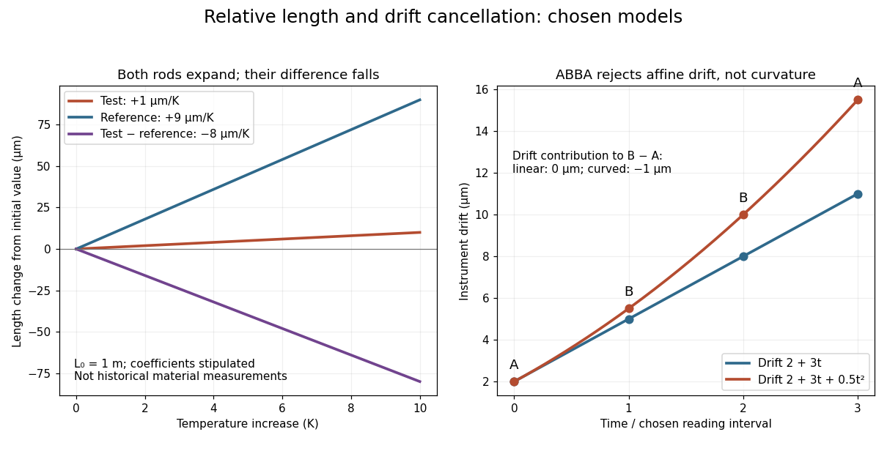

# Differential length comparator

↑ **Parent:** [Dimensional metrology](dimensional-metrology.md)

An instrument for comparing two [lengths](length.md) through their difference. Suppose a test rod and reference both have length $L_0$ at [temperature](temperature-split.md) $T_0$, and have constant [linear thermal expansion coefficients](linear-thermal-expansion-coefficient.md) $\alpha_s$ and $\alpha_r$ over a small interval. Their first-order models give

$$
L_s(T)=L_0[1+\alpha_s(T-T_0)],\qquad L_r(T)=L_0[1+\alpha_r(T-T_0)].
$$

For the observed difference $D(T)=L_s(T)-L_r(T)$, the [derivative](derivative.md) $b=dD/dT$ therefore determines

$$
\boxed{\alpha_s=\alpha_r+\frac{b}{L_0}}.
$$

The reference's independently calibrated [linear thermal expansion coefficient](linear-thermal-expansion-coefficient.md) is essential: the difference alone identifies $\alpha_s-\alpha_r$, not either coefficient separately.

For an original numerical example, stipulate $L_0=1.00\,\mathrm m$, $\alpha_s=1.0\times10^{-6}\,\mathrm{K^{-1}}$ and $\alpha_r=9.0\times10^{-6}\,\mathrm{K^{-1}}$. Heating both by $10\,\mathrm K$ gives sample and reference increases of $10\,\mu\mathrm m$ and $90\,\mu\mathrm m$. Thus **the sample expands even though its measured difference decreases** by $80\,\mu\mathrm m$. These are chosen model parameters, not measured values for a historical [Invar](invar.md) specimen or reference.

If $\alpha_r$ and $b$ have independent [standard uncertainties](standard-uncertainty.md) $0.2\times10^{-6}\,\mathrm{K^{-1}}$ and $0.3\,\mu\mathrm{m\,K^{-1}}$, and uncertainty in $L_0$ is negligible, [variance additivity for independent random variables](variance-additivity-for-independent-random-variables.md) gives

$$
u(\alpha_s)=\sqrt{u(\alpha_r)^2+\frac{u(b)^2}{L_0^2}}
\simeq0.36\times10^{-6}\,\mathrm{K^{-1}}.
$$

Repeating the difference measurement can reduce its random contribution; it does not remove uncertainty in the reference. A [temperature gradient](temperature-gradient.md) or unequal rod [temperatures](temperature-split.md) also breaks the common-temperature model and can introduce a [systematic error](systematic-error.md).

**[Figure 2](#image-chosen-rod-expansion-and-instrument-drift-models-a-negative-length-difference-need-not-imply-contraction). Chosen rod expansion and instrument drift models: a negative length difference need not imply contraction**.

**Table of contents**

- [ABBA measurement sequence](abba-measurement-sequence.md)

## ↑ Ancestors (4)

1. [Dimensional metrology](dimensional-metrology.md)
2. [Metrology](metrology.md)
3. [Physics](physics-split.md)
4. [Codex Wiki](split.md)

## ← Incoming links (2)

- [Dimensional metrology](dimensional-metrology.md)
- [Guillaume thermal expansion experiment](guillaume-thermal-expansion-experiment.md)
