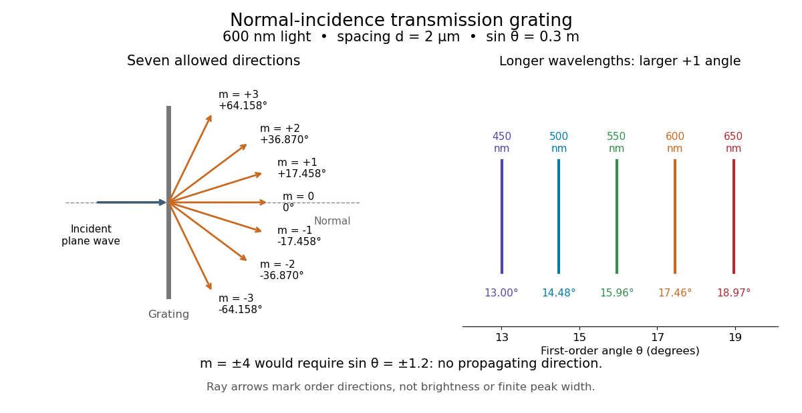

# Diffraction grating

↑ **Parent:** [Physical optics](physical-optics-split.md)  
ⓦ [Wiki](https://en.wikipedia.org/wiki/Diffraction_grating)

A diffraction grating is a periodic optical structure whose repeated slits or grooves direct [light](light.md) into [diffraction orders](diffraction-order.md) through [wave interference](interference-wave-propagation.md). Its beauty is that many individually broad contributions cooperate to select narrow directions: the spacing determines where the principal peaks occur, while the number of illuminated elements determines how sharply they are selected. This makes a [diffraction grating](diffraction-grating.md) useful in a [spectrometer](spectrometer.md), where separating [wavelengths](wavelength.md) spatially lets us examine an [optical spectrum](optical-spectrum.md). [MIT 6.007: Multiple-slit diffraction and spectrometer application, slides 5-6](https://ocw.mit.edu/courses/6-007-electromagnetic-energy-from-motors-to-lasers-spring-2011/4835d62777f42e82a40c319defcc80a6_MIT6_007S11_lec28.pdf).

Consider a transmission [diffraction grating](diffraction-grating.md) in air, illuminated at normal incidence by a [plane wave](plane-wave.md). Let $d$ be the centre-to-centre slit spacing, $\lambda$ the [wavelength](wavelength.md) in the surrounding medium, and $\theta$ the signed outgoing [angle](angle.md) from the forward normal. In [Fraunhofer diffraction](fraunhofer-diffraction.md), where observation directions specify the far-field pattern, adjacent contributions have path difference $d\sin\theta$ and [phase difference](phase-difference.md) $\delta=2\pi d\sin\theta/\lambda$. Their [wave amplitudes](wave-amplitude.md) reinforce whenever $\delta=2\pi m$, giving $d\sin\theta=m\lambda$. This normal-incidence geometry should be kept distinct from the incident and reflected [angle](angle.md) convention in the [grating equation](grating-equation.md) below. [MIT: Interference and diffraction, section 14.8](https://www.mit.edu/course/other/viz/EM/visualizations/notes/modules/guide14.pdf).

Angular colour separation follows immediately. At fixed nonzero [diffraction order](diffraction-order.md), increasing the [wavelength](wavelength.md) moves the peak farther from the normal. With $d=2\,\mathrm{\mu m}$, first-order [light](light.md) at $450\,\mathrm{nm}$ leaves at $13.003^\circ$, whereas $650\,\mathrm{nm}$ leaves at $18.966^\circ$: a separation of $5.963^\circ$. The zero [diffraction order](diffraction-order.md) stays at $0^\circ$ for both [wavelengths](wavelength.md). Thus [grating dispersion](grating-dispersion.md) comes from an orderly dependence of [wave interference](interference-wave-propagation.md) on [wavelength](wavelength.md), rather than an arbitrary assignment of colours to directions.

**[Figure 17](#image-normal-incidence-diffraction-orders-at-600-mathrm-nm-and-first-order-angular-colour-separation). Normal-incidence diffraction orders at $600\,\mathrm{nm}$ and first-order angular colour separation**.

For $N$ identical slits with uniform coherent illumination, meaning stable relative [wave phases](phase-waves.md) across the array, the normalized [wave interference](interference-wave-propagation.md) factor is

$$
F_N(\theta)=\left|\frac1N\sum_{j=0}^{N-1}e^{ij\delta}\right|^2=\left[\frac{\sin(N\delta/2)}{N\sin(\delta/2)}\right]^2,\qquad \delta=\frac{2\pi d\sin\theta}{\lambda}.
$$

The apparent $0/0$ at a principal peak has limiting value one. A short explanation uses the [geometric series](geometric-series.md): equal [wave phases](phase-waves.md) add $N$ equal [complex amplitudes](complex-amplitude.md); a small directional change distributes those contributions around the complex plane and allows cancellation. With each slit's contribution held fixed, peak [scalar wave intensity](scalar-wave-intensity.md) scales as $N^2$. The normalized plots remove that height change to make the narrowing visible. Stable relative [wave phases](phase-waves.md), or [optical coherence](optical-coherence.md), are essential; a sum of independent intensities would lose this array structure. [Richard Fitzpatrick, University of Texas: Multi-slit interference, equations 10.38-10.40](https://farside.ph.utexas.edu/teaching/315/Waveshtml/node93.html).

For finite slit width $a$, the ideal rectangular-slit model multiplies $F_N$ by a broad [single-slit diffraction](single-slit-diffraction.md) envelope:

$$
\frac{I(\theta)}{I(0)}=\left[\frac{\sin u}{u}\right]^2F_N(\theta),\qquad u=\frac{\pi a\sin\theta}{\lambda}.
$$

The [sinc function](sinc-function.md) factor, extended continuously at $u=0$, controls the brightness available to the narrow peaks. For example, $a=0.5\,\mathrm{\mu m}$ gives envelope values about $0.811$, $0.405$, and $0.090$ at [diffraction orders](diffraction-order.md) $1$, $2$, and $3$ in the $600\,\mathrm{nm}$ example. If an envelope zero coincides with an allowed [diffraction order](diffraction-order.md), that peak disappears. A permitted direction therefore need not produce a visible bright spot. [MIT: Single-slit envelope and absent interference maxima, sections 14.6-14.7](https://www.mit.edu/course/other/viz/EM/visualizations/notes/modules/guide14.pdf).

Historically, [Joseph von Fraunhofer](joseph-von-fraunhofer.md) used fine parallel wires stretched between threaded rods to make [diffraction gratings](diffraction-grating.md). Kenyon's historical apparatus account describes both this construction and a later reconstruction with visible [light](light.md). The example makes the governing idea tangible: regular spacing can turn a simple array of obstacles into an instrument for distinguishing [wavelengths](wavelength.md). [Thomas B. Greenslade Jr., Kenyon College: Diffraction grating](https://physics.kenyon.edu/EarlyApparatus/Optics/Diffraction_Grating/Diffraction_Grating.html).

**Table of contents**

- [Fixed-illumination grating peak change with slit width](fixed-illumination-grating-peak-change-with-slit-width.md)
- [First subsidiary maximum of a large slit array](first-subsidiary-maximum-of-a-large-slit-array.md)
- [First minimum of a finite slit array](first-minimum-of-a-finite-slit-array.md)
- [Pixel sampling of a grating spectrum](pixel-sampling-of-a-grating-spectrum.md)
- [Resolving power of a diffraction grating](resolving-power-of-a-diffraction-grating.md)
  - [Finite-grating incoherent doublet profile](finite-grating-incoherent-doublet-profile.md)
  - [Normal-incidence grating width bound](normal-incidence-grating-width-bound.md)
- [Diffraction order](diffraction-order.md)
  - [Missing diffraction order](missing-diffraction-order.md)
- [Grating equation](grating-equation.md)
  - [Diffraction-order feasibility](diffraction-order-feasibility.md)
  - [Grating dispersion](grating-dispersion.md)
  - [Anamorphic magnification of a grating](anamorphic-magnification-of-a-grating.md)
    - [Slit-limited resolving power of a grating](slit-limited-resolving-power-of-a-grating.md)
- [Littrow configuration](littrow-configuration.md)
- [Echelle grating](echelle-grating.md)

## ↑ Ancestors (5)

1. [Physical optics](physical-optics-split.md)
2. [Optics](optics-split.md)
3. [Branches of physics](branches-of-physics.md)
4. [Physics](physics-split.md)
5. [Codex Wiki](split.md)

## ← Incoming links (45)

- [4f pulse shaper](4f-pulse-shaper.md)
- [Adjacent-order spacing versus nearest-axis echelle interval](adjacent-order-spacing-versus-nearest-axis-echelle-interval.md)
- [Chirped pulse amplification](chirped-pulse-amplification.md)
- [Cross-disperser](cross-disperser.md)
- [Diffraction grating](diffraction-grating.md)
- [Diffraction order](diffraction-order.md)
- [Dirac comb](dirac-comb.md)
- [Discharge spectra and the Bohr model](discharge-spectra-and-the-bohr-model.md)
- [Fraunhofer diffraction](fraunhofer-diffraction.md)
- [Grating equation](grating-equation.md)
- [Grism](grism.md)
- [Holography](holography.md)
- [Integral-field spectrograph volume scaling](integral-field-spectrograph-volume-scaling.md)
- [Interference (wave propagation)](interference-wave-propagation.md)
- [Laser-diffraction measurement of capillary waves](laser-diffraction-measurement-of-capillary-waves.md)
- [Optical coherence](optical-coherence.md)
- [Solution](past-exam-of-the-mathematics-course-of-the-university-of-cambridge/2008/iii/paper-61/3/d/solution.md)
- [Solution](past-exam-of-the-mathematics-course-of-the-university-of-cambridge/2010/iii/paper-50/1/e/solution.md)
- [Solution](past-exam-of-the-mathematics-course-of-the-university-of-cambridge/2017/iii/paper-338/2/a/i/solution.md)
- [Solution](past-exam-of-the-mathematics-course-of-the-university-of-cambridge/2017/iii/paper-338/2/a/v/solution.md)
- [Solution](past-exam-of-the-mathematics-course-of-the-university-of-cambridge/2017/iii/paper-338/2/b/i/solution.md)
- [Solution](past-exam-of-the-mathematics-course-of-the-university-of-cambridge/2017/iii/paper-338/2/b/ii/solution.md)
- [Solution](past-exam-of-the-mathematics-course-of-the-university-of-cambridge/2018/iii/paper-338/2/a/i/solution.md)
- [Solution](past-exam-of-the-mathematics-course-of-the-university-of-cambridge/2018/iii/paper-338/2/a/ii/solution.md)
- [Solution](past-exam-of-the-mathematics-course-of-the-university-of-cambridge/2018/iii/paper-338/2/a/iv/solution.md)
- [Solution](past-exam-of-the-mathematics-course-of-the-university-of-cambridge/2018/iii/paper-338/2/a/v/solution.md)
- [Solution](past-exam-of-the-mathematics-course-of-the-university-of-cambridge/2019/iii/paper-338/3/d/ii/solution.md)
- [Solution](past-exam-of-the-physics-a-course-of-the-university-of-cambridge/2010/paper-1/section-d/d12/a/solution.md)
- [Solution](past-exam-of-the-physics-a-course-of-the-university-of-cambridge/2013/paper-2/section-d/d13/c/solution.md)
- [Second-order direction](past-exam-of-the-physics-a-course-of-the-university-of-cambridge/2017/paper-2/section-b/b8/second-order-direction.md)
- [Solution](past-exam-of-the-physics-a-course-of-the-university-of-cambridge/2018/paper-2/section-d/d13/a/solution.md)
- [Solution](past-exam-of-the-physics-a-course-of-the-university-of-cambridge/2019/paper-2/section-b/b6/d/solution.md)
- [Solution](past-exam-of-the-physics-a-course-of-the-university-of-cambridge/2022/paper-2/section-b/b7/d/solution.md)
- [Solution](past-exam-of-the-physics-course-of-the-year-1-of-the-natural-sciences-course-of-the-university-of-cambridge/2018/section-a/4/solution.md)
- [Solution](past-exam-of-the-physics-course-of-the-year-1-of-the-natural-sciences-course-of-the-university-of-cambridge/2021/section-a/4/solution.md)
- [Solution](past-exam-of-the-physics-course-of-the-year-1-of-the-natural-sciences-course-of-the-university-of-cambridge/2024/paper-1/section-a/4/solution.md)
- [Pixel sampling of a grating spectrum](pixel-sampling-of-a-grating-spectrum.md)
- [Polarization preparation and dephasing experiment](polarization-preparation-and-dephasing-experiment.md)
- [Single-slit diffraction](single-slit-diffraction.md)
- [Spectral phase in pulse compression](spectral-phase-in-pulse-compression.md)
- [Spectroscopic test of the Twin Quasar lens](spectroscopic-test-of-the-twin-quasar-lens.md)
- [Strickland-Mourou chirped pulse amplification experiment](strickland-mourou-chirped-pulse-amplification-experiment.md)
- [Ultraviolet](ultraviolet.md)
- [Zeeman discovery experiment of 1896](zeeman-discovery-experiment-of-1896.md)
- [Zernike's discovery of phase contrast](zernike-s-discovery-of-phase-contrast.md)
